# 判断推理 · 逻辑判断

> 考点编码：`PD-LJ`　｜　体系对齐：花生十三 `panduan-tuili.md#四`

## 一、命题规律

- **本题型真题总量**：1033 题（2000–2026）
- **地区分布**：国考 410 / 广东 435 / 湖北 188
- **近六年题量**：2026年56题, 2025年65题, 2024年55题, 2023年35题, 2022年66题, 2021年33题
- **覆盖试卷**：94 套
- **子考点分布**：逻辑判断（综合） 374　削弱 264　加强 193　翻译推理 80　前提假设 72　归纳推导 68
- **同题变体**：另有 139 道为同题重复（同年多卷/跨年再考），已折叠，需展开见 scripts/search.py --all-variants

## 二、近年真题（最多 12 题，按年份倒序）

### 2026 湖北·统一卷　第 96 题　（加强）

近年来,东海海域经常出现鲸搁浅现象,海洋学家推测是因为东海海岸线很长,而且这里拥有丰富的浮游生物 和鱼类资源,容易引鲸洄游至此,进而导致鲸搁浅的现象发生。 以下描写鲸搁浅的选项中,最能支持上述结论的是( )。

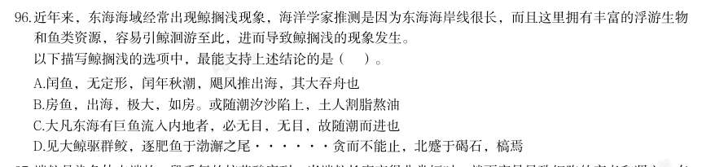

- **A.** 闰鱼,无定形,闰年秋潮,飓风推出海,其大吞舟也
- **B.** 房鱼,出海,极大,如房。或随潮汐沙陷上,土人割脂熬油
- **C.** 大凡东海有巨鱼流入内地者,必无目,无目,故随潮而进也
- **D.** 见大鲸驱群鲛,逐肥鱼于渤澥之尾······贪而不能止,北蹙于碣石,槁焉

**答案：D**

**解析/参考要点**：D
第一步:找出论点和论据。
论点:东海海岸线很长,且拥有丰富的浮游生物和鱼类资源,容易引鲸洄游至此,
进而导致鲸搁浅的现象发生。
论据:无。
本题只有论点,没有论据,加强优先考虑补充论据。
第二步:逐一分析选项。
A 项:该项翻译为:一种只在闰年出现的、形态不定的鱼(闰鱼),在闰年秋季
的大潮期间,被风暴推上海岸,其体型巨大到足以吞没船只。该项表明巨鱼是被
飓风推上岸的,与论点中“食物吸引洄游导致搁浅”无关,话题不一致,无法加
强,排除;
B 项:该项翻译为:房鱼,出现在海里,体型极大,如同房屋一般。有时会随着
潮汐搁浅在沙滩上,当地人便割取其脂肪来熬油。该项表明巨鱼因潮汐被困沙滩,
与论点中“食物吸引洄游导致搁浅”无关,话题不一致,无法加强,排除;
C 项:该项翻译为:凡是东海有巨大的鱼流入内陆水域的,必定没有眼睛,因为
没有眼睛,所以只能随着潮水进退。该项表明巨鱼因无目才随潮水进入内地搁浅,
与论点中“食物吸引洄游导致搁浅”无关,话题不一致,无法加强,排除;
D 项:该项翻译为:看到大鲸驱赶一群鲨鱼,追逐肥美的鱼群于渤海近海区
域······因为贪食无法停止,最终向北困于碣石一带,最终干涸搁浅。该
项表明鲸鱼是追逐食物(鱼类资源)而来,最终搁浅,补充论据,可以加强,当
选。
故正确答案为D。

### 2026 湖北·统一卷　第 97 题　（削弱）

端粒是染色体末端的一段重复的核苷酸序列。当端粒长度变得非常短时,就更容易导致细胞的衰老和凋亡。有 研究发现,每天每增加一杯速溶咖啡摄入量,端粒长度对应的等效年龄减少0.38年,因而速溶咖啡摄入量与端 粒长度呈负相关。不过,研究结果也显示,研磨咖啡摄入量与端粒长度的相关性没有统计学意义,不能证实研 磨咖啡也会减少端粒长度对应的等效年龄。该研究认为,饮用速溶咖啡会导致衰老,饮用研磨咖啡则不会,因 而后者更健康。 以下哪项如果为真,不能支持上述结论?

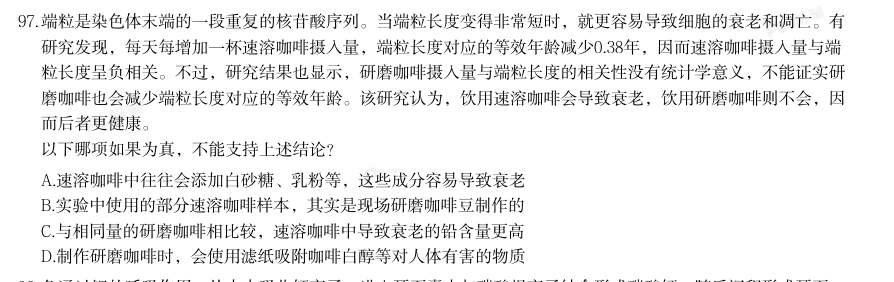

- **A.** 速溶咖啡中往往会添加白砂糖、乳粉等,这些成分容易导致衰老
- **B.** 实验中使用的部分速溶咖啡样本,其实是现场研磨咖啡豆制作的
- **C.** 与相同量的研磨咖啡相比较,速溶咖啡中导致衰老的铅含量更高
- **D.** 制作研磨咖啡时,会使用滤纸吸附咖啡白醇等对人体有害的物质

**答案：B**

**解析/参考要点**：B
第一步:找出论点和论据。
论点:饮用速溶咖啡会导致衰老,饮用研磨咖啡则不会,因而后者更健康。
论据:每天每增加一杯速溶咖啡摄入量,端粒长度对应的等效年龄减少0.38 年,
因而速溶咖啡摄入量与端粒长度呈负相关。不过,研究结果也显示,研磨咖啡摄
入量与端粒长度的相关性没有统计学意义,不能证实研磨咖啡也会减少端粒长度
对应的等效年龄。
本题论点与论据都在说饮用速溶咖啡会导致衰老,但饮用研磨咖啡则不会。论点
和论据话题一致,加强优先考虑补充论据,即解释原因或举例子,且本题为选非
题,将可以加强的选项排除即可。
第二步:逐一分析选项。
A 项:该项讨论的是速溶咖啡中往往会添加白砂糖、乳粉等,这些成分容易导致
衰老,解释了为什么饮用速溶咖啡会导致衰老,补充论据,可以加强,排除;
B 项:该项讨论的是实验中使用的部分速溶咖啡样本,其实是现场研磨咖啡豆制
作的,那么就不确定造成衰老的是否为速溶咖啡,说明实验不科学、不准确,可
以削弱,不能加强,当选;
C 项:该项讨论的是与相同量的研磨咖啡相比较,速溶咖啡中导致衰老的铅含量
更高,说明饮用速溶咖啡会导致衰老,饮用研磨咖啡则相较不会,补充论据,可
以加强,排除;
D 项:该项讨论的是制作研磨咖啡时,会使用滤纸吸附咖啡白醇等对人体有害的
物质,解释了为什么饮用研磨咖啡会更加健康,补充论据,可以加强,排除。
本题为选非题,故正确答案为B。

### 2026 湖北·统一卷　第 98 题　（削弱）
> 材料：鱼通过鳃的呼吸作用,从水中吸收钙离子,进入耳石囊内与碳酸根离子结合形成碳酸钙、随后沉积形成耳石, 它具有维持鱼身平衡及辅助听觉的作用。鱼耳石的日周轮、年轮和产卵轮等时间记号,记录了鱼类生长过程中 的环境信息。通过分析鱼耳石形态和化学组成等方式,我们可以了解鱼类生活史特征及其栖息环境的变化。…

以下哪项如果为真,最能加强上述论证?

- **A.** 许多鱼类的寿命可长达数十年之久
- **B.** 环境污染可能导致鱼停止生长甚至死亡
- **C.** 不同鱼类的耳石大小不同,难以据此判断鱼类的生长环境情况
- **D.** 相对于鳞片、鳍条,鱼耳石的形态结构和化学组成更稳定,保存时间更长

**答案：D**

**解析/参考要点**：D
第一步:找出论点和论据。
论点:通过分析鱼耳石形态和化学组成等方式,我们可以了解鱼类生活史特征及
其栖息环境的变化。
论据:鱼耳石的日周轮、年轮和产卵轮等时间记号,记录了鱼类生长过程中的环
境信息。
本题论点和论据均在讨论“分析鱼耳石有助于了解鱼类生活的环境”,二者话题
一致,加强可以考虑补充论据。
第二步:逐一分析选项。
A 项:该项说的是许多鱼类的寿命很长,而论点讨论的是分析鱼耳石有助于了解
鱼类生活的环境,话题不一致,不能加强,排除;
B 项:该项说的是环境污染对鱼的不良影响,而论点讨论的是分析鱼耳石有助于
了解鱼类生活的环境,话题不一致,不能加强,排除;
C 项:该项说的是根据耳石难以判断鱼类的生长环境,是对论点进行削弱,不能
加强,排除;
D 项:该项说的是鱼耳石形态结构和化学组成更稳定,保存时间更长,补充论据
说明鱼耳石在了解鱼类的生活史特征及其栖息环境的变化方面更有优势,可以加
强,当选。
故正确答案为D。

### 2026 湖北·统一卷　第 99 题　（削弱）

紫杉醇是治疗癌症的明星药物。紫杉醇通过作用于细胞内的微管蛋白,保持微管的稳定性来抑制细胞的有丝分 裂,控制癌细胞发展,从而达到治疗目的。香榧中含有紫杉醇,因此,有观点认为,多食用香榧可以治疗癌 症。 以下哪项如果为真,最能削弱上述结论?

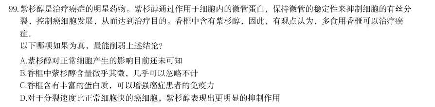

- **A.** 紫杉醇对正常细胞产生的影响目前还未可知
- **B.** 香榧中紫杉醇含量微乎其微,几乎可以忽略不计
- **C.** 香榧含有丰富的蛋白质,可以增强癌症患者的免疫力
- **D.** 对于分裂速度比正常细胞快的癌细胞,紫杉醇表现出更明显的抑制作用

**答案：B**

**解析/参考要点**：B
第一步:找出论点和论据。
论点:多食用香榧可以治疗癌症。
论据:香榧中含有紫杉醇,紫杉醇通过作用于细胞内的微管蛋白,保持微管的稳
定性来抑制细胞的有丝分裂,控制癌细胞发展,从而达到治疗目的。
本题论点在讨论“多食用香榧可以治疗癌症”,论据在讨论“香榧中的紫杉醇能
治疗癌症”,论点和论据话题不一致,削弱优先考虑拆桥,即拆断“食用香榧”
和“紫杉醇”之间的联系。
第二步:逐一分析选项。
A 项:该项指出“紫杉醇对正常细胞产生的影响目前还未可知”,而题干讨论的
是“紫杉醇对癌细胞的影响”,话题不一致,无法削弱,排除;
B 项:论点讨论的是“多食用香榧可以治疗癌症”,原因是“香榧中的紫杉醇能
治疗癌症”,该项指出“香榧中紫杉醇含量微乎其微,几乎可以忽略不计”,即
不能通过日常食用香榧取得治疗癌症的效果,断开了论点和论据之间的联系,为
拆桥项,可以削弱,当选;
C 项:该项指出“香榧可以增强癌症患者的免疫力”,但增强免疫力不等于可以
治疗癌症,话题不一致,无法削弱,排除;
D 项:该项指出“紫杉醇能抑制癌细胞”,补充论据,为加强项,无法削弱,排
除。
故正确答案为B。

### 2026 湖北·统一卷　第 100 题　（削弱）

一项关于离子通道Piezo2的介导性慢性疼痛超敏反应功能的研究表明,Piezo2是一个机械敏感通道,会在压力的 刺激下激活伤害性感受器,当Piezo2发生功能丧失型突变时,患者对轻微的触摸或振动不再敏感;当它发生功 能获得型突变时,患者通常被诊断为其它疾病。 以下哪项如果为真,最能削弱上述结论?

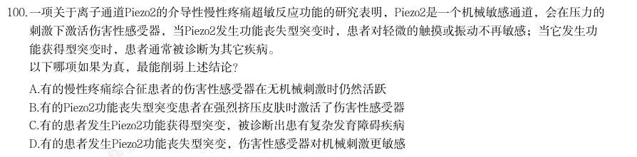

- **A.** 有的慢性疼痛综合征患者的伤害性感受器在无机械刺激时仍然活跃
- **B.** 有的Piezo2功能丧失型突变患者在强烈挤压皮肤时激活了伤害性感受器
- **C.** 有的患者发生Piezo2功能获得型突变,被诊断出患有复杂发育障碍疾病
- **D.** 有的患者发生Piezo2功能丧失型突变,伤害性感受器对机械刺激更敏感

**答案：D**

**解析/参考要点**：D
第一步:找出论点和论据。
论点:Piezo2 是一个机械敏感通道,会在压力的刺激下激活伤害性感受器,当
Piezo2 发生功能丧失型突变时,患者对轻微的触摸或振动不再敏感;当它发生
功能获得型突变时,患者通常被诊断为其它疾病。
论据:无。
本题论点讨论的是Piezo2 会在压力的刺激下激活伤害性感受器,并给出Piezo2
功能丧失型突变和功能获得型突变的两种表现。只有论点,没有论据,削弱优先
考虑削弱论点。
第二步:逐一分析选项。
A 项:该项指出有的慢性疼痛综合征患者伤害性感受器在“无机械刺激时”仍活
跃,而论点讨论的是Piezo2 通道在“压力刺激时”的表现,话题不一致,无法
削弱,排除;
B 项:该项指出有的Piezo2 功能丧失型突变患者在“强烈挤压皮肤时”激活了
伤害性感受器,但不明确其在“轻微的触摸或振动时”是否能激活伤害性感受器,
不明确选项,无法削弱,排除;
C 项:该项指出有的患者发生Piezo2 功能获得型突变,被诊断出患有复杂发育
障碍疾病,对论点中“发生功能获得型突变时,患者通常被诊断为其它疾病”进
行支持,具有一定加强力度,无法削弱,排除;
D 项:该项指出有的患者发生Piezo2 功能丧失型突变,伤害性感受器对机械刺
激更敏感,举例削弱论点中“Piezo2 发生功能丧失型突变时,患者对轻微的触
摸或振动不再敏感”,削弱论点,可以削弱,当选。
故正确答案为D。

### 2026 湖北·统一卷　第 101 题　（加强）

近日,考古学家发现了一块展示约1.25亿年前肉食性哺乳动物爬兽袭击较大植食性恐龙鹦鹉嘴龙的化石。化石 中,鹦鹉嘴龙呈卧姿态,后肢折叠在身体两侧;爬兽的身体向右盘绕,俯坐在鹦鹉嘴龙背侧,抓扒着猎物的下 巴并撕咬肋骨,其小腿则被鹦鹉嘴龙的后腿夹住。研究者认为,这一发现首次挑战了“恐龙在白垩纪期间几乎 没有受到同时代哺乳动物威胁”的观点。 以下哪项如果为真,最不能支持上述研究者的结论?

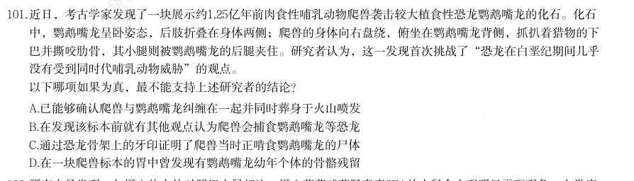

- **A.** 已能够确认爬兽与鹦鹉嘴龙纠缠在一起并同时葬身于火山喷发
- **B.** 在发现该标本前就有其他观点认为爬兽会捕食鹦鹉嘴龙等恐龙
- **C.** 通过恐龙骨架上的牙印证明了爬兽当时正啃食鹦鹉嘴龙的尸体
- **D.** 在一块爬兽标本的胃中曾发现有鹦鹉嘴龙幼年个体的骨骼残留

**答案：B**

**解析/参考要点**：B
第一步:找出论点和论据。
论点:这一发现首次挑战了“恐龙在白垩纪期间受到过同时代哺乳动物威胁”的
观点。
论据:考古学家发现了一块展示约1.25 亿年前肉食性哺乳动物爬兽袭击较大植
食性恐龙鹦鹉嘴龙的化石。化石中,鹦鹉嘴龙呈俯卧姿态,后肢折叠在身体两侧;
爬兽的身体向右盘绕,俯坐在鹦鹉嘴龙背侧,抓扒着猎物的下巴并撕咬肋骨,其
小腿则被鹦鹉嘴龙的后腿夹住。
从论据“化石显示二者身体纠缠在一起”到论点“恐龙受到过威胁”,注意身体
纠缠
威胁,所以论据到论点的推理是有漏洞的,可以补充论据填补漏洞,也
可以直接加强论点,且本题为选非题,排除可以加强的选项即可。
第二步:逐一分析选项。
A 项:该项指出能够确认爬兽与鹦鹉嘴龙纠缠在一起,论据讨论的也是二者在化
石中呈现的纠缠在一起的形态,所以该项的表述是对论据内容的重复,具有一定
的加强力度,可以加强,排除;
B 项:该项指出在发现该标本前就有其他观点认为爬兽会捕食恐龙,说明此次考
古研究并非“首次”发现恐龙在白垩纪期间受到过同时代哺乳动物威胁,直接削
弱论点,无法加强,当选;
C 项:该项指出可证明爬兽当时正啃食鹦鹉嘴龙的尸体,结合论据中“二者身体
纠缠在一起”的表述,说明在鹦鹉嘴龙死之前有和爬兽纠缠的过程,可体现出哺
乳动物对恐龙的威胁,可以加强,排除;
D 项:该项指出在爬兽标本的胃中发现有鹦鹉嘴龙幼年个体的骨骼残留,结合论
据中“二者身体纠缠在一起”的表述,说明爬兽对恐龙有威胁,可以加强,排除。
本题为选非题,故正确答案为B。

### 2026 湖北·统一卷　第 102 题　（归纳推导）

研究人员发现,与摄入盐水的对照组小鼠相比,摄入葡萄球菌肠毒素SEA的小鼠会出现明显干呕现象。人类癌 症患者使用化疗药物也会有类似的恶心和呕吐反应。研究显示,小鼠肠道内的SEA毒素激活了肠内壁的肠嗜铬 细胞,释放出血清素,血清素又与肠道的感觉神经元受体结合,将信号传递到脑干中的特定神经元从而引发干 呕,当特定神经元被灭活后,小鼠干呕显著减少。研究还发现,特定神经元被灭活后,其他动物的干呕也会显 著减少。 由此可以推出:

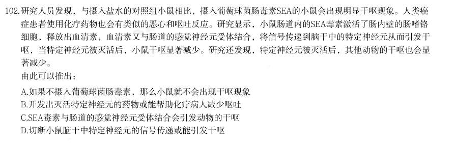

- **A.** 如果不摄入葡萄球菌肠毒素,那么小鼠就不会出现干呕现象
- **B.** 开发出灭活特定神经元的药物或能帮助化疗病人减少呕吐
- **C.** SEA毒素与肠道的感觉神经元受体结合会引发动物的干呕
- **D.** 切断小鼠脑干中特定神经元的信号传递或能引发干呕

**答案：B**

**解析/参考要点**：B
日常结论题,根据题干信息逐一分析选项。
A 项:题干指出“摄入葡萄球菌肠毒素SEA 的小鼠会出现明显干呕现象”,并未
提到不摄入葡萄球菌肠毒素的情况,无法推出,排除;
B 项:题干指出“人类癌症患者使用化疗药物也会有类似的恶心和呕吐反应”和
“当特定神经元被灭活后,小鼠干呕显著减少。研究还发现,特定神经元被灭活
后,其他动物的干呕也会显著减少”,说明灭活特定神经元能减少动物干呕,而
化疗呕吐与此相似,因此开发出灭活特定神经元的药物有可能帮助化疗病人减少
呕吐,可以推出,当选;
C 项:题干指出“小鼠肠道内的SEA 毒素激活了肠内壁的肠嗜铬细胞,释放出血
清素,血清素又与肠道的感觉神经元受体结合,将信号传递到脑干中的特定神经
元从而引发干呕”,说明与受体结合的是血清素,并非SEA 毒素,无法推出,排
除;
D 项:题干指出“当特定神经元被灭活后,小鼠干呕显著减少”,说明切断信号
传递能够减少干呕,而非引发干呕,无法推出,排除。
故正确答案为B。

### 2026 湖北·统一卷　第 103 题　（翻译推理）

青藏高原被誉为“亚洲水塔”,是全球气候变化敏感区和指示区。这里分布着地球海拔最高数量最多的高原湖 泊群,面积约占全国的百分之五十,对区域水循环、生态环境和气候调节具有重要意义。如果青藏高原降水增 加或者冰川加速消融,那么青藏高原的湖泊将会持续扩张,并且导致潜在的流域合并或重组,威胁到该地区的 基础设施和生态安全。由此可以推出:

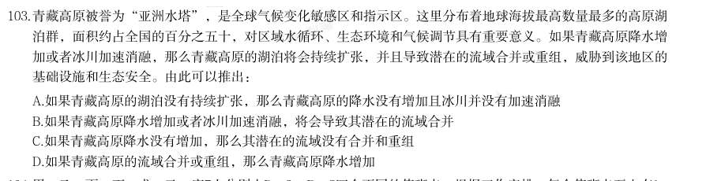

- **A.** 如果青藏高原的湖泊没有持续扩张,那么青藏高原的降水没有增加且冰川并没有加速消融
- **B.** 如果青藏高原降水增加或者冰川加速消融,将会导致其潜在的流域合并
- **C.** 如果青藏高原降水没有增加,那么其潜在的流域没有合并和重组
- **D.** 如果青藏高原的流域合并或重组,那么青藏高原降水增加

**答案：A**

**解析/参考要点**：A
第一步:翻译题干。
青藏高原降水增加或冰川加速消融
(青藏高原的湖泊将会持续扩张)且
(潜在的流域合并或重组)。
第二步:逐一分析选项。
A 项:翻译为:
青藏高原的湖泊将会持续扩张
青藏高原降水增加且
冰川加速消融,是否定题干箭头后“且关系”的一部分,否后必否前,可以推出,
当选;
B 项:翻译为:青藏高原降水增加或冰川加速消融
潜在的流域合并,是对
题干的肯前,肯前必肯后,应推出“潜在的流域合并或重组”,而非“潜在的
流域合并”,不能推出,排除;
C 项:翻译为:
青藏高原降水增加
潜在的流域合并和重组,是否定题干
箭头前“或关系”的一部分,不是否前,且否前得不到确定结论,不能推出,排
除;
D 项:翻译为:青藏高原的流域合并或重组
青藏高原降水增加,是肯定题
干箭头后“且关系”的一部分,不是肯后,且肯后得不到确定结论,不能推出,
排除。
故正确答案为A。

### 2026 湖北·统一卷　第 104 题　（翻译推理）

甲、乙、丙、丁、戊、己、庚7人分别去P、Q、R、S四个不同的值班点,根据工作安排,每个值班点至少有1 人,至多有3人;每个人只能去1个值班点;要求Q值班点有3人值班。同时,还需满足下列条件: (1)去R值班点的人数与去P值班点的人数一样 (2)如果甲、乙、丙中至多2人去Q值班点,那么只有丁去S值班点 (3)只有乙和庚去S值班点,丁或戊才不去S值班点 根据上述信息,下列哪项必然为真?

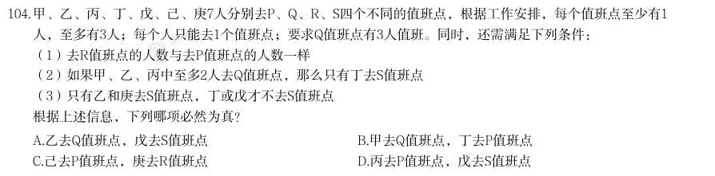

- **A.** 乙去Q值班点,戊去S值班点
- **B.** 甲去Q值班点,丁去P值班点
- **C.** 己去P值班点,庚去R值班点
- **D.** 丙去P值班点,戊去S值班点

**答案：A**

**解析/参考要点**：A
第一步:分析题干条件。
(1)甲、乙、丙、丁、戊、己、庚7 人去P、Q、R、S 四个值班点,每个值班点
至少有1 人,至多有3 人,每个人只能去1 个值班点,Q 值班点有3 人;
(2)R 值班点人数=P 值班点人数;
(3)甲、乙、丙至多2 人去Q 值班点
只有丁去S 值班点;
(4)丁或戊不去S 值班点
乙和庚去S 值班点。
第二步:根据题干条件进行推理。
由条件(1)(2)可确定各值班点的人数为Q 值班点3 人、S 值班点2 人、P 值
班点1 人、R 值班点1 人。S 值班点2 人是对条件(3)的否后,否后必否前,可
推知甲、乙、丙3 人均去Q 值班点。乙去Q 值班点,就不能再去S 值班点,是对
条件(4)的否后,否后必否前,可推知丁、戊均去S 值班点。己、庚的值班点
无法确定,只有A 项必然为真。
故正确答案为A。

### 2026 湖北·统一卷　第 105 题　（归纳推导）

小王把仙女座、猎户座、大熊座、人马座、狮子座五个星座在星空图上的位置用

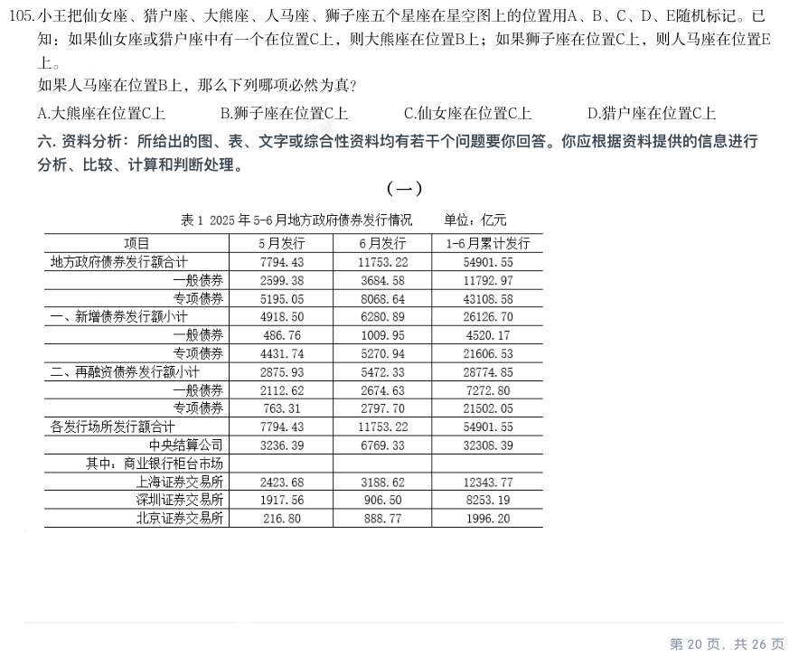

- **A.** 大熊座在位置C上
- **B.** 狮子座在位置C上
- **C.** 仙女座在位置C上
- **D.** 猎户座在位置C上

**答案：A**

**解析/参考要点**：A
第一步:翻译题干条件。
(1)仙女座在位置C 或猎户座在位置C
大熊座在位置B;
(2)狮子座在位置C
人马座在位置E;
(3)人马座在位置B。
第二步:根据题干条件进行推理。
根据条件(3)人马座在位置B,可知大熊座不在位置B,是对条件(1)的否后,
根据否后必否前,可以推出仙女座不在位置C 且猎户座不在位置C,排除C、D
两项;
根据条件(3)人马座在位置B,可知人马座不在位置E,是对条件(2)的否后,
根据否后必否前,可以推出狮子座不在位置C,排除B 项。
故正确答案为A。

### 2026 广东·统一卷　第 51 题　（翻译推理）

如果一座城市采用集约高效的发展方式,那么其资源消耗量必然会减少。只要这种减少速度非常缓慢,就不会 对城市经济发展造成负面影响。 由此可以推出:

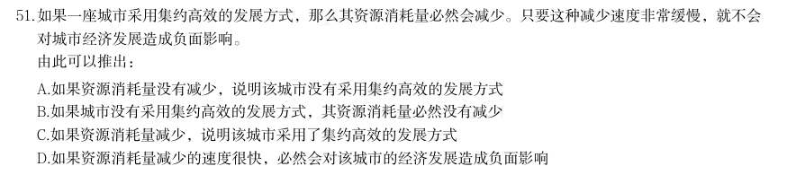

- **A.** 如果资源消耗量没有减少,说明该城市没有采用集约高效的发展方式
- **B.** 如果城市没有采用集约高效的发展方式,其资源消耗量必然没有减少
- **C.** 如果资源消耗量减少,说明该城市采用了集约高效的发展方式
- **D.** 如果资源消耗量减少的速度很快,必然会对该城市的经济发展造成负面影响

**答案：A**

**解析/参考要点**：答案A
第一步:翻译题干
1采用集约高效的发展方式→资源消耗量减少;
2减少速度缓慢→-对经济发展造成负面影响。
第二步:逐一分析选项。
A 项:该项翻译为“-资源消耗量减少->采用集约高效的发展方式”,是对1的否
否后必否前,可以推出,当选;后,
B 项:该项翻译为“-采用集约高效的发展资源消耗量减少”,是对1的否方式→
-前,否前得不到确定性的结论,不能推出,排除;
C 项:该项翻译为“资源消耗量减少→采用集约高效的发展方式”,是对1的肯
后,肯后得不到确定性的结论,不能推出,排
除;
D 项:该项翻译为“-减少速度缓慢→对经济发展造成负面影响”,是对2的否前,
否前得不到确定性的结论,不能推出,排除。故正确答案为A。

### 2026 广东·统一卷　第 52 题　（加强）

甘蔗是生产加工食糖的重要原料。近年来,世界范围内甘蔗种植面积不断扩大,在一定程度上改变了土地利用 的格局。由于全球食糖需求不断增长,有人因此认为,随着食糖的生产加工规模进一步扩大,甘蔗种植会进一 步改变土地利用的格局。 要使上述推论成立,需要补充的前提是( )。

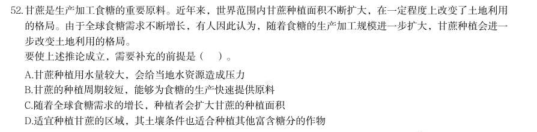

- **A.** 甘蔗种植用水量较大,会给当地水资源造成压力
- **B.** 甘蔗的种植周期较短,能够为食糖的生产快速提供原料
- **C.** 随着全球食糖需求的增长,种植者会扩大甘蔗的种植面积
- **D.** 适宜种植甘蔗的区域,其土壤条件也适合种植其他富含糖分的作物

**答案：C**

**解析/参考要点**：答案C
第一步:找出论点和论据。
论点:由于全球食糖需求不断增长,随着食糖的生产加工规模进一步扩大,甘蔗
种植会进一步改变土地利用的格局。
论据:近年来,世界范围内甘蔗种植面积不断扩大,在一定程度上改变了土地利
用的格局。
本题论点讨论的是“食糖需求”和“改变土地利用格局”之间的关系,论据讨论
的是“甘蔗种植面积”和“改变土地利用格局”之间的关系,二者话题不一致,
且提问方式为“前提”,加强优先搭桥,即建立“食糖需求”和“甘蔗种植面积”
之间的联系。
第二步:逐一分析选项,
A 项:该项指出甘蔗种植会给当地水资源造成压力,而论点说的是甘蔗种植会改
变士地利用格局,话题不一致,无法加强,排除,
B 项:该项指出甘蔗的种植周期短,能够为食糖的生产快速提供原料,而论点说
的是甘蔗种植会改变土地利用格局,话题不一致,无法加强,排除;
C 项:该项指出随着食糖需求增长,种植者会扩大甘蔗种植面积,建立了“食糖
需求”和“甘蔗种植面积”之间的联系,搭桥项,可以加强,当选;
D 项:该项指出适宜种甘蔗的土地也适合种植其他富含糖分的作物,而论点说的
是甘蔗种植会改变土地利用格局,话题不一致,无法加强,排除。
故正确答案为C。

## 三、其余真题（按年代分片）

| 年代 | 题量 | 分片文件 |
|---|---:|---|
| 2000s | 228 | [PD-LJ-2000s.md](split/PD-LJ-2000s.md) |
| 2010s | 432 | [PD-LJ-2010s.md](split/PD-LJ-2010s.md) |
| 2020s | 361 | [PD-LJ-2020s.md](split/PD-LJ-2020s.md) |

> 也可用 `python scripts/search.py --kaodian PD-LJ` 直接检索全部 1033 题。