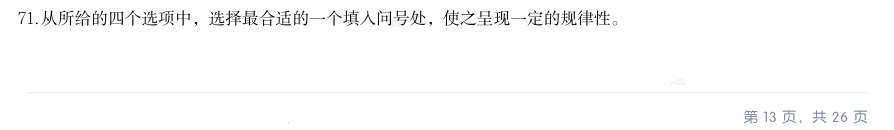
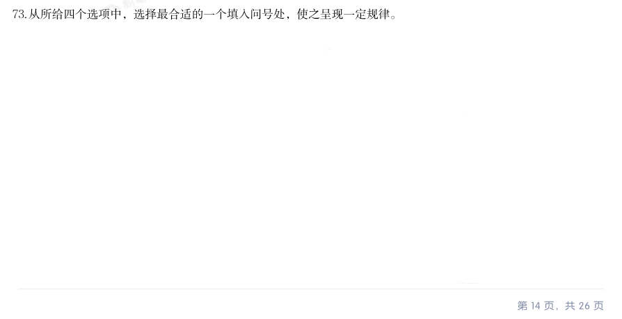
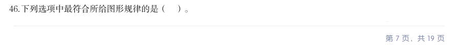
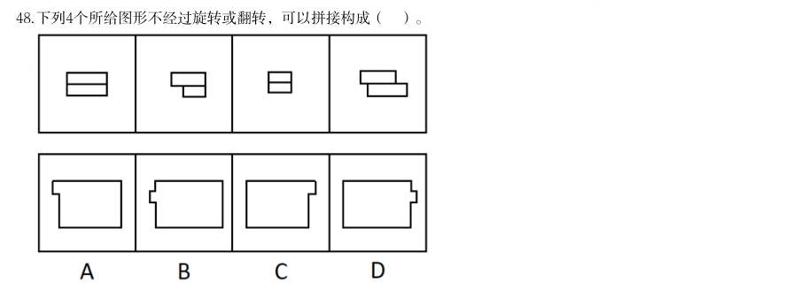

# 判断推理 · 图形推理

> 考点编码：`PD-TX`　｜　体系对齐：花生十三 `panduan-tuili.md#一`

## 一、命题规律

- **本题型真题总量**：807 题（2000–2026）
- **地区分布**：国考 417 / 广东 274 / 湖北 116
- **近六年题量**：2026年39题, 2025年39题, 2024年40题, 2023年30题, 2022年50题, 2021年33题
- **覆盖试卷**：92 套
- **子考点分布**：图形推理（待细分） 240　分组分类 131　位置规律 95　属性规律 71　数量规律 62　折纸盒 62
- **同题变体**：另有 14 道为同题重复（同年多卷/跨年再考），已折叠，需展开见 scripts/search.py --all-variants

## 二、近年真题（最多 12 题，按年份倒序）

### 2026 湖北·统一卷　第 71 题　（属性规律）
> 材料：个最恰当的答案。 从所给的四个选项中,选择最合适的一个填入问号处,使之呈现一定的规律性。…

从所给的四个选项中,选择最合适的一个填入问号处,使之呈现一定的规律性。

> （本题为图形题，选项为图片，见原卷）

**答案：B**

**解析/参考要点**：B
元素组成不同,且无明显属性规律,考虑数量规律。观察发现,题干图形出现明
显封闭区域,优先考虑数面。题干图形的面数量依次为10、9、8、?、6、5,
故“?”处图形的面数量应为7,只有B 项符合。
故正确答案为B。

### 2026 湖北·统一卷　第 72 题　（分组分类）

把下面的六个图形分为两类,使每一类图形都有各自的共同特征或规律,分类正确的一项是:

- **A.** 124,356
- **B.** 126,345
- **C.** 136,245
- **D.** 146,235

**答案：C**

**解析/参考要点**：C
本题为分组分类题目。元素组成相似,且相同元素“圆”重复出现,优先考虑样
式规律中的遍历。观察发现,图136中的圆均位于图形内部,图245中的圆
均位于图形外部,即图136为一组,图245为一组。
故正确答案为C。

### 2026 湖北·统一卷　第 73 题　（属性规律）

从所给四个选项中,选择最合适的一个填入问号处,使之呈现一定规律。

> （本题为图形题，选项为图片，见原卷）

**答案：A**

**解析/参考要点**：A
元素组成不同,且无明显属性规律,考虑数量规律。观察发现,题干图形线条交
叉明显,优先考虑交点数。第一行图形的交点数依次为1、2、3,第二行图形的
交点数依次为4、5、6,第三行图形的交点数依次为7、8、?,故?处应为9
个交点的图形,只有A 项符合。
故正确答案为A。

### 2026 湖北·统一卷　第 74 题　（折纸盒）

左图是一个带把手的立方体纸盒,右边哪项可能是其外表面展开图?

> （本题为图形题，选项为图片，见原卷）

**答案：B**

**解析/参考要点**：B
A 项:数字1 的面和数字4 的面为相对面,相对面不能同时出现,选项展开图与
题干立体图不一致,排除;
B 项:选项展开图与题干立体图一致,当选;
C 项:题干立体图中,数字4 的面和数字6 的面中的数字书写方向是一致的,而
选项中这两个面中的数字书写方向不一致,选项展开图与题干立体图不一致,排
除;
D 项:题干立体图中,数字4 的面和数字6 的面中的数字书写方向是一致的,而
选项中这两个面中的数字书写方向不一致,选项展开图与题干立体图不一致,排
除。
故正确答案为B。

### 2026 湖北·统一卷　第 75 题　（立体拼合）

从所给的四个选项中,选择最合适的一个填入问号处,使之呈现一定的规律性:

> （本题为图形题，选项为图片，见原卷）

**答案：B**

**解析/参考要点**：B
本题考查立体拼合。第一组图的图一由图二和图三拼合而成,第二组图的图一也
应由图二与“?”处图形拼合而成,对应B 项。
故正确答案为B。

### 2026 广东·统一卷　第 46 题　（图形推理（待细分））
> 材料：下列选项中最符合所给图形规律的是( )。…

下列选项中最符合所给图形规律的是( )。

> （本题为图形题，选项为图片，见原卷）

**答案：暂缺（原始文件为扫描版）**

**解析/参考要点**：答案A

### 2026 广东·统一卷　第 47 题　（属性规律）

下列选项中最符合所给图形规律的是( )。

> （本题为图形题，选项为图片，见原卷）

**答案：C**

**解析/参考要点**：答案C
元素组成不同,优先考虑属性规律。观察发现,题干出现全直线、全曲线图形,
考虑曲直性。九宫格优先看横行,第一行图形均为全直线图形,第二行图形均为
全曲线图形,第三行前两幅图形均为有曲有直图形,故“?"处图形应是有曲有直
图形,只有C 项符合
故正确答案为C。

### 2026 广东·统一卷　第 48 题　（立体拼合）

下列4个所给图形不经过旋转或翻转,可以拼接构成( )。

> （本题为图形题，选项为图片，见原卷）

**答案：暂缺（原始文件为扫描版）**

**解析/参考要点**：答案A

### 2026 广东·统一卷　第 49 题　（图形推理（待细分））

下列选项中最符合所给图形规律的是( )。

> （本题为图形题，选项为图片，见原卷）

**答案：暂缺（原始文件为扫描版）**

**解析/参考要点**：答案B

### 2026 国考·副省级　第 81 题　（位置规律）

从所给的四个选项中,选择最合适的一个填入问号处,使之呈现一定的规律性:

> （本题为图形题，选项为图片，见原卷）

**答案：A**

**解析/参考要点**：A
元素组成相同,优先考虑位置规律。题干图形出现十六宫格,可以优先考虑内外分开看。观察发现,题干图形
中黑色三角形均存在三个顶点,其中外圈的两个顶点在外圈依次逆时针平移一格,内圈的顶点在内圈依次逆时
针平移一格,故?处图形也应符合此规律,只有A 项符合。
故正确答案为A。

### 2026 国考·副省级　第 82 题　（属性规律）

从所给的四个选项中,选择最合适的一个填入问号处,使之呈现一定的规律性:

> （本题为图形题，选项为图片，见原卷）

**答案：D**

**解析/参考要点**：D
元素组成不同,且无明显属性规律,考虑数量规律。观察发现,题干图形均由不同形状小黑块连接而成,且黑
色块之间围成封闭面,考虑面数量。题干图形面数量依次为0、1、2、3、4,故?处图形面数量应为5,只有
D 项符合。
故正确答案为D。

### 2026 国考·副省级　第 83 题　（立体拼合）

从所给四个选项中,选择最合适的一个填入问号处,使之呈现一定的规律性:

> （本题为图形题，选项为图片，见原卷）

**答案：D**

**解析/参考要点**：D
元素组成不同,且每幅图均由几个图形拼接而成,考虑图形间关系。观察发现,题干图形均有一个黑块,黑块
与4 个白块共有4 条公共边,且与每个白块均存在1 条公共边,A 项黑块与白块共有5 条公共边,B 项黑块与
白块共有3 条公共边,C 项中黑块与右下角白块不存在公共边,排除A、B、C 三项,只有D 项符合。
故正确答案为D。

## 三、立体图形（折纸盒 / 三视图 / 截面 / 立体拼合）

| 子考点 | 题量 | 识别要点 | 代表真题 |
|---|---:|---|---|
| 折纸盒 | 62 | 纸盒外表面折叠 / 展开，六面体的相对面、相邻面 | `HB-2026-ty-X074`、`GK-2026-fs-X087`、`GK-2026-ds-X081` |
| 三视图 | 23 | 主视 / 俯视 / 左视，问「哪一项不可能是该多面体的视图」 | `GK-2026-fs-X086`、`GK-2026-ds-X080`、`GD-2025-ty-X046` |
| 截面 | 22 | 从任一面剖开 / 切割，问切口是什么形状 | `GK-2026-zf-X080`、`GK-2025-fs-X087`、`GK-2025-ds-X080` |
| 立体拼合 | 51 | 多面体拼合 / 拆分 / 组合，问「哪一项能填入问号处」 | `HB-2026-ty-X075`、`GD-2026-ty-X048`、`GK-2026-fs-X083` |
| 立体图形 | 22 | 立体图形总称，暂未细分到上面四类 | `GD-2025-ty-X050`、`GD-2023-xz-X048`、`GD-2023-xj-X043` |

> 立体图形子考点判定优先于「数量 / 位置 / 样式 / 属性规律」；检索：`python scripts/search.py --sub 折纸盒`。

## 四、其余真题（按年代分片）

| 年代 | 题量 | 分片文件 |
|---|---:|---|
| 2000s | 147 | [PD-TX-2000s.md](split/PD-TX-2000s.md) |
| 2010s | 372 | [PD-TX-2010s.md](split/PD-TX-2010s.md) |
| 2020s | 276 | [PD-TX-2020s.md](split/PD-TX-2020s.md) |

> 也可用 `python scripts/search.py --kaodian PD-TX` 直接检索全部 807 题。