# 判断推理 · 图形推理

> 考点编码：`PD-TX`　｜　体系对齐：花生十三 `panduan-tuili.md#一`

## 一、命题规律

- **本题型真题总量**：803 题（2000–2026）
- **地区分布**：国考 415 / 广东 268 / 湖北 120
- **近六年题量**：2026年32题, 2025年34题, 2024年40题, 2023年30题, 2022年51题, 2021年33题
- **覆盖试卷**：92 套
- **子考点分布**：图形推理（综合） 298　数量规律 198　位置规律 155　立体图形 80　样式规律 56　分组分类 26
- **同题变体**：另有 32 道为同题重复（同年多卷/跨年再考），已折叠，需展开见 scripts/search.py --all-variants

## 二、真题与答案（按年份倒序，最多 30 题）

### 2026 湖北·统一卷　第 72 题　（分组分类）

把下面的六个图形分为两类,使每一类图形都有各自的共同特征或规律,分类正确的一项是:

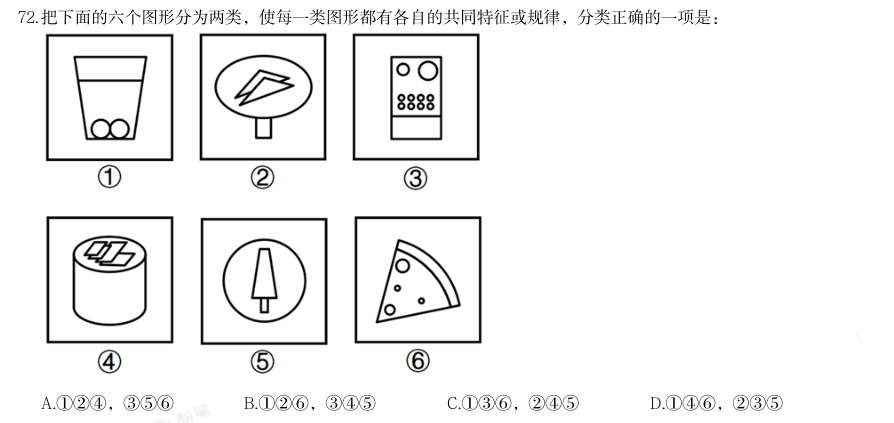

- **A.** 124,356
- **B.** 126,345
- **C.** 136,245
- **D.** 146,235

**答案：C**

**解析/参考要点**：C
本题为分组分类题目。元素组成相似,且相同元素“圆”重复出现,优先考虑样
式规律中的遍历。观察发现,图136中的圆均位于图形内部,图245中的圆
均位于图形外部,即图136为一组,图245为一组。
故正确答案为C。

### 2026 湖北·统一卷　第 74 题　（立体图形）

左图是一个带把手的立方体纸盒,右边哪项可能是其外表面展开图?

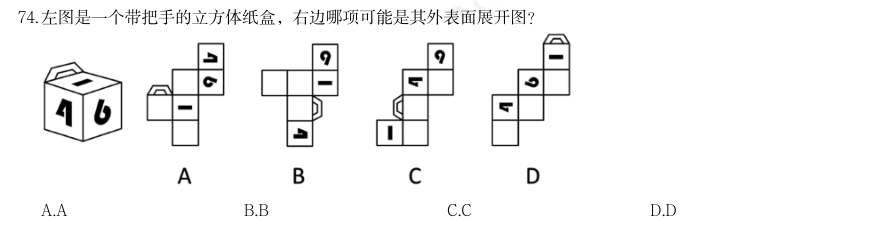

- **A.** A
- **B.** B
- **C.** C
- **D.** D

**答案：B**

**解析/参考要点**：B
A 项:数字1 的面和数字4 的面为相对面,相对面不能同时出现,选项展开图与
题干立体图不一致,排除;
B 项:选项展开图与题干立体图一致,当选;
C 项:题干立体图中,数字4 的面和数字6 的面中的数字书写方向是一致的,而
选项中这两个面中的数字书写方向不一致,选项展开图与题干立体图不一致,排
除;
D 项:题干立体图中,数字4 的面和数字6 的面中的数字书写方向是一致的,而
选项中这两个面中的数字书写方向不一致,选项展开图与题干立体图不一致,排
除。
故正确答案为B。

### 2026 湖北·统一卷　第 75 题　（立体图形）

从所给的四个选项中,选择最合适的一个填入问号处,使之呈现一定的规律性:

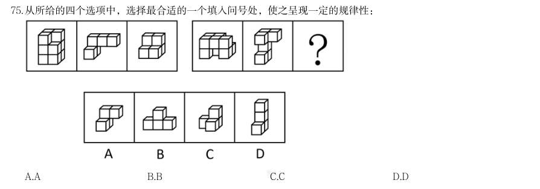

> （本题为图形题，选项为图片，见原卷）

**答案：B**

**解析/参考要点**：B
本题考查立体拼合。第一组图的图一由图二和图三拼合而成,第二组图的图一也
应由图二与“?”处图形拼合而成,对应B 项。
故正确答案为B。

### 2026 广东·统一卷　第 47 题　（属性规律）

下列选项中最符合所给图形规律的是( )。

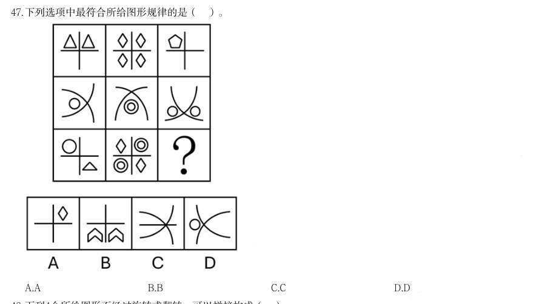

> （本题为图形题，选项为图片，见原卷）

**答案：C**

**解析/参考要点**：答案C
元素组成不同,优先考虑属性规律。观察发现,题干出现全直线、全曲线图形,
考虑曲直性。九宫格优先看横行,第一行图形均为全直线图形,第二行图形均为
全曲线图形,第三行前两幅图形均为有曲有直图形,故“?"处图形应是有曲有直
图形,只有C 项符合
故正确答案为C。

### 2026 广东·统一卷　第 49 题　（图形推理（综合））

下列选项中最符合所给图形规律的是( )。

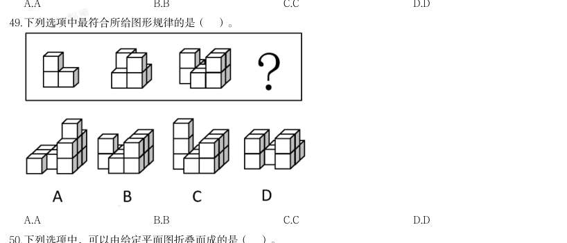

> （本题为图形题，选项为图片，见原卷）

**答案：暂缺（原始文件为扫描版）**

**解析/参考要点**：答案B

### 2026 国考·副省级　第 81 题　（位置规律）

从所给的四个选项中,选择最合适的一个填入问号处,使之呈现一定的规律性:

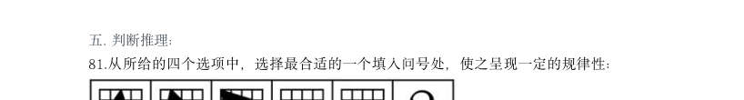

> （本题为图形题，选项为图片，见原卷）

**答案：A**

**解析/参考要点**：A
元素组成相同,优先考虑位置规律。题干图形出现十六宫格,可以优先考虑内外分开看。观察发现,题干图形
中黑色三角形均存在三个顶点,其中外圈的两个顶点在外圈依次逆时针平移一格,内圈的顶点在内圈依次逆时
针平移一格,故?处图形也应符合此规律,只有A 项符合。
故正确答案为A。

### 2026 国考·副省级　第 82 题　（数量规律）

从所给的四个选项中,选择最合适的一个填入问号处,使之呈现一定的规律性:

> （本题为图形题，选项为图片，见原卷）

**答案：D**

**解析/参考要点**：D
元素组成不同,且无明显属性规律,考虑数量规律。观察发现,题干图形均由不同形状小黑块连接而成,且黑
色块之间围成封闭面,考虑面数量。题干图形面数量依次为0、1、2、3、4,故?处图形面数量应为5,只有
D 项符合。
故正确答案为D。

### 2026 国考·副省级　第 83 题　（数量规律）

从所给四个选项中,选择最合适的一个填入问号处,使之呈现一定的规律性:

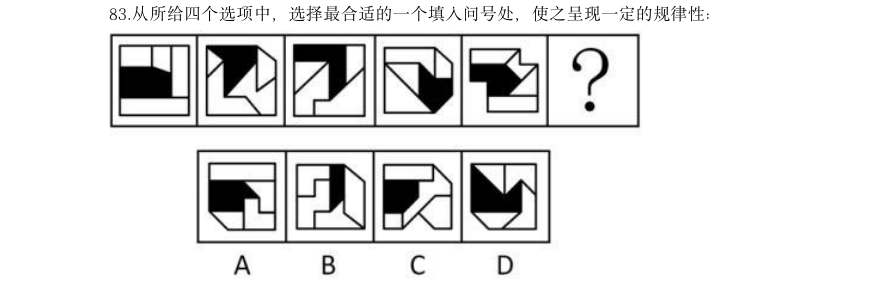

> （本题为图形题，选项为图片，见原卷）

**答案：D**

**解析/参考要点**：D
元素组成不同,且每幅图均由几个图形拼接而成,考虑图形间关系。观察发现,题干图形均有一个黑块,黑块
与4 个白块共有4 条公共边,且与每个白块均存在1 条公共边,A 项黑块与白块共有5 条公共边,B 项黑块与
白块共有3 条公共边,C 项中黑块与右下角白块不存在公共边,排除A、B、C 三项,只有D 项符合。
故正确答案为D。

### 2026 国考·副省级　第 84 题　（位置规律）

从所给的四个选项中,选择最合适的一个填入问号处,使之呈现一定的规律性:

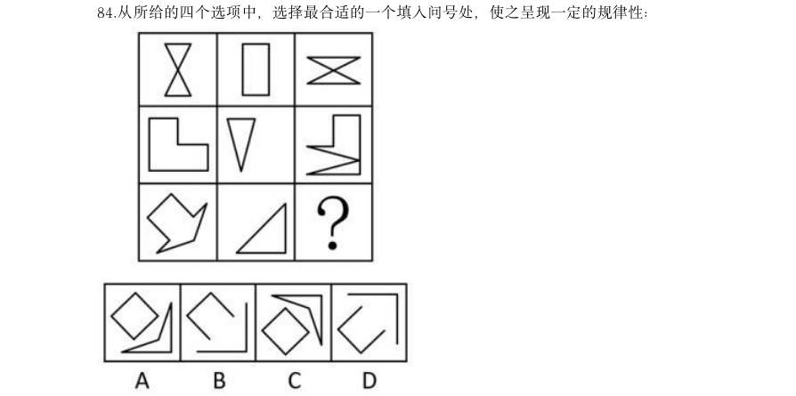

> （本题为图形题，选项为图片，见原卷）

**答案：C**

**解析/参考要点**：C 正确答案
未作答你的答案
76 %全站正确率
D 易错项
解析
元素组成相似,且有相同线条重复出现,优先考虑样式规律中的加减同异。九宫格优先看横行,观察发现,第
一行中,图1 和图2 先求异,再逆时针旋转90 度,即可得到图3;经验证,第二行满足此规律;第三行应用
此规律,只有C 项符合。
故正确答案为C。

### 2026 国考·副省级　第 85 题　（数量规律）

从所给的四个选项中,选择最合适的一个填入问号处,使之呈现一定的规律性:

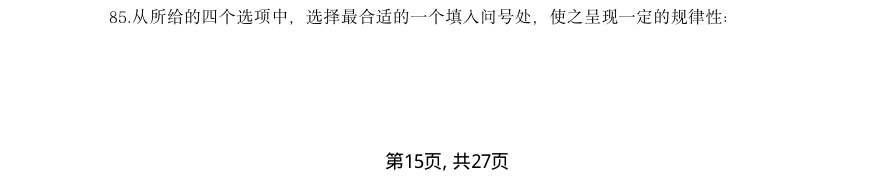

> （本题为图形题，选项为图片，见原卷）

**答案：B**

**解析/参考要点**：B
元素组成不同,优先考虑属性规律。观察发现,题干图形均由2 个图形组成,且出现等腰元素,考虑对称性,
题干均由1 个中心对称图形和1 个轴对称图形构成,排除D 项;继续观察发现,题干图形出现明显的多端点
图形,考虑笔画数,题干图形的笔画数均为3(1 个图形为一笔画图形,1 个图形为两笔画图形),故?处图
形的笔画数应为3,只有B 项符合。
故正确答案为B。

### 2026 国考·副省级　第 86 题　（立体图形）

左边为由15 个白色正方体和3 个黑色正方体组合而成的多面体俯视图和左视图,其正视图 可能是:

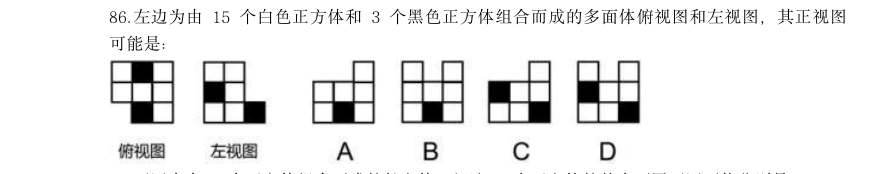

> （本题为图形题，选项为图片，见原卷）

**答案：B**

**解析/参考要点**：B
本题考查三视图。俯视图中间一列最下方为黑色正方形,则对应正视图中间一列最下方为黑色正方形,排除C、
D 两项。俯视图、左视图结合选项主视图可以确定立体图形,逐一分析A、B 选项。
A 项:如果A 项为正视图,结合题干左视图,确定立体图形如下图所示,和题干俯视图不一致,且此时小正方
体个数共为16 个,与题干所给小正方体个数(15 白+3 黑)不一致,排除;
B 项:结合题干两个视图和B 项,确定立体图形如下图所示(注意底层是7 个白色块),立体图形有15 个白
色块和3 个黑色块,符合题干要求。
故正确答案为B。

### 2026 国考·副省级　第 87 题　（立体图形）

下图为由2 个正方体组合而成的长方体,问这2 个正方体的外表面展开图可能分别是:

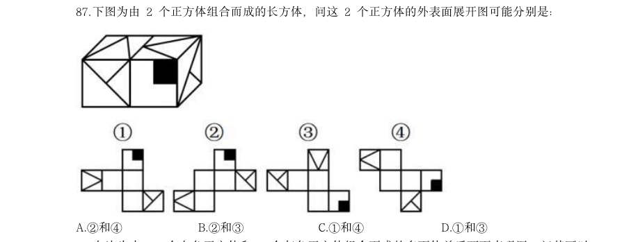

- **A.** 2和4
- **B.** 2和3
- **C.** 1和4
- **D.** 1和3

**答案：D**

**解析/参考要点**：D
将题干2 个正方体的面标上字母序号,并在立体图形和外表面展开图的“T”字形面(面e 和面g)中以“T”
字形中线端点为起始点,顺时针描边标号,如下图所示。
图1中,标出“T 字形”面中对应的边2 和边3 后发现,二者与题干右侧正方体中面g 的边2 和边3 对应一致,
故图1可能是题干右侧正方体的外表面展开图;
图2中,标出“T 字形”面中对应的边2 和边3 后发现,二者与题干右侧正方体中面g 的边2 和边3 对应不一
致,故图2不可能是题干右侧正方体的外表面展开图,标出“T 字形”面中对应的边4 后发现,与题干左侧正
方体中面e 的边4 对应不一致,故图2不可能是题干左侧正方体的外表面展开图;
图3中,标出“T 字形”面中对应的边4 后发现,该公共边与题干左侧正方体中面e 的边4 对应一致,故图3
可能是题干左侧正方体的外表面展开图;
图4中,标出“T 字形”面中对应的边2 和边3 后发现,二者与题干右侧正方体中面g 的边2 和边3 对应不一
致,故图4不可能是题干右侧正方体的外表面展开图,标出“T 字形”面中对应的边4 后发现,与题干左侧正
方体中面e 的边4 对应不一致,故图4不可能是题干左侧正方体的外表面展开图。
综上,2 个正方体的外表面展开图可能是1和3,对应D 项。
故正确答案为D。

### 2026 国考·副省级　第 88 题　（位置规律）

左边为由12 个白色正方体和3 个灰色正方体组合而成的多面体前后两面直观图,问其可以 由除哪项外的三个多面体组合而成?

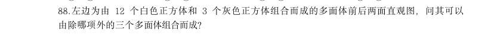

> （本题为图形题，选项为图片，见原卷）

**答案：B**

**解析/参考要点**：B
本题考查立体拼合。题干立体图形可以由A、C、D 三项旋转后拼合而成,具体过程如下图所示:
本题为选非题,故正确答案为B。

### 2026 国考·副省级　第 89 题　（数量规律）

把下面的六个图形分为两类,使每一类图形都有各自的共同特征或规律,分类正确的一项是:

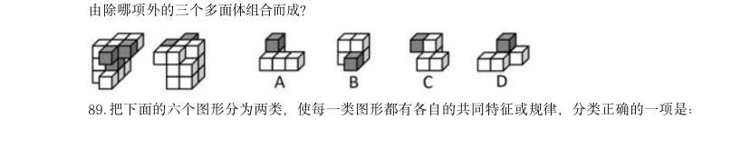

- **A.** 126,345
- **B.** 124,356
- **C.** 156,234
- **D.** 146,235

**答案：B**

**解析/参考要点**：B
元素组成不同,且无明显属性规律,优先考虑数量规律。观察发现,题干每幅图中均存在一个黑色面和四个白
色面,但根据面的数量无法分组分类,故考虑面的细化。再次观察发现,每幅图中均有1-2 个白色面形状与黑
色面形状相同,故考虑相同形状的面,图124中黑色面的形状与2 个白色面形状一致,图356中黑色面的
形状与1 个白色面形状一致,故图124为一组,图356为一组。
故正确答案为B。

### 2026 国考·副省级　第 90 题　（位置规律）

把下面的六个图形分为两类,使每一类图形都有各自的共同特征或规律,分类正确的一项是:

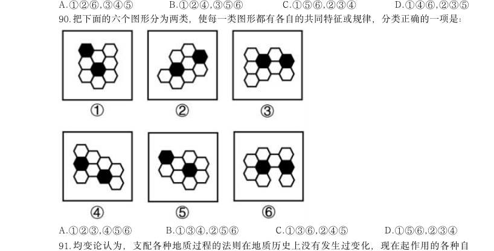

- **A.** 123,456
- **B.** 134,256
- **C.** 136,245
- **D.** 156,234

**答案：C**

**解析/参考要点**：C
本题为分组分类题目。元素组成相同,但无明显位置规律。观察发现,题干图形均出现两个黑块,且图136
中两个黑块均通过一条线连接,图245中两个黑块均通过一个面连接,即图136为一组,图245为一组。
故正确答案为C。

### 2026 国考·地市级　第 77 题　（数量规律）

从所给的四个选项中,选择最合适的一个填入问号处,使之呈现一定的规律性:

> （本题为图形题，选项为图片，见原卷）

**答案：D**

**解析/参考要点**：D
元素组成不同,且无明显属性规律,考虑数量规律。观察发现,题干每幅图形均分为2 个部分,且其中一
个部分有1 个黑球,另一个部分有2 个黑球,只有D 项符合规律。
故正确答案为D。

### 2026 国考·地市级　第 78 题　（数量规律）

从所给的四个选项中,选择最合适的一个填入问号处,使之呈现一定的规律性:

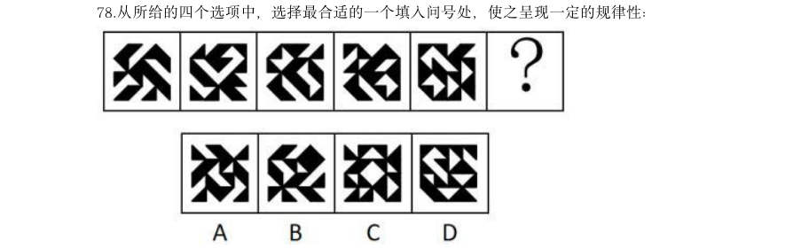

> （本题为图形题，选项为图片，见原卷）

**答案：D**

**解析/参考要点**：D
元素组成不同,且无明显属性规律,考虑数量规律。观察发现,题干图形均由不同形状小黑块连接而成,
且黑色块之间围成封闭面,考虑面数量。题干图形面数量依次为0、1、2、3、4,故?处图形面数量应为
5,只有D 项符合。
故正确答案为D。

### 2026 国考·地市级　第 79 题　（位置规律）

从所给的四个选项中,选择最合适的一个填入问号处,使之呈现一定的规律性:

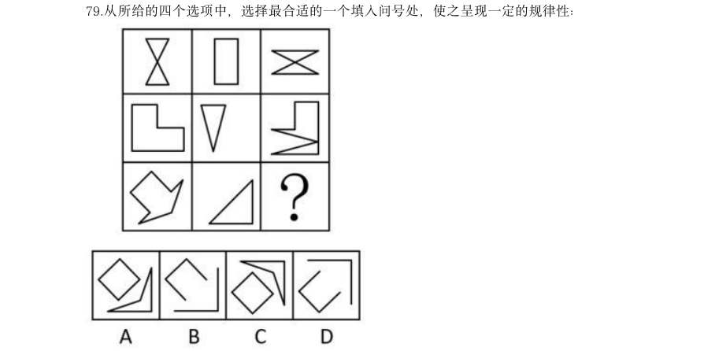

> （本题为图形题，选项为图片，见原卷）

**答案：C**

**解析/参考要点**：C
元素组成相似,且有相同线条重复出现,优先考虑样式规律中的加减同异。九宫格优先看横行,观察发现,
第一行中,图1 和图2 先求异,再逆时针旋转90 度,即可得到图3;经验证,第二行满足此规律;第三行
应用此规律,只有C 项符合。
故正确答案为C。

### 2026 国考·地市级　第 81 题　（立体图形）

左边为给定的正方体纸盒的外表面展开图,由2 个该正方体纸盒组合而成的长方体可能是:

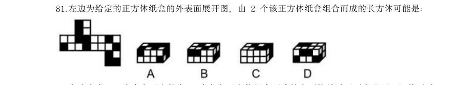

> （本题为图形题，选项为图片，见原卷）

**答案：A**

**解析/参考要点**：A
将原展开图标上序号如下图,逐一进行分析。
A 项:选项中左侧正方体纸盒由面f 和面i 构成,右侧正方体纸盒由面f、面g 和面k 构成,选项与题干展
开图一致,当选;
B 项:选项中右侧正方体纸盒由面e、面h 和面i 构成,题干展开图中三个面的公共点与面i 上黑块的顶点
重合,而选项中三个面的公共点与面i 上的黑块不相交,选项与题干展开图不一致,排除;
C 项:选项中左侧正方形纸盒由面f 和面h 构成,题干展开图中面f 和面h 为相对面,不能同时出现,选
项与题干展开图不一致,排除;
D 项:选项中右侧正方形纸盒由面f、面h 和面i 构成,题干展开图中面f 和面h 为相对面,不能同时出现,
选项与题干展开图不一致,排除。
故正确答案为A。

### 2026 国考·地市级　第 83 题　（位置规律）

把下面的六个图形分为两类,使每一类图形都有各自的共同特征或规律,分类正确的一项是:

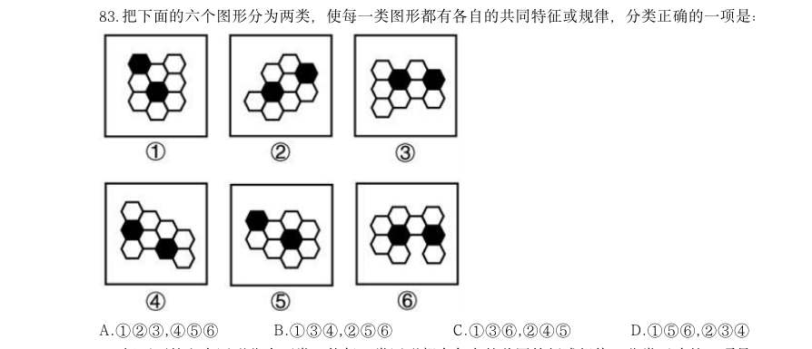

- **A.** 123,456
- **B.** 134,256
- **C.** 136,245
- **D.** 156,234

**答案：C**

**解析/参考要点**：C
本题为分组分类题目。元素组成相同,但无明显位置规律。观察发现,题干图形均出现两个黑块,且图1
36中两个黑块均通过一条线连接,图245中两个黑块均通过一个面连接,即图136为一组,图24
5为一组。
故正确答案为C。

### 2026 国考·地市级　第 84 题　（数量规律）

把下面的六个图形分为两类,使每一类图形都有各自的共同特征或规律,分类正确的一项是:

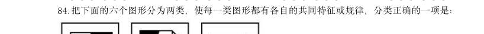

- **A.** 126,345
- **B.** 124,356
- **C.** 156,234
- **D.** 146,235

**答案：B**

**解析/参考要点**：B
元素组成不同,且无明显属性规律,优先考虑数量规律。观察发现,题干每幅图中均存在一个黑色面和四
个白色面,但根据面的数量无法分组分类,故考虑面的细化。再次观察发现,每幅图中均有1-2 个白色面
形状与黑色面形状相同,故考虑相同形状的面,图124中黑色面的形状与2 个白色面形状一致,图35
6中黑色面的形状与1 个白色面形状一致,故图124为一组,图356为一组。
故正确答案为B。

### 2026 国考·地市级　第 85 题　（位置规律）

把下面6 个图形分为两类,使每一类图形都有各自的共同特征或规律,分类正确的一项是:

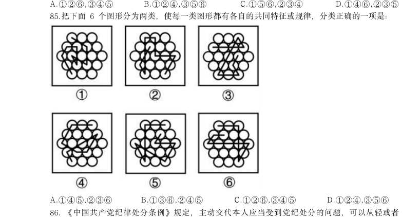

- **A.** 145,236
- **B.** 136,245
- **C.** 126,345
- **D.** 124,356

**答案：A**

**解析/参考要点**：A
题干图形均由正六边形宫格及若干线条组成,且线条之间都存在一个十字交叉点,观察十字交叉点的位置,
图145中十字交叉点位于白球外部,图236中十字交叉点位于白球内部,故图145为一组,图23
6为一组,只有A 项符合。
故正确答案为A。

### 2026 国考·地市级　第 92 题　（图形推理（综合））
> 材料：自主动机是指人们出于兴趣或内在满足感而从事某种活动,外部动机是指人们为获得外部奖 励或避免惩罚而从事某种活动,这些动机背后的心理需求又分为三种:(1)自主性需求,即人 们希望自己能控制和选择自己的行为,而不是受到外部强制;(2)胜任性需求,即人们希望能 在自己做的事上获得成就感和自我效能感; A.善本:版 (3)归属感需求,即人们希望与他人建立有意义的联系,感受到归属和支持。…

根据上述定义,下列说法错误的是:

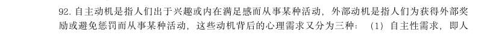

> （本题为图形题，选项为图片，见原卷）

**答案：B**

**解析/参考要点**：B
第一步:找出定义关键词。
自主动机:“出于兴趣或内在满足感”、“从事某种活动”;
外部动机:“为获得外部奖励或避免惩罚”、“从事某种活动”;
自主性需求:“希望自己能控制和选择自己的行为,而不是受到外部强制”;
胜任性需求:“希望能在自己做的事上获得成就感和自我效能感”;
归属感需求:“希望与他人建立有意义的联系,感受到归属和支持”。
第二步:逐一分析选项。
A 项:小张参加了一项感兴趣的社交活动,符合“出于兴趣或内在满足感”、“从事某种活动”,体现了
自主动机;他认为这能帮助自己结交新朋友,符合“希望与他人建立有意义的联系,感受到归属和支持”,
体现了归属感需求,说法正确,排除;
B 项:小李担心不参加被扣绩效,符合“为获得外部奖励或避免惩罚”、“从事某种活动”,体现了外部
动机;但小李担心如果不参加就会被扣绩效,说明其受到外部约束,不符合“希望自己能控制和选择自己
的行为,而不是受到外部强制”,没有体现自主性需求,说法错误,当选;
C 项:小王每天晨跑,很享受锻炼带来的满足感,符合“出于兴趣或内在满足感”、“从事某种活动”,
体现了自主动机;他坚信这是促进健康的必要努力,符合“希望能在自己做的事上获得成就感和自我效能
感”,体现了胜任性需求,说法正确,排除;
D 项:小陈和队友为实现团体奖牌零的突破而努力,追求的是成就感,符合“希望能在自己做的事上获得
成就感和自我效能感”,体现了胜任性需求;他与队友相互鼓励,符合“希望与他人建立有意义的联系,
感受到归属和支持”,体现了归属感需求,说法正确,排除。
本题为选非题,故正确答案为B。

### 2026 国考·地市级　第 96 题　（数量规律）

与“经年:积岁”在逻辑关系上最相近的是: 本 B.秘方:偏方 C.仲夏:夏季 D.黎民:百姓

> （本题为图形题，选项为图片，见原卷）

**答案：D**

**解析/参考要点**：D
第一步:判断题干词语间逻辑关系。
“经年”指经过一年或若干年,“积岁”指累积多年,二者均可指经过多年,为近义关系。
第二步:判断选项词语间逻辑关系。
A 项:“善本”指古代书籍中文字讹误较少、学术或艺术价值上比一般本子优异的刻本或写本,“版本”
指同一部书因编辑、传抄、刻版、排版或装订形式等的不同而产生的不同的本子,“善本”是“版本”的
一种类型,二者不是近义关系,与题干逻辑关系不一致,排除;
B 项:“秘方”指不公开的有显著医疗效果的药方,“偏方”指民间流传不见于古典医学著作的中药方,
前者从是否公开角度划分,后者从是否正规角度划分,二者为交叉关系,与题干逻辑关系不一致,排除;
C 项:“仲夏”指夏季的第二个月,是“夏季”的一部分,二者为组成关系,与题干逻辑关系不一致,排
除;
D 项:“黎民”指平民、民众,“百姓”指军人和官员以外的人,二者均可指普通民众,为近义关系,与
题干逻辑关系一致,当选。
故正确答案为D。

### 2026 国考·行政执法　第 76 题　（数量规律）
> 材料：项中选出一个最恰当的答案.…

从所给的四个选项中,选择最合适的一个填入问号处,使之呈现一定的规律性:

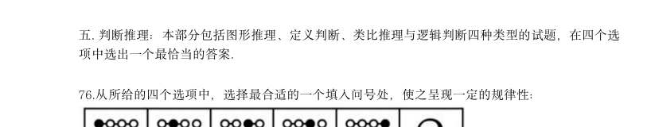

> （本题为图形题，选项为图片，见原卷）

**答案：D**

**解析/参考要点**：D
元素组成不同,且无明显属性规律,考虑数量规律。观察发现,题干每幅图形均分为2 个部分,且其中一
个部分有1 个黑球,另一个部分有2 个黑球,只有D 项符合规律。
故正确答案为D。

### 2026 国考·行政执法　第 77 题　（位置规律）

从所给的四个选项中,选择最合适的一个填入问号处,使之呈现一定的规律性:

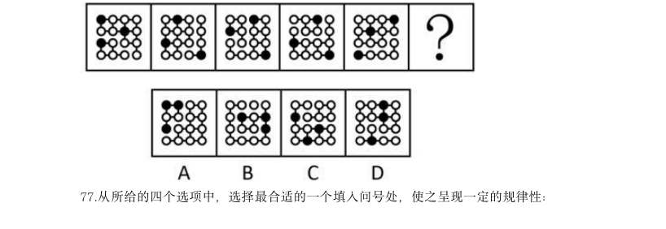

> （本题为图形题，选项为图片，见原卷）

**答案：A**

**解析/参考要点**：A
元素组成相同,优先考虑位置规律。题干图形出现十六宫格,可以优先考虑内外分开看。观察发现,题干
图形中黑色三角形均存在三个顶点,其中外圈的两个顶点在外圈依次逆时针平移一格,内圈的顶点在内圈
依次逆时针平移一格,故?处图形也应符合此规律,只有A 项符合。
故正确答案为A。

### 2026 国考·行政执法　第 78 题　（数量规律）

从所给的四个选项中,选择最合适的一个填入问号处,使之呈现一定的规律性:

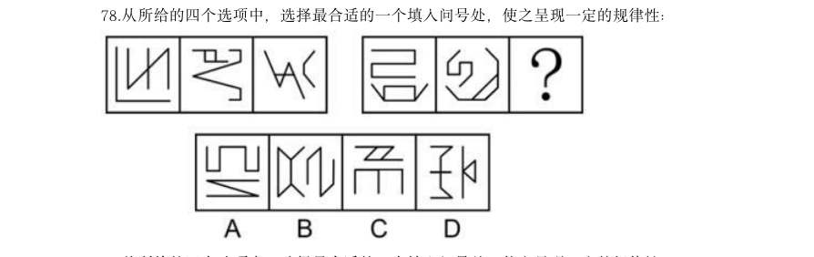

> （本题为图形题，选项为图片，见原卷）

**答案：B**

**解析/参考要点**：B
元素组成不同,优先考虑属性规律。观察发现,题干图形均由2 个图形组成,且出现等腰元素,考虑对称
性,题干均由1 个中心对称图形和1 个轴对称图形构成,排除D 项;继续观察发现,题干图形出现明显的
多端点图形,考虑笔画数,题干图形的笔画数均为3(1 个图形为一笔画图形,1 个图形为两笔画图形),
故?处图形的笔画数应为3,只有B 项符合。
故正确答案为B。

### 2026 国考·行政执法　第 79 题　（样式规律）

从所给的四个选项中,选择最合适的一个填入问号处,使之呈现一定的规律性:

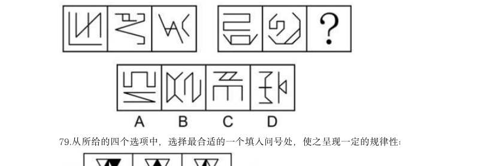

> （本题为图形题，选项为图片，见原卷）

**答案：C**

**解析/参考要点**：C
元素组成相似,优先考虑样式规律。观察发现,九宫格每行图形轮廓和分割区域相同,优先考虑黑白运算。
第一行图形的运算规律为:白+黑=白,白+白=白,黑+白=白,黑+黑=黑;经验证,第二行图形符合此规
律;第三行图形应用此规律,只有C 项符合。
故正确答案为C。

### 2026 国考·行政执法　第 80 题　（立体图形）

左边为给定的多面体,现用经P、Q、R 三点的平面对其进行切割,切面为:

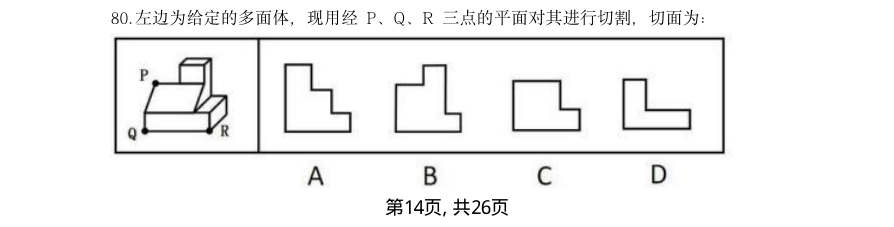

> （本题为图形题，选项为图片，见原卷）

**答案：B**

**解析/参考要点**：B
本题考查截面图。根据平面公理“过不在一条直线上的三点,有且只有一个平面”可以得出,经过P、Q、
R 三点可以确定唯一的切面(即截面),即为B 项,如下图所示:
故正确答案为B。

### 2026 国考·行政执法　第 83 题　（位置规律）

把下面的六个图形分为两类,使每一类图形都有各自的共同特征或规律,分类正确的一项是:

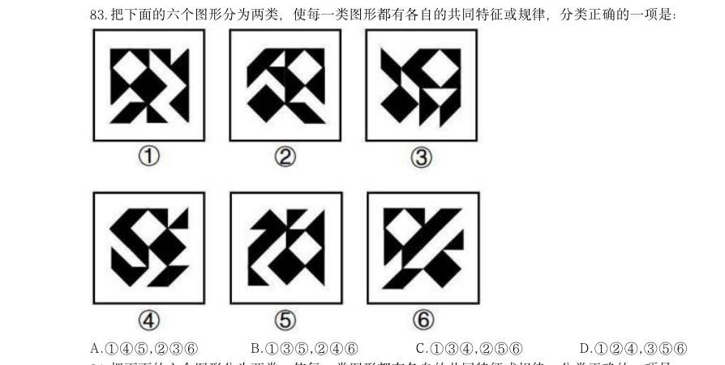

- **A.** 145,236
- **B.** 135,246
- **C.** 134,256
- **D.** 124,356

**答案：A**

**解析/参考要点**：A
本题为分组分类题目。元素组成相同,但整体看没有明显的位置规律。观察发现,题干每幅图中均有一个
黑菱形和一个白菱形,且图145中的黑菱形和白菱形相交于线,图236中的黑菱形和白菱形不相交。
故图145为一组,图236为一组。
故正确答案为A。
