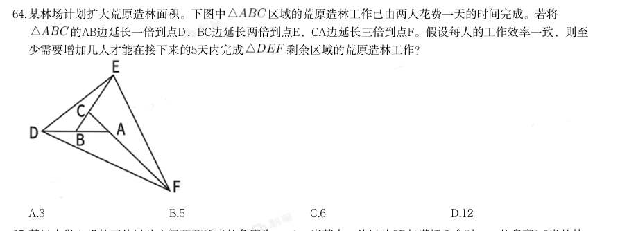
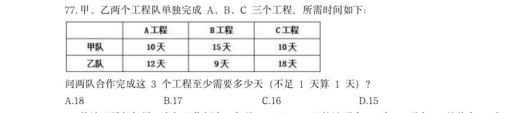
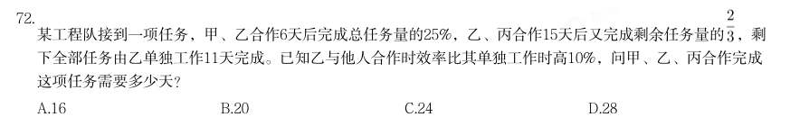

# 数量关系 · 工程问题

> 考点编码：`SL-GC`　｜　体系对齐：花生十三 `shuliang-guanxi.md#题型1`

## 一、命题规律

- **本题型真题总量**：52 题（2002–2026）
- **地区分布**：国考 26 / 广东 15 / 湖北 11
- **近六年题量**：2026年5题, 2025年2题, 2024年2题, 2023年4题, 2022年3题, 2021年2题
- **覆盖试卷**：41 套
- **子考点分布**：给定效率型 22　给定时间型 20　工程问题（综合） 15　给定人数机器型 1
- **同题变体**：另有 6 道为同题重复（同年多卷/跨年再考），已折叠，需展开见 scripts/search.py --all-variants
- **速算/速解提示**：见花生十三 `references/ziliao-susuan.md` 与 `references/shuliang-gongshi.md` 对应章节

## 二、近年真题（最多 12 题，按年份倒序）

### 【2026 湖北省考·第 64 题】HB-2026-ty-X064　工程问题｜给定效率型

某林场计划扩大荒原造林面积。下图中 区域的荒原造林工作已由两人花费一天的时间完成。若将 的AB边延长一倍到点D,BC边延长两倍到点E,CA边延长三倍到点F。假设每人的工作效率一致,则至 少需要增加几人才能在接下来的5天内完成 剩余区域的荒原造林工作?

- **A.** 3
- **B.** 5
- **C.** 6
- **D.** 12

**答案：B**

**解析/参考要点**：B

### 【2026 国考（副省级）·第 67 题】GK-2026-fs-X067　工程问题｜给定效率型

甲和乙两个工厂共同生产5 天,能生产w 件产品。甲的效率是乙的m 倍,如果甲效率提升 50%,乙效率提升为原来的n 倍,则3 天就能生产w 件产品。问m 和n 的关系为:

- **A.** m=3n-5
- **B.** m=6n-10
- **C.** m=5-3n
- **D.** m=10-6n

**答案：B**

**解析/参考要点**：B
赋值乙原来的效率为每天生产1 件,则甲原来的效率为每天生产m 件,故w=(m+1)×5=5m+5 件;后来甲的
效率变为每天生产m×(1+50%)=1.5m 件,乙变为1×n=n 件,则w=(1.5m+n)×3=4.5m+3n。故5m+5=4.5m+3n,
化简为m=6n-10。
故正确答案为B。

### 【2026 国考（副省级）·第 77 题】GK-2026-fs-X077　工程问题｜给定时间型

甲、乙两个工程队单独完成

- **A.** 18
- **B.** 17
- **C.** 16
- **D.** 15

**答案：D**

**解析/参考要点**：D

### 【2026 国考（地市级）·第 70 题】GK-2026-ds-X070　工程问题｜给定效率型

甲、乙两车间每天可加工2000 个零件。若甲、乙车间效率分别提升10%和20%,则两车间每 天可加工2260 个零件。问效率提升前甲车间每天可加工多少个零件?

- **A.** 1100
- **B.** 1200
- **C.** 1300
- **D.** 1400

**答案：D**

**解析/参考要点**：D

### 【2026 国考（行政执法）·第 72 题】GK-2026-zf-X072　工程问题｜给定时间型

甲、乙两个工程队单独完成

- **A.** 18
- **B.** 17
- **C.** 16
- **D.** 15

**答案：D**

**解析/参考要点**：D

### 【2025 广东省考·第 39 题】GD-2025-ty-X039　工程问题｜给定时间型

甲、乙两个工程队合作实施某项工程,原计划30天完成,但工作5天后甲被抽调到其他工程,又过了15天该工 程正好完成一半,此时丙工程队加入,3天后甲工程队返回,最终该工程比原计划提前2天完成,则丙工程队的 效率是甲工程队的( )倍。

- **A.** 1.5
- **B.** 2
- **C.** 2.5
- **D.** 3

**答案：B**

### 【2025 国考（副省级）·第 73 题】GK-2025-fs-X073　工程问题｜给定时间型

某种机械由3个A模块和2个B模块组成。甲车间每天可生产6个A模块或3个B模块,乙车间每天可生产1个A模块 或2个B模块。现两车间合作生产40台该机械所需模块,问至少需要多少天?

- **A.** 24
- **B.** 26
- **C.** 28
- **D.** 30

**答案：C**

**解析/参考要点**：要使所需时间最少,则让两个车间分别生产相对效率更高的模块。甲车间相对于乙车间生产A 模块的效
率为
,生产B 模块的相对效率为
,比较发现,甲车间生产A 模块的相对效率更高,故
先由甲车间生产A 模块,乙车间生产B 模块。甲车间生产A 模块需要
天,此时乙车间已
生产B 模块2×20=40 个,还剩40×2-40=40 个B 模块由两车间共同生产,需要
天,故至
少需要20+8=28 天。
故正确答案为C。

### 【2024 国考（副省级）·第 65 题】GK-2024-fs-X065　工程问题｜工程问题（综合）

甲乙两条生产线同一天开始生产某种产品,甲每天比前一天多生产m件,乙每天比前一天少生产2m件,第5天两 条生产线的当日产量相同,且前5天乙的累计产量是甲的2倍。问第一天乙的产量是甲的多少倍?

- **A.** 6
- **B.** 7
- **C.** 4
- **D.** 5

**答案：C**

**解析/参考要点**：根据题意可知,甲生产线每天产量是公差为m 的等差数列,乙生产线每天产量是公差为-2m 的等差数列。
2024 国考《行测》(副省级)解析
21 / 46
设第5 天两条生产线的当日产量均为x 件,根据等差数列通项公式:
,即
,则第1 天甲生产线产量为
件,乙生产
线产量为
件。根据等差数列求和公式:
,可列等式:
,解得x=8m,
则第1 天甲生产线产量为x-4m=8m-4m=4m 件,乙生产线产量为x+8m=8m+8m=16m 件,故所求为
倍。
故正确答案为C。

### 【2024 国考（副省级）·第 72 题】GK-2024-fs-X072　工程问题｜给定时间型

某工程队接到一项任务,甲、乙合作6天后完成总任务量的25%,乙、丙合作15天后又完成剩余任务量的 ,剩 下全部任务由乙单独工作11天完成。已知乙与他人合作时效率比其单独工作时高10%,问甲、乙、丙合作完成 这项任务需要多少天?

- **A.** 16
- **B.** 20
- **C.** 24
- **D.** 28

**答案：B**

**解析/参考要点**：由于“乙与他人合作时效率比其单独工作时高10%”,即乙与他人合作时效率为(1+10%)乙=1.1 乙,根
据题意则有:
······1;
2024 国考《行测》(副省级)解析
24 / 46
······2
;
······3。联立13可得15 甲=11 乙,
赋值甲的效率为
11 ,乙的效率为
15 ,则工作总量=11×15×4=660 ,则
,所求时间
天。
故正确答案为B。

### 【2023 湖北省考·第 124 题】HB-2023-ty-X124　工程问题｜工程问题（综合）

2021 年海水冷却用水量低于海水冷却工程年总循环量的沿海省市共有几个:

- **A.** 5 个
- **B.** 6 个
- **C.** 7 个
- **D.** 8 个

**答案：D**

**解析/参考要点**：定位文字材料可得,2021 年全国11 个沿海省市海水冷却工程年总循环量为169.5 亿吨。结合表格比
较可得,8 个沿海省中,海水冷却用水量低于海水冷却工程年总循环量的省份共有5 个,分别为辽宁
(49.0 亿吨)、河北(54.6 亿吨)、山东(145.1 亿吨)、江苏(117.5 亿吨)、广西(70.6 亿吨)。
除表中8 省外,剩余3 个沿海省市海水冷却用水量之和
亿吨。因3 个省市的海水冷却用水
量之和(163.1 亿吨)低于海水冷却工程年总循环量(169.5 亿吨),则每个省市的海水冷却用水量
均应低于海水冷却工程年总循环量。
故满足要求的沿海省市共5+3=8 个。
故正确答案为D

### 【2023 广东省考（乡镇）·第 20 题】GD-2023-xz-X020　工程问题｜给定人数机器型

2022 年,广东把稳就业摆在突出位置,抓好重点群体就业。以下不属于广东省推出的就 业培训工程的是( )。

- **A.** 广东智造
- **B.** 粤菜师傅
- **C.** 广东技工
- **D.** 南粤家政

**答案：A**

**解析/参考要点**：本题考查政治常识。
A 项错误,B、C、D 三项正确,2022 年广东省《政府工作报告》中“二、2022 年工作安排”
指出:“(十)持续保障和改善民生,大力发展各项社会事业,在高质量发展中促进共同富
裕。强化就业优先导向。深入实施3.0 版‘促进就业九条’,延续减负稳岗扩就业政策,突
出抓好高校毕业生、异地务工人员、退役军人、脱贫人口等重点群体就业,确保零就业家庭
动态‘清零’。推动‘粤菜师傅’‘广东技工’‘南粤家政’三项工程标准化品牌化发展,
培育‘乡村工匠’,实施技工教育‘强基培优’计划,推动技师学院和高职院校政策互通。
大力支持创业带动就业和多渠道灵活就业,推进就业实名制。启动新一轮和谐劳动关系综合
试验区建设,健全保障农民工工资支付长效机制。”
本题为选非题,故正确答案为A。

### 【2023 国考（行政执法）·第 61 题】GK-2023-zf-X061　工程问题｜给定效率型

在这部分试题中,每道题呈现一段表述数字关系的文字,要求你迅速、准 确地计算出答案。 一项工作甲独立完成需要3小时,乙独立完成的用时比其与甲合作完成多4小时,且乙和丙合作完成需要4小 时。问丙独立完成需要多少小时?

- **A.** 10
- **B.** 12
- **C.** 6
- **D.** 8

**答案：B**

**解析/参考要点**：赋值工作总量为12,则甲的效率为
,乙、丙合作的效率为
。设乙的效率为x,
根据“乙独立完成的用时比其与甲合作完成多4 小时”,可得:
,解得:x=2,
即乙的效率为2,则丙的效率为3-2=1。因此,丙独立完成需要
小时。
故正确答案为B。

## 三、其余真题（按年代分片）

| 年代 | 题量 | 分片文件 |
|---|---:|---|
| 2000s | 5 | [SL-GC-2000s.md](split/SL-GC-2000s.md) |
| 2010s | 27 | [SL-GC-2010s.md](split/SL-GC-2010s.md) |
| 2020s | 8 | [SL-GC-2020s.md](split/SL-GC-2020s.md) |

> 也可用 `python scripts/search.py --kaodian SL-GC` 直接检索全部 52 题。