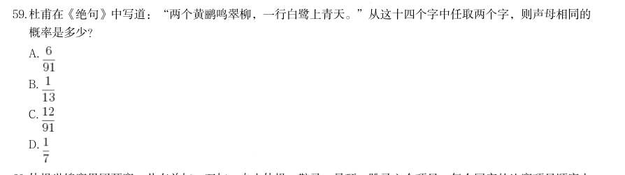
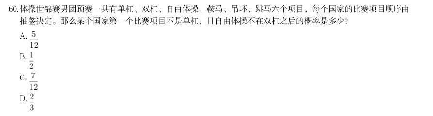
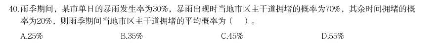
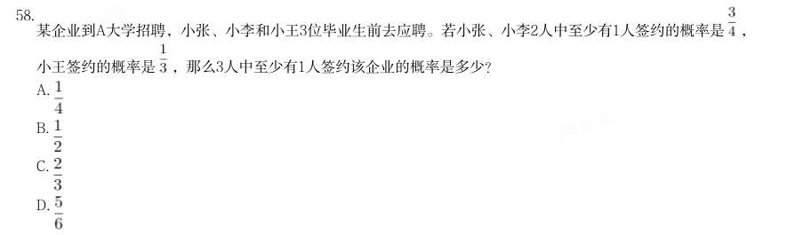
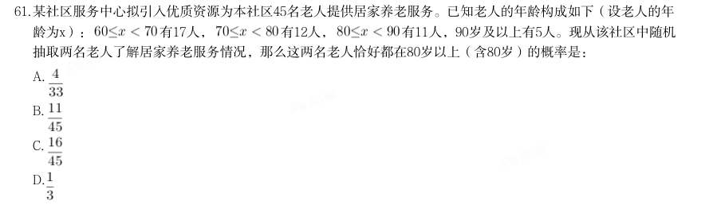
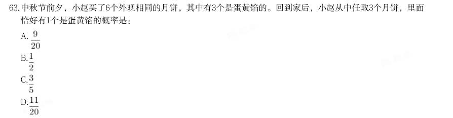
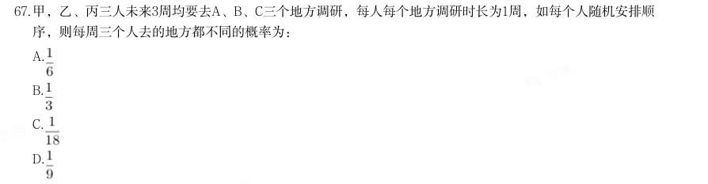

# 数量关系 · 概率问题

> 考点编码：`SL-GL`　｜　体系对齐：花生十三 `shuliang-guanxi.md#题型5`

## 一、命题规律

- **本题型真题总量**：51 题（2009–2026）
- **地区分布**：国考 23 / 广东 7 / 湖北 21
- **近六年题量**：2026年4题, 2025年2题, 2024年5题, 2023年3题, 2022年6题, 2021年1题
- **覆盖试卷**：37 套
- **子考点分布**：摸球与抽取 49　比赛与赛制 8　概率问题（综合） 2
- **同题变体**：另有 8 道为同题重复（同年多卷/跨年再考），已折叠，需展开见 scripts/search.py --all-variants
- **速算/速解提示**：见花生十三 `references/ziliao-susuan.md` 与 `references/shuliang-gongshi.md` 对应章节

## 二、近年真题（最多 12 题，按年份倒序）

### 2026 湖北·统一卷　第 59 题　（摸球与抽取）

杜甫在《绝句》中写道:“两个黄鹂鸣翠柳,一行白鹭上青天。”从这十四个字中任取两个字,则声母相同的 概率是多少?

- **A.** 
- **B.** 
- **C.** 
- **D.** 

**答案：B**

**解析/参考要点**：B
从十四个字中任取两个字,总的情况数为
种。十四个字的拼音分别为“liǎng
gè huáng lí míng cuì liǔ,yì háng bái lù shàng qīng tiān。”其中相同的
声母只有4 个“l”和2 个“h”。其中两个字声母均为l 的情况数为
种,两个字声母均为h 的情况数为
种,分类用加法,
则满足“两个字声母相同”条件的情况数为6+1=7 种。根据公式:概率=满足条
件的情况数/总的情况数,则题干所求概率
。故正确答案为B。

### 2026 湖北·统一卷　第 60 题　（比赛与赛制）

体操世锦赛男团预赛一共有单杠、双杠、自由体操、鞍马、吊环、跳马六个项目,每个国家的比赛项目顺序由 抽签决定。那么某个国家第一个比赛项目不是单杠,且自由体操不在双杠之后的概率是多少?

- **A.** 
- **B.** 
- **C.** 
- **D.** 

**答案：A**

**解析/参考要点**：A
根据题意,第一个比赛项目是六个项目中的任意一项的概率均为
,则第一个
比赛项目不是单杠的概率为
;自由体操要么在双杠之前,要么在双
杠之后,要求自由体操不在双杠之后,则自由体操在双杠之前,概率为
。分
步用乘法,则所求概率
。
故正确答案为A。

### 2026 广东·统一卷　第 40 题　（摸球与抽取）

雨季期间,某市单日的暴雨发生率为30%,暴雨出现时当地市区主干道拥堵的概率为70%,其余时间拥堵的概 率为20%,则雨季期间当地市区主干道拥堵的平均概率为( )。

- **A.** 25%
- **B.** 35%
- **C.** 45%
- **D.** 55%

**答案：B**

**解析/参考要点**：答案B
根据题意,雨季期间当地市区主干道拥堵可分为两种情况:
1暴雨出现时当地市区主干道拥堵,概率为30%x70%=21%;
2其余时间当地市区主干道拥堵,概率为(1-30%)x20%=14%。
分类用加法,故雨季期间当地市区主干道拥堵的平均概率为21%+14%=35%。
故正确答案为B。

### 2026 国考·副省级　第 73 题　（摸球与抽取）

某单位从所有职工中随机选3 人参加某个会议,张立和李磊2 人中只有1 人被选中的概率 是2 人均被选中概率的30 倍。问该单位有职工多少人?

- **A.** 15
- **B.** 17
- **C.** 29
- **D.** 33

**答案：D**

**解析/参考要点**：D

### 2025 湖北·统一卷　第 58 题　（摸球与抽取）

某企业到A大学招聘,小张、小李和小王3位毕业生前去应聘。若小张、小李2人中至少有1人签约的概率是 , 小王签约的概率是 ,那么3人中至少有1人签约该企业的概率是多少?

- **A.** 
- **B.** 
- **C.** 
- **D.** 

**答案：C**

### 2025 湖北·统一卷　第 61 题　（比赛与赛制）

21分制的羽毛球比赛,每赢一球得1分,下一球由上一球得分方发球,20:20平局以后,先多得2分的一方获 胜,若甲发球时甲得分的概率为0.6、乙发球时乙得分的概率为0.7,各球的结果相互独立,乙将比分追成20: 20平后,甲最终以23:21的比分获胜的概率在以下哪个范围?

- **A.** 0.05-0.1
- **B.** 0.1-0.15
- **C.** 0.15-0.2
- **D.** 0.2-0.25

**答案：C**

### 2024 湖北·统一卷　第 61 题　（摸球与抽取）

某社区服务中心拟引入优质资源为本社区45名老人提供居家养老服务。已知老人的年龄构成如下(设老人的年 龄为x): 有17人, 有12人, 有11人,90岁及以上有5人。现从该社区中随机 抽取两名老人了解居家养老服务情况,那么这两名老人恰好都在80岁以上(含80岁)的概率是:

- **A.** 
- **B.** 
- **C.** 
- **D.** 

**答案：A**

### 2024 湖北·统一卷　第 63 题　（摸球与抽取）

中秋节前夕,小赵买了6个外观相同的月饼,其中有3个是蛋黄馅的。回到家后,小赵从中任取3个月饼,里面 恰好有1个是蛋黄馅的概率是:

- **A.** 
- **B.** 
- **C.** 
- **D.** 

**答案：A**

### 2024 国考·副省级　第 74 题　（摸球与抽取）

甲、乙等36人分为6个小组参加某项活动,要求任意2组人数不同,每个组都不少于3人,且任何一组人数不得 超过另一组的3倍。问甲和乙至少有1人分到人数第二多的小组的概率为( )。

- **A.** 35%
- **B.** 40%
- **C.** 25%
- **D.** 30%

**答案：B**

**解析/参考要点**：根据题干“6 个小组任意2 组人数不同,每个组不少于3 人”,可先给6 个小组分别分3 人、4 人、5 人、
6 人、7 人、8 人,共3+4+5+6+7+8=33 人,还剩余36-33=3 人。根据题干“任何一组人数不得超过另一
组的3 倍”,则人数最多的组不能超过9 人,故剩余的3 人只能分到人数最多的三个小组且每个小组分
1 人,此时人数第二多的小组有7+1=8 人。总情况数为从36 人中选8 人分到人数第二多的小组,有
种情况。
方法一:满足题意要求的情况较复杂,优先考虑反面情况。反面情况为甲和乙两人均未分到人数第二多
的小组,即从剩余
人中选
人分到该小组,有
种情况,则所求概率
2024 国考《行测》(副省级)解析
25 / 46
。
方法二:将满足题意要求的情况分类讨论如下:
1甲、乙其中1 人分到人数第二多的小组,再从剩余34 人中选7 人分到该小组,有
种情况;
2甲和乙都分到人数第二多的小组,再从剩余34 人中选6 人分到该小组,有
种情况。
分类用加法,则所求概率
。
故正确答案为B。

### 2024 国考·地市级　第 67 题　（摸球与抽取）

甲,乙、丙三人未来3周均要去

- **A.** 
- **B.** 
- **C.** 
- **D.** 

**答案：C**

**解析/参考要点**：由题意可知,甲未来3 周分别要去A、B、C 三个地方调研,则甲的情况数为
种情况,
同理乙、丙的情况数均为6 种情况,则总情况数为6×6×6=216 种情况。要满足每周三个人去的地方都
不同,先考虑第一周,甲、乙、丙三人对应A、B、C 三个地方,则第一周三人的情况数为
种情况。以甲、乙、丙分别去A、B、C 三个地方为例,讨论第二周及第三周情况,如下表所示:
如表格所示,若第一周A 地点由甲调研时,则第二周A 地点可以从乙、丙二人中选择,有
种情
况,若第二周A 地点人员确定,即其余地点和时间的人员均确定,则满足要求的情况数为6×2=12 种情
况。根据概率
,则每周三个人去的地方都不同的概率
。
故正确答案为C。

### 2024 国考·行政执法　第 64 题　（摸球与抽取）

甲,乙、丙三人未来3周均要去

- **A.** 
- **B.** 
- **C.** 
- **D.** 

**答案：C**

**解析/参考要点**：由题意可知,甲未来3 周分别要去A、B、C 三个地方调研,则甲的情况数为
种
情况,
同理乙、丙的情况数均为6 种情况,则总情况数为6×6×6=216 种情况。要满足每周三个人去的地方都
不同,先考虑第一周,甲、乙、丙三人对应A、B、C 三个地方,则第一周三人的情况数为
种情况。以甲、乙、丙分别去A、B、C 三个地方为例,讨论第二周及第三周情况,如下表所示:
如表格所示,若第一周A 地点由甲调研时,则第二周A 地点可以从乙、丙二人中选择,有
种
情
况,若第二周A 地点人员确定,即其余地点和时间的人员均确定,则满足要求的情况数为6×2=12 种情
况。根据概率
,则每周三个人去的地方都不同的概率
。
故正确答案为C。

### 2023 湖北·统一卷　第 65 题　（摸球与抽取）

某学习平台收到的征文,将通过两轮评审决定能否采用。先由两位编辑进行初审,若两 位编辑评审都通过,则予以采用;若两位编辑都未予通过,则不予采用;若仅有一位编辑初 审通过,则再由主编进行复审,若复审通过,则予以采用,否则不予采用。设稿件能通过各 初审编辑评审的概率均为0.4,复审的稿件能通过的概率为0.2,各编辑独立评审,则每篇征 文被采用的概率为:

- **A.** 0.32
- **B.** 0.256
- **C.** 0.24
- **D.** 0.208

**答案：B**

## 三、其余真题（按年代分片）

| 年代 | 题量 | 分片文件 |
|---|---:|---|
| 2000s | 1 | [SL-GL-2000s.md](split/SL-GL-2000s.md) |
| 2010s | 26 | [SL-GL-2010s.md](split/SL-GL-2010s.md) |
| 2020s | 12 | [SL-GL-2020s.md](split/SL-GL-2020s.md) |

> 也可用 `python scripts/search.py --kaodian SL-GL` 直接检索全部 51 题。