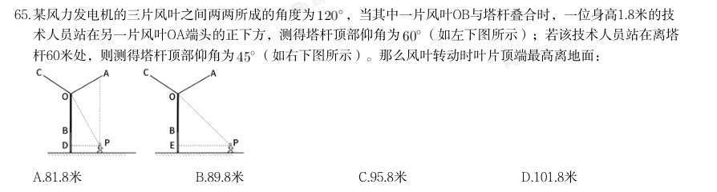
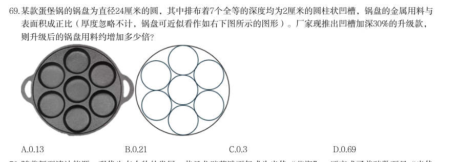
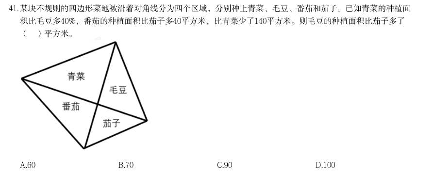
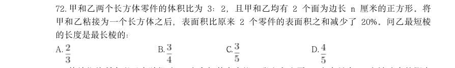
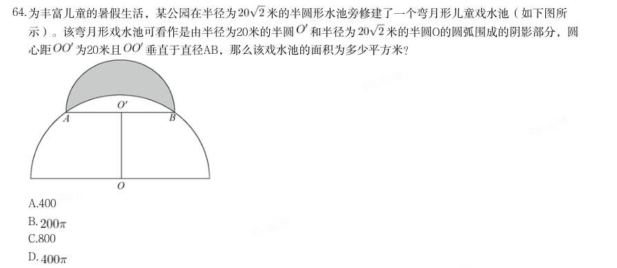
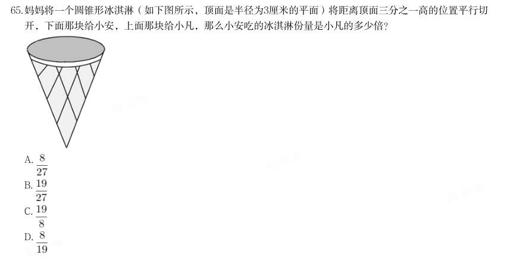

# 数量关系 · 几何问题

> 考点编码：`SL-JH`　｜　体系对齐：花生十三 `shuliang-guanxi.md#题型9`

## 一、命题规律

- **本题型真题总量**：96 题（2002–2026）
- **地区分布**：国考 49 / 广东 17 / 湖北 30
- **近六年题量**：2026年8题, 2025年7题, 2024年5题, 2023年2题, 2022年6题, 2021年3题
- **覆盖试卷**：54 套
- **子考点分布**：平面几何 59　立体几何 39　相似与比例 8　几何问题（综合） 1
- **同题变体**：另有 11 道为同题重复（同年多卷/跨年再考），已折叠，需展开见 scripts/search.py --all-variants
- **速算/速解提示**：见花生十三 `references/ziliao-susuan.md` 与 `references/shuliang-gongshi.md` 对应章节

## 二、近年真题（最多 12 题，按年份倒序）

### 2026 湖北·统一卷　第 62 题　（平面几何）

某小区内有一块直角扇形的草坪如下图所示,两条互相垂直的小路AC与BC分别长4米和3米。物业公司准备在 四边形OACB围成的区域种植丁香花。如果小路面积忽略不计,则丁香花种植面积为多少平方米?

- **A.** 11
- **B.** 12
- **C.** 13
- **D.** 14

**答案：A**

**解析/参考要点**：A
连接AB,且延长CB、AO 相交于D 点,如下图所示:
已知
,AC=4 米,BC=3 米,在直角三角形ABC 中,斜边
米。由于AD 所对圆周角为
,故AD 为直径,AO=OD,
则
与
全等,BD=AB=5 米,CD=CB+BD=3+5=8 米。
,
,
。所求面积
。
故正确答案为A。

### 2026 湖北·统一卷　第 63 题　（立体几何）

为庆祝春节,某村计划在村口的两根圆柱体石柱上缠绕灯带。每根石柱需绕上3圈灯带,起始点为A,终点为 B,如下图所示。若每根石柱高为5米,横截面圆的周长为4米,那么两根石柱所需的灯带总长度最短为多少 米?

> （本题为图形题，选项为图片，见原卷）

**答案：C**

**解析/参考要点**：C
根据题干要求“两根石柱所需的灯带总长度最短”,即求A 点到B 点的长度最短,
已知每根石柱高为5 米,横截面圆的周长为4 米,将石柱侧面展开成平面图形(如
下图所示),则所求AB 长度最短即图中直角三角形的斜边。根据直角三角形勾
股定理:
,则
,故两根石柱所需灯带总
长度最短为13×2=26 米。
故正确答案为C。

### 2026 湖北·统一卷　第 65 题　（平面几何）

某风力发电机的三片风叶之间两两所成的角度为 ,当其中一片风叶OB与塔杆叠合时,一位身高1.8米的技 术人员站在另一片风叶OA端头的正下方,测得塔杆顶部仰角为 (如左下图所示);若该技术人员站在离塔 杆60米处,则测得塔杆顶部仰角为 (如右下图所示)。那么风叶转动时叶片顶端最高离地面:

- **A.** 81.8米
- **B.** 89.8米
- **C.** 95.8米
- **D.** 101.8米

**答案：D**

**解析/参考要点**：D

### 2026 湖北·统一卷　第 69 题　（立体几何）

某款蛋堡锅的锅盘为直径24厘米的圆,其中排布着7个全等的深度均为2厘米的圆柱状凹槽,锅盘的金属用料与 表面积成正比(厚度忽略不计,锅盘可近似看作如右下图所示的图形)。厂家现推出凹槽加深30%的升级款, 则升级后的锅盘用料约增加多少倍?

- **A.** 0.13
- **B.** 0.21
- **C.** 0.3
- **D.** 0.69

**答案：A**

**解析/参考要点**：A

### 2026 广东·统一卷　第 41 题　（相似与比例）

某块不规则的四边形菜地被沿着对角线分为四个区域,分别种上青菜、毛豆、番茄和茄子。已知青菜的种植面 积比毛豆多40%,番茄的种植面积比茄子多40平方米,比青菜少了140平方米。则毛豆的种植面积比茄子多了 ( )平方米。

- **A.** 60
- **B.** 70
- **C.** 90
- **D.** 100

**答案：暂缺（原始文件为扫描版）**

**解析/参考要点**：答案D

### 2026 国考·副省级　第 66 题　（相似与比例）
> 材料：答案。…

某园区种植甲、乙、丙三种花卉共10 公顷,甲的种植面积是乙的2 倍,丙的种植面积比乙 少2 公顷。问丙的种植面积为多少公顷?

- **A.** 1
- **B.** 2
- **C.** 3
- **D.** 4

**答案：A**

**解析/参考要点**：A
设乙的种植面积为x 公顷,则甲的种植面积为2x 公顷,丙的种植面积为(x-2)公顷,根据题意可得:2x+x+
(x-2)=10,解得x=3,则丙的种植面积为3-2=1 公顷。
故正确答案为A

### 2026 国考·副省级　第 72 题　（立体几何）

甲和乙两个长方体零件的体积比为3:2,且甲和乙均有2 个面为边长n 厘米的正方形。将 甲和乙粘接为一个长方体之后,表面积比原来2 个零件的表面积之和减少了20%。问乙最短棱 的长度是最长棱的:

- **A.** 
- **B.** 
- **C.** 
- **D.** 

**答案：C**

**解析/参考要点**：C

### 2026 国考·副省级　第 75 题　（相似与比例）

一块梯形场地如下图所示,已知OA=0.6OD,现在需要将这块场地拓展为一块长方形场地,问 扩展后场地面积比原来至少增加:

- **A.** 20%
- **B.** 25%
- **C.** 40%
- **D.** 50%

**答案：B**

**解析/参考要点**：B

### 2025 湖北·统一卷　第 63 题　（立体几何）

某三层高的露天平台每层可视作圆柱体(如下图所示)。已知每层高5米,下层直径100米,中层直径80米,上 层直径68米,现要对平台的外表面进行清洁维护,共需要维护多少平方米?

- **A.** 
- **B.** 
- **C.** 
- **D.** 

**答案：D**

### 2025 湖北·统一卷　第 64 题　（平面几何）

为丰富儿童的暑假生活,某公园在半径为 米的半圆形水池旁修建了一个弯月形儿童戏水池(如下图所 示)。该弯月形戏水池可看作是由半径为20米的半圆 和半径为 米的半圆O的圆弧围成的阴影部分,圆 心距 为20米且 垂直于直径AB,那么该戏水池的面积为多少平方米?

- **A.** 400
- **B.** 
- **C.** 800
- **D.** 

**答案：B**

### 2025 湖北·统一卷　第 65 题　（立体几何）

妈妈将一个圆锥形冰淇淋(如下图所示,顶面是半径为3厘米的平面)将距离顶面三分之一高的位置平行切 开,下面那块给小安,上面那块给小凡,那么小安吃的冰淇淋份量是小凡的多少倍?

- **A.** 
- **B.** 
- **C.** 
- **D.** 

**答案：B**

### 2025 国考·副省级　第 71 题　（平面几何）

甲、乙、丙3台收割机每小时均能收割2亩小麦,三台机器上午先后开始收割工作,12:00时甲收割的面积是乙 的1.5倍,且比丙多收割6亩,16:00时3台收割机共收割了50亩,问乙是何时开始工作的?

- **A.** 6:00
- **B.** 7:00
- **C.** 8:00
- **D.** 9:00

**答案：C**

**解析/参考要点**：12:00 至16:00,3 台收割机均工作4 小时,共收割
亩小麦,则12:00 之前3 台收
割机收割50-24=26 亩小麦。设12:00 之前乙收割机工作了x 小时,收割面积为2x 亩,根据题意可列等
式:
,解得x=4,即乙收割机在12:00 之前工作了4 小
时,则乙是在8:00 开始工作的。
2025 国考《行测》(副省级)解析
24 / 46
故正确答案为C。

## 三、其余真题（按年代分片）

| 年代 | 题量 | 分片文件 |
|---|---:|---|
| 2000s | 24 | [SL-JH-2000s.md](split/SL-JH-2000s.md) |
| 2010s | 35 | [SL-JH-2010s.md](split/SL-JH-2010s.md) |
| 2020s | 25 | [SL-JH-2020s.md](split/SL-JH-2020s.md) |

> 也可用 `python scripts/search.py --kaodian SL-JH` 直接检索全部 96 题。