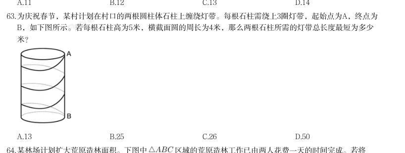
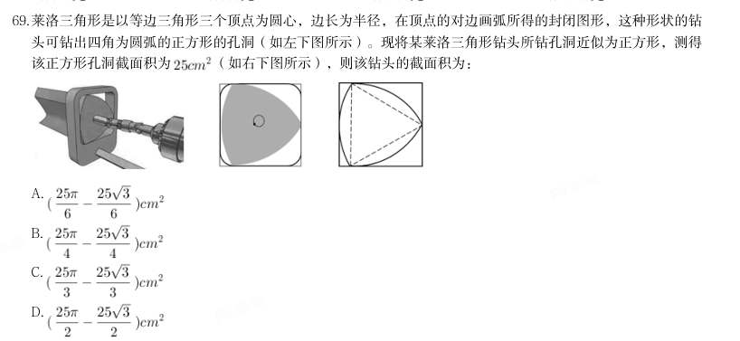

# 数量关系 · 几何问题

> 考点编码：`SL-JH`　｜　体系对齐：花生十三 `shuliang-guanxi.md#题型9`

## 一、命题规律

- **本题型真题总量**：94 题（2002–2026）
- **地区分布**：国考 47 / 广东 18 / 湖北 29
- **近六年题量**：2026年7题, 2025年7题, 2024年5题, 2023年2题, 2022年5题, 2021年3题
- **覆盖试卷**：53 套
- **同题变体**：另有 13 道为同题重复（同年多卷/跨年再考），已折叠，需展开见 scripts/search.py --all-variants
- **速算/速解提示**：见花生十三 `references/ziliao-susuan.md` 与 `references/shuliang-gongshi.md` 对应章节

## 二、真题与答案（按年份倒序，最多 30 题）

### 2026 湖北·统一卷　第 63 题

为庆祝春节,某村计划在村口的两根圆柱体石柱上缠绕灯带。每根石柱需绕上3圈灯带,起始点为A,终点为 B,如下图所示。若每根石柱高为5米,横截面圆的周长为4米,那么两根石柱所需的灯带总长度最短为多少 米?

> （本题为图形题，选项为图片，见原卷）

**答案：C**

**解析/参考要点**：63.C
根据题干要求“两根石柱所需的灯带总长度最短”,即求A 点到B 点的长度最短,
已知每根石柱高为5 米,横截面圆的周长为4 米,将石柱侧面展开成平面图形(如
下图所示),则所求AB 长度最短即图中直角三角形的斜边。根据直角三角形勾
股定理:
,则
,故两根石柱所需灯带总
长度最短为13×2=26 米。
故正确答案为C。

### 2026 湖北·统一卷　第 65 题

某风力发电机的三片风叶之间两两所成的角度为 ,当其中一片风叶OB与塔杆叠合时,一位身高1.8米的技 术人员站在另一片风叶OA端头的正下方,测得塔杆顶部仰角为 (如左下图所示);若该技术人员站在离塔 杆60米处,则测得塔杆顶部仰角为 (如右下图所示)。那么风叶转动时叶片顶端最高离地面:

- **A.** 81.8米
- **B.** 89.8米
- **C.** 95.8米
- **D.** 101.8米

**答案：D**

**解析/参考要点**：65.D

### 2026 湖北·统一卷　第 69 题

某款蛋堡锅的锅盘为直径24厘米的圆,其中排布着7个全等的深度均为2厘米的圆柱状凹槽,锅盘的金属用料与 表面积成正比(厚度忽略不计,锅盘可近似看作如右下图所示的图形)。厂家现推出凹槽加深30%的升级款, 则升级后的锅盘用料约增加多少倍?

- **A.** 0.13
- **B.** 0.21
- **C.** 0.3
- **D.** 0.69

**答案：A**

**解析/参考要点**：69.A

### 2026 广东·统一卷　第 41 题

某块不规则的四边形菜地被沿着对角线分为四个区域,分别种上青菜、毛豆、番茄和茄子。已知青菜的种植面 积比毛豆多40%,番茄的种植面积比茄子多40平方米,比青菜少了140平方米。则毛豆的种植面积比茄子多了 ( )平方米。

- **A.** 60
- **B.** 70
- **C.** 90
- **D.** 100

**答案：D**

### 2026 国考·副省级　第 66 题
> 材料：答案。…

某园区种植甲、乙、丙三种花卉共10 公顷,甲的种植面积是乙的2 倍,丙的种植面积比乙 少2 公顷。问丙的种植面积为多少公顷?

- **A.** 1
- **B.** 2
- **C.** 3
- **D.** 4

**答案：A**

**解析/参考要点**：66、A
设乙的种植面积为x 公顷,则甲的种植面积为2x 公顷,丙的种植面积为(x-2)公顷,根据题意可得:2x+x+
(x-2)=10,解得x=3,则丙的种植面积为3-2=1 公顷。
故正确答案为A

### 2026 国考·副省级　第 72 题

甲和乙两个长方体零件的体积比为3:2,且甲和乙均有2 个面为边长n 厘米的正方形。将 甲和乙粘接为一个长方体之后,表面积比原来2 个零件的表面积之和减少了20%。问乙最短棱 的长度是最长棱的:

- **A.** 
- **B.** 
- **C.** 
- **D.** 

**答案：C**

**解析/参考要点**：72、C

### 2026 国考·副省级　第 75 题

一块梯形场地如下图所示,已知OA=0.6OD,现在需要将这块场地拓展为一块长方形场地,问 扩展后场地面积比原来至少增加:

- **A.** 20%
- **B.** 25%
- **C.** 40%
- **D.** 50%

**答案：B**

**解析/参考要点**：75、B

### 2025 湖北·统一卷　第 63 题

某三层高的露天平台每层可视作圆柱体(如下图所示)。已知每层高5米,下层直径100米,中层直径80米,上 层直径68米,现要对平台的外表面进行清洁维护,共需要维护多少平方米?

- **A.** 
- **B.** 
- **C.** 
- **D.** 

**答案：D**

### 2025 湖北·统一卷　第 64 题

为丰富儿童的暑假生活,某公园在半径为 米的半圆形水池旁修建了一个弯月形儿童戏水池(如下图所 示)。该弯月形戏水池可看作是由半径为20米的半圆 和半径为 米的半圆O的圆弧围成的阴影部分,圆 心距 为20米且 垂直于直径AB,那么该戏水池的面积为多少平方米?

- **A.** 400
- **B.** 
- **C.** 800
- **D.** 

**答案：B**

### 2025 湖北·统一卷　第 65 题

妈妈将一个圆锥形冰淇淋(如下图所示,顶面是半径为3厘米的平面)将距离顶面三分之一高的位置平行切 开,下面那块给小安,上面那块给小凡,那么小安吃的冰淇淋份量是小凡的多少倍?

- **A.** 
- **B.** 
- **C.** 
- **D.** 

**答案：B**

### 2025 国考·副省级　第 71 题

甲、乙、丙3台收割机每小时均能收割2亩小麦,三台机器上午先后开始收割工作,12:00时甲收割的面积是乙 的1.5倍,且比丙多收割6亩,16:00时3台收割机共收割了50亩,问乙是何时开始工作的?

- **A.** 6:00
- **B.** 7:00
- **C.** 8:00
- **D.** 9:00

**答案：C**

**解析/参考要点**：【71】解析
12:00 至16:00,3 台收割机均工作4 小时,共收割
亩小麦,则12:00 之前3 台收
割机收割50-24=26 亩小麦。设12:00 之前乙收割机工作了x 小时,收割面积为2x 亩,根据题意可列等
式:
,解得x=4,即乙收割机在12:00 之前工作了4 小
时,则乙是在8:00 开始工作的。
2025 国考《行测》(副省级)解析
24 / 46
故正确答案为C。

### 2025 国考·副省级　第 78 题

某厂区如图所示,其中ABCD为矩形,ABEF为直角梯形,AB与DE相交于G点,其中阴影区域ADGF为涉密区 域。已知AD、AF、AB长度分别为240米、150米、100米,问涉密区域的面积为多少万平方米?

- **A.** 1.2
- **B.** 1.3
- **C.** 1.4
- **D.** 1.5

**答案：A**

**解析/参考要点**：【78】解析
方法一:如下图所示,连接AE,根据“ABEF 为直角梯形”,可知
,
和
均以AG 为底、EB 为高,即两个三角形同底等高,则
。由于ABCD 为矩形且AD、AB
长度分别为240 米、100 米,则所求涉密区域面积
平方米=1.2 万平方米。
2025 国考《行测》(副省级)解析
26 / 46
方法二:设AG、BE 的长度分别为x 米、y 米,则BG 的长度为(100-x)米。根据“ABCD 为矩形,ABEF 为
直角梯形”,则
,
,因此
,
则有
,即
,整理可得
,故所求涉密区域面
积
平方米=1.2 万平方米。
故正确答案为A。

### 2025 国考·副省级　第 80 题

一个容器的下部分为高12厘米的倒立圆锥体,上部分为圆柱体,且圆锥和圆柱的底面半径相等。现匀速向容器 中注入水,1分钟后液面高6厘米,又过30分钟后注满。问整个容器的高度为多少厘米?

- **A.** 22
- **B.** 22.5
- **C.** 23
- **D.** 23.5

**答案：D**

**解析/参考要点**：【80】解析
2025 国考《行测》(副省级)解析
27 / 46
故正确答案为D。

### 2025 国考·行政执法　第 75 题

一个长方体零件最大面的面积是最小面的3倍,次大面的面积是最大、最小面面积平均值的 。问该零件最小 面的长是其宽的多少倍?

- **A.** 
- **B.** 
- **C.** 
- **D.** 

**答案：C**

**解析/参考要点**：【75】解析
设该长方体零件的三条不同长度的棱长从长到短依次为a、b、c,则最大面的面积为ab、次大面的面积
2025 国考《行测》(行政执法卷)解析
27 / 46
为ac、最小面的面积为bc,根据题意则有
,根据1可得a=3c,
代入2可得
。
故正确答案为C。

### 2024 湖北·统一卷　第 68 题

某单面圆形交通禁停标志牌如图所示,标志牌直径为60cm,牌中各处红色区域宽度均为5cm,某工厂承接30个 该种标志牌的喷绘业务,已知每个标志牌的蓝色区域喷绘价格是112.5元,红蓝区域喷绘单价相同(价格仅按面 积计算),那么30个标志牌喷绘共需:

- **A.** 3375元
- **B.** 6000元
- **C.** 6750元
- **D.** 8437.5元

**答案：C**

### 2024 湖北·统一卷　第 69 题

莱洛三角形是以等边三角形三个顶点为圆心,边长为半径,在顶点的对边画弧所得的封闭图形,这种形状的钻 头可钻出四角为圆弧的正方形的孔洞(如左下图所示)。现将某莱洛三角形钻头所钻孔洞近似为正方形,测得 该正方形孔洞截面积为 (如右下图所示),则该钻头的截面积为:

> （本题为图形题，选项为图片，见原卷）

**答案：D**

### 2024 国考·副省级　第 70 题

某公园内的道路如下图所示,其中AB、BC分别为正南北向和正东西向道路,AB、AC分别长100米和200米。且 BCD为正三角形,如要用直线道路连接AD,则该道路的长度为多少米?

- **A.** 
- **B.** 
- **C.** 
- **D.** 

**答案：C**

**解析/参考要点**：【70】解析
连接AD(如下图):
由于“AB、BC 分别为正南北向和正东西向道路”,故
,根据勾股定理可得:
米
,
由
于
,故三角形ABC 为一个锐角为
的直角三角形,
。
由于
BCD
为正三角形,故
米,
,故
,则三角形ACD 为直角三角形,根据勾股定
2024 国考《行测》(副省级)解析
23 / 46
理可得:
米。
故正确答案为C。

### 2024 国考·副省级　第 71 题

设计师将一个正方形的大厅分给如下图所示的几个区域,已知所有的三角形都是等腰直角三角形,梯形都是等 腰梯形,且所有三角形和梯形面积均相等。在三角形的区域铺设地砖,在中间的正方形区域铺设木地板。问地 砖和木地板的面积比是多少?

- **A.** 2:3
- **B.** 4:3
- **C.** 8:9
- **D.** 16:9

**答案：C**

**解析/参考要点**：【71】解析
如图所示,从E 点作EG 垂直于AC;从C、D 两点分别作CF、DH 垂直于EM。根据题意可知,三角形都是
等腰直角三角形,梯形都是等腰梯形,BE 与EC 均为梯形的腰,则BE=EC,可知E 为BC 的中点,那么EG
为等腰直角三角形ABC 的中位线。赋值EG=1,则EG=CF=DH=1,又
,则EG=GC=EF=HM=1,
AB=2EG=2
。
,
,根据三角形和梯形面积相
等,
,可得CD=1,则中间正方形区域的边EM=EF+FH+HM=3。三角
形的区域铺设地砖,则铺设地砖的面积
;中间的正方形区域铺设木地
板,则铺设木地板的面积=3×3=9,地砖和木地板的面积比是8:9。
故正确答案为C。

### 2024 国考·行政执法　第 66 题

甲、乙两个联络站相距10千米。一条道路与甲、乙联络站连线相平行,且与两联络站连线的垂直距离为12千 米。现需紧邻该道路建一个工作站,问工作站距离甲、乙联络站距离之和最小为多少千米?

- **A.** 20
- **B.** 22
- **C.** 24
- **D.** 26

**答案：D**

**解析/参考要点**：【66】解析
如图所示:过道路作甲联络站(A 点)的对称点
点
,并交道路于M 点,连接
点
和乙联络站(B 点)
交道路于O 点。由于
点
和A 点关于道路对称,则三角形AMO 与三角形
为全等三角形,即
。根据两点之间线段最短,可知将工作站建在O 点时,距离甲、乙联络站的距离之和最小,
即工作站距离甲、乙联络站的距离之和
。在直角三角形
中,
AB=10 千米,
千
米,根据勾股定理可得,
千米。因
此,工作站距离甲、乙联络站距离之和最小为26 千米。
故正确答案为D。

### 2023 国考·行政执法　第 62 题

在一块正方形土地中,画一条经过某个顶点的规划线,将其分割为三角形和梯形两块土地,且梯形土地的面积 正好是三角形土地的2倍。问三角形和梯形土地的周长之比是多少?

- **A.** 1:2
- **B.** 5:7
- **C.** 
- **D.** 

**答案：D**

### 2023 国考·行政执法　第 70 题

一个圆柱体零件A和一个圆锥体零件B分别用甲、乙两种合金铸造而成。A的底面半径和高相同,B的底面半径 是高的2倍,两个零件的高相同,质量也相同。问甲合金的密度是乙合金的多少倍?

- **A.** 
- **B.** 
- **C.** 
- **D.** 

**答案：A**

### 2022 广东·乡镇　第 39 题

如图阴影部分是一块由8 块相同的正方形草皮围成的草坪。已知草坪的外圈均铺有一圈小石子带,小石子 带的总长度是48 米,则该草坪的面积为( )平方米。

- **A.** 48
- **B.** 72
- **C.** 81
- **D.** 96

**答案：B**

**解析/参考要点**：39.解析
设每块正方形草皮的边长为a 米,则小石子带的总长度即为下图所示红色线条的总长度,即大正方
形周长+白色小正方形周长=3a×4+a×4=16a=48 米,解得a=3 米,则
平方米。
故正确答案为B。
备注:本题小石子带的宽度忽略不计,否则无法求解。

### 2022 广东·乡镇　第 43 题

有一个长方形花坛,长为10 米,宽为8 米。现要在花坛四周安装栅栏,要求4 个顶点处各插一根木桩, 除顶点处的木桩外,每边还要插若干木桩,且每两根木桩间的距离至少为3 米,则最多可以插( )根木桩。

- **A.** 10
- **B.** 12
- **C.** 14
- **D.** 16

**答案：A**

**解析/参考要点**：43.解析
环形植树,有多少间隔就能植多少棵树,要求插入木桩尽量多,则木桩间的距离尽量小,根据题意
可确定两木桩之间的间隔为3 米,用每条边的边长除以3 看商,有余数的话,商是多少就可以分成
多少个间隔,没有的话则需减1。长边
米,则有3 个间隔,宽边
米,则有2 个
间隔,故该长方形花坛共有2×(3+2)=10 个间隔,故可以插入10 根木桩。
故正确答案为A。

### 2022 广东·乡镇　第 45 题

桶中装有一定量的液体,液体体积为桶容量的40%,现向桶中继续加入16 升同一液体后,液体体积为原来 的1.5 倍,则该桶的容量为( )升。

- **A.** 20
- **B.** 40
- **C.** 60
- **D.** 80

**答案：D**

**解析/参考要点**：45.解析
设桶中最初装有的液体量为x 升,根据题意列等式:x+16=1.5x,解得:x=32 升。由于液体体积为
桶容量的40%,则该桶的容量为
升。
故正确答案为D。

### 2022 国考·副省级　第 73 题

(单选题)一个圆柱体零件的高为1,其圆形底面上的内接正方形边长正好也为1。现将该圆柱体零件 切割4 次,得到棱长为1 的正方体,则切去部分的总面积为:

- **A.** 
- **B.** 
- **C.** 
- **D.** 

**答案：A**

**解析/参考要点**：73.解析
第一步,本题考查几何问题,属于立体几何类。
第二步,如图所示,底面圆的内接正方形的面积为1,则边长为1,对角线长为
,可知底面圆的半径为
。
切割下去的四个部分总表面积相当于(一个圆柱的表面积-上下表面两个正方形)+立方体的侧面积,代入数据
为
=
。
因此,选择A 选项。

### 2022 国考·地市级　第 67 题

一个圆柱体零件的高为1,其圆形底面上的内接正方形边长正好也为1。现将该圆柱体零件 切割4 次,得到棱长为1 的正方体,则切去部分的总面积为:

> （本题为图形题，选项为图片，见原卷）

**答案：A**

**解析/参考要点**：67.解析
第一步,本题考查几何问题,属于立体几何类。
第二步,如图所示,底面圆的内接正方形的面积为1,则边长为1,对角线长为
,可知底面圆的半径为
。
切割下去的四个部分总表面积相当于(一个圆柱的表面积-上下表面两个正方形)+立方体的侧面积,代入数据
为
=
。
因此,选择A 选项。

### 2021 广东·乡镇　第 45 题

如图所示,周长为24 米的平行四边形绿化地被划分为三块区域,两边为三角形的花坛,中间为矩形的草地。 已知a、b、c 长度之比为4∶2∶ ,则矩形草地的面积为( )平方米。

- **A.** 6
- **B.** 6
- **C.** 12
- **D.** 12

**答案：暂缺（原始文件为扫描版）**

### 2021 国考·副省级　第 74 题

一个人工湖的湖面上有一个露出水面3 米的圆锥体人工景观(底面朝下)。如人工湖水深减少20%,则该 景观露出水面部分的体积将增加61/64。问原来的人工湖水深为多少米?

- **A.** 3.5
- **B.** 3.75
- **C.** 4.25
- **D.** 4.5

**答案：暂缺（原始文件为扫描版）**

### 2021 国考·地市级　第 69 题

在一块下图所示的梯形土地中种植某种产量为1.2 千克/平方米的作物。已知该梯形的高为100 米,ABC、BCD 和CDE 为正三角形,且BAF 和DEG 的角度都是90 度,问该土地的总产量为多少吨?

- **A.** 
- **B.** 
- **C.** 
- **D.** 

**答案：B**

**解析/参考要点**：69、正确答案:B,全站正确率:45%,易错项:C。
解析
解法一:
第一步,本题考查几何问题,属于平面几何类。
第二步,设正三角形边长为a,由于中间三个三角形都是正三角形,可知∠ABF=60°,又∠BAF=90°,那么
BF=2AB=2a,可知梯形的上底边是2a+a+2a=5a,下底边是2a;可知梯形的面积为
=350a。又正
三角形高是边长的
,即
a=100,a=
,则面积为350×
=
(平方米)。总产量为
×
1.2=
(千克),即
吨。
因此,选择B 选项。
解法二:
第一步,本题考查几何问题,属于平面几何类。
第二步,由于中间三个三角形都是正三角形,可知∠ABF=60°,又∠BAF=90°,那么BF=2AB;边上两个直角三
角形拼凑在一起是一个大正三角形且边长是小正三角形的2 倍,那么面积是小正三角形面积的4 倍。则整个图形
是7 个小正三角形的面积。
第三步,正三角形高是边长的
倍,可知边长为
,则面积为
(平方米)。总产
量为
×7×1.2=
(千克),即
吨。
因此,选择B 选项。

### 2020 湖北·统一卷　第 58 题

某社区拟对一块梯形活动场地进行扩建,经测算,如果将梯形的上底边增加1 米,下底边增加1 米,则面积 将扩大10 平方米;如果将梯形的上底边增加1 倍,下底边增加1 米,则面积将扩大55 平方米;如果将上底边增 加1 米,下底边增加1 倍,则面积将扩大105 平方米。现拟将梯形的上底边增加1 倍还多2 米,下底边增加3 倍 还多4 米,则面积将扩大多少?

- **A.** 280 平方米
- **B.** 380 平方米
- **C.** 420 平方米
- **D.** 480 平方米

**答案：B**

**解析/参考要点**：58、正确答案:B,全站正确率:40%,易错项:C。
解析
第一步,本题考查几何问题,属于平面几何类。
第二步,设梯形的上底、下底、高分别为a、b、h,根据“面积将扩大10 平方米”可得
,解得h=10(米);根据“面积将扩大55 平方米”可得
,解得a=10(米);根据“面积将扩大105 平方米”可得
,解得b=20(米)。
第三步,如果上底增加1 倍多2 米变为22 米,下底边增加3 倍多4 米变为84 米,则面积将扩
大
(平方米)。
因此,选择B 选项。
