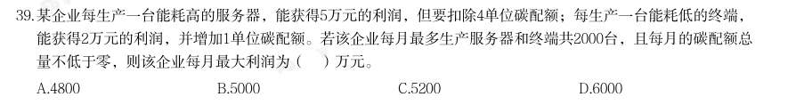

# 数量关系 · 利润问题

> 考点编码：`SL-LR`　｜　体系对齐：花生十三 `shuliang-guanxi.md#题型3`

## 一、命题规律

- **本题型真题总量**：47 题（2000–2026）
- **地区分布**：国考 28 / 广东 13 / 湖北 6
- **近六年题量**：2026年3题, 2025年2题, 2024年1题, 2023年1题, 2022年3题, 2021年1题
- **覆盖试卷**：35 套
- **子考点分布**：基础利润 41　折扣与促销 13　利润问题（综合） 3
- **同题变体**：另有 10 道为同题重复（同年多卷/跨年再考），已折叠，需展开见 scripts/search.py --all-variants
- **速算/速解提示**：见花生十三 `references/ziliao-susuan.md` 与 `references/shuliang-gongshi.md` 对应章节

## 二、近年真题（最多 12 题，按年份倒序）

### 2026 广东·统一卷　第 39 题　（基础利润）

某企业每生产一台能耗高的服务器,能获得5万元的利润,但要扣除4单位碳配额;每生产一台能耗低的终端, 能获得2万元的利润,并增加1单位碳配额。若该企业每月最多生产服务器和终端共2000台,且每月的碳配额总 量不低于零,则该企业每月最大利润为( )万元。

- **A.** 4800
- **B.** 5000
- **C.** 5200
- **D.** 6000

**答案：暂缺（原始文件为扫描版）**

**解析/参考要点**：答案C

### 2026 国考·副省级　第 68 题　（基础利润）

某企业2023 年开始拓展海外业务,当年海外业务亏损m 元,但2024 年海外业务实现利润 2m 元。在国内市场每年利润保持不变的前提下,2024 年总利润是2023 年的1.2 倍。问该企业 每年国内市场利润为多少元?

- **A.** 13m
- **B.** 14m
- **C.** 15m
- **D.** 16m

**答案：D**

**解析/参考要点**：D
设该企业每年国内市场利润为x 元,每年总利润=国内市场利润+海外业务利润,根据条件“2024 年总利润是
2023 年的1.2 倍”,可列式:x+2m=1.2(x-m),解得x=16m,即该企业每年国内市场利润为16m 元。
故正确答案为D。

### 2026 国考·地市级　第 69 题　（基础利润）

某种商品若按每件100 元出售,每天售出m 件;若降价10%,日销量将提高25%且单日利 润与降价前相同。问该商品成本为多少元/件?

- **A.** 50
- **B.** 60
- **C.** 70
- **D.** 80

**答案：A**

**解析/参考要点**：A

### 2025 湖北·统一卷　第 57 题　（基础利润）

小明在网络二手交易平台按照每张150元的价格转手了两张珍藏版CD,其中一张盈利25%,另一张亏损25%,则 小明转手这两张CD总的盈亏情况是:

- **A.** 不盈不亏
- **B.** 盈利20元
- **C.** 亏损20元
- **D.** 亏损25元

**答案：A**

### 2025 国考·副省级　第 76 题　（折扣与促销）

某种商品在定价基础上打八折销售,打折之前每天卖40件,开始打折第一天起,每天都比前一天多卖10件。打 折销售15天的利润总额与打折之前销售20天的利润总额相同,问这种商品的成本是定价的:

- **A.** 60%
- **B.** 64%
- **C.** 70%
- **D.** 75%

**答案：B**

**解析/参考要点**：2025 国考《行测》(副省级)解析
25 / 46
故正确答案为B。

### 2024 国考·地市级　第 61 题　（折扣与促销）

在这部分试题中,每道题呈现一段表述数字关系的文字,要求你迅速、准 确地计算出答案。 某地为工业企业提供相当于营业额2%的税收优惠,当地的A工厂原本预计当年会产生相当于营业额0.8%的亏 损,在享受优惠政策后预计可以盈利300万元。问A工厂当年的预计营业额为多少亿元?

- **A.** 4
- **B.** 3.6
- **C.** 3
- **D.** 2.5

**答案：D**

**解析/参考要点**：设A 工厂当年的预计营业额为x 亿元,则A 工厂原本预计会产生的亏损为0.8%x 亿元,在享受税收优惠
后盈利为2%x-0.8%x=1.2%x=300 万元=0.03 亿元,解得x=2.5。
故正确答案为D。

### 2023 国考·行政执法　第 63 题　（折扣与促销）

已知A、B两种设备定价相同,C设备单价为8000元/台。现A、B两种设备分别打六折、七折促销,购买1台B设 备的费用比购买A、C设备各1台的总费用高2万元。问促销期间1000万元预算最多可以购买多少台A设备?

- **A.** 35
- **B.** 51
- **C.** 59
- **D.** 77

**答案：C**

**解析/参考要点**：设A、B 两种设备每台定价均为x 万元,则促销期间A 设备单价为0.6x 万元,B 设备为0.7x
万元。8000 元=0.8 万元,根据题意,可列方程:0.7x=0.6x+0.8+2,解得x=28,则促销期间A
设备单价为28×0.6=16.8 万元。促销期间1000 万元可以购买
台A 设备,则最多
可以购买59 台A 设备。
故正确答案为C。

### 2022 国考·副省级　第 67 题　（基础利润）

(单选题)某地引进新的杂交水稻品种,今年每亩稻谷产量比上年增加了20%,且由于口感改善,每斤 稻谷的售价从1.5 元提升到1.65 元。以此计算,今年每亩稻谷的销售收入比上年高660 元。问今年的稻 谷 亩产是多少斤?

- **A.** 2200
- **B.** 1980
- **C.** 1650
- **D.** 1375

**答案：C**

**解析/参考要点**：解析
第一步,本题考查基础应用题。
第二步,设去年稻谷亩产量为5x 斤,则今年亩产量为6x 斤,根据销售收入比上年高660 元列方程,1.65×6x-
1.5×5x=660,解得x=275,今年的稻谷亩产是6x=1650 斤。
因此,选择C 选项。

### 2022 国考·副省级　第 75 题　（折扣与促销）

(单选题)某件商品的定价为成本的1.5 倍,如果在降价30 元/件的基础上再打八折,则销售5 件这件商 品的利润比原价销售1 件时多130 元。问用以下哪种折扣销售时,1.5 万元能买到的件数正好比原价销售 时多4 件?

- **A.** 先降价50 元/件再打八折
- **B.** 先打九折再降价50 元/件
- **C.** 降价150 元/件
- **D.** 打八五折

**答案：B**

**解析/参考要点**：解析
第一步,本题考查经济利润问题,属于基础公式类。
第二步,设该商品成本为2x 元,定价为3x 元,降价30 元/件的基础上打八折的售价为(3x-30)
×0.8=2.4x-24,那么单利为0.4x-24。根据销售5 件的利润比1 件多130 元,有5(0.4x-24)-x=130,解
得x=250。则该商品成本为500 元,定价为750 元,1.5 万元可以买15000÷750=20(件),多买4 件则售价
实际为15000÷(20+4)=625(元)。四个选项的售价分别为560 元、625 元、600 元、637.5 元,仅有B 符
合。
因此,选择B 选项。

### 2022 国考·地市级　第 63 题　（基础利润）

某地引进新的杂交水稻品种,今年每亩稻谷产量比上年增加了20%,且由于口感改善,每斤 稻谷的售价从1.5 元提升到1.65 元。以此计算,今年每亩稻谷的销售收入比上年高660 元。问今年 的稻谷亩产是多少斤?

- **A.** 2200
- **B.** 1980
- **C.** 1650
- **D.** 1375

**答案：C**

**解析/参考要点**：解析
第一步,本题考查基础应用题。
第二步,设去年稻谷亩产量为5x 斤,则今年亩产量为6x 斤,根据销售收入比上年高660 元列方程,1.65×6x-
1.5×5x=660,解得x=275,今年的稻谷亩产是6x=1650 斤。
因此,选择C 选项。

### 2021 广东·乡镇　第 38 题　（基础利润）

某帮扶项目以每公斤9 元的价格从农民手中收购了一批苹果,并以每公斤12 元(包邮)的价格在网上销售。 售出总量的80%后,价格下调为每公斤10 元(包邮)。运费成本为每公斤0.1 元。全部售完后,扣除收购成本 和运费的总收益为2.5 万元,则这批苹果为( )吨。

- **A.** 5
- **B.** 10
- **C.** 15
- **D.** 20

**答案：暂缺（原始文件为扫描版）**

### 2020 广东·乡镇　第 43 题　（基础利润）

办公室按零售价花费360 元购买了一批笔记本。如果按批发价购买,则每个笔记本能便宜3 元,且恰好能 多购买20 个。则该笔记本零售价为( )元。

- **A.** 3
- **B.** 4
- **C.** 6
- **D.** 9

**答案：暂缺（原始文件为扫描版）**

## 三、其余真题（按年代分片）

| 年代 | 题量 | 分片文件 |
|---|---:|---|
| 2000s | 10 | [SL-LR-2000s.md](split/SL-LR-2000s.md) |
| 2010s | 20 | [SL-LR-2010s.md](split/SL-LR-2010s.md) |
| 2020s | 5 | [SL-LR-2020s.md](split/SL-LR-2020s.md) |

> 也可用 `python scripts/search.py --kaodian SL-LR` 直接检索全部 47 题。