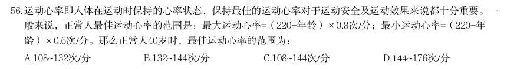

# 数量关系 · 年龄问题

> 考点编码：`SL-NL`　｜　体系对齐：花生十三 `shuliang-guanxi.md#题型8`

## 一、命题规律

- **本题型真题总量**：29 题（2000–2026）
- **地区分布**：国考 16 / 广东 5 / 湖北 8
- **近六年题量**：2026年3题, 2025年2题, 2024年2题, 2019年1题, 2017年1题, 2016年2题
- **覆盖试卷**：27 套
- **子考点分布**：年龄差不变 18　年龄和与倍数 16　年龄问题（综合） 2
- **同题变体**：另有 7 道为同题重复（同年多卷/跨年再考），已折叠，需展开见 scripts/search.py --all-variants
- **速算/速解提示**：见花生十三 `references/ziliao-susuan.md` 与 `references/shuliang-gongshi.md` 对应章节

## 二、近年真题（最多 12 题，按年份倒序）

### 2026 湖北·统一卷　第 56 题　（年龄差不变）

运动心率即人体在运动时保持的心率状态,保持最佳的运动心率对于运动安全及运动效果来说都十分重要。一 般来说,正常人最佳运动心率的范围是:最大运动心率=(220-年龄)×0.8次/分;最小运动心率=(220-年 龄)×0.6次/分。那么正常人40岁时,最佳运动心率的范围为:

- **A.** 108~132次/分
- **B.** 132~144次/分
- **C.** 108~144次/分
- **D.** 144~176次/分

**答案：C**

**解析/参考要点**：C
根据题干给出的公式,当正常人40 岁时,最大运动心率=(220-40)×0.8=144
次/分;最小运动心率=(220-40)×0.6=108 次/分。故正常人40 岁时,最佳运
动心率的范围为:108~144 次/分。
故正确答案为C。

### 2026 国考·副省级　第 76 题　（年龄和与倍数）

甲和乙办公室各有4 名职工,乙办公室职工平均年龄为32 岁。现从甲办公室调动1 人到乙 办公室,2 个办公室职工平均年龄都增加了2 岁。问调动后甲办公室职工的平均年龄为多少岁?

- **A.** 50
- **B.** 48
- **C.** 46
- **D.** 44

**答案：A**

**解析/参考要点**：A

### 2026 国考·行政执法　第 69 题　（年龄差不变）

2024 年张和李年龄的平均值是刘的2 倍;2028 年张的年龄是李的1.5 倍,比刘年龄的2 倍 大4 岁。问张哪一年60 岁?

- **A.** 2036 年
- **B.** 2038 年
- **C.** 2040 年
- **D.** 2042 年

**答案：C**

**解析/参考要点**：C

### 2025 国考·副省级　第 70 题　（年龄差不变）

2024年甲、乙、丙三人的年龄之和与2034年甲的年龄相同,且甲、乙的年龄之差大于乙、丙的年龄之差。已知 乙的年龄小于甲但大于丙,问2024年甲的年龄最小可能为多少岁?

- **A.** 13
- **B.** 11
- **C.** 10
- **D.** 9

**答案：D**

**解析/参考要点**：根据“2024 年甲、乙、丙三人的年龄之和与2034 年甲的年龄相同”可得:甲+乙+丙=甲+(2034-2024),
化简为:丙=10-乙······1,根据“乙的年龄小于甲但大于丙”,则乙>5。年龄问题优先考虑代
入排除法,问最小,按照从小到大依次代入。
代入D项,当甲=9 时,根据“甲、乙的年龄之差大于乙、丙的年龄之差”可得:9-乙>乙-丙······2,
将1代入2,解得:
,又因乙>5,则乙=6,丙=10-6=4,满足题干所有条件,无需验证其他选
项。
故正确答案为D。

### 2025 国考·地市级　第 72 题　（年龄差不变）

张、王、李、赵4人的平均年龄为28岁,张、王的年龄之和比李大25岁,李、赵的年龄之和比张大27岁。已知 张比王大2岁,问他们4人中年龄最大的比最小的大几岁?

- **A.** 5
- **B.** 6
- **C.** 3
- **D.** 4

**答案：B**

**解析/参考要点**：根据题意可列方程组:
⎩
⎪
⎨
⎪
⎧张+ 王+ 李+ 赵= 28 × 4
张+ 王= 李+ 25
李+ 赵= 张+ 27
张= 王+ 2
,解得:王=27,张=29,李=31,赵=25。
因此4 人中年龄最大的李(31 岁)比最小的赵(25 岁)大31-25=6 岁。
故正确答案为B。

### 2024 国考·副省级　第 61 题　（年龄和与倍数）

甲、乙、丙三人的年龄之比为3:4:5。8年之后,甲、乙的年龄之和是丙的1.5倍,且这一年甲、乙、丙、丁四 人的平均年龄为43岁。问再过15年,甲、乙、丙、丁中有几人将超过60岁?

- **A.** 4
- **B.** 3
- **C.** 2
- **D.** 1

**答案：C**

**解析/参考要点**：设甲、乙、丙三人现在的年龄分别为3x 岁、4x 岁、5x 岁。根据“8 年之后,甲、乙的年龄之和是丙的
1.5 倍”,可列式:
,解得x=8,则甲、乙、丙现在的年龄分别为3×8=24 岁、
4×8=32 岁、5×8=40 岁。如下表,则8 年之后、再过15 年,甲、乙、丙年龄分别为:
2024 国考《行测》(副省级)解析
20 / 46
根据“8 年之后,甲、乙、丙、丁的平均年龄为43 岁”,则8 年之后,四人年龄之和为43×4=172 岁,
此时丁年龄为172-32-40-48=52 岁,则再过15 年,丁年龄为52+15=67 岁。故再过15 年,年龄超过60
岁的有丙和丁2 人。
故正确答案为C。

### 2024 国考·地市级　第 66 题　（年龄差不变）

2023年王的年龄比张的年龄的2倍小2岁,2025年张的年龄是李的年龄的1.5倍,2030年张和李的年龄之和与王的 年龄相同。问3人的年龄之和在哪一年第一次超过120岁?

- **A.** 2037年
- **B.** 2036年
- **C.** 2035年
- **D.** 2034年

**答案：D**

**解析/参考要点**：设2025 年李的年龄为x 岁,根据题意列表如下:
2024 国考《行测》(地市级)解析
21 / 47
根据“2030 年张和李的年龄之和与王的年龄相同”,可列式:3x+1=1.5x+5+x+5,解得x=18,则2030 年
3 人的年龄之和为
岁。设从2030 年起,再过n 年3 人的年龄之和超过120 岁,则有
110+3n>120,解得
,取整为4 年,即3 人的年龄之和在2030+4=2034 年第一次超过120
岁。
故正确答案为D。

### 2019 国考·地市级　第 67 题　（年龄差不变）

某单位有2 个处室,甲处室有12 人,乙处室有20 人。现在将甲处室最年轻的4 人调入乙处室,则乙处室的 平均年龄增加了1 岁,甲处室的平均年龄增加了3 岁。问在调动之前,两个处室的平均年龄相差多少岁?

- **A.** 8
- **B.** 12
- **C.** 14
- **D.** 15

**答案：B**

**解析/参考要点**：设调动前甲处室的平均年龄为
岁,乙处室的平均年龄为
岁,则调动后甲处室的平均年龄为
岁,乙处
室的平均年龄为
岁。根据调动前后甲、乙两处室的年龄之和不变,可列式:
,
解得
,所以调动前两个处室的平均年龄差为12 岁。
故正确答案为B。

### 2017 国考·副省级　第 62 题　（年龄和与倍数）

某人出生于20 世纪70 年代,某年他发现从当年起连续10 年自己的年龄均与当年年份数字之和相等(出生 当年算0 岁)。问他在以下哪一年时,年龄为9 的整数倍?

- **A.** 2006 年
- **B.** 2007 年
- **C.** 2008 年
- **D.** 2009 年

**答案：B**

**解析/参考要点**：方法一:设出生年份为
年。若当年为
年,根据连续10 年自己的年龄均与当年年份数字之
和相等,可得:
,解得
,不满足条件;若当年为
年,
可得:
,解得
,即出生于1971 年,代入2006 年为35 岁,
2007 年为36 岁,是9 的整数倍。
方法二:1990 年,数字之和为
岁,若满足年龄等于当年年份数字之和,则出生年份
,满足出生于20 世纪70 年代,且从1990 年开始连续十年都满足要求。所以出生年份为1971
年,代入2006 年为35 岁,2007 年为36 岁,是9 的整数倍。
故正确答案为B。

### 2016 湖北·统一卷　第 67 题　（年龄差不变）

2014 年父亲、母亲的年龄之和是年龄之差的23 倍,年龄之差是儿子年龄的1/5,5 年后母亲和儿子的年龄 都是平方数。问2014 年父亲的年龄是多少?(年龄都按整数计算)

- **A.** 36 岁
- **B.** 40 岁
- **C.** 44 岁
- **D.** 48 岁

**答案：D**

**解析/参考要点**：由2014
年父母年龄之差是儿子年龄的
,可得儿子的年龄是5
的倍数,而5 年后儿子的年龄也必然是5
的
倍数,是5
的倍数且为平方数的只能为25,则可得到2014 年儿子的年龄为20
岁,父母年龄差即20×
=4 岁,
年龄和为4×23=92 岁,假设父亲年龄比母亲年龄大,则可得父亲年龄-母亲年龄=4,可得父亲年龄=48 岁,母亲
年龄=44 岁,5 年后母亲年龄为49 岁,是平方数,满足条件。
故正确答案为D。

### 2016 国考·副省级　第 71 题　（年龄和与倍数）

有一位百岁老人出生于二十世纪,2015 年他的年龄各数字之和正好是他在2012 年的年龄的各数字之和的三 分之一,问该老人出生的年份各数字之和是多少(出生当年算作0 岁)?

- **A.** 14
- **B.** 15
- **C.** 16
- **D.** 17

**答案：A**

**解析/参考要点**：由题意可得2012 年老人的年龄之和为3 的倍数,则3 年后即老人在2015 年时年龄之和仍为3 的倍数。
又已知老人出生于二十世纪,则老人在2015 年时的年龄<2015-1900=115 岁(出生当年算作0 岁)。取值试算,
若老人2015 年时114 岁,则2012 年111 岁,不满足题意;若老人2015 年时111 岁,年龄各数字和为3,则2012
年108 岁,年龄各数字和为9,满足题意。得到2015-111=1904,即老人于1904 年出生。
故正确答案为A。

### 2015 国考·副省级　第 68 题　（年龄差不变）

小李的弟弟比小李小2 岁,小王的哥哥比小王大2 岁、比小李大5 岁。1994 年,小李的弟弟和小王的年龄 之和为15。问2014 年小李与小王的年龄分别为多少岁:

- **A.** 25,32
- **B.** 27,30
- **C.** 30,27
- **D.** 32,25

**答案：B**

**解析/参考要点**：根据题中已知条件“小王的哥哥比小王大2 岁,比小李大5 岁”可知,小王比小李大3 岁,从选项可判断,
只有B 项符合。
故正确答案为B。

## 三、其余真题（按年代分片）

| 年代 | 题量 | 分片文件 |
|---|---:|---|
| 2000s | 8 | [SL-NL-2000s.md](split/SL-NL-2000s.md) |
| 2010s | 9 | [SL-NL-2010s.md](split/SL-NL-2010s.md) |

> 也可用 `python scripts/search.py --kaodian SL-NL` 直接检索全部 29 题。