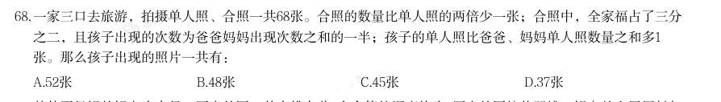
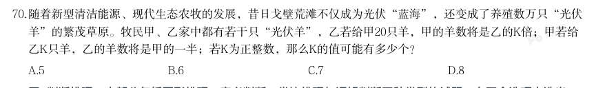
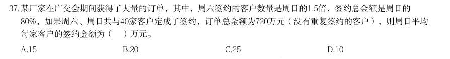
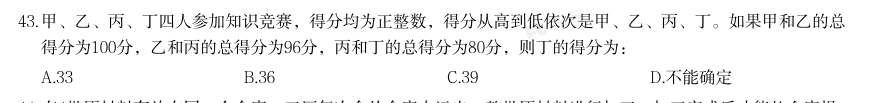
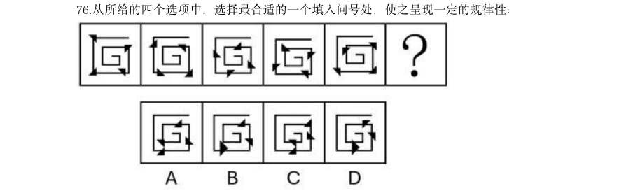

# 数量关系 · 其他数量关系

> 考点编码：`SL-OT`　｜　体系对齐：花生十三 `体系外补充（方程/和差倍比/基础计算，归入数量关系）`

## 一、命题规律

- **本题型真题总量**：388 题（2000–2026）
- **地区分布**：国考 171 / 广东 133 / 湖北 84
- **近六年题量**：2026年11题, 2025年6题, 2024年13题, 2023年1题, 2022年23题, 2021年10题
- **覆盖试卷**：85 套
- **子考点分布**：和差倍比 224　其他数量关系（综合） 129　基础计算 27　方程与不定方程 27　日期与钟表 14
- **同题变体**：另有 33 道为同题重复（同年多卷/跨年再考），已折叠，需展开见 scripts/search.py --all-variants
- **速算/速解提示**：见花生十三 `references/ziliao-susuan.md` 与 `references/shuliang-gongshi.md` 对应章节

## 二、近年真题（最多 12 题，按年份倒序）

### 【2026 湖北省考·第 68 题】HB-2026-ty-X068　其他数量关系｜和差倍比

一家三口去旅游,拍摄单人照、合照一共68张。合照的数量比单人照的两倍少一张;合照中,全家福占了三分 之二,且孩子出现的次数为爸爸妈妈出现次数之和的一半;孩子的单人照比爸爸、妈妈单人照数量之和多1 张。那么孩子出现的照片一共有:

- **A.** 52张
- **B.** 48张
- **C.** 45张
- **D.** 37张

**答案：A**

**解析/参考要点**：A
根据“单人照、合照一共68 张。合照的数量比单人照的两倍少一张”,可得单
人照为(68+1)/3=23 张,合照为68−23=45 张。因为“孩子的单人照比爸爸、妈
妈单人照数量之和多1 张”,则孩子单人照为
张,爸爸、妈妈单
人照为23−12=11 张。由于“合照中,全家福占了三分之二”,则全家福数量为
45X(2/3)=30 张,两人合照数量为45−30=15 张。
设有孩子的两人合照为x 张,则没有孩子的两人合照为(15−x)张。根据“合照
中孩子出现的次数为爸爸妈妈出现次数之和的一半”,可得方程
,解得x=10。所以孩子出现的照片一共
有12+30+10=52 张。
故正确答案为A。

### 【2026 湖北省考·第 70 题】HB-2026-ty-X070　其他数量关系｜和差倍比

随着新型清洁能源、现代生态农牧的发展,昔日戈壁荒滩不仅成为光伏“蓝海”,还变成了养殖数万只“光伏 羊”的繁茂草原。牧民甲、乙家中都有若干只“光伏羊”,乙若给甲20只羊,甲的羊数将是乙的K倍;甲若给 乙K只羊,乙的羊数将是甲的一半;若K为正整数,那么K的值可能有多少个?

- **A.** 5
- **B.** 6
- **C.** 7
- **D.** 8

**答案：D**

**解析/参考要点**：D
设牧民甲、乙家中的光伏羊分别有x 只、y 只。根据题意可列方程组:
,将1式x=k(y-20)-20 代入2式可得:k
(y-20)-20-k=2(y+k),整理可得
,变形后可得
,根据题意y 为正整数,且k 为正
整数,则k-2 为66 的约数。对66 进行因式分解:66=1×66=2×33=3×22=6×11,
因此66 的约数共8 个,k-2 共8 种情况:
当k-2=1 时,k=3,y=89 只,x=187 只;
当k-2=2 时,k=4,y=56 只,x=124 只;
当k-2=3 时,k=5,y=45 只,x=105 只;
当k-2=6 时,k=8,y=34 只,x=92 只;
当k-2=11 时,k=13,y=29 只,x=97 只;
当k-2=22 时,k=24,y=26 只,x=124 只;
当k-2=33 时,k=35,y=25 只,x=155 只;
当k-2=66 时,k=68,y=24 只,x=252 只。
则k 值共有8 种可能。
故正确答案为D。

### 【2026 广东省考·第 37 题】GD-2026-ty-X037　其他数量关系｜和差倍比

某厂家在广交会期间获得了大量的订单,其中,周六签约的客户数量是周日的1.5倍,签约总金额是周日的 80%,如果周六、周日共与40家客户定成了签约,订单总金额为720万元(没有重复签约的客户),则周日平均 每家客户的签约金额为( )万元。

- **A.** 15
- **B.** 20
- **C.** 25
- **D.** 10

**答案：C**

**解析/参考要点**：答案C
因“周六签约的客户数量是周日的1.5 倍且“周六、周日共与40 家客户定成了
签约”,则周日签约客户数量=(40/1.5+1)x1=16 家;同理可得,周日签(720/80%+1)
x1=400 万元。故周日平均每家客户的签约金额=签约总金额/签约客户数量
=400/16=25 万元。=故正确答案为C。

### 【2026 广东省考·第 43 题】GD-2026-ty-X043　其他数量关系｜和差倍比

甲、乙、丙、丁四人参加知识竞赛,得分均为正整数,得分从高到低依次是甲、乙、丙、丁。如果甲和乙的总 得分为100分,乙和丙的总得分为96分,丙和丁的总得分为80分,则丁的得分为:

- **A.** 33
- **B.** 36
- **C.** 39
- **D.** 不能确定

**答案：A**

**解析/参考要点**：答案A
方法一:根据题意,设甲的得分为x 分,则乙的得分为(100-x)分,丙的得分为
96-(100-x)=(x-4)分,丁的得分为80-(x-4)=(84-x)分。根据“得分从高到低依
次是甲、乙、丙、丁”,可知甲的得分高于乙,即x>100-x,解得x>50;乙的得分
高于丙,即100-x>x-4,解得x<52,因每人得分均为正整数,则x=51。故丁的
得分为84-51=33 分。
方法二:直接计算较复杂,考虑代入排除法。代入A 项:丁的得分为33 分,则丙
的得分为80-33=47 分,乙的得分为96-47=49 分,甲的得分为100-49=51 分,得
分从高到低依次是甲(51 分)、乙(49 分)、丙(47 分)、丁(33 分),满足题干所有
条件,当选。故正确答案为A。

### 【2026 国考（副省级）·第 69 题】GK-2026-fs-X069　其他数量关系｜和差倍比

某企业采购了A、B、C 三个品牌的电脑共54 台,其中采购A 品牌电脑的台数比B 品牌电 脑少35%。问采购的C 品牌电脑比B 品牌电脑:

- **A.** 少1 台
- **B.** 少2 台
- **C.** 多1 台
- **D.** 多2 台

**答案：C**

**解析/参考要点**：C

### 【2026 国考（副省级）·第 74 题】GK-2026-fs-X074　其他数量关系｜和差倍比

某考试有30 人参加,每人得分都是0~100 之间的整数且互不相同。已知得分不低于90 的人 平均分为93.8 分,小姜得了92 分,问他的成绩排名最低可能是第几名?

- **A.** 4
- **B.** 5
- **C.** 7
- **D.** 8

**答案：A**

**解析/参考要点**：A
设得分不低于90 的有n 个人。根据题意“每人得分都是0~100 之间的整数且互不相同”,则分数不低于90
的人数最多为90~100 分各1 人,即n≤11;总分数为n 个整数之和,即总分数=93.8n 为整数,则n 只能为5
或10。
若n=10,则前十名的总分数为93.8×10=938 分。因分数为互不相同的整数,则前十名总分最低为
90+91+92+93+94+95+96+97+98+99=945>938,n=10 不成立,则n=5,排除C、D 两项。
n=5,则前五名总分数为93.8×5=469 分。问“排名最低可能是第几名”,代入B 项,92 分为第5 名,则前
五名总分数最低为92+93+94+95+96=470>469,不成立,排除。
故正确答案为A。

### 【2026 国考（副省级）·第 78 题】GK-2026-fs-X078　其他数量关系｜日期与钟表

某社区干部每周一参加工作例会,每月10 日、20 日接访群众。已知8 月与9 月共有2 次 接访群众与工作例会在同一天,问当年9 月1 日是:

- **A.** 周三
- **B.** 周二
- **C.** 周六
- **D.** 周五

**答案：C**

**解析/参考要点**：C
根据题意可知,8 月10 日、20 日,9 月10 日、20 日,这4 天中有2 天既接访群众又参加工作例会,即这4
天中仅有2 天是周一。这4 天中相邻2 天间隔天数依次为10 天、21 天、10 天,21 天为7 的倍数,则仅8 月
20 日与9 月10 日的星期数相同,故8 月20 日与9 月10 日为周一,则9 月3 日为周一,9 月1 日为周六。
故正确答案为C。

### 【2026 国考（副省级）·第 80 题】GK-2026-fs-X080　其他数量关系｜和差倍比

公司1 月销售额为w 元,从2 月开始每个月的销售额都比上个月高k 元。已知一季度完成 全年销售目标的18%,上半年完成全年销售目标的48%,问公司全年实际销售额将比销售目标高 多少元?

- **A.** 21k
- **B.** 28k
- **C.** 33k
- **D.** 44k

**答案：C**

**解析/参考要点**：C

### 【2026 国考（地市级）·第 66 题】GK-2026-ds-X066　其他数量关系｜和差倍比
> 材料：A.少1 出答案。…

某企业采购了A、B、C 三个品牌的电脑共54 台,其中采购A 品牌电脑的台数比B 品牌电 脑少35%。问采购的C 品牌电脑比B 品牌电脑: 台 B.少2 台 C.多1 台 D.多2 台

> （本题为图形题，选项为图片，见原卷）

**答案：C**

**解析/参考要点**：C

### 【2026 国考（地市级）·第 76 题】GK-2026-ds-X076　其他数量关系｜日期与钟表

从所给的四个选项中,选择最合适的一个填入问号处,使之呈现一定的规律性 选项中选出一个最恰当的答案。 :

> （本题为图形题，选项为图片，见原卷）

**答案：A**

**解析/参考要点**：A
元素组成相同,优先考虑位置规律。观察发现,题干每幅图形中四个黑色三角形均沿着折线逆时针方向每
次走一步,且每次自身顺时针旋转
,如下图所示。
因此?处图形也应满足此规律,只有A 项符合。
故正确答案为A。

### 【2026 国考（行政执法）·第 70 题】GK-2026-zf-X070　其他数量关系｜和差倍比

甲、乙和丙3 个单位共有100 多名职工,其中甲单位的职工人数占总数的24%,乙单位的职 工比丙单位多50%。问丙单位的职工比甲单位多多少人?

- **A.** 4
- **B.** 8
- **C.** 12
- **D.** 16

**答案：B**

**解析/参考要点**：B

### 【2025 国考（副省级）·第 66 题】GK-2025-fs-X066　其他数量关系｜和差倍比

运送一批货物,第一趟派出10辆大车,第二趟又增派15辆小车,运输量比第一趟高50%。问每辆大车的载货量 是小车的多少倍?

- **A.** 3
- **B.** 2.5
- **C.** 2
- **D.** 1.5

**答案：A**

**解析/参考要点**：设每辆大车的载货量为x,每辆小车的载货量为y,则第一趟的运输量为10x,第二趟的运输量为10x+15y。
2025 国考《行测》(副省级)解析
23 / 46
根据题意可列式:10x+15y=(1+50%)×10x,整理可得:x=3y,即每辆大车的载货量是小车的3 倍。
故正确答案为A。

## 三、其余真题（按年代分片）

| 年代 | 题量 | 分片文件 |
|---|---:|---|
| 2000s | 140 | [SL-OT-2000s.md](split/SL-OT-2000s.md) |
| 2010s | 168 | [SL-OT-2010s.md](split/SL-OT-2010s.md) |
| 2020s | 68 | [SL-OT-2020s.md](split/SL-OT-2020s.md) |

> 也可用 `python scripts/search.py --kaodian SL-OT` 直接检索全部 388 题。