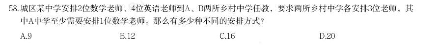
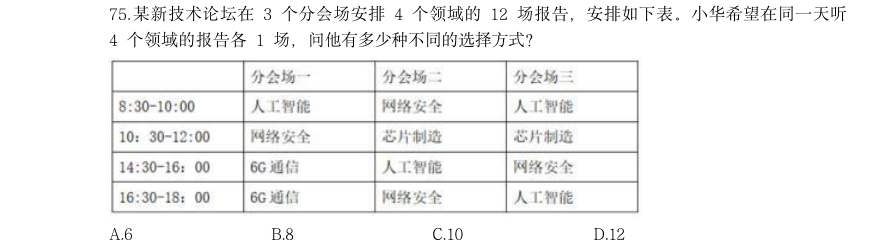
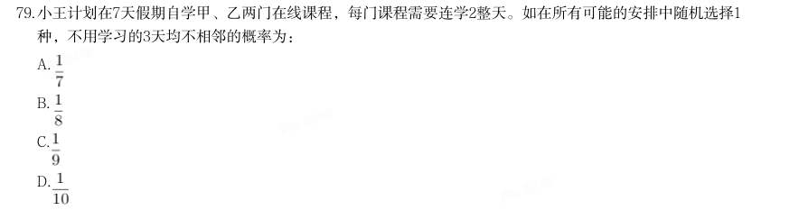

# 数量关系 · 排列组合

> 考点编码：`SL-PL`　｜　体系对齐：花生十三 `shuliang-guanxi.md#题型4`

## 一、命题规律

- **本题型真题总量**：52 题（2004–2026）
- **地区分布**：国考 27 / 广东 10 / 湖北 15
- **近六年题量**：2026年3题, 2025年6题, 2024年5题, 2023年3题, 2022年2题, 2021年1题
- **覆盖试卷**：41 套
- **子考点分布**：基础排列组合 46　捆绑法 14　排列组合（综合） 3　插空法 1
- **同题变体**：另有 12 道为同题重复（同年多卷/跨年再考），已折叠，需展开见 scripts/search.py --all-variants
- **速算/速解提示**：见花生十三 `references/ziliao-susuan.md` 与 `references/shuliang-gongshi.md` 对应章节

## 二、近年真题（最多 12 题，按年份倒序）

### 2026 湖北·统一卷　第 58 题　（基础排列组合）

城区某中学安排2位数学老师、4位英语老师到A、B两所乡村中学任教,要求两所乡村中学各安排3位老师,其 中A中学至少需要安排1位数学老师。那么有多少种不同的安排方式?

- **A.** 9
- **B.** 12
- **C.** 16
- **D.** 20

**答案：C**

**解析/参考要点**：C
方法一:根据题意,A 中学可以安排1 位数学老师或2 位数学老师,分类讨论如
下:
(1)A 中学安排1 位数学老师、2 位英语老师,其余老师安排给B 中学,有
种安排方式;
(2)A 中学安排2 位数学老师、1 位英语老师,其余老师安排给B 中学,有
种安排方式。
分类用加法,则A 中学至少需要安排1 位数学老师的方式有12+4=16 种。
方法二:可考虑逆向思维。总情况为从6 位老师中选3 位去A 中学,有
种安排方式。要求A 中学至少需要安排1 位数学老师,反面为安排到A 中学的3
位老师全是英语老师,有
种安排方式。因此,共有20-4=16 种安排方式。
故正确答案为C。

### 2026 国考·地市级　第 67 题　（基础排列组合）

某部门7 人分两组到甲、乙两市进行调研。已知到甲市人数超过一半,老张和小王均到乙 市,问共有多少种不同的分组方式?

- **A.** 10
- **B.** 8
- **C.** 6
- **D.** 5

**答案：C**

**解析/参考要点**：C

### 2026 国考·地市级　第 75 题　（基础排列组合）

某新技术论坛在3 个分会场安排4 个领域的12 场报告,安排如下表。小华希望在同一天听 4 个领域的报告各1 场,问他有多少种不同的选择方式?

- **A.** 6
- **B.** 8
- **C.** 10
- **D.** 12

**答案：D**

**解析/参考要点**：D

### 2025 湖北·统一卷　第 56 题　（基础排列组合）

案。 某研究机构对不同蔬果的代谢质量进行评分,分数越高代表代谢质量越高。现有13种蔬果,其中2种蔬果为5 分,4种蔬果为4分,3种蔬果为3分,4种蔬果为2分,那么从中选取3种蔬果得分总和不低于13分的组合共有多 少种?

- **A.** 21
- **B.** 19
- **C.** 16
- **D.** 13

**答案：C**

### 2025 湖北·统一卷　第 59 题　（排列组合（综合））

某地军工驿站就业直通车送6名工人到

- **A.** 180
- **B.** 320
- **C.** 345
- **D.** 360

**答案：C**

### 2025 国考·副省级　第 72 题　（基础排列组合）

某竞赛由5道次序固定的判断题组成,参赛者起始为0分,每答对1题加1分,每答错1题扣1分。小王作答了所有 试题,答完每道题时当前的得分都不低于1分。问他的答题情况有多少种不同的可能?

- **A.** 7
- **B.** 6
- **C.** 4
- **D.** 3

**答案：B**

**解析/参考要点**：根据题干“答完每道题时当前的得分都不低于1 分”可知,第一题和第二题均答对,第三题分情况讨论:
1第三题答对,此时有3 分,第四题和第五题不论是答对还是答错,均能保证答完每道题时当前的得分
都不低于1 分,故第四题和第五题答题情况均为2 种,分步用乘法,有2×2=4 种情况;
2第三题答错,此时还剩1 分,所以第四题必须答对,第四题答对后有2 分,则第五题不论答对还是答
错均满足题干条件,有2 种情况。
分类用加法,即共有4+2=6 种情况。
故正确答案为B。

### 2025 国考·副省级　第 77 题　（排列组合（综合））

将甲、乙两种设备各5件全部分配给

- **A.** 3
- **B.** 6
- **C.** 12
- **D.** 24

**答案：A**

**解析/参考要点**：根据题意,符合要求的情况列表如下:
综上,共有3 种不同的分配方式。
故正确答案为A。

### 2025 国考·副省级　第 79 题　（捆绑法）

小王计划在7天假期自学甲、乙两门在线课程,每门课程需要连学2整天。如在所有可能的安排中随机选择1 种,不用学习的3天均不相邻的概率为:

- **A.** 
- **B.** 
- **C.** 
- **D.** 

**答案：D**

**解析/参考要点**：根据公式:概率=满组要求情况数/总情况数,分析如下:
甲、乙两门课程均需要占用相邻的2 天,可用捆绑法,先将每门课程所占用的2 天分别捆绑,再将这2
个捆绑体和其它3 天进行排序。因每“天”均相同,不用排序,而两门课程不同,需要排序,则总情况
数
种情况;
根据题意,不用学习的3 天均不相邻,可用插空法,优先安排学习两门课程的时间,因两门课程不同,
对两门课程进行排序有
种情况,再将剩余3 天插入两门课程安排好之后形成的3 个空隙,因每
“天”均相同不用再排序,有
种情况,故满足要求的情况数=2×1=2 种情况。
综上,所求概率
。
故正确答案为D。

### 2025 国考·行政执法　第 69 题　（排列组合（综合））

将甲、乙两种设备各5件全部分配给

- **A.** 3
- **B.** 6
- **C.** 12
- **D.** 24

**答案：A**

**解析/参考要点**：根据题意,符合要求的情况列表如下:
综上,共有3 种不同的分配方式。
故正确答案为A。

### 2024 湖北·统一卷　第 59 题　（基础排列组合）

运输公司准备将475箱相同的救灾物资运往灾区。现在有足够多的大、小两种货车可供选择,大货车每辆最多 可装载48箱物资,小货车每辆最多可装载32箱物资。每辆大货车配两名驾驶员,每辆小货车配一名驾驶员,目 前公司有17名驾驶员可供派遣。若装载物资时,应先装满大货车,再依次装满小货车,且最后一辆小货车的装 载率至少要达到三分之二,则可选择的派车方案有多少种?

- **A.** 2
- **B.** 3
- **C.** 4
- **D.** 5

**答案：A**

### 2024 湖北·统一卷　第 60 题　（捆绑法）

某公园绿化管理部门采购了100片围栏,每片长1米且不可弯折。现拆分拟围成5块周长相等且互不相邻的矩形 花卉区域。若不考虑拼接间隙,那么这5块区域的最大与最小面积最多可相差多少平方米?

- **A.** 10
- **B.** 12
- **C.** 16
- **D.** 25

**答案：C**

### 2024 湖北·统一卷　第 65 题　（基础排列组合）

中国空间站主体由天和核心舱、问天实验舱、梦天实验舱构成。某次实验需要5名宇航员同时在三个舱中开 展,每个人只能去一个舱,每个舱至少安排1名宇航员,其中甲宇航员只能去问天实验舱和梦天实验舱中的一 个,则不同的安排方法有多少种?

- **A.** 72
- **B.** 88
- **C.** 100
- **D.** 144

**答案：C**

## 三、其余真题（按年代分片）

| 年代 | 题量 | 分片文件 |
|---|---:|---|
| 2000s | 5 | [SL-PL-2000s.md](split/SL-PL-2000s.md) |
| 2010s | 23 | [SL-PL-2010s.md](split/SL-PL-2010s.md) |
| 2020s | 12 | [SL-PL-2020s.md](split/SL-PL-2020s.md) |

> 也可用 `python scripts/search.py --kaodian SL-PL` 直接检索全部 52 题。