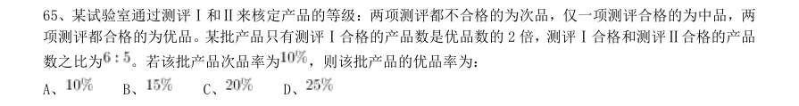
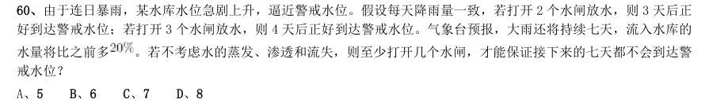

# 数量关系 · 容斥问题

> 考点编码：`SL-RC`　｜　体系对齐：花生十三 `shuliang-guanxi.md#题型6`

## 一、命题规律

- **本题型真题总量**：28 题（2005–2025）
- **地区分布**：国考 11 / 广东 12 / 湖北 5
- **近六年题量**：2025年1题, 2024年1题, 2022年1题, 2021年2题, 2018年2题, 2017年2题
- **覆盖试卷**：23 套
- **子考点分布**：容斥问题（综合） 14　两集合 11　三集合 6
- **同题变体**：另有 3 道为同题重复（同年多卷/跨年再考），已折叠，需展开见 scripts/search.py --all-variants
- **速算/速解提示**：见花生十三 `references/ziliao-susuan.md` 与 `references/shuliang-gongshi.md` 对应章节

## 二、近年真题（最多 12 题，按年份倒序）

### 2025 国考·副省级　第 69 题　（容斥问题（综合））

某研发小组员工中,60%的人参与了A项目,45%的人参与了B项目,两个项目都参与的人比两个项目都不参与 的多2人。问该研发小组有多少人?

- **A.** 100
- **B.** 50
- **C.** 40
- **D.** 20

**答案：C**

**解析/参考要点**：设该研发小组有x 人,则参与了A 项目的有
人,参与了B 项目的有
人;设两个项目都不参与的有y 人,则两个项目都参与的有(y+2)人。根据两集
合容斥原理公式:
,可列式:0.6x+0.45x-(y+2)=x-y,解得x=40,
即该研发小组有40 人。
故正确答案为C。

### 2024 湖北·统一卷　第 64 题　（容斥问题（综合））

某公司开展迎新春三分球投篮比赛。3个部门分别派出2、4、4个选手共计10人参加。规则要求同一个部门的选 手顺序相连、全部投完再安排另一个部门的人员,则这10人不同的投篮顺序种数的范围是:

- **A.** 小于1000
- **B.** 1000~5000
- **C.** 5001~10000
- **D.** 10000以上

**答案：C**

**解析/参考要点**：根据题意,要求同一部门的选手顺序相连,故可先将同一部门的选手捆绑起来,再对三个部门进行
排序。因同一部门的选手有先后之分,则3 个部门分别有
、
、
种排列
方式,3 个部门共有
种排列方式。故一共有2×24×24×6=6912 种不同的投篮顺序,在C
项范围内。
故正确答案为C。

### 2022 广东·乡镇　第 41 题　（两集合）

某单位计划从全部80 名员工中挑选专项工作组成员,要求该组成员须同时有基层经历和计算机等级证书。 已知,单位内有40 人有基层经历,有46 人有计算机等级证书,既没有基层经历又未获得计算机等级证书的有10 人。那么能够进入工作组的员工有( )人。

- **A.** 16
- **B.** 40
- **C.** 46
- **D.** 54

**答案：A**

**解析/参考要点**：解析
根据两集合容斥原理公式A+B-A
B=总数-都不,可得:有基层经历+有计算机等级证书-两种都有=
总人数-两种都没有,设同时有基层经历和计算机等级证书的有x 人,则有40+46-x=80-10,解得
x=16。
故正确答案为A。

### 2021 国考·副省级　第 65 题　（三集合）

某企业参与兴办了甲、乙、丙、丁4 个扶贫车间,共投资450 万元,甲车间的投资额是其他三个车间投资额 之和的一半,乙车间的投资额比丙车间高25%,丁车间的投资额比乙、丙车间投资额之和低60 万元。企业后期 向4 个车间追加了200 万元投资,每个车间的追加投资额都不超过其余任一车间追加投资额的2 倍,问总投资额 最高和最低的车间,总投资额最多可能相差多少万元?

- **A.** 70
- **B.** 90
- **C.** 110
- **D.** 130

**答案：暂缺（原始文件为扫描版）**

### 2021 国考·地市级　第 64 题　（容斥问题（综合））

某地10 户贫困农户共申请扶贫小额信贷25 万元。已知每人申请金额都是1000 元的整数倍,申请金额最高 的农户申请金额不超过申请金额最低农户的2 倍,且任意2 户农户的申请金额都不相同。问申请金额最低的农户 最少可能申请多少万元信贷?

- **A.** 1.5
- **B.** 1.6
- **C.** 1.7
- **D.** 1.8

**答案：B**

**解析/参考要点**：,全站正确率:47%,易错项:C。
解析
第一步,本题考查最值问题,属于数列构造。
第二步,设申请金额最低的农户最少可能申请x 万元信贷,根据申请金额最高的农户申请金额不超过申请金额最
低农户的2 倍,则最高的申请2x 万元,要使最低的最低,则中间8 户应尽量高,已知每人申请金额都是1000 元
的整数倍,构造如下表:
列方程:2x+(2x-0.1)+(2x-0.2)+......+x=25,解得x=1.5+,问题求最少向上取整,最少申请1.6 万
元信贷。
因此,选择B 选项。

### 2018 湖北·统一卷　第 65 题　（容斥问题（综合））

某试验室通过测评I和II来核定产品的等级:两项测评都不合格的为次品,仅一项测评合格的为中品,两 项测评都合格的为优品。某批产品只有测评I合格的产品数是优品数的2 倍,测评I合格和测评II合格的产品 数之比为 。若该批产品次品率为 ,则该批产品的优品率为:

- **A.** 
- **B.** 
- **C.** 
- **D.** 

**答案：C**

**解析/参考要点**：假设这批产品的优品数为
,则只有测评I合格的产品数为
,测评I合格的全部产品数为
,测
评II合格的产品数为
。根据两集合容斥原理公式:
,则这批产
品非次品数量为
,在总数中占比为
,则产品总数为
,则优品率为
。
故正确答案为C。

### 2018 湖北·统一卷　第 68 题　（三集合）

联欢会上,有24 人吃冰激凌、30 人吃蛋糕、38 人吃水果,其中既吃冰激凌又吃蛋糕的有12 人,既吃冰 激凌又吃水果的有16 人,既吃蛋糕又吃水果的有18 人,三样都吃的则有6 人。假设所有人都吃了东西,那么 只吃一样东西的人数是多少?

- **A.** 12
- **B.** 18
- **C.** 24
- **D.** 32

**答案：B**

**解析/参考要点**：如图所示,共有24 人吃冰淇淋,其中有12 人吃了蛋糕,16 人吃了水果,既吃了蛋糕又吃了水果的有6 人,则
只吃了冰淇淋的人数为
人;同理,只吃了蛋糕的人数为
人;只
吃了水果的人数为
人,则只吃一样东西的人数为
人。
故正确答案为B。

### 2017 湖北·统一卷　第 60 题　（容斥问题（综合））

由于连日暴雨,某水库水位急剧上升,逼近警戒水位。假设每天降雨量一致,若打开2 个水闸放水,则3 天后正 好到达警戒水位;若打开3 个水闸放水,则4 天后正好到达警戒水位。气象台预报,大雨还将持续七天,流入水库的 水量将比之前多 。若不考虑水的蒸发、渗透和流失,则至少打开几个水闸,才能保证接下来的七天都不会到达警 戒水位?

- **A.** 5
- **B.** 6
- **C.** 7
- **D.** 8

**答案：B**

**解析/参考要点**：设水库原有水量为
,警戒水位的水量为
,每天降水量为
,每个水闸每天放水量为1。则根据水库水量变化
过程可得:
;
可以解得
,
。
气象台预报,降水量增加
,则每天降水
,设未来7 天至少打开n 个水闸可以保证水量低于警戒水位。则
可得方程如下:
,代入数据可得,
,故至少打开5.5 个水闸,应向上取整为6 个水闸。
故正确答案为B。

### 2017 广东·统一卷　第 27 题　（两集合）

某单位有107 名职工为灾区捐献了物资,其中78 人捐献衣物,77 人捐献食品。该单位既捐献衣物,又 捐献食品的职工有多少人?

- **A.** 48
- **B.** 50
- **C.** 52
- **D.** 54

**答案：暂缺（原始文件为扫描版）**

### 2016 国考·副省级　第 73 题　（两集合）

某出版社新招了10 名英文、法文和日文方向的外文编辑,其中既会英文又会日文的小李是唯一掌握一种以 上外语的人。在这10 人中,会法文的比会英文的多4 人,是会日文人数的两倍。问只会英文的有几人?

- **A.** 2
- **B.** 0
- **C.** 3
- **D.** 1

**答案：D**

**解析/参考要点**：由题意可知会法文是会日文人数的2 倍,可知会法文的人数是偶数,且会法文比会英文多4 人,则会英
文的人数为偶数,已知小李是唯一掌握一种以上外语的人且小李会英语,则只会英文的人数为奇数,排除A 项与
B 项。代入C 项,若只会英文的有3 人,则会英文的人数为3+1=4 人(1 人指小李),会法文的有4+4=8 人,会
日文的有8
2=4 人,根据三集合标准型公式:4+8+4-1+0=15>10 人,排除C 项。
故正确答案为D。

### 2015 国考·副省级　第 73 题　（三集合）

某企业调查用户从网络获取信息的习惯,问卷回收率为90%,调查对象中有179 人使用搜索引擎获取信息, 146 人从官方网站获取信息,246 人从社交网站获取信息,同时使用这三种方式的有115 人,使用其中两种的有 24 人,另有52 人这三种方式都不使用,问这次调查共发出了多少份问卷:

- **A.** 310
- **B.** 360
- **C.** 390
- **D.** 410

**答案：D**

**解析/参考要点**：根据题意,收回问卷
,则所求为
。
故正确答案为D。

### 2014 国考·统一卷　第 65 题　（容斥问题（综合））

某连锁企业在10 个城市共有100 家专卖店,每个城市的专卖店数量都不同。如果专卖店数量排名第5 多的 城市有12 家专卖店,那么专卖店数量排名最后的城市,最多有几家专卖店:

- **A.** 2
- **B.** 3
- **C.** 4
- **D.** 5

**答案：C**

**解析/参考要点**：设专卖店数量排名最后的城市有
x
家专卖店。要求专卖店数量排名最后的城市专卖店的数量最多,则令其
他城市专卖店数量最少。题目中已知排名第5 多城市有12 家专卖店,且每个城市专卖店数量不同,则可得下
表:
16 + 15 + 14 + 13 + 12 + (x
+ 4) + (x
+ 3) + (x
+ 2) + (x
+ 1) +
x
= 100,解得
x
= 4。
故正确答案为C。

## 三、其余真题（按年代分片）

| 年代 | 题量 | 分片文件 |
|---|---:|---|
| 2000s | 7 | [SL-RC-2000s.md](split/SL-RC-2000s.md) |
| 2010s | 9 | [SL-RC-2010s.md](split/SL-RC-2010s.md) |

> 也可用 `python scripts/search.py --kaodian SL-RC` 直接检索全部 28 题。