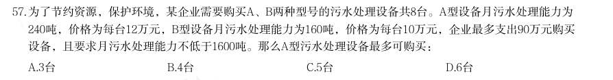
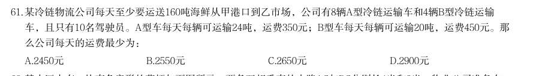
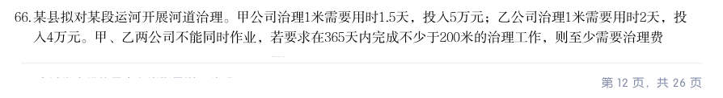
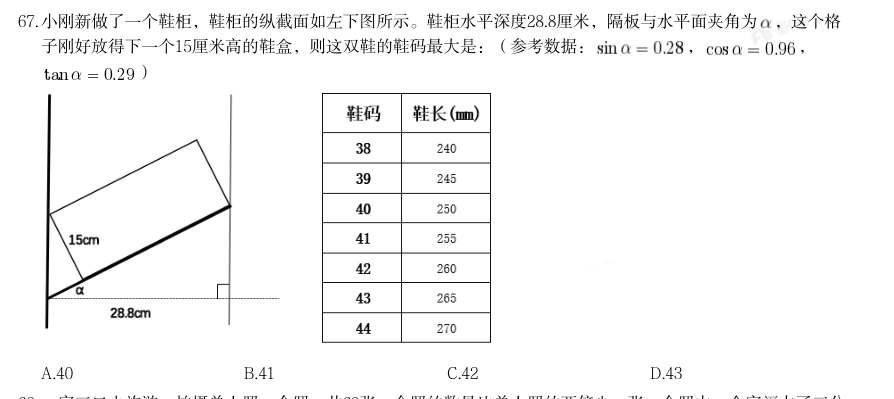

# 数量关系 · 最值问题

> 考点编码：`SL-ZZ`　｜　体系对齐：花生十三 `shuliang-guanxi.md#题型7`

## 一、命题规律

- **本题型真题总量**：100 题（2000–2026）
- **地区分布**：国考 52 / 广东 18 / 湖北 30
- **近六年题量**：2026年4题, 2025年2题, 2024年2题, 2022年2题, 2021年6题, 2020年7题
- **覆盖试卷**：58 套
- **子考点分布**：最值优化 110　最不利构造 6　多集合最值 1
- **同题变体**：另有 17 道为同题重复（同年多卷/跨年再考），已折叠，需展开见 scripts/search.py --all-variants
- **速算/速解提示**：见花生十三 `references/ziliao-susuan.md` 与 `references/shuliang-gongshi.md` 对应章节

## 二、近年真题（最多 12 题，按年份倒序）

### 2026 湖北·统一卷　第 57 题　（最值优化）

为了节约资源,保护环境,某企业需要购买A、B两种型号的污水处理设备共8台。A型设备月污水处理能力为 240吨,价格为每台12万元,B型设备月污水处理能力为160吨,价格为每台10万元,企业最多支出90万元购买 设备,且要求月污水处理能力不低于1600吨。那么A型污水处理设备最多可购买:

- **A.** 3台
- **B.** 4台
- **C.** 5台
- **D.** 6台

**答案：C**

**解析/参考要点**：C
方法一:根据题意可得A、B 两种型号的设备每万元月污水处理能力分别为
吨、
吨,相同支出情况下A 型设备污水处理能力更强,但
A 型设备价格较高,结合题目问A 型污水处理设备最多可购买多少,可从最大选
项开始代入验证:
代入D 项,A 型设备6 台,则B 型设备8-6=2 台,总费用=6×12+2×10=72+20=92
万元,超过90 万预算,排除;
代入C 项,A 型设备5 台,则B 型设备8-5=3 台,总费用=5×12+3×10=60+30=90
万元,刚好符合预算,总处理能力
,符合能力要求。
故正确答案为C。
方法二:设购买A 型设备x 台,则B 型设备(8-x)台。根据企业最多支出90 万元
可得
,根据要求月污水处理能力不低于1600 吨可得
,解得
,因此A 型设备最多可购买5
台。
故正确答案为C。

### 2026 湖北·统一卷　第 61 题　（最值优化）

某冷链物流公司每天至少要运送160吨海鲜从甲港口到乙市场,公司有8辆A型冷链运输车和4辆B型冷链运输 车,且只有10名驾驶员。A型车每天每辆可运输24吨,运费350元;B型车每天每辆可运输20吨,运费450元。那 么公司每天的运费最少为:

- **A.** 2450元
- **B.** 2550元
- **C.** 2650元
- **D.** 2900元

**答案：A**

**解析/参考要点**：A
求每天的运费最少,优先考虑使用费用低的车型。根据题意可知,A 型车的运费
(350 元)更低,则尽量多用A 型车。要满足每天至少运送160 吨,
,
车辆为整数,向上取整为7 辆,即7 辆A 型车可满足运送要求,且运费最少,运
费为7×350=2450 元。
故正确答案为A。

### 2026 湖北·统一卷　第 66 题　（最值优化）

某县拟对某段运河开展河道治理。甲公司治理1米需要用时1.5天,投入5万元;乙公司治理1米需要用时2天,投 入4万元。甲、乙两公司不能同时作业,若要求在365天内完成不少于200米的治理工作,则至少需要治理费 用:

- **A.** 832万元
- **B.** 845万元
- **C.** 860万元
- **D.** 870万元

**答案：D**

**解析/参考要点**：D
根据题意要求总费用最少,则需治理总量尽量少,即完成200 米的治理工作即可。
又因甲公司治理费用为5 万元/米,乙公司为4 万元/米,要使总治理费用最低,
则需乙公司治理距离尽量长。设乙公司治理x 米,则甲公司治理(200-x)米,
根据治理天数在365 天内,可列式:
,解得
,
x 最大为130。则总治理费用最低为5×(200-130)+4×130=870 万元。
故正确答案为D。

### 2026 湖北·统一卷　第 67 题　（最值优化）

小刚新做了一个鞋柜,鞋柜的纵截面如左下图所示。鞋柜水平深度28.8厘米,隔板与水平面夹角为 ,这个格 子刚好放得下一个15厘米高的鞋盒,则这双鞋的鞋码最大是:(参考数据: , , )

> （本题为图形题，选项为图片，见原卷）

**答案：B**

**解析/参考要点**：B
如下图所示,已知
,
,
,所以,
。
在直角
中,
,所以
;
在直角
中,
,所以
;
所以,BC=CE-BE=30-4.35=25.65cm=256.5mm,对应题中表格可知,最大可放41
码的鞋。
故正确答案为B。

### 2025 湖北·统一卷　第 62 题　（最值优化）

某展览馆最多可以容纳1040人。该展览馆有

- **A.** 7
- **B.** 6
- **C.** 5
- **D.** 4

**答案：C**

**解析/参考要点**：根据题意可知,全部人员紧急疏散到安全疏散点的时间=人员通过出口逃生时间+从出口到达安全疏
散点的时间,从A、B、C 出口到达安全疏散点分别需要1 分钟、3 分钟、2 分钟。设至少需要n 分钟,
才可将全部人员疏散,根据三个出口疏散人员数相加为总人数,可列式:150(n-1)+100(n-3)
+80(n-2)=1040,解n=5,即全部人员紧急疏散到安全疏散点至少需要5 分钟。
故正确答案为C。

### 2025 国考·地市级　第 69 题　（最值优化）

某单位65名职工中,拥有甲、乙、丙三项认证中至少一项的职工正好占80%,没有甲认证的职工与有乙认证的 职工人数一样多,仅有丙认证的职工有3人,三项认证都有的职工有6人,问有多少人仅拥有甲、乙两项认证?

- **A.** 10
- **B.** 13
- **C.** 16
- **D.** 19

**答案：A**

**解析/参考要点**：根据题意,该单位没有甲、乙、丙三项认证中任何一项的职工人数为65×(1-80%)=13 人。如图所示,
设仅有甲、乙两项认证的人数为x 人,仅有乙、丙两项认证的人数为y 人,仅有乙认证的人数为z 人。
则没有甲认证的职工人数为(z+y+3+13)人,有乙认证的职工人数为(z+y+x+6)人,根据题意可得:
z+y+3+13=z+y+x+6,解得x=10,即仅有甲、乙两项认证的人数为10 人。
2025 国考《行测》(地市级)解析
23 / 44
故正确答案为A。

### 2024 国考·副省级　第 69 题　（最值优化）

某次考试有20道选择题和20道判断题,每题答对得3分,答错得0分,不答得1分。考生小王成绩为82分,且他 选择题的答错数比答对数多,问他判断题至少答对了多少道?

- **A.** 17
- **B.** 18
- **C.** 15
- **D.** 16

**答案：A**

**解析/参考要点**：要让判断题答对的尽量少,则判断题的得分应尽量少,成绩82 分一定,选择题的得分应尽量多,由于
“选择题的答错数比答对数多”,则选择题最多答对9 道,答错10 道,不答1 道,此时选择题得分最多
为9×3+1=28 分,判断题得分至少为82-28=54 分。设判断题答对x 道,答错y 道,不答z 道,可列方程
组:
。1-2可得:
,要想x 尽量小,则y 尽量小,
y 最小为0,此时x=17,因此小王判断题至少答对了17 道。
故正确答案为A。

### 2024 国考·地市级　第 65 题　（最值优化）

甲、乙、丙三个研发团队共有研发人员300多人,其中甲的人数比乙多26%。现丙调3人去乙后,两个团队人数 相同。问此时甲至少调多少人去丙后,才能保证丙的人数是甲的2倍以上?

- **A.** 49
- **B.** 35
- **C.** 50
- **D.** 40

**答案：C**

**解析/参考要点**：由于甲的人数比乙多26%,可得:
,则甲的人数是63 的倍数,
乙的人数是50 的倍数,设乙的人数为50x 人,则甲的人数为63x 人。根据丙调3 人去乙后,两个团队人
数相同,可得:丙-3=50x+3,则丙=(50x+6)人。根据三个研发团队共有研发人员300 多人,可得:
300<63x+50x+50x+6<400 ,解得:x=2 ,即甲的人数为63x=63×2=126 人,丙原来的人数为
50x+6=50×2+6=106 人。丙调3 人去乙后,此时丙的人数为106-3=103 人。设此时甲调y 人去丙,可得:
103+y>2×(126-y),解得:
,向上取整,则y 取50,即此时甲至少调50 人去丙后,
才能保证丙的人数是甲的2 倍以上。
故正确答案为C。

### 2022 国考·地市级　第 61 题　（最值优化）

某单位办事大厅有3 个相同的办事窗口,2 天最多可以办理600 笔业务,每个窗口办理单笔 业务的用时均相同。现对该办事大厅进行流程优化,增设2 个与以前相同的办事窗口,且每个办事窗 口办理每笔业务的用时缩短到以前的 。问优化后的办事大厅办理6000 笔业务最少需要多少天?

- **A.** 8
- **B.** 10
- **C.** 12
- **D.** 15

**答案：A**

**解析/参考要点**：解析
第一步,本题考查基础计算问题。
第二步,3 个窗口,2 天可办理600 笔业务,每个窗口每天可办理600÷2÷3=100 笔业务。每个窗口时间缩短到
以前的
,每天可办理100÷
=150 笔业务,增设2 个窗口,共5 个窗口,每天可办理150×5=750 笔业务。
优化后的办事大厅办理6000 笔业务最少需要6000÷750=8 天。
因此,选择A 选项。

### 2022 国考·行政执法　第 61 题　（最值优化）

(单选题)某单位办事大厅有3 个相同的办事窗口,2 天最多可以办理600 笔业务,每个窗口办理单笔业 务的用时均相同。现对该办事大厅进行流程优化,增设2 个与以前相同的办事窗口,且每个办事窗口办 理每笔业务的用时缩短到以前的2/3。问优化后的办事大厅办理6000 笔业务最少需要多少天?

- **A.** 8
- **B.** 10
- **C.** 12
- **D.** 15

**答案：A**

**解析/参考要点**：解析
第一步,本题考查基础计算问题。
第二步,3 个窗口,2 天可办理600 笔业务,每个窗口每天可办理600÷2÷3=100 笔业务。每个窗口时间缩短到
以前的
,每天可办理100÷
=150 笔业务,增设2 个窗口,共5 个窗口,每天可办理150×5=750 笔业务。
优化后的办事大厅办理6000 笔业务最少需要6000÷750=8 天。
因此,选择A 选项。

### 2021 广东·乡镇　第 37 题　（最值优化）

某茶园需要在一定时间内完成采摘。前4 天安排了20 名采茶工,完成了五分之一的工作量。如果再用10 天 完成全部采摘,至少还需要增加( )名采茶工。

- **A.** 12
- **B.** 11
- **C.** 10
- **D.** 9

**答案：暂缺（原始文件为扫描版）**

### 2021 国考·副省级　第 62 题　（最值优化）

商业街物业管理处采购了一批消毒液发放给街内的复工商户,如果每个商户分6 瓶,最后剩余12 瓶。如果 多采购30%,则在给每个商户分8 瓶后还能剩余10 瓶。如果多采购80%,复工商户数量增加10 家,且每个商户 分到的数量相同,问每个商户最多可以分多少瓶?

- **A.** 8
- **B.** 9
- **C.** 10
- **D.** 12

**答案：暂缺（原始文件为扫描版）**

## 三、其余真题（按年代分片）

| 年代 | 题量 | 分片文件 |
|---|---:|---|
| 2000s | 28 | [SL-ZZ-2000s.md](split/SL-ZZ-2000s.md) |
| 2010s | 49 | [SL-ZZ-2010s.md](split/SL-ZZ-2010s.md) |
| 2020s | 11 | [SL-ZZ-2020s.md](split/SL-ZZ-2020s.md) |

> 也可用 `python scripts/search.py --kaodian SL-ZZ` 直接检索全部 100 题。