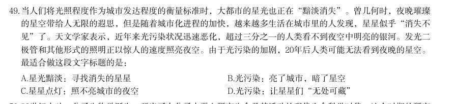
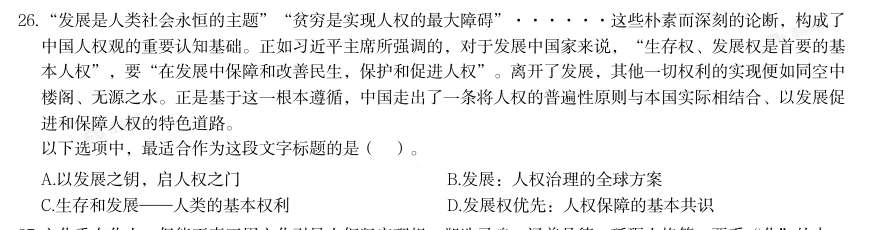
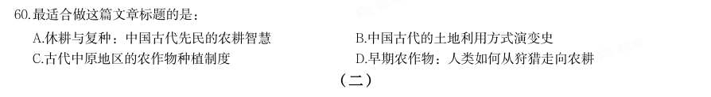

# 言语理解 · 标题填入

> 考点编码：`YY-BTTR`　｜　体系对齐：花生十三 `yanyu-lianjie.md#3.3`

## 一、命题规律

- **本题型真题总量**：61 题（2003–2026）
- **地区分布**：国考 39 / 广东 8 / 湖北 14
- **近六年题量**：2026年5题, 2025年5题, 2024年6题, 2023年5题, 2022年7题, 2021年3题
- **覆盖试卷**：43 套
- **同题变体**：另有 12 道为同题重复（同年多卷/跨年再考），已折叠，需展开见 scripts/search.py --all-variants

## 二、近年真题（最多 12 题，按年份倒序）

### 【2026 湖北省考·第 49 题】HB-2026-ty-X049　标题填入｜标题填入

当人们将光照程度作为城市发达程度的衡量标准时,大都市的星光也正在“黯淡消失”。曾几何时,夜晚璀璨 的星空带给人无限的遐思,但是随着城市化进程的加快,越来越多生活在城市里的人发现,星星似乎“消失不 见”了。天文学家表示,近年来光污染状况迅速恶化,超过三分之一的人类看不到夜空中明亮的银河。发光二 极管和其他形式的照明正以惊人的速度照亮夜空。由于光污染的加剧,20年后人类可能无法看到夜晚的星空。 最适合做这段文字标题的是:

- **A.** 星光黯淡:寻找消失的星星
- **B.** 光污染:亮了城市,暗了星空
- **C.** 星星点灯:照不亮城市的夜空
- **D.** 光污染:让星星们“无处可藏”

**答案：B**

**解析/参考要点**：B
文段开篇介绍人们将光照程度作为衡量城市发达程度的标准,同时大都市的星光
在“黯淡消失”,接着指出随着城市化进程加快,城市的星星似乎“消失不见”
了。后文通过天文学家的观点,强调城市光污染状况迅速恶化,部分人类已经看
不到夜空中明亮的银河,最后指出未来人类可能看不见夜晚的星空,故文段整体
围绕“光污染”展开,介绍其照亮城市的同时也“暗淡”了星空,对应B 项。
A 项,未提及核心话题“光污染”,且“寻找消失的星星”文段并未提及,无中
生有,排除;
C 项,未提及核心话题“光污染”,且“星星点灯”文段并未提及,无中生有,
排除;
D 项,“无处可藏”与文意相悖,且缺少对城市的影响,表述片面,排除。
故正确答案为B。

### 【2026 广东省考·第 26 题】GD-2026-ty-X026　标题填入｜标题填入

“发展是人类社会永恒的主题”“贫穷是实现人权的最大障碍”······这些朴素而深刻的论断,构成了 中国人权观的重要认知基础。正如习近平主席所强调的,对于发展中国家来说,“生存权、发展权是首要的基 本人权”,要“在发展中保障和改善民生,保护和促进人权”。离开了发展,其他一切权利的实现便如同空中 楼阁、无源之水。正是基于这一根本遵循,中国走出了一条将人权的普遍性原则与本国实际相结合、以发展促 进和保障人权的特色道路。 以下选项中,最适合作为这段文字标题的是( )。

- **A.** 以发展之钥,启人权之门
- **B.** 发展:人权治理的全球方案
- **C.** 生存和发展——人类的基本权利
- **D.** 发展权优先:人权保障的基本共识

**答案：A**

**解析/参考要点**：答案A
文段首句通过举例引出中国人权观的认知基础,随后引用总书记的讲话指出,对
发展中国家来说,要在发展中保护和促进人权,接着从反面进行论证发展对人权
的重要性。尾句通过“正是”进行强调得出结论即中国走出一条以发展促进和保
障人权的特色道路。故文段重点强调发展是保障人权的基础,中国通过发展来促
进和保障人权。A 项“以发展之钥,启人权之门”对应“以发展促进和保障人权”
这一中国特色道路形象概括文段主旨,当选。
B 项,“全球方案”与文段“与中国实际相结合”“中国特色道路”不符,范围扩
大,排除;
C 项,只提到“生存和发展是基本权利”,但文段重点是中国通过发展保障人权,
该选项未突出“发展促进人权”的实践路径,排除;
D 项,“发展权优先”并非文段强调的重点且“基本共识”与“中国特色道路”
不符,排除。
故正确答案为A。

### 【2026 国考（副省级）·第 54 题】GK-2026-fs-X054　标题填入｜标题填入

民主真正落地,需基于明确、可操作的行动指南,行动指南要依托科学规范的程序文本来呈 现,在这个意义上,科学民主的程序文本是民主得以从理念转化为现实不可或缺的载体,也是维 护民主之实的基本保证。一方面,可借鉴他山之石,一定程度地吸纳其他国家较为成熟的,基 于民主、公正、法治原则所建立起的议事规则;另一方面,须扎根实际,不能将程序简单视为 政治制度的“飞来峰”,照抄照搬或简而化之,需要注重历史和现实、理论和实践、形式和内 容有机统一,找到正确的方式方法。此外,还应构建长效化的程序完善机 制,不断夯实程序之基。 最适合做这段文字标题的是:

- **A.** 以程序保障之力强化实质民主之效
- **B.** 以程序内容之基筑牢实质民主之实
- **C.** 以程序运行之效提升实质民主之质
- **D.** 以程序科学之道阐释实质民主之义

**答案：B**

**解析/参考要点**：B
文段开篇指出民主真正落地需要明确可操作的行动指南,而行动指南则需要依托科学规范的程序文本来呈现,
引出“民主落地”和“程序文本”的话题,接着强调科学民主的程序文本对民主从理念转化为现实以及维护民
主之实的重要作用。然后通过三方面进行具体的解释说明,一是借鉴他国成熟议事规则,二是扎根实际,注重
历史与现实等有机统一找到正确方法,三是构建长效化程序完善机制。故文段重在强调要以科学规范的程序文
本,即程序内容为基础来筑牢实质民主,对应B 项。
A 项,文段强调以“程序文本”为基础,“以程序保障之力”表述不明确,排除;
C 项,文段重点围绕“程序文本”展开,未涉及“程序的运行”,无中生有,排除;
D 项,文段强调以“程序文本”为基础,“以程序科学之道”表述不明确,且“民主之义”偏离重点,文段侧
重讨论民主如何落到实处,排除。
故正确答案为B。
【文段出处】学习时报《坚持以程序民主赋能实质民主》

### 【2026 国考（副省级）·第 65 题】GK-2026-fs-X065　标题填入｜标题填入

最适合做这篇文章标题的是:

- **A.** 大汉王朝的“官方招待所”
- **B.** 汉代简牍上的丝路盛况
- **C.** 驿站小人物与历史大事件
- **D.** 悬泉汉简里的丝路往事

**答案：D**

**解析/参考要点**：D
文章首段先引出悬泉置遗址的话题,介绍其是丝绸之路上的国家驿置机关,第二段介绍该地出土大量悬泉汉简,
时间跨度长,文字信息量大,第三段至第五段列举了悬泉汉简中记录的丝路之上普通人、戍边士卒日常生活,
以及悬泉置接待各国使者的相关信息,尾段指出悬泉汉简记载的丝路上的人和事具有弥足珍贵的价值。故文章
围绕悬泉汉简与丝绸之路两个核心话题展开论述,重点强调悬泉汉简记载的丝绸之路上的故事,对应D 项。
A 项,缺少核心话题“悬泉汉简”和“丝路”,排除;
B 项,“汉代简牍”扩大了核心话题“悬泉汉简”的范围,排除;
C 项,缺少核心话题“悬泉汉简”和“丝路”,排除。
故正确答案为D。
【文段出处】中央广电总台国际在线《【简牍中国】悬泉汉简记录千年丝路上的小故事和大历史》

### 【2026 国考（地市级）·第 55 题】GK-2026-ds-X055　标题填入｜标题填入

随着我国城镇化率逐步提高,城市已经成为人口集聚的主要空间,要实现智慧城市的发展目 标,必须紧跟新一代数字技术发展趋势,找准数字技术融入市域社会治理的“小切口”,促进 两者深度融合,可建设区、街、社(村)三层结构的数智化基层治理平台,覆盖社区治理全域 组织工作场景,有效破解基层治理“小马拉大车”的突出问题。通过建设数智化基层治理平 台,加快实现市域社会管理手段、管理模式、管理理念创新、推动城市治理和运行从数字化到 智能化再到智慧化的转型升级。 最适合做这段文字标题的是:

- **A.** 变“治理”为“智理”,提升城市智治水平
- **B.** 从“数字”到“数智”,打造基层治理平台
- **C.** 数字技术:提升基层治理的新手段
- **D.** 基层治理:从末梢发力向智慧升级

**答案：A**

**解析/参考要点**：A
文段开篇交代背景,即我国城镇化率提高,城市成为人口集聚的主要空间。随后指出要实现智慧城市发展
目标,需紧跟新一代数字技术发展趋势,让数字技术与市域社会治理相融合。后文给出明确对策,即建设
区、街、社(村)三层结构的数智化基层治理平台。尾句进一步强调,该平台可推动城市治理实现从数字
化到智能化再到智慧化的转型升级。故文段重点在对策部分,强调通过建设数智化基层治理平台可以实现
城市治理的智慧化转型升级,A 项精准概括了文段从“治理手段创新”到“智慧化升级”的核心脉络,其
中“智理”一词巧妙呼应“智慧治理”,形象贴切,契合主旨,当选。
B 项,“打造基层治理平台”表述片面,文段的落脚点不仅仅是“打造平台”,而是通过这个平台实现城
市治理的智慧化转型升级,排除;
C 项,“数字技术”表述不明确,未体现“数智化平台”与“城市治理智慧化”之间的关系,排除;
D 项,“基层治理”概念偷换,且未表明“数智化”,排除。
故正确答案为A。
【文段出处】光明日报《市域管理:变“治理”为“智理”》

### 【2025 湖北省考·第 49 题】HB-2025-ty-X049　标题填入｜标题填入

上门代厨、上门收纳整理、上门推拿、上门养老······近年来,各类上门服务新业态涌现,为市场经济 输入新鲜血液。但“上门经济”并非只有红利没有烦恼。调查发现,目前“上门经济”面临监管存在盲区、消 费者维权难、取证溯源难等问题,亟待加强规范引导。规范是保障行业健康有序发展、维护各方合法权益的基 础。只有把规矩立起来,加强规范引导,才能促进“上门经济”良性发展。 最适合做这段文字标题的是:

- **A.** “上门经济”规范有序方能行稳致远
- **B.** “上门经济”并非只有红利没有烦恼
- **C.** “上门经济”为市场经济输入新血液
- **D.** “上门经济”既要敞开门也要守好门

**答案：A**

**解析/参考要点**：文段开篇论述各类上门服务新业态涌现给市场经济带来活力,接着通过转折关联词“但”指出“上门经
济”存在监管盲区、消费者维权难、取证溯源难等问题,并通过“亟待”提出对策,强调要对其加强规
范引导,尾句通过“只有······才”再次强调,确立规矩,加强规范引导才能促进“上门经济”的良性发展。
故文段为提出问题—解决问题的结构,重在提对策,强调“上门经济”的发展需加强规范引导,对应A
项。
B 项,对应文段问题表述,非重点,排除;
C 项,对应文段开篇部分,为转折前内容,非重点,排除;
D 项,“要敞开门也要守好门”表述不明确,未体现对策“加强规范引导”,偏离文段中心,排除。
故正确答案为A。
【文段出处】安徽日报《“上门经济”立规才能长远》

### 【2025 国考（副省级）·第 51 题】GK-2025-fs-X051　标题填入｜标题填入

“足国之道,节用裕民,而善臧其余。”党政机关过紧日子不是一时之需、权宜之策,而是一贯的、长期的、 常态化的工作要求。一个国家可调配的资源总量是有限的,唯有坚持该花的花、该省的省,才能集中财力办大 事,把更多真金白银用于发展紧要处、民生急需上。一路走来,艰苦奋斗、勤俭节约始终是我们党的优良作 风,也是我们党不断发展壮大的重要保证。“党和政府带头过紧日子,目的是为老百姓过好日子”。这本国之 大账,是民生大账,亦是民心大账。 这段文字是一篇文章的开头,最适合做文章标题的是:

- **A.** 节用裕民,“过紧日子”算的是国之大账
- **B.** 严格落实党政机关“过紧日子”的要求
- **C.** 在“过紧日子”中诠释忠诚干净担当
- **D.** 落实落细,把“过紧日子”的要求贯穿始终

**答案：A**

**解析/参考要点**：本题为接语选择题与标题填入题的结合题型。文段首先引用“足国之道,节用裕民,而善臧其余”并指
出党政机关过紧日子是长期工作要求,接着说明国家可调配资源有限,需坚持该花则花、该省则省以集
中财力办大事、用于发展紧要处和民生关键处,随后再次介绍艰苦奋斗、勤俭节约是我们党的优良作风
和发展壮大的重要保证,最后总结指出党和政府带头过紧日子是为了让老百姓过好日子,这算的是涉及
民生与民心的国之大账。故文章的重点应围绕党政机关“过紧日子”以及其与民生的关系展开论述,对
应A 项。
B、C、D 三项,均未体现出党政机关“过紧日子”以及其与民生的关系,偏离重点,排除。
故正确答案为A。
【文段出处】长安观察《锐评|节用裕民,过“紧日子”算的是国之大账》
2025 国考《行测》(副省级)解析
19 / 46

### 【2025 国考（副省级）·第 60 题】GK-2025-fs-X060　标题填入｜标题填入

最适合做这篇文章标题的是:

- **A.** 休耕与复种:中国古代先民的农耕智慧
- **B.** 中国古代的土地利用方式演变史
- **C.** 古代中原地区的农作物种植制度
- **D.** 早期农作物:人类如何从狩猎走向农耕

**答案：C**

**解析/参考要点**：文章第1段先引出中国古代中原地区农作物种植制度的话题。第2段对中原地区的种植结构、制度变化
进行详细介绍。第3段通过文献记载,对商周时期撂荒、休耕制度进行具体介绍。第4段从考古研究中
梳理先秦时期中原地区几千年来土地利用方式的演变。第5段、第6段沿着时间顺序对考古研究的内容
展开介绍,即从古代中原地区农作物种植制度变化的角度进行详细阐述:“森林休耕”——“灌木休
耕”——“草地休耕”——复种制度的出现。故整篇文章围绕古代中原地区的农作物种植制度展开介绍,
对应C 项。
A 项“休耕与复种”、B 项“土地利用方式”均仅对应文章后半部分内容,表述片面,且缺乏文章核心话
题“中原地区”,排除;
D 项,“早期农作物”非重点,文章重点论述的是“种植方式”,排除。
故正确答案为C。
【文段出处】人民日报《考古中的早期农作物种植制度(博古知今)》

### 【2025 国考（副省级）·第 65 题】GK-2025-fs-X065　标题填入｜标题填入

最适合做这篇文章标题的是:

- **A.** 砷绿:十九世纪致命流行色
- **B.** 复古花卉壁纸:华丽与危机
- **C.** 清新色彩风:迷人的田园假象
- **D.** 美丽的诱惑:来自实验室的毒药

**答案：A**

**解析/参考要点**：文章第一段引出砷绿颜料的话题,第二段介绍了砷绿颜料的起源,并指出其毒性很强,第三段至第六段
具体说明了砷绿颜料在实际生产和普遍应用中,对于人体健康造成的严重危害,第七段提到早在颜料问
世之初就有人担忧其危险性,直到19 世纪中期,这些危险才真正开始得到关注,并指出欧洲很多国家开
始立法禁止在生活用品中使用含砷颜料,除了英国,第八段总结前文,强调砷绿颜料的使用带来了严重
后果,故整篇文章围绕砷绿颜料在19 世纪流行却危害健康展开论述,对应A 项。
B 项,未提及“砷绿颜料”这一主题词,且“复古花卉壁纸”仅对应文章砷绿颜料应用的一方面内容,
表述片面,排除;
C 项,未提及“砷绿颜料”这一主题词,且“迷人的田园假象”并未明确指出对健康的危害,表述不明
确,排除;
D 项,未提及“砷绿颜料”这一主题词,且“实验室”并非文章重点,排除。
故正确答案为A。
【文段出处】科普中国《含砷绿颜料,致命的流行色》

### 【2025 国考（地市级）·第 61 题】GK-2025-ds-X061　标题填入｜标题填入

如今,文艺工作者深入挖掘传统绘画与传统舞蹈之间的内在联系,将诗、书、画、乐、舞融于一体,形成新的 审美表达。比如,杭州亚运会开幕式文艺表演环节,第一个节目《水墨入诗画》便以中国画为基本元素,身着 青绿色长裙的舞者在山水画卷中翩翩起舞,营造出“人在画中游”的优美意境。舞蹈诗剧《只此青绿》同样以 经典山水画为灵感,通过舞蹈再现画家王希孟创作《千里江山图》的过程,并以刚柔相济的肢体语言、精心设 计的舞蹈动作呈现山水神韵。在这些作品中,传统绘画与舞蹈的创意融合产生叠加效应,使传统文化与现代审 美相谐适,产生了广泛的社会影响。 最适合做这段文字标题的是:

- **A.** 青绿热:传统与现代的双向奔赴
- **B.** 传统与现代:审美表达的异与同
- **C.** 人在画中游:穿越千年的艺术盛宴
- **D.** 画与舞:跨界融合激发艺术新活力

**答案：D**

**解析/参考要点**：文段开篇指出文艺工作者深入挖掘传统绘画与传统舞蹈之间的内在联系,将多种艺术形式融于一体,形
成新的审美表达。接着后文通过“比如”举例,论述《水墨入诗画》、《只此青绿》两部作品均是将传统
绘画与舞蹈进行巧妙融合,取得了很好的艺术效果。尾句呼应文段开头,再次强调通过传统绘画与舞蹈
的融合,产生了叠加效应,使得传统文化与现代审美相谐适,故整个文段为“总-分-总”结构,重在强
调通过传统绘画与舞蹈的跨界融合,形成了新的审美艺术表达,对应D 项。
2025 国考《行测》(地市级)解析
21 / 44
A 项,“青绿热”对应文段举例部分的内容,非重点,且“传统与现代的双向奔赴”表述不够明确,文
段重在强调“传统绘画与舞蹈”的融合,排除;
B 项,“传统与现代”表述不明确,文段重在论述由“传统绘画与舞蹈”融合,产生了新的审美艺术表
达,而非对比“审美表达的异与同”,偏离文段中心,排除;
C 项,“人在画中游”对应文段举例部分的内容,非重点且表述片面,排除。
故正确答案为D。
【文段出处】人民日报《跨界融合激发美术新活力(艺坛走笔)》

### 【2024 湖北省考·第 42 题】HB-2024-ty-X042　标题填入｜标题填入

神经科学领域已有研究揭示脑衰老的分子、细胞、器官、系统多层级多种生物学特征,它们相互依赖、彼此互 为联系,共同构成脑衰老特征及其发生机制的复杂性。此外,该领域新技术和新方法的应用也使研究内容得到 极大丰富与发展。在对抗衰老过程中维持脑健康及其功能,是一项挑战,运动可以通过改善脑衰老的生物学特 征及生理功能,促进脑的可塑性。因此,临床实践中运动干预可作为补充策略,改善衰老人群及相关慢性疾病 患者的脑健康。 最适合做这段文字标题的是:

- **A.** 运动促进脑生长:加强认知与记忆
- **B.** 运动干预脑衰老:新进展与再认识
- **C.** 运动改变脑结构:挑战性与安全性
- **D.** 运动影响脑健康:运动疗法有前景

**答案：B**

### 【2024 广东省考·第 26 题】GD-2024-ty-X026　标题填入｜标题填入

从光明科学城到南沙科学城,从横琴粤澳深度合作区到河套深港科技创新合作区······近年来,高端科 研资源在粤港澳大湾区加速汇聚,推动粤港澳大湾区国际科技创新中心建设不断取得新进展。目前,广东已初 步构建起以鹏城实验室、广州实验室为引领的高水平多层次实验室体系,散裂中子源、强流重离子加速器装置 等一批重大科技基础设施也相继落成,世界一流的重大科技基础设施集群正在粤港澳大湾区加速成型。 下列选项最适合作为这段文字标题的是( )。

- **A.** 粤港澳大湾区“软硬联通”加速推进
- **B.** 粤港澳大湾区基础设施建设稳步推进
- **C.** 粤港澳大湾区建设纵深推进动能澎湃
- **D.** 粤港澳大湾区科技设施集群加速成型

**答案：D**

**解析/参考要点**：文段开篇通过列举例子介绍了科研资源在粤港澳大湾区汇聚,推动粤港澳大湾区科技创新中心建设
不断取得新进展,接着继续论述了多种重大科技基础设施群相继落成,世界一流的重大科技基础设
施集群正在粤港澳大湾区加速成型,故文段主要围绕“粤港澳大湾区”以及“科技设施”进行论述,
对应D 项。
A 项,“软硬联通”为文段未提及内容,无中生有,且缺少文段主题词“科技设施”,排除;
B 项,“基础设施建设”话题范围扩大,文段核心话题是“科技设施”,排除;
C 项,缺少文段主题词“科技设施”,排除。
故正确答案为D。
【文段出处】新华网《布局更完善 科创力更足——粤港澳大湾区建设纵深推进一线扫描》

## 三、其余真题（按年代分片）

| 年代 | 题量 | 分片文件 |
|---|---:|---|
| 2000s | 3 | [YY-BTTR-2000s.md](split/YY-BTTR-2000s.md) |
| 2010s | 20 | [YY-BTTR-2010s.md](split/YY-BTTR-2010s.md) |
| 2020s | 26 | [YY-BTTR-2020s.md](split/YY-BTTR-2020s.md) |

> 也可用 `python scripts/search.py --kaodian YY-BTTR` 直接检索全部 61 题。