# 言语理解 · 逻辑填空

> 考点编码：`YY-LJTK`　｜　体系对齐：花生十三 `yanyu-lianjie.md#二`

## 一、命题规律

- **本题型真题总量**：1269 题（2001–2026）
- **地区分布**：国考 651 / 广东 287 / 湖北 331
- **近六年题量**：2026年66题, 2025年67题, 2024年68题, 2023年60题, 2022年72题, 2021年37题
- **覆盖试卷**：92 套
- **子考点分布**：两空 556　一空 306　逻辑填空（综合） 302　三空及以上 260　成语辨析 48
- **同题变体**：另有 203 道为同题重复（同年多卷/跨年再考），已折叠，需展开见 scripts/search.py --all-variants

## 二、近年真题（最多 12 题，按年份倒序）

### 2026 湖北·统一卷　第 26 题　（逻辑填空（综合））

的答案。 当前人类已全面进入知识经济时代,高质量发展越来越依靠知识和创新。教育强国、科技强国、人才强国具有 共生性, 。科技强国要求高科技自立自强,成为世界主要科学中心;人才强国要求提高自主培养质量, 成为世界重要人才中心。科技和人才离不开高质量教育体系,因此“三大强国”的统筹部署有利于支撑“两个 中心”建设。 填入画横线部分最恰当的一项是:

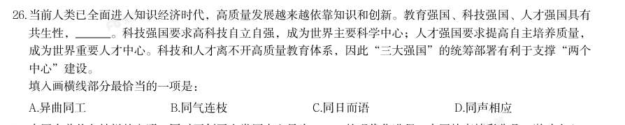

- **A.** 异曲同工
- **B.** 同气连枝
- **C.** 同日而语
- **D.** 同声相应

**答案：B**

**解析/参考要点**：B
根据“教育强国、科技强国、人才强国具有共生性”“科技强国要求高科技自立
自强,成为世界主要科学中心;人才强国要求提高自主培养质量,成为世界重要
人才中心。科技和人才离不开高质量教育体系”可知,横线处应体现三者互相离
不开、联系紧密之意。B 项“同气连枝” 比喻同胞的兄弟姐妹,现引申为彼此
的关系很密切,互相依存,符合文意,当选。A 项“异曲同工”指不同的做法收
到同样效果,并未体现三者关系紧密之意,排除;C 项“同日而语”指放在同一
时间谈论,多用于否定句式,文段并未讨论时间关系,排除;D 项“同声相应”
指志趣、意见相同的人互相响应,自然地结合在一起,与文意不符,排除。
故正确答案为B。

### 2026 湖北·统一卷　第 27 题　（成语辨析）

中国有着悠久灿烂的文明,同时开创了人类历史上最为 的现代化进程,中国故事精彩非凡、激动人心, 也需要精彩讲述、更好传播。 填入画横线部分最恰当的一项是:

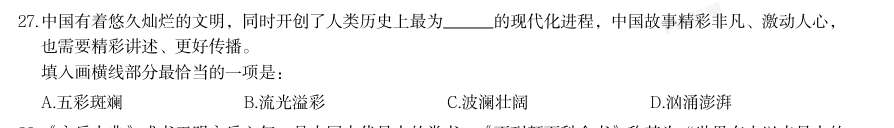

- **A.** 五彩斑斓
- **B.** 流光溢彩
- **C.** 波澜壮阔
- **D.** 汹涌澎湃

**答案：C**

**解析/参考要点**：C
横线处所填成语搭配“现代化进程”,且根据文意可知,横线处应体现中国现代
化进程气势宏大、规模宏伟。C 项“波澜壮阔”比喻声势雄壮或规模巨大,多用
于形容事业、进程等,与“现代化进程”搭配恰当,且符合文意,当选。
A 项“五彩斑斓”指多种颜色错杂而繁多耀眼,B 项“流光溢彩”形容光彩明亮
华丽,跳动闪烁,均多用于形容色彩,与“现代化进程”搭配不当,排除;D 项
“汹涌澎湃”多形容声势浩大,不可阻挡,常用来形容水流、情绪等,与“现代
化进程”搭配不当,排除。
故正确答案为C。

### 2026 湖北·统一卷　第 28 题　（逻辑填空（综合））

《永乐大典》成书于明永乐六年,是中国古代最大的类书,《不列颠百科全书》称其为“世界有史以来最大的 百科全书”,共计22937卷11095册,约3.7亿字,收先秦至明初的各类典籍七八千种,被称为典籍 、佚书宝 库。

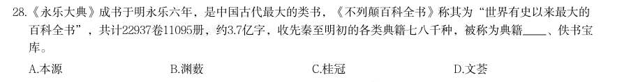

- **A.** 本源
- **B.** 渊薮
- **C.** 桂冠
- **D.** 文荟

**答案：B**

**解析/参考要点**：B
顿号提示横线处与“佚书宝库”构成并列,且根据“世界有史以来最大的百科全
书”“收先秦至明初的各类典籍七八千种”可知,横线处应体现《永乐大典》汇
聚了各类典籍之意,B 项“渊薮”指人或事物聚集的地方,置于此处表达典籍汇
集之意,为常见表达,符合文意,当选。
A 项“本源”指事物产生的根源,横线处强调的是典籍的汇聚,而非根源,排除;
C 项“桂冠”指竞赛中的冠军,与文意无关,排除;
D 项“文荟”指文化、文艺精华汇聚之所或文化荟萃的状态,常被用作机构、场
所或活动的名称,“文”与“典籍”重复,排除。
故正确答案为B。

### 2026 湖北·统一卷　第 29 题　（两空）

未来,数字科技将会持续深度赋能文化产业,数字文化产业新模式、新业态更加丰富,文化产业的产业链、生 态链、价值链更为 。我们应着重培养市场主体,探索建构文化全产业链, 文化供给与文化需求的错 位,引导文化企业坚持社会效益与经济效益的高度统一,不断提升文化产品和服务的供给质量。 依次填入画横线部分最恰当的一项是:

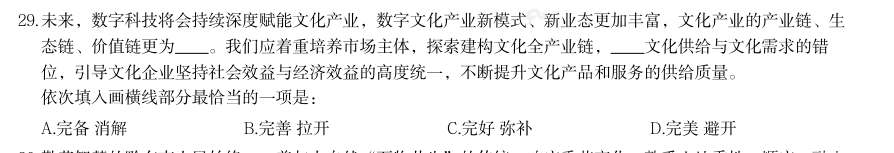

- **A.** 完备 消解
- **B.** 完善 拉开
- **C.** 完好 弥补
- **D.** 完美 避开

**答案：A**

**解析/参考要点**：A
本题可从第二空入手,横线处词语搭配“错位”,根据“应着重培养市场主体,
探索建构文化全产业链”“引导文化企业坚持社会效益与经济效益的高度统一”
可知,横线处应表达要解决、消除文化供给与需求不匹配、不协调的问题。A 项
“消解”意为消释、消除,与“错位”搭配恰当,符合文意,保留。B 项“拉开”
指摆开,放开,增加差距,置于此处表达让错位变得更大,与文意相悖,排除;
C 项“弥补”指补偿、填补,常搭配“短板”“不足”等,与“错位”搭配不当,
排除;D 项“避开”指躲开、回避,侧重主动绕开问题,不主动解决,文段强调
要主动消除错位,与“错位”搭配不当且与文意不符,排除。
第一空,代入验证。搭配“产业链、生态链、价值链”,且根据“数字科技将会
持续深度赋能文化产业,数字文化产业新模式、新业态更加丰富”可知,横线处
应表达相关产业链条变得齐全,完整,A 项“完备”指应该有的全都有了,符合
文意,当选。
故正确答案为A。

### 2026 湖北·统一卷　第 30 题　（两空）

勤劳智慧的黔东南人民始终 着与大自然“万物共生”的传统,响应季节变化,熟悉土地秉性,顺应、融入 大自然生态系统,形成了生态养殖、种植绿色循环发展的完整生物链。作为典型的人工生态系统,江稻鱼鸭复 合系统具有保护生物多样性、控制病虫害、调节气候、 水源等多种生态功能。 依次填入画横线部分最恰当的一项是:

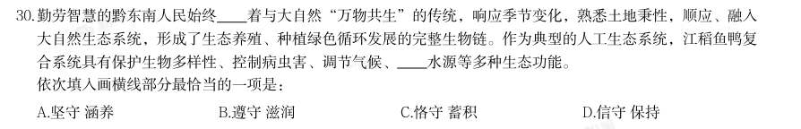

- **A.** 坚守 涵养
- **B.** 遵守 滋润
- **C.** 恪守 蓄积
- **D.** 信守 保持

**答案：A**

**解析/参考要点**：A
第一空,搭配“传统”,A 项“坚守”指坚定遵守,不背离,B 项“遵守”指依
照规定行动,不违背,C 项“恪守”指严格遵守,均与“传统”搭配恰当,保留。
D 项“信守”指忠诚地遵守,常搭配“承诺”等,与“传统”搭配不当,排除。
第二空,搭配“水源”,A 项“涵养”指蓄积并保持(水分等),与“水源”搭
配恰当,当选。B 项“滋润”指增添水分,使不干枯,与“水源”搭配不当,排
除;C 项“蓄积”指积聚储存,与“水源”搭配不当,且不及A 项“涵养”语义
丰富,排除。
故正确答案为A。

### 2026 湖北·统一卷　第 31 题　（两空）

一种能监测心脏术后并发症的新设备可以完成比传统的起搏器更复杂的监测。起搏器只能提供心脏的整体图 像,但新设备可以提供更 的图像,具体显示出心脏哪些区域功能不正常。其上分布的微电极阵列可从心房 的多个位置绘制电信号活动,并按需传递电刺激,以便在 的时候解除房颤,恢复正常心律。 依次填入画横线部分最恰当的一项是:

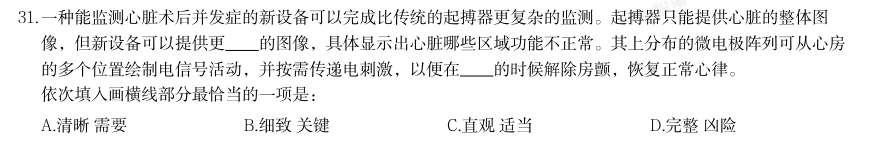

- **A.** 清晰 需要
- **B.** 细致 关键
- **C.** 直观 适当
- **D.** 完整 凶险

**答案：B**

**解析/参考要点**：B
第一空,根据横线前转折词“但”及后文“具体显示出心脏哪些区域功能不正常”
可知,横线处所填词语应与“整体”构成转折关系,表达新设备提供的图像更具
体、更精细之意。B 项“细致”指精细周密,符合文意,保留。A 项“清晰”指
清楚,而文段并未对比图像的清晰度,且其反义词应为“模糊”,无法与“整体”
构成转折,排除;C 项“直观”指直接观察的,与具体、精细无关,排除;D 项
“完整”指没有损坏或残缺,与“整体”语义相近,无法构成转折关系,排除。
第二空,代入验证。B 项“关键”比喻事物最紧要的部分,对事情起决定作用的
因素,置于此处能表达在重要、紧急时刻解除房颤之意,逻辑合理,当选。
故正确答案为B。

### 2026 湖北·统一卷　第 32 题　（两空）

高山草甸四周海拔较高的陡峭山地往往是不同生态系统的交界处,生存环境和食物资源更为多样,这使得赤狐 可以大展拳脚, 在不同景观的边缘,将捕食效率最大化,同时也将风险降至最低,可谓 。即使在内 蒙古达赉湖、宁夏贺兰山等地,赤狐的洞穴也经常出现。 依次填入画横线部分最恰当的一项是:

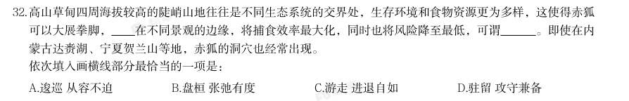

- **A.** 逡巡 从容不迫
- **B.** 盘桓 张弛有度
- **C.** 游走 进退自如
- **D.** 驻留 攻守兼备

**答案：C**

**解析/参考要点**：C
第一空,根据“······在不同景观的边缘,将捕食效率最大化,同时也将
风险降至最低”可知,横线处所填词语需体现赤狐能够主动、灵活地穿梭在不同
景观边缘的意思,C 项“游走”指四处走动、来回移动,置于此处能够体现赤狐
的动态性和灵活性,符合文意,保留。A 项“逡巡”指有所顾虑而徘徊不前,文
段并未体现赤狐有所顾虑,排除;B 项“盘桓”指逗留、徘徊,D 项“驻留”指
在某处暂时停留,两项均强调“停留不走”的状态,与文意不符,排除。
第二空,代入验证。C 项“进退自如”指无论是前进还是后退都能得心应手,可
对应前文“捕食效率最大化”(进)和“风险降至最低”(退),与文意相符,
当选。
故正确答案为C。

### 2026 湖北·统一卷　第 33 题　（三空及以上）
> 材料：这些“山环水绕”的地方虽然山不高,水的形态也无太大差别,但这里是自然优美的 。这里有花岗岩、石 灰岩、红色砂岩三大造景岩石,每一种都造就了独具 的美,如花岗岩的雄浑,石灰岩的秀美,红色砂岩造…

就的赤壁丹霞······然而,这块“山环水绕”之地,永远在 中展现出无穷的多样性,如花岗岩造 就的黄山式的景观在江西三清山上再现,红色砂岩造就的广东仁化碧水丹崖式的风景在福建泰宁重演。 依次填入画横线部分最恰当的一项是:

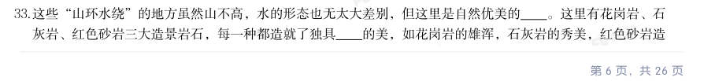

- **A.** 代表 生态 丰富性
- **B.** 特例 风情 共同性
- **C.** 范例 特色 同一性
- **D.** 典范 个性 统一性

**答案：D**

**解析/参考要点**：D
第一空,根据“这里有花岗岩、石灰岩、红色砂岩三大造景岩石,每一种都造就
了独具······的美”可知,横线处意在表达这些“山环水绕”的地方能够
体现出自然优美之意。A 项“代表”指显示同一类的共同特征的人或事物,C 项
“范例”指可以当作典范的事例,D 项“典范”指可以作为学习、效仿标准的人
或事物,均符合文意,保留。B 项“特例”指特殊的事例,由前文“虽然山不高,
水的形态也无太大差别”可知,文段并未体现这里有“特殊”之意,排除。
第二空,根据“如花岗岩的雄浑,石灰岩的秀美,红色砂岩造就的赤壁丹霞······”
可知,横线处应体现三大造景岩石造就的美各有独特之处,C 项“特色”指事物
所表现的独特的色彩、风格,D 项“个性”指事物的特性,均能够体现出“不一
样”之意,保留。A 项“生态”指生物在一定的自然环境下生存和发展的状态,
也指生物的生理特性和生活习性,与文中造景岩石的地质景观之美无关,且无法
体现出独特之处,排除。
第三空,根据“如花岗岩造就的黄山式的景观在江西三清山上再现,红色砂岩造
就的广东仁化碧水丹崖式的风景在福建泰宁重演”可知,横线处应体现不同地域
的同类景观存在共通规律与内在特质。D 项“统一性”指共有的特质和特性,侧
重内在规律一致、共有特质相通,与文意相符,且能与“多样性”对应,当选。
C 项“同一性”指具有完全相同的性质,侧重强调事物间毫无差异,与后文“多
样性”表意矛盾,排除。
故正确答案为D。

### 2026 湖北·统一卷　第 34 题　（两空）

在一般印象里,香水是比较晚近的舶来品,但这里的“香水”指的是发展成熟的香精香水。20世纪初,香港的 广生行和上海中西大药房 引进了淡香精香水“佛罗里达水”,借用欧阳修词中“花露重,草烟低,人家帘 幕垂”的句子,命名为“花露水”。这种淡绿色香水主要使用玫瑰与麝香香精,在此后数十年里 中国,是 中国最流行的香调。所以,有人将花露水称为中国最早的香水,也不能说没有依据。 依次填入画横线部分最恰当的一项是:

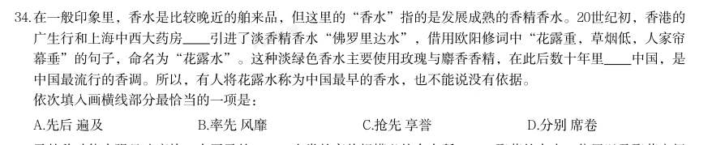

- **A.** 先后 遍及
- **B.** 率先 风靡
- **C.** 抢先 享誉
- **D.** 分别 席卷

**答案：B**

**解析/参考要点**：B
第一空,根据“在一般印象里,香水是比较晚近的舶来品”“有人将花露水称为
中国最早的香水”可知,横线处要体现出香港的广生行和上海中西大药房在较早
的时候就引进了香水,B 项“率先”指带头,首先,C 项“抢先”指赶在别人前
头,争先,均符合文意,保留。A 项“先后”指前后相继,侧重香港的广生行和
上海中西大药房这两家引进香水的先后顺序,D 项“分别”指分头,各自,均与
文意不符,排除。
第二空,根据“是中国最流行的香调”可知,横线处要体现出花露水在此后数十
年里很流行之意,B 项“风靡”指草木随风而倒,形容事物很风行,符合文意,
当选。C 项“享誉”指在社会上取得声誉,以此体现其品质好口碑好之意,而文
段仅仅表达流行之意,与文意不符,排除。
故正确答案为B。

### 2026 湖北·统一卷　第 35 题　（两空）

马的移动能力强且速度快,有了马的 ,人类的畜牧规模必然会有所 ,聚落的大小、位置以及聚落之间 的距离也会随之出现一定程度的变化。 依次填入画横线部分最恰当的一项是:

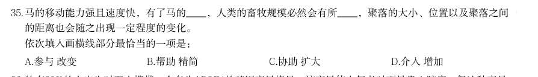

- **A.** 参与 改变
- **B.** 帮助 精简
- **C.** 协助 扩大
- **D.** 介入 增加

**答案：C**

**解析/参考要点**：C
第一空,根据“有了马的······人类的畜牧规模”可知,横线处应体现马
在人类畜牧活动中所起到的作用。A 项“参与”指参加,B 项“帮助”指替人出
力、出主意或给予物质上、精神上的支援,C 项“协助”指从旁提供帮助或辅助,
均与文意相符,保留。D 项“介入”指插入其中进行干预,强调主动干预,与文
中“马”这一主体特性不符,排除。
第二空,搭配“规模”,且根据“马的移动能力强且速度快”可知,横线处应体
现马对人类畜牧规模变化起到积极作用。C 项“扩大”指使(范围、规模等)比
原来大,与“规模”搭配恰当,且与文意相符,当选。A 项“改变”指事物发生
显著的差别,置于横线处仅能体现规模发生变化,无法体现是积极的变化还是消
极的变化,与C 项相较,“扩大”更契合文意,排除;B 项“精简”指去掉不必
要的,留下必要的,与文意相悖,排除。
故正确答案为C。

### 2026 湖北·统一卷　第 36 题　（两空）

约有20%的人出生时至少携带一个名为APOE4的基因变异拷贝。该变异使人年老时更易患心脏病,但这种变异 却没有被淘汰。研究发现,APOE4基因可能具有抵消其他负面影响的 好处,如携带APOE4的女性会生育更 多的孩子。这种生育优势可能使该致病基因在人类进化过程中得以 。 依次填入画横线部分最恰当的一项是:

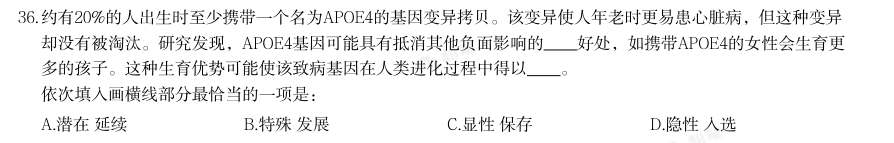

- **A.** 潜在 延续
- **B.** 特殊 发展
- **C.** 显性 保存
- **D.** 隐性 入选

**答案：A**

**解析/参考要点**：A
第一空,根据“携带APOE4 的儿童可以更好地清除肠道寄生虫”可知,横线处应
体现APOE4 基因有一些不为人知的好处,这些好处不是马上就能显现出来之意。
A 项“潜在”指存在于事物内部尚未显露出来的,D 项“隐性”指性质或性状不
表现在外的,均符合文意,保留。B 项“特殊”强调特别、与众不同,与文意不
符,排除;C 项“显性”指明显表现出来,与文意相悖,排除。
第二空,根据“携带这种基因的女性会生育更多的孩子。这种生育优势可能使该
致病基因在人类进化过程中”可知,横线处应体现因为这种生育优势,致病基因
得以留存下来之意。A 项“延续”指照原来样子继续下去,符合文意,当选。D
项“入选”指中选、当选,与文意不符,排除。
故正确答案为A。

### 2026 湖北·统一卷　第 37 题　（三空及以上）

近年来,随着“中华文明探源研究”“考古中国”等重大项目的深入实施,中国考古学界积极推动多学科交叉 融合,不断利用新手段、新工具提升田野考古发掘水平与研究阐释能力, 了历史轴线, 了历史信度, 丰富了历史内涵, 了历史场景。 依次填入画横线部分最恰当的一项是:

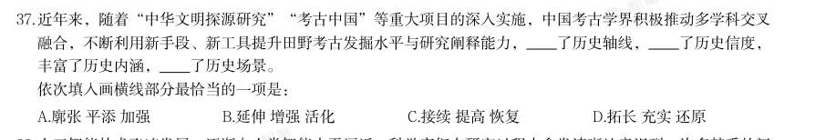

- **A.** 廓张 平添 加强
- **B.** 延伸 增强 活化
- **C.** 接续 提高 恢复
- **D.** 拓长 充实 还原

**答案：B**

**解析/参考要点**：B
第一空,搭配“历史轴线”,且根据“不断利用新手段、新工具提升田野考古发
掘水平与研究阐释能力”以及“丰富了历史内涵”可知,横线处所填词语应体现
新手段、新工具的使用使历史轴线延长之意。B 项“延伸”指延长、伸展,D 项
“拓长”指扩展并延长,均与“历史轴线”搭配恰当,保留。A 项“廓张”指扩
散、扩大,与“历史轴线”搭配不当,排除;C 项“接续”指接着前面的,继续,
文段未体现历史轴线曾处于中断状态之意,与文意不符,排除。
第二空,搭配“历史信度”,B 项“增强”指增进、加强,与“历史信度”搭配
恰当,保留。D 项“充实”指丰富、充足,常搭配“细节”“内容”“队伍”等,
与“历史信度”搭配不当,排除。
第三空,代入验证,B 项“活化”指使物质、细胞、机体恢复或增强活力,与“历
史场景”搭配恰当,当选。
故正确答案为B。

## 三、其余真题（按年代分片）

| 年代 | 题量 | 分片文件 |
|---|---:|---|
| 2000s | 216 | [YY-LJTK-2000s.md](split/YY-LJTK-2000s.md) |
| 2010s | 595 | [YY-LJTK-2010s.md](split/YY-LJTK-2010s.md) |
| 2020s | 446 | [YY-LJTK-2020s.md](split/YY-LJTK-2020s.md) |

> 也可用 `python scripts/search.py --kaodian YY-LJTK` 直接检索全部 1269 题。