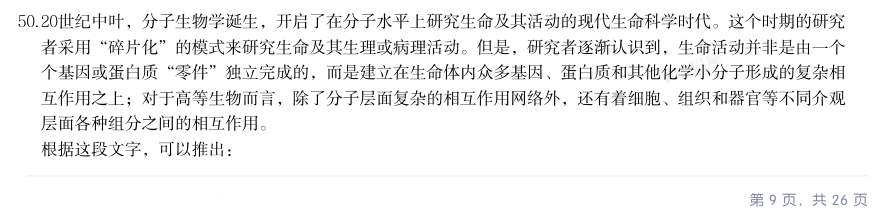
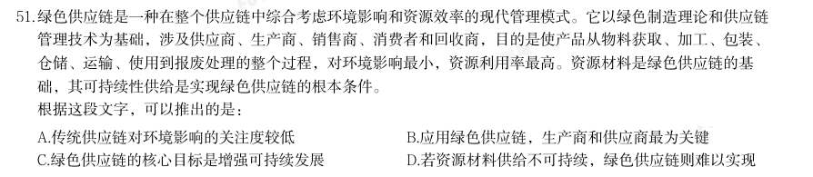
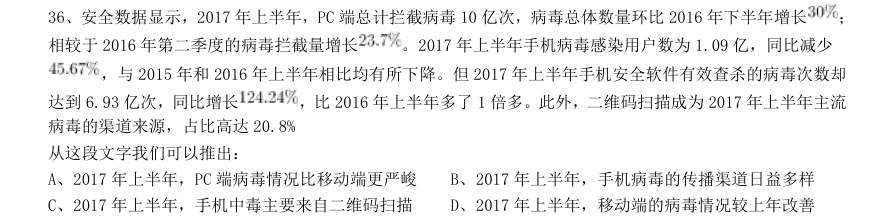
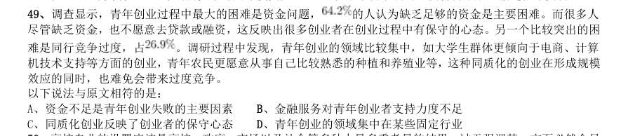

# 言语理解 · 细节判断

> 考点编码：`YY-XJPD`　｜　体系对齐：花生十三 `yanyu-lianjie.md#3.2`

## 一、命题规律

- **本题型真题总量**：64 题（2000–2026）
- **地区分布**：国考 40 / 广东 6 / 湖北 18
- **近六年题量**：2026年2题, 2025年1题, 2022年1题, 2020年3题, 2019年1题, 2018年1题
- **覆盖试卷**：34 套
- **同题变体**：另有 6 道为同题重复（同年多卷/跨年再考），已折叠，需展开见 scripts/search.py --all-variants

## 二、近年真题（最多 12 题，按年份倒序）

### 【2026 湖北省考·第 50 题】HB-2026-ty-X050　细节判断｜细节判断

20世纪中叶,分子生物学诞生,开启了在分子水平上研究生命及其活动的现代生命科学时代。这个时期的研究 者采用“碎片化”的模式来研究生命及其生理或病理活动。但是,研究者逐渐认识到,生命活动并非是由一个 个基因或蛋白质“零件”独立完成的,而是建立在生命体内众多基因、蛋白质和其他化学小分子形成的复杂相 互作用之上;对于高等生物而言,除了分子层面复杂的相互作用网络外,还有着细胞、组织和器官等不同介观 层面各种组分之间的相互作用。 根据这段文字,可以推出:

- **A.** 生命活动是一种复杂系统的整体行为
- **B.** 低等生物的生命活动由基因独立完成
- **C.** 分子层面的研究是理解高等生物的关键
- **D.** 现代科学主要采用“碎片化”模式研究生命活动

**答案：A**

**解析/参考要点**：A
A 项,根据“生命活动并非是由一个个基因或蛋白质‘零件’独立完成的,而是
建立在生命体内众多基因、蛋白质和其他化学小分子形成的复杂相互作用之
上······还有着细胞、组织和器官等不同介观层面各种组分之间的相互作
用”可知,表述正确,当选;
B 项,根据“生命活动并非是由一个个基因或蛋白质‘零件’独立完成的”可知,
文段是一个普遍性的陈述,并未区分低等生物和高等生物,尽管后文提及高等生
物有额外的介观层面相互作用,但并不意味着低等生物的生命活动可以由基因独
立完成,无中生有,排除;
C 项,根据“除了分子层面复杂的相互作用网络外,还有着细胞、组织和器官等
不同介观层面各种组分之间的相互作用”可知,除了“分子层面的研究”,还存
在“细胞、组织和器官等不同介观层面”,未提及分子层面的研究是理解高等生
物的“关键”,偷换逻辑,排除;
D 项,根据“20 世纪中叶,分子生物学诞生······这个时期的研究者采用
‘碎片化’的模式来研究生命及其生理或病理活动”和“但是,研究者逐渐认识
到,生命活动并非是······”可知,20 世纪中叶使用了“碎片化”的模
式,后来研究者逐渐认识到该模式的弊端,故无法得出现代科学“主要采用”“碎
片化”模式研究生命活动,排除。
故正确答案为A。

### 【2026 湖北省考·第 51 题】HB-2026-ty-X051　细节判断｜细节判断

绿色供应链是一种在整个供应链中综合考虑环境影响和资源效率的现代管理模式。它以绿色制造理论和供应链 管理技术为基础,涉及供应商、生产商、销售商、消费者和回收商,目的是使产品从物料获取、加工、包装、 仓储、运输、使用到报废处理的整个过程,对环境影响最小,资源利用率最高。资源材料是绿色供应链的基 础,其可持续性供给是实现绿色供应链的根本条件。 根据这段文字,可以推出的是:

- **A.** 传统供应链对环境影响的关注度较低
- **B.** 应用绿色供应链,生产商和供应商最为关键
- **C.** 绿色供应链的核心目标是增强可持续发展
- **D.** 若资源材料供给不可持续,绿色供应链则难以实现

**答案：D**

**解析/参考要点**：D
A 项,文段仅介绍了绿色供应链“综合考虑环境影响”,未提及传统供应链对环
境影响的关注度,无中生有,排除;
B 项,根据“它以绿色制造理论和供应链管理技术为基础,涉及供应商、生产商、
销售商、消费者和回收商”可知,“生产商和供应商最为关键”表述过于绝对,
排除;
C 项,根据“目的是使产品从物料获取、加工、包装、仓储、运输、使用到报废
处理的整个过程,对环境影响最小,资源利用率最高”可知,“核心目标是增强
可持续发展”表述错误,排除;
D 项,根据“资源材料是绿色供应链的基础,其可持续性供给是实现绿色供应链
的根本条件”可知,若资源材料供给不可持续,作为根本条件缺失,绿色供应链
则难以实现,表述正确,当选。
故正确答案为D。

### 【2025 国考（副省级）·第 62 题】GK-2025-fs-X062　细节判断｜细节判断

下列说法与原文相符的是:

- **A.** 最早的含砷绿颜料的得名与发明者的姓名有关
- **B.** 巴黎绿所制壁纸有毒是因为表面未做任何处理
- **C.** 儿童福利院中毒事件促使立法禁止使用含砷颜料
- **D.** 波士顿医生的例子证明砷绿颜料被用于医疗领域

**答案：A**

**解析/参考要点**：A 项,根据文章第二段“含砷绿颜料的历史从一种名为‘舍勒绿’的物质开始”与“1775 年,瑞典化学
家卡尔•威廉•舍勒首先在实验室里得到了它”可知,最早的含砷绿颜料命名与发明者姓名是有关的,表
述正确,当选;
B 项,根据文章第四段“不过鲜艳的巴黎绿和它制成的华美壁纸确实颇具代表性······砷绿颜料
不易褪色、成本低廉,于是它自然受到了壁纸生产商的青睐”与“这些壁纸表面会‘上胶’,但它却往
往不能起到充分的固定作用”可知,巴黎绿所制壁纸表面是有“上胶”处理的,“未做任何处理”与文
意相悖,排除;
C 项,文章并未提及“儿童福利院中毒事件”与“立法禁止使用含砷颜料”之间的关系,无中生有,排
除;
D 项,根据文章第五段“例如,一位波士顿的医生受到手指疼痛的困扰,最终发现原因是他玩的纸牌使
用了有毒砷颜料来上色”可知,波士顿医生手指疼痛是因为所玩的纸牌使用了砷绿颜料,“医疗领域”
偷换概念,排除。
2025 国考《行测》(副省级)解析
22 / 46
故正确答案为A。
【文段出处】科普中国《含砷绿颜料,致命的流行色》

### 【2022 国考（副省级）·第 57 题】GK-2022-fs-X057　细节判断｜细节判断

(单选题)关于弓形虫感染,下列说法与原文相符的是:

- **A.** 主动诱发弓形虫慢性感染有可能治疗人类的焦虑症
- **B.** 免疫力低下的小鼠感染弓形虫时不会出现行为改变
- **C.** 受弓形虫感染的小鼠会完全丧失对危险因素的恐惧感
- **D.** 小鼠受弓形虫慢性感染引发的恐惧感减弱是不可逆的

**答案：D**

**解析/参考要点**：解析
第一步,分析文段,将选项与原文一一对应。
第二步,辨析选项。A 项不符合原文,对应“研究人员强调,他们在老鼠身上的研究结果可能不能完美地应用于
人类,因为人类通常比受寄生虫感染的啮齿类动物表现出更少的症状”,“治疗”无中生有。B 项不符合原文,
对应“我们现在发现,行为改变不仅影响到对猫食掠食者的恐惧,而且在受感染小鼠的大脑中发生了重大变化,
总体上影响了各种行为和神经功能。”C 项不符合原文,对应“慢性感染弓形虫的小鼠对猫尿液的畏惧程度降低
了,甚至喜欢上了猫尿的气味”,只是降低,不是完全丧失。D 项与原文符合,对应“并且在研究人员将小鼠体
内的弓形虫完全清除后,这种变化并没有发生反转”。
因此,选择D 选项。

### 【2020 湖北省考·第 40 题】HB-2020-ty-X040　细节判断｜细节判断

有研究团队让22 名17 岁至42 岁的志愿者在两周内每晚照常使用电子设备,但在睡前佩戴三小时防蓝光眼 镜,发现其晚间褪黑激素水平整体上升了大约 58%,上升幅度甚至超过服用褪黑激素补充剂带来的变化。志愿 者感觉睡眼质量改善,入睡更快,整体睡眠时间延长,研究者说,最大的蓝光光源是日光,但大部分基于LED 灯 的设备也会发出蓝光,“人造蓝光”会激活对褪黑激素有抑制作用的内在光敏视网膜神经节细胞,从而干扰睡眠。 该研究者建议睡前少用电子设备,或佩戴防蓝光眼镜。 从这段文字可以推出:

> （本题为图形题，选项为图片，见原卷）

**答案：D**

**解析/参考要点**：,全站正确率:87%,易错项:A。
解析
第一步,分析文段,将选项与文段一一对应。
第二步,辨析选项。A 项对应“‘人造蓝光’会激活......从而干扰睡眠”,A 项“减少褪黑激素分泌而促进睡眠”
与文段表述相悖,排除A 项。B 项对应“最大的蓝光光源是日光,但大部分基于LED 灯的设备也会发出蓝光,‘人
造蓝光’会激活对褪黑激素有抑制作用的内在光敏视网膜神经节细胞,从而干扰睡眠”,可知天然的日光会激活
内在光敏视网膜神经节细胞,B 项曲解文意,排除。C 项和D 项对应“在睡前佩戴三小时防蓝光眼镜,发现其晚
间褪黑激素水平整体上升了大约58%,上升幅度甚至超过服用褪黑激素补充剂带来的变化。志愿者感觉睡眠质量
改善,入睡更快,整体睡眠时间延长。”C 项表述与文段相悖,文段强调佩戴防蓝光眼镜才会使褪黑素水平上升,
排除C 项。D 项表述符合文意。
因此,选择D 选项。

### 【2020 湖北省考·第 41 题】HB-2020-ty-X041　细节判断｜细节判断

生命存在的首要条件是液态水,一颗行星是否宜居取决于表面温度能否维持液态水的存在。冰行星或冰卫星 地表原本被冰雪覆盖,此前研究认为,随着恒星辐射增强,其地表冰雪最终会融化形成液态水,从而适宜生命生 存。不过,最新研究证明,随着恒星辐射增强,冰行星或冰卫星将直接进入极端炎热的温室逃逸状态,表面温度 将升至100 摄氏度以上,液态水无法存在。一旦冰雪融化,行星地表反射能力的突然降低使其吸收恒星辐射的能 力大大增强。此外,冰雪融化后,大量水汽进入大气,强温室效应也使地表温度进一步升高。 下列说法与原文相符的是:

- **A.** 宜居行星在事实上并不存在
- **B.** 冰行星或冰卫星其实不宜居
- **C.** 冰行星或冰卫星其实没有冰
- **D.** 温室逃逸状态阻止了冰融化

**答案：B**

**解析/参考要点**：,全站正确率:87%,易错项:A。
解析
第一步,分析文段,将选项与文段一一对应。
第二步,辨析选项。A 项“宜居行星是否存”在文段没有提及,属于无中生有,排除A 项。B 项对应“不过”之
后的内容,介绍了冰行星和冰卫星不适宜生命生存,B 项符合文意。C 项对应“冰行星和冰卫星地表原本被冰雪
覆盖”,表述与文段相悖,排除C 项。D 项对应“冰行星和冰卫星将直接进入极端炎热的温室逃逸状态,表面温
度将升至100 摄氏度以上......”,可以得出温室逃逸并不会阻止冰融化,不符合文意,排除D 项。
因此,选择B 选项。

### 【2020 国考（省级）·第 52 题】GK-2020-sj-X052　细节判断｜细节判断

以下关于“鹖冠”和“进贤冠”的说法与原文相符的是:

- **A.** “鹖冠”最早出现在汉代古墓出土的文物中
- **B.** “鹖冠”因其两侧插着鹖鸟尾羽装饰而得名
- **C.** “进贤冠”产生于魏晋南北朝时期
- **D.** “进贤冠”专门用于重大祭祀活动

**答案：B**

**解析/参考要点**：A 项,对应第1段“'鹖冠'是战国到汉代时武官所戴之冠”可知,最早应出现在战国,时间表述不正确,排
除;
B 项,对应第1段“有趣的是,冠两侧都插着羽毛,······这种冠就叫'鹖冠'”可知,该项表述正确;
C 项,对应第2段“进贤冠一直沿用到北朝”可知,进贤冠应在北朝之前出现,该项时间表述不正确,排除;
D 项,文段未提及“‘进贤冠’专门用于重大祭祀活动”,无中生有,排除。
故正确答案为B。
【文段出处】《冠冕何以堂皇》

### 【2019 湖北省考·第 52 题】HB-2019-ty-X052　细节判断｜细节判断

科学家在100 亿光年外的星系里发现一颗超亮超新星,其爆发于宇宙大爆炸后约35 亿年,正值天文学家所 称的“宇宙正午”时期。普通超新星是大质量恒星死亡时发生剧烈爆炸产生的。超亮超新星的亮度比普通超新星 高10 到100 倍,目前还不太清楚其形成机制。以往发现的超亮超新星所在星系质量都较小,使科学家认为小星 系缺乏重元素的环境有利于产生超亮超新星。此次发现的超亮超新星所在星系是普通的大质量星系,使人重新思 考超亮超新星的形成问题。这意味着银河系也可能曾拥有产生超亮超新星的条件。 下列说法与原文相符的是:

- **A.** 超亮超新星产生于恒星形成最剧烈的“宇宙正午”时期
- **B.** 小星系缺乏重元素的环境事实上不利于产生超亮超新星
- **C.** 普通的大质量星系可能曾经拥有产生超亮超新星的条件
- **D.** 大质量恒星死亡时发生剧烈爆炸并不能产生超亮超新星

**答案：C**

**解析/参考要点**：C 项,根据“此次发现的超亮超新星所在星系是普通的大质量星系,使人重新思考超亮超新星的形成问题”
可知,普通大质量星系可能可以产生超亮超新星,符合文意,当选。
A 项,“恒星形成最剧烈”文段没有提及,且文段只是说一颗超亮超新星爆发于“宇宙正午时期”,选项表述无
中生有,排除;
B 项,根据“小星系缺乏重元素的环境有利于产生超亮超新星”,选项说“不利于”,与文意相悖,排除;
D 项,根据“普通超新星是大质量恒星死亡时发生剧烈爆炸产生的”可知文段没有说过“大质量恒星死亡发生剧
烈爆炸”和“超亮超新星”的关系,无中生有,排除。
故正确答案为C。
【文段出处】《科学家解析“宇宙正午”的超亮超新星》

### 【2018 湖北省考·第 36 题】HB-2018-ty-X036　细节判断｜细节判断

安全数据显示,2017 年上半年,PC 端总计拦截病毒10 亿次,病毒总体数量环比2016 年下半年增长 ; 相较于2016 年第二季度的病毒拦截量增长 。2017 年上半年手机病毒感染用户数为1.09 亿,同比减少 ,与2015 年和2016 年上半年相比均有所下降。但2017 年上半年手机安全软件有效查杀的病毒次数却 达到6.93 亿次,同比增长 ,比2016 年上半年多了1 倍多。此外,二维码扫描成为2017 年上半年主流 病毒的渠道来源,占比高达20.8% 从这段文字我们可以推出:

- **A.** 2017 年上半年,PC 端病毒情况比移动端更严峻
- **B.** 2017 年上半年,手机病毒的传播渠道日益多样
- **C.** 2017 年上半年,手机中毒主要来自二维码扫描
- **D.** 2017 年上半年,移动端的病毒情况较上年改善

**答案：D**

**解析/参考要点**：A 项,根据文段“PC 端总计拦截病毒10 亿次”、“手机安全软件有效查杀的病毒次数却达到6.93 亿次”可
知,文段只是列举了拦截病毒数量的数据,但文段并未对二者“病毒情况”进行比较,故“PC 端病毒情况比移
动端更严峻”无法得出,排除。
B 项,“手机病毒的传播渠道日益多样”文段并未提及,属于无中生有,排除。
C 项,文段表述为“二维码扫描成为2017 年上半年主流病毒的渠道来源”,选项表述为“手机中毒主要来自二
维码扫描”,“主流病毒”与“主要来自二维码病毒”概念不一致,故偷换概念,排除。
D 项,根据文段“2017 年上半年手机病毒感染用户数为1.09 亿,同比减少
,与2015 年和2016 年上半年
相比均有所下降”可知,表述正确,当选。
故正确答案为D。
【文段出处】《手机中毒主要来自二维码》

### 【2017 湖北省考·第 45 题】HB-2017-ty-X045　细节判断｜细节判断

自然界产生的电磁辐射,又称为环境电磁波的本底辐射。本底辐射对人类生存环境,无不良影响。“阳光也是一 种电磁辐射,亿万年来我们正是依靠阳光的照射才生存到现在。”但是,另外一类电磁辐射源所发射的电磁波,会对 环境产生不良影响,对人类健康造成危害。资料显示,环境中的电磁辐射源包括人类发明、制造和使用的能够产生辐 射电磁波的一切电子仪器、装置和设备。这一类电磁辐射源,被称为电磁波辐射污染源。 下列说法与原文不符的是:

- **A.** 阳光属于本底辐射中的一种
- **B.** 雷达属于电磁波辐射污染源
- **C.** 电磁波不会对人类造成危害
- **D.** 本底辐射对环境无不良影响

**答案：C**

**解析/参考要点**：根据“另外一类电磁辐射源所发射的电磁波,会对环境产生不良影响,对人类健康造成危害”可知,C 项与文意
相悖,当选。
根据“自然界产生的电磁辐射,又称为环境电磁波的本底辐射”及“阳光也是一种电磁辐射”可知,A 项正确。
根据“人类发明、制造和使用的能够产生辐射电磁波的一切电子仪器、装置和设备。这一类电磁辐射源,被称为电磁
波辐射污染源”可知,雷达属于描述中的人造设备,B 项正确。
根据“本底辐射对人类生存环境,无不良影响”可知,D 项正确。
本题为选非题,故正确答案为C。
【文段出处】《电磁波影响儿童认知吗》

### 【2017 国考（副省级）·第 49 题】GK-2017-fs-X049　细节判断｜细节判断

调查显示,青年创业过程中最大的困难是资金问题, 的人认为缺乏足够的资金是主要困难。而很多人 尽管缺乏资金,也不愿意去贷款或融资,这反映出很多创业者在创业过程中有保守的心态。另一个比较突出的困 难是同行竞争过度,占 。调研过程中发现,青年创业的领域比较集中,如大学生群体更倾向于电商、计算 机技术支持等方面的创业,青年农民更愿意从事自己比较熟悉的种植和养殖业等,这种同质化的创业在形成规模 效应的同时,也难免会带来过度竞争。 以下说法与原文相符的是:

- **A.** 资金不足是青年创业失败的主要因素
- **B.** 金融服务对青年创业者支持力度不足
- **C.** 同质化创业反映了创业者的保守心态
- **D.** 青年创业的领域集中在某些固定行业

**答案：D**

**解析/参考要点**：根据“青年创业过程中最大的困难是资金问题”、“缺乏足够的资金是主要困难”可知,资金不足是青年创
业困难的主要因素,而不是“创业失败”,偷换概念,A 项错误,排除;根据“尽管缺乏资金,也不愿意去贷款
或融资”可知,是青年创业者不愿主动贷款或融资,而非“金融服务”对青年创业者支持力度不足,
B 项错误,
排除;根据创业者“不愿意去贷款或融资”,反映出他们“在创业过程中有保守的心态”可知,“同质化”不反
映保守心态,C 项错误,排除;根据“青年创业领域比较集中......大学生群体更倾向于......青年农民更倾向于......”
可知,青年创业的领域集中在某些固定行业,D 项正确,当选。
故正确答案为D。

### 【2017 国考（地市级）·第 59 题】GK-2017-ds-X059　细节判断｜细节判断

调查显示,青年创业过程中最大的困难是资金问题,64.2%的人认为缺乏足够的资金是主要困难。而很多人 尽管缺乏资金,也不愿意去贷款或融资,这反映出很多创业者在创业过程中有保守的心态。另一个比较突出的困 难是同行竞争过度,占26.9%。调研过程中发现,青年创业的领域比较集中,如大学生群体更倾向于电商、计算 机技术支持等方面的创业,青年农民更愿意从事自己比较熟悉的种植和养殖业等,这种同质化的创业在形成规模 效应的同时,也难免会带来过度竞争。 以下说法与原文相符的是:

- **A.** 资金不足是青年创业失败的主要因素
- **B.** 金融服务对青年创业者支持力度不足
- **C.** 同质化创业反映了创业者的保守心态
- **D.** 青年创业的领域集中在某些固定行业

**答案：D**

**解析/参考要点**：根据“青年创业过程中最大的困难是资金问题”、“缺乏足够的资金是主要困难”可知,资金不足是青年创
业困难的主要因素,而不是“创业失败”,偷换概念,A 项错误,排除;根据“尽管缺乏资金,也不愿意去贷款
或融资”可知,是青年创业者不愿主动贷款或融资,而非“金融服务”对青年创业者支持力度不足,
B 项错误,
排除;根据创业者“不愿意去贷款或融资”,反映出他们“在创业过程中有保守的心态”可知,“同质化”不反
映保守心态,C 项错误,排除;根据“青年创业领域比较集中......大学生群体更倾向于......青年农民更倾向于......”
可知,青年创业的领域集中在某些固定行业,D 项正确,当选。
故正确答案为D。

## 三、其余真题（按年代分片）

| 年代 | 题量 | 分片文件 |
|---|---:|---|
| 2000s | 34 | [YY-XJPD-2000s.md](split/YY-XJPD-2000s.md) |
| 2010s | 18 | [YY-XJPD-2010s.md](split/YY-XJPD-2010s.md) |

> 也可用 `python scripts/search.py --kaodian YY-XJPD` 直接检索全部 64 题。