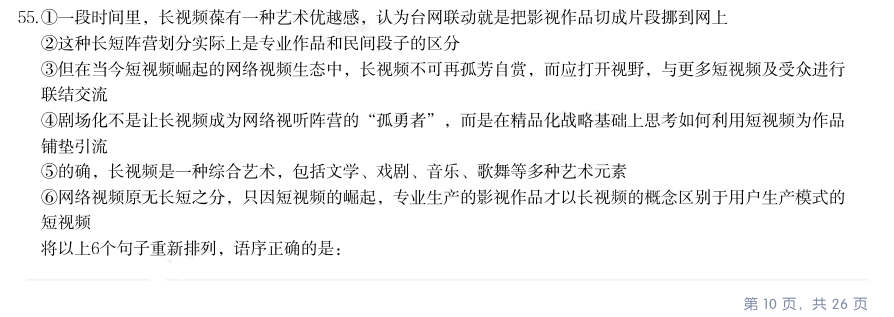
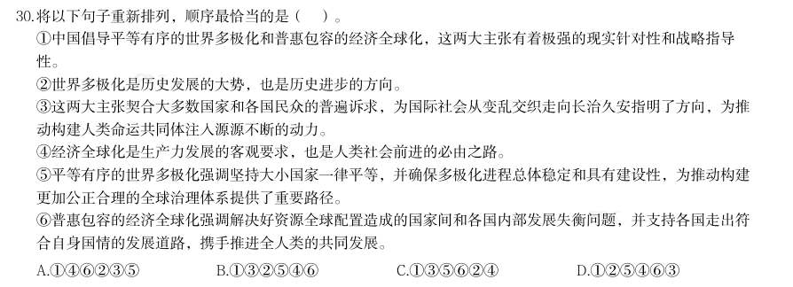

# 言语理解 · 语句排序

> 考点编码：`YY-YJPX`　｜　体系对齐：花生十三 `yanyu-lianjie.md#4.1`

## 一、命题规律

- **本题型真题总量**：92 题（2002–2026）
- **地区分布**：国考 58 / 广东 10 / 湖北 24
- **近六年题量**：2026年6题, 2025年8题, 2024年11题, 2023年2题, 2022年9题, 2021年3题
- **覆盖试卷**：48 套
- **同题变体**：另有 17 道为同题重复（同年多卷/跨年再考），已折叠，需展开见 scripts/search.py --all-variants

## 二、近年真题（最多 12 题，按年份倒序）

### 2026 湖北·统一卷　第 55 题　（语句排序）

1一段时间里,长视频葆有一种艺术优越感,认为台网联动就是把影视作品切成片段挪到网上 2这种长短阵营划分实际上是专业作品和民间段子的区分 3但在当今短视频崛起的网络视频生态中,长视频不可再孤芳自赏,而应打开视野,与更多短视频及受众进行 联结交流 4剧场化不是让长视频成为网络视听阵营的“孤勇者”,而是在精品化战略基础上思考如何利用短视频为作品 铺垫引流 5的确,长视频是一种综合艺术,包括文学、戏剧、音乐、歌舞等多种艺术元素 6网络视频原无长短之分,只因短视频的崛起,专业生产的影视作品才以长视频的概念区别于用户生产模式的 短视频 将以上6个句子重新排列,语序正确的是:

- **A.** 641235
- **B.** 462153
- **C.** 512364
- **D.** 153246

**答案：B**

**解析/参考要点**：B
观察选项,确定首句。1句指出长视频葆有艺术优越感及对台网联动的认识,4
句对“剧场化”下定义,指出剧场化是在精品化战略基础上思考如何利用短视频
为长视频作品铺垫引流,6句说明长短视频划分的由来,三句均可作首句,故保
留A、B、D 三项。5句以“的确”开头,“的确”指完全确实,多用于佐证前文
观点,故不适合直接作首句,排除C 项。
继续观察发现,2句出现指代词“这”,可考虑指代词捆绑解题。2句核心围绕
“长短视频的阵营划分”展开,前文需围绕此话题论述。观察A、B、D 三项可知,
2句前分别为1、3、6句。6句介绍因短视频的崛起才有了长短视频之分,与
2句话题一致,可构成指代词捆绑,B 项当选。1句介绍长视频葆有艺术优越感,
3句介绍当下长视频的发展方向,二者均无法与2句构成指代词捆绑,排除A、
D 两项。
故正确答案为B。

### 2026 广东·统一卷　第 30 题　（语句排序）

将以下句子重新排列,顺序最恰当的是( )。 1中国倡导平等有序的世界多极化和普惠包容的经济全球化,这两大主张有着极强的现实针对性和战略指导 性。 2世界多极化是历史发展的大势,也是历史进步的方向。 3这两大主张契合大多数国家和各国民众的普遍诉求,为国际社会从变乱交织走向长治久安指明了方向,为推 动构建人类命运共同体注入源源不断的动力。 4经济全球化是生产力发展的客观要求,也是人类社会前进的必由之路。 5平等有序的世界多极化强调坚持大小国家一律平等,并确保多极化进程总体稳定和具有建设性,为推动构建 更加公正合理的全球治理体系提供了重要路径。 6普惠包容的经济全球化强调解决好资源全球配置造成的国家间和各国内部发展失衡问题,并支持各国走出符 合自身国情的发展道路,携手推进全人类的共同发展。

- **A.** 146235
- **B.** 132546
- **C.** 135624
- **D.** 125463

**答案：D**

**解析/参考要点**：答案D
观察选项,首句均为1句,提出中国倡导的“世界多极化”和“经济全球化”两
大主张。观察题干,25两句均围绕“世界多极化”话题论述。46两句均围绕
“经济全球化”话题论述。根据行文逻辑顺序,应先论述“世界多极化”,再论
述“经济全球化”,25两句在46两句前,排除A、C 两项。
对比B、D 两项,观察3句与2546四句的位置关系。3句在论述“两大主张”
的作用与意义,2546四句为“两大主张”内容的具体展开,按照行文逻辑顺
序,应先论述“两大主张”的内容,再论述其作用与意义3句适合放在文段结尾,
排除B 项。
故正确答案为D。

### 2026 国考·副省级　第 50 题　（语句排序）

1在这种条件下点火并稳定燃烧,好比在12 级狂风中点燃一根火柴 2在高超声速飞行器穿越云霄的征途中,动力推进技术就是打开高速大门的金钥匙 3当燃烧室内气流流速超过声速时,会形成复杂的激波系,激波前后气流状态会产生突变 4目前,超燃冲压发动机是这一领域的明星,它可以在大气中有效获取氧气,并且在高超声速条 件下稳定燃烧 5想象一下,让一个重达数吨的飞行器在空气稀薄的高空中以数倍声速疾驰,需要多么强大的发 动机提供足够的推力 6此时,常规的发动机技术完全不能适用,只有超燃冲压发动机才能在极短时间内将大量燃料转 化为推力,并让飞行器加速稳定在高超声速 将以上6 个句子重新排列,语序正确的一项是:

- **A.** 263145
- **B.** 254316
- **C.** 541632
- **D.** 532461

**答案：B**

**解析/参考要点**：B
观察选项,对比首句。2句引入“高超声速飞行器”这一话题并指出动力推进技术是高超声速飞行器的关键,
5句指出飞行器在高空中高速疾驰的过程中,对发动机推力的严苛要求,根据行文逻辑,应先引出高超声速飞
行器这一话题,强调动力推进技术的重要性之后,再以“想象一下”引导一个具体的场景对2句中的观点进行
论证,故2句应在5句之前,排除C、D 两项。
分析A、B 两项,对比尾句。5句指出飞行器在高空中高速疾驰的过程中,对发动机推力的严苛要求,6句通
过对比常规发动机与超燃冲压发动机,指出超燃冲压发动机在高超声速条件下的不可替代性,根据行文逻辑,
应先提出对发动机推力的严苛要求,再总结超燃冲压发动机在高超声速条件下的不可替代性,故5句应在6句
之前,排除A 项。
故正确答案为B。
【文段出处】中国军网-解放军报《高超声速飞行器:穿越云霄的“极速传奇”》

### 2026 国考·副省级　第 51 题　（语句排序）

1非周期性意味着,由这种形状构成的整体图案,不能通过平移或旋转来恢复相同的图案 2在后续的研究中,数学家们逐渐缩小这一数字,直到上世纪70 年代,罗杰·彭罗斯仅使用 两种不同的菱形,就完成了非周期性铺砌 3“爱因斯坦”来源于德语,意思是“一块石头”,指的是单铺砌块 4在数学的铺砌领域,寻找“爱因斯坦”是许多数学家追求了半个多世纪的“圣杯” 5单铺砌块指的是一个可以填满无限平面,且不会自我重复的非周期性铺砌块 6早期的数学家需要多种形状来组成非周期铺砌块,比如首个可以覆盖无限平面的非周期铺砌是 由2 万多种形状组成的 将以上6 个句子重新排列,语序正确的一项是:

- **A.** 351462
- **B.** 435621
- **C.** 543216
- **D.** 612534

**答案：A**

**解析/参考要点**：A
对比选项,确定首句。3句引出“爱因斯坦”这一概念并解释其含义,4句指出寻找“爱因斯坦”是数学家的
长期目标,5句对“单铺砌块”进行定义,6句讲述早期数学家的研究概况,均可作为首句,无法判断。
继续观察选项,对比尾句。1句对“非周期性”的含义及其局限性进行说明,属于概念阐述,2句描述“在后
续的研究中”对于非周期性铺砌问题的突破,4句论述寻找“爱因斯坦”是许多数学家追求的“圣杯”,6句
论述“早期的数学家”在非周期铺砌块中需要很多形状,4句及6句均为早期研究阶段,从时间脉络与行文逻
辑看,应先解释含义或提出早期的问题与困境,再阐述后续进展与成果,因此2句更适合作尾句,排除B、C、
D 三项。
故正确答案为A。
【文段出处】搜狐网《一个数学突破,进入了物理学领域》

### 2026 国考·行政执法　第 56 题　（语句排序）

1原子时能够满足对时间间隔均匀性的要求,但它的时刻却没有具体的物理含义 2它是采用原子时的秒长,利用原子时的均匀性,通过闰秒,保证时刻与世界时在一定程度相符 的时间尺度 3世界时的时刻对应太阳在天空中的特定位置,反映地球在空间旋转时自转的角度和地轴方位 41972 年,国际上规定“协调世界时”成为新的国际标准时间,并沿用至今 5因此,为了兼顾人们对时刻和时间间隔的测量应用需要,定义了“协调世界时” 6但是地球自转不均匀等特性,使得世界时的秒长大致呈逐年变长的趋势将以上6 个句子重新 排列,语序正确的一项是:

- **A.** 431625
- **B.** 415326
- **C.** 361524
- **D.** 312654

**答案：C**

**解析/参考要点**：C
对比选项,确定首句。3句介绍世界时的定义和特点,4句讲述1972 年“协调世界时”成为国际标准时
间,均可以作为首句,不好判断。
继续寻找其他线索,发现5句出现结论词“因此”,并指出为了兼顾人们对时刻和时间间隔的需要,定义
了“协调世界时”,故5句前应指出为何要定义协调世界时的相关内容,5句前有1句、2句、6句,1
句介绍“原子时能够满足对时间间隔均匀性的要求,但它的时刻却没有具体的物理含义”的缺陷,可与5
句构成因果关系,保留B、C 两项。2句介绍了一种新的时间尺度,6句仅指出世界时的秒长大致呈逐年
变长的趋势,均无法与5句构成因果关系,排除A、D 两项。
继续寻找其他线索,发现6句出现转折词“但是”,指出地球自转不均匀等特性使得世界时的秒长逐年变
长,故可利用转折词捆绑解题,6句前有2句和3句,3句指出世界时反映地球在空间旋转时自转的角度
和地轴方位,与6句话题一致,且符合转折关系,对应C 项。2句介绍了协调世界时的原理,与6句内容
无关,无法构成转折关系,排除B 项。
故正确答案为C。
【文段出处】人民日报《准时,究竟以何为准(唠“科”)》

### 2026 国考·行政执法　第 57 题　（语句排序）

1它的形成过程与火星上的风力,风向等因素密切相关,是科学家研究火星气候特征的重要 对象,可以帮助人们推测火星的古气候环境 2火星上常年风沙肆虐,岩土遍布,形成了许多不同形态的风沙地貌 3更有趣的是,火星上横向风成脊的两翼方向指向南方——只有在北风之下才能形成这样的形态 4科学家通过计算祝融号着陆区横向风成脊的脊线、顺风剖面和风成床的形态特征,惊喜地发 现,其与地球上存在的巨型沙波纹形态参数较为相似 5综合祝融号测量到的火星风场信息,我们可以推断,火星上古时期也许时常刮起北风 6在祝融号的着陆区中,有一种典型的风沙地貌——横向风成脊将以上6 个句子重新排列,语 序正确的一项是:

- **A.** 621345
- **B.** 643251
- **C.** 245631
- **D.** 261435

**答案：D**

**解析/参考要点**：D
对比选项,确定首句。2句介绍火星上有多种不同形态的风沙地貌,6句具体论述祝融号着陆区的一种典
型的风沙地貌,按照逻辑顺序应先提出观点,再通过例子进行解释说明,故2句应在6句之前,2句更适
合作为首句,排除A、B 两项。
对比C、D 两项,2句后所接句子分别为4句和6句,6句引出横向风成脊的话题,4句介绍科学家计算
横向风成脊的脊线、顺风剖面和风成床的形态特征,并有所发现,按照逻辑顺序,应先提出话题,再具体
论述,故6句应在4句之前,排除C 项,锁定D 项。
故正确答案为D。
【文段出处】学习强国《每日科普|询天问火火星回答了我们什么?》

### 2025 湖北·统一卷　第 55 题　（语句排序）

1这种电池可以被用于驱动各种低功率、一次性可丢弃的电子器件 2加上一点水,纸带上的盐会溶解,释放出带电离子,这些离子在纸带上弥散激活电池组 3纸张和锌的生物可降解性,使这种电池能够最大程度减少可丢弃、低功率电子器件带来的环境影响 4纸带上分布着氯化钠,纸带较短端浸了蜡,含有石墨薄片的油墨印制在纸带一面,有锌粉的油墨印制在纸带 的另一面 5一种新电池,主要由一个1平方厘米的电池单元组成,还包含3种印在长方形纸带上的油墨 6这种油墨将电池组正负极和两根电线连接起来,电线位于有蜡的那端 将以上6个句子重新排列,语序正确的是:

- **A.** 516423
- **B.** 534612
- **C.** 546213
- **D.** 564321

**答案：C**

### 2025 广东·统一卷　第 24 题　（语句排序）

将下列句子重新排列,顺序最为恰当的是( )。 1马达加斯加已成为非洲杂交水稻种植面积最大、产量最高的国家。 2马达加斯加是传统农业国,受农业生产方式传统、土地荒漠化等影响,该国水稻产量无法完全满足本国需 求。 3十多年来,中国杂交水稻已在马达加斯加累计推广7万多公顷,平均每公顷单产达7.8吨,最高单产可达每公 顷12吨。 42007年,中国援马达加斯加杂交水稻示范中心正式启动,帮助当地民众园粮食自给自足之梦。

- **A.** 1423
- **B.** 1342
- **C.** 2431
- **D.** 2134

**答案：A**

### 2025 广东·统一卷　第 29 题　（语句排序）

将下列句子重新排列,顺序最为恰当的是( )。 1所以篆书的书写如同画面一般,比较繁复,从而导致了“隶变”的发生。 2魏晋时期是楷书的形成期,楷书在隶书的基础上简化了笔法,将运笔动作集中在起笔、收笔和弯折处。 3隶书与小篆同时产生于秦始皇时期,就是“篆之捷也”,得名隶书。是因为它是一种流行于下层皂隶之间的 字体。 4行书出现的时间则和楷书不相上下,也是在隶书之上加快运笔速度,草率起来,笔画之间有了映带连属。 5到了汉代,为了进一步追求效率,人们书写更加潦草,就出现了草书。 6汉字在发展演变的历程中其形成了五种字体,篆书是最早的,象形意味较强。

- **A.** 613524
- **B.** 361245
- **C.** 635142
- **D.** 316452

**答案：D**

### 2025 国考·副省级　第 52 题　（语句排序）
> 材料：1但目前来看,新一代AI都表现出一定的回避提问的意图,这可能与模型试图节约算力资源有关 2在目前的法律框架内,数字生命还不是可以承担法律责任的主体,而被认为是程序、代码,或是人在网络空 间中的一个身份 3如果机器向人输出了错误或者不能理解的内容,这是算法故障,应当要求开发、维护人员尽快修复,而不是 指令机器“立刻改正” 4不过一旦模型有自主选择逃避人类提问的能力,并且已经脱离了开发人员的控制,AI没有法律人格的结论就 要面临挑战了…

5一般认为,创造数字生命的人,就是对数字生命负责的人,例如程序的开发者、AI的使用者等 6这除了伦理上的考虑,还有其不具备承担责任可能的因素 将以上6个句子重新排列 ,语序正确的一项是:

- **A.** 256143
- **B.** 526413
- **C.** 265314
- **D.** 532641

**答案：C**

**解析/参考要点**：对比选项,确定首句。2句先提出数字生命这一概念,并阐述其不是可以承担法律责任的主体,5句指
出创造数字生命的人,就是对数字生命负责的人。按照行文逻辑,应该先引出“数字生命”这一话题,
再介绍对其负责的主体,故2句更适合作首句,排除B、D 两项。
对比A、C 两项,2句后分别衔接5句与6句。观察5句与6句发现,6句中出现指代词“其”,说明与
之捆绑的句子应该与6句中的话题一致,对比A、C 两项,6句之前分别为5句和2句,6句论述“其”
不具备承担责任可能的因素,说明之前所接的句子应提到无法承担责任的主体对象,2句指出数字生命
还不是可以承担法律责任的主体,可与6句衔接,构成指代词捆绑,C 项当选。5句提到对数字生命负
责的人,与6句话题衔接不恰当,无法构成捆绑关系,排除A 项。
故正确答案为C。
【文段出处】学习时报《数字生命遥远吗?》

### 2025 国考·地市级　第 54 题　（语句排序）

1但目前来看,新一代AI都表现出一定的回避提问的意图,这可能与模型试图节约算力资源有关 2在目前的法律框架内,数字生命还不是可以承担法律责任的主体,而被认为是程序、代码,或是人在网络空 间中的一个身份 3如果机器向人输出了错误或者不能理解的内容,这是算法故障,应当要求开发、维护人员尽快修复,而不是 指令机器“立刻改正” 4不过一旦模型有自主选择逃避人类提问的能力,并且已经脱离了开发人员的控制,AI没有法律人格的结论就 要面临挑战了 5一般认为,创造数字生命的人,就是对数字生命负责的人,例如程序的开发者、AI的使用者等 6这除了伦理上的考虑,还有其不具备承担责任可能的因素 将以上6个句子重新排列 ,语序正确的一项是:

- **A.** 256143
- **B.** 526413
- **C.** 265314
- **D.** 532641

**答案：C**

**解析/参考要点**：对比选项,确定首句。2句先提出数字生命这一概念,并阐述其不是可以承担法律责任的主体,5句指
出创造数字生命的人,就是对数字生命负责的人。按照行文逻辑,应该先引出“数字生命”这一话题,
再介绍对其负责的主体,故2句更适合作首句,排除B、D 两项。
对比A、C 两项,2句后分别衔接5句与6句。观察5句与6句发现,6句中出现指代词“其”,说明与
之捆绑的句子应该与6句中的话题一致,对比A、C 两项,6句之前分别为5句和2句,6句论述“其”
不具备承担责任可能的因素,说明之前所接的句子应提到无法承担责任的主体对象,2句指出数字生命
还不是可以承担法律责任的主体,可与6句衔接,构成指代词捆绑,C 项当选。5句提到对数字生命负
责的人,与6句话题衔接不恰当,无法构成捆绑关系,排除A 项。
故正确答案为C。
【文段出处】学习时报《数字生命遥远吗?》

### 2025 国考·地市级　第 55 题　（语句排序）
> 材料：1严格执法与公正司法是相辅相成的…

2加强行政执法与刑事司法衔接,是为了确保二者之间既能互不干扰,又能高效转换,从而更有力地实施法律 3前端为后端减负、后端为前端增力,才能更好地让严格执法与公正司法共同发力,促进法律有效实施,保障 社会公平正义 4特别是在环境保护、食品安全等关系人民切身利益的重点领域,行政执法与刑事司法脱节会导致法律威慑力 不足 5习近平总书记指出,“要加强行政执法与刑事司法有机衔接,坚决克服有案不移、以罚代刑等现象。” 6严格执法位于前端,通过行政手段依法保障人民群众的生命财产安全;公正司法位于后端,定分止争,是公 平正义的最后一道防线 将以上6个句子重新排列,语序正确的一项是:

- **A.** 165243
- **B.** 124536
- **C.** 536412
- **D.** 562314

**答案：A**

**解析/参考要点**：对比选项,确定首句。1句指出严格执法与公正司法是相辅相成的,5句通过引用习近平总书记的话,
指出要加强行政执法与刑事司法的有机衔接,15两句均可作首句,保留。
继续寻找其他线索,36两句均论述“前端”“后端”相关话题,且3句介绍了前端与后端的配合能够
更好地让严格执法与公正司法共同发力,6句介绍了前端是严格执法,后端是公正司法,按照逻辑顺序,
应先介绍前端与后端分别对应的话题,再介绍二者应如何配合,故6句在3句之前,排除B、C 两项,保
留A、D 两项。
对比尾句,尾句为3句与4句,3句通过必要条件“······才······”给出了前端与后端
配合的对策,4句介绍了行政执法与刑事司法脱节所带来的问题,根据行文逻辑可知,应先论述问题,
再提出对策,故4句在3句之前,排除D 项,A 项当选。
故正确答案为A。
【文段出处】学习时报《建立行政执法与刑事司法“无缝衔接”机制》

## 三、其余真题（按年代分片）

| 年代 | 题量 | 分片文件 |
|---|---:|---|
| 2000s | 3 | [YY-YJPX-2000s.md](split/YY-YJPX-2000s.md) |
| 2010s | 42 | [YY-YJPX-2010s.md](split/YY-YJPX-2010s.md) |
| 2020s | 35 | [YY-YJPX-2020s.md](split/YY-YJPX-2020s.md) |

> 也可用 `python scripts/search.py --kaodian YY-YJPX` 直接检索全部 92 题。