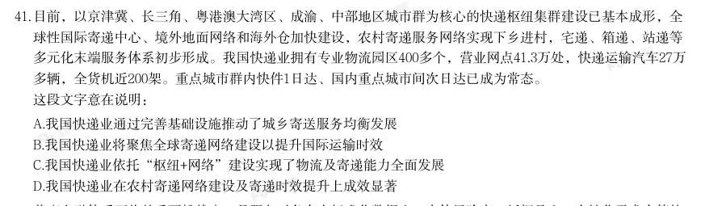

# 言语理解 · 中心理解

> 考点编码：`YY-ZXJL`　｜　体系对齐：花生十三 `yanyu-lianjie.md#3.1`

## 一、命题规律

- **本题型真题总量**：932 题（2000–2026）
- **地区分布**：国考 420 / 广东 306 / 湖北 206
- **近六年题量**：2026年24题, 2025年34题, 2024年34题, 2023年32题, 2022年29题, 2021年20题
- **覆盖试卷**：97 套
- **子考点分布**：对策优先 382　转折与因果 277　中心句与主旨 188　中心理解（综合） 135　主题词 59
- **同题变体**：另有 109 道为同题重复（同年多卷/跨年再考），已折叠，需展开见 scripts/search.py --all-variants

## 二、近年真题（最多 12 题，按年份倒序）

### 2026 湖北·统一卷　第 39 题　（对策优先）

智能社会的演进模糊了社会心态与社会行为的边界,呈现出线上线下虚实共生、心态风险与行动风险交织缠绕 的特征,这对社会心态的治理策略与治理工具提出了新的挑战。社交软件的分享机制与算法推荐规律,都以对 人类心理特征的精准利用为前提。此类技术往往把复杂的人类互动过程简化为点赞、转发等二元化的态度立场 或简单行为,虽然便利了个体表达观点,却可能导致网络行为高度两极化,让许多事实错误但情绪饱满的虚假 信息快速传播,成为网络空间治理的一大顽疾。 这段文字意在强调:

- **A.** 智能社会对社会心态治理提出了新的挑战
- **B.** 智能化加速了从社会心态到社会行为的转化
- **C.** 社交软件的算法可能导致网络行为高度两极化
- **D.** 智能社会当务之急是要加强网络空间治理

**答案：A**

**解析/参考要点**：A
文段开篇介绍了智能社会演进所呈现的特征,并指出这对社会心态的治理提出了
新挑战。随后指出社交软件的分享机制与算法推荐规律会简化人类的互动行为,
导致网络行为高度两极化,让虚假信息传播,成为网络空间治理的一大顽疾,即
对前文进行了解释说明。故文段重点在首句,强调智能社会的演进对社会心态治
理提出了新挑战,对应A 项。
B 项,“加速了从社会心态到社会行为的转化”无中生有,文段未提及,排除;
C 项,“可能导致网络行为高度两极化”对应分述句部分,非重点,且缺少文段
主题词“智能社会”,排除;
D 项,文段的问题是“智能社会对社会心态的治理提出新挑战”,若想提对策,
也应该是针对“社会心态”,“要加强网络空间治理”偏离文段核心,对策不具
备针对性,排除。
故正确答案为A。

### 2026 湖北·统一卷　第 40 题　（对策优先）
> 材料：晚安牛奶的最大卖点在于“高褪黑素含量”。有品牌标明“褪黑素含量:12500pg/盒”,1pg等于万亿分之一 克。而褪黑素的有效剂量在0.1~0.3毫克,这意味着需要喝约8000盒这种牛奶才能达到治疗剂量,因此晚安牛奶…

助眠更依赖于其安慰剂效应。如果某人有轻微的失眠困扰,还达不到临床上失眠的诊断标准,又能够排除器质 性或精神疾病因素导致的失眠,个体比较相信晚安牛奶,或者喝后有效,在这种有益无害的前提下,不妨食 用。 这段文字意在强调:

- **A.** 晚安牛奶的助眠效果主要源自心理作用
- **B.** 晚安牛奶能助眠是商家的虚假宣传
- **C.** 多喝晚安牛奶才能起到助眠作用
- **D.** 晚安牛奶有较好的助眠效果

**答案：A**

**解析/参考要点**：A
文段首先通过晚安牛奶的最大卖点,引出“高褪黑素含量”话题,之后通过数据
对比指出品牌标明的褪黑素含量远远达不到褪黑素的治疗剂量,随后通过结论词
“因此”引出结论,即晚安牛奶助眠更依赖于其安慰剂效应。最后进行补充说明,
指出在某些轻微、非器质性或精神疾病因素导致的失眠且在本人相信等情况下可
以食用。故文段重在强调晚安牛奶助眠效果的真正来源是安慰剂作用,即心理作
用,对应A 项。
B 项,“商家的虚假宣传”文段并未提及,无中生有,排除;
C 项,“多喝晚安牛奶才能起到助眠作用”非重点,虽然文段提到“需要喝约8000
盒”,但这只是为了证明晚安牛奶的褪黑素含量低,排除;
D 项,“晚安牛奶有较好的助眠效果”偏离重点,文段重点强调“晚安牛奶的助
眠效果主要靠安慰剂作用”,排除。
故正确答案为A。

### 2026 湖北·统一卷　第 41 题　（主题词）

目前,以京津冀、长三角、粤港澳大湾区、成渝、中部地区城市群为核心的快递枢纽集群建设已基本成形,全 球性国际寄递中心、境外地面网络和海外仓加快建设,农村寄递服务网络实现下乡进村,宅递、箱递、站递等 多元化末端服务体系初步形成。我国快递业拥有专业物流园区400多个,营业网点41.3万处,快递运输汽车27万 多辆,全货机近200架。重点城市群内快件1日达、国内重点城市间次日达已成为常态。 这段文字意在说明:

- **A.** 我国快递业通过完善基础设施推动了城乡寄送服务均衡发展
- **B.** 我国快递业将聚焦全球寄递网络建设以提升国际运输时效
- **C.** 我国快递业依托“枢纽+网络”建设实现了物流及寄递能力全面发展
- **D.** 我国快递业在农村寄递网络建设及寄递时效提升上成效显著

**答案：C**

**解析/参考要点**：C
文段开篇指出“以城市群为核心的快递枢纽集群”已基本建设成形,随后指出“全
球性国际寄递中心、境外地面网络和海外仓”加快建设、“农村寄递服务网络”
实现下乡进村。接下来通过列数据的形式说明我国快递业物流能力显著增强,进
而提升了寄递能力。故文段通过并列结构说明快递业依托枢纽集群与地面网络,
提升了物流能力和寄递能力,对应C 项。
A 项“城乡”、B 项“全球寄递网络”、D 项“农村”均仅对应文段部分内容,
文段提及我国快递业覆盖城市与农村,同时“全球性国际寄递中心、境外地面网
络和海外仓”也加快建设,表述片面,排除。
故正确答案为C。

### 2026 湖北·统一卷　第 42 题　（对策优先）

普惠金融体系面临的重要挑战之一是服务对象存在标准化数据少、个体风险高、抵押品少、个性化需求多等特 征,因此发展普惠金融需要不同类型的金融机构和企业共同分担风险和损失,比如融资担保等风险共担机制即 为解决上述问题的一种手段,不过费用设计、合作模式等都有待于进一步创新。 这段文字意在说明:

- **A.** 普惠金融体系费用设计和合作模式亟待创新
- **B.** 普惠金融体系建设要逐步拓宽金融服务领域
- **C.** 普惠金融体系建设有必要完善风险共担机制
- **D.** 普惠金融体系面临来自服务对象的多重挑战

**答案：C**

**解析/参考要点**：C
文段首先介绍了普惠金融体系面临的一大重要挑战,为问题引入。随后以“因此”
+“需要”引导对策“发展普惠金融需要不同类型的金融机构和企业共同分担风
险和损失”,并以“比如”引导举例论证,结尾处虽出现转折词“不过”,但其
引导的“费用设计、合作模式等都有待于进一步创新”实为对风险共担机制的具
体完善。所以中心句仍为“因此”引导的对策句,对应C 项。
A 项,对应文段尾句对“风险共担机制”补充说明的内容,非文段重点,且C 项
既包含文段的核心对策“风险共担机制”,又通过“有必要完善”概括了“费用
设计、合作模式等都有待于进一步创新”,更为全面完整,故排除A 项;
B 项,“逐步拓宽金融服务领域”文段未提及,无中生有,排除;
D 项,“面临来自服务对象的多重挑战”为问题表述,非重点,排除。
故正确答案为C。

### 2026 湖北·统一卷　第 43 题　（主题词）

斑翅果蝇的雌虫会在多种软皮水果中产卵,其幼虫在果实内取食,导致水果腐烂。近日,科研人员利用“基因 剪刀”技术将影响斑翅果蝇性别发育的基因修改成让雌虫无法正常产卵但对雄虫无影响的版本后,斑翅果蝇的 绝大多数后代都会继承这个基因变化,实现基因驱动。科学家认为,人为实现基因驱动,让特定基因在生物群 体中传播开来,可以控制有害生物的数量或增强濒危物种的抗病能力。此前已有研究团队用相关方法消灭传播 疟疾的蚊子,此次用于斑翅果蝇这种农业害虫尚属首次。 这段文字主要介绍了:

- **A.** “基因剪刀”技术是一项高效的抗虫害技术
- **B.** “基因剪刀”技术增强了濒危物种的抗病能力
- **C.** 通过基因驱动可以控制有害生物的数量
- **D.** 研究人员用“基因剪刀”技术对抗斑翅果蝇

**答案：D**

**解析/参考要点**：D
文段首先指出斑翅果蝇雌虫产卵会危害软皮水果,接着说明科研人员用“基因剪
刀”技术修改其性别发育基因,实现基因驱动,随后介绍基因驱动具有控制有害
生物数量或增强濒危物种抗病能力的作用,尾句进一步强调,此次将该技术用于
斑翅果蝇这种农业害虫是首次尝试。故文段围绕“基因剪刀”技术与“斑翅果蝇”
展开,重点强调研究人员运用“基因剪刀”技术对抗斑翅果蝇这一具体研究,对
应D 项。
A 项,“高效的抗虫害技术”侧重对技术本身的属性评价,但文段并未提及该技
术是否“高效”,且文段核心是介绍该技术针对斑翅果蝇的具体应用实践,选项
缺少文段主题词“斑翅果蝇”,偏离文段重点,排除;
B 项,“增强了濒危物种的抗病能力”仅为“基因剪刀”技术实现基因驱动后可
能带来的效果之一,并非文段所阐述的核心内容,表述片面且非重点,且缺少文
段主题词“斑翅果蝇”,排除;
C 项,“控制有害生物的数量”仅为基因驱动可能带来的效果之一,并非文段所
阐述的核心内容,表述片面且非重点,且缺少文段主题词“基因剪刀”技术与“斑
翅果蝇”,排除。
故正确答案为D。

### 2026 湖北·统一卷　第 44 题　（对策优先）

在我国,对农业生产造成重大危害的多数昆虫都具有迁飞性。草地贪夜蛾、黏虫等具有“春夏北迁,秋冬南 迁”的习性。由于昆虫个体小、重量轻,飞行能力有限,远距离迁飞主要借助气流运载。季风、台风、西太平 洋副热带高压的位置与强度变化等因素都会对害虫的迁飞扩散产生重要影响。每年春夏,害虫大军从中南半岛 等地随西南季风迁飞入我国,之后又随西南季风或东南季风暖湿气流继续北上。到了秋冬,草地贪夜蛾、黏虫 等为逃避低温环境,只好迁回温暖的南方。这是昆虫逃避不良环境条件的一种生存对策。 这段文字重在说明害虫大军迁飞的:

- **A.** 地域密码
- **B.** 季节规律
- **C.** 环境影响
- **D.** 生存策略

**答案：B**

**解析/参考要点**：B
文段开篇引出话题“多数昆虫都具有迁飞性”,随后提出观点,草地贪夜蛾、黏
虫等具有“春夏北迁,秋冬南迁”的习性,即害虫大军迁飞的季节规律。后文对
其进行原因解释,从季风、台风、西太平洋副热带高压的位置与强度变化等因素
具体论述如何影响其迁飞的季节规律,文段最后一句通过“这”对前文“逃避低
温环境”进行补充说明。故文段重在说明害虫大军迁飞的季节规律,对应B 项。
A 项“地域密码”文段并非重点描述,虽然提及南北方,但“春夏北迁,秋冬南
迁”重点是强调季节的规律,排除;
C 项“环境影响”对应“季风、台风、西太平洋副热带高压的位置与强度变化等
因素”,为原因解释部分内容,非重点,排除;
D 项“生存策略”出现在尾句,是对“逃避低温环境”进行的补充说明,并非全
文重点,排除。
故正确答案为B。

### 2026 湖北·统一卷　第 45 题　（对策优先）
> 材料：在深度学习的过程中,实际确定误差并非易事。为解决这一问题,当前深度学习领域应用“损失函数”实现误 差最小化,即在人工智能的学习过程中,找到能够最小化损失函数值的参数。但损失函数的形式会随具体情况 而有所不同,难以全面掌握其特性,因此需要引入微分。微分主要用于分析某个变量的变化如何影响函数的 值。通过对损失函数进行微分,可以明了参数变化时损失函数值的变化,进而调整参数值,让损失函数的值尽 可能小。在针对性地进行编程后,人工智能能够自动完成上述任务。…

对这段文字概括最恰当的是:

- **A.** 通过对损失函数进行微分,深度学习能实现误差最小化
- **B.** 引入微分后,损失函数能帮助人工智能实现自主深度学习
- **C.** 损失函数在深度学习中主要用于确定误差
- **D.** 损失函数对深度学习的参数优化具有重要意义

**答案：A**

**解析/参考要点**：A
文段开篇介绍在深度学习过程中确定实际误差并非易事,接下来指出用“损失函
数”实现误差最小化,随后“但”转折引出损失函数形式会随具体情况而有所不
同,难以全面掌握其特性,紧接着通过“因此”强调需要引入微分,后文继续说
明对损失函数微分能明确参数变化对损失值的影响,进而调整参数值让损失函数
的值尽可能小,且进行针对性编程后人工智能就可自动完成任务。故文段核心在
于对损失函数进行微分能帮助深度学习实现误差最小化,对应A 项。
B 项,文段重点是“误差最小化”,并非“实现自主深度学习”,偏离文段中心,
排除;
C、D 两项,均缺少“微分”这一主题词,偏离文段中心,排除。
故正确答案为A。

### 2026 湖北·统一卷　第 46 题　（中心句与主旨）

人形机器人的传感器像是人类的眼睛、耳朵和皮肤,扮演着感知器官的角色。视觉传感器通过摄像头捕捉环境 图像;声音传感器接收并解析语音指令;力觉传感器仿效人体的力觉感受,精确感知与外界的接触力;触觉传 感器模仿人类触觉,精准感知物体的形状和硬度。控制系统是人形机器人的大脑,借助计算单元和智能算法处 理数据并作出决策。多种智能算法的应用让机器人越来越接近人类,比如利用深度神经网络,处理视觉、语音 识别等任务。 根据这段文字,对“人形机器人的设计原理”概括最准确的是:

- **A.** 借助多功能传感器实现智能化处理
- **B.** 仿生学与机械工程的有机融合
- **C.** 赋予精准触觉,提升感知能力
- **D.** 传感技术与控制理论的集成突破

**答案：D**

**解析/参考要点**：D
文段首先指出人形机器人的传感器扮演感知器官的角色,并具体介绍视觉、声音、
力觉和触觉传感器的作用。随后指出控制系统如同人类大脑,借助计算单元和智
能算法处理数据并作出决策,并说明智能算法的应用使其更接近人类。故文段为
并列结构,从传感器与控制系统两个角度论述了人形机器人的设计原理,对应D
项。
A 项“多功能传感器”、C 项“触觉”和“提升感知能力”均仅对应传感器部分,
未提及“控制系统”,表述片面,排除;
B 项,“机械工程”文段未提及,无中生有,排除。
故正确答案为D。

### 2026 湖北·统一卷　第 52 题　（对策优先）

一年中的大部分时间,成年棕熊都是离群索居的动物。但当大量鲑鱼洄游到湖中繁殖时,常常会有几十头棕熊 同时聚集在湖边。过高的种群密度和相对有限的理想捕鱼位置,决定了它们必须竞争进食序列。在这个巨大 的“餐桌”周围,进食的座次是由实力来决定的,成年公熊之间常常为了争夺捕鱼位置在湖畔发生激烈打斗, 胜者赢得一切。在这个时期,湖畔通常是被雄性棕熊所占据的,当雌性带着幼年棕熊靠近时,狂暴的公熊会驱 赶它们,幼熊易遭到撕咬而死亡。 由这段文字无法推出:

- **A.** 成年棕熊在争夺食物时竞争非常激烈
- **B.** 成年棕熊的进食序列主要由实力决定
- **C.** 鲑鱼繁殖期的湖畔对幼熊会更加危险
- **D.** 雌熊带幼熊靠近湖畔是为了捕食鲑鱼

**答案：D**

**解析/参考要点**：D
A 项:根据“成年公熊之间常常为了争夺捕鱼位置在湖畔发生激烈打斗”可知,
符合文意,排除;
B 项:根据“在这个巨大的‘餐桌’周围,进食的座次是由实力来决定的”可知,
符合文意,排除;
C 项:根据“当大量鲑鱼洄游到湖中繁殖时,······在这个时期······当
雌性带着幼年棕熊靠近时,狂暴的公熊会驱赶它们,幼熊易遭到撕咬而死亡”可
知,符合文意,排除;
D 项:文段仅指出“当雌性带着幼年棕熊靠近时,狂暴的公熊会驱赶它们”,但
并未提及它们靠近的目的是捕食鲑鱼,无中生有,当选。
本题为选非题,故正确答案为D。

### 2026 广东·统一卷　第 21 题　（对策优先）

当前,中国经济已转向高质量发展阶段,旧的生产函数组合方式已经难以持续,不可能像高速增长阶段那样主 要依靠要素投入驱动经济增长,必须转向更多依靠科技创新和全要素生产率的提高。面对新一轮科技革命和产 业变革深入发展,中国既要摆脱传统增长方式下粗放扩张、低效发展的生产力发展路径,又要拓展先进生产力 发展空间。以科技创新为核心,培育和发展新质生产力,才能为高质量发展开辟新路径、注入新动力。 这段文字主要讲了( )。

- **A.** 重大技术变革驱动中国经济高速增长
- **B.** 高质量发展离不开培育和发展新质生产力
- **C.** 每一次科技革命都会带来生产力质的飞跃
- **D.** 科技创新是培育和发展新质生产力的核心

**答案：B**

**解析/参考要点**：答案B
文段开篇指出中国经济已转向高质量发展阶段,经济增长需要依靠科技创新和全
要素生产率的提高,接着指出既要摆脱传统增长方式下粗放扩张、低效发展的生
产力发展路径,又要拓展先进生产力发展空
间,尾句通过必要条件提出对策,强调培育和发展新质生产力才能为高质量发展
开辟新路径、注入新动力。故文段重点强调高质量发展需要培育和发展新质生产
力对应B 项。
A 项,缺少文段主题词“新质生产力”“高质量发展”,偏离文段核心,排除:
C 项,缺少文段主题词“新质生产力”“高质量发展”,偏离文段核心,且“都会
带来生产大质的飞跃”表述过于绝对,排除
D 项,缺少文段主题词“高质量发展”,偏离文段核心,文段重点强调通过培育
和发展新质生产力实现高质量发展,选项并未提及“高质量发展”这一最终目标,
排除。
故正确答案为B。

### 2026 广东·统一卷　第 24 题　（对策优先）

近年来,多地鼓励市民通过“随手拍”反映市政设施损坏、不文明行为等城市治理问题。作为庞大复杂的有机 体,城市运转涉及经济、文化、民生等多个领域和部门,规划、政策、制度等即便再完善细密也难以穷尽城市 治理的每一个细节、每一处角落。城市理想蓝图与现实场景之间的微小“空白”,特别需要广大市民主动作 为、共同“填补”。看似简单的市民“随手拍”,反映出市民变被动接受公共服务为主动参与城市治理的积极 意识。 上述文字意在说明( )。

- **A.** 城市文明建设人人有责
- **B.** 城市运转体系庞大且复杂
- **C.** 城市治理需要市民主动参与
- **D.** 城市理想蓝图需要全民共绘

**答案：C**

**解析/参考要点**：答案C
文段先引出“随手拍”参与城市治理的现象接着指出问题“城市运转复杂,制度
规划难以覆盖所有治理细节”,随后通过程度词“特别”强调对策,即需要广大
市民主动作为。文段末尾再次强调“随手拍”反映出市民主动参与城市治理。故
文段重点强调对策“需要市民主动作为”且文段主题词为“城市治理”,对应C
项。
A 项“城市文明建设人人有责”、D 项“城市理想蓝图需要全民共绘”均缺少文段
核心话题“主动作为”,文段并非仅强调全民参与,而是强调全民的主动参与,
排除:
B 项,“城市运转体系庞大且复杂”为问题阐述,文段重点强调对策,非重点,
排除。故正确答案为C。

### 2026 广东·统一卷　第 25 题　（对策优先）

从“村BA”到“村超”,从乡村博物馆到美术馆、音乐会,一批乡村文体活动开展得有声有色。这些乡村公共 文化服务衍生出的新业态,正在成为推动乡村全面振兴的重要动力。乡村公共文化服务提升和乡村文化产业发 展要充分考虑乡土特征,聚焦乡村资源优势和文化特色,提炼乡村的文化主题和品牌定位,打造集村史馆、乡 村书屋等功能于一体的复合体空间,采用多元化、艺术化和高新技术的场景营造手段,建设乡土美学生活体验 中心,注重乡村本土节日的挖掘,从而推动文化创意赋能乡村可持续发展。 根据这段文字,作者最有可能认同( )。

- **A.** 乡村公共文化服务是推动乡村全面振兴的重要动力
- **B.** 村字头的文体活动是乡村公共文化服务的典型代表
- **C.** 复合体空间的主要价值在于合理利用乡村空间资源
- **D.** 挖掘乡村本土文化资源有利于推动乡村可持续发展

**答案：D**

**解析/参考要点**：答案D
文段开篇以乡村文体活动为例,引出乡村公共文化服务新业态对乡村全面振兴的
推动作用。接着通过“要”指出对策,强调乡村公共文化服务提升与文化产业发
展需立足乡土特征,聚焦乡村特色,提炼乡村定位,打造乡村复合体空间,建设
乡土美学生活体验中心,挖掘乡村本土节日,最终赋能乡村可持续发展。故文段
重在强调通过挖掘乡村本土文化资源赋能乡村可持续发展,对应D 项。
A 项,对应文段开头“乡村公共文化服务衍生出的新业态成为推动乡村全面振兴
的重要动力”的内容,非重点,且“乡村公共文化服务”偷换概念,排除,
B 项,“村字头的文体活动”对应文段开篇的例子,非重点,排除;
C 项,“复合体空间”仅是具体对策中的一部分,表述片面,排除。
故正确答案为D。

## 三、其余真题（按年代分片）

| 年代 | 题量 | 分片文件 |
|---|---:|---|
| 2000s | 279 | [YY-ZXJL-2000s.md](split/YY-ZXJL-2000s.md) |
| 2010s | 427 | [YY-ZXJL-2010s.md](split/YY-ZXJL-2010s.md) |
| 2020s | 214 | [YY-ZXJL-2020s.md](split/YY-ZXJL-2020s.md) |

> 也可用 `python scripts/search.py --kaodian YY-ZXJL` 直接检索全部 932 题。