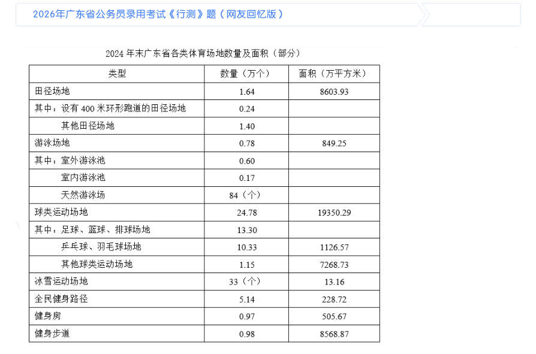
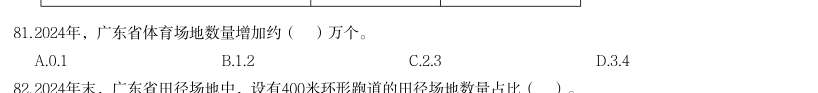
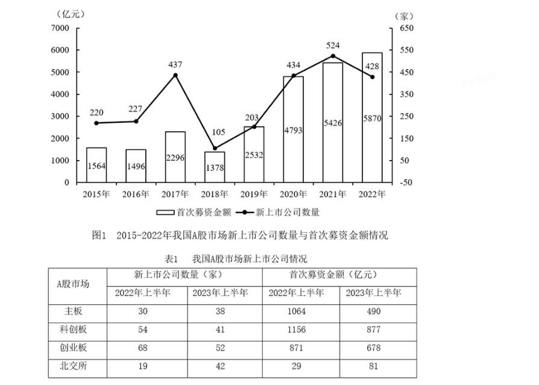
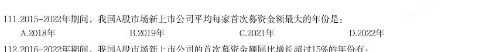
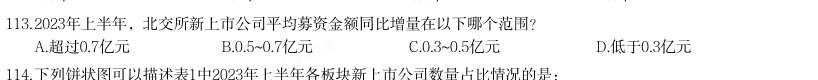

# 资料分析 · 平均数计算

> 考点编码：`ZL-AVG`　｜　体系对齐：花生十三 `ziliao-fenxi.md#题型5`

## 一、命题规律

- **本题型真题总量**：166 题（2001–2026）
- **地区分布**：国考 101 / 广东 34 / 湖北 31
- **近六年题量**：2026年8题, 2025年10题, 2024年8题, 2023年5题, 2022年14题, 2021年7题
- **覆盖试卷**：71 套
- **子考点分布**：现期平均数 181　平均数增长率 2　基期平均数 1
- **同题变体**：另有 18 道为同题重复（同年多卷/跨年再考），已折叠，需展开见 scripts/search.py --all-variants
- **速算/速解提示**：见花生十三 `references/ziliao-susuan.md` 与 `references/shuliang-gongshi.md` 对应章节

## 二、近年真题（最多 12 题，按年份倒序）

### 2026 湖北·统一卷　第 122 题　（现期平均数）
> 材料：截至2024年末,我国60岁及以上人口突破3亿,达到31031万人。养老服务相关企业约16万家,比2023年底 增长24.36%。全国共有各类养老机构和设施40.6万个,养老床位合计799.3万张。…

2024年末,我国注册登记的养老机构平均拥有护理型床位约:

> 材料图见 images/HB-2026-ty-X121-m.jpg

- **A.** 68张
- **B.** 83张
- **C.** 103张
- **D.** 127张

**答案：B**

**解析/参考要点**：B
根据题干“2024 年末······平均拥有······约”,结合材料时间
为2024 年末,可判定本题为现期平均数问题。定位文字材料第一段可得:截至
2024 年末,我国注册登记的养老机构4.0 万个,床位507.7 万张(护理型床位
占比为65.7%)。根据公式:部分=整体×比重、平均数
,则2024 年末
我国注册登记的养老机构平均拥有护理型床位数
张,与B 项最接近。
故正确答案为B。
计算提示:本题为多步乘除运算,采用百化分来简化运算。
,则
,与B 项最接近。

### 2026 广东·统一卷　第 81 题　（基期平均数）
> 材料：截至2024年末,广东省共有体育场地35.3万个,较上年增长3.58%;体育场地面积3.72亿平方米,较上年增长4.49%;人均体育场地面积2.91平方米(按常住人口计算),较上年增长3.93%。…

截至2024年末,广东省共有体育场地35.3万个,较上年增长3.58%;体育场地面积3.72亿平方米,较上年增 长4.49%;人均体育场地面积2.91平方米(按常住人口计算),较上年增长3.93%。 2024年,广东省体育场地数量增加约( )万个。

- **A.** 0.1
- **B.** 1.2
- **C.** 2.3
- **D.** 3.4

**答案：暂缺（原始文件为扫描版）**

**解析/参考要点**：答案B

### 2026 广东·统一卷　第 87 题　（现期平均数）
> 材料：新中国成立以来,我国的城镇化建设不断推进,城市规模不断扩大,综合实力显著增强,基础设施持续改 善,城市更加宜业宜居。 从城市数量看,1948年末,我国城市共有58个,新中国成立后,大批县城改设为城市。1949年末,全国城 市共有129个,其中,地级以上城市68个,县级市61个,建制镇2000个左右。改革开放前,我国的城镇化经历 了一段比较曲折的发展历程,小城市和小城镇发展缓慢。1978年末,全国城市共有193个,其中,地级以上城 市101个,县级市92个,建制镇2173个。改革开放以来,城市数量快速增加。2023年末,城市个数达到694个, 其中,地级以上城市297个,县级市397个,建制镇2…

2023年末,我国地级以上城市的常住人口规模平均约为( )。

> 材料图见 images/GD-2026-ty-X086-m.jpg

- **A.** 216.6万人
- **B.** 226.6万人
- **C.** 236.6万人
- **D.** 246.6万人

**答案：B**

**解析/参考要点**：答案B
根据题干“2023 年末......常住人口规模平均约为......”,结合材料给出了2023
年末的数据,可判定本题为现期平均数问题。定位文字材料二、三段可得:2023
年末地级以上城市297 个、我国地级以上城市常住人口总数67313 万人。根据公
式:平均数=总数/份数,则题目所求=67313/297 约=226.6 万人。故正确答案为B。

### 2026 国考·副省级　第 120 题　（现期平均数）

全国期货交易所中,2025 年3 月平均每手成交额同比增幅和同比降幅最大的分别是:

> 材料图见 images/GK-2026-fs-X116-m.jpg

- **A.** 中国金融期货交易所,广州期货交易所
- **B.** 中国金融期货交易所,上海国际能源交易中心
- **C.** 上海期货交易所,广州期货交易所
- **D.** 上海期货交易所,上海国际能源交易中心

**答案：C**

**解析/参考要点**：C

### 2026 国考·行政执法　第 116 题　（现期平均数）
> 材料：2024 年,我国企业发明专利产业化平均收益(平均每件已产业化的有效专利产生的收益)为 869.5 万元/件,较上年增长4.8%。…

其中,战略性新兴产业和未来产业领域的企业发明专利产业 化平均收益分别为939.1 万元/件和1132.7 万元/件。分企业规模看,中型企业发明专利产业化平 均收益最高,为991.9 万元/件,其次为大型企业和小型企业,分别为953.9 万元/件和752.4 万元 /件,微型企业相对最低,为260.1 万元/件。 2024 年,我国企业发明专利产业化平均收益比上年增长约多少万元/件?

- **A.** 60
- **B.** 50
- **C.** 40
- **D.** 30

**答案：C**

**解析/参考要点**：C

### 2026 国考·行政执法　第 118 题　（现期平均数）
> 材料：2024 年,我国企业发明专利产业化平均收益(平均每件已产业化的有效专利产生的收益)为 869.5 万元/件,较上年增长4.8%。…

2024 年,我国大型企业平均每拥有1 件有效发明专利产生的专利产业化收益约是我国中型 企业的多少倍?

- **A.** 0.8
- **B.** 1.0
- **C.** 1.3
- **D.** 1.6

**答案：A**

**解析/参考要点**：A

### 2026 国考·行政执法　第 127 题　（现期平均数）
> 材料：2025 年清明假期3 天,Y 省接待游客2110.5 万人次,同比增长6.4%;实现旅游收入 107.8 亿元,同比增长8.7%。全省4A 级及以上景区接待游客657.5 万人次,同比增长7.4%; 纳入监测的13 家红色旅游经典景区接待游客54.7 万人次,同比增长5.1%。 2025 年“五一”假期5 天,Y 省接待游客4608.2 万人次,同比增长18.7%;实现旅游收 入295 亿元,同比增长20.3%。全省4A 级及以上景区接待游客1629.9 万人次,同比增长 14.3%;纳入监测的13 家红色旅游经典景区接待游客119.5 万人次,同比增长12.0%。 2025 年端午假期3 …

2025 年“五一”假期,Y 省平均每接待1 人次游客产生的旅游收入比清明假期:

> 材料图见 images/GK-2026-zf-X121-m.jpg

- **A.** 高10%以上
- **B.** 高不到10%
- **C.** 低10%以上
- **D.** 低不到10%

**答案：A**

**解析/参考要点**：A

### 2026 国考·行政执法　第 129 题　（现期平均数）
> 材料：2025 年清明假期3 天,Y 省接待游客2110.5 万人次,同比增长6.4%;实现旅游收入 107.8 亿元,同比增长8.7%。全省4A 级及以上景区接待游客657.5 万人次,同比增长7.4%; 纳入监测的13 家红色旅游经典景区接待游客54.7 万人次,同比增长5.1%。 2025 年“五一”假期5 天,Y 省接待游客4608.2 万人次,同比增长18.7%;实现旅游收 入295 亿元,同比增长20.3%。全省4A 级及以上景区接待游客1629.9 万人次,同比增长 14.3%;纳入监测的13 家红色旅游经典景区接待游客119.5 万人次,同比增长12.0%。 2025 年端午假期3 …

2025 年清明假期、“五一”假期和端午假期Y 省接待的游客中,平均每万人次中有多少 人次前往纳入监测的13 家红色旅游经典景区旅游?

> 材料图见 images/GK-2026-zf-X121-m.jpg

- **A.** 超过300 人次
- **B.** 200~300 人次之间
- **C.** 100~200 人次之间
- **D.** 不到100 人次

**答案：B**

**解析/参考要点**：B

### 2025 湖北·统一卷　第 111 题　（现期平均数）

2015-2022年期间,我国A股市场新上市公司平均每家首次募资金额最大的年份是:

- **A.** 2018年
- **B.** 2019年
- **C.** 2021年
- **D.** 2022年

**答案：暂缺（原始文件为扫描版）**

### 2025 湖北·统一卷　第 113 题　（现期平均数）

2023年上半年,北交所新上市公司平均募资金额同比增量在以下哪个范围?

> 材料图见 images/HB-2025-ty-X111-m.jpg

- **A.** 超过0.7亿元
- **B.** 0.5~0.7亿元
- **C.** 0.3~0.5亿元
- **D.** 低于0.3亿元

**答案：暂缺（原始文件为扫描版）**

### 2025 广东·统一卷　第 89 题　（现期平均数）
> 材料：2023年,我国铁路客运创历史最好水平,服务保障国家重大战略成效显著旅客运输。国家铁路旅客发送量完成36.85亿人,比上年增加20.75亿人;国家铁路旅客周转量(旅客周转量=旅客发送量×旅客平均运送距离)完成14717.12亿人公里,比上年增加8145.36亿人公里。…

在2020~2023年间,国家铁路旅客平均运送距离量最短的年份是( )。

> 材料图见 images/GD-2025-ty-X086-m.jpg

- **A.** 2020年
- **B.** 2021年
- **C.** 2022年
- **D.** 2023年

**答案：暂缺（原始文件为扫描版）**

### 2025 国考·副省级　第 125 题　（现期平均数）

以下折线图中,最能准确反映2019-2023年我国厨房小家电平均每台零售价变化趋势的是:

> 材料图见 images/GK-2025-fs-X121-m.jpg

- **A.** 
- **B.** 
- **C.** 
- **D.** 

**答案：D**

**解析/参考要点**：根据题干“······2019-2023 年······平均每台零售价变化趋势的是”,可判定本题为现
期平均数问题。定位统计表可得:2019-2023 年,我国厨房小家电全品类零售量及零售额。平均每台零
售价
,可得2019-2023 年我国厨房小家电平均每台零售价分别为:
2019 年,
元/台;
2020 年,
元/台;
2021 年,
元/台;
2022 年,
元/台;
2023 年,
元/台。
比较可知,2019 年我国厨房小家电平均每台零售价比其它年份都明显高,排除A、B 两项;2020 年-2022
年这三年数值接近,排除C 项,只有D 项符合。
故正确答案为D。

## 三、其余真题（按年代分片）

| 年代 | 题量 | 分片文件 |
|---|---:|---|
| 2000s | 28 | [ZL-AVG-2000s.md](split/ZL-AVG-2000s.md) |
| 2010s | 74 | [ZL-AVG-2010s.md](split/ZL-AVG-2010s.md) |
| 2020s | 52 | [ZL-AVG-2020s.md](split/ZL-AVG-2020s.md) |

> 也可用 `python scripts/search.py --kaodian ZL-AVG` 直接检索全部 166 题。