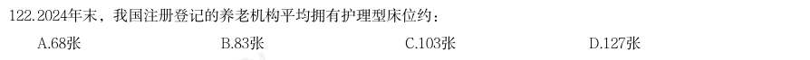
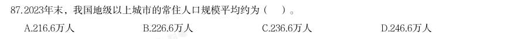
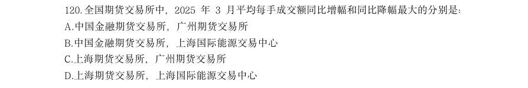
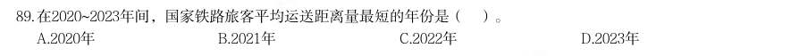
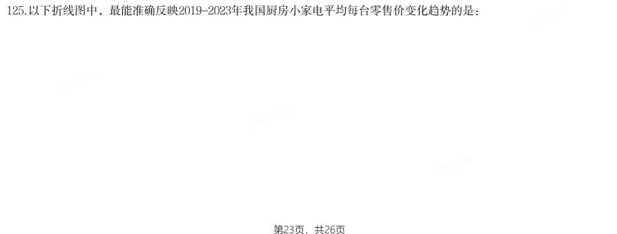
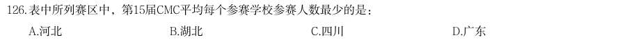

# 资料分析 · 平均数计算

> 考点编码：`ZL-AVG`　｜　体系对齐：花生十三 `ziliao-fenxi.md#题型5`

## 一、命题规律

- **本题型真题总量**：165 题（2001–2026）
- **地区分布**：国考 101 / 广东 33 / 湖北 31
- **近六年题量**：2026年7题, 2025年10题, 2024年8题, 2023年5题, 2022年14题, 2021年7题
- **覆盖试卷**：72 套
- **子考点分布**：现期平均数 174　平均数增长率 5　基期平均数 3
- **同题变体**：另有 17 道为同题重复（同年多卷/跨年再考），已折叠，需展开见 scripts/search.py --all-variants
- **速算/速解提示**：见花生十三 `references/ziliao-susuan.md` 与 `references/shuliang-gongshi.md` 对应章节

## 二、近年真题（最多 12 题，按年份倒序）

### 2026 湖北·统一卷　第 122 题　（现期平均数）

2024年末,我国注册登记的养老机构平均拥有护理型床位约:

- **A.** 68张
- **B.** 83张
- **C.** 103张
- **D.** 127张

**答案：B**

**解析/参考要点**：B
根据题干“2024 年末······平均拥有······约”,结合材料时间
为2024 年末,可判定本题为现期平均数问题。定位文字材料第一段可得:截至
2024 年末,我国注册登记的养老机构4.0 万个,床位507.7 万张(护理型床位
占比为65.7%)。根据公式:部分=整体×比重、平均数
,则2024 年末
我国注册登记的养老机构平均拥有护理型床位数
张,与B 项最接近。
故正确答案为B。
计算提示:本题为多步乘除运算,采用百化分来简化运算。
,则
,与B 项最接近。

### 2026 广东·统一卷　第 87 题　（现期平均数）

2023年末,我国地级以上城市的常住人口规模平均约为( )。

- **A.** 216.6万人
- **B.** 226.6万人
- **C.** 236.6万人
- **D.** 246.6万人

**答案：B**

**解析/参考要点**：答案B
根据题干“2023 年末......常住人口规模平均约为......”,结合材料给出了2023
年末的数据,可判定本题为现期平均数问题。定位文字材料二、三段可得:2023
年末地级以上城市297 个、我国地级以上城市常住人口总数67313 万人。根据公
式:平均数=总数/份数,则题目所求=67313/297 约=226.6 万人。故正确答案为B。

### 2026 国考·副省级　第 120 题　（现期平均数）

全国期货交易所中,2025 年3 月平均每手成交额同比增幅和同比降幅最大的分别是:

- **A.** 中国金融期货交易所,广州期货交易所
- **B.** 中国金融期货交易所,上海国际能源交易中心
- **C.** 上海期货交易所,广州期货交易所
- **D.** 上海期货交易所,上海国际能源交易中心

**答案：C**

**解析/参考要点**：C

### 2026 国考·行政执法　第 116 题　（现期平均数）
> 材料：2024 年,我国企业发明专利产业化平均收益(平均每件已产业化的有效专利产生的收益)为 869.5 万元/件,较上年增长4.8%。…

2024 年,我国企业发明专利产业化平均收益比上年增长约多少万元/件?

- **A.** 60
- **B.** 50
- **C.** 40
- **D.** 30

**答案：C**

**解析/参考要点**：C

### 2026 国考·行政执法　第 118 题　（现期平均数）

2024 年,我国大型企业平均每拥有1 件有效发明专利产生的专利产业化收益约是我国中型 企业的多少倍?

- **A.** 0.8
- **B.** 1.0
- **C.** 1.3
- **D.** 1.6

**答案：A**

**解析/参考要点**：A

### 2026 国考·行政执法　第 127 题　（现期平均数）

2025 年“五一”假期,Y 省平均每接待1 人次游客产生的旅游收入比清明假期:

- **A.** 高10%以上
- **B.** 高不到10%
- **C.** 低10%以上
- **D.** 低不到10%

**答案：A**

**解析/参考要点**：A

### 2026 国考·行政执法　第 129 题　（现期平均数）

2025 年清明假期、“五一”假期和端午假期Y 省接待的游客中,平均每万人次中有多少 人次前往纳入监测的13 家红色旅游经典景区旅游?

- **A.** 超过300 人次
- **B.** 200~300 人次之间
- **C.** 100~200 人次之间
- **D.** 不到100 人次

**答案：B**

**解析/参考要点**：B

### 2025 湖北·统一卷　第 111 题　（现期平均数）

2015-2022年期间,我国A股市场新上市公司平均每家首次募资金额最大的年份是:

- **A.** 2018年
- **B.** 2019年
- **C.** 2021年
- **D.** 2022年

**答案：暂缺（原始文件为扫描版）**

### 2025 湖北·统一卷　第 113 题　（现期平均数）

2023年上半年,北交所新上市公司平均募资金额同比增量在以下哪个范围?

- **A.** 超过0.7亿元
- **B.** 0.5~0.7亿元
- **C.** 0.3~0.5亿元
- **D.** 低于0.3亿元

**答案：暂缺（原始文件为扫描版）**

### 2025 广东·统一卷　第 89 题　（现期平均数）

在2020~2023年间,国家铁路旅客平均运送距离量最短的年份是( )。

- **A.** 2020年
- **B.** 2021年
- **C.** 2022年
- **D.** 2023年

**答案：暂缺（原始文件为扫描版）**

### 2025 国考·副省级　第 125 题　（现期平均数）

以下折线图中,最能准确反映2019-2023年我国厨房小家电平均每台零售价变化趋势的是:

- **A.** 
- **B.** 
- **C.** 
- **D.** 

**答案：D**

**解析/参考要点**：根据题干“······2019-2023 年······平均每台零售价变化趋势的是”,可判定本题为现
期平均数问题。定位统计表可得:2019-2023 年,我国厨房小家电全品类零售量及零售额。平均每台零
售价
,可得2019-2023 年我国厨房小家电平均每台零售价分别为:
2019 年,
元/台;
2020 年,
元/台;
2021 年,
元/台;
2022 年,
元/台;
2023 年,
元/台。
比较可知,2019 年我国厨房小家电平均每台零售价比其它年份都明显高,排除A、B 两项;2020 年-2022
年这三年数值接近,排除C 项,只有D 项符合。
故正确答案为D。

### 2025 国考·副省级　第 126 题　（现期平均数）

(三) 表中所列赛区中,第15届CMC平均每个参赛学校参赛人数最少的是:

- **A.** 河北
- **B.** 湖北
- **C.** 四川
- **D.** 广东

**答案：D**

**解析/参考要点**：根据题干“······第十五届······平均每个······”,结合材料给出第十五届CMC
各赛区参赛情况,可判定本题为现期平均数问题。定位统计表可知第十五届CMC 各赛区参赛学校数及参
2025 国考《行测》(副省级)解析
43 / 46
赛人数,根据公式:平均数
,可得:河北为
,湖北为
,
四川为
,广东为
。比较可知,广东赛区平均每个参赛学校参赛人数
最少。
故正确答案为D。

## 三、其余真题（按年代分片）

| 年代 | 题量 | 分片文件 |
|---|---:|---|
| 2000s | 28 | [ZL-AVG-2000s.md](split/ZL-AVG-2000s.md) |
| 2010s | 74 | [ZL-AVG-2010s.md](split/ZL-AVG-2010s.md) |
| 2020s | 51 | [ZL-AVG-2020s.md](split/ZL-AVG-2020s.md) |

> 也可用 `python scripts/search.py --kaodian ZL-AVG` 直接检索全部 165 题。