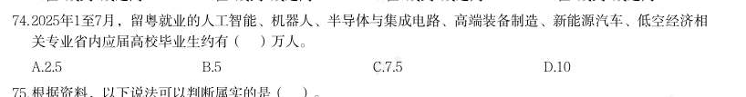

# 资料分析 · 基期量计算

> 考点编码：`ZL-BASE`　｜　体系对齐：花生十三 `ziliao-fenxi.md#题型1`

## 一、命题规律

- **本题型真题总量**：467 题（2000–2026）
- **地区分布**：国考 218 / 广东 167 / 湖北 82
- **近六年题量**：2026年32题, 2025年23题, 2024年21题, 2023年8题, 2022年22题, 2021年10题
- **覆盖试卷**：92 套
- **同题变体**：另有 26 道为同题重复（同年多卷/跨年再考），已折叠，需展开见 scripts/search.py --all-variants
- **速算/速解提示**：见花生十三 `references/ziliao-susuan.md` 与 `references/shuliang-gongshi.md` 对应章节

## 二、真题与答案（按年份倒序，最多 30 题）

### 2026 湖北·统一卷　第 113 题

2023年我国通用航空完成飞行时长比2022年约多:

- **A.** 13万小时
- **B.** 15万小时
- **C.** 17万小时
- **D.** 19万小时

**答案：B**

**解析/参考要点**：113.B
根据题干“2023 年······比2022 年约多”,结合选项带单位,可判定本
题为增长量计算问题。定位文字材料第一段可得:2023 年我国通用航空完成飞
行时长137.1 万小时,同比增长12.4%。根据公式:增长量
,则题目所求
万小时。
故正确答案为B。

### 2026 湖北·统一卷　第 115 题

不能从上述资料中推出的是:

- **A.** 2022年,载客类通用航空完成飞行时长约1.8万小时
- **B.** 2023年,通用航空完成飞行时长小于无人机累计飞行时长
- **C.** 若保持2023年同比增速不变,那么2026年全行业有效无人机操控员执照将超过35万本
- **D.** 2023年,全国获得通用航空经营许可证且使用民用无人机的通用航空企业数量的同比增速不超过30%

**答案：D**

**解析/参考要点**：115.D

### 2026 湖北·统一卷　第 116 题
> 材料：(三) 2025年上半年,Q市12348公共法律服务热线有效接听解答咨询量(以下简称法律热线咨询量)为102428人 次。按咨询事项分类统计,前十事项的咨询量合计占法律热线咨询量的85.85%,同比提升0.65个百分点。…

· 本试卷由粉笔用户上岸张同学66生成 2025年第二季度Q市法律热线咨询量约为:

- **A.** 4.83万人次
- **B.** 4.96万人次
- **C.** 5.12万人次
- **D.** 5.23万人次

**答案：B**

**解析/参考要点**：116.B
定位文字材料可得,2025 年上半年Q 市法律热线咨询量为102428 人次;定位统
计图可得,2025 年一季度Q 市法律热线咨询量为52802 人次。根据公式:第二
季度数据=上半年数据-第一季度数据,则2025 年第二季度Q 市法律热线咨询量
为102428-52802=49626 人次
万人次,对应B 项。
故正确答案为B。

### 2026 湖北·统一卷　第 119 题

2024年上半年Q市法律热线咨询量中前十事项的咨询量约为:

- **A.** 9.19万人次
- **B.** 8.27万人次
- **C.** 7.89万人次
- **D.** 6.38万人次

**答案：C**

**解析/参考要点**：119.C

### 2026 湖北·统一卷　第 123 题

根据老年人口抚养比的计算公式,2022年我国0-14岁的人口数约为:

- **A.** 23968万人
- **B.** 24522万人
- **C.** 34795万人
- **D.** 96592万人

**答案：A**

**解析/参考要点**：123.A
根据题干“根据老年人口抚养比的计算公式,2022 年······人口数约为”,
可判定本题为比值计算问题。根据统计表可得:2022 年末我国总人口为141175
万人,65 岁及以上人口为20978 万人,老年人口抚养比为21.8%。根据公式:老
年人口抚养比
,则15-64 岁人口数
万人,2022 年我国0-14 岁的
人口数=2022 年末总人口数-(15-64 岁人口数+65 岁及以上人口数)=141175-
(96229+20978)=141175-117207=23968 万人。
故正确答案为A。

### 2026 湖北·统一卷　第 124 题

2018-2024年,变化趋势与以下折线图相符的指标是:

- **A.** 年末总人口数
- **B.** 15-64岁人口数
- **C.** 各类养老机构数
- **D.** 各类养老机构的平均床位数

**答案：D**

**解析/参考要点**：124.D
A 项:定位统计表可得2018-2024 年中国年末总人口数。其中2018 年(140541
万人)<2019 年(141008 万人),即第1 个点低于第2 个点,不符合折线图的变
化趋势,排除;
B 项:定位统计表可得2018-2024 年中国65 岁及以上人口数和老年人口抚养比。
根据公式:老年人口抚养比
,可得:15-64 岁人口
数
,则15-64 岁人口数分别为:2018 年,
万人;2019 年,
万
人>2018 年(
万人),即第1 个点低于第2 个点,不符合折线图的变化
趋势,排除;
C 项:定位统计表可得2018-2024 年中国各类养老机构数量。其中2018 年(16.8
万个)<2019 年(20.4 万个),即第1 个点低于第2 个点,不符合折线图的变化
趋势,排除;
D 项:定位统计表可得2018-2024 年中国各类养老机构数量以及各类养老机构床
位数。根据公式:平均床位数
,则各类养老机构的平均床位数分别
为:2018 年,
张;2019 年,
张;2020
年,
张;2021 年,
张;2022 年,
张;2023 年,
张;2024 年,
张。符合折线图的变化趋势,当选。
故正确答案为D。

### 2026 湖北·统一卷　第 125 题

不能从上述资料中推出的是: · 本试卷由粉笔用户上岸张同学66生成

- **A.** 2024年底,医养结合机构的平均床位数高于注册登记养老机构的平均床位数
- **B.** 2021~2024年,我国各类养老机构的数量持续增长,但床位数并未同步增长
- **C.** 2024年,平均用于支持每项公立医疗卫生机构医养结合项目的中央预算内投资资金超过4000万元
- **D.** 2018~2024年,我国15~64岁人口数始终保持下降的趋势

**答案：D**

**解析/参考要点**：125.D
A 项:定位文字材料第一段可得,2024 年底,全国注册登记的养老机构4.0 万个,
床位507.7 万张;定位文字材料第二段可得,医养结合机构超过8400 家,床位
总数超过210 万张。则2024 年底医养结合机构的平均床位数
张,注册登记养老机构的平均床位数
张,前者大于后者,正确;
B 项:定位统计表可得,2021~2024 年各年我国各类养老机构的数量分别为35.8
万个、38.7 万个、40.4 万个、40.6 万个,床位数分别为815.9 万张、829.4 万
张、823 万张、799.3 万张。观察数据,2021~2024 年我国各类养老机构的数量
持续增长,但床位数并未同步增长,正确;
C 项:定位文字材料第二段可得,2024 年,中央预算内投资11.4 亿元用于支持
27 项公立医疗卫生机构医养结合项目。则所求
万元>4000 万
元,正确;
D 项:定位统计表可得,2018~2024 年各年份我国65 岁及以上人口数和老年人口
抚养比。根据公式:老年人口抚养比
,可得2018
年我国15~64 岁人口数
万人,2019 年我国15~64 岁人口数
万人,则2018 年我国15~64 岁人口数<2019 年,非始终保
持下降的趋势,错误。
本题为选非题,故正确答案为D。

### 2026 广东·统一卷　第 71 题
> 材料：分析、比较、计算和判断处理。 (一) 广东既是经济大省,也是人口大省、就业大省,数据显示,2024年广东净增74万人,新出生113.3万人;城 镇新增就业超143万人,超额完成国家下达的110万人的年度就业任务,并且实现4386万异地务工人员稳定就 业,是名副其实的就业超级“蓄水池”。 今年以来,广东按照省委、省政府关于实施“百万英才汇南粤”行动计划的部署安排,围绕“粤聚英才、 粤见未来”主题,广泛募集岗位、强化精准对接、提升优质服务、持续扩大声势。截至7月中旬,全省已吸纳 超过100万应届高校毕业生留粤来粤就业创业,进一步夯实广东现代化产业体系的人才基座,充分彰显经济大 省挑大梁的责任担当。…

从留粤就业的省内应届高校毕业生情况看,今年1至7月,制造业吸纳毕业生约10万人,人数占比从2020年 的14.72%提升到2025年的19.21%。其中,人工智能、机器人、半导体与集成电路、高端装备制造、新能源汽 车、低空经济相关专业毕业生占四分之一,对发展新质生产力、建设现代化产业体系的人才支撑作用明显提 升。 “百万英才汇南粤”行动计划围绕的主题是( )。

- **A.** “好岗配优才”
- **B.** “粤聚英才、粤见未来”
- **C.** “魅力大湾区,活力新广东”
- **D.** “经济大省挑大梁,再造一个新广东”

**答案：B**

**解析/参考要点**：第71 题答案B
定位文字材料第二段可得:今年以来,广东按照省委、省政府关于实施“百万英
才汇南粤”行动计划的部署安排,围绕“粤聚英才、粤见未来”主题,对应B
项。故正确答案为B。

### 2026 广东·统一卷　第 72 题

关于“百万英才汇南粤”行动计划,资料未提及( )。

- **A.** 紧紧围绕广东现代化产业体系建设需要
- **B.** 突出新兴产业未来产业
- **C.** 鼓励应届毕业生跨省就业创业
- **D.** 充分发动知名科技企业拿出大量优质岗位

**答案：C**

**解析/参考要点**：第72 题答案C
定位资料第三段可知,“百万英才汇南粤”行动计划紧紧围绕广东现代化产业体
系建设需要,对应A 项:聚焦20 个战略性产业集群,突出新兴产业未来产业,对
应B 项:充分发动知名科技企业拿出大量优质岗位组织发动各类企事业单位动态
募集120 多万优质岗位,对应D 项。定位资料第二段,按照省委、省政府关于实
施“百万英才汇南粤行动计划的部署安排,截至7 月中旬,全省已吸纳超过100
万应届高校毕业生留粤来粤就业创业,未提及鼓励应届毕业生跨省就业创业情况。
本题为选非题,故正确答案为C。

### 2026 广东·统一卷　第 74 题

2025年1至7月,留粤就业的人工智能、机器人、半导体与集成电路、高端装备制造、新能源汽车、低空经济相 关专业省内应届高校毕业生约有( )万人。

- **A.** 2.5
- **B.** 5
- **C.** 7.5
- **D.** 10

**答案：A**

**解析/参考要点**：第74 题答案A
根据题干“2025 年1 至7 月...省内应届高校毕业生约有...万人”,结合材料时间
为2025 年1 至7 月及材料给出题干相关专业省内应届高校毕业生占比,可判定
本题为现期比重问题。定位文字材料第四段可得从留粤就业的省内应届高校毕业
生情况看,今年(2025 年)1 至7 月,制造业吸纳毕业生约10 万人...其中,人工
智能、机器人、半导体与集成电路、高端装备制造、新能源汽车、低空经济相关
专业毕业生占四分之一。根据公式:部分=整体x 比重则所求=10万x1/4=2.5 万。
故正确答案为A

### 2026 广东·统一卷　第 75 题

根据资料,以下说法可以判断属实的是( )。

- **A.** 2024年,广东新出生人口超百万
- **B.** 2024年,广东省内应届高校毕业生中,本科生占比超40%
- **C.** 2025年上半年,广东超额完成国家下达的年度就业任务
- **D.** 2025年上半年,广东吸纳超百万应届高校毕业生留粤来粤就业创业

**答案：A**

**解析/参考要点**：第75 题答案A
A 项:定位文字材料第一段可得:数据显示,2024 年广东新出生113.3 万人,正确
B 项:材料中并未提及2024 年广东省内应届高校毕业生和本科生相关信息,故无
法判断,错误;
C 项:定位文字材料第一段可得:2024 年广东城镇新增就业超143 万人,超额完成
国家下达的110 万人的年度就业任务,非
2025 年上半年,错误:
D 项:定位文字材料第二段可得:截至(2025 年)7 月中旬,全省已吸纳超过100 万
应届高校毕业生留粤来粤就业创业,非2025 年上半年,错误。故正确答案为A。

### 2026 广东·统一卷　第 76 题
> 材料：(二) 标准物质与尺子、砝码一样,是测量中必不可少的参照工具。它是已提前获得准确测量结果、均匀稳定的 样品,待测样品以其为标准,确保不同时间、人员、实验室的测量结果可比。标准物质研制生产机构在开展具 体品种标准物质的生产供应前,须通过技术审评并取得定级证书,这些取得定级证书的标准物质,统称为“国 家标准物质”。根据计量溯源性、准确度和用途等,国家标准物质目前分为两类,即一级标准物质和二级标准 物质。 国家标准物质数量快速增长的原因有四个方面:一是用途广泛、涉及经济、社会发展的各个领域;二是需 求大幅增加,检测部门和行业主管部门日益重视测量结果的准确性;三是产业发展迅速,除了中国计量科学研 究院…

· 本试卷由粉笔用户上岸张同学66生成 根据计量溯源性、准确度和用途等,国家标准物质目前分为( )类。

- **A.** 两
- **B.** 三
- **C.** 四
- **D.** 五

**答案：A**

**解析/参考要点**：第76 题答案A
定位文字材料第一段可知,根据计量溯源性、准确度和用途等,国家标准物质目
前分为两类,即一级标准物质和二级标准物质。
故正确答案为A。

### 2026 广东·统一卷　第 77 题

根据资料,国家标准物质数量快速增长的原因不包括( )。

- **A.** 用途广泛
- **B.** 需求大幅增加
- **C.** 产业链完整
- **D.** 政策支持

**答案：C**

**解析/参考要点**：第77 题答案C
定位文字材料第二段可得:国家标准物质数量快速增长的原因有四个方面:一是
用途广泛......二是需求大幅增加...三是产业发展迅速.........四是政策支持......。
则国家标准物质数量快速增长的原因不包括产业链完整。
本题为选非题,故正确答案为C。

### 2026 广东·统一卷　第 78 题

截至2024年末,市场监管总局累计批准建立国家标准物质( )项。

- **A.** 17934
- **B.** 18458
- **C.** 18982
- **D.** 19506

**答案：B**

**解析/参考要点**：第78 题答案B
定位文字材料第三段可得:截至2025 年上半年,市场监管总局累计批准建立国家
标准物质18982 项。2025 年上半年,我国新批准建立国家标准物质524 项。根
据2024 年末累计批准数据+2025年上半年新批准数据=2025 年上半年累计批准数
据,则题干所求为18982-524=18458 项,
故正确答案为B。

### 2026 广东·统一卷　第 80 题

下列选项中,最有可能准确反映2025年上半年我国新建标准物质地域分布情况的是( )。

- **A.** 
- **B.** 
- **C.** 
- **D.** 

**答案：A**

**解析/参考要点**：第80 题答案A
定位文字材料第三段可得:2025 年上半年,我国新批准建立国家标准物质524 项:
从地域分布看,华北地区新建标准物质234 项,华东地区新建标准物质124 项,
东北地区新建标准物质62 项,西北地区新建标准物质48 项,华南地区新建标准
物质32 项西南地区新建标准物质24 项,华中地区未新建标准物质。饼形图未给
出图例时,应按材料数据顺序(从前往后或从上往下),从12 点钟方向开始顺时
针排布。因华中地区未新建标准物质,可知饼状图只包括6 个地区,排除C、D
两项。对比AB 两项,最明显的区别为华南地区和西南地区的大小关系(即最后两
部分),华南地区32 项明显大于西南地区24 项,排除B 选项。故正确答案为A。

### 2026 广东·统一卷　第 81 题

(三) 截至2024年末,广东省共有体育场地35.3万个,较上年增长3.58%;体育场地面积3.72亿平方米,较上年增 长4.49%;人均体育场地面积2.91平方米(按常住人口计算),较上年增长3.93%。 · 本试卷由粉笔用户上岸张同学66生成 2024年,广东省体育场地数量增加约( )万个。

- **A.** 0.1
- **B.** 1.2
- **C.** 2.3
- **D.** 3.4

**答案：暂缺（原始文件为扫描版）**

**解析/参考要点**：第81 题答案B

### 2026 广东·统一卷　第 83 题

2024年末,广东省足球、篮球、排球“三大球”场地面积约为( )亿平方米。

- **A.** 0.10
- **B.** 0.11
- **C.** 1.04
- **D.** 1.10

**答案：D**

**解析/参考要点**：第83 题答案D
定位表格材料可知“球类运动场地=足球、篮球、排球场地+乒乓球、羽毛球场地
+其他球类运动场地”,且已知球类运动场地面积为19350.29 万平方米;乒乓球、
羽毛球场地面积为1126.57 万平方米;其他球类运动场地面积为7268.73 万平方
米,则足球篮球、排球场地面积=19350.29-1126.57-7268.73=10954.99 万平方
米约=1.10 亿平方米。故正确答案为D。

### 2026 广东·统一卷　第 86 题
> 材料：(四) 新中国成立以来,我国的城镇化建设不断推进,城市规模不断扩大,综合实力显著增强,基础设施持续改 善,城市更加宜业宜居。 从城市数量看,1948年末,我国城市共有58个,新中国成立后,大批县城改设为城市。1949年末,全国城 市共有129个,其中,地级以上城市68个,县级市61个,建制镇2000个左右。改革开放前,我国的城镇化经历 了一段比较曲折的发展历程,小城市和小城镇发展缓慢。1978年末,全国城市共有193个,其中,地级以上城 · 本试卷由粉笔用户上岸张同学66生成 市101个,县级市92个,建制镇2173个。改革开放以来,城市数量快速增加。2023年末,城市个数达到694个, 其中…

根据材料,下列时间段我国常住人口城镇化率增加最多的是:

- **A.** 1957—1978年
- **B.** 1978—1995年
- **C.** 1995—2011年
- **D.** 2011—2023年

**答案：C**

**解析/参考要点**：第86 题答案C
定位图形材料可知:1957 年、1978 年、1995 年、2011 年、2023 年全国常住人口
城镇化率分别为:15.39%、17.92%、29.04%、51.83%、66.14%。
1957-1978 年我国常住人口城镇化率增加17.92%-15.39%=2.53%;
1978-1995 年我国常住人口城镇化29.04%-17.92%=11.12%;
1995-2011 年我国常住人口城镇化率增加51.83%-29.04%=22.79%;
2011-2023 年我国常住人口城镇化率增加66.14%-51.83%=14.31%。
比较可知,我国常住人口城镇化率增加最多的是1995-2011 年,
故正确答案为C.

### 2026 国考·副省级　第 116 题

信息进行分析、比较、计算和判断处理。 (一) 2025 年一季度全国期货市场成交额约为多少万亿元?

- **A.** 153
- **B.** 162
- **C.** 175
- **D.** 184

**答案：B**

**解析/参考要点**：116、B
定位统计表可得:2025 年一季度表中所列6 个期货交易所市场成交额分别为48.2 万亿元、7.7 万亿元、21.1
万亿元、60.6 万亿元、22.6 万亿元、1.8 万亿元。则所求为
万亿元,与B 项最接近。
故正确答案为B。

### 2026 国考·副省级　第 118 题

全国2025 年3 月成交量超过一季度月均成交量的期货交易所有几个?

- **A.** 5
- **B.** 4
- **C.** 3
- **D.** 2

**答案：A**

**解析/参考要点**：118、A
根据题干“全国2025 年3 月......超过一季度月均......”,结合材料时间为2025 年3 月和一季度,可判定本题
为现期平均数问题。定位表格材料可得2025 年3 月和一季度各期货交易所成交量。3 月成交量超过一季度月
均成交量,即3 月>
一季度
,整理为3 月×3>一季度,即可满足条件。分别验证如下:
上海期货交易所,193.3×3>190×3=570>493.5 百万手,满足;
上海国际能源交易中心,15.0×3=45>39.0 百万手,满足;
郑州商品交易所,253.4×3>250×3=750>633.2 百万手,满足;
中国金融期货交易所,26.2×3>25×3=75>72.7 百万手,满足;
大连商品交易所,234.7×3>200×3=600>573.1 百万手,满足;
广州期货交易所,11.9×3<12×3=36<38.2 百万手,不满足。
综上,2025 年3 月成交量超过一季度月均成交量的期货交易所有上海期货交易所、上海国际能源交易中心、
郑州商品交易所、中国金融期货交易所、大连商品交易所,共5 个。
故正确答案为A。

### 2026 国考·副省级　第 119 题

2024 年一季度,郑州商品交易所成交量比大连商品交易所:

- **A.** 多不到0.5 亿手
- **B.** 少不到0.5 亿手
- **C.** 多0.5 亿手以上
- **D.** 少0.5 亿手以上

**答案：B**

**解析/参考要点**：119、B

### 2026 国考·副省级　第 121 题

2024 年,全国基本医疗保险统筹基金支出金额超过收入金额的月份有几个?

- **A.** 4
- **B.** 5
- **C.** 6
- **D.** 7

**答案：B**

**解析/参考要点**：121、B
根据题干“2024 年,全国基本医疗保险......支出金额超过收入金额的月份有几个”,结合材料全国基本医疗
保险=职工基本医疗保险+城乡居民基本医疗保险,定位统计图1 和图2 可知2024 年各月职工基本医疗保险和
城乡居民基本医疗保险情况。故各月基金支出和基金收入情况如下:
1 月:全国基金支出
亿元;全国基金收入
亿元。基
金支出<基金收入,不符合;
2 月:全国基金支出
亿元;全国基金收入
亿元。基金
支出<基金收入,不符合;
3 月:全国基金支出
亿元;全国基金收入
亿元。基
金支出<基金收入,不符合;
4 月:全国基金支出
亿元;全国基金收入
亿元。基
金支出>基金收入,符合;
5 月:全国基金支出
亿元;全国基金收入
亿元。基
金支出>基金收入,符合;
6 月:全国基金支出
亿元;全国基金收入
亿元。
基金支出>基金收入,符合;
7 月:全国基金支出
亿
元;全国基金收入
亿
元。基
金支出>基金收入,符合;
8 月:全国基金支出=804+1082=1886 亿元;全国基金收入=415+1424=1839 亿元。基金支出>基金收入,符合;
9 月:全国基金支出
亿元;全国基金收入
亿元。
基金支出<基金收入,不符合;
10 月:全国基金支出
亿元;全国基金收入
亿元。
基金支出<基金收入,不符合;
11 月:全国基金支出
亿元;全国基金收入
亿元。
基金支出<基金收入,不符合;
12 月:全国基金支出
亿
元;全国基金收入
亿
元。
基金支出<基金收入,不符合。
综上,2024 年全国基本医疗保险统筹基金支出金额超过收入金额的月份有4 月、5 月、6 

### 2026 国考·副省级　第 122 题

2024 年,全国基本医疗保险统筹基金累计收入第一次超过1.5 万亿元是在几月?

- **A.** 5 月
- **B.** 6 月
- **C.** 7 月
- **D.** 8 月

**答案：C**

**解析/参考要点**：122、C

### 2026 国考·副省级　第 123 题

2024 年,全国城乡居民基本医疗保险统筹基金收入最高的季度是:

- **A.** 一季度
- **B.** 二季度
- **C.** 三季度
- **D.** 四季度

**答案：D**

**解析/参考要点**：123、D

### 2026 国考·副省级　第 131 题
> 材料：2024 年,我国对联合国定义的45 个最不发达国家(以下简称最不发达国家)进出口 14230.2 亿元人民币,占同期我国外贸进出口总值的3.2%。其中出口8664.6 亿元,同比(下同) 增长4.3%;进口5565.5 亿元,增长12.8%。 2024 年,我国对最不发达国家出口机电产品3942.2 亿元,增长13.5%。其中出口船舶690.8 亿元,增长65.9%,主要出口至全球第一大船旗国利比里亚。出口金额654.3 亿元,增长67%; 出口工程机械、火车分别为165.3 亿元、91.6 亿元,分别增长28.9%、39.5%;出口劳动密集型产 品2481 亿元,增长3.7%,其中纺织品1…

12 月,我国自最不发达国家进口512.7 亿元,增长18.1%,其中自刚果民主共和国、几内亚、 老挝、赞比亚分别进口156.3 亿元,54.7 亿元,35.6 亿元,33.9 亿元,分别增长84.6%,40.3%, 25.7%、127.27%。 2024 年,我国外贸进出口总值在以下哪个范围内?

- **A.** 不到44 万亿元
- **B.** 44 万亿元~45 万亿元之间
- **C.** 45 万亿元~46 万亿元之间
- **D.** 超过46 万亿元

**答案：B**

**解析/参考要点**：131、B

### 2026 国考·副省级　第 134 题

2023 年1~11 月,我国对最不发达国家月均进口值约为多少亿元?

- **A.** 395
- **B.** 409
- **C.** 468
- **D.** 502

**答案：B**

**解析/参考要点**：134、B

### 2026 国考·副省级　第 135 题

关于2024 年我国进出口情况,能根据上述资料推出的是:

- **A.** 铜材进口总值不到3000 亿元
- **B.** 我国对最不发达国家火车出口值同比增量高于对其工程机械出口值同比增量
- **C.** 劳动密集型产品出口值占我国最不发达国家出口总值的比重高于上年水平
- **D.** 12 月自刚果民主共和国、几内亚、老挝、赞比亚的进口总值超过当月我国自最不发达国家进

**答案：D**

**解析/参考要点**：135、D

### 2026 国考·地市级　第 111 题

) A.下降了20%以 2024 年上半年,中国医药保健品进出口贸易顺差(出口额-进口额)比上年同期: 上 B.下降了不到20% C.上升了20%以上 D.上升了不到20%

> （本题为图形题，选项为图片，见原卷）

**答案：C**

**解析/参考要点**：111、C

### 2026 国考·地市级　第 116 题
> 材料：绿证是对可再生能源绿色电力颁发的具有独特标识代码的电子证书,1 个绿证单位对应 1000 千瓦时可再生能源电量。2024 年全国核发绿证47.34 亿个,其中可交易绿证31.58 亿个。 截至2024 年12 月底全国累计核发绿证49.55 亿个,其中可交易绿证33.79 亿个。 2024 年,全国集中式项目核发绿证46.77 亿个。…

2024 年,全国核发的不可交易绿证对应约多少万亿千瓦时可再生能源电量?

- **A.** 1.6
- **B.** 3.2
- **C.** 7.9
- **D.** 15.8

**答案：A**

**解析/参考要点**：116、A

### 2026 国考·地市级　第 126 题
> 材料：2024 年,我国对联合国定义的45 个最不发达国家(以下简称最不发达国家)进出口 14230.2 亿元人民币,占同期我国外贸进出口总值的3.2%。其中出口8664.6 亿元,同比(下同) 增长4.3%;进口5565.5 亿元,增长12.8%。 2024 年,我国对最不发达国家出口机电产品3942.2 亿元,增长13.5%。其中出口船舶690.8 亿元,增长65.9%,主要出口至全球第一大船旗国利比里亚。出口金额654.3 亿元,增长67%; 出口工程机械、火车分别为165.3 亿元、91.6 亿元,分别增长28.9%、39.5%;出口劳动密集型产 品2481 亿元,增长3.7%,其中纺织品1…

2024 年,我国外贸进出口总值在以下哪个范围内?

> （本题为图形题，选项为图片，见原卷）

**答案：B**

**解析/参考要点**：126、B
