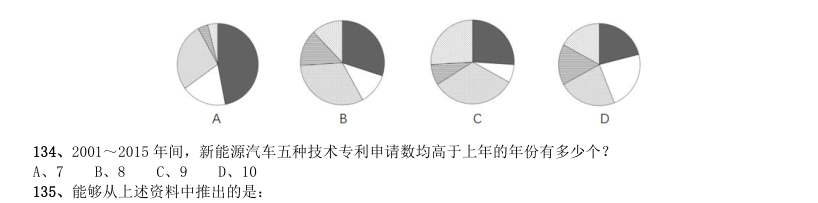
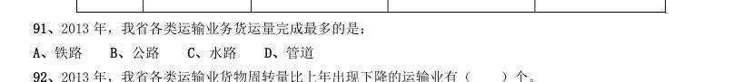
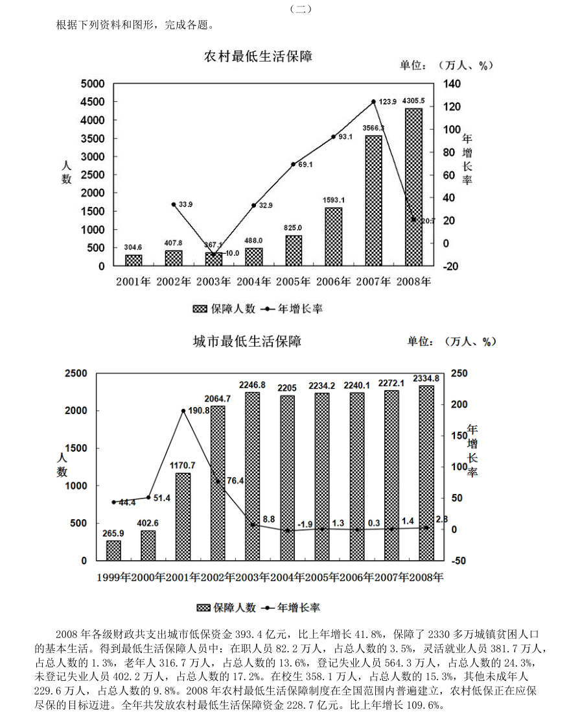

# 资料分析 · 基期量计算

> 考点编码：`ZL-BASE`　｜　体系对齐：花生十三 `ziliao-fenxi.md#题型1`

## 一、命题规律

- **本题型真题总量**：17 题（2004–2019）
- **地区分布**：国考 6 / 广东 8 / 湖北 3
- **近六年题量**：2019年4题, 2017年1题, 2015年1题, 2014年4题, 2013年1题, 2010年1题
- **覆盖试卷**：12 套
- **子考点分布**：基期量计算（综合） 7　已知现期与增长率求基期 5　已知现期与增长量求基期 4　基期量比较 3
- **同题变体**：另有 2 道为同题重复（同年多卷/跨年再考），已折叠，需展开见 scripts/search.py --all-variants
- **速算/速解提示**：见花生十三 `references/ziliao-susuan.md` 与 `references/shuliang-gongshi.md` 对应章节

## 二、近年真题（最多 12 题，按年份倒序）

### 2019 广东·乡镇　第 82 题　（已知现期与增长量求基期）
> 材料：过去5 年,我国统筹开展交通扶贫和“四好农村路工作”,农村基础设施更加完善,服务乡村振兴成效显著。…

2015~2018 年,全国新改建农村公路里程较上年增加最多的一年是( )。

> 材料图见 images/GD-2019-xz-X081-m.jpg

- **A.** 2015
- **B.** 2016
- **C.** 2017
- **D.** 2018

**答案：暂缺（原始文件为扫描版）**

### 2019 广东·乡镇　第 87 题　（基期量计算（综合））
> 材料：党的十八大以来,脱贫工作取得巨大成效,全国农村贫困人口大幅减少。截至2018 年末,全国农村贫困人 口从2012 年末的9899 万人减少至1660 万人;农村贫困发生率从2012 年的 下降至 ,累计下降8.5 个百 分点。…

2013—2018 年,全国农村贫困发生率较上年下降最多的是( )年。

> 材料图见 images/GD-2019-xz-X081-m.jpg

- **A.** 2013
- **B.** 2015
- **C.** 2017
- **D.** 2018

**答案：暂缺（原始文件为扫描版）**

### 2019 广东·乡镇　第 94 题　（已知现期与增长量求基期）
> 材料：近年来,B 省营商环境不断优化,市场活力不断增强,新登记市场主体都保持较快增长势头。2018 年,全省 新登记市场主体229.74 万户,日均新登记市场主体6294 户,同比增长 。 全省产业结构也进一步调整优化,新登记市场主体主要集中在第三产业。2018 年,全省三大产业新登记市场 主体分别为第一产业2.02 万户,第二产业24.01 万户,第三产业203.71 万户。截止2018 年12 月末,全省三大产 业的实有各类市场主体户数分别为9.83 万户,157.38 万户,978.92 万户。…

2018 年,B 省租赁和商务服务业新登记企业数较上年增加约( )万户。

> 材料图见 images/GD-2019-xz-X091-m.jpg

- **A.** 2.8
- **B.** 3.8
- **C.** 4.8
- **D.** 5.8

**答案：暂缺（原始文件为扫描版）**

### 2019 广东·县级　第 89 题　（已知现期与增长量求基期）
> 材料：近年来,A 省新登记市场主体保持较快增长势头。全省实有各类市场主体从2015 年的775.95 万户增长到 2018 年的1146.13 万户。2018 年,全省新登记市场主体229.74 万户,日均新登记市场主体6294 户,同比增长 。…

2018 年,租赁和商务服务业新登记企业数较上年增加约( )万户。

> 材料图见 images/GD-2019-xj-X086-m.jpg

- **A.** 2.8
- **B.** 3.8
- **C.** 4.8
- **D.** 5.8

**答案：暂缺（原始文件为扫描版）**

### 2017 国考·副省级　第 134 题　（基期量计算（综合））
> 材料：理。 某市2015 年全年粮食总产量4.16 万吨,同比下降2.3%;甘蔗产量0.57 万吨,下降23.6%;油料产量0.12万吨,增长32.4%;蔬菜产量15.79 万吨,下降3.4%;水果产量7.84 万吨,增长7.4%。 全年水产品产量29.16 万吨,同比增长3.6%,其中海洋捕捞1.09 万吨,与上年持平;海水养殖6.07 万吨,增长89.5%;淡水捕捞0.18 万吨,增长1.1%;淡水养殖21.81 万吨,下降7.9%。 2010-2015 年某市粮食产量及其增速116、2014 年该市蔬菜产量比水果产量约高多少万吨? A、9B、8C、7D、6117、“十二五”期间,该市粮食总产量…

2001~2015 年间,新能源汽车五种技术专利申请数均高于上年的年份有多少个?

> 材料图见 images/GK-2017-fs-X121-m.jpg

- **A.** 7
- **B.** 8
- **C.** 9
- **D.** 10

**答案：B**

**解析/参考要点**：题干给出2000-2015 年间五种技术专利申请数的具体值,故找出五种专利申请数均高于上年的年份,直接
找数即可。查看表格,五种专利申请数均高于上年的有2003、2004、2005、2006、2007、2008、2010、2011 共
八个年份。
故正确答案为B。

### 2015 广东·乡镇　第 89 题　（基期量比较）

年,电话用户数与上年差距最大的年份是:

> 材料图见 images/GD-2015-xz-X086-m.jpg

- **A.** 2009 年
- **B.** 2010 年
- **C.** 2013 年
- **D.** 2014 年

**答案：暂缺（原始文件为扫描版）**

### 2014 湖北·统一卷　第 113 题　（基期量比较）
> 材料：图2008—2012 年全国一次能源、石油生产量与消费量的情况图22008—2012 年全国矿产品进出口情况…

2009—2012 年间全国商品进出口总额最高年份,矿产品进出口总额比上年:

> 材料图见 images/HB-2014-ty-X111-m.jpg

- **A.** 上升了348 亿美元
- **B.** 下降了1601 亿美元
- **C.** 上升了2138 亿美元
- **D.** 上升了2446 亿美元

**答案：A**

**解析/参考要点**：根据题干中“矿产品进出口总额比上年”可知此题为增长相关的问题,选项均为具体值,故此题为增长率
的计算问题。根据图2,2009-2012 年间全国商品进出口总额分别为
、
、
、
,观察分母很
接近,2012 年的分子最大,故全国商品进出口总额最高的年份是2012 年。2012 年矿产品进出口总额的增长量=
现期量-基期量=9919–9571=348 亿美元。
故正确答案为A

### 2014 广东·乡镇　第 91 题　（已知现期与增长率求基期）
> 材料：(材料2)据统计,2013 年我省完成货运量305830 万吨,比上年增长14.8%;完成货运周转量12407.08 亿吨公里,比上年增长26.9%。…

据统计,2013 年我省完成货运量305830 万吨,比上年增长14.8%;完成货运周转量12407.08 亿吨公里, 比上年增长26.9%。 2013 年,我省各类运输业务货运量完成最多的是:

- **A.** 铁路
- **B.** 公路
- **C.** 水路
- **D.** 管道

**答案：暂缺（原始文件为扫描版）**

### 2014 广东·乡镇　第 92 题　（基期量计算（综合））
> 材料：(材料2)据统计,2013 年我省完成货运量305830 万吨,比上年增长14.8%;完成货运周转量12407.08 亿吨公里,比上年增长26.9%。…

2013 年,我省各类运输业货物周转量比上年出现下降的运输业有( )个。

> 材料图见 images/GD-2014-xz-X091-m.jpg

- **A.** 4
- **B.** 3
- **C.** 2
- **D.** 1

**答案：暂缺（原始文件为扫描版）**

### 2014 国考·统一卷　第 121 题　（基期量计算（综合））
> 材料：根据以下资料,回答121—125 题。 2012 年第三季度全国100 个城市的公共就业服务机构市场中,用人单位通过公共就业服务机构招聘各类人 员约643.3 万人,进入市场的求职者约610 万人,岗位空缺与求职人数比率比上年同期上升了1%。上年同期这 100 个城市中,用人单位通过公共就业服务机构招聘各类人员约577.9 万人。…

2012 年第三季度,在所有求职人员中:失业人员所占比重为48.8%,其中,新成长失业青年占24.2%(在 新 成长失业青年中应届高校毕业生占51.4%),就业转失业人员占13.4%,其他失业人员占11.2%;外来务工人员 的比重为41%,外来务工人员由本市农村人员和外埠人员组成,其中本市农村人员为95.2 万人。 2012 年第三季度全国十个城市岗位需求和求职信息 与2011 年同期比,2012 年第三季度全国100 个城市调查的公共就业服务机构市场供求中,进入市场的求 职者人数:

- **A.** 高于上年同期
- **B.** 低于上年同期
- **C.** 与上年同期持平
- **D.** 无法推出

**答案：A**

**解析/参考要点**：2012 年招聘的是643.3 万人,求职为610 万人,因此岗位空缺为33.3 万人。岗位空缺占求职人数的比例
和去年差不多,因此2011 年求职人数小于2011 年招聘的人数577.9 万人,所以,2012 年的求职人数大于2011
年(去年有岗位空缺,所以求职人数肯定小于当年招聘的人数)。
故正确答案为A。

### 2013 湖北·统一卷　第 152 题　（基期量比较）
> 材料：某市2010 年全年实现农业增加值124.3 亿元,比上年下降1.6%。粮食播种面积22.3 万公顷,比上年减少 0.3 万公顷;粮食产量115.7 万吨,比上年下降7.3%。 全市农业观光园1303 个,比上年增加9 个;观光园总收入17.8 亿元,比上年增长16.7%。民俗旅游实际经 营户7979 户,比上年减少726 户;民俗旅游总收入7.3 亿元,增长20.7%。种业收入14.6 亿元,比上年增长13.5%。…

该市主要农副产品与上年相比,产量变化绝对值最小的是:

> 材料图见 images/HB-2013-ty-X150-m.jpg

- **A.** 肉类
- **B.** 禽蛋
- **C.** 水产品
- **D.** 牛奶

**答案：B**

**解析/参考要点**：根据题干中“与上年相比,变化绝对值最小”确定本题为增长量绝对值的比较问题。根据材料表格部分可
得四个选项对应产量变化绝对值分别是
、
、
、
,B 项数值最小。(由于r 远远小于1,故1 + r 部分可以忽略不计,则只需估
算现期×r 部分判断大小)
故正确答案为B。

### 2010 广东·统一卷　第 75 题　（已知现期与增长率求基期）
> 材料：根据下列资料和图形,完成各题。 2008 年各级财政共支出城市低保资金393.4 亿元,比上年增长41.8%,保障了2330 多万城镇贫困人口 的基本生活。得到最低生活保障人员中:在职人员82.2 万人,占总人数的3.5%,灵活就业人员381.7 万人, 占总人数的1.3%,老年人316.7 万人,占总人数的13.6%,登记失业人员564.3 万人,占总人数的24.3%, 未登记失业人员402.2 万人,占总人数的17.2%。在校生358.1 万人,占总人数的15.3%,其他未成年人 229.6 万人,占总人数的9.8%。2008 年农村最低生活保障制度在全国范围内普遍建立,农村低保正在应保 …

比上年增长109.6%。 2008 年农村最低生活保障人数比2001 年将近翻了多少番:

- **A.** 15
- **B.** 14
- **C.** 5
- **D.** 4

**答案：暂缺（原始文件为扫描版）**

## 三、其余真题（按年代分片）

| 年代 | 题量 | 分片文件 |
|---|---:|---|
| 2000s | 5 | [ZL-BASE-2000s.md](split/ZL-BASE-2000s.md) |

> 也可用 `python scripts/search.py --kaodian ZL-BASE` 直接检索全部 17 题。