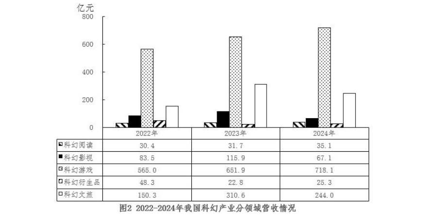
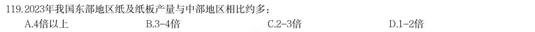
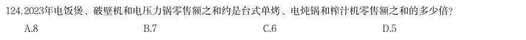
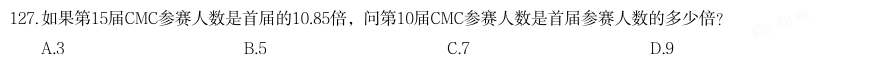
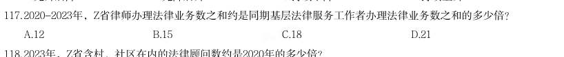
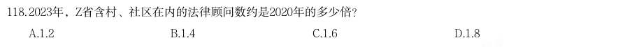
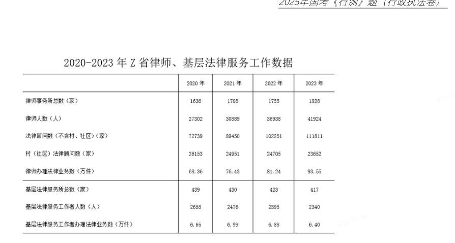
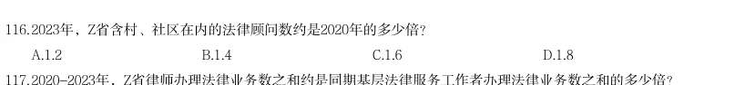
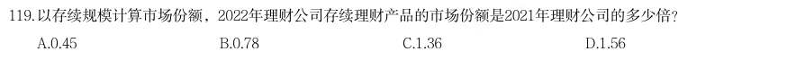

# 资料分析 · 倍数计算

> 考点编码：`ZL-BEI`　｜　体系对齐：花生十三 `ziliao-fenxi.md#题型6`

## 一、命题规律

- **本题型真题总量**：63 题（2000–2026）
- **地区分布**：国考 31 / 广东 20 / 湖北 12
- **近六年题量**：2026年5题, 2025年6题, 2024年7题, 2023年1题, 2022年6题, 2020年3题
- **覆盖试卷**：47 套
- **子考点分布**：是几倍 57　倍数计算（综合） 12　基期倍数 1
- **同题变体**：另有 7 道为同题重复（同年多卷/跨年再考），已折叠，需展开见 scripts/search.py --all-variants
- **速算/速解提示**：见花生十三 `references/ziliao-susuan.md` 与 `references/shuliang-gongshi.md` 对应章节

## 二、近年真题（最多 12 题，按年份倒序）

### 【2026 国考（副省级）·第 126 题】GK-2026-fs-X126　倍数计算｜是几倍
> 材料：绿证是对可再生能源绿色电力颁发的具有独特标识代码的电子证书,1 个绿证单位对应 1000 千瓦时可再生能源电量。2024 年全国核发绿证47.34 亿个,其中可交易绿证31.58 亿个。 截至2024 年12 月底全国累计核发绿证49.55 亿个,其中可交易绿证33.79 亿个。 2024 年,全国集中式项目核发绿证46.77 亿个。按项目类型划分,风电19.07 亿个,常规 水电15.78 亿个,太阳能发电8.03 亿个,生物质发电3.81 亿个,风光一体化项目755 万个, 地热能发电52 万个,海洋能发电1.1 万个。…

2024 年全国分布式项目核发绿证5695 万个,同比 增长27.8 倍。其中,分散式风电核发绿证3364 万个,分布式光伏核发绿证2331 万个。 2024 年,全国核发的不可交易绿证对应约多少万亿千瓦时可再生能源电量?

> 材料图见 images/GK-2026-fs-X121-m.jpg

- **A.** 1.6
- **B.** 3.2
- **C.** 7.9
- **D.** 15.8

**答案：A**

**解析/参考要点**：A
定位文字材料第一段可得:2024 年全国核发绿证47.34 亿个,其中可交易绿证31.58 亿个。故2024 年全国核
发的不可交易绿证47.34-31.58=15.76 亿个,结合文字材料第一段中的“1 个绿证单位对应1000 千瓦时可再生
能源电量”,则题干所求为
15.76✖1000
10000
=
1.576 万亿千瓦时,与A 项最接近。
故正确答案为A。

### 【2026 国考（副省级）·第 127 题】GK-2026-fs-X127　倍数计算｜是几倍
> 材料：绿证是对可再生能源绿色电力颁发的具有独特标识代码的电子证书,1 个绿证单位对应 1000 千瓦时可再生能源电量。2024 年全国核发绿证47.34 亿个,其中可交易绿证31.58 亿个。 截至2024 年12 月底全国累计核发绿证49.55 亿个,其中可交易绿证33.79 亿个。 2024 年,全国集中式项目核发绿证46.77 亿个。按项目类型划分,风电19.07 亿个,常规 水电15.78 亿个,太阳能发电8.03 亿个,生物质发电3.81 亿个,风光一体化项目755 万个, 地热能发电52 万个,海洋能发电1.1 万个。…

2023 年,全国核发绿证数量约是2022 年的多少倍?

> 材料图见 images/GK-2026-fs-X121-m.jpg

- **A.** 3.7
- **B.** 5.1
- **C.** 6.3
- **D.** 7.8

**答案：D**

**解析/参考要点**：D
根据题干“2023 年......约是2022 年的多少倍”,结合材料给出2022 年、2023 年全国绿证累计核发量,可判
定本题为现期倍数问题。定位统计图可得,2021-2023 年末全国绿证累计核发量分别为3893 万个、5954 万个、
22075 万个。则2023 年全国核发绿证数量=22075-5954=16121 万个,2022 年全国核发绿证数量=5954-3893=2061
万个。则所求倍数=
16121
2061 ≈8 倍,与D 项最接近。
故正确答案为D。

### 【2026 国考（地市级）·第 117 题】GK-2026-ds-X117　倍数计算｜是几倍
> 材料：绿证是对可再生能源绿色电力颁发的具有独特标识代码的电子证书,1 个绿证单位对应 1000 千瓦时可再生能源电量。2024 年全国核发绿证47.34 亿个,其中可交易绿证31.58 亿个。 截至2024 年12 月底全国累计核发绿证49.55 亿个,其中可交易绿证33.79 亿个。 2024 年,全国集中式项目核发绿证46.77 亿个。…

2023 年,全国核发绿证数量约是2022 年的多少倍?

> 材料图见 images/GK-2026-ds-X116-m.jpg

- **A.** 3.7
- **B.** 5.1
- **C.** 6.3
- **D.** 7.8

**答案：D**

**解析/参考要点**：D

### 【2026 国考（地市级）·第 121 题】GK-2026-ds-X121　倍数计算｜倍数计算（综合）
> 材料：科幻产业包括科幻阅读、科幻影视、科幻游戏、科幻衍生品、科幻文旅五大领域。2024年,我国科幻产业总营收1089.6 亿元。…

科幻产业包括科幻阅读、科幻影视、科幻游戏、科幻衍生品、科幻文旅五大领域。2024 年,我国科幻产业总营收1089.6 亿元

> 材料图见 images/GK-2026-ds-X116-m.jpg

> （本题为图形题，选项为图片，见原卷）

**答案：B**

**解析/参考要点**：B

### 【2026 国考（行政执法）·第 121 题】GK-2026-zf-X121　倍数计算｜是几倍
> 材料：科幻产业包括科幻阅读、科幻影视、科幻游戏、科幻衍生品、科幻文旅五大领域。2024年,我国科幻产业总营收1089.6 亿元。…

科幻产业包括科幻阅读、科幻影视、科幻游戏、科幻衍生品、科幻文旅五大领域。2024 年,我国科幻产业总营收1089.6 亿元。 2021~2024 年,我国科幻产业累计营收额约是2017~2020 年的多少倍?

- **A.** 2.5
- **B.** 2.2
- **C.** 1.9
- **D.** 1.6

**答案：B**

**解析/参考要点**：B

### 【2025 湖北省考·第 119 题】HB-2025-ty-X119　倍数计算｜倍数计算（综合）
> 材料：2023年全国著作权(包括作品著作权、计算机软件著作权、著作权质权)登记总量达8923901件,同比增 长40.46%,增速比上年同期增加39个百分点。根据各省、自治区、直辖市版权局和中国版权保护中心作品登记 信息统计,2023年全国共完成作品著作权登记6428277件,同比增长42.30%,登记量前五位的分别是:北京市 1101072件,同比增加53802件;山东省873826件,同比增加619459件;福建省710648件,同比增加424814件; 中国版权保护中心493070件,同比增加1476件;上海市412660件,同比增加30660件,从作品类型来看,登记 量最多的是美术作品329…

2023年我国东部地区纸及纸板产量与中部地区相比约多:

> 材料图见 images/HB-2025-ty-X111-m.jpg

- **A.** 4倍以上
- **B.** 3-4倍
- **C.** 2-3倍
- **D.** 1-2倍

**答案：该题答案缺失，见原卷**

### 【2025 国考（副省级）·第 124 题】GK-2025-fs-X124　倍数计算｜是几倍

2023年电饭煲、破壁机和电压力锅零售额之和约是台式单烤、电炖锅和榨汁机零售额之和的多少倍?

> 材料图见 images/GK-2025-fs-X121-m.jpg

- **A.** 8
- **B.** 7
- **C.** 6
- **D.** 5

**答案：A**

**解析/参考要点**：根据题干“2023 年······约是······的多少倍”,结合材料时间为2023 年,可判定本题
为现期倍数问题。定位图形材料可得:2023 年,电饭煲、破壁机、电压力锅零售额分别为133.4 亿元、
62.7 亿元、53.6 亿元,台式单烤、电炖锅、榨汁机零售额分别为12.1 亿元、12 亿元、6.5 亿元。则所
求
倍。
故正确答案为A。

### 【2025 国考（副省级）·第 127 题】GK-2025-fs-X127　倍数计算｜是几倍

如果第15届CMC参赛人数是首届的10.85倍,问第10届CMC参赛人数是首届参赛人数的多少倍?

> 材料图见 images/GK-2025-fs-X126-m.jpg

- **A.** 3
- **B.** 5
- **C.** 7
- **D.** 9

**答案：B**

**解析/参考要点**：根据题干“······第10 届······是首届······倍”,可判定本题为现期倍数问题。
定位统计图可知:第15 届CMC 参赛人数为28.84 万人,第10 届CMC 参赛人数为13.88 万人。由题干可
知:第15 届CMC 参赛人数是首届的10.85 倍,即首届CMC 参赛人数为
万人。则所求倍数为
。
故正确答案为B。

### 【2025 国考（地市级）·第 117 题】GK-2025-ds-X117　倍数计算｜是几倍

2020-2023年,Z省律师办理法律业务数之和约是同期基层法律服务工作者办理法律业务数之和的多少倍?

> 材料图见 images/GK-2025-ds-X116-m.jpg

- **A.** 12
- **B.** 15
- **C.** 18
- **D.** 21

**答案：A**

**解析/参考要点**：根据题干“2020-2023 年······之和约是······之和的多少倍”,可判定本题为现期倍数
问题。定位统计表可知:2020-2023 年每年Z 省律师办理法律业务数、基层法律服务工作者办理法律业
务
数
。
可
得
题
干
所
求
倍
数
为
倍。
故正确答案为A。

### 【2025 国考（地市级）·第 118 题】GK-2025-ds-X118　倍数计算｜是几倍

2023年,Z省含村、社区在内的法律顾问数约是2020年的多少倍?

> 材料图见 images/GK-2025-ds-X116-m.jpg

- **A.** 1.2
- **B.** 1.4
- **C.** 1.6
- **D.** 1.8

**答案：B**

**解析/参考要点**：根据题干“2023 年······约是······多少倍”,可判定本题为现期倍数问题。定位统计表
可得:2023 年Z 省(不含村、社区)法律顾问数为111811 家,村(社区)法律顾问数为23652 家;2020
年Z 省(不含村、社区)法律顾问数为72739 家,村(社区)法律顾问数为26153 家。则题干所求
倍。
故正确答案为B。

### 【2025 国考（行政执法）·第 116 题】GK-2025-zf-X116　倍数计算｜是几倍

(二) 2023年,Z省含村、社区在内的法律顾问数约是2020年的多少倍?

- **A.** 1.2
- **B.** 1.4
- **C.** 1.6
- **D.** 1.8

**答案：B**

**解析/参考要点**：根据题干“2023 年······约是······多少倍”,可判定本题为现期倍数问题。定位统计表
可得:2023 年Z 省(不含村、社区)法律顾问数为111811 家,村(社区)法律顾问数为23652 家;2020
年Z 省(不含村、社区)法律顾问数为72739 家,村(社区)法律顾问数为26153 家。则题干所求
倍。
故正确答案为B。

### 【2024 湖北省考·第 119 题】HB-2024-ty-X119　倍数计算｜是几倍
> 材料：2022年,全国共有260家银行机构和29家理财公司累计新发理财产品2.94万只,同比下降38.23%,降幅比上 年同期扩大7.22个百分点;累计募集资金89.62万亿元,同比减少32.57万亿元。 截至2022年底,全国共有278家银行机构和29家理财公司有存续的理财产品,共存续产品3.47万只,同比下 降4.41%;存续规模27.65万亿元,同比下降4.66%。分机构类型来看,理财公司存续产品13947只,存续规模 22.24万亿元,同比增长29.36%。银行机构中,城商行存续产品9064只,存续规模2.45万亿元,同比下降 32.34%;农村金融机构存续产品7808只,存续规模1.09万…

以存续规模计算市场份额,2022年理财公司存续理财产品的市场份额是2021年理财公司的多少倍?

> 材料图见 images/HB-2024-ty-X116-m.jpg

- **A.** 0.45
- **B.** 0.78
- **C.** 1.36
- **D.** 1.56

**答案：C**

## 三、其余真题（按年代分片）

| 年代 | 题量 | 分片文件 |
|---|---:|---|
| 2000s | 7 | [ZL-BEI-2000s.md](split/ZL-BEI-2000s.md) |
| 2010s | 28 | [ZL-BEI-2010s.md](split/ZL-BEI-2010s.md) |
| 2020s | 16 | [ZL-BEI-2020s.md](split/ZL-BEI-2020s.md) |

> 也可用 `python scripts/search.py --kaodian ZL-BEI` 直接检索全部 63 题。