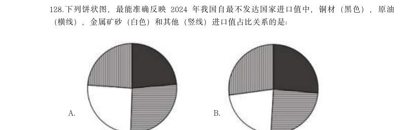
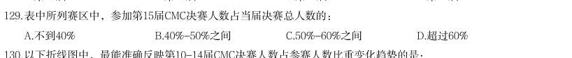
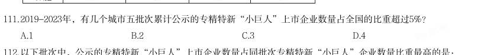
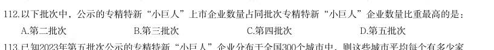
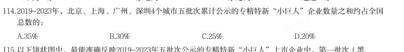
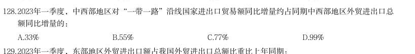

# 资料分析 · 比重计算与比较

> 考点编码：`ZL-BILI`　｜　体系对齐：花生十三 `ziliao-fenxi.md#题型4`

## 一、命题规律

- **本题型真题总量**：233 题（2000–2026）
- **地区分布**：国考 124 / 广东 67 / 湖北 42
- **近六年题量**：2026年14题, 2025年14题, 2024年13题, 2023年10题, 2022年12题, 2021年8题
- **覆盖试卷**：83 套
- **同题变体**：另有 36 道为同题重复（同年多卷/跨年再考），已折叠，需展开见 scripts/search.py --all-variants
- **速算/速解提示**：见花生十三 `references/ziliao-susuan.md` 与 `references/shuliang-gongshi.md` 对应章节

## 二、真题与答案（按年份倒序，最多 30 题）

### 2026 湖北·统一卷　第 107 题

2025年1-4月,再融资债券发行额占地方政府债券累计发行额的比重在下列哪个范围内?

- **A.** 35%~45%
- **B.** 45%~55%
- **C.** 55%~65%
- **D.** 65%~75%

**答案：C**

**解析/参考要点**：107.C
根据题干“2025 年1-4 月······占······的比重在下列哪个范围
内”,结合材料时间为2025 年,可判定本题为现期比重问题。定位表1 可得:
2025 年1-6 月地方政府债券累计发行额为54901.55 亿元,6 月发行额为11753.22
亿元,5 月发行额为7794.43 亿元;2025 年1-6 月再融资债券累计发行额为
28774.85 亿元,6 月发行额为5472.33 亿元,5 月发行额为2875.93 亿元。根据
公式:比重
,且2025 年1-4 月=2025 年1-6 月累计-6 月-5 月,可得所
求为
,在C 项范围内。
故正确答案为C。

### 2026 湖北·统一卷　第 121 题
> 材料：(四) 截至2024年末,我国60岁及以上人口突破3亿,达到31031万人。养老服务相关企业约16万家,比2023年底 增长24.36%。全国共有各类养老机构和设施40.6万个,养老床位合计799.3万张。…

2024年末,我国60岁及以上人口中,65岁及以上的人口占比约为:

- **A.** 51%
- **B.** 61%
- **C.** 71%
- **D.** 81%

**答案：C**

**解析/参考要点**：121.C
根据题干“2024 年末······中······占比约为”,结合材料给出
2024 年末相关数据,可判定本题为现期比重问题。定位文字材料第一段可得:
截至2024 年末,我国60 岁及以上人口突破3 亿,达到31031 万人;定位统计表
可得:2024 年,我国65 岁及以上人口为22023 万人。根据公式:比重
,
可得题干所求
。
故正确答案为C。

### 2026 广东·统一卷　第 73 题

2025年3至7月“粤就业”小程序发布的62.5万个岗位中,年薪10万元以上岗位占比( )。

- **A.** 在1成到2成之间
- **B.** 在2成到3成之间
- **C.** 在3成到4成之间
- **D.** 在4成到5成之间

**答案：D**

**解析/参考要点**：第73 题答案D
根据题干“2025 年3 至7 月......占比...”,结合材料时间为2025 年3 至7 月,
可判定本题为现期比重问题。定位文字材料第三段可得:2025 年3 至7 月,累计
组织2.1 万家重点企业在“粤就业”小程序发布62.5 万个岗位其中,年薪10
万元以上岗位约26 万个。根部分据公式:比重=部分/整体,则题目所求
=26/62.5=41.6%,在D 项范围内。故正确答案为D。

### 2026 广东·统一卷　第 79 题

2024年上半年,我国新批准建立的国家标准物质中,企业申报的标准物质项目数约占( )。

- **A.** 40%
- **B.** 50%
- **C.** 60%
- **D.** 70%

**答案：暂缺（原始文件为扫描版）**

**解析/参考要点**：第79 题答案D

### 2026 广东·统一卷　第 82 题

2024年末,广东省田径场地中,设有400米环形跑道的田径场地数量占比( )。

- **A.** 不到15%
- **B.** 在15%-20%之间
- **C.** 在20%-25%之间
- **D.** 超过25%

**答案：A**

**解析/参考要点**：第82 题答案A
根据题干“2024 年末,......数量占比”,结合材料时间为2024 年末,可判定本
题为现期比重问题。定位表格材料可得:2024 年末广东省田径场地总数量为1.64
万个,设有400 米环形跑道的田径场地数量为0.24 万个。根据公式:比重则=部
分/整体,题目所求=0.24/1.64≈14.6%在A 项范围内。故正确答案为A。

### 2026 广东·统一卷　第 88 题

与1949年末相比,2023年末我国城市中,地级以上城市数量占比( )。

- **A.** 减少了约10个百分点
- **B.** 增加了约10个百分点
- **C.** 减少了约1个百分点
- **D.** 增加了约1个百分点

**答案：A**

**解析/参考要点**：第88 题答案A
根据题干“与1949 年末相比,2023 年末...占比”,结合选项为增加了/减少了+
百分点,可判定本题为两期比重问题。定位文字材料第二段可得:1949 年末,全
国城市共有129 个,其中,地级以上城市68 个;2023 年末,城市个数达到694
个,其中,地级以上城市297 个。根据公式:比重=部分/整体,则题目所求
=297/694-68/129 约=43%-53%=-10%,即减少了10 个百分点。故正确答案为A。

### 2026 国考·副省级　第 124 题

2024 年,职工基本医疗保险统筹基金支出占全国基本医疗保险统筹基金支出比重最大的月 份,当月职工基本医疗保险支出比上月:

- **A.** 增加了5%以上
- **B.** 减少了5%以上
- **C.** 增加了不到5%
- **D.** 减少了不到5%

**答案：D**

**解析/参考要点**：124、D

### 2026 国考·副省级　第 128 题

2024 年绿证核发量最多的5 个省级行政区,绿证核发量约占全国总量的:

- **A.** 38%
- **B.** 42%
- **C.** 46%
- **D.** 50%

**答案：B**

**解析/参考要点**：128、B

### 2026 国考·副省级　第 129 题

2024 年,全国集中式风电项目核发绿证数量占当年集中式项目核发绿证数量的比重比太阳能 发电项目的占比高约多少个百分点?

- **A.** 16
- **B.** 20
- **C.** 24
- **D.** 28

**答案：C**

**解析/参考要点**：129、C

### 2026 国考·副省级　第 133 题

下列饼状图,最能准确反映2024 年我国自最不发达国家进口值中,铜材(黑色),原油 (横线),金属矿砂(白色)和其他(竖线)进口值占比关系的是:

- **A.** 
- **B.** 
- **C.** 
- **D.** 

**答案：B**

**解析/参考要点**：133、B

### 2026 国考·地市级　第 112 题

2024 年上半年,中药提取物出口额占医药保健品出口总额的比重比上年同期:

- **A.** 上升了3 个百分点以上
- **B.** 下降了3 个百分点以上
- **C.** 上升了不到3 个百分点
- **D.** 下降了不到3 个百分点

**答案：D**

**解析/参考要点**：112、D

### 2026 国考·地市级　第 124 题

2022~2024 年,科幻文旅营收额占科幻产业营收额的比重超过20%的年份仅包括: 年 B.2023 年 C.2022 和2024 年 D.2022 年

> （本题为图形题，选项为图片，见原卷）

**答案：A**

**解析/参考要点**：124、A

### 2026 国考·地市级　第 128 题

A.9.5% B.8.5% C.7.5% D.10.5% 下列饼状图,最能准确反映2024 年我国自最不发达国家进口值中,铜材(黑色),原油 (横线),金属矿砂(白色)和其他(竖线)进口值占比关系的是:

- **A.** 
- **B.** 
- **C.** 
- **D.** 

**答案：B**

**解析/参考要点**：128、B

### 2026 国考·行政执法　第 124 题

2022~2024 年,科幻文旅营收额占科幻产业营收额的比重超过20%的年份仅包括:

- **A.** 2023 和2024 年
- **B.** 2023 年
- **C.** 2022 和2024 年
- **D.** 2022 年

**答案：A**

**解析/参考要点**：124、A

### 2025 湖北·统一卷　第 122 题

2022年北京市作品著作权登记量约占同年全国作品著作权登记总量的:

- **A.** 10%
- **B.** 13%
- **C.** 18%
- **D.** 23%

**答案：暂缺（原始文件为扫描版）**

### 2025 广东·统一卷　第 73 题

2023年,G省城镇社会消费品零售额约占社会消费品零售额的( )。

- **A.** 79.8%
- **B.** 83.4%
- **C.** 87.1%
- **D.** 90.0%

**答案：暂缺（原始文件为扫描版）**

### 2025 广东·统一卷　第 83 题

2023年,G省文物系统国有博物馆约占国有博物馆总量的( )。

- **A.** 55%
- **B.** 66%
- **C.** 77%
- **D.** 88%

**答案：暂缺（原始文件为扫描版）**

### 2025 国考·副省级　第 122 题

2019-2023年,我国厨房小家电全品类零售额中线上零售额占比超过75%的年份有几个?

- **A.** 4
- **B.** 3
- **C.** 2
- **D.** 1

**答案：B**

**解析/参考要点**：【122】解析
根据题干“2019-2023 年······中······占比超过75%的年份有几个”,可判定本题为现
期比重问题。定位统计表可得:2019-2023 年,我国厨房小家电全品类零售额分别为672.8 亿元、631.9
亿元、557.5 亿元、520.3 亿元、549.3 亿元;线上零售额分别为378 亿元、443 亿元、435 亿元、473 亿
元、422 亿元。根据公式:比重=部分/整体,可得各年份我国厨房小家电全品类零售额中线上零售额占
比分别为:
2019 年:378/672.8≈378/670=56%<75%,不满足;
2020 年:443/631.9≈443/630≈70%<75%,不满足;
2021 年:435/557.5≈435/560≈78%>75%,满足;
2022 年:473/520.3≈473/520=91%>75%,满足;
2023 年:422/549.3≈422/550≈77%>75%,满足。
综上,2019-2023 年,我国厨房小家电全品类零售额中线上零售额占比超过75%的年份有2021 年、2022
年、2023 年,共3 个。
故正确答案为B。
2025 国考《行测》(副省级)解析
42 / 46

### 2025 国考·副省级　第 129 题

表中所列赛区中,参加第15届CMC决赛人数占当届决赛总人数的:

- **A.** 不到40%
- **B.** 40%-50%之间
- **C.** 50%-60%之间
- **D.** 超过60%

**答案：C**

**解析/参考要点**：【129】解析
根据题干“······参加第15 届······占当届······的”,结合选项为百分数,可判
定本题为现期比重问题。定位统计图可得:参加第15 届CMC 决赛的总人数为1169 人;定位统计表可得:
表中所列赛区参加第15 届CMC 决赛的人数=46+90+48+40+59+57+80+86+90+46=642 人。根据公式:比重
,则所求比重
,在C 项范围内。
故正确答案为C。

### 2025 国考·副省级　第 130 题

以下折线图中,最能准确反映第10-14届CMC决赛人数占参赛人数比重变化趋势的是:

- **A.** 
- **B.** 
- **C.** 
- **D.** 

**答案：B**

**解析/参考要点**：【130】解析
根据题干“······第10-14 届······比重······”,结合材料给出第10-14 届CMC
参赛人数情况,可判定本题为现期比重问题。定位统计图可知第10-14 届CMC 参赛人数及决赛人数。根
据公式:比重
,可得第10-14 届CMC 决赛人数占参赛人数比重分别为:
2025 国考《行测》(副省级)解析
44 / 46
第10 届,
;
第11 届,
;
第12 届,
;
第13 届,
;
第14 届,
。
比较可知,第12 届比重最小,第14 届比重最大,只有B 项满足。
故正确答案为B。

### 2025 国考·副省级　第 132 题

2023年三季度,人民银行清算总中心系统处理支付业务中,小额批量支付系统处理业务笔数的占比同比:

- **A.** 下降了2个百分点以上
- **B.** 下降了不到2个百分点
- **C.** 上升了2个百分点以上
- **D.** 上升了不到2个百分点

**答案：D**

**解析/参考要点**：【132】解析
根据题干“2023 年三季度,······中······的占比同比”,结合选项为“上升/下降+百分
点”,可判定本题为两期比重计算问题。定位文字材料第二段可得:2023 年三季度,人民银行清算总中
心系统共处理支付业务54.79 亿笔(B),同比增长0.92%(b),其中,小额批量支付系统处理业务11.51
亿笔(A ),同比增长5.73% (a )。根据公式:两期比重差
,则题干所求
,即上升了不到2 个百分
点。
故正确答案为D。

### 2025 国考·地市级　第 111 题

分析、比较、计算和判断处理。 (一) 2019-2023年,有几个城市五批次累计公示的专精特新“小巨人”上市企业数量占全国的比重超过5%?

- **A.** 1
- **B.** 2
- **C.** 3
- **D.** 4

**答案：C**

**解析/参考要点**：【111】解析
根据题干“2019-2023 年,有几个城市······占全国的比重超过5%”,结合材料时间为2019-2023
年,可判定本题为现期比重问题。定位柱状图可知2019-2023 年我国各批次专精特新“小巨人”上市企
业数量,则2019-2023 年我国五批次累计公示的专精特新“ 小巨人” 上市企业数量为
39+198+229+282+134=882 家。根据公式:比重
,题目求
,则满足城市>全国
×5%=882×5%=44.1 家即可。定位表格可知全国排名前10 的城市五批次累计专精特新“小巨人”上市企
业数量,观察发现,从第4 名开始均小于44.1 家,即只有3 个城市的占比超过5%。
故正确答案为C。

### 2025 国考·地市级　第 112 题

以下批次中,公示的专精特新“小巨人”上市企业数量占同批次专精特新“小巨人”企业数量比重最高的是:

- **A.** 第二批次
- **B.** 第三批次
- **C.** 第四批次
- **D.** 第五批次

**答案：A**

**解析/参考要点**：【112】解析
根据题干“以下批次中······占同批次······比重最高的是”,可判定本题为现期比重问
题。定位统计图可知各批次公示的专精特新“小巨人”上市企业数量及企业数量,根据公式:比重
2025 国考《行测》(地市级)解析
38 / 44
,各批次公示的专精特新“小巨人”上市企业数量占同批次专精特新“小巨人”企业数量比重分
别为:第二批次,198/1744>10%;第三批次,229/2930<10%;第四批次,282/4357<10%;第五批次,
134/3671<10%,则第二批次公示的专精特新“小巨人”上市企业数量占同批次专精特新“小巨人”企
业数量比重最高。
故正确答案为A。

### 2025 国考·地市级　第 114 题

2019-2023年,北京、上海、广州、深圳4个城市五批次累计公示的专精特新“小巨人”企业数量之和约占全国 总数的:

- **A.** 35%
- **B.** 30%
- **C.** 25%
- **D.** 20%

**答案：D**

**解析/参考要点**：【114】解析
根据题干“2019-2023 年······约占······”,结合材料给出2019-2023 年的相关数据,
可判定本题为现期比重问题。定位统计图可得:2019-2023 年我国五批次公示的专精特新“小巨人”企
业数量分别为248 家、1744 家、2930 家、4357 家、3671 家;定位统计表可得:2019-2023 年北京、上
海、广州、深圳4 个城市五批次累计专精特新“小巨人”企业数量分别为840 家、713 家、249 家、755
家。根据公式:比重
,可得题干所求
。
故正确答案为D。

### 2025 国考·地市级　第 126 题
> 材料：(四) 2023年一季度,我国外贸进出口总额为9.89万亿元,同比增加0.45万亿元。其中,东部地区进出口7.75万亿 元,同比增长2.9%;中西部、东北地区分别进出口1.84万亿元、2975.4亿元,同比分别增长12.6%、9.4%。 2月份,东部地区进出口同比增速由1月份的下降11.1%转为增长7%,3月份增速扩大至15.8%。一季度有进 出口实绩企业数量38.7万家,同比增长5.2%。一季度,东部地区出口高技术产品7741.7亿元,同比增长9.8%, 占东部地区出口额比重为17.9%,同比提升0.7个百分点,其中3月增速为21%。 一季度,中西部地区民营企业进出口1.08万亿元,同比增长…

以下饼状图中,最能准确反映2023年一季度我国外贸进出口总额中,东部地区(白色)、中西部地区(斜线) 和东北地区(黑色)外贸进出口额占比关系的是:

- **A.** 
- **B.** 
- **C.** 
- **D.** 

**答案：A**

**解析/参考要点**：【126】解析
根据题干“以下饼状图中,最能准确反映2023 年一季度······占比关系的是”,结合材料时间为
2023 年一季度,可判定本题为现期比重问题。定位文字材料第一段可得:2023 年一季度,我国外贸进出
口总额为9.89 万亿元。其中,东部地区进出口7.75 万亿元;中西部、东北地区分别进出口1.84 万亿
元、2975.4 亿元。根据公式:比重=部分/整体,则东部地区外贸进出口额占我国外贸进出口总额的比重
2025 国考《行测》(地市级)解析
43 / 44
为7.75/9.89>7.75/10>3/4,排除C、D 两项;中西部地区与东北地区外贸进出口额的倍数关系为1.84
万亿/2975.4 亿≈1.84/0.30=6+,排除B 项。
故正确答案为A。

### 2025 国考·地市级　第 128 题

2023年一季度,中西部地区对“一带一路”沿线国家进出口贸易额同比增量约占同期中西部地区外贸进出口总 额同比增量的:

- **A.** 33%
- **B.** 55%
- **C.** 77%
- **D.** 99%

**答案：D**

**解析/参考要点**：【128】解析
根据题干“2023 年一季度······占······”,结合材料时间为2023 年一季度,可判定本
题为现期比重问题。定位文字材料第一段可得:2023 年一季度,中西部地区进出口1.84 万亿元,同比
增长12.6%。定位文字材料第三段可得:(2023 年)一季度,中西部地区对“一带一路”沿线国家进出口
7400.9 亿元,同比增长38%。根据公式:增长量
、比重
,可得所求
,与D 项最接近。
故正确答案为D。

### 2025 国考·地市级　第 129 题

2023年一季度,东部地区外贸进出口额占我国外贸进出口总额比重比上年同期:

- **A.** 上升了5个百分点以上
- **B.** 上升了不到5个百分点
- **C.** 下降了5个百分点以上
- **D.** 下降了不到5个百分点

**答案：D**

**解析/参考要点**：【129】解析
根据题干“2023 年一季度······占······比重比上年同期”,结合选项为“上升了/下降
了+百分点”,可判定本题为两期比重问题。定位文字材料第一段可得:2023 年一季度,我国外贸进出
口总额为9.89 万亿元(B),同比增加0.45 万亿元。其中,东部地区进出口7.75 万亿元(A),同比增长
2.9%(a)。根据公式:增长率
,可得2023 年一季度我国外贸进出口总额同比
2025 国考《行测》(地市级)解析
44 / 44
增长率
(b);根据公式:两期比重差
,则所求
,即下降了不到1.9 个百分点,在D 项
范围内。
故正确答案为D。

### 2025 国考·行政执法　第 121 题

(三) 2019-2023年,有几个城市五批次累计公示的专精特新“小巨人”上市企业数量占全国的比重超过5%?

- **A.** 1
- **B.** 2
- **C.** 3
- **D.** 4

**答案：C**

**解析/参考要点**：【121】解析
根据题干“2019-2023 年,有几个城市······占全国的比重超过5%”,结合材料时间为2019-2023
年,可判定本题为现期比重问题。定位柱状图可知2019-2023 年我国各批次专精特新“小巨人”上市企
业数量,则2019-2023 年我国五批次累计公示的专精特新“ 小巨人” 上市企业数量为
39+198+229+282+134=882 家。根据公式:比重
,题目求
,则满足城市>全国
2025 国考《行测》(行政执法卷)解析
43 / 46
×5%=882×5%=44.1 家即可。定位表格可知全国排名前10 的城市五批次累计专精特新“小巨人”上市企
业数量,观察发现,从第4 名开始均小于44.1 家,即只有3 个城市的占比超过5%。
故正确答案为C。

### 2024 湖北·统一卷　第 108 题

2022年,按体育场地类型的数量,从大到小排位第二的约占全国体育场地数量的:

- **A.** 5.4%
- **B.** 23.2%
- **C.** 29.6%
- **D.** 62.1%

**答案：C**

### 2024 广东·统一卷　第 77 题

与2021年相比,2022年中国对外直接投资流量在全球中的占比( )。

- **A.** 增加了不到3个百分点
- **B.** 增加了超过3个百分点
- **C.** 减少了不到3个百分点
- **D.** 减少了超过3个百分点

**答案：A**
