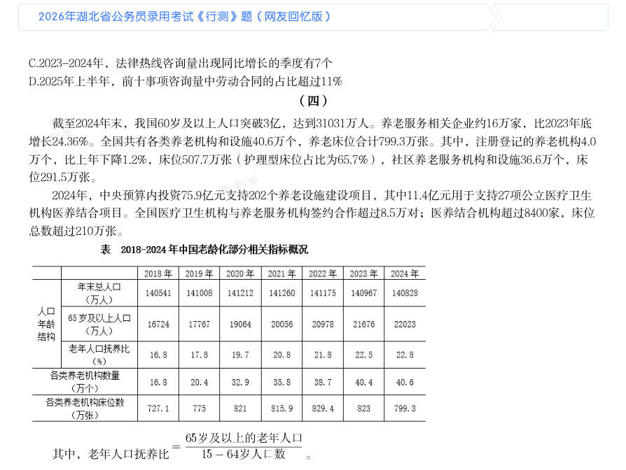
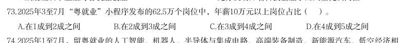
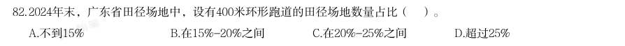
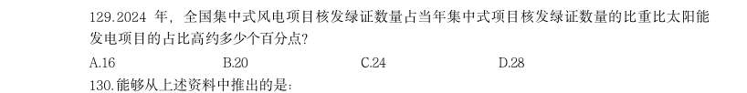
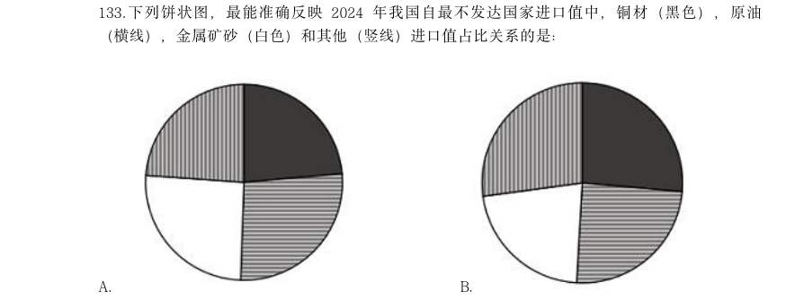

# 资料分析 · 比重计算与比较

> 考点编码：`ZL-BILI`　｜　体系对齐：花生十三 `ziliao-fenxi.md#题型4`

## 一、命题规律

- **本题型真题总量**：233 题（2000–2026）
- **地区分布**：国考 125 / 广东 66 / 湖北 42
- **近六年题量**：2026年14题, 2025年14题, 2024年14题, 2023年10题, 2022年12题, 2021年8题
- **覆盖试卷**：83 套
- **子考点分布**：现期比重 223　两期比重差 44　比重计算（综合） 1
- **同题变体**：另有 35 道为同题重复（同年多卷/跨年再考），已折叠，需展开见 scripts/search.py --all-variants
- **速算/速解提示**：见花生十三 `references/ziliao-susuan.md` 与 `references/shuliang-gongshi.md` 对应章节

## 二、近年真题（最多 12 题，按年份倒序）

### 2026 湖北·统一卷　第 107 题　（现期比重）

2025年1-4月,再融资债券发行额占地方政府债券累计发行额的比重在下列哪个范围内?

> 材料图见 images/HB-2026-ty-X106-m.jpg

- **A.** 35%~45%
- **B.** 45%~55%
- **C.** 55%~65%
- **D.** 65%~75%

**答案：C**

**解析/参考要点**：C
根据题干“2025 年1-4 月······占······的比重在下列哪个范围
内”,结合材料时间为2025 年,可判定本题为现期比重问题。定位表1 可得:
2025 年1-6 月地方政府债券累计发行额为54901.55 亿元,6 月发行额为11753.22
亿元,5 月发行额为7794.43 亿元;2025 年1-6 月再融资债券累计发行额为
28774.85 亿元,6 月发行额为5472.33 亿元,5 月发行额为2875.93 亿元。根据
公式:比重
,且2025 年1-4 月=2025 年1-6 月累计-6 月-5 月,可得所
求为
,在C 项范围内。
故正确答案为C。

### 2026 湖北·统一卷　第 121 题　（两期比重差）
> 材料：截至2024年末,我国60岁及以上人口突破3亿,达到31031万人。养老服务相关企业约16万家,比2023年底 增长24.36%。全国共有各类养老机构和设施40.6万个,养老床位合计799.3万张。…

其中,注册登记的养老机构4.0 万个,比上年下降1.2%,床位507.7万张(护理型床位占比为65.7%),社区养老服务机构和设施36.6万个,床 位291.5万张。 2024年,中央预算内投资75.9亿元支持202个养老设施建设项目,其中11.4亿元用于支持27项公立医疗卫生 机构医养结合项目。全国医疗卫生机构与养老服务机构签约合作超过8.5万对;医养结合机构超过8400家,床位 总数超过210万张。 其中,老年人口抚养比 。 2024年末,我国60岁及以上人口中,65岁及以上的人口占比约为:

- **A.** 51%
- **B.** 61%
- **C.** 71%
- **D.** 81%

**答案：C**

**解析/参考要点**：C
根据题干“2024 年末······中······占比约为”,结合材料给出
2024 年末相关数据,可判定本题为现期比重问题。定位文字材料第一段可得:
截至2024 年末,我国60 岁及以上人口突破3 亿,达到31031 万人;定位统计表
可得:2024 年,我国65 岁及以上人口为22023 万人。根据公式:比重
,
可得题干所求
。
故正确答案为C。

### 2026 广东·统一卷　第 73 题　（现期比重）
> 材料：广东既是经济大省,也是人口大省、就业大省,数据显示,2024年广东净增74万人,新出生113.3万人;城 镇新增就业超143万人,超额完成国家下达的110万人的年度就业任务,并且实现4386万异地务工人员稳定就 业,是名副其实的就业超级“蓄水池”。 今年以来,广东按照省委、省政府关于实施“百万英才汇南粤”行动计划的部署安排,围绕“粤聚英才、 粤见未来”主题,广泛募集岗位、强化精准对接、提升优质服务、持续扩大声势。截至7月中旬,全省已吸纳 超过100万应届高校毕业生留粤来粤就业创业,进一步夯实广东现代化产业体系的人才基座,充分彰显经济大 省挑大梁的责任担当。 “百万英才汇南粤”行动计划紧紧围绕广…

2025年3至7月“粤就业”小程序发布的62.5万个岗位中,年薪10万元以上岗位占比( )。

> 材料图见 images/GD-2026-ty-X071-m.jpg

- **A.** 在1成到2成之间
- **B.** 在2成到3成之间
- **C.** 在3成到4成之间
- **D.** 在4成到5成之间

**答案：D**

**解析/参考要点**：答案D
根据题干“2025 年3 至7 月......占比...”,结合材料时间为2025 年3 至7 月,
可判定本题为现期比重问题。定位文字材料第三段可得:2025 年3 至7 月,累计
组织2.1 万家重点企业在“粤就业”小程序发布62.5 万个岗位其中,年薪10
万元以上岗位约26 万个。根部分据公式:比重=部分/整体,则题目所求
=26/62.5=41.6%,在D 项范围内。故正确答案为D。

### 2026 广东·统一卷　第 79 题　（现期比重）
> 材料：标准物质与尺子、砝码一样,是测量中必不可少的参照工具。它是已提前获得准确测量结果、均匀稳定的 样品,待测样品以其为标准,确保不同时间、人员、实验室的测量结果可比。标准物质研制生产机构在开展具 体品种标准物质的生产供应前,须通过技术审评并取得定级证书,这些取得定级证书的标准物质,统称为“国 家标准物质”。根据计量溯源性、准确度和用途等,国家标准物质目前分为两类,即一级标准物质和二级标准 物质。 国家标准物质数量快速增长的原因有四个方面:一是用途广泛、涉及经济、社会发展的各个领域;二是需 求大幅增加,检测部门和行业主管部门日益重视测量结果的准确性;三是产业发展迅速,除了中国计量科学研 究院等机构之…

2024年上半年,我国新批准建立的国家标准物质中,企业申报的标准物质项目数约占( )。

> 材料图见 images/GD-2026-ty-X076-m.jpg

- **A.** 40%
- **B.** 50%
- **C.** 60%
- **D.** 70%

**答案：暂缺（原始文件为扫描版）**

**解析/参考要点**：答案D

### 2026 广东·统一卷　第 82 题　（现期比重）
> 材料：截至2024年末,广东省共有体育场地35.3万个,较上年增长3.58%;体育场地面积3.72亿平方米,较上年增长4.49%;人均体育场地面积2.91平方米(按常住人口计算),较上年增长3.93%。…

2024年末,广东省田径场地中,设有400米环形跑道的田径场地数量占比( )。

> 材料图见 images/GD-2026-ty-X081-m.jpg

- **A.** 不到15%
- **B.** 在15%-20%之间
- **C.** 在20%-25%之间
- **D.** 超过25%

**答案：A**

**解析/参考要点**：答案A
根据题干“2024 年末,......数量占比”,结合材料时间为2024 年末,可判定本
题为现期比重问题。定位表格材料可得:2024 年末广东省田径场地总数量为1.64
万个,设有400 米环形跑道的田径场地数量为0.24 万个。根据公式:比重则=部
分/整体,题目所求=0.24/1.64≈14.6%在A 项范围内。故正确答案为A。

### 2026 广东·统一卷　第 88 题　（现期比重）
> 材料：新中国成立以来,我国的城镇化建设不断推进,城市规模不断扩大,综合实力显著增强,基础设施持续改 善,城市更加宜业宜居。 从城市数量看,1948年末,我国城市共有58个,新中国成立后,大批县城改设为城市。1949年末,全国城 市共有129个,其中,地级以上城市68个,县级市61个,建制镇2000个左右。改革开放前,我国的城镇化经历 了一段比较曲折的发展历程,小城市和小城镇发展缓慢。1978年末,全国城市共有193个,其中,地级以上城 市101个,县级市92个,建制镇2173个。改革开放以来,城市数量快速增加。2023年末,城市个数达到694个, 其中,地级以上城市297个,县级市397个,建制镇2…

与1949年末相比,2023年末我国城市中,地级以上城市数量占比( )。

> 材料图见 images/GD-2026-ty-X086-m.jpg

- **A.** 减少了约10个百分点
- **B.** 增加了约10个百分点
- **C.** 减少了约1个百分点
- **D.** 增加了约1个百分点

**答案：A**

**解析/参考要点**：答案A
根据题干“与1949 年末相比,2023 年末...占比”,结合选项为增加了/减少了+
百分点,可判定本题为两期比重问题。定位文字材料第二段可得:1949 年末,全
国城市共有129 个,其中,地级以上城市68 个;2023 年末,城市个数达到694
个,其中,地级以上城市297 个。根据公式:比重=部分/整体,则题目所求
=297/694-68/129 约=43%-53%=-10%,即减少了10 个百分点。故正确答案为A。

### 2026 国考·副省级　第 124 题　（现期比重）

2024 年,职工基本医疗保险统筹基金支出占全国基本医疗保险统筹基金支出比重最大的月 份,当月职工基本医疗保险支出比上月:

> 材料图见 images/GK-2026-fs-X121-m.jpg

- **A.** 增加了5%以上
- **B.** 减少了5%以上
- **C.** 增加了不到5%
- **D.** 减少了不到5%

**答案：D**

**解析/参考要点**：D

### 2026 国考·副省级　第 128 题　（现期比重）
> 材料：绿证是对可再生能源绿色电力颁发的具有独特标识代码的电子证书,1 个绿证单位对应 1000 千瓦时可再生能源电量。2024 年全国核发绿证47.34 亿个,其中可交易绿证31.58 亿个。 截至2024 年12 月底全国累计核发绿证49.55 亿个,其中可交易绿证33.79 亿个。 2024 年,全国集中式项目核发绿证46.77 亿个。按项目类型划分,风电19.07 亿个,常规 水电15.78 亿个,太阳能发电8.03 亿个,生物质发电3.81 亿个,风光一体化项目755 万个, 地热能发电52 万个,海洋能发电1.1 万个。…

2024 年绿证核发量最多的5 个省级行政区,绿证核发量约占全国总量的:

> 材料图见 images/GK-2026-fs-X121-m.jpg

- **A.** 38%
- **B.** 42%
- **C.** 46%
- **D.** 50%

**答案：B**

**解析/参考要点**：B

### 2026 国考·副省级　第 129 题　（现期比重）
> 材料：绿证是对可再生能源绿色电力颁发的具有独特标识代码的电子证书,1 个绿证单位对应 1000 千瓦时可再生能源电量。2024 年全国核发绿证47.34 亿个,其中可交易绿证31.58 亿个。 截至2024 年12 月底全国累计核发绿证49.55 亿个,其中可交易绿证33.79 亿个。 2024 年,全国集中式项目核发绿证46.77 亿个。按项目类型划分,风电19.07 亿个,常规 水电15.78 亿个,太阳能发电8.03 亿个,生物质发电3.81 亿个,风光一体化项目755 万个, 地热能发电52 万个,海洋能发电1.1 万个。…

2024 年,全国集中式风电项目核发绿证数量占当年集中式项目核发绿证数量的比重比太阳能 发电项目的占比高约多少个百分点?

> 材料图见 images/GK-2026-fs-X121-m.jpg

- **A.** 16
- **B.** 20
- **C.** 24
- **D.** 28

**答案：C**

**解析/参考要点**：C

### 2026 国考·副省级　第 133 题　（现期比重）
> 材料：2024 年,我国对联合国定义的45 个最不发达国家(以下简称最不发达国家)进出口 14230.2 亿元人民币,占同期我国外贸进出口总值的3.2%。其中出口8664.6 亿元,同比(下同) 增长4.3%;进口5565.5 亿元,增长12.8%。 2024 年,我国对最不发达国家出口机电产品3942.2 亿元,增长13.5%。其中出口船舶690.8 亿元,增长65.9%,主要出口至全球第一大船旗国利比里亚。出口金额654.3 亿元,增长67%; 出口工程机械、火车分别为165.3 亿元、91.6 亿元,分别增长28.9%、39.5%;出口劳动密集型产 品2481 亿元,增长3.7%,其中纺织品1…

下列饼状图,最能准确反映2024 年我国自最不发达国家进口值中,铜材(黑色),原油 (横线),金属矿砂(白色)和其他(竖线)进口值占比关系的是:

> 材料图见 images/GK-2026-fs-X121-m.jpg

- **A.** 
- **B.** 
- **C.** 
- **D.** 

**答案：B**

**解析/参考要点**：B

### 2026 国考·地市级　第 112 题　（两期比重差）

2024 年上半年,中药提取物出口额占医药保健品出口总额的比重比上年同期:

- **A.** 上升了3 个百分点以上
- **B.** 下降了3 个百分点以上
- **C.** 上升了不到3 个百分点
- **D.** 下降了不到3 个百分点

**答案：D**

**解析/参考要点**：D

### 2026 国考·地市级　第 124 题　（现期比重）
> 材料：科幻产业包括科幻阅读、科幻影视、科幻游戏、科幻衍生品、科幻文旅五大领域。2024年,我国科幻产业总营收1089.6 亿元。…

2022~2024 年,科幻文旅营收额占科幻产业营收额的比重超过20%的年份仅包括: 年 B.2023 年 C.2022 和2024 年 D.2022 年

> 材料图见 images/GK-2026-ds-X116-m.jpg

> （本题为图形题，选项为图片，见原卷）

**答案：A**

**解析/参考要点**：A

## 三、其余真题（按年代分片）

| 年代 | 题量 | 分片文件 |
|---|---:|---|
| 2000s | 55 | [ZL-BILI-2000s.md](split/ZL-BILI-2000s.md) |
| 2010s | 88 | [ZL-BILI-2010s.md](split/ZL-BILI-2010s.md) |
| 2020s | 78 | [ZL-BILI-2020s.md](split/ZL-BILI-2020s.md) |

> 也可用 `python scripts/search.py --kaodian ZL-BILI` 直接检索全部 233 题。