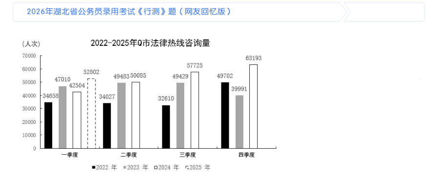

# 资料分析 · 综合分析

> 考点编码：`ZL-COMP`　｜　体系对齐：花生十三 `ziliao-fenxi.md#题型9`

## 一、命题规律

- **本题型真题总量**：753 题（2000–2026）
- **地区分布**：国考 339 / 广东 256 / 湖北 158
- **近六年题量**：2026年47题, 2025年33题, 2024年34题, 2023年14题, 2022年32题, 2021年21题
- **覆盖试卷**：95 套
- **子考点分布**：选正确项 272　综合分析（综合） 245　选错误项 216　排序与图示判断 37　判断个数 23
- **同题变体**：另有 40 道为同题重复（同年多卷/跨年再考），已折叠，需展开见 scripts/search.py --all-variants
- **速算/速解提示**：见花生十三 `references/ziliao-susuan.md` 与 `references/shuliang-gongshi.md` 对应章节

## 二、近年真题（最多 12 题，按年份倒序）

### 2026 湖北·统一卷　第 108 题　（排序与图示判断）

关于2025年6月各类地方政府债券发行额的环比增速,下列排序正确的是:

> 材料图见 images/HB-2026-ty-X106-m.jpg

- **A.** 再融资专项债券>新增一般债券>再融资一般债券>新增专项债券
- **B.** 新增一般债券>新增专项债券>再融资一般债券>再融资专项债券
- **C.** 再融资专项债券>再融资一般债券>新增一般债券>新增专项债券
- **D.** 再融资专项债券>新增一般债券>新增专项债券>再融资一般债券

**答案：A**

**解析/参考要点**：A
根据题干“关于2025 年6 月······环比增速,下列排序正确的是”,可
判定本题为一般增长率问题。定位表1 可得2025 年5 月、6 月地方新增一般债
券、新增专项债券、再融资一般债券、再融资专项债券的发行额。根据公式:增
长率
,可得2025 年6 月各类地方政府债券发行额的环比
增速分别如下:
新增一般债券:
;
新增专项债券:
;
再融资一般债券:
;
再融资专项债券:
。
综上,正确排序为再融资专项债券>新增一般债券>再融资一般债券>新增专项债
券。
故正确答案为A。

### 2026 湖北·统一卷　第 109 题　（选错误项）

下列选项和如下饼图相符的是:

> 材料图见 images/HB-2026-ty-X106-m.jpg

- **A.** 2025年5月各发行场所发行额:1-中央结算公司、2-上海证券交易所、3-深圳证券交易所、4-北京证券交易所
- **B.** 2025年6月各发行场所发行额:1-中央结算公司、2-上海证券交易所、3-深圳证券交易所、4-北京证券交易所
- **C.** 2025年5月地方政府债券发行额:1-新增一般债券、2-新增专项债券、3-再融资一般债券、4-再融资专项债券
- **D.** 2025年6月地方政府债券发行额:1-新增一般债券、2-新增专项债券、3-再融资一般债券、4-再融资专项债

**答案：D**

**解析/参考要点**：D
A 项:定位表1 可知:2025 年5 月地方政府中央结算公司债券发行额3236.39
亿元>上海证券交易所债券发行额2423.68 亿元,与饼状图不符,错误;
B 项:定位表1 可知:2025 年6 月地方政府中央结算公司债券发行额6769.33
亿元>上海证券交易所债券发行额3188.62 亿元,与饼状图不符,错误;
C 项:定位表1 可知:2025 年5 月地方政府再融资一般债券发行额2112.62 亿元,
远大于再融资专项债券发行额763.31 亿元,与饼状图不符,错误;
D 项:定位表1 可知:2025 年6 月地方政府新增一般债券发行额1009.95 亿元、
新增专项债券发行额5270.94 亿元、再融资一般债券发行额2674.63 亿元、再融
资专项债券发行额2797.70 亿元,与饼状图完全符合,正确。
故正确答案为D。

### 2026 湖北·统一卷　第 110 题　（综合分析（综合））

券 能够从上述资料中推出的是:

- **A.** 与2025年5月相比,所有机构在6月均增持了地方政府债券
- **B.** 2025年1-4月地方政府债券平均发行额低于6月地方政府债券发行额· 本试卷由粉笔用户上岸张同学66生成
- **C.** 2025年5月与6月上海证券交易所发行额占1-6月总发行额的比重差异超过7个百分点
- **D.** 对比2025年5月与6月的机构投资者持有情况,不存在持有金额上升、占比却下降的机构

**答案：B**

**解析/参考要点**：B

### 2026 湖北·统一卷　第 113 题　（选正确项）

2023年我国通用航空完成飞行时长比2022年约多:

> 材料图见 images/HB-2026-ty-X111-m.jpg

- **A.** 13万小时
- **B.** 15万小时
- **C.** 17万小时
- **D.** 19万小时

**答案：B**

**解析/参考要点**：B
根据题干“2023 年······比2022 年约多”,结合选项带单位,可判定本
题为增长量计算问题。定位文字材料第一段可得:2023 年我国通用航空完成飞
行时长137.1 万小时,同比增长12.4%。根据公式:增长量
,则题目所求
万小时。
故正确答案为B。

### 2026 湖北·统一卷　第 114 题　（排序与图示判断）

关于2022年底通用航空飞行时长,下列排序正确的是:

> 材料图见 images/HB-2026-ty-X111-m.jpg

- **A.** 其他类>非经营性>载人类
- **B.** 其他类>载客类>非经营性
- **C.** 非经营性>其他类>载人类
- **D.** 载人类>载客类>非经营性

**答案：A**

**解析/参考要点**：A

### 2026 湖北·统一卷　第 115 题　（综合分析（综合））

不能从上述资料中推出的是:

> 材料图见 images/HB-2026-ty-X111-m.jpg

- **A.** 2022年,载客类通用航空完成飞行时长约1.8万小时
- **B.** 2023年,通用航空完成飞行时长小于无人机累计飞行时长
- **C.** 若保持2023年同比增速不变,那么2026年全行业有效无人机操控员执照将超过35万本
- **D.** 2023年,全国获得通用航空经营许可证且使用民用无人机的通用航空企业数量的同比增速不超过30%

**答案：D**

**解析/参考要点**：D

### 2026 湖北·统一卷　第 116 题　（选正确项）
> 材料：(三) 2025年上半年,Q市12348公共法律服务热线有效接听解答咨询量(以下简称法律热线咨询量)为102428人 次。按咨询事项分类统计,前十事项的咨询量合计占法律热线咨询量的85.85%,同比提升0.65个百分点。…

· 本试卷由粉笔用户上岸张同学66生成 2025年第二季度Q市法律热线咨询量约为:

- **A.** 4.83万人次
- **B.** 4.96万人次
- **C.** 5.12万人次
- **D.** 5.23万人次

**答案：B**

**解析/参考要点**：B
定位文字材料可得,2025 年上半年Q 市法律热线咨询量为102428 人次;定位统
计图可得,2025 年一季度Q 市法律热线咨询量为52802 人次。根据公式:第二
季度数据=上半年数据-第一季度数据,则2025 年第二季度Q 市法律热线咨询量
为102428-52802=49626 人次
万人次,对应B 项。
故正确答案为B。

### 2026 湖北·统一卷　第 119 题　（综合分析（综合））

2024年上半年Q市法律热线咨询量中前十事项的咨询量约为:

> 材料图见 images/HB-2026-ty-X116-m.jpg

- **A.** 9.19万人次
- **B.** 8.27万人次
- **C.** 7.89万人次
- **D.** 6.38万人次

**答案：C**

**解析/参考要点**：C

### 2026 湖北·统一卷　第 120 题　（选错误项）

能够从上述资料中推出的是:

> 材料图见 images/HB-2026-ty-X116-m.jpg

- **A.** 2024年上半年民事诉讼程序咨询量不超过1.4万人次
- **B.** 2022-2024年,下半年法律热线咨询量均高于上半年· 本试卷由粉笔用户上岸张同学66生成
- **C.** 2023-2024年,法律热线咨询量出现同比增长的季度有7个
- **D.** 2025年上半年,前十事项咨询量中劳动合同的占比超过11%

**答案：D**

**解析/参考要点**：D
A 项:定位文字材料可得:2025 年上半年,咨询量最多的事项是民事诉讼程序,
数量为20846 人次,同比增长38.3%。根据公式:基期量
,则所求
人次
万人次,即2024 年上半年民
事诉讼程序咨询量超过1.4 万人次,错误;
B 项:定位统计图可知2022-2024 年各季度法律热线咨询量。因上半年=一季度+
二季度,下半年=三季度+四季度,则2023 年上半年法律热线咨询量
=47010+49483=96493 人次,下半年法律热线咨询量=49429+39991=89420 人次,
即2023 年下半年法律热线咨询量低于上半年,错误;
C 项:定位统计图可知2022-2024 年各季度法律热线咨询量。比较可知,2023
年法律热线咨询量出现同比增长的季度有一季度、二季度、三季度,2024 年出
现同比增长的季度有二季度、三季度、四季度,共6 个,错误;
D 项:定位文字材料可得:2025 年上半年,Q 市12348 公共法律服务热线有效接
听解答咨询量(以下简称法律热线咨询量)为102428 人次。按咨询事项分类统
计,前十事项的咨询量合计占法律热线咨询量的85.85%,第三名劳动合同为
10708 人次。根据公式:比重
,则所求
,即占比超过11%,正确。
故正确答案为D。

### 2026 湖北·统一卷　第 123 题　（选正确项）

根据老年人口抚养比的计算公式,2022年我国0-14岁的人口数约为:

> 材料图见 images/HB-2026-ty-X121-m.jpg

- **A.** 23968万人
- **B.** 24522万人
- **C.** 34795万人
- **D.** 96592万人

**答案：A**

**解析/参考要点**：A
根据题干“根据老年人口抚养比的计算公式,2022 年······人口数约为”,
可判定本题为比值计算问题。根据统计表可得:2022 年末我国总人口为141175
万人,65 岁及以上人口为20978 万人,老年人口抚养比为21.8%。根据公式:老
年人口抚养比
,则15-64 岁人口数
万人,2022 年我国0-14 岁的
人口数=2022 年末总人口数-(15-64 岁人口数+65 岁及以上人口数)=141175-
(96229+20978)=141175-117207=23968 万人。
故正确答案为A。

### 2026 湖北·统一卷　第 124 题　（选错误项）

2018-2024年,变化趋势与以下折线图相符的指标是:

> 材料图见 images/HB-2026-ty-X121-m.jpg

- **A.** 年末总人口数
- **B.** 15-64岁人口数
- **C.** 各类养老机构数
- **D.** 各类养老机构的平均床位数

**答案：D**

**解析/参考要点**：D
A 项:定位统计表可得2018-2024 年中国年末总人口数。其中2018 年(140541
万人)<2019 年(141008 万人),即第1 个点低于第2 个点,不符合折线图的变
化趋势,排除;
B 项:定位统计表可得2018-2024 年中国65 岁及以上人口数和老年人口抚养比。
根据公式:老年人口抚养比
,可得:15-64 岁人口
数
,则15-64 岁人口数分别为:2018 年,
万人;2019 年,
万
人>2018 年(
万人),即第1 个点低于第2 个点,不符合折线图的变化
趋势,排除;
C 项:定位统计表可得2018-2024 年中国各类养老机构数量。其中2018 年(16.8
万个)<2019 年(20.4 万个),即第1 个点低于第2 个点,不符合折线图的变化
趋势,排除;
D 项:定位统计表可得2018-2024 年中国各类养老机构数量以及各类养老机构床
位数。根据公式:平均床位数
,则各类养老机构的平均床位数分别
为:2018 年,
张;2019 年,
张;2020
年,
张;2021 年,
张;2022 年,
张;2023 年,
张;2024 年,
张。符合折线图的变化趋势,当选。
故正确答案为D。

### 2026 湖北·统一卷　第 125 题　（选错误项）

不能从上述资料中推出的是: · 本试卷由粉笔用户上岸张同学66生成

> 材料图见 images/HB-2026-ty-X121-m.jpg

- **A.** 2024年底,医养结合机构的平均床位数高于注册登记养老机构的平均床位数
- **B.** 2021~2024年,我国各类养老机构的数量持续增长,但床位数并未同步增长
- **C.** 2024年,平均用于支持每项公立医疗卫生机构医养结合项目的中央预算内投资资金超过4000万元
- **D.** 2018~2024年,我国15~64岁人口数始终保持下降的趋势

**答案：D**

**解析/参考要点**：D
A 项:定位文字材料第一段可得,2024 年底,全国注册登记的养老机构4.0 万个,
床位507.7 万张;定位文字材料第二段可得,医养结合机构超过8400 家,床位
总数超过210 万张。则2024 年底医养结合机构的平均床位数
张,注册登记养老机构的平均床位数
张,前者大于后者,正确;
B 项:定位统计表可得,2021~2024 年各年我国各类养老机构的数量分别为35.8
万个、38.7 万个、40.4 万个、40.6 万个,床位数分别为815.9 万张、829.4 万
张、823 万张、799.3 万张。观察数据,2021~2024 年我国各类养老机构的数量
持续增长,但床位数并未同步增长,正确;
C 项:定位文字材料第二段可得,2024 年,中央预算内投资11.4 亿元用于支持
27 项公立医疗卫生机构医养结合项目。则所求
万元>4000 万
元,正确;
D 项:定位统计表可得,2018~2024 年各年份我国65 岁及以上人口数和老年人口
抚养比。根据公式:老年人口抚养比
,可得2018
年我国15~64 岁人口数
万人,2019 年我国15~64 岁人口数
万人,则2018 年我国15~64 岁人口数<2019 年,非始终保
持下降的趋势,错误。
本题为选非题,故正确答案为D。

## 三、其余真题（按年代分片）

| 年代 | 题量 | 分片文件 |
|---|---:|---|
| 2000s | 188 | [ZL-COMP-2000s.md](split/ZL-COMP-2000s.md) |
| 2010s | 340 | [ZL-COMP-2010s.md](split/ZL-COMP-2010s.md) |
| 2020s | 213 | [ZL-COMP-2020s.md](split/ZL-COMP-2020s.md) |

> 也可用 `python scripts/search.py --kaodian ZL-COMP` 直接检索全部 753 题。