# 资料分析 · 综合分析

> 考点编码：`ZL-COMP`　｜　体系对齐：花生十三 `ziliao-fenxi.md#题型9`

## 一、命题规律

- **本题型真题总量**：305 题（2003–2026）
- **地区分布**：国考 128 / 广东 97 / 湖北 80
- **近六年题量**：2026年16题, 2025年11题, 2024年13题, 2023年6题, 2022年10题, 2021年11题
- **覆盖试卷**：88 套
- **子考点分布**：选错误项 181　选正确项 79　排序与图示判断 36　综合分析（综合） 20　判断个数 5
- **同题变体**：另有 16 道为同题重复（同年多卷/跨年再考），已折叠，需展开见 scripts/search.py --all-variants
- **速算/速解提示**：见花生十三 `references/ziliao-susuan.md` 与 `references/shuliang-gongshi.md` 对应章节

## 二、真题与答案（按年份倒序，最多 30 题）

### 2026 湖北·统一卷　第 108 题　（排序与图示判断）

关于2025年6月各类地方政府债券发行额的环比增速,下列排序正确的是:

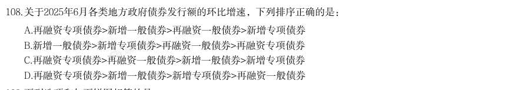

- **A.** 再融资专项债券>新增一般债券>再融资一般债券>新增专项债券
- **B.** 新增一般债券>新增专项债券>再融资一般债券>再融资专项债券
- **C.** 再融资专项债券>再融资一般债券>新增一般债券>新增专项债券
- **D.** 再融资专项债券>新增一般债券>新增专项债券>再融资一般债券

**答案：A**

**解析/参考要点**：A
根据题干“关于2025 年6 月······环比增速,下列排序正确的是”,可
判定本题为一般增长率问题。定位表1 可得2025 年5 月、6 月地方新增一般债
券、新增专项债券、再融资一般债券、再融资专项债券的发行额。根据公式:增
长率
,可得2025 年6 月各类地方政府债券发行额的环比
增速分别如下:
新增一般债券:
;
新增专项债券:
;
再融资一般债券:
;
再融资专项债券:
。
综上,正确排序为再融资专项债券>新增一般债券>再融资一般债券>新增专项债
券。
故正确答案为A。

### 2026 湖北·统一卷　第 109 题　（选错误项）

下列选项和如下饼图相符的是:

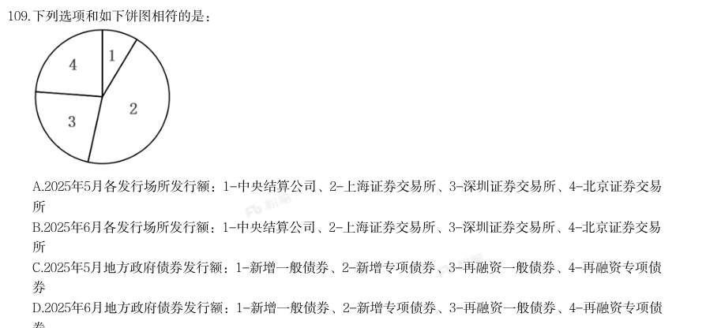

- **A.** 2025年5月各发行场所发行额:1-中央结算公司、2-上海证券交易所、3-深圳证券交易所、4-北京证券交易所
- **B.** 2025年6月各发行场所发行额:1-中央结算公司、2-上海证券交易所、3-深圳证券交易所、4-北京证券交易所
- **C.** 2025年5月地方政府债券发行额:1-新增一般债券、2-新增专项债券、3-再融资一般债券、4-再融资专项债券
- **D.** 2025年6月地方政府债券发行额:1-新增一般债券、2-新增专项债券、3-再融资一般债券、4-再融资专项债

**答案：D**

**解析/参考要点**：D
A 项:定位表1 可知:2025 年5 月地方政府中央结算公司债券发行额3236.39
亿元>上海证券交易所债券发行额2423.68 亿元,与饼状图不符,错误;
B 项:定位表1 可知:2025 年6 月地方政府中央结算公司债券发行额6769.33
亿元>上海证券交易所债券发行额3188.62 亿元,与饼状图不符,错误;
C 项:定位表1 可知:2025 年5 月地方政府再融资一般债券发行额2112.62 亿元,
远大于再融资专项债券发行额763.31 亿元,与饼状图不符,错误;
D 项:定位表1 可知:2025 年6 月地方政府新增一般债券发行额1009.95 亿元、
新增专项债券发行额5270.94 亿元、再融资一般债券发行额2674.63 亿元、再融
资专项债券发行额2797.70 亿元,与饼状图完全符合,正确。
故正确答案为D。

### 2026 湖北·统一卷　第 110 题　（综合分析（综合））

券 能够从上述资料中推出的是:

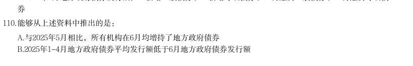

- **A.** 与2025年5月相比,所有机构在6月均增持了地方政府债券
- **B.** 2025年1-4月地方政府债券平均发行额低于6月地方政府债券发行额· 本试卷由粉笔用户上岸张同学66生成
- **C.** 2025年5月与6月上海证券交易所发行额占1-6月总发行额的比重差异超过7个百分点
- **D.** 对比2025年5月与6月的机构投资者持有情况,不存在持有金额上升、占比却下降的机构

**答案：B**

**解析/参考要点**：B

### 2026 湖北·统一卷　第 114 题　（排序与图示判断）

关于2022年底通用航空飞行时长,下列排序正确的是:

- **A.** 其他类>非经营性>载人类
- **B.** 其他类>载客类>非经营性
- **C.** 非经营性>其他类>载人类
- **D.** 载人类>载客类>非经营性

**答案：A**

**解析/参考要点**：A

### 2026 湖北·统一卷　第 120 题　（选错误项）

能够从上述资料中推出的是:

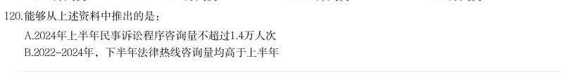

- **A.** 2024年上半年民事诉讼程序咨询量不超过1.4万人次
- **B.** 2022-2024年,下半年法律热线咨询量均高于上半年· 本试卷由粉笔用户上岸张同学66生成
- **C.** 2023-2024年,法律热线咨询量出现同比增长的季度有7个
- **D.** 2025年上半年,前十事项咨询量中劳动合同的占比超过11%

**答案：D**

**解析/参考要点**：D
A 项:定位文字材料可得:2025 年上半年,咨询量最多的事项是民事诉讼程序,
数量为20846 人次,同比增长38.3%。根据公式:基期量
,则所求
人次
万人次,即2024 年上半年民
事诉讼程序咨询量超过1.4 万人次,错误;
B 项:定位统计图可知2022-2024 年各季度法律热线咨询量。因上半年=一季度+
二季度,下半年=三季度+四季度,则2023 年上半年法律热线咨询量
=47010+49483=96493 人次,下半年法律热线咨询量=49429+39991=89420 人次,
即2023 年下半年法律热线咨询量低于上半年,错误;
C 项:定位统计图可知2022-2024 年各季度法律热线咨询量。比较可知,2023
年法律热线咨询量出现同比增长的季度有一季度、二季度、三季度,2024 年出
现同比增长的季度有二季度、三季度、四季度,共6 个,错误;
D 项:定位文字材料可得:2025 年上半年,Q 市12348 公共法律服务热线有效接
听解答咨询量(以下简称法律热线咨询量)为102428 人次。按咨询事项分类统
计,前十事项的咨询量合计占法律热线咨询量的85.85%,第三名劳动合同为
10708 人次。根据公式:比重
,则所求
,即占比超过11%,正确。
故正确答案为D。

### 2026 广东·统一卷　第 84 题　（排序与图示判断）

2024年末,广东省下列运动场地单位面积排序正确的是:

- **A.** 冰雪运动场地>田径场地>游泳场地>健身房
- **B.** 田径场地>冰雪运动场地>健身房>游泳场地
- **C.** 田径场地>游泳场地>健身房>冰雪运动场地
- **D.** 田径场地>冰雪运动场地>游泳场地>健身房

**答案：暂缺（原始文件为扫描版）**

**解析/参考要点**：答案D

### 2026 广东·统一卷　第 85 题　（选错误项）

根据材料,以下说法不正确的是( )。

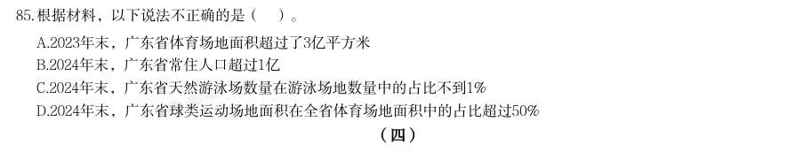

- **A.** 2023年末,广东省体育场地面积超过了3亿平方米
- **B.** 2024年末,广东省常住人口超过1亿
- **C.** 2024年末,广东省天然游泳场数量在游泳场地数量中的占比不到1%
- **D.** 2024年末,广东省球类运动场地面积在全省体育场地面积中的占比超过50%

**答案：暂缺（原始文件为扫描版）**

**解析/参考要点**：答案C

### 2026 广东·统一卷　第 89 题　（排序与图示判断）

与1978年末相比,2023年末我国各类型城镇数量增幅排序正确的是( )。

- **A.** 地级以上城市>县级市>建制镇
- **B.** 建制镇>地级以上城市>县级市
- **C.** 地级以上城市>建制镇>县级市
- **D.** 建制镇>县级市>地级以上城市

**答案：D**

**解析/参考要点**：答案D
根据题干“与1978 年末相比,2023 年末...增幅排序正确的是”,可判定本题为
一般增长率问题。定位文字材料第二段可得:1978 年末,全国共有地级以上城市
101 个,县级市92 个,建制镇2173 个;2023 年末,全国共有地级以上城市297
个,县级市397 个,建制镇21421 个。根据公式;增长率=现期量/基期量,因为
全都需要减1,因此比较大小只需要比较现期量/基期量即可。地级以上城市为
297/101≈2.9:县级市为397/92 约=4.3,建制镇为21421/2173 约=9.9。因此各
类型城镇数量增幅排序为:建制镇>县级市>地级以上城市。故正确答案为D

### 2026 广东·统一卷　第 90 题　（选错误项）

根据资料,以下说法错误的是( )。

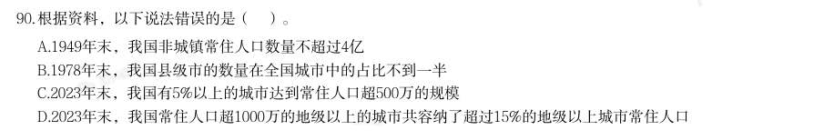

- **A.** 1949年末,我国非城镇常住人口数量不超过4亿
- **B.** 1978年末,我国县级市的数量在全国城市中的占比不到一半
- **C.** 2023年末,我国有5%以上的城市达到常住人口超500万的规模
- **D.** 2023年末,我国常住人口超1000万的地级以上的城市共容纳了超过15%的地级以上城市常住人口

**答案：暂缺（原始文件为扫描版）**

**解析/参考要点**：答案C

### 2026 国考·副省级　第 130 题　（综合分析（综合））

能够从上述资料中推出的是:

- **A.** 2019 年,全国绿证核发量多于2018 年
- **B.** 截至2023 年底,全国累计核发绿证中,可交易绿证的占比不到1%
- **C.** 2024 年,全国常规水电核发绿证不到集中式项目核发绿证总数量的三分之一
- **D.** 2024 年,湖北、湖南核发绿证之和占全国比重比广东、广西之和高1 个百分点以上

**答案：D**

**解析/参考要点**：D

### 2026 国考·地市级　第 114 题　（排序与图示判断）

将2024 年上半年1医用敷料2一次性耗材3保健康复用品4口腔设备与材料进口额同比增 量从高到低排序正确的是:

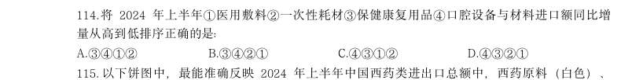

- **A.** 3412
- **B.** 3421
- **C.** 4312
- **D.** 4321

**答案：C**

**解析/参考要点**：C

### 2026 国考·地市级　第 115 题　（排序与图示判断）

以下饼图中,最能准确反映2024 年上半年中国西药类进出口总额中,西药原料(白色)、 西成药(横线)和生化药(黑色)占比关系的是:

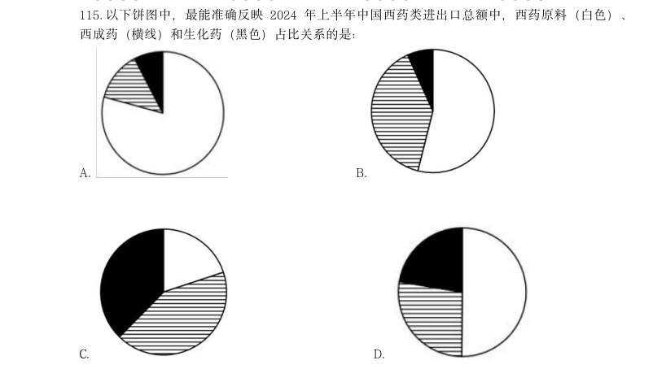

- **A.** 
- **B.** 
- **C.** 
- **D.** 

**答案：D**

**解析/参考要点**：D

### 2026 国考·地市级　第 120 题　（综合分析（综合））

能够从上述资料中推出的是:

- **A.** 2019 年,全国绿证核发量多于2018 年
- **B.** 截至2023 年底,全国累计核发绿证中,可交易绿证的占比不到1%
- **C.** 2024 年,全国常规水电核发绿证不到集中式项目核发绿证总数量的三分之一
- **D.** 2024 年,湖北、湖南核发绿证之和占全国比重比广东、广西之和高1 个百分点以上

**答案：D**

**解析/参考要点**：D

### 2026 国考·行政执法　第 117 题　（判断个数）

将我国企业的发明专利、实用新型专利、外观设计专利按产业化率从高到低排序,则 2020~2023 年中次序与2024 年次序一致的年份有几个?

- **A.** 0
- **B.** 1
- **C.** 2
- **D.** 3

**答案：B**

**解析/参考要点**：B
定位统计表可得2020-2024 年,我国企业的发明专利、实用新型专利、外观设计专利产业化率。将我国企
业的各类专利按产业化率从高到低排序分别为:
2020 年,外观设计专利(51.6%)、发明专利(44.9%)、实用新型专利(42.0%);
2021 年,外观设计专利(52.3%)、发明专利(46.8%)、实用新型专利(46.2%);
2022 年,外观设计专利(58.7%)、发明专利(48.1%)、实用新型专利(44.9%);
2023 年,外观设计专利(66.0%)、实用新型专利(57.1%)、发明专利(51.3%);
2024 年,外观设计专利(63.5%)、实用新型专利(54.9%)、发明专利(53.3%)。
则2020~2023 年中次序与2024 年次序一致的年份是2023 年,共1 个。
故正确答案为B。

### 2026 国考·行政执法　第 120 题　（判断个数）

在12023 年未来产业领域企业发明专利产业化平均收益、22024 年小微企业发明专利产业化 总体平均收益、32023 年金属制品业大型企业发明专利产业化率3 项指标中,能够从上述资料中 推出的有几项?

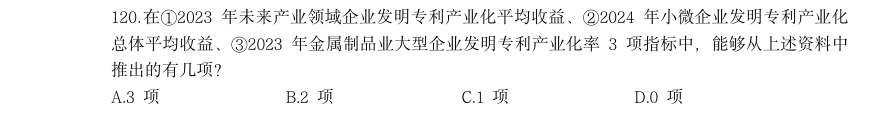

- **A.** 3 项
- **B.** 2 项
- **C.** 1 项
- **D.** 0 项

**答案：D**

**解析/参考要点**：D
1定位文字材料可得:2024 年,我国未来产业领域的企业发明专利产业化平均收益为1132.7 万元/件。并
未给出相较于2023 年的增长率或增长量,故无法推出2023 年未来产业领域企业发明专利产业化平均收益;
2定位文字材料可得:2024 年,小型企业发明专利产业化平均收益为752.4 万元/件,微型企业为260.1 万
元/件。并未给出小型企业和微型企业已产业化的有效专利数量,故无法推出2024 年小微企业发明专利产
业化总体平均收益;
3定位统计表可知2023 年大型企业发明专利产业化率;定位柱状图可知2023 年金属制品业企业发明专利
产业化率。并未给出金属制品业大型企业发明专利产业化率的情况,故无法推出2023 年金属制品业大型
企业发明专利产业化率。
综上,3 项均无法推出。
故正确答案为D。

### 2026 国考·行政执法　第 128 题　（选正确项）

将Y 省2024 年清明假期、“五一”假期和端午假期日均实现旅游收入从高到低排列,以 下正确的是:

- **A.** “五一”、端午、清明
- **B.** 清明、“五一”、端午
- **C.** “五一”、清明、端午
- **D.** 清明、端午、“五一”

**答案：C**

**解析/参考要点**：C

### 2025 湖北·统一卷　第 105 题　（选正确项）

某公园计划从桃树、李树、杨树、柳树、松树中选择几种树种植,树种的选择满足下列条件: (1)如果选桃树,那么不选松树; (2)要么选桃树,要么选李树; (3)至少选3种树种植; (4)桃树和杨树至多选1种; (5)李树和柳树至多选1种。 由此可以推出:

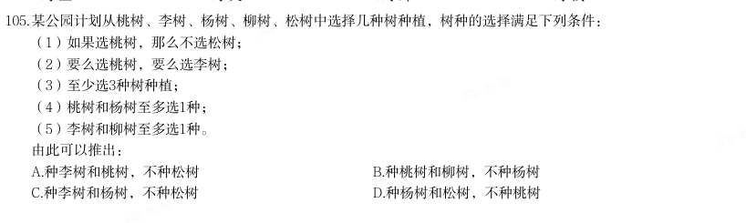

- **A.** 种李树和桃树,不种松树
- **B.** 种桃树和柳树,不种杨树
- **C.** 种李树和杨树,不种松树
- **D.** 种杨树和松树,不种桃树

**答案：暂缺（原始文件为扫描版）**

### 2025 湖北·统一卷　第 110 题　（综合分析（综合））

能够从上述资料中推出的是:

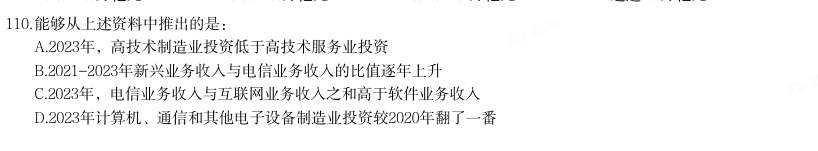

- **A.** 2023年,高技术制造业投资低于高技术服务业投资
- **B.** 2021-2023年新兴业务收入与电信业务收入的比值逐年上升
- **C.** 2023年,电信业务收入与互联网业务收入之和高于软件业务收入
- **D.** 2023年计算机、通信和其他电子设备制造业投资较2020年翻了一番

**答案：暂缺（原始文件为扫描版）**

### 2025 湖北·统一卷　第 115 题　（综合分析（综合））

能够从上述资料中推出的是:

- **A.** 2022年下半年,我国A股市场新上市公司首次募资总金额高于2022年上半年
- **B.** 2022年下半年,我国A股市场新上市公司平均每家首次募资金额约为10.7亿元
- **C.** 2016-2022年期间,我国A股市场新上市公司数量增长率最大的年份出现在2019年
- **D.** 2023年上半年,我国A股市场新上市公司数量与首次募资金额都小于2022年上半年

**答案：暂缺（原始文件为扫描版）**

### 2025 湖北·统一卷　第 118 题　（选正确项）

2023年,造纸及纸板生产企业部分经济指标同比增速按从高到低排列,正确的是( )。

- **A.** 成品存货、利润总额、资产、负债总额
- **B.** 成品存货、利润总额、负债总额、资产
- **C.** 利润总额、负债总额、资产、成品存货
- **D.** 利润总额、资产、负债总额、成品存货

**答案：暂缺（原始文件为扫描版）**

### 2025 湖北·统一卷　第 120 题　（综合分析（综合））

能够从上述资料中推出的是:

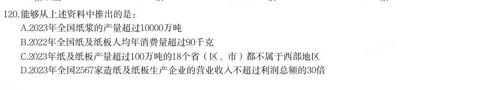

- **A.** 2023年全国纸浆的产量超过10000万吨
- **B.** 2022年全国纸及纸板人均年消费量超过90千克
- **C.** 2023年纸及纸板产量超过100万吨的18个省(区、市)都不属于西部地区
- **D.** 2023年全国2567家造纸及纸板生产企业的营业收入不超过利润总额的30倍

**答案：暂缺（原始文件为扫描版）**

### 2025 广东·统一卷　第 80 题　（选错误项）

根据材料,以下说法不正确的是( )。

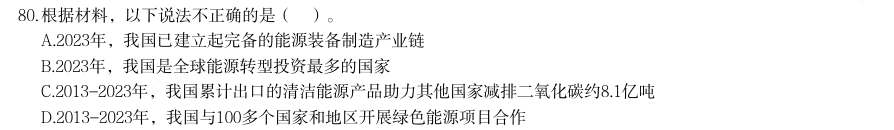

- **A.** 2023年,我国已建立起完备的能源装备制造产业链
- **B.** 2023年,我国是全球能源转型投资最多的国家
- **C.** 2013-2023年,我国累计出口的清洁能源产品助力其他国家减排二氧化碳约8.1亿吨
- **D.** 2013-2023年,我国与100多个国家和地区开展绿色能源项目合作

**答案：暂缺（原始文件为扫描版）**

### 2025 广东·统一卷　第 85 题　（选正确项）

根据资料,以下说法正确的是( )。

- **A.** 2017~2023年,G省国有博物馆数量逐年增加
- **B.** 2017~2023年,G省非国有博物馆数量逐年增加
- **C.** 2019年,G省非国有博物馆首次超过100家
- **D.** 2023年,按G省常住人口1.27亿计算,每40万人拥有1家博物馆

**答案：暂缺（原始文件为扫描版）**

### 2025 广东·统一卷　第 90 题　（选错误项）

根据材料,以下说法不正确的是( )。

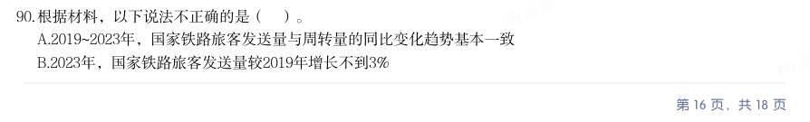

- **A.** 2019~2023年,国家铁路旅客发送量与周转量的同比变化趋势基本一致
- **B.** 2023年,国家铁路旅客发送量较2019年增长不到3%【认准淘宝店铺:通关达人资料库】公考,事业编,遴选,考研,一站式备考,持续更新
- **C.** 2018年~2023年,国家铁路旅客发送量增速高于周转量
- **D.** 2018~2023年,国家铁路旅客年均周转量超过12000亿人公里

**答案：暂缺（原始文件为扫描版）**

### 2025 国考·副省级　第 134 题　（选正确项）

将其他支付系统中1银行行内业务系统、2银联跨行支付系统、3城银清算支付清算系统和4农信银支付清算 系统按2023年三季度平均每笔业务金额同比增速从高到低排列,以下正确的是:

- **A.** 1234
- **B.** 3214
- **C.** 4321
- **D.** 4123

**答案：C**

**解析/参考要点**：根据题干“······2023 年三季度平均每笔业务金额同比增速······”,可判定本题为平均
数的增长率问题。定位文字资料第三段可得:(2023 年三季度)在其他支付系统中,银行行内业务系统
三季度处理业务数量同比增长11.14%(
),金额同比下降4.10%(
);银联跨行支付系统处理业务
数量和金额同比分别增长21.37%(
)和8.70%(
);城银清算支付清算系统处理业务数量和金额同
比分别增长34.61%(
)和36.31%(
);农信银支付清算系统处理业务数量和金额同比分别下降39.98%
(
)和13.55%(
)。根据公式:平均数的增长率
,则2023 年三季度1银行行内业务系
统、2银联跨行支付系统、3城银清算支付清算系统和4农信银支付清算系统平均每笔业务金额同比增
速分别为:
1银行行内业务系统:
;
2银联跨行支付系统:
;
3城银清算支付清算系统:
;
4农信银支付清算系统:
。
综上可知,同比增速从高到低排列为:4321。
故正确答案为C。

### 2025 国考·地市级　第 125 题　（选错误项）

关于资料中城市2023年12月电影票房状况,能够从上述资料中推出的是:

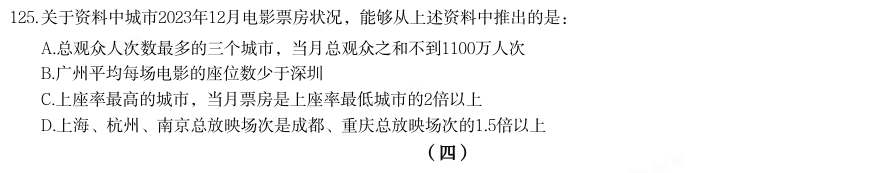

- **A.** 总观众人次数最多的三个城市,当月总观众之和不到1100万人次
- **B.** 广州平均每场电影的座位数少于深圳
- **C.** 上座率最高的城市,当月票房是上座率最低城市的2倍以上
- **D.** 上海、杭州、南京总放映场次是成都、重庆总放映场次的1.5倍以上

**答案：C**

**解析/参考要点**：A 项:定位图2 可得2023 年12 月全国电影票房前10 城市总观众人次。最多的三个城市分别为北京
(410.74
万人次)、上海(398.05
万人次)、成都(308.76
万人次),
410.74+398.05+308.76>410+398+308=1116 万人次>1100 万人次,错误;
B 项:定位图1 可得:2023 年12 月广州、深圳总放映场次分别为21.67 万场、21.53 万场;定位图2 可
得:2023 年12 月广州观众人次数和上座率分别为294.00 万人次、8.07%;深圳观众人次数和上座率分
别为287.82 万人次、8.72% 。根据公式:上座率
,可得座位数
,故
年
月广州平均每场电影的座位数
,深圳平均每场电影的座位数
,根据分数比较原则:分子大、分母小,分数值
大,则2023 年12 月广州平均每场电影的座位数多于深圳,错误;
C 项:定位图1 可得2023 年12 月全国电影票房前10 城市票房;定位图2 可得2023 年12 月全国电影票
房前10 城市上座率。资料中城市2023 年12 月上座率最高的城市是北京(10.75%),其票房为19324 万
元;上座率最低的城市是重庆(6.35%),其票房为8451 万元。
倍,正确;
D 项:定位图1 可得:2023 年12 月上海、杭州、南京、成都、重庆总放映场次分别为28.40 万场、15.76
万场、12.46 万场、24.55 万场、21.41 万场。
倍
倍,错误。
故正确答案为C。

### 2025 国考·地市级　第 130 题　（选正确项）

关于我国外贸进出口状况,能够从上述资料中推出的是:

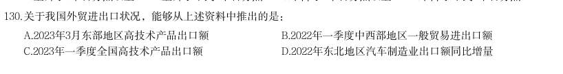

- **A.** 2023年3月东部地区高技术产品出口额
- **B.** 2022年一季度中西部地区一般贸易进出口额
- **C.** 2023年一季度全国高技术产品出口额
- **D.** 2022年东北地区汽车制造业出口额同比增量

**答案：B**

**解析/参考要点**：A 项:定位文字材料第二段可得:(2023 年)一季度,东部地区出口高技术产品7741.7 亿元,3 月增速
为21%。但是材料缺少2023 年1-2 月份东部地区高技术产品出口额的相关数据,故2023 年3 月东部地
区高技术产品出口额无法推出;
B 项:定位文字材料第一段可得:2023 年一季度,中西部地区进出口1.84 万亿元,同比增长12.6%;定
位文字材料第三段可得:
(2023 年)一季度,中西部地区一般贸易进出口占中西部地区进出口总额的56.6%,
同比提升4.9 个百分点。根据公式:基期量
,可得2022 年一季度中西部地区进出口总额
,2022 年一季度,中西部地区一般贸易进出口占中西部地区进出口总额的比重为
(56.6%-4.9% ),则
年一季度中西部地区一般贸易进出口额
,可以推出;
C 项:材料没有涉及全国高技术产品出口额的相关数据,故无法推出;
D 项:定位文字材料第四段可得:(2023 年)一季度,东北地区汽车制造业出口同比增长62.3%,但是材
料缺少2022 年东北地区汽车制造业出口额的相关数据,故2022 年东北地区汽车制造业出口额同比增量
无法推出。
故正确答案为B。

### 2024 湖北·统一卷　第 110 题　（综合分析（综合））

能够从上述资料推出的是:

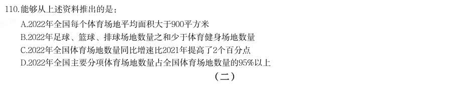

- **A.** 2022年全国每个体育场地平均面积大于900平方米
- **B.** 2022年足球、篮球、排球场地数量之和少于体育健身场地数量
- **C.** 2022年全国体育场地数量同比增速比2021年提高了2个百分点
- **D.** 2022年全国主要分项体育场地数量占全国体育场地数量的95%以上

**答案：D**

### 2024 湖北·统一卷　第 113 题　（选错误项）

2021年,下列国家全球创新指数大小比较,错误的是:

- **A.** 瑞士>瑞典>美国
- **B.** 英国>韩国>荷兰
- **C.** 芬兰>新加坡>丹麦
- **D.** 俄罗斯>巴西>印度

**答案：D**

### 2024 湖北·统一卷　第 115 题　（综合分析（综合））

能够从上述资料推出的是:

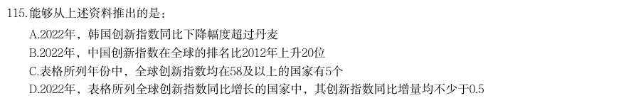

- **A.** 2022年,韩国创新指数同比下降幅度超过丹麦
- **B.** 2022年,中国创新指数在全球的排名比2012年上升20位
- **C.** 表格所列年份中,全球创新指数均在58及以上的国家有5个
- **D.** 2022年,表格所列全球创新指数同比增长的国家中,其创新指数同比增量均不少于0.5

**答案：A**
