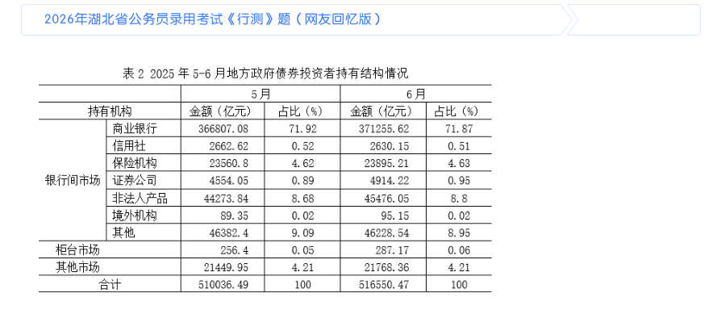
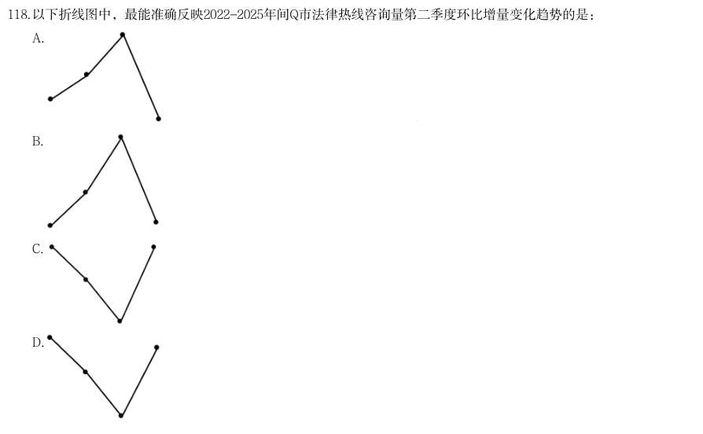
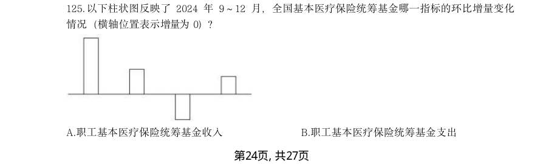
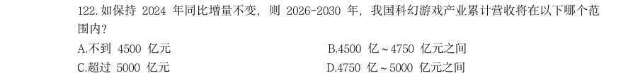
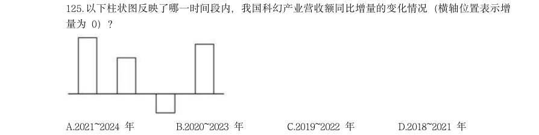
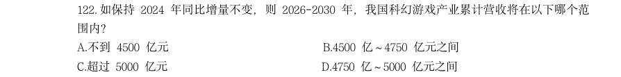
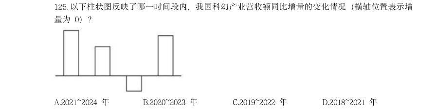
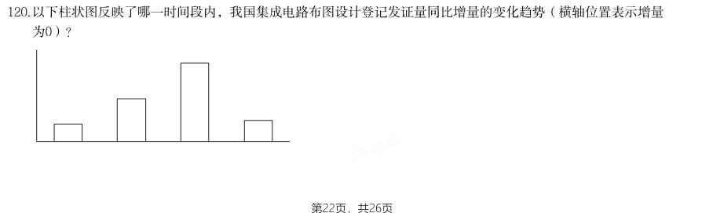

# 资料分析 · 增长量计算

> 考点编码：`ZL-GROW`　｜　体系对齐：花生十三 `ziliao-fenxi.md#题型2`

## 一、命题规律

- **本题型真题总量**：74 题（2000–2026）
- **地区分布**：国考 47 / 广东 14 / 湖北 13
- **近六年题量**：2026年10题, 2025年4题, 2024年4题, 2023年4题, 2022年3题, 2021年2题
- **覆盖试卷**：45 套
- **子考点分布**：增长量计算（综合） 37　增长量计算（415 份数法） 33　增长量比较 16
- **同题变体**：另有 12 道为同题重复（同年多卷/跨年再考），已折叠，需展开见 scripts/search.py --all-variants
- **速算/速解提示**：见花生十三 `references/ziliao-susuan.md` 与 `references/shuliang-gongshi.md` 对应章节

## 二、近年真题（最多 12 题，按年份倒序）

### 2026 湖北·统一卷　第 106 题　（增长量计算（415 份数法））

分析、比较、计算和判断处理。 (一) · 本试卷由粉笔用户上岸张同学66生成 2025年6月,地方政府债券投资者总持有额的环比增量约为:

- **A.** 5514亿元
- **B.** 6124亿元
- **C.** 6514亿元
- **D.** 7124亿元

**答案：C**

**解析/参考要点**：C
根据题干“2025 年6 月······的环比增量约为”,可判定本题为增长量
计算问题。定位表2 可得:2025 年5 月和6 月地方政府债券投资者总持有额分
别为510036.49 亿元、516550.47 亿元。根据公式:增长量=现期量-基期量,则
2025 年6 月地方政府债券投资者总持有额的环比增量
=516550.47-510036.49
516550-510036=6514 亿元。
故正确答案为C。

### 2026 湖北·统一卷　第 112 题　（增长量计算（综合））

2024年,全国在册通用机场数量比2023年约增加了:

> 材料图见 images/HB-2026-ty-X111-m.jpg

- **A.** 2%
- **B.** 4%
- **C.** 6%
- **D.** 8%

**答案：C**

**解析/参考要点**：C
根据题干“2024 年······比2023 年约增加了”,结合选项为百分数,可
判定本题为一般增长率计算问题。定位文字材料第一段可知:截至2024 年底,
全国在册通用机场达475 个,较2023 年增加26 个。根据公式:增长率
,则所求增长率
,与C 项
最接近。
故正确答案为C。

### 2026 湖北·统一卷　第 118 题　（增长量计算（415 份数法））

以下折线图中,最能准确反映2022-2025年间Q市法律热线咨询量第二季度环比增量变化趋势的是:

> 材料图见 images/HB-2026-ty-X116-m.jpg

- **A.** 
- **B.** 
- **C.** 
- **D.** 

**答案：A**

**解析/参考要点**：A
根据题干“······第二季度环比增量变化趋势的是”,可判定本题为增长
量比较问题。定位统计图可知:2022 年第一季度、第二季度Q 市法律热线咨询
量分别为34658 人次、34027 人次;2023 年第一季度、第二季度Q 市法律热线咨
询量分别为47010 人次、49483 人次;2024 年第一季度、第二季度Q 市法律热线
咨询量分别为42504 人次、50085 人次;2025 年第一季度Q 市法律热线咨询量为
52802 人次。定位文字材料可得:2025 年上半年,Q 市法律热线咨询量为102428
人次。则2025 年第二季度Q 市法律热线咨询量为102428-52802=49626 人次。
(说
明:2025 年第二季度Q 市法律热线咨询量本材料第一小题已计算过,本题求解
时可直接用)。根据公式:增长量=现期量-基期量,可得2022-2025 年Q 市法律
热线咨询量第二季度环比增量分别为:
2022 年第二季度,
人次;
2023 年第二季度,
人次;
2024 年第二季度,
人次;
2025 年第二季度,
人次。
综上可知,环比增量呈先上升后下降趋势,且2022 年第二季度环比增量(-600
人次)>2025 年第二季度环比增量(-3000 人次),与A 项变化趋势一致。
故正确答案为A。
速算提示:
观察数据可知,2022 年、2025 年第二季度环比增量均为负,2023 年、2024 年第
二季度环比增量均为正,即折线图第一个点和第四个点应处于较低的两个位置,
排除C、D 两项;2022 年第二季度,
人次,2025 年
第二季度,
人次,则第四个点

### 2026 国考·副省级　第 125 题　（增长量计算（415 份数法））

以下柱状图反映了2024 年9~12 月,全国基本医疗保险统筹基金哪一指标的环比增量变化 情况(横轴位置表示增量为0)?

> 材料图见 images/GK-2026-fs-X121-m.jpg

- **A.** 职工基本医疗保险统筹基金收入
- **B.** 职工基本医疗保险统筹基金支出
- **C.** 城乡居民基本医疗保险统筹基金收入
- **D.** 城乡居民基本医疗保险统筹基金支出

**答案：C**

**解析/参考要点**：C
根据题干“......环比增量变化情况......”,可判定本题为增长量比较问题。定位统计图可得2024 年8-12 月全
国基本医疗保险统筹基金的收支情况。根据公式:增长量=现期量-基期量,可得选项中各指标环比增量如下:
A 项,职工基本医疗保险统筹基金收入2024 年9 月环比增量=1479-1424=55 亿元,10 月环比增量=1503-1479=24
亿元,11 月环比增量=1430-1503=-73 亿元,由于|11 月环比增量|>|9 月环比增量|,而柱状图(横轴位置代表
增量为0)中第三个月柱体长度<第一个月柱体长度,不符合柱状图变化趋势,排除;
B项,职工基本医疗保险统筹基金支出2024 年9 月环比增量=1054-1082<0,而柱状图中第一个月的环比增量>0,
不符合柱状图变化趋势,排除;
C 项,城乡居民基本医疗保险统筹基金收入2024 年9 月环比增量=1094-415=679 亿元,10 月环比增量
=1395-1094=301 亿元,11 月环比增量=1089-1395=-306 亿元,12 月环比增量=1305-1089=216 亿元,符合柱
状图变化趋势,当选;
D 项,城乡居民基本医疗保险统筹基金支出2024 年9 月环比增量=810-804=6 亿元,10 月环比增量
=560-810=-250 亿元,而柱状图中第二个月的环比增量>0,不符合柱状图变化趋势,排除。
故正确答案为C。

### 2026 国考·地市级　第 122 题　（增长量计算（综合））

如保持2024 年同比增量不变,则2026-2030 年,我国科幻游戏产业累计营收将在以下哪个范 围内? 元 B.4500 亿~4750 亿元之间 D.4750 亿~5000 亿元之间

> 材料图见 images/GK-2026-ds-X116-m.jpg

> （本题为图形题，选项为图片，见原卷）

**答案：D**

**解析/参考要点**：D

### 2026 国考·地市级　第 125 题　（增长量计算（415 份数法））

以下柱状图反映了哪一时间段内,我国科幻产业营收额同比增量的变化情况(横轴位置表示增 量为0)? (四

> 材料图见 images/GK-2026-ds-X116-m.jpg

- **A.** 2021~2024 年
- **B.** 2020~2023 年
- **C.** 2019~2022 年
- **D.** 2018~2021 年

**答案：D**

**解析/参考要点**：D
根据题干“......我国科幻产业营收额同比增量的变化情况......”,可判定本题为增长量比较问题。定位图
1 可知2017~2024 年我国科幻产业各年度营收额,根据公式:增长量=现期量-基期量,则选项中各年份增
长量分别为:
A 项:2021 年,829.6-551.1=278.5 亿元;2022 年,877.5-829.6=47.9 亿元;2023 年,1132.9-877.5=255.4
亿元,题干图中第三年增长量为负,排除。
B 项:2020 年,551.1-658.7=-107.6 亿元,题干图中第一年增长量为正,排除。
C 项:2019 年,658.6-456.4=202.2 亿元;2020 年,551.1-658.7=-107.6 亿元,题干图中第二年增长量为正,
排除。
D 项:2018 年,456.4-140.0=316.4 亿元;2019 年,658.6-456.4=202.2 亿元;2020 年,551.1-658.7=-107.6
亿元;2021 年,829.6-551.1=278.5 亿元,符合题干图形的变化情况,当选。
故正确答案为D。

### 2026 国考·行政执法　第 119 题　（增长量计算（415 份数法））

资料所列13 个行业中,2024 年企业发明专利产业化率同比增量超过3 个百分点的有几个?

- **A.** 5
- **B.** 6
- **C.** 7
- **D.** 8

**答案：C**

**解析/参考要点**：C
根据题干“2024 年······同比增量超过······有几个”,可判定本题为增长量计算问题。
定位统计图可知2023 年及2024 年我国不同行业企业发明专利产业化率。根据公式:增长量=现期量-基期
量,本题所求企业发明专利产业化率的增长量,2024 年企业发明专利产业化率相当于现期量,2023 年企
业发明专利产业化率相当于基期量,故2024 年各行业企业发明专利产业化率的同比增量如下:
研究和试验发展:32.5%-31.9%=0.6 个百分点,不符合;
专业技术服务业:34.2%-29.6%=4.6 个百分点,符合;
医药制造业:46.8%-43.0%=3.8 个百分点,符合;
计算机、通信和其他电子设备制造业:50.8%<52.2%,即同比减少,不符合;
软件和信息技术服务业:54.9%<55.3%,即同比减少,不符合;
汽车制造业:62.2%<63.3%,即同比减少,不符合;
非金属矿物制造业:63.7%-57.8%=5.9 个百分点,符合;
橡胶和塑料制品业:63.8%-62.5%=1.3 个百分点,不符合;
化学原料和化学制品制造业:64.4%-57.4%=7.0 个百分点,符合;
金属制品业:64.9%-58.1%=6.8 个百分点,符合;
通用设备制造业:67.5%-61.6%=5.9 个百分点,符合;
专用设备制造业:68.9%-66.9%=2.0 个百分点,不符合;
电气机械和器材制造业:71.2%-63.8%=7.4 个百分点,符合。
综上,资料所列13 个行业中,2024 年企业发明专利产业化率同比增量超过3 个百分点的有7 个。
故正确答案为C

### 2026 国考·行政执法　第 122 题　（增长量计算（综合））

如保持2024 年同比增量不变,则2026-2030 年,我国科幻游戏产业累计营收将在以下哪个范 围内?

> 材料图见 images/GK-2026-zf-X121-m.jpg

- **A.** 不到4500 亿元
- **B.** 4500 亿~4750 亿元之间
- **C.** 超过5000 亿元
- **D.** 4750 亿~5000 亿元之间

**答案：D**

**解析/参考要点**：D

### 2026 国考·行政执法　第 125 题　（增长量计算（415 份数法））

以下柱状图反映了哪一时间段内,我国科幻产业营收额同比增量的变化情况(横轴位置表示增 量为0)?

> 材料图见 images/GK-2026-zf-X121-m.jpg

- **A.** 2021~2024 年
- **B.** 2020~2023 年
- **C.** 2019~2022 年
- **D.** 2018~2021 年

**答案：D**

**解析/参考要点**：D
根据题干“······我国科幻产业营收额同比增量的变化情况······”,可判定本题为增长量
比较问题。定位图1 可知2017~2024 年我国科幻产业各年度营收额,根据公式:增长量=现期量-基期量,
则选项中各年份增长量分别为:
A 项:2021 年,829.6-551.1=278.5 亿元;2022 年,877.5-829.6=47.9 亿元;2023 年,1132.9-877.5=255.4
亿元,题干图中第三年增长量为负,排除。
B 项:2020 年,551.1-658.7=-107.6 亿元,题干图中第一年增长量为正,排除。
C 项:2019 年,658.6-456.4=202.2 亿元;2020 年,551.1-658.7=-107.6 亿元,题干图中第二年增长量为正,
排除。
D 项:2018 年,456.4-140.0=316.4 亿元;2019 年,658.6-456.4=202.2 亿元;2020 年,551.1-658.7=-107.6
亿元;2021 年,829.6-551.1=278.5 亿元,符合题干图形的变化情况,当选。
故正确答案为D。

### 2026 国考·行政执法　第 126 题　（增长量计算（综合））
> 材料：2025 年清明假期3 天,Y 省接待游客2110.5 万人次,同比增长6.4%;实现旅游收入 107.8 亿元,同比增长8.7%。全省4A 级及以上景区接待游客657.5 万人次,同比增长7.4%; 纳入监测的13 家红色旅游经典景区接待游客54.7 万人次,同比增长5.1%。 2025 年“五一”假期5 天,Y 省接待游客4608.2 万人次,同比增长18.7%;实现旅游收 入295 亿元,同比增长20.3%。全省4A 级及以上景区接待游客1629.9 万人次,同比增长 14.3%;纳入监测的13 家红色旅游经典景区接待游客119.5 万人次,同比增长12.0%。 2025 年端午假期3 …

2025 年清明假期、“五一”假期和端午假期,Y 省接待游客总人次数比上年增长了:

> 材料图见 images/GK-2026-zf-X121-m.jpg

- **A.** 超过1400 万人次
- **B.** 1100 万~1400 万人次之间
- **C.** 800 万~1100 万人次之间
- **D.** 不到800 万人次

**答案：B**

**解析/参考要点**：B

### 2025 国考·副省级　第 120 题　（增长量计算（415 份数法））

以下柱状图反映了哪一时间段内,我国集成电路布图设计登记发证量同比增量的变化趋势(横轴位置表示增量 为0)?

> 材料图见 images/GK-2025-fs-X116-m.jpg

- **A.** 2017-2020年
- **B.** 2016-2019年
- **C.** 2019-2022年
- **D.** 2018-2021年

**答案：D**

**解析/参考要点**：根据题干“······同比增量的变化趋势”,可判定本题为增长量比较问题。定位统计图可得2015-
2022 年我国集成电路布图设计登记发证量。根据公式:增长量=现期量-基期量,则2016-2022 年我国集
成电路布图设计登记发证量同比增量分别为:
2016 年,
;
2017 年,
;
2018 年,
;
2019 年,
;
2020 年,
;
2021 年,
;
2022 年,9106-13087<0。
观察可知,柱状图呈现先上升再下降的趋势,且第三个柱子最高,与2018-2021 年同比增量的变化趋势
一致。
故正确答案为D。

### 2025 国考·副省级　第 128 题　（增长量计算（415 份数法））

若保持第15届CMC参赛人数环比增量不变,问哪一届CMC参赛人数将第一次超过50万人?

> 材料图见 images/GK-2025-fs-X126-m.jpg

- **A.** 第19届
- **B.** 第20届
- **C.** 第21届
- **D.** 第22届

**答案：A**

**解析/参考要点**：根据题干“若保持······环比增量不变,······将第一次超过50 万人”,可判定本题为现
期计算问题。定位图1 可得:第14 届CMC 参赛人数为23.18 万人,第15 届CMC 参赛人数为28.84 万人。
根据公式:增长量=现期量-基期量,则第15 届CMC 参赛人数环比增量=28.84-23.18=5.66 万人。根据公
式:现期量=基期量+增长量×n,可得28.84+5.66×n>50,解得n>3.7,则n 至少取到4,故第15+4=19
届CMC 参赛人数将第一次超过50 万人。
故正确答案为A。

## 三、其余真题（按年代分片）

| 年代 | 题量 | 分片文件 |
|---|---:|---|
| 2000s | 8 | [ZL-GROW-2000s.md](split/ZL-GROW-2000s.md) |
| 2010s | 31 | [ZL-GROW-2010s.md](split/ZL-GROW-2010s.md) |
| 2020s | 23 | [ZL-GROW-2020s.md](split/ZL-GROW-2020s.md) |

> 也可用 `python scripts/search.py --kaodian ZL-GROW` 直接检索全部 74 题。