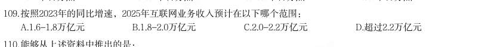
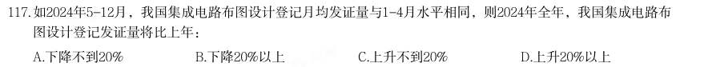
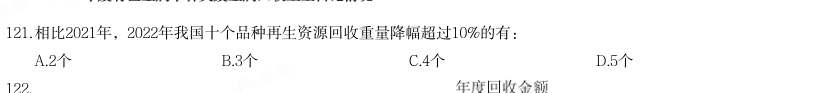
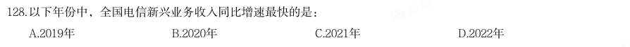

# 资料分析 · 增长率计算与比较

> 考点编码：`ZL-RATE`　｜　体系对齐：花生十三 `ziliao-fenxi.md#题型3`

## 一、命题规律

- **本题型真题总量**：210 题（2000–2026）
- **地区分布**：国考 71 / 广东 72 / 湖北 67
- **近六年题量**：2026年6题, 2025年13题, 2024年11题, 2023年7题, 2022年9题, 2021年6题
- **覆盖试卷**：78 套
- **子考点分布**：增长率计算 88　增长率比较 72　增长率计算（综合） 61　降幅与增速 9
- **同题变体**：另有 20 道为同题重复（同年多卷/跨年再考），已折叠，需展开见 scripts/search.py --all-variants
- **速算/速解提示**：见花生十三 `references/ziliao-susuan.md` 与 `references/shuliang-gongshi.md` 对应章节

## 二、真题与答案（按年份倒序，最多 30 题）

### 2026 湖北·统一卷　第 117 题　（增长率计算（综合））

2025年第一季度Q市法律热线咨询量环比增长速度约为:

- **A.** 24.23%
- **B.** 19.50%
- **C.** -19.68%
- **D.** -16.44%

**答案：D**

**解析/参考要点**：D

### 2026 国考·副省级　第 117 题　（增长率计算）

2025 年1-2 月,上海期货交易所成交额同比增速在以下哪个范围内?

- **A.** 不到45%
- **B.** 超过85%
- **C.** 45%-65%之间
- **D.** 65%-85%之间

**答案：D**

**解析/参考要点**：D

### 2026 国考·副省级　第 132 题　（增长率计算）

2024 年,我国对最不发达国家进出口总值同比增速约为:

- **A.** 9.5%
- **B.** 8.5%
- **C.** 7.5%
- **D.** 10.5%

**答案：C**

**解析/参考要点**：C

### 2026 国考·地市级　第 113 题　（增长率计算（综合））

表中所列医药保健品12 个小类中,2024 年上半年进出口总额同比上升的有几类?

- **A.** 7
- **B.** 6
- **C.** 5
- **D.** 4

**答案：A**

**解析/参考要点**：A

### 2026 国考·地市级　第 123 题　（增长率计算）

我国科幻产业五大领域中,2024 年营收额同比增速快于2023 年水平的有几个?

- **A.** 4
- **B.** 3
- **C.** 2
- **D.** 1

**答案：C**

**解析/参考要点**：C

### 2026 国考·行政执法　第 111 题　（增长率计算（综合））

(一) 2024 年上半年,中国医药保健品进出口贸易顺差(出口额-进口额)比上年同期:

- **A.** 下降了20%以上
- **B.** 下降了不到20%
- **C.** 上升了20%以上
- **D.** 上升了不到20%

**答案：C**

**解析/参考要点**：C

### 2025 湖北·统一卷　第 107 题　（增长率比较）

2019-2023年,互联网业务收入同比增速高于电子信息制造业增加值同比增速的年份有:

- **A.** 1个
- **B.** 2个
- **C.** 3个
- **D.** 4个

**答案：暂缺（原始文件为扫描版）**

### 2025 湖北·统一卷　第 108 题　（增长率计算（综合））

2023年,新兴业务收入与电信业务收入的比值,较2019年上升了约:

- **A.** 11个百分点
- **B.** 10.7个百分点
- **C.** 10.3个百分点
- **D.** 9.8个百分点

**答案：暂缺（原始文件为扫描版）**

### 2025 湖北·统一卷　第 109 题　（增长率计算）

按照2023年的同比增速,2025年互联网业务收入预计在以下哪个范围:

- **A.** 1.6-1.8万亿元
- **B.** 1.8-2.0万亿元
- **C.** 2.0-2.2万亿元
- **D.** 超过2.2万亿元

**答案：暂缺（原始文件为扫描版）**

### 2025 湖北·统一卷　第 112 题　（增长率计算（综合））

2016-2022年期间,我国A股市场新上市公司的首次募资金额同比增长超过15%的年份有:

- **A.** 3个
- **B.** 4个
- **C.** 5个
- **D.** 6个

**答案：暂缺（原始文件为扫描版）**

### 2025 湖北·统一卷　第 117 题　（增长率计算）

2022年全国纸及纸板消费量同比增速与产量同比增速相比约:

- **A.** 低4.58个百分点
- **B.** 低0.5个百分点
- **C.** 高5.37个百分点
- **D.** 高1.79个百分点

**答案：暂缺（原始文件为扫描版）**

### 2025 湖北·统一卷　第 124 题　（增长率计算）

以下折线图中,最能准确反映2023年各省、自治区、直辖市版权局和中国版权保护中心作品著作权登记量前五 位的同比增长率情况的是(按登记量从大到小排列):

- **A.** 
- **B.** 
- **C.** 
- **D.** 

**答案：暂缺（原始文件为扫描版）**

### 2025 广东·统一卷　第 72 题　（增长率计算（综合））

2023年,G省社会消费品零售额同比增长( )。

- **A.** 不到5%
- **B.** 在5%到10%之间
- **C.** 在10%到15%之间
- **D.** 超过15%

**答案：暂缺（原始文件为扫描版）**

### 2025 广东·统一卷　第 74 题　（增长率计算）

2023年,G省下列指标的社会消费品零售额同比增长率最高的是( )。

- **A.** 城镇
- **B.** 乡村
- **C.** 商品零售
- **D.** 餐饮收入

**答案：暂缺（原始文件为扫描版）**

### 2025 广东·统一卷　第 81 题　（增长率计算（综合））

2023年,G省博物馆数量同比增长约( )。

- **A.** 2.1%
- **B.** 4.2%
- **C.** 6.3%
- **D.** 8.4%

**答案：暂缺（原始文件为扫描版）**

### 2025 广东·统一卷　第 84 题　（增长率计算（综合））

2017~2023年间,G省国有博物馆同比增加数量最多的是( )。

- **A.** 2017年
- **B.** 2018年
- **C.** 2019年
- **D.** 2020年

**答案：暂缺（原始文件为扫描版）**

### 2025 广东·统一卷　第 86 题　（增长率计算（综合））

【认准淘宝店铺:通关达人资料库】公考,事业编,遴选,考研,一站式备考,持续更新 2023年,国家铁路旅客发送量同比增长约( )。

- **A.** 30%
- **B.** 55%
- **C.** 130%
- **D.** 155%

**答案：暂缺（原始文件为扫描版）**

### 2025 国考·副省级　第 117 题　（增长率计算）

如2024年5-12月,我国集成电路布图设计登记月均发证量与1-4月水平相同,则2024年全年,我国集成电路布 图设计登记发证量将比上年:

- **A.** 下降不到20%
- **B.** 下降20%以上
- **C.** 上升不到20%
- **D.** 上升20%以上

**答案：C**

**解析/参考要点**：根据题干“······我国集成电路布图设计登记发证量将比上年”,结合选项为百分数,可判定本
题为一般增长率问题。定位文字材料可知:2024 年1-4 月,我国集成电路布图设计登记申请3503 件,
发证4189 件。定位统计图可知:2023 年我国集成电路布图设计登记发证11316 件。则2024 年1-4 月我
国集成电路布图设计登记月均发证量
件,2024 年全年我国集成电路布图设计登记发
证量=4189+1047×(12-4)=12565 件。根据公式:增长率
,可得2024 年全年
我国集成电路布图设计登记发证量比上年增长
,即上升不到
20%。
故正确答案为C。

### 2025 国考·副省级　第 118 题　（增长率计算）

2019-2021年,我国集成电路布图设计登记申请量三年的同比增速:

- **A.** 先升后降
- **B.** 先降后升
- **C.** 逐年上升
- **D.** 逐年下降

**答案：D**

**解析/参考要点**：根据题干“2019-2021······三年的同比增速”,可判定本题为一般增长率问题。定位统计图可得:
2018-2021 年我国集成电路布图设计登记申请量分别为4431 件、8319 件、14375 件、20353 件。根据公
式:增长率
,则2019-2021 年我国集成电路布图设计登记申请量同比增速分别
为:
2025 国考《行测》(副省级)解析
40 / 46
2019 年,
;
2020 年,
;
2021 年,
。
综上所述,2019-2021 年,我国集成电路布图设计登记申请量同比增速逐年下降。
故正确答案为D。

### 2024 湖北·统一卷　第 114 题　（增长率计算（综合））

2022年,中国、巴西、俄罗斯、印度、南非五国创新指数之和同比:

- **A.** 增长约3.2%
- **B.** 增长约4.8%
- **C.** 下降约3.2%
- **D.** 下降约4.8%

**答案：C**

### 2024 湖北·统一卷　第 116 题　（增长率计算（综合））
> 材料：(三) 2022年,全国共有260家银行机构和29家理财公司累计新发理财产品2.94万只,同比下降38.23%,降幅比上 年同期扩大7.22个百分点;累计募集资金89.62万亿元,同比减少32.57万亿元。 截至2022年底,全国共有278家银行机构和29家理财公司有存续的理财产品,共存续产品3.47万只,同比下 降4.41%;存续规模27.65万亿元,同比下降4.66%。分机构类型来看,理财公司存续产品13947只,存续规模 22.24万亿元,同比增长29.36%。银行机构中,城商行存续产品9064只,存续规模2.45万亿元,同比下降 32.34%;农村金融机构存续产品7808只,存续规模1…

2022年全国银行机构和理财公司累计新发理财产品只数与2020年相比约:

- **A.** 下降45%
- **B.** 下降57%
- **C.** 下降66%
- **D.** 下降69%

**答案：B**

### 2024 湖北·统一卷　第 121 题　（降幅与增速）

2022年我国报废机动车回收数量399.1万辆,同比增长32.9%,回收数量占我国机动车保有量的 。 相比2021年,2022年我国十个品种再生资源回收重量降幅超过10%的有:

- **A.** 2个
- **B.** 3个
- **C.** 4个
- **D.** 5个

**答案：B**

### 2024 广东·统一卷　第 71 题　（增长率计算（综合））
> 材料：所给出的图、表、文字或综合性资料均有若干个问题要你回答。你应根据 资料提供的信息进行分析、比较、计算和判断处理。 (一) 党的二十大报告强调,教育、科技、人才是全面建设社会主义现代化国家的基础性、战略性支撑。近年 来,广东紧紧围绕制造业当家、聚焦高质量发展,大力实施制造业当家技能人才支撑工程,加快建设一支规模 宏大的知识型、技能型、创新型技能人才队伍。2023年,全省技能人才总量达1934万人,其中高技能人才657 万人。 为推动广东技工与广东制造共同成长,近年来,广东紧紧围绕壮大20个战略性产业集群,紧密对接产业升 级和技术变革趋势,开展新产业工人职业技能提升工程,培育掌握新技术的产业新工匠…

2023年广东高技能人才是全省技能人才总量的( )。

- **A.** 12%
- **B.** 23%
- **C.** 34%
- **D.** 45%

**答案：B**

### 2024 广东·统一卷　第 78 题　（增长率计算（综合））

2022年,中国国民经济的18个行业大类中有( )个行业的对外直接投资流量同比有所增加。

- **A.** 4
- **B.** 5
- **C.** 6
- **D.** 7

**答案：A**

### 2024 广东·统一卷　第 81 题　（增长率计算（综合））
> 材料：(三) 自2022年1月1日《中华人民共和国法律援助法》施行以来,我国法律援助覆盖面不断扩大、服务水平显著 提升。据统计,2022年全国法律援助机构共组织办理法律援助案件137万余件,值班律师提供法律帮助95万余 件,为1980万余人次提供法律咨询,提供法律咨询人次同比增加约5%。…

2022年,G省法律援助案件数量约占全国的( )。

- **A.** 9.2%
- **B.** 14.3%
- **C.** 19.4%
- **D.** 24.5%

**答案：C**

### 2024 广东·统一卷　第 84 题　（增长率计算）

下列选项最有可能准确反映了2018-2022年间G省法律援助机构办理的相关案件的同比增长率的是( )。

- **A.** 
- **B.** 
- **C.** 
- **D.** 

**答案：D**

### 2024 广东·统一卷　第 86 题　（增长率计算（综合））
> 材料：(四) 2021年,各地区各部门全面落实党中央、国务院关于实现数字乡村发展战略的决策部署,积极引入社会资 本投资建数字乡村。…

2019-2021年,全国县域农业农村信息化建设县均社会资本投入的年均增率约为( )。

- **A.** 10%
- **B.** 21%
- **C.** 32%
- **D.** 43%

**答案：暂缺（原始文件为扫描版）**

### 2024 广东·统一卷　第 89 题　（增长率比较）

2021年,关于县域农业农村信息化建设,下列数据同比增长率最大的是( )。

- **A.** 东部地区县均社会资本投入
- **B.** 东部地区乡村人均社会资本投入
- **C.** 西部地区县均社会资本投入
- **D.** 西部地区乡村人均社会资本投入

**答案：暂缺（原始文件为扫描版）**

### 2024 国考·地市级　第 128 题　（增长率比较）

以下年份中,全国电信新兴业务收入同比增速最快的是:

- **A.** 2019年
- **B.** 2020年
- **C.** 2021年
- **D.** 2022年

**答案：C**

**解析/参考要点**：根据题干“以下年份中······同比增速最快的是”,可判定本题为一般增长率比较问题。定位图
2024 国考《行测》(地市级)解析
46 / 47
1 可得:2018~2022 年全国电信新兴业务收入分别为1084 亿元、1374 亿元、1737 亿元、2372 亿元、3072
亿元。根据公式:增长率
,可得2019~2022 年各年全国电信新兴业务收入同比
增速分别为:
A 项:2019 年,
;
B 项:2020 年,
;
C 项:2021 年,
;
D 项:2022 年,
。
比较可知,全国电信新兴业务收入同比增速最快的是2021 年。
故正确答案为C。

### 2024 国考·行政执法　第 127 题　（增长率计算）

2023年一季度,我国机器人设备进出口贸易逆差比上年同期:

- **A.** 下降了不到30%
- **B.** 下降了30%以上
- **C.** 上升了不到30%
- **D.** 上升了30%以上

**答案：D**

**解析/参考要点**：方法一:根据题干“2023 年一季度······进出口贸易逆差比上年同期······”,结合选项
为百分数,可判定本题为一般增长率问题。定位文字材料第二段可知:2023 年1~3 月,我国机器人设备
累计出口金额1.9 亿美元,较上年增长62.1%,累计进口金额6.9 亿美元,较上年增长55.1%。根据公
式:贸易逆差=进口额-出口额,则2023 年1-3 月,我国机器人设备进出口贸易逆差为6.9-1.9=5 亿美
2024 国考《行测》(行政执法卷)解析
45 / 46
元;根据公式:基期量
,则2
022 年1
-3 月,我国机器人设备进出口贸易逆差为
亿美元。根据公式:增长率
,故贸易逆差的增长率为
,即上升了30%以上。
方法二:根据公式:贸易逆差=进口额-出口额,则进口额=贸易逆差+出口额,结合材料中给出了进口额
与出口额的增长率,可判定本题为混合增长率问题。根据混合增长率口诀“混合居中”,则有出口额同
比增长率(62.1%)>进口额同比增长率(55.1%)>贸易逆差同比增长率(r)。2023 年1-3 月,我国机
器人设备进出口贸易逆差为6.9-1.9=5 亿美元,出口额为1.9 亿美元,根据“混合增长率偏向基期量大
的(一般用现期量代替基期量近似计算)”,故进口额同比增长率更靠近贸易逆差的同比增长率,则有
55.1%-r<62.1%-55.1%,解得r>48.1%,即上升了30%以上。
故正确答案为D。
