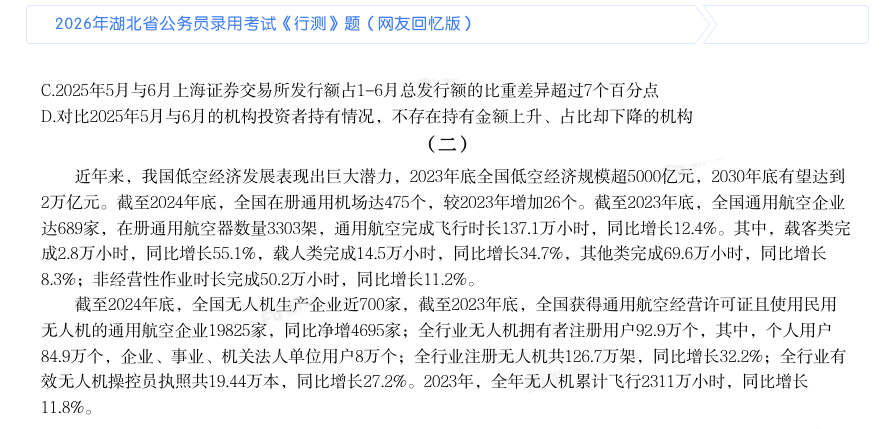
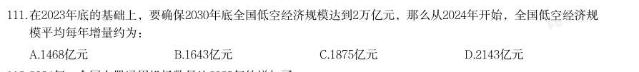
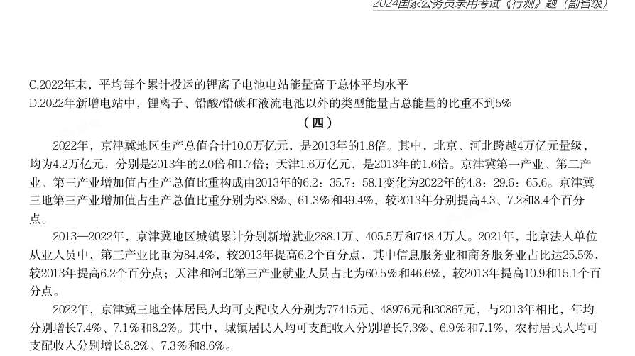
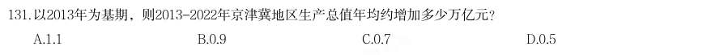
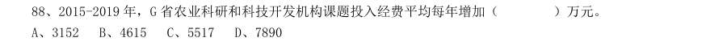

# 资料分析 · 年均增长率

> 考点编码：`ZL-YEAR`　｜　体系对齐：花生十三 `ziliao-fenxi.md#题型7`

## 一、命题规律

- **本题型真题总量**：38 题（2001–2026）
- **地区分布**：国考 12 / 广东 19 / 湖北 7
- **近六年题量**：2026年1题, 2025年4题, 2024年2题, 2023年1题, 2022年1题, 2021年3题
- **覆盖试卷**：24 套
- **子考点分布**：年均增长率计算 35　年均增长率比较 7
- **同题变体**：另有 4 道为同题重复（同年多卷/跨年再考），已折叠，需展开见 scripts/search.py --all-variants
- **速算/速解提示**：见花生十三 `references/ziliao-susuan.md` 与 `references/shuliang-gongshi.md` 对应章节

## 二、近年真题（最多 12 题，按年份倒序）

### 【2026 湖北省考·第 111 题】HB-2026-ty-X111　年均增长率｜年均增长率计算
> 材料：近年来,我国低空经济发展表现出巨大潜力,2023年底全国低空经济规模超5000亿元,2030年底有望达到 2万亿元。截至2024年底,全国在册通用机场达475个,较2023年增加26个。截至2023年底,全国通用航空企业 达689家,在册通用航空器数量3303架,通用航空完成飞行时长137.1万小时,同比增长12.4%。其中,载客类完 成2.8万小时,同比增长55.1%,载人类完成14.5万小时,同比增长34.7%,其他类完成69.6万小时,同比增长 8.3%;非经营性作业时长完成50.2万小时,同比增长11.2%。 截至2024年底,全国无人机生产企业近700家,截至2023年底,全国获得通…

在2023年底的基础上,要确保2030年底全国低空经济规模达到2万亿元,那么从2024年开始,全国低空经济规 模平均每年增量约为:

- **A.** 1468亿元
- **B.** 1643亿元
- **C.** 1875亿元
- **D.** 2143亿元

**答案：D**

**解析/参考要点**：D

### 【2025 广东省考·第 78 题】GD-2025-ty-X078　年均增长率｜年均增长率计算
> 材料：60亿美元,是全球能源转型投 资最多的国家。十年来,中国向全球提供优质的清洁能源产品和服务,有力促进全球风电,光伏成本大幅下 降,中国与100多个国家和地区开展绿色能源项目合作,2023年出口风电光伏产品助力其他国家减排二氧化碳 约8.1亿吨。中国新能源产业丰富了全球供给,缓解了全球通胀压力,助力全球应对气候变化和绿色转型。…

2023年我国已有超过 的人口用上了天然气 C.2013~2023年,我国人均生活用电量几乎翻了一番 D.2013~2023年,新增清洁能源发电量占全社会用电量一半以上 2013-2023年,全国充电基础设施年均增加约( )万台。

> 材料图见 images/GD-2025-ty-X071-m.jpg

- **A.** 60
- **B.** 75
- **C.** 85
- **D.** 95

**答案：该题答案缺失，见原卷**

### 【2025 广东省考·第 82 题】GD-2025-ty-X082　年均增长率｜年均增长率计算
> 材料：2023年,G省博物馆系统落实国家文物局、G省人民政府关于推进文物事业高质量发展战略合作协议,锚定博物馆事业高质量发展任务,全省博物馆事业发展取得明显成效。 截至2023年来,G省备案博物馆385家。其中,国有博物馆257家,非国有博物馆128家。国有博物馆中,文物系统国有博物馆227家,行业国有博物馆30家。G省国家一、二、三级博物馆共82家,数量位居全国第二。…

2016~2022年,G省博物馆年均增加( )家。

> 材料图见 images/GD-2025-ty-X081-m.jpg

- **A.** 15
- **B.** 16
- **C.** 17
- **D.** 18

**答案：该题答案缺失，见原卷**

### 【2025 广东省考·第 87 题】GD-2025-ty-X087　年均增长率｜年均增长率计算
> 材料：2023年,我国铁路客运创历史最好水平,服务保障国家重大战略成效显著旅客运输。国家铁路旅客发送量完成36.85亿人,比上年增加20.75亿人;国家铁路旅客周转量(旅客周转量=旅客发送量×旅客平均运送距离)完成14717.12亿人公里,比上年增加8145.36亿人公里。…

2018~2023年,国家铁路旅客发送量年均增长约( )万人。

> 材料图见 images/GD-2025-ty-X086-m.jpg

- **A.** 6130
- **B.** 7360
- **C.** 8280
- **D.** 9200

**答案：该题答案缺失，见原卷**

### 【2025 广东省考·第 88 题】GD-2025-ty-X088　年均增长率｜年均增长率计算
> 材料：2023年,我国铁路客运创历史最好水平,服务保障国家重大战略成效显著旅客运输。国家铁路旅客发送量完成36.85亿人,比上年增加20.75亿人;国家铁路旅客周转量(旅客周转量=旅客发送量×旅客平均运送距离)完成14717.12亿人公里,比上年增加8145.36亿人公里。…

2021~2023年,国家铁路旅客周转量年均增长率( )。

> 材料图见 images/GD-2025-ty-X086-m.jpg

- **A.** 不到15%
- **B.** 在15%到30%之间
- **C.** 在30%到45%之间
- **D.** 超过45%

**答案：该题答案缺失，见原卷**

### 【2024 国考（副省级）·第 131 题】GK-2024-fs-X131　年均增长率｜年均增长率计算
> 材料：2022年,京津冀地区生产总值合计10.0万亿元,是2013年的1.8倍。其中,北京、河北跨越4万亿元量级, 均为4.2万亿元,分别是2013年的2.0倍和1.7倍;天津1.6万亿元,是2013年的1.6倍。京津冀第一产业、第二产 业、第三产业增加值占生产总值比重构成由2013年的6.2:35.7:58.1变化为2022年的4.8:29.6:65.6。京津冀 三地第三产业增加值占生产总值比重分别为83.8%、61.3%和49.4%,较2013年分别提高4.3、7.2和8.4个百分 点。 2013—2022年,京津冀地区城镇累计分别新增就业288.1万、405.5万和748.4万人。2021年,…

以2013年为基期,则2013-2022年京津冀地区生产总值年均约增加多少万亿元?

- **A.** 1.1
- **B.** 0.9
- **C.** 0.7
- **D.** 0.5

**答案：D**

**解析/参考要点**：根据题干“······年均约增加多少万亿元”,可判定本题为年均增长量问题。定位文字材料第一
段可得:2022 年,京津冀地区生产总值合计10.0 万亿元,是2013 年的1.8 倍。则2013 年,京津冀地
区生产总值合计
万亿元。根据公式:年均增长量
,则2013-2022
年京津冀地区生产总值年均增加
万亿元。
故正确答案为D。

### 【2024 国考（副省级）·第 134 题】GK-2024-fs-X134　年均增长率｜年均增长率计算
> 材料：2022年,京津冀地区生产总值合计10.0万亿元,是2013年的1.8倍。其中,北京、河北跨越4万亿元量级, 均为4.2万亿元,分别是2013年的2.0倍和1.7倍;天津1.6万亿元,是2013年的1.6倍。京津冀第一产业、第二产 业、第三产业增加值占生产总值比重构成由2013年的6.2:35.7:58.1变化为2022年的4.8:29.6:65.6。京津冀 三地第三产业增加值占生产总值比重分别为83.8%、61.3%和49.4%,较2013年分别提高4.3、7.2和8.4个百分 点。 2013—2022年,京津冀地区城镇累计分别新增就业288.1万、405.5万和748.4万人。2021年,…

将京、津、冀按2013—2022年居民人均可支配收入年均增速的城乡差值的绝对值从大到小排列,以下正确的 是:

> 材料图见 images/GK-2024-fs-X131-m.jpg

- **A.** 京、冀、津
- **B.** 冀、京、津
- **C.** 京、津、冀
- **D.** 冀、津、京

**答案：B**

**解析/参考要点**：定位文字材料第三段可知,2022 年与2013 年相比,京津冀三地城镇和农村居民人均可支配收入年均增
速。三地居民城乡人均可支配收入年均增速差值的绝对值分别为:京
,津
,冀
,故从大到小排列为:冀、京、津。
故正确答案为B。

### 【2023 广东省考（乡镇）·第 88 题】GD-2023-xz-X088　年均增长率｜年均增长率计算

2017-2021 年间,广东农林牧渔业总产值年均增加约( )亿元。

- **A.** 415
- **B.** 467
- **C.** 584
- **D.** 779

**答案：C**

**解析/参考要点**：根据题干“2017-2021 年间,广东农林牧渔业总产值年均增加······亿元”,可判定本题为年均增
长量问题。定位图1 可得:2017、2021 年广东农林牧渔业总产值分别为5969.9 亿元、8305.8
亿元。根据公式:年均增长量
,则所求
亿元。
故正确答案为C。

### 【2022 广东省考（乡镇）·第 93 题】GD-2022-xz-X093　年均增长率｜年均增长率计算
> 材料：增加森林面积、提高森林质量、提升生态系统碳汇增量,将为我国实现碳达峰、碳中和目标、维护全球生态安全做出巨大贡献。1973 年,我国开展了第一次森林资源清查。目前已完成第9 次森林资源清查,我国森林面积和森林蓄积量连续30 年保持“双增长”。“十三五”时期,我国累计造林5.45 亿亩,森林覆盖率达到23.04%,森林蓄积量为175.6 亿立方米,森林面积达到2.2 亿公顷(1 公顷为15 亩)。湿地保护率达到52%,治理沙化土地1.5 亿亩。…

2016-2018 年,我国国际重要湿地面积的年均增长率约为:

> 材料图见 images/GD-2022-xz-X091-m.jpg

- **A.** 25%
- **B.** 30%
- **C.** 35%
- **D.** 40%

**答案：B**

**解析/参考要点**：解析
根据题干“2016-2018 年······年均增长率约为”,可判定本题为年均增长率问题。定位图2 可得:2016
年与2018 年我国国际重要湿地面积分别为61.68 万亩、104.24 万亩。根据年均增长率公式:
(n 为年份差),则
,解得
。
故正确答案为B。

### 【2021 广东省考（乡镇）·第 88 题】GD-2021-xz-X088　年均增长率｜年均增长率计算
> 材料：级职称。全省共有农村科普示范基地554 个、科普示范街道(乡镇)145 个、科普示范社区(村)1341 个。…

2015-2019 年,G 省农业科研和科技开发机构课题投入经费平均每年增加( )万元。

> 材料图见 images/GD-2021-xz-X086-m.jpg

- **A.** 3152
- **B.** 4615
- **C.** 5517
- **D.** 7890

**答案：该题答案缺失，见原卷**

### 【2021 国考（地市级）·第 113 题】GK-2021-ds-X113　年均增长率｜年均增长率比较

在表中所列各类LED 应用市场中,2013—2019 年产值年均增速(以2013 年为基期)最快的应用市场,2019 年产值约占LED 行业总产值的:

> 材料图见 images/GK-2021-ds-X111-m.jpg

- **A.** 14%
- **B.** 17%
- **C.** 36%
- **D.** 85%

**答案：A**

**解析/参考要点**：,全站正确率:46%,易错项:C。
解析
第一步,本题考查现期比重计算中的求比重。
第二步,定位表格材料。
第三步,根据
,相差年数n 相同时,比较年均增速的大小可用
替代,初期
为2013 年,末期为2019 年,代入数据可得
分别为汽车照明
,通用照明
,景观照明
,显示屏
,背光应用
,信号及指示
,其他
,
最大的是
显示屏,则2013—2019 年产值年均增速最快的应用市场是显示屏。
第四步,2019 年LED 总产值为7548 亿元,显示屏产值为1089 亿元,根据比重
,选项出现首位相同,
第二位不同的情况,分母从左向右截取前三位,代入数据可得2019 年显示屏产值占LED 总产值的比重为
,
直除首两位商14,A 选项符合。
因此,选择A 选项。

### 【2021 国考（地市级）·第 119 题】GK-2021-ds-X119　年均增长率｜年均增长率计算
> 材料：(材料2)2019 年全国地铁运营线路长度达5181 公里,占城轨交通运营线路总里程的76.8%。 2019 年末,我国城轨交通配属地铁列车6178 列,全年实现地铁客运量227.76 亿人次。 注:除客运量为全年数值外,其余指标为年末时点值。…

表中所列2019 年地铁客运量超过10 亿人次的城市中,2019 年平均每条地铁运营线路长度超过40 公里的 城市有几个?

> 材料图见 images/GK-2021-ds-X116-m.jpg

- **A.** 1
- **B.** 2
- **C.** 3
- **D.** 4

**答案：B**

**解析/参考要点**：,全站正确率:58%,易错项:C。
解析
第一步,本题考查现期平均数比较。
第二步,定位表格材料。
第三步,直接读数可知,表中所列2019 年地铁客运量超过10 亿人次的城市有:上海(38.7 亿人次)、北京(39.4
亿人次)、广州(32.9 亿人次)、武汉(12.4 亿人次)、深圳(17.8 亿人次)、成都(14.0 亿人次)、南京(10.4
亿人次)。根据平均数=后/前=地铁运营线路长度/运营线路条数>40,即地铁运营线路长度>运营线路条数×40。
可得,满足的有上海(669.5>15×40=600)、成都(302.2>7×40=280),共2 个。
因此,选择B 选项。

## 三、其余真题（按年代分片）

| 年代 | 题量 | 分片文件 |
|---|---:|---|
| 2000s | 5 | [ZL-YEAR-2000s.md](split/ZL-YEAR-2000s.md) |
| 2010s | 20 | [ZL-YEAR-2010s.md](split/ZL-YEAR-2010s.md) |
| 2020s | 1 | [ZL-YEAR-2020s.md](split/ZL-YEAR-2020s.md) |

> 也可用 `python scripts/search.py --kaodian ZL-YEAR` 直接检索全部 38 题。