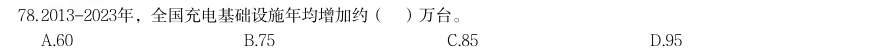
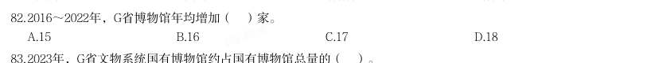
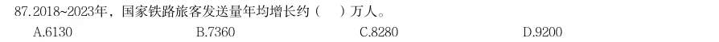
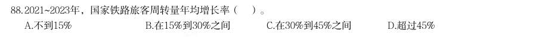
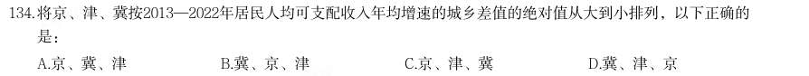
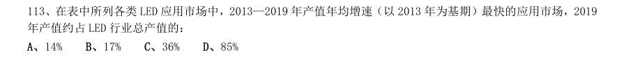
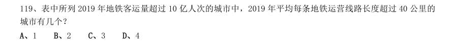

# 资料分析 · 年均增长率

> 考点编码：`ZL-YEAR`　｜　体系对齐：花生十三 `ziliao-fenxi.md#题型7`

## 一、命题规律

- **本题型真题总量**：39 题（2001–2026）
- **地区分布**：国考 13 / 广东 19 / 湖北 7
- **近六年题量**：2026年1题, 2025年4题, 2024年2题, 2023年1题, 2022年1题, 2021年3题
- **覆盖试卷**：24 套
- **同题变体**：另有 4 道为同题重复（同年多卷/跨年再考），已折叠，需展开见 scripts/search.py --all-variants
- **速算/速解提示**：见花生十三 `references/ziliao-susuan.md` 与 `references/shuliang-gongshi.md` 对应章节

## 二、真题与答案（按年份倒序，最多 30 题）

### 2026 湖北·统一卷　第 111 题
> 材料：(二) 近年来,我国低空经济发展表现出巨大潜力,2023年底全国低空经济规模超5000亿元,2030年底有望达到 2万亿元。截至2024年底,全国在册通用机场达475个,较2023年增加26个。截至2023年底,全国通用航空企业 达689家,在册通用航空器数量3303架,通用航空完成飞行时长137.1万小时,同比增长12.4%。其中,载客类完 成2.8万小时,同比增长55.1%,载人类完成14.5万小时,同比增长34.7%,其他类完成69.6万小时,同比增长 8.3%;非经营性作业时长完成50.2万小时,同比增长11.2%。 截至2024年底,全国无人机生产企业近700家,截至2023年底,全…

在2023年底的基础上,要确保2030年底全国低空经济规模达到2万亿元,那么从2024年开始,全国低空经济规 模平均每年增量约为:

- **A.** 1468亿元
- **B.** 1643亿元
- **C.** 1875亿元
- **D.** 2143亿元

**答案：D**

**解析/参考要点**：111.D

### 2025 广东·统一卷　第 78 题

2023年我国已有超过 的人口用上了天然气 C.2013~2023年,我国人均生活用电量几乎翻了一番 D.2013~2023年,新增清洁能源发电量占全社会用电量一半以上 2013-2023年,全国充电基础设施年均增加约( )万台。

- **A.** 60
- **B.** 75
- **C.** 85
- **D.** 95

**答案：暂缺（原始文件为扫描版）**

### 2025 广东·统一卷　第 82 题

2016~2022年,G省博物馆年均增加( )家。

- **A.** 15
- **B.** 16
- **C.** 17
- **D.** 18

**答案：暂缺（原始文件为扫描版）**

### 2025 广东·统一卷　第 87 题

2018~2023年,国家铁路旅客发送量年均增长约( )万人。

- **A.** 6130
- **B.** 7360
- **C.** 8280
- **D.** 9200

**答案：暂缺（原始文件为扫描版）**

### 2025 广东·统一卷　第 88 题

2021~2023年,国家铁路旅客周转量年均增长率( )。

- **A.** 不到15%
- **B.** 在15%到30%之间
- **C.** 在30%到45%之间
- **D.** 超过45%

**答案：暂缺（原始文件为扫描版）**

### 2024 国考·副省级　第 131 题
> 材料：(四) 2022年,京津冀地区生产总值合计10.0万亿元,是2013年的1.8倍。其中,北京、河北跨越4万亿元量级, 均为4.2万亿元,分别是2013年的2.0倍和1.7倍;天津1.6万亿元,是2013年的1.6倍。京津冀第一产业、第二产 业、第三产业增加值占生产总值比重构成由2013年的6.2:35.7:58.1变化为2022年的4.8:29.6:65.6。京津冀 三地第三产业增加值占生产总值比重分别为83.8%、61.3%和49.4%,较2013年分别提高4.3、7.2和8.4个百分 点。 2013—2022年,京津冀地区城镇累计分别新增就业288.1万、405.5万和748.4万人。20…

以2013年为基期,则2013-2022年京津冀地区生产总值年均约增加多少万亿元?

- **A.** 1.1
- **B.** 0.9
- **C.** 0.7
- **D.** 0.5

**答案：D**

**解析/参考要点**：【131】解析
根据题干“······年均约增加多少万亿元”,可判定本题为年均增长量问题。定位文字材料第一
段可得:2022 年,京津冀地区生产总值合计10.0 万亿元,是2013 年的1.8 倍。则2013 年,京津冀地
区生产总值合计
万亿元。根据公式:年均增长量
,则2013-2022
年京津冀地区生产总值年均增加
万亿元。
故正确答案为D。

### 2024 国考·副省级　第 134 题

将京、津、冀按2013—2022年居民人均可支配收入年均增速的城乡差值的绝对值从大到小排列,以下正确的 是:

- **A.** 京、冀、津
- **B.** 冀、京、津
- **C.** 京、津、冀
- **D.** 冀、津、京

**答案：B**

**解析/参考要点**：【134】解析
定位文字材料第三段可知,2022 年与2013 年相比,京津冀三地城镇和农村居民人均可支配收入年均增
速。三地居民城乡人均可支配收入年均增速差值的绝对值分别为:京
,津
,冀
,故从大到小排列为:冀、京、津。
故正确答案为B。

### 2023 广东·乡镇　第 88 题

2017-2021 年间,广东农林牧渔业总产值年均增加约( )亿元。

- **A.** 415
- **B.** 467
- **C.** 584
- **D.** 779

**答案：C**

**解析/参考要点**：第88 题
正确答案是:【C】
根据题干“2017-2021 年间,广东农林牧渔业总产值年均增加······亿元”,可判定本题为年均增
长量问题。定位图1 可得:2017、2021 年广东农林牧渔业总产值分别为5969.9 亿元、8305.8
亿元。根据公式:年均增长量
,则所求
亿元。
故正确答案为C。

### 2022 广东·乡镇　第 93 题

2016-2018 年,我国国际重要湿地面积的年均增长率约为:

- **A.** 25%
- **B.** 30%
- **C.** 35%
- **D.** 40%

**答案：B**

**解析/参考要点**：93.解析
根据题干“2016-2018 年······年均增长率约为”,可判定本题为年均增长率问题。定位图2 可得:2016
年与2018 年我国国际重要湿地面积分别为61.68 万亩、104.24 万亩。根据年均增长率公式:
(n 为年份差),则
,解得
。
故正确答案为B。

### 2021 广东·乡镇　第 88 题

2015-2019 年,G 省农业科研和科技开发机构课题投入经费平均每年增加( )万元。

- **A.** 3152
- **B.** 4615
- **C.** 5517
- **D.** 7890

**答案：暂缺（原始文件为扫描版）**

### 2021 国考·地市级　第 113 题

在表中所列各类LED 应用市场中,2013—2019 年产值年均增速(以2013 年为基期)最快的应用市场,2019 年产值约占LED 行业总产值的:

- **A.** 14%
- **B.** 17%
- **C.** 36%
- **D.** 85%

**答案：A**

**解析/参考要点**：113、正确答案:A,全站正确率:46%,易错项:C。
解析
第一步,本题考查现期比重计算中的求比重。
第二步,定位表格材料。
第三步,根据
,相差年数n 相同时,比较年均增速的大小可用
替代,初期
为2013 年,末期为2019 年,代入数据可得
分别为汽车照明
,通用照明
,景观照明
,显示屏
,背光应用
,信号及指示
,其他
,
最大的是
显示屏,则2013—2019 年产值年均增速最快的应用市场是显示屏。
第四步,2019 年LED 总产值为7548 亿元,显示屏产值为1089 亿元,根据比重
,选项出现首位相同,
第二位不同的情况,分母从左向右截取前三位,代入数据可得2019 年显示屏产值占LED 总产值的比重为
,
直除首两位商14,A 选项符合。
因此,选择A 选项。

### 2021 国考·地市级　第 119 题

表中所列2019 年地铁客运量超过10 亿人次的城市中,2019 年平均每条地铁运营线路长度超过40 公里的 城市有几个?

- **A.** 1
- **B.** 2
- **C.** 3
- **D.** 4

**答案：B**

**解析/参考要点**：119、正确答案:B,全站正确率:58%,易错项:C。
解析
第一步,本题考查现期平均数比较。
第二步,定位表格材料。
第三步,直接读数可知,表中所列2019 年地铁客运量超过10 亿人次的城市有:上海(38.7 亿人次)、北京(39.4
亿人次)、广州(32.9 亿人次)、武汉(12.4 亿人次)、深圳(17.8 亿人次)、成都(14.0 亿人次)、南京(10.4
亿人次)。根据平均数=后/前=地铁运营线路长度/运营线路条数>40,即地铁运营线路长度>运营线路条数×40。
可得,满足的有上海(669.5>15×40=600)、成都(302.2>7×40=280),共2 个。
因此,选择B 选项。

### 2020 湖北·统一卷　第 119 题

2017 年A 市生态与环境价值中,年值、贴现值较上年均有所上升的指标有:

- **A.** 6 个
- **B.** 5 个
- **C.** 4 个
- **D.** 3 个

**答案：暂缺（原始文件为扫描版）**

### 2019 湖北·统一卷　第 107 题

2013 年至2017 年我国成年国民人均期刊阅读量超过这五年平均水平的年份有:

- **A.** 2 个
- **B.** 3 个
- **C.** 4 个
- **D.** 5 个

**答案：B**

**解析/参考要点**：107、由题干“2013 年至2017 年···超过这五年平均水平的年份有”可知,本题为平均数问题。定位表格第五
行,由公式
可得,这五年人均期刊阅读的平均水平
,2013
年至2017 年期刊人均阅读量超过这五年平均水平的有3 个年份,分别为2013 年、2014 年、2015 年。
故正确答案为B。

### 2019 湖北·统一卷　第 111 题
> 材料：2014 年我国实施“单独两孩”生育政策,出生人口1687 万人,比上年增加47 万人。2016 年实施“全面 两孩”生育政策,出生人口1786 万人,比上年增加131 万人;出生率与“十二五”时期年平均出生率相比,提 高了0.84 个千分点。2017 年我国出生人口1723 万人,虽然比上年减少63 万人,但比“十二五”时期年平均 出生人口多出79 万人;出生率为 ,比上一年降低0.52 个千分点。2017 年二孩数量进一步上升至883 万 人,二孩占全部出生人口的比重达到 ,比2016 年的占比提高了11 个百分点。 2017 年出生人口最多的省份是山东,出生人口174.98 万人,但是比…

2013 年我国出生人口比“十二五”时期年平均出生人口:

- **A.** 减少4 万人
- **B.** 增加5 万人
- **C.** 减少9 万人
- **D.** 增加47 万人

**答案：A**

**解析/参考要点**：111、定位文字资料第一段“2014 年......我国出生人口1687 万人,比上年增加47 万人;2017 年我国出生人口
1723 万人,......,但比‘十二五’期间年平均出生人口多出79 万人”,可知2013 年我国出生人口为
万人,“十二五”期间年平均出生人口为
万人。
,则2013 年我国出生人口比“十
二五”期间年平均出生人口减少4 万人。
故正确答案为A。

### 2019 湖北·统一卷　第 112 题

“十二五”时期我国年平均出生率为:

- **A.** 
- **B.** 
- **C.** 
- **D.** 

**答案：B**

**解析/参考要点**：112、定位文字资料第一段“2016 年······出生率与‘十二五’时期年平均出生率相比,提高了0.84 个千分点;
2017 年······出生率为
,比上一年降低0.52 个千分点”,可知“十二五”期间年平均出生率为
。
故正确答案为B。

### 2019 广东·乡镇　第 99 题

2014-2017 年,A 省平均每年新增申报无公害农产品产地认定( )个。

- **A.** 184
- **B.** 202
- **C.** 221
- **D.** 230

**答案：暂缺（原始文件为扫描版）**

### 2019 广东·思维能力测验　第 10 题

据统计,某企业生产的所有型号空调的销量比往年均有大幅度提升。该企业由此认为,今年他们生产 的空调的市场占有率也会大幅提高。 以下最能说明上述推理存在漏洞的是()。

- **A.** 暗含了该空调生产企业的消费者满意度有所增加
- **B.** 忽视了其他企业空调的销量可能也有所提升
- **C.** 暗含了消费者可能同时使用两个品牌的空调
- **D.** 假设了空调消费市场划分将进一步细化

**答案：B**

**解析/参考要点**：10、第一步:找出论点和论据。
论点:今年他们生产的空调的市场占有率也会大幅提高。
论据:据统计,某企业生产的所有型号空调的销量比往年均有大幅度提升。
第二步:逐一分析选项。
A 项:题干讨论的是空调销量以及市场占有率,和消费者满意度无关,无法指出漏洞,排除;
B 项:题干说因为企业生产的所有型号空调的销量比往年均有大幅度提升,所以空调的市场占有率也会大幅提高,
但是如果其他企业空调的销量也提升的话,就不能确定空调市场总量的变化以及该企业空调市场占有率到底会不
会提升,可以指出漏洞,当选;
C 项:题干说因为企业生产的所有型号空调的销量比往年均有大幅度提升,所以空调的市场占有率也会大幅提高,
和消费者是否会同时使用两个品牌的空调无关,无法指出漏洞,排除;
D 项:题干讨论的是空调销量以及市场占有率,和空调消费市场划分会不会进一步细化无关,无法指出漏洞,排
除。
故正确答案为B。

### 2018 广东·统一卷　第 97 题

2013—2016 年,全省医疗卫生机构平均每年较上一年增加执业(助理)医师约( )万人。

- **A.** 0.9
- **B.** 1.1
- **C.** 1.7
- **D.** 2.1

**答案：暂缺（原始文件为扫描版）**

### 2016 广东·乡镇　第 96 题

2006 年至2011 年期间,平均每年增加的人数为( )万人。

- **A.** 531.3
- **B.** 657.4
- **C.** 752.4
- **D.** 839.2

**答案：暂缺（原始文件为扫描版）**

### 2016 广东·县级　第 86 题

计算和判断处理。 (一) 2006 年至2011 年期间,平均每年增加的人数为( )万人。

- **A.** 531.3
- **B.** 657.4
- **C.** 752.4
- **D.** 839.2

**答案：暂缺（原始文件为扫描版）**

### 2015 广东·县级　第 89 题

2014 年 月,最接近我国手机出货量全年平均数的月份是:

- **A.** 5 月
- **B.** 8 月
- **C.** 9 月
- **D.** 10 月

**答案：暂缺（原始文件为扫描版）**

### 2014 广东·乡镇　第 96 题

据统计,2013 年广东省城镇化私营单位就业人员年平均工资为37020 元,比上年增长16.0%,增幅回落3.9 个百分点。 2013 年广东省城镇私营单位分区域就业人员年平均工资图(单位:元) 2013 年,我省城镇化私营单位就业人员年平均工资比2012 年增加了( )元。

- **A.** 5100
- **B.** 5200
- **C.** 5300
- **D.** 5400

**答案：暂缺（原始文件为扫描版）**

### 2014 广东·乡镇　第 97 题

2013 年,城镇私营单位就业人员年平均工资与2012 年相比,增长最慢的区域是:

- **A.** 珠三角
- **B.** 山区
- **C.** 东翼
- **D.** 西翼

**答案：暂缺（原始文件为扫描版）**

### 2014 广东·乡镇　第 98 题

2012 年,我省城镇私营单位就业人员年平均工资最高的区域约为最低区域的( )倍。

- **A.** 1.2
- **B.** 1.8
- **C.** 1.5
- **D.** 2.0

**答案：暂缺（原始文件为扫描版）**

### 2014 广东·乡镇　第 99 题

2011 年,我省城镇私营单位就业人员年平均工资约为( )元。

- **A.** 25891
- **B.** 26622
- **C.** 28083
- **D.** 31920

**答案：暂缺（原始文件为扫描版）**

### 2014 广东·乡镇　第 100 题

如果2014 年我省各区域城镇私营单位就业人员年平均工资保持2013 年的增长速度,则2014 年各区域年 平均工资从高到底的正确排序是:

- **A.** 珠三角>东翼>山区>西翼
- **B.** 珠三角>山区>东翼>西翼
- **C.** 珠三角>东翼>西翼>山区
- **D.** 珠三角>西翼>东翼>山区

**答案：暂缺（原始文件为扫描版）**

### 2014 国考·统一卷　第 116 题
> 材料：根据资料所提供的信息进行分析、比较、计算和判断处理。 一、 根据以下资料,回答116—120 题。 2012 年全国国道网车流量较大的地区主要集中在北京、天津、上海、江苏、浙江、广东和山东,上述省市 国道网的日平均交通量均超过2 万辆。全国国道网日平均行驶量为244883 万车公里,北京、天津、河北、山西、 上海、浙江、湖北、广东的国道年平均拥挤度均超过0.6。其中,国家高速公路日平均交通量为22181 辆,日平 均行驶量为148742 万车公里;普通国道日平均交通量为10845 辆,日平均行驶量为111164 万车公里。全国高速 公路日平均交通量为21305 辆,日平均行驶量为204717 …

) 2008—2012 年全国国道与高速公路日平均交通量及年平均交通拥挤度 2009—2012 年全国国道日平均交通量同比增速最快的一年是:

- **A.** 2010 年
- **B.** 2009 年
- **C.** 2012 年
- **D.** 2011 年

**答案：C**

**解析/参考要点**：116、从图中可以看出只有2010 年和2012 年的增长量比较多,因此只需比较这两年即可。2010 年增长率=
=
,2012 年的增长率为
=
。通过观察可知2012 年增速最大。
故正确答案为C。

### 2014 国考·统一卷　第 117 题

2008—2012 年全国国道与高速公路年平均拥挤度数值相差最小的年份,高速公路全年日平均交通量为:

- **A.** 10765 辆
- **B.** 16837 辆
- **C.** 12632 辆
- **D.** 19423 辆

**答案：B**

**解析/参考要点**：117、查找题。通过折线图可知,两条折线最接近的即为“全国国道与高速公路年平均拥挤度数值相差最小的年
份”,是2009 年,所以查找得解B 项16837 辆。
故正确答案为B。

### 2011 湖北·统一卷　第 101 题

请你根据资料所提供的信息进行分析、比较、计算和判断处理。 (一)根据以下资料,完成各题。 A0 级型车比A00 级型车在过去的五年中每年平均销售份额约高出:

- **A.** 15 个百分点
- **B.** 14 个百分点
- **C.** 16 个百分点
- **D.** 17 个百分点

**答案：B**

**解析/参考要点**：101、过去五年,A0 级型车的平均销售额=
;A00 级型车的平均销售额
=
个百分点,则A0 级型车比A00 级型车在过去的五年中每年平均销售份额约高
出
个百分点。
故正确答案为B。
注意:过去五年依次为2006、2007、2008、2009、2010 年。
