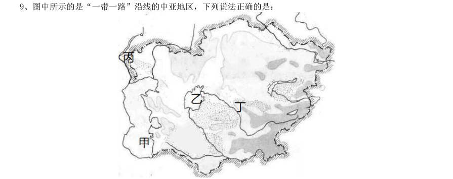
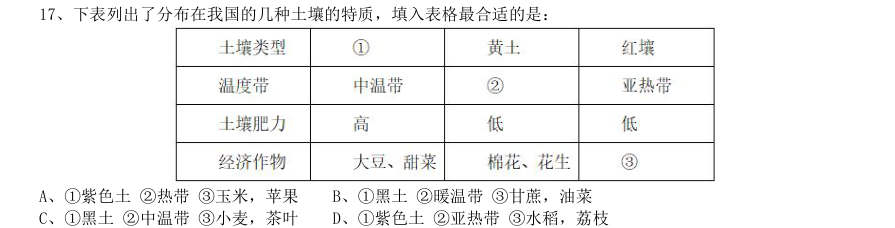
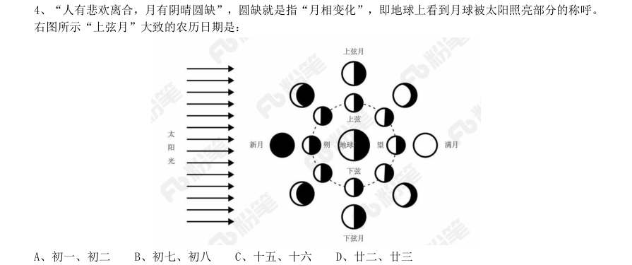
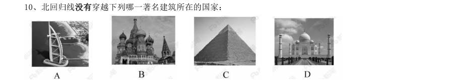
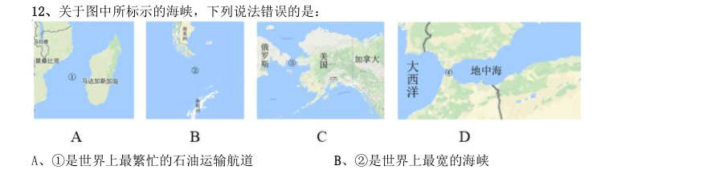
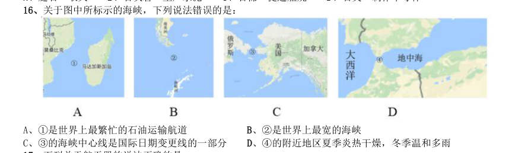
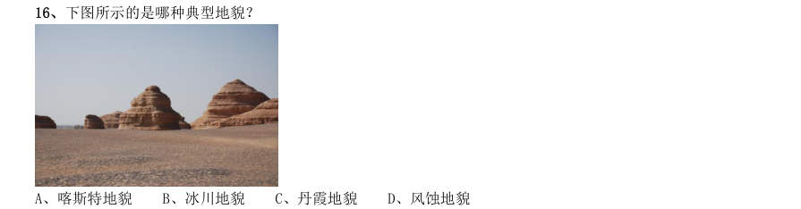
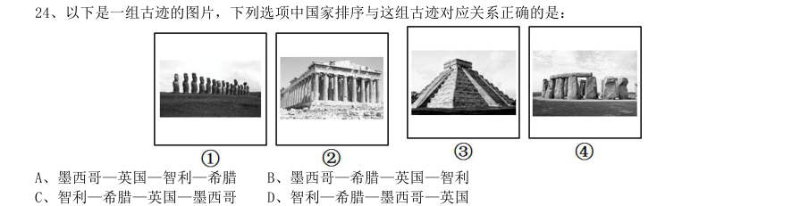

# 常识判断 · 地理常识 · 2010 年代真题

> 所属考点：[CS-DL](../CS-DL-地理常识.md)　｜　本片 53 题

> 本片子考点：中国地理 25　地理常识（综合） 15　世界地理 13

### 2019 湖北·选调　第 18 题　（世界地理）

“一带一路”倡议提出6 年来,已成为世界上规模最大的合作和发展平台,目前已有123 个国家和29 个国 际组织签署了共建“一带一路”合作文件,“七国集团”成员国意大利表态参与“一带一路”建设。通过合作, 东非有了第一条高速公路,马尔代夫有了第一座跨海大桥,肯尼亚的世纪工程蒙内铁路建成通车······大 量事实证明,参与“一带一路”合作,加快了相关各国和地区发展进程,改善了沿线民生需求,开辟了互利共赢 的前景。从哲学角度看,这彰显出:

- **A.** 相互联系必然促进事物运动发展
- **B.** 事物多样性决定了联系的多样性
- **C.** 整个世界是相互联系的统一整体
- **D.** 发展有前进性、上升性和永恒性

**答案：C**

### 2019 广东·乡镇　第 66 题　（世界地理）

2018 年8 月,国家提出衡量贫困人口是否脱贫的标准是“两不愁、三保障”,其中“两不愁”是指不愁吃、 不愁穿。以下不属于“三保障”的是( )。

- **A.** 基本医疗
- **B.** 义务教育
- **C.** 住房安全
- **D.** 环境优美

**答案：暂缺**

### 2019 广东·乡镇　第 77 题　（地理常识（综合））

全面建成小康社会,最艰巨最繁重的任务在( ),特别是在贫困地区。

- **A.** 城市
- **B.** 城镇
- **C.** 社区
- **D.** 农村

**答案：暂缺**

### 2019 广东·乡镇　第 80 题　（地理常识（综合））

地球内部具有巨大的热量,并通过不同途径由内向外散发地热能。以下现象与地热能有关的是( )。

- **A.** 台风生成
- **B.** 火山喷发
- **C.** 山洪暴发
- **D.** 岩石风化

**答案：暂缺**

### 2019 广东·选调　第 8 题　（中国地理）

一个国家,一个民族发展中更基本、更深沉、更持久的力量是( )。

- **A.** 道路自信
- **B.** 理论自信
- **C.** 制度自信
- **D.** 文化自信

**答案：D**

### 2019 广东·选调　第 11 题　（地理常识（综合））

我国已明确脱贫攻坚目标,即到2020 年,稳定实现农村贫困人口不愁吃、不愁穿、( )、基本医疗和住 房安全有保障,使贫困地区的基本公共服务主要领域指标接近全国平均水平。

- **A.** 就业水平
- **B.** 农业设施
- **C.** 义务教育
- **D.** 卫生条件

**答案：C**

### 2019 广东·选调　第 17 题　（中国地理）

“人不能两次踏进同一条河流”反映了( )的哲学关系。

- **A.** 现象和本质
- **B.** 量变和质变
- **C.** 运动和静止
- **D.** 社会存在和社会意识

**答案：C**

### 2019 国考·地市级　第 17 题　（中国地理）

下列地理分界线对应正确的是:

- **A.** 横断山脉——内流区和外流区
- **B.** 本初子午线——东半球和西半球
- **C.** 200 毫米等降水量线——农耕区和畜牧业区
- **D.** 祁连山脉——河西走廊和柴达木盆地

**答案：D**

### 2019 国考·省级　第 9 题　（中国地理）

图中所示的是“一带一路”沿线的中亚地区,下列说法正确的是:

- **A.** 甲湖在成因上属于构造湖
- **B.** 乙湖是世界陆地的最低处
- **C.** 丙河处于亚欧两洲分界线上
- **D.** 丁河水源是由冰雪融水供给

**答案：D**

### 2019 国考·省级　第 17 题　（中国地理）

下表列出了分布在我国的几种土壤的特质,填入表格最合适的是:

- **A.** 1紫色土2热带3玉米,苹果
- **B.** 1黑土2暖温带3甘蔗,油菜
- **C.** 1黑土2中温带3小麦,茶叶
- **D.** 1紫色土2亚热带3水稻,荔枝

**答案：B**

### 2018 湖北·统一卷　第 4 题　（地理常识（综合））

“人有悲欢离合,月有阴晴圆缺”,圆缺就是指“月相变化”,即地球上看到月球被太阳照亮部分的称呼。 右图所示“上弦月”大致的农历日期是:

- **A.** 初一、初二
- **B.** 初七、初八
- **C.** 十五、十六
- **D.** 廿二、廿三

**答案：B**

### 2018 湖北·统一卷　第 10 题　（世界地理）

北回归线没有穿越下列哪一著名建筑所在的国家:

> （本题为图形题，选项为图片，见原卷）

**答案：B**

### 2018 广东·统一卷　第 85 题　（中国地理）

“春困”是人体随着自然气候的变化而发生的生理反应。为克服“春困”,下列做法不合适的是 ( )。

- **A.** 多吃黄绿色蔬菜
- **B.** 保持室内空气流通
- **C.** 尽可能多做剧烈运动
- **D.** 养成早睡早起的习惯

**答案：暂缺**

### 2018 国考·副省级　第 6 题　（世界地理）

关于2017 年新调整的海洋伏季休渔制度,下列说法错误的是:

- **A.** 各类作业方式休渔时间均有所延长
- **B.** 首次将南海的单层刺网纳入休渔范围
- **C.** 统一了所有海域的休渔结束时间
- **D.** 首次要求为捕捞渔船配套服务的捕捞辅助船同步休渔

**答案：C**

### 2018 国考·副省级　第 14 题　（中国地理）

下列哪一现象与季风气候不存在因果关系?

- **A.** 塔里木河在夏季进入汛期
- **B.** 华北地区在初春频发寒潮
- **C.** 我国东北的工业区一般建在城市的东北或西南
- **D.** 夏季长江入海口附近海域的盐度比其他季节低

**答案：A**

### 2018 国考·副省级　第 15 题　（中国地理）

关于下列地区的说法错误的是:

- **A.** 欧洲北海:既是著名产油区,又是著名渔场
- **B.** 波斯湾地区:既是著名产油区,又是古文明发祥地
- **C.** 湄公河流域:既是小麦主产区,又是佛教圣地
- **D.** 五大湖区:既有世界上面积最大的淡水湖,又跨美加两国边境线

**答案：C**

### 2018 国考·副省级　第 17 题　（世界地理）

9 月底,小李开启了欧洲之旅。他先参加了一场盛大的啤酒节,随后参观了海德公园并瞻仰了马克思墓,最 后参观了欧盟总部。问小李依次游历了哪几座城市?

- **A.** 慕尼黑、伦敦、布鲁塞尔
- **B.** 米兰、柏林、阿姆斯特丹
- **D.** 巴黎、汉堡、布鲁塞尔

**答案：A**

### 2018 国考·地市级　第 19 题　（中国地理）

关于下列地区的说法错误的是:

- **A.** 欧洲北海:既是著名产油区,又是著名渔场
- **B.** 波斯湾地区:既是著名产油区,又是古文明发祥地
- **C.** 湄公河流域:既是小麦主产区,又是佛教圣地
- **D.** 五大湖区:既有世界上面积最大的淡水湖,又跨美加两国边境线

**答案：C**

### 2017 广东·统一卷　第 75 题　（世界地理）

我国海洋综合科考船“海洋六号”从珠江口进入南海海域,执行大洋南极科考任务。下列关于科考船从 珠江口进入南海,所受浮力情况说法正确的是:

- **A.** 由于船始终浮在水面上,所以受到的浮力不变
- **B.** 由于海水的密度更大,所以船在海洋里受到的浮力更大
- **C.** 由于船排开海水的体积更小,所以在海洋里受到的浮力更小
- **D.** 由于船排开江水的体积更大,所以在江水里受到的浮力更大

**答案：暂缺**

### 2017 广东·统一卷　第 77 题　（地理常识（综合））

地球上的矿产资源非常丰富。关于矿产,以下认识不正确的是:

- **A.** 最坚硬的矿石是金刚石,最软的矿石是石膏
- **B.** 砂岩按照砂粒直径划分为微粒、细粒、中粒、粗粒和巨粒
- **C.** 煤、石油和天然气都是化石燃料,由动植物的遗体演变而成
- **D.** 大多数矿物是在熔融的岩石或炽热的熔体冷却结晶时形成的

**答案：暂缺**

### 2017 广东·统一卷　第 78 题　（世界地理）

世界上多数国家都采用以区时为单位的标准时。关于时间,以下认识不正确的是:

- **A.** 所有时区都以格林尼治本初子午线为基础
- **B.** 国际日期变更线的西边要比东边晚一天
- **C.** 许多国家在夏季人为地把时钟拨快一小时,使用夏令时间
- **D.** 全球共分为24 个时区,每个时区都有自己的时间

**答案：暂缺**

### 2017 国考·副省级　第 12 题　（中国地理）

关于图中所标示的海峡,下列说法错误的是:

- **A.** 1是世界上最繁忙的石油运输航道
- **B.** 2是世界上最宽的海峡
- **C.** 3的海峡中心线是国际日期变更线的一部分
- **D.** 4的附近地区夏季炎热干燥,冬季温和多雨

**答案：A**

### 2017 国考·副省级　第 14 题　（地理常识（综合））

下列矿物与其用途对应错误的是:

- **A.** 燧石—取火
- **B.** 石灰岩—生产水泥
- **C.** 石棉—促进燃烧
- **D.** 石英—制作半导体

**答案：C**

### 2017 国考·副省级　第 19 题　（世界地理）

小王冬季从北京首都国际机场乘坐航班去某个机场,到达后发现手表显示的时间为18 点30 分,而机场所在 地时间为22 点30 分,他去的可能是以下哪个城市?

- **A.** 华盛顿
- **B.** 马尼拉
- **C.** 曼彻斯特
- **D.** 惠灵顿

**答案：D**

### 2017 国考·地市级　第 15 题　（地理常识（综合））

下列矿物与其用途对应错误的是:

- **A.** 燧石—取火
- **B.** 石灰岩—生产水泥
- **C.** 石棉—促进燃烧
- **D.** 石英—制作半导体

**答案：C**

### 2017 国考·地市级　第 16 题　（中国地理）

关于图中所标示的海峡,下列说法错误的是:

- **A.** 1是世界上最繁忙的石油运输航道
- **B.** 2是世界上最宽的海峡
- **C.** 3的海峡中心线是国际日期变更线的一部分
- **D.** 4的附近地区夏季炎热干燥,冬季温和多雨

**答案：A**

### 2016 湖北·统一卷　第 12 题　（中国地理）

下列关于国家征收农民集体所有土地补偿的规定,说法错误的是:

- **A.** 征收农民集体土地,需要按照被征收土地的原用途予以补偿
- **B.** 征收耕地以外其他土地的补偿标准由省、自治区、直辖市规定
- **C.** 被征收土地上的附着物和青苗的补偿标准,由市、县人民政府规定
- **D.** 征收耕地应给予土地补偿费、安置补助费、地上附着物和青苗的补偿费

**答案：C**

### 2016 湖北·统一卷　第 16 题　（中国地理）

下图所示的是哪种典型地貌?

- **A.** 喀斯特地貌
- **B.** 冰川地貌
- **C.** 丹霞地貌
- **D.** 风蚀地貌

**答案：A**

### 2016 湖北·统一卷　第 18 题　（中国地理）

洲际导弹通常指射程大于8000 公里的远程弹道式导弹。目前,中国研制的洲际弹道导弹主要是什么系列 的?

- **A.** “东风”系列
- **B.** “长征”系列
- **C.** “红旗”系列
- **D.** “天宫”系列

**答案：A**

### 2016 广东·乡镇　第 75 题　（中国地理）

现代化工业社会过多燃烧煤炭、石油和天然气等化石资源,使自然界更多(更强)地产生灾 害性天气(气候)现象,包括有( )。 1雾霾 2极光 3温室效应 4龙卷风 5酸雨 6冰雹

- **A.** 234
- **B.** 146
- **C.** 145
- **D.** 135

**答案：暂缺**

### 2016 国考·副省级　第 4 题　（中国地理）

下列文字中画横线部分存在错误的是: 古代的东西方商路主要有三条:一条是从中亚由陆路沿里海、波罗的海(A)到小亚细亚;一条是先由海路至波 斯湾,然后经两河流域到地中海东岸(B)的叙利亚一带;第三条是先由海路至红海,然后再由陆路到埃及(C) 的亚历山大港。在这几条商路中,红海以东由阿拉伯商人(D)掌握;地中海一带则为意大利的威尼斯和热那亚 所垄断。

- **A.** (A)
- **B.** (B)
- **C.** (C)
- **D.** (D)

**答案：A**

### 2015 湖北·统一卷　第 8 题　（地理常识（综合））

所谓硬水是指水中存在较多的矿物质成分,水的硬度指的是水中钙镁离子的总和。下列关于硬水的说法错误的 是:

- **A.** 加入石灰能降低水的硬度
- **B.** 可以用肥皂水鉴别软硬水
- **C.** 将水煮沸可以降低水的硬度
- **D.** 可以长期饮用硬度较高的水

**答案：D**

### 2015 国考·副省级　第 8 题　（中国地理）

下列关于地理位置的描述与城市之间对应关系错误的是:

- **A.** 北通汝洛,西带秦蜀,南遮湖广,东瞰吴越——襄阳
- **B.** 东压江淮,西挟关陇,北通幽燕,南系荆襄——南京
- **C.** 南抚百越,北望中州,据五岭之要会,扼赣闽粤湘之要冲——赣州
- **D.** 居浙右之上游,控鄱阳之肘腋,制闽越之喉吭,通宣歙之声势——衢州

**答案：A**

### 2014 湖北·统一卷　第 3 题　（中国地理）

关于亚洲政坛女性首脑,下列说法错误的是:

- **A.** 科拉松·阿基诺夫人是亚洲首位女总统
- **B.** 阿罗约曾任菲律宾总统之职
- **C.** 朴槿惠的父亲曾任韩国总统
- **D.** 英拉·西那瓦是马来西亚总理

**答案：A**

### 2014 湖北·统一卷　第 10 题　（中国地理）

下列关于火山的表述错误的是:

- **A.** 喷出的物质有气态、流态和固态三种
- **B.** 页岩是最常见的岩浆岩
- **C.** 五大连池的形成与火山喷发有关
- **D.** 可分为死火山、活火山和休眠火山

**答案：A**

### 2014 湖北·统一卷　第 15 题　（中国地理）

下列哪项不在中国地形的第二级阶梯上?

- **A.** 秦岭
- **B.** 呼伦贝尔高原
- **C.** 鄂尔多斯高原
- **D.** 巴颜喀拉山

**答案：D**

### 2014 国考·统一卷　第 3 题　（世界地理）

下列关于国家主权及国防地理的表述,不正确的是:

- **A.** 主权是联合国赋予国家的最基本的权利
- **B.** 一国的领海和领空都是其领土的组成部分
- **C.** 我国南海四大群岛是东沙、西沙、中沙和南沙群岛
- **D.** 我国与越南、缅甸、吉尔吉斯斯坦等十几个国家接壤

**答案：A**

### 2013 湖北·统一卷　第 2 题　（中国地理）

与我国接壤的金砖国家有:

- **A.** 1 个
- **B.** 2 个
- **C.** 3 个
- **D.** 4 个

**答案：B**

### 2013 湖北·统一卷　第 5 题　（地理常识（综合））

地震是地球上的主要自然灾害之一。下列关于地震的说法,错误的是:

- **A.** 地震活动在时间分布上具有一定的周期性
- **B.** 环太平洋地震带是地球上地震最活跃的地区
- **C.** 里氏地震规模每增强一级,释放的能量约增加10 倍
- **D.** 有记录以来最大的一次大地震是1960 年的智利大地震,其震级为9.5 级

**答案：C**

### 2013 湖北·统一卷　第 20 题　（中国地理）

中国是世界上稀土资源最丰富的国家,素有“稀土王国”之称。 下列关于稀土的表述,错误的是:

- **A.** 稀土一般是以氧化物状态分离出来的,稀土的得名是因为很稀少
- **B.** 美国是稀土的主要使用国,目前中国出口的稀土数量居全球之首
- **C.** 我国是稀土资源储藏大国,也是稀土产品生产、应用和出口大国
- **D.** 我国的稀土储量占世界稀土储量的百分比近年来因开发已经下降

**答案：B**

### 2013 湖北·统一卷　第 21 题　（地理常识（综合））

血浆包括各种矿物质、糖类、脂类、蛋白质、激素和维生素等。 在上述各种物质中,造成血液颜色为红色的是:

- **A.** 激素
- **B.** 蛋白质
- **C.** 糖类
- **D.** 维生素

**答案：B**

### 2013 湖北·统一卷　第 24 题　（中国地理）

以下是一组古迹的图片,下列选项中国家排序与这组古迹对应关系正确的是:

- **A.** 墨西哥—英国—智利—希腊
- **B.** 墨西哥—希腊—英国—智利
- **C.** 智利—希腊—英国—墨西哥
- **D.** 智利—希腊—墨西哥—英国

**答案：D**

### 2013 国考·统一卷　第 18 题　（地理常识（综合））

从3 月下旬到10 月上旬,太阳在地球上直射位置的移动规律是:

- **A.** 赤道→南回归线→赤道
- **B.** 赤道→北回归线→赤道
- **C.** 南回归线→赤道→北回归线
- **D.** 北回归线→赤道→南回归线

**答案：B**

### 2012 湖北·统一卷　第 2 题　（地理常识（综合））

关于我国“战国七雄”地理位置描述准确的是:

- **A.** 齐国的纬度最高
- **B.** 楚国的纬度最低
- **C.** 燕国的经度最小
- **D.** 秦国的经度最大

**答案：B**

### 2012 国考·统一卷　第 5 题　（地理常识（综合））

关于欧洲主权债务危机的原因,下列说法不正确的是:

- **A.** 欧元升值
- **B.** 欧元区经济低迷
- **C.** 巨额财政赤字
- **D.** 财政政策与货币政策的不协调

**答案：A**

### 2012 国考·统一卷　第 22 题　（中国地理）

冰是水在低温条件下的一种形态,然而生活中发现,在我国北方的冬季,河流往往是表面结冰而深层依然 是流动的水。对于此种现象,原因是:

- **A.** 水固化成冰时会释放出热量
- **B.** 表面冰层具有隔热保温作用
- **C.** 水在0°C左右具有热缩冷涨的性质
- **D.** 气温尚未低到使河流整体冰冻的程度

**答案：B**

### 2012 国考·统一卷　第 24 题　（地理常识（综合））

2011 年3 月,日本强地震造成核泄漏。为降低和防止核泄漏造成的危害,发生核泄漏时,下列做法中不 正确的是:

- **A.** 离开核泄漏地区后,要换衣服和鞋子并将其放在塑料袋中
- **B.** 食品不暴露在空气中,而是放在密闭的容器内或冰箱里保存
- **C.** 进入被放射物质污染的地区时,使用手帕、毛巾等捂住口鼻
- **D.** 将从核泄露国家回来的人员隔离,避免他人受到放射性元素的伤害

**答案：A**

### 2011 国考·统一卷　第 18 题　（地理常识（综合））

下列有关地震的表述,不正确的是:

- **A.** 2008 年四川汶川地震是我国自1949 年以来破坏性最强、波及范围最广的一次地震
- **B.** 我国位于世界两大地震带——环太平洋地震带与欧亚地震带之间
- **C.** 我国的地震带主要分布在台湾、西南、西北、华北、东南沿海等五个区域
- **D.** 震源的深度越浅,地震破坏力越大,波及范围也越广

**答案：A**

### 2011 国考·统一卷　第 21 题　（世界地理）

在几千年人类文明发展进程中,亚洲、非洲、美洲、欧洲都留下许多宝贵的文学、艺术和建筑遗产,下列文 化遗产属于同一个大洲的是:

- **A.** 《最后的晚餐》、雕塑“思想者”、雕塑“大卫”
- **B.** 胡夫金字塔、狮身人面像、帕特农神庙
- **C.** 《百年孤独》、《老人与海》、《海底两万里》
- **D.** 《飞鸟集》、《高老头》、《源氏物语》

**答案：A**

### 2010 湖北·统一卷　第 134 题　（世界地理）

第一个从欧洲到印度的人是:

- **A.** 拿破仑
- **B.** 麦哲伦
- **C.** 达·伽马
- **D.** 迪亚士

**答案：C**

### 2010 国考·统一卷　第 123 题　（中国地理）

关于我国的湖泊,下列叙述正确的是:

- **A.** 海拔最低的湖在四川
- **B.** 海拔最高的湖在新疆
- **C.** 最大的淡水湖在江西
- **D.** 最大的咸水湖在西藏

**答案：A**

### 2010 国考·统一卷　第 136 题　（世界地理）

下列关于我国上下级国家之间关系的说法正确的是:

- **A.** 上下级人民政府之间是领导与被领导的关系
- **B.** 上下级人民政府之间是业务指导与被指导的关系
- **C.** 上下级人民代表大会之间是领导与被领导的关系
- **D.** 上下级人民法院之间是领导与被领导的关系,上下级人民检察院之间是监督与被监督的关系

**答案：A**

### 2010 国考·统一卷　第 137 题　（世界地理）

下列关于国家行政机关之间的说法正确的是:

- **A.** 各级国家行政机关都有权实施行政处罚
- **B.** 行政诉讼实行举证责任倒置原则,因此,行政机关承担全部举证责任
- **C.** 国家行政机关公务员被判处刑罚的,给予开除处分
- **D.** 国务院的法定会议形式分为国务院常务会议、国务院全体会议、国务院办公会议

**答案：A**
