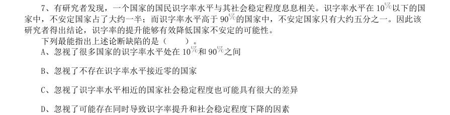
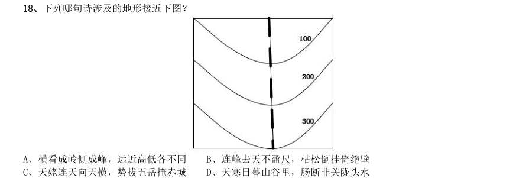

# 常识判断 · 地理常识 · 2020 年代真题

> 所属考点：[CS-DL](../CS-DL-地理常识.md)　｜　本片 21 题

### 2023 广东·乡镇　第 64 题　（世界地理）

目前,风能技术员是某国受伤率最高的职业之一,从业人员较少。但随着国家能源需求 向可再生能源转变,该国将越来越需要从事这样高风险性职业的人才,以保证国家能源的正 常供应。由于风能技术人才紧缺,该国此类岗位的薪酬不断提高。对此有专家建议,在加大 风能技术人才培养的同时,该国还应积极引进国际风能技术人才。 以下选项如果为真,最能解释这一现象的是( )。

- **A.** 风能技术员在工作中面临的风险在短期内不会下降
- **B.** 该国风能技术人才培养无法完全满足能源发展需求
- **C.** 风能技术员岗位薪酬的不断提高将制约能源产业的发展
- **D.** 国际风能技术人才的技术水平不低于该国培养的风能技术人才

**答案：B**

### 2023 广东·乡镇　第 81 题　（世界地理）

下列关于我国家庭用电的说法正确的是( )。

- **A.** 我国家庭使用的是220V 的直流电
- **B.** 带金属外壳的用电器一般使用两孔插座
- **C.** 要使用电器之间互不影响,用电器应串联接入电路
- **D.** 家庭用电的保险丝可以由电阻率大、熔点低的合金制成

**答案：D**

### 2023 国考·行政执法　第 1 题　（中国地理）

党的二十大报告指出,从现在起,中国共产党的中心任务就是团结带领全国各族人民全面建成社会主义现代化 强国、实现第二个百年奋斗目标,以中国式现代化全面推进中华民族伟大复兴。下列对中国式现代化的理解, 正确的有几项? 1坚持把实现人民对美好生活的向往作为现代化建设的出发点和落脚点 2共同富裕是社会主义的本质要求,是中国式现代化的重要特征 3在物质文明方面超越西方发达国家,是中国式现代化的主要目标 4遵循世界各国现代化的共同模式,是中国式现代化道路的基本经验 5中国式现代化新道路,创造了人类文明新形态

- **A.** 2项
- **B.** 3项
- **C.** 4项
- **D.** 5项

**答案：B**

### 2023 国考·行政执法　第 2 题　（世界地理）

党的二十大报告指出,要发展全过程人民民主,保障人民当家作主。关于人民民主,下列表述正确的是: 1人民民主是社会主义的生命,是全面建设社会主义现代化国家的应有之义 2全过程人民民主是社会主义民主政治的本质属性,是最广泛、最真实、最管用的民主 3协商民主是实践全过程人民民主的重要形式 4党内民主是全过程人民民主的重要体现

- **A.** 134
- **B.** 124
- **C.** 123
- **D.** 234

**答案：C**

### 2023 国考·行政执法　第 5 题　（中国地理）

中共中央、国务院印发了《黄河流域生态保护和高质量发展规划纲要》,根据该纲要,下列表述错误的是:

- **A.** 到2035年黄河流域生态保护和高质量发展取得重大战略成果
- **B.** 河湟-藏羌文化区是农耕文化与游牧文化交汇相融的过渡地带
- **C.** 支持青海、甘肃等风能、太阳能丰富地区构建风光水多能互补系统
- **D.** 水土保持区以内蒙古高原南缘、宁夏中部等为主

**答案：D**

### 2022 广东·乡镇　第 12 题　（世界地理）

基层治理是国家治理的基石,在打造基层治理共同体中,基层群众性自治组织发挥的是:

- **A.** 主导作用
- **B.** 决定作用
- **C.** 引领作用
- **D.** 基础作用

**答案：D**

### 2022 广东·乡镇　第 30 题　（中国地理）

台湾海峡、渤海海峡、琼州海峡是我国三大海峡。关于三大海峡的地理位置,从北到南正确的是:

- **A.** 琼州海峡——渤海海峡——台湾海峡
- **B.** 渤海海峡——琼州海峡——台湾海峡
- **C.** 渤海海峡——台湾海峡——琼州海峡
- **D.** 台湾海峡——琼州海峡——渤海海峡

**答案：C**

### 2022 国考·副省级　第 12 题　（中国地理）

(单选题)2020 年12 月8 日,国家主席习近平同尼泊尔总统班达里互致信函,共同宣布珠穆朗玛峰高 程。关于此次珠峰高程测量,下列说法错误的是:

- **A.** 水准测量从日喀则一等水准点起测
- **B.** 使用北斗卫星导航系统进行高精度定位
- **C.** 探测峰顶雪深的雪深雷达通过超声波探测
- **D.** 首次在珠峰北侧开展航空重力测量

**答案：C**

### 2022 国考·地市级　第 12 题　（中国地理）

2020 年12 月8 日,国家主席习近平同尼泊尔总统班达里互致信函,共同宣布珠穆朗玛峰高 程。关于此次珠峰高程测量,下列说法错误的是:

- **A.** 水准测量从日喀则一等水准点起测
- **B.** 使用北斗卫星导航系统进行高精度定位
- **C.** 探测峰顶雪深的雪深雷达通过超声波探测
- **D.** 首次在珠峰北侧开展航空重力测量

**答案：C**

### 2021 广东·乡镇　第 12 题　（世界地理）

党的十九届五中全会提出,坚持( )在我国现代化建设全局中的核心地位,把科技自立自强作为国家 发展的战略支撑。

- **A.** 创新
- **B.** 改革
- **C.** 开放
- **D.** 发展

**答案：暂缺**

### 2021 广东·乡镇　第 25 题　（世界地理）

中华人民共和国全国人民代表大会是最高国家权力机关。全国人民代表大会行使的职权不包括:

- **A.** 选举国家监察委员会主任以及最高人民法院院长
- **B.** 撤销全国人民代表大会常务委员会不适当的决定
- **C.** 编制和执行国民经济和社会发展计划和国家预算
- **D.** 制定和修改刑事、民事、国家机构的和其他的基本法律

**答案：暂缺**

### 2021 广东·乡镇　第 27 题　（世界地理）

《中华人民共和国环境保护法》所称环境包括: 1海洋 2森林 3草原 4湿地

- **A.** 34
- **B.** 12
- **C.** 134
- **D.** 1234

**答案：暂缺**

### 2021 国考·地市级　第 1 题　（中国地理）

党的十九届四中全会审议通过了《中共中央关于坚持和完善中国特色社会主义制度、推进国家治理体系和治 理能力现代化若干重大问题的决定》。下列对该决定理解不准确的是:

- **A.** 首次用一次中央全会专门研究我国国家制度和国家治理问题并作出决定
- **B.** 首次提出国家治理体系和治理能力现代化的命题
- **C.** 明确党的领导制度在我国国家制度和治理体系中的统领地位
- **D.** 对社会主义基本经济制度内涵作出重要拓展和深化

**答案：B**

### 2021 国考·地市级　第 13 题　（中国地理）

中共中央、国务院于2019 年11 月印发了《国家积极应对人口老龄化中长期规划》,其中提及的积极应对人 口老龄化的战略目标包括: 1制度基础持续巩固2财富储备日益充沛3人力资本不断提升4科技支撑更加有力5城乡区域协调发展

- **A.** 1345
- **B.** 1234
- **C.** 1245
- **D.** 2345

**答案：B**

### 2020 广东·思维能力测验　第 7 题　（世界地理）

有研究者发现,一个国家的国民识字率水平与其社会稳定程度息息相关。识字率水平在10 以下的国 家中,不安定国家占了大约一半;而识字率水平高于90 的国家中,不安定国家只有大约五分之一。因此该 研究者得出结论,识字率的提升能够有效降低国家不安定的可能性。 下列最能指出上述论断缺陷的是( )。

- **A.** 忽视了很多国家的识字率水平处在10和90之间
- **B.** 忽视了不存在识字率水平接近零的国家
- **C.** 忽视了识字率水平相近的国家社会稳定程度也可能具有很大的差异
- **D.** 忽视了可能存在同时导致识字率提升和社会稳定程度下降的因素

**答案：D**

### 2020 广东·思维能力测验　第 28 题　（中国地理）

今年暑假,小林去了高原地区旅游。为了防止被晒黑,小林在旅游期间每天都会按照说明来使用某 品牌防晒霜,但在旅游结束后,小林发现自己还是被晒黑了。因此,小林认为该品牌防晒霜是不合格产品。 下列各项最好地总结了上述论证缺陷的是( )。

- **A.** 忽视了每款防晒霜在销售之前都需要通过质量检测
- **B.** 假设了小林在旅游期间并没有使用其他的美白产品
- **C.** 默认了对于防晒霜而言,防止皮肤被晒伤的效果并不重要
- **D.** 假设了合格的防晒霜必须起到完全防止皮肤被晒黑的效果

**答案：D**

### 2020 广东·思维能力测验　第 41 题　（世界地理）

对于国家投入大量人力物力保护野生动物的做法,有网民认为:野生动物和家养的猪、牛、羊等都 是动物,既然国家不保护家养的动物,也就没有必要去保护野生动物。 下列最能指出上述论证缺陷的是( )。

- **A.** 默认了保护野生动物所花费的人力物力更多
- **B.** 默认了所有动物拥有相同的受保护价值
- **C.** 忽视了家养动物的数量远多于野生动物
- **D.** 忽视了野生动物对人类生存的重要性

**答案：B**

### 2020 广东·综合行政能力测验　第 3 题　（中国地理）

党的十九届四中全会提出,我国国家治理一切工作和活动都依照中国特色社会主义制度展开,我国 ( )是中国特色社会主义制度及其执行能力的集中体现。

- **A.** 基层治理体系和治理能力
- **B.** 城乡治理体系和治理能力
- **C.** 社会治理体系和治理能力
- **D.** 国家治理体系和治理能力

**答案：D**

### 2020 广东·综合行政能力测验　第 9 题　（世界地理）

坚持和完善共建共治共享的社会治理制度,保持社会稳定、维护国家安全。以下举措不属于打造共建 共治共享的社会治理格局的是( )。

- **A.** 畅通民意表达渠道
- **B.** 依法有序的信息公开
- **C.** 降低城乡人口流动性
- **D.** 开展行业公共安全风险评估

**答案：C**

### 2020 国考·地市级　第 13 题　（世界地理）

社会信用体系的建立有利于提高全社会的诚信意识和信用水平。下列关于国家加快社会信用体系建设的说法 错误的是:

- **A.** “重点突破,强化应用”是社会信用体系建设的主要原则之一
- **B.** 为惩戒失信执行人,规定其不得以财产支付子女就读高等院校的费用
- **C.** 推进青年信用体系建设,逐步应用到入学、就业、创业等领域
- **D.** 使统一社会信用代码成为企业的唯一身份代码

**答案：B**

### 2020 国考·地市级　第 18 题　（中国地理）

下列哪句诗涉及的地形接近下图?

- **A.** 横看成岭侧成峰,远近高低各不同
- **B.** 连峰去天不盈尺,枯松倒挂倚绝壁
- **C.** 天姥连天向天横,势拔五岳掩赤城
- **D.** 天寒日暮山谷里,肠断非关陇头水

**答案：D**
