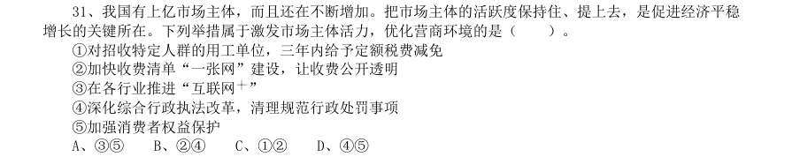

# 常识判断 · 法律常识 · 2020 年代真题

> 所属考点：[CS-FL](../CS-FL-法律常识.md)　｜　本片 46 题

### 2024 湖北·统一卷　第 3 题　（宪法）

在党员、干部的日常言行上——《不断提高政治判断力、政治领悟力、政治执行力》 习近平总书记强调,要坚定维护宪法权威和尊严,推动宪法完善和发展,更好发挥宪法在治国理政中的重要作 用。下列有关表述正确的有几项: 1要加强宪法理论研究和宣传教育,坚持知识普及、理论阐释、观念引导全面发力 2加快完善以宪法为核心的中国特色社会主义法律体系,不断提高宪法实施和监督水平 3坚持宪法确定的中国共产党领导地位不动摇,坚持宪法确定的人民民主专政的国体和人民代表大会制度的政 体不动摇 4宪法是治国安邦的总章程,是我们党治国理政的根本法律依据,是国家政治和社会生活的最高法律规范

- **A.** 1项
- **B.** 2项
- **C.** 3项
- **D.** 4项

**答案：D**

### 2024 湖北·统一卷　第 6 题　（法律常识（综合））

事 党的十八大以来,以习近平同志为核心的党中央始终把未成年人工作摆在突出位置。2024年1月1日起施行的 《未成年人网络保护条例》是我国第一部针对未成年人网络保护的专门性综合立法,是贯彻落实习近平法治思 想的生动体现。下列关于该条例内容表述正确的有几项? 1国家教育部门负责统筹协调未成年人网络保护工作 2网络产品和服务提供者不得为未成年人提供游戏账号租售服务 3网络产品和服务提供者不得通过自动化决策方式向未成年人进行商业营销 4网络直播服务提供者应当建立网络直播发布者真实身份信息动态核验机制 5网络服务提供者可根据实际引导未成年人参与应援集资、投票打榜、刷量控评等网络活动

- **A.** 2项
- **B.** 3项
- **C.** 4项
- **D.** 5项

**答案：B**

### 2024 湖北·统一卷　第 8 题　（法律常识（综合））

《中华人民共和国法律援助法》对于规范和促进法律援助工作、保障公民和有关当事人合法权益具有重大意 义。下列情况属于可经指派获得法律援助的是: 115岁的学生小明涉嫌贩卖毒品,没有委托辩护人 225岁的精神病人赵某涉嫌抢劫,其患病多年经济困难,没有委托辩护人 335岁的村民张某因向村中水井投毒,可能被判处死刑,没有委托辩护人 445岁的聋哑人李某创设公司后涉嫌逃税罪,其个人资产过亿,没有委托辩护人

- **A.** 123
- **B.** 234
- **C.** 134
- **D.** 1234

**答案：D**

### 2024 国考·副省级　第 9 题　（宪法）

根据《中华人民共和国立法法》下列说法错误的是( )。

- **A.** 国家监察委员会可以向全国人大常委会提出法律案
- **B.** 县级人大常委可以对基层治理方面的事项制定地方性法规
- **C.** 设区的市人大常委会可以根据实际需要设立基层立法联系点
- **D.** 法律草案的说明应当包括起草过程中对重大分歧意见的协调处理情况

**答案：B**

### 2024 国考·地市级　第 4 题　（宪法）

中国共产党登上中国历史舞台后,经过艰辛探索和实践,成功在中华大地上制定和实施了具有鲜明社会主义性 质的宪法、真正意义上的人民宪法,在我国宪法发展史乃至世界宪法制度史上都具有开创性意义,为人类法治 文明进步贡献了中国智慧、中国方案。下列有关我国宪法的表述正确的有几项? 1我国宪法确认了中国共产党的领导地位,这是我国宪法最显著的特征 2宪法是治国安邦的总章程,是中国共产党治国理政的根本法律依据 3要全面发挥宪法在立法中的核心地位功能,每一个立法环节都把好宪法关 4必须坚持宪法监督制度化法规化,宪法的生命在于监督,宪法的权威也在于监督

- **A.** 1项
- **B.** 2项
- **C.** 3项
- **D.** 4项

**答案：C**

### 2024 国考·地市级　第 8 题　（法律常识（综合））

习近平总书记强调,要把黑土地保护作为一件大事来抓,把黑土地用好养好。《中华人民共和国黑土地保护 法》自 2022 年8月1日起施行,下列表述不符合该法规定的是:

- **A.** 黑土层深厚、土壤性状良好的黑土地划入永久基本农田,重点用于粮食生产
- **B.** 无法修复的黑土地不列入黑土地保护范围进行修复
- **C.** 县级以上人民政府应当将黑土地保护工作纳入国民经济和社会发展规划
- **D.** 除国防建设项目选址无法避开外,其他建设项目一律不得占用黑土地

**答案：D**

### 2024 国考·地市级　第 9 题　（宪法）

根据《中华人民共和国立法法》下列说法错误的是( )。

- **A.** 国家监察委员会可以向全国人大常委会提出法律案
- **B.** 县级人大常委可以对基层治理方面的事项制定地方性法规
- **C.** 设区的市人大常委会可以根据实际需要设立基层立法联系点
- **D.** 法律草案的说明应当包括起草过程中对重大分歧意见的协调处理情况

**答案：B**

### 2024 国考·行政执法　第 11 题　（行政法）

下列做法符合《中华人民共和国行政处罚法》规定的是:

- **A.** 甲综合行政执法局责令孙某限期拆除其违法建筑
- **B.** 某变电站项目建成六年后,乙生态环境局发现其系“未批先建”,处以罚款
- **C.** 某公司因某次违规代开发票被丙税务部门罚款三次
- **D.** 丁市场监督管理局对王某作出行政拘留七日并罚款一千元的处罚

**答案：A**

### 2024 国考·行政执法　第 12 题　（刑法）

下列哪种情形,我国刑法不具有管辖权?

- **A.** 甲国公民在我国国际机场里给乙国公民下毒,乙国公民出境后毒发身亡
- **B.** 在从我国出发已行驶至甲国的国际列车上,甲国公民对乙国公民实施抢劫
- **C.** 我国公民在我国境内,通过电话教唆在甲国的甲国公民故意杀人
- **D.** 我国公民在甲国境内,对甲国公民实施绑架行为

**答案：B**

### 2024 国考·行政执法　第 13 题　（民法典）

诉讼时效是指民事权利受到侵害的权利人在法定的时效期间内不行使权利,当时效期间届满时,人民法院对权 利人的权利不再进行保护的制度。 下列情形不适用诉讼时效的是: 1甲要求邻居拆除妨碍通行的围墙 2乙要求物业修复可能导致儿童坠落的下水道 3丙要求长期占用其名下房屋的人搬离 4丁要求某公司支付其专利使用费

- **A.** 134
- **B.** 234
- **C.** 123
- **D.** 124

**答案：C**

### 2023 湖北·统一卷　第 6 题　（法律常识（综合））

党内法规体系建设是一个久久为功、持续推进的历史过程。习近平总书记在庆祝中国共 产党成立100 周年大会上宣布,我们党已经“形成比较完善的党内法规体系”,下列关于中 国共产党党内法规体系的说法错误的是:

- **A.** 党章是所有党内法规的源头,是制定一切党内法规的基础和依据
- **B.** 党内法规使用党章、准则、条例、规定、办法、规则、细则7 类名称
- **C.** 党内法规草案形成后,应当广泛征求意见。征求意见可以采取书面、座谈会、论证会等形式,但不宜采取网上征询的方式
- **D.** 党内法规体系以“1+4”为基本框架,即在党章之下分为党的组织法规、党的领导法规、

**答案：C**

### 2023 湖北·统一卷　第 20 题　（民法典）

老张和老伴李某育有两儿一女,小儿子早逝。老张不幸去世后,没有留下遗嘱,下列关 于遗产继承的说法错误的是:

- **A.** 遗产分割时,应当先将老张和李某共有的财产分出一半,归李某所有,其余的属于老张的遗产
- **B.** 大儿子在外地工作,长期对老张不闻不问,应当不分或少分遗产
- **C.** 女儿因工伤丧失了劳动能力,她的配偶患病长期服药,两个孩子都还在读中学,女儿与其他继承人均等继承遗产份额
- **D.** 小儿子的妻子陈某念及公婆二人无人照顾、行动不便,平日里悉心照料二老的生活,陈

**答案：C**

### 2023 广东·乡镇　第 24 题　（法律常识（综合））

根据《中华人民共和国土地管理法》,以下属于法律所禁止的行为有( )。 1退耕还牧 2围湖造田 3闲置耕地 4耕地取土

- **A.** 12
- **B.** 34
- **C.** 123
- **D.** 234

**答案：D**

### 2023 广东·乡镇　第 25 题　（法律常识（综合））

根据我国法律,敏感个人信息是一旦泄露或者非法使用,容易导致自然人的人格尊严受 到侵害或者人身、财产安全受到危害的个人信息。以下不属于敏感个人信息的是( )。

- **A.** 人脸特征
- **B.** 从业经历
- **C.** 医疗健康
- **D.** 行踪轨迹

**答案：B**

### 2023 广东·乡镇　第 27 题　（宪法）

下列选项不符合《中华人民共和国立法法》表述的是( )。

- **A.** 立法应当遵循宪法的基本原则
- **B.** 立法应当符合社会舆论的观点
- **C.** 立法应当从国家整体利益出发
- **D.** 立法应当适应经济社会发展和全面深化改革的要求

**答案：B**

### 2023 广东·县级　第 13 题　（宪法）

下列选项不符合《中华人民共和国立法法》表述的是( )。

- **A.** 立法应当遵循宪法的基本原则
- **B.** 立法应当符合社会舆论的观点
- **C.** 立法应当从国家整体利益出发
- **D.** 立法应当适应经济社会发展和全面深化改革的要求

**答案：B**

### 2023 国考·行政执法　第 11 题　（民法典）

关于个人信息保护,下列说法不符合我国法律规定的是:

- **A.** 通过自动化决策方式向个人进行商业营销,应同时提供不针对其个人特征的选项或便捷的拒绝方式
- **B.** 通过人脸识别技术所收集的个人图像、身份识别信息只能用于维护公共安全目的
- **C.** 个人信息和隐私有密切的关系,个人信息当中的私密信息适用有关隐私权的规定
- **D.** 用户量巨大的个人信息处理者需要定期发布个人信息保护社会责任报告

**答案：B**

### 2022 广东·乡镇　第 27 题　（法律常识（综合））

根据《党政领导干部选拔任用工作条例》,党政领导干部应当逐级提拔。特别优秀或者工作特殊需要的干 部,符合有关条件或情形的可以破格提拔。以下不属于可以破格提拔的条件或情形的是:

- **A.** 经济发达、高新技术产业发展地区急需引进的
- **B.** 在条件艰苦、环境复杂、基础差的地区或者单位工作实绩突出
- **C.** 专业性较强的岗位或者重要专项工作急需的
- **D.** 在关键时刻或者承担急难险重任务中经受住考验、表现突出、作出重大贡献

**答案：A**

### 2022 广东·乡镇　第 28 题　（民法典）

小李在乡道上驾驶汽车,为避让行人,不小心驶入道路旁的农田导致农作物受损。经协商,小李赔偿了农 民的损失,则小李承担的是:

- **A.** 民事责任
- **B.** 刑事责任
- **C.** 行政责任
- **D.** 道德责任

**答案：A**

### 2022 国考·副省级　第 8 题　（宪法）

(单选题)《中华人民共和国宪法》(1982 年)实施以来,先后五次以修正案的形式进了修改。下列宪 法条款与宪法修正案对应正确的是:

- **A.** 公民的合法的私有财产不受侵犯——1993 年宪法修正案
- **B.** 农村集体经济组织实行家庭承包经营为基础、统分结合的双层经营体制——2004 年宪法修正案
- **C.** 国家尊重和保障人权——1999 年宪法修正案
- **D.** 中国共产党领导是中国特色社会主义最本质的特征——2018 年宪法修正案

**答案：D**

### 2022 国考·地市级　第 9 题　（法律常识（综合））

《中华人民共和国数据安全法》自2021 年9 月1 日起施行。依据该法,下列说法错误的是:

- **A.** 省级以上人民政府应当将数字经济发展纳入本级国民经济和社会发展规划
- **B.** 国家工业和信息化主管部门负责国家数据安全工作的决策和议事协调
- **C.** 国家建立数据分类分级保护制度,对数据实行分类分级保护
- **D.** 从事数据交易中介服务的机构提供服务,应当要求数据提供方说明数据来源

**答案：B**

### 2022 国考·地市级　第 10 题　（行政法）

新修订的《中华人民共和国行政处罚法》自2021 年7 月15 日起施行。依据该法,下列说法 正确的是∶

- **A.** 行政机关拟作出降低资质等级的处罚之前,应当组织听证
- **B.** 对当事人依法给予一百元以上罚款的,执法人员不得当场收缴
- **C.** 法律、行政法规对违法行为未作出行政处罚规定的,地方性法规可补充设定
- **D.** 行政机关可以在其法定权限内书面委托其他组织或个人实施行政处罚

**答案：B**

### 2022 国考·行政执法　第 7 题　（行政法）

(单选题)新修订的《中华人民共和国行政处罚法》自2021 年7 月15 日起施行。依据该法,下列说法正 确的是∶

- **A.** 行政机关拟作出降低资质等级的处罚之前,应当组织听证
- **B.** 对当事人依法给予一百元以上罚款的,执法人员不得当场收缴
- **C.** 法律、行政法规对违法行为未作出行政处罚规定的,地方性法规可补充设定
- **D.** 行政机关可以在其法定权限内书面委托其他组织或个人实施行政处罚

**答案：B**

### 2022 国考·行政执法　第 8 题　（民法典）

(单选题)新修正的《中华人民共和国安全生产法》自2021 年9 月1 日起施行。依据该法,下列说法正 确的是:

- **A.** 应急管理部门对安全生产进行监督管理,其他行业主管部门无监管职责
- **B.** 生产经营单位分管生产的负责人是本单位安全生产第一负责人
- **C.** 安全生产违法行为导致重大事故损害公益的,人民检察院及有关公益组织可提起公益诉讼
- **D.** 生产安全事故情节特别严重、影响特别恶劣的,罚款额最高可达一亿元

**答案：D**

### 2022 国考·行政执法　第 9 题　（法律常识（综合））

(单选题)《中华人民共和国数据安全法》自2021 年9 月1 日起施行。依据该法,下列说法错误的是:

- **A.** 省级以上人民政府应当将数字经济发展纳入本级国民经济和社会发展规划
- **B.** 国家工业和信息化主管部门负责国家数据安全工作的决策和议事协调
- **C.** 国家建立数据分类分级保护制度,对数据实行分类分级保护
- **D.** 从事数据交易中介服务的机构提供服务,应当要求数据提供方说明数据来源

**答案：B**

### 2021 广东·乡镇　第 26 题　（民法典）

民法典与人们生活息息相关,被誉为“社会生活的百科全书”。以下内容中,民法典未涉及的是:

- **A.** 监管保险业务
- **B.** 禁止高空抛物
- **C.** 见义勇为补偿
- **D.** 保护个人信息

**答案：暂缺**

### 2021 国考·副省级　第 9 题　（民法典）

关于我国民法典,下列说法正确的是:

- **A.** 秉持“民商合一”传统,把许多商事法律规范纳入其中
- **B.** 对我国先前的民法体系和内容实现了颠覆性突破
- **C.** 首次将节约资源、保护生态环境列为民事活动基本原则
- **D.** 知识产权和涉外民事法律关系独立成编

**答案：暂缺**

### 2021 国考·地市级　第 5 题　（行政法）

根据2020 年1 月21 日中共中央办公厅发布的《纪检监察机关处理检举控告工作规则》,下列表述错误的是:

- **A.** 对匿名检举控告材料,确有需要的,可以直接核查检举控告人的笔迹、网际协议地址(IP 地址)等信息
- **B.** 纪检监察机关提倡、鼓励实名检举控告,对实名检举控告优先办理、优先处置、给予答复
- **C.** 承办的监督检查、审查调查部门应当将实名检举控告的处理结果在办结之日起15 个工作日内向检举控告人反馈
- **D.** 纪检监察机关信访举报部门可以通过面谈方式核实是否属于实名检举控告

**答案：A**

### 2021 国考·地市级　第 9 题　（法律常识（综合））

根据《中国共产党纪律处分条例》,下列说法中正确的是:

- **A.** 某区委原书记吕某,大搞迷信活动,找风水先生破解风水、拨问前程,主要违反党的生活纪律
- **B.** 某国有公司原党委委员、执行董事赵某,利用企业信誉和地位大搞权钱交易,牟取个人私利,主要违反党的廉洁纪律
- **C.** 某县委向中央环保督察组提供10 份编造的县委常委会会议纪要,弄虚作假,应对督察,主要违反党的工作纪律
- **D.** 某市畜牧兽医局原党组书记、局长郭某,自2003 年3 月起兼任该市某饲料有限公司(畜牧类企业)法定代表

**答案：B**

### 2020 湖北·统一卷　第 8 题　（法律常识（综合））

下列关于法律基础知识的表述正确的是:

- **A.** 司法机关在适用法律审理案件时,优先适用法律原则,再适用法律规则
- **B.** 法的渊源通常指法的形式意义上的渊源,即法律规范的创制方式和外部表现形式
- **C.** 法的公布与法的实施是两个不同的概念,但实践中法的公布日期即法的实施日期
- **D.** 当同一机关制定的法律出现效力冲突时,一般解决原则是新法优于旧法,一般法优于特别法

**答案：B**

### 2020 广东·乡镇　第 12 题　（民法典）

我国民法典规定,未设立村集体经济组织的,( )可以依法代行村集体经济组织职能。

- **A.** 村长
- **B.** 村民委员会
- **C.** 村党支部
- **D.** 村民小组

**答案：暂缺**

### 2020 广东·乡镇　第 21 题　（行政法）

2020 年6 月30 日颁布的《中华人共和国香港特别行政区维护国家安全法》是保持香港特别行政区繁荣和 稳定的重要法律。以下属于该法规定处罚的罪行有: 1分裂国家罪 2颠覆国家政权罪 3恐怖活动罪 4勾结外国或者境外势力危害国家安全罪

- **A.** 14
- **B.** 123
- **C.** 234
- **D.** 1234

**答案：暂缺**

### 2020 广东·乡镇　第 28 题　（法律常识（综合））

消费者权利是消费者在购买、使用商品或者接受服务中所享有的权利。下列消费者权利与侵犯该权利的事 件对应正确的是:

- **A.** 知情权——某线上服装店为快速清仓,推出低价“福袋”商品,并注明“福袋”内服装的款式、颜色等随机搭配
- **B.** 自主选择权——某餐厅推出外卖8 折活动,但是消费者点外卖时只有选择套餐才享受折扣,自由搭配时无法享受8 折优惠
- **C.** 安全保障权——王某的轿车已达到报废标准,但是他依旧照常使用,在一次高速行驶中刹车失灵造成事故
- **D.** 公平交易权——李某在车行订购汽车后,车行要求李某购买“车辆维护套餐”,否则汽车不予交付

**答案：暂缺**

### 2020 广东·乡镇　第 29 题　（民法典）

某公司与陈某在签订劳动合同时,在该合同约定“本人自愿放弃缴纳社保,公司每月给予200 元补贴作为 补偿,与每月工资一同发放”, 陈某工作一年后辞职。辞职后,他在当地申请劳动仲裁,要求该分司补缴社会 保险金。关于以上案例,以下说法错误的是:

- **A.** 案例中合同所约定的不缴纳社保的条款属于无效条款
- **B.** 该公司应为陈某补缴社会保险
- **C.** 陈某应当返还由该公司每月发放的200 元补贴
- **D.** 为确保放弃缴纳社保声明合法生效,应另起协议

**答案：暂缺**

### 2020 广东·县级　第 14 题　（行政法）

2020 年6 月30 日颁布的《中华人民共和国香港特别行政区维护国家安全法》是保持香港特别行政区繁荣和 稳定的重要法律。以下属于该法规定处罚的罪行有: 1分裂国家罪 2颠覆国家政权罪 3恐怖活动罪 4勾结外国或者境外势力危害国家安全罪

- **A.** 14
- **B.** 123
- **C.** 234
- **D.** 1234

**答案：暂缺**

### 2020 广东·县级　第 25 题　（民法典）

民法典对我国现行的、制定于不同时期的民事法律规范进行全面系统地编订纂修,以下法律规范不属于民法 典范围的是:

- **A.** 物权法
- **B.** 婚姻法
- **C.** 公务员法
- **D.** 侵权责任法

**答案：暂缺**

### 2020 广东·思维能力测验　第 4 题　（法律常识（综合））

为了提高国内青少年的身体素质,有人建议增加义务教育阶段体育课的课时。因为体育课课时越多, 中小学生进行体育锻炼的时间越长,他们的身体素质就会越好。 要使上述论证成立,必须补充的前提是( )。

- **A.** 中小学生会在体育课上进行体育锻炼
- **B.** 体育课课时越少,中小学生体育锻炼时间也越短
- **C.** 体育课是中小学生提升身体素质的唯一途径
- **D.** 增加体育锻炼时间有利于提高身体素质

**答案：A**

### 2020 广东·思维能力测验　第 11 题　（刑法）

城市比乡村人口密度更高,而高人口密度会导致犯罪率的上升,因此城市比乡村有着更高的犯罪率。 下列选项中,与上述推理结构最为相似的是( )。

- **A.** 酶是一种蛋白质,而蛋白质是由氨基酸组成的,因此酶也是由氨基酸组成的
- **B.** 县比市辖区拥有更高的自主权,而更高的自主权会带来更高的审批效率,因此县比市辖区的审批效率更高
- **C.** 猫科动物拥有敏锐的听力,老虎、猎豹和家猫都属于猫科动物,因此它们的听力都很敏锐
- **D.** 相比农村的孩子,城市的孩子能够接触到更加优质的教育资源,同时城市的孩子升学率更高,因此优

**答案：B**

### 2020 广东·综合行政能力测验　第 2 题　（法律常识（综合））

五大发展理念是新时代指导中国经济社会发展的基本理念。以下举措主要体现的不是共享发展理念的 是( )。 1调查摸清我国贫困人口分布、致贫原因、脱贫需求等信息,建立起全国统一的扶贫开发信息系统 2健全以基层党组织为核心,以群众自治组织、辖区企事业单位、社会组织、社区居民为补充的“五位 一体”自治组织 3取消对义务教育阶段学校的考核排名,推动校长和教师异校交流 4把资源消耗、环境损害、生态效益等指标纳入经济社会发展评价体系 5鼓励企业发挥优势,按照市场化的方式开展产业扶贫,实现贫困地区与企业发展的双赢

- **A.** 24
- **B.** 145
- **C.** 123
- **D.** 345

**答案：A**

### 2020 广东·综合行政能力测验　第 31 题　（宪法）

我国有上亿市场主体,而且还在不断增加。把市场主体的活跃度保持住、提上去,是促进经济平稳 增长的关键所在。下列举措属于激发市场主体活力,优化营商环境的是( )。 1对招收特定人群的用工单位,三年内给予定额税费减免 2加快收费清单“一张网”建设,让收费公开透明 3在各行业推进“互联网 ” 4深化综合行政执法改革,清理规范行政处罚事项 5加强消费者权益保护

- **A.** 35
- **B.** 24
- **C.** 12
- **D.** 45

**答案：B**

### 2020 广东·综合行政能力测验　第 32 题　（宪法）

以下关于我国宪法中的规定,说法有误的是( )。

- **A.** 如果遇到不能进行下届全国人民代表大会代表选举的非常情况,由全国人民代表大会常务委员会以全体组成人员的三分之二以上的多数通过,可以推迟选举,延长本届全国人民代表大会的任期
- **B.** 宪法的修改,由全国人民代表大会常务委员会或者四分之一以上的全国人民代表大会代表提议,并由全国人民代表大会以到会代表的四分之三以上的多数通过
- **C.** 如果全国人民代表大会常务委员会认为必要,或者有五分之一以上的全国人民代表大会代表提议,可以临时召集全国人民代表大会会议
- **D.** 法律和其他议案由全国人民代表大会以全体代表的过半数通过

**答案：B**

### 2020 广东·综合行政能力测验　第 33 题　（宪法）

第十三届全国人民代表大会第一次会议通过的宪法修正案,将“国家工作人员就职时应当依照法律 规定公开进行宪法宣誓”写入宪法,这有利于( )。 1坚持依法治国,坚持依宪治国 2增强国家机关工作人员乃至全社会的宪法意识 3保障国家机关工作人员履行职务的合法性 4激发国家机关工作人员履行职务的使命感

- **A.** 123
- **B.** 234
- **C.** 124
- **D.** 134

**答案：C**

### 2020 广东·综合行政能力测验　第 34 题　（行政法）

由( )颁布的《中华人民共和国食品安全法实施条例》自2019 年12 月1 日起正式施行,该条 例在食品安全法的基础上补短板、强弱项,以良法善治,为人民群众“舌尖上的安全”保驾护航。

- **A.** 全国人民代表大会常务委员会
- **B.** 国家发展和改革委员会
- **C.** 全国人民代表大会
- **D.** 国务院

**答案：D**

### 2020 广东·综合行政能力测验　第 35 题　（法律常识（综合））

社会保障是指国家通过立法,积极动员社会各方面资源,保证无收入、低收入以及遭受各种意外灾 害的公民能够维持生存,保障劳动者在年老、失业、患病、工伤、生育时的基本生活不受影响,同时根据经 济和社会发展状况,逐步增进公共福利水平,提高国民生活质量。社会保障包括社会保险、社会福利、社会 救助、社会优抚等类型。以下情况属于社会救助的是( )。

- **A.** 学校给特困家庭学生发放助学金
- **B.** 工伤职工获得一次性伤残补助金
- **C.** 某慈善基金为贫困家庭的先天性心脏病儿童提供免费医疗
- **D.** 退出现役的一级至四级残疾军人,由国家供养终身

**答案：A**

### 2020 国考·地市级　第 9 题　（行政法）

对侵害英雄烈士的姓名、肖像、名誉、荣誉的行为,有权向人民法院提起诉讼的主体是: 1英雄烈士近亲属 2检察机关 3当地人民政府 4负责英雄烈士保护工作的部门

- **A.** 24
- **B.** 14
- **C.** 13
- **D.** 12

**答案：D**

### 2020 国考·地市级　第 10 题　（行政法）

2018 年某大型玻璃厂超标排放大气污染物,严重污染了周边的大气环境。根据我国相关法律,下列哪一无 违法记录且符合年限要求的主体有权提起公益诉讼?

- **A.** 由周边住户合法有效推选出的某环保志愿者
- **B.** 依法在邻省民政厅登记的某环保协会
- **C.** 依法在玻璃厂所在地的县民政局登记的某环保中心
- **D.** 在国外合法设立但尚未在我国民政部门登记的某环保基金会

**答案：B**
