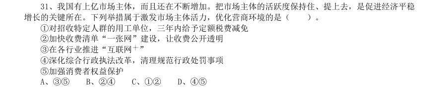

# 常识判断 · 经济常识 · 2020 年代真题

> 所属考点：[CS-JJ](../CS-JJ-经济常识.md)　｜　本片 54 题

### 2024 湖北·统一卷　第 7 题　（宏观经济）

在2023年12月召开的中央经济工作会议上,习近平总书记全面总结2023年经济工作,深刻分析当前经济形势, 系统部署2024年经济工作。下列关于做好2024年经济工作的要求,表述正确的有: 1强化宏观政策逆周期和跨周期调节 2坚持稳中求进、以进促稳、先立后破 3积极的财政政策要适度加力、提质增效 4稳健的货币政策要灵活适度、精准有效

- **A.** 12
- **B.** 123
- **C.** 234
- **D.** 1234

**答案：D**

### 2024 湖北·统一卷　第 17 题　（宏观经济）

下列关于贷款市场报价利率(LPR)说法错误的是:

- **A.** 目前LPR只有1年期和5年期以上两个期限品种
- **B.** 当LPR下降后,商业性个人住房贷款的最新一期月供也会下降
- **C.** LPR是由中国人民银行授权全国银行间同业拆借中心计算并公布的基础性的贷款参考利率
- **D.** 新发放的商业性个人住房贷款利率是以最近一个月相应期限的贷款市场报价利率为定价基准加点形成

**答案：B**

### 2024 湖北·统一卷　第 19 题　（经济常识（综合））

宝石是用于装饰的、有经济价值的矿物及生物矿物和岩石的总称,呈现晶体、集合体等形态,是地球送给人类 的珍贵礼物。下列不属于宝石形成机制的是( )。

- **A.** 由炽热岩浆喷发所生成的熔岩蒸汽冷凝产生
- **B.** 岩浆冷却凝固时浓缩的成分结晶后形成
- **C.** 在地核内部高温高压变质瘤结成型
- **D.** 从岩浆产生的热液中结晶生长

**答案：C**

### 2024 广东·统一卷　第 10 题　（经济常识（综合））

2024年2月,广东召开全省高质量发展大会,会议强调,推进产业科技创新,发展新质生产力是广东的战略之 举、长远之策。以下有关广东高质量发展要求的表述,不准确的是( )。

- **A.** 要坚持以开放促改革、促创新
- **B.** 要持续营造有利于创新的政策和制度环境
- **C.** 要全力支持高校做创新的主角,推动创新资源向高校集聚
- **D.** 要依托市场优势吸聚创新资源,运用市场机制兑现创新价值

**答案：A**

### 2024 国考·副省级　第 2 题　（微观与市场）

习总书记强调,要引导民营企业和民营企业家正确理解党中央方针政策,增强信心、轻装上阵、大胆发展,实 现民营经济健康发展、高质量发展。关于推动民营经济高质量发展,下列选项正确的是( )。 1民营企业要践行新发展理念,转变发展方式、调整产业结构、转换增长动力,坚守主业、做强实业,自觉走 高质量发展路子 2有能力、有条件的民营企业要加强自主创新,在推进科技自立自强和科技成果转化中发挥更大作用 3要激发民间资本投资活力,鼓励和吸引民间资本参与互联网投资和境外投资,为促进国内外双循环做出更大 贡献 4要依法规范和引导各类资本健康发展,有效防范化解系统性金融风险,为各类所有制企业创造公平竞争、竞 相发展的环境

- **A.** 124
- **B.** 123
- **C.** 134
- **D.** 234

**答案：A**

### 2024 国考·副省级　第 4 题　（经济常识（综合））

习近平总书记强调全面建设社会主义现代化国家,扎实推进共同富裕,最艰巨最繁重的任务仍然在农村,必须 逐步缩小城乡差距。下列符合党和国家政策精神的是( )。 1积极推进以建制镇为重要载体的新型城镇化建设,构建以建制镇为枢纽的县镇经济体系 2持续实施动态监测,不断增强脱贫地区内生发展动力,坚决守住不发生规模性返贫底线 3因地制宜大力发展特色产业,推进农村一、二、三产业融合发展 4持续深化农村人居环境整治,加强传统村落和乡村特色风貌保护,加强农村精神文明建设

- **A.** 123
- **B.** 124
- **C.** 234
- **D.** 134

**答案：C**

### 2024 国考·副省级　第 7 题　（宏观经济）

习近平指出健全美丽中国建设保障体系,统筹各领域资源,汇聚各方面力量,打好法治、市场、科技、政 策“组合拳”,关于健全美丽中国建设保障体系,下列正确的是( )。 1要全面实行排污许可制,完善自然资源资产管理制度体系,健全国土空间用途管制制度 2要完善绿色低碳发展经济政策,强化财政支持、税收政策支持、金融支持、价格政策支持 3要加快构建环保信用监管体系,规范环境治理市场,促进环保产业和环境服务业健康发展 4要更好发挥政府在碳排放权、用能权、用水权等资源环境要素配置中的决定性

- **A.** 234
- **B.** 124
- **C.** 134
- **D.** 123

**答案：D**

### 2024 国考·副省级　第 13 题　（宏观经济）

下列与宏观经济有关的说法,错误的是( )。

- **A.** 利率变化与资金供求关系有关
- **B.** 央行逆回购会减少市场流动性
- **C.** 国际收支顺差会给本币带来升值压力
- **D.** 提高贷款利率可用于控制通货膨胀

**答案：B**

### 2024 国考·副省级　第 15 题　（经济常识（综合））

习近平总书记在给山东省地矿局第六地质大队全体地质工作者的回信中强调:“矿产资源是经济社会发展的重 要物质基础,矿产资源勘查开发事关国计民生和国家安全。”下列与我国矿产资源有关的说法错误的是:

- **A.** 锡矿是我国的优势矿产资源之一
- **B.** 我国已在南海实现天然气水合物试采
- **C.** 新疆罗布泊是我国钾盐的主要产地之一
- **D.** 我国目前最大的金矿在云南省内

**答案：D**

### 2024 国考·行政执法　第 7 题　（微观与市场）

党的二十大报告指出,依托我国超大规模市场优势,以国内大循环吸引全球资源要素,增强国内国际两个市场 两种资源联动效应,提升贸易投资合作质量和水平。下列关于提升贸易投资合作质量和水平的措施,表述准确 的是: 1推动货物贸易优化升级,创新服务贸易发展机制,发展数字贸易,加快建设贸易强国 2扩大外资准入负面清单,营造市场化、法治化、国际化一流营商环境 3优化区域开放布局,巩固中西部和东北地区开放先导地位,提高东部地区开放水平 4实施自由贸易试验区提升战略,扩大面向全球的高标准自由贸易区网络

- **A.** 12
- **B.** 23
- **C.** 14
- **D.** 34

**答案：C**

### 2023 湖北·统一卷　第 2 题　（宏观经济）

党的二十大报告指出:要采取更多惠民生、暖民心举措,着力解决好人民群众急难愁盼 问题,健全基本公共服务体系,提高公共服务水平,增强均衡性和可及性,扎实推进共同富 裕。下列有关内容表述正确的是: 1实施渐进式延迟法定退休年龄 2健全社保基金保值增值和安全监管体系 3加大税收、社会保障、转移支付等的调节力度 4健全终身职业技能培训制度,推动解决周期性就业矛盾 5深化以市场化为导向的公立医院改革,规范民营医院发展 6坚持房子是用来住的、不是用来炒的定位,加快建立多主体供给、多渠道保障、租购并举 的住房制度

- **A.** 1234
- **B.** 1236
- **C.** 2356
- **D.** 1456

**答案：B**

### 2023 湖北·统一卷　第 4 题　（微观与市场）

党的二十大报告提出“加快发展数字经济,促进数字经济和实体经济深度融合,打造具 有国际竞争力的数字产业集群”。下列有关我国数字经济发展说法不正确的是:

- **A.** 我国5G 网络规模已在全球居首位
- **B.** 目前中国算力规模约占全球的27%,排名第二
- **C.** 2021 年我国数字经济规模占GDP 总量的比重接近20%
- **D.** 全国一体化大数据中心体系初步建立,“东数西算”工程已于2022 年全面启动

**答案：C**

### 2023 湖北·统一卷　第 63 题　（经济常识（综合））

某产业展洽会主办方融合“七巧板”元素设计了七大展示区域(如下图所示),甲、乙、 丙三家参展公司从7 块展区中分别选择面积各不相间的一个区域进行布展,则共有多少种选 择方案?

- **A.** 48
- **B.** 72
- **C.** 96
- **D.** 192

**答案：B**

### 2023 广东·乡镇　第 2 题　（微观与市场）

当前,各乡镇纷纷在特色农产品上做文章,但真正能在市场竞争中__________的,还是那 些品类独特、品质优良的农产品。

- **A.** 历久弥新
- **B.** 脱颖而出
- **C.** 一枝独秀
- **D.** 披荆斩棘

**答案：B**

### 2023 广东·乡镇　第 5 题　（微观与市场）

质量__________是产出来的,__________是管出来的,__________是市场竞争出来的。这 就要推动有效市场与有为政府更好结合,共助质量强国建设取得新成效。

- **A.** 不不而
- **B.** 既也更
- **C.** 首先其次再次
- **D.** 要么要么要么

**答案：B**

### 2023 广东·乡镇　第 14 题　（微观与市场）

党的二十大报告指出,高质量发展是全面建设社会主义现代化国家的首要任务。发展是 党执政兴国的第一要务。下列属于建设现代化产业体系的是( )。 1支持专精特新企业发展 2完善农业支持保护制度 3加快建设西部陆海新通道 4加快发展数字经济 5构建优质高效的服务业新体系

- **A.** 145
- **B.** 235
- **C.** 1234
- **D.** 2345

**答案：A**

### 2023 广东·乡镇　第 62 题　（微观与市场）

为推动社区养老服务建设,某社区开设了长者食堂,向社区内符合条件的老年人提供一 日三餐。该食堂饭菜价格远低于市场价,且品种多样、味道极佳、分量充足,然而每天到该 食堂就餐的老年人数量并不多。 以下各项如果为真,最能解释这一现象的是( )。

- **A.** 社区内多数老年人选择送餐上门而非到食堂用餐
- **B.** 该社区内和周边有许多深受当地居民喜爱的餐馆
- **C.** 该长者食堂占地面积较大,食堂内就餐座位充足
- **D.** 符合就餐条件的老年人在社区居民中的占比不高

**答案：A**

### 2023 广东·乡镇　第 91 题　（宏观经济）
> 材料：2021 年,广东省财政科学技术支出为982.76 亿元,占当年全省财政一般公共预算支出 的比重为5.4%。其中,省本级财政科学技术支出为102.05 亿元,占省本级财政一般公共预 算支出的比重为6.6%,同比增加0.84 个百分点。珠江三角洲核心区财政科学技术支出845. 09 亿元,同比增长2.6%。…

2021 年,广东省财政科学技术支出比上年提高了( )亿元。

- **A.** 7.03
- **B.** 17.03
- **C.** 27.03
- **D.** 37.03

**答案：C**

### 2023 广东·乡镇　第 93 题　（经济指标）

2020 年广东省省本级财政科学技术支出( )。

- **A.** 在60-80 亿元之间
- **B.** 在80-100 亿元之间
- **C.** 在100-120 亿元之间
- **D.** 超过120 亿元

**答案：B**

### 2023 广东·乡镇　第 97 题　（微观与市场）

2022 年,城镇居民人均可支配收入较消费支出多( )元。

- **A.** 3501
- **B.** 7906
- **C.** 12545
- **D.** 18892

**答案：D**

### 2022 广东·乡镇　第 15 题　（经济常识（综合））

在经济全球化时代,任何一个国家都不可能孤立于世界之外,团结合作是所有国家的必然选择,各国人民 更需要同舟共济、共克时艰。 下列选项最符合该观点内涵的是:

- **A.** 人视水见形,视民知治不
- **B.** 孤举者难起,众行者易趋
- **C.** 安而不忘危,存而不忘亡
- **D.** 天不言而四时行,地不语而百物生

**答案：B**

### 2022 广东·乡镇　第 19 题　（微观与市场）

《中华人民共和国国民经济和社会发展第十四个五年规划和2035 年远景目标纲要》提出“推进能源革命, 建设清洁低碳、安全高效的能源体系”。以下措施有助于建设清洁低碳、安全高效的能源体系的是: 1提升光伏发电规模 2推进以电代煤 3推动沿海核电建设 4有序发展海上风电

- **A.** 14
- **B.** 23
- **C.** 234
- **D.** 1234

**答案：D**

### 2022 广东·县级　第 17 题　（经济指标）

结构性就业问题是因经济结构和劳动力结构不对应,使工作岗位要求与劳动者文化技术水平不相适应而产 生的就业问题。以下措施最有助于缓解结构性就业问题的是:

- **A.** 鼓励创业带动就业,支持多渠道灵活就业
- **B.** 持续、大规模、多层次开展职业培训
- **C.** 完善就业失业统计监测调查体系
- **D.** 健全覆盖城乡劳动者的社会保障体系

**答案：B**

### 2022 国考·副省级　第 7 题　（微观与市场）

(单选题)根据《中华人民共和国国民经济和社会发展第十四个五年规划和2035 年远景目标纲要》,下 列不属于“十四五”规划重要目标的是:

- **A.** 保持制造业比重基本稳定,增强制造业竞争优势
- **B.** 优化提升供给结构,促进农业、制造业、服务业、能源资源等产业协调发展
- **C.** 健全农业支持保护制度,完善粮食主产区利益补偿机制
- **D.** 关键核心技术实现重大突破,进入创新型国家前列

**答案：D**

### 2022 国考·地市级　第 2 题　（微观与市场）

习近平总书记指出,要根据我国经济发展实际情况,建立起扩大内需的有效制度,释放内需 潜力,加快培育完整内需体系,加强需求侧管理,扩大居民消费,提升消费层次,使建设超大规模的 国内市场成为一个可持续的历史过程。下列举措不属于需求侧改革的是:

- **A.** 构建“智能+”消费生态体系
- **B.** 完善收入分配制度
- **C.** 严格落实“房住不炒”
- **D.** 剥离企业办社会职能

**答案：D**

### 2022 国考·地市级　第 7 题　（微观与市场）

根据《中华人民共和国国民经济和社会发展第十四个五年规划和2035 年远景目标纲要》,下 列不属于“十四五”规划重要目标的是:

- **A.** 保持制造业比重基本稳定,增强制造业竞争优势
- **B.** 优化提升供给结构,促进农业、制造业、服务业、能源资源等产业协调发展
- **C.** 健全农业支持保护制度,完善粮食主产区利益补偿机制
- **D.** 关键核心技术实现重大突破,进入创新型国家前列

**答案：D**

### 2022 国考·地市级　第 14 题　（宏观经济）

财政是国家治理的基础和重要支柱,科学的财税体制是优化资源配置、维护市场统一、促进 社会公平、实现国家长治久安的制度保障。下列关于我国财税制度变迁的表述错误的是:

- **A.** 国税地税机构合并后,实行以国家税务总局直接领导的管理体制
- **B.** 《中华苏维埃共和国宪法大纲》宣布取消一切反革命统治时代的苛捐杂税
- **C.** 《中国人民政治协商会议共同纲领》明确规定“简化税制”
- **D.** 营业税改征增值税可减少重复征税,有利于降低企业税负

**答案：A**

### 2022 国考·行政执法　第 2 题　（微观与市场）

(单选题)习近平总书记指出,要根据我国经济发展实际情况,建立起扩大内需的有效制度,释放内需 潜力,加快培育完整内需体系,加强需求侧管理,扩大居民消费,提升消费层次,使建设超大规模的国 内市场成为一个可持续的历史过程。下列举措不属于需求侧改革的是:

- **A.** 构建“智能+”消费生态体系
- **B.** 完善收入分配制度
- **C.** 严格落实“房住不炒”
- **D.** 剥离企业办社会职能

**答案：D**

### 2022 国考·行政执法　第 13 题　（宏观经济）

(单选题)下列经济现象或做法符合经济学常理的是:

- **A.** 中央银行增加外汇储备引起货币供应量减少
- **B.** 通货紧缩时期政府减少在社会福利方面的支出
- **C.** 政府通过降低税率,减少税收,抑制通货膨胀
- **D.** 流动性过剩时中央银行在金融市场上出售国债

**答案：D**

### 2021 广东·乡镇　第 14 题　（经济常识（综合））

《中共中央关于制定国民经济和社会发展第十四个五年规划和二〇三五年远景目标的建议》对新发展阶段优 先发展农业农村、全面推进乡村振兴作出总体部署。以下不属于新发展阶段全面推进乡村振兴措施的是( )。

- **A.** 实施农村人居环境整治
- **B.** 加快县域内城乡融合发展
- **C.** 加强党的农村基层组织建设
- **D.** 保障农村贫困人口基本医疗和住房安全

**答案：暂缺**

### 2021 广东·乡镇　第 20 题　（微观与市场）

增强消费对经济发展的基础性作用,顺应消费升级趋势,提升传统消费,培育新型消费,适当增加公共消费。 下列措施中,有助于增强消费对经济发展的基础性作用的有: 1提高服务消费领域市场准入门槛,减少产品供给 2推动汽车等消费品由购买管理向使用管理转变 3完善节假日制度,落实带薪休假制度 4改善消费环境,强化消费者权益保护

- **A.** 14
- **B.** 13
- **C.** 24
- **D.** 234

**答案：暂缺**

### 2021 广东·乡镇　第 30 题　（经济常识（综合））

2020 年是“十三五”收官之年,广东经济社会发展取得重大成果。下列有关说法正确的是: 1第一届全国职业技能大赛在广东举行 2全省地区生产总值超过11 万亿元,连续32 年位居全国第一 3区域创新综合能力跃居全国第一,有效发明专利量保持全国首位

- **A.** 2
- **B.** 12
- **C.** 13
- **D.** 123

**答案：暂缺**

### 2021 国考·副省级　第 1 题　（微观与市场）

面对复杂严峻的形势,以习近平同志为核心的党中央深刻把握世界大势和发展规律,科学分析我国发展面临 机遇和挑战的新变化,着眼我国经济中长期发展,作出加快形成新发展格局的重大战略部署。关于我国新发展格 局,下列理解正确的有几项? 1努力把满足国内需求作为发展的出发点和落脚点 2充分发挥国内超大规模市场优势 3逐步形成以国内大循环为主体、国内国际双循环相互促进的格局 4深化收入分配改革是形成以国内大循环为主体的关键

- **A.** 1 项
- **B.** 2 项
- **C.** 3 项
- **D.** 4 项

**答案：暂缺**

### 2021 国考·地市级　第 2 题　（宏观经济）

习近平总书记指出,要强化对市场主体的金融支持,发展普惠金融,有效缓解企业特别是中小微企业融资难 融资贵的问题。下列哪个措施最有助于新增融资重点流向中小微企业?

- **A.** 深化市场报价利率改革,引导贷款利率继续下行
- **B.** 探索优化教育、养老领域中长期融资的配套政策和运作模式
- **C.** 综合运用清收、核销、重组、证券化、债转股等多种处置手段,大力化解不良资产风险
- **D.** 银行业金融机构优先、快速对在中国人民银行征信报告中无贷款记录的企业提供贷款

**答案：D**

### 2020 湖北·统一卷　第 1 题　（经济常识（综合））

习近平总书记2020 年3 月6 日在决战决胜脱贫攻坚座谈会上强调,这次会议的主要任务是,分析当前形势, 克服新冠肺炎疫情影响,凝心聚力,打赢脱贫攻坚战,做到“两个确保”。下列属于“两个确保”内容的是: 1如期完成脱贫攻坚目标任务2实现经济社会高质量发展 3打赢疫情防控阻击战4全面建成小康社会

- **A.** 12
- **B.** 13
- **C.** 24
- **D.** 14

**答案：D**

### 2020 湖北·统一卷　第 7 题　（微观与市场）

下列俗语与其蕴含的经济学道理对应错误的是:

- **A.** 田忌赛马——成本与收益
- **B.** 知人知面不知心——信息不对称
- **C.** 十年树木,百年树人——长期投资
- **D.** 萝卜白菜,各有所爱——偏好理论

**答案：A**

### 2020 广东·乡镇　第 14 题　（经济常识（综合））

为有效应对新冠疫情对我国经济的影响,相关部门出台了一系列举措帮助企业复工复产。以下属于金融政 策举措的是:

- **A.** 降低政府定价的货物港务费和港口设施保安费收费标准,显著降低物流运输成本
- **B.** 对中小微企业生产经营场所的用电、用水、用气实施阶段性缓缴费用,缓缴期“欠费不停供”
- **C.** 免征中小微企业三项社保的单位缴费,降低企业负担
- **D.** 引导银行加大对民营和小微企业支持的力度,保持贷款额合理增加

**答案：暂缺**

### 2020 广东·乡镇　第 18 题　（经济常识（综合））

产业增收是脱贫攻坚的主要途径和长久之策。以下举措不属于产业扶贫的是:

- **A.** 种植特色水果
- **B.** 开展乡村旅游
- **C.** 兴建乡村卫生站
- **D.** 成立农产品产业园

**答案：暂缺**

### 2020 广东·乡镇　第 30 题　（经济常识（综合））

“逆经济风向调节”是指当经济萎缩时要采取扩张的经济政策,当经济过热时要采用紧缩的经济政策。据 此,当一个国家经济过热时,应当采取的政策措施是:

- **A.** 减少政府支出,提高利率
- **B.** 减少政府支出,降低利率
- **C.** 增加政府支出,提高利率
- **D.** 增加政府支出,降红利率

**答案：暂缺**

### 2020 广东·思维能力测验　第 2 题　（经济常识（综合））

一个企业形象如何,取决于它的经济效益和社会效益。企业管理者需要明确的是,只有不断提高企业 的经济效益,才能不断提高企业的社会效益。 由此可知,下列关系必然正确的是( )。 1企业的经济效益好,其社会效益必然好 2企业的经济效益差,其社会效益必然差 3企业的社会效益好,其经济效益必然好 4企业的社会效益差,其经济效益必然差

- **A.** 13
- **B.** 23
- **C.** 14
- **D.** 24

**答案：B**

### 2020 广东·思维能力测验　第 19 题　（微观与市场）

某地为抑制高房价,实施了严格的商品房限购政策,限制本地户籍家庭只能购买两套住房、外地户 籍家庭只能购买一套住房,并且预测商品房价格会下降。但实际上,限购政策推行后,预期效果并未出现。 下列最有助于解释上述结果的是( )。

- **A.** 流入当地的外来人口不断增加
- **B.** 多数本地户籍家庭已经拥有两套住房
- **C.** 当地的教育资源较好
- **D.** 当地人均收入水平较高

**答案：A**

### 2020 广东·思维能力测验　第 31 题　（微观与市场）

为改变世界钢铁市场供过于求的局面,保护本国钢铁生产商,多个国家开始对进口钢材征收高额关 税,以期促使全球钢铁生产大国控制产能。但关税实施后,国际钢铁价格虽然大跌,全球钢铁产量却并没有 显著下降。 以下能够最好地解释这一情况的是( )。

- **A.** 钢铁生产企业难以在短时间内降低产能
- **B.** 部分发展中国家对钢材的需求量依然比较高
- **C.** 世界钢铁生产大国本身也是钢铁消费大国
- **D.** 大宗钢铁产品订单的生产需要一定周期

**答案：C**

### 2020 广东·思维能力测验　第 34 题　（微观与市场）

虽然已经有人指出纯电动车的电池生产和回收处理过程仍然很不环保,但对消费者个人而言,纯电 动车比传统燃油车更加经济,毕竟相同公里数的花费是传统燃油车的一半。所以,消费者个人使用纯电动车 仍然是较优选择。 下列各项最好地总结了上述论证缺陷的是( )。

- **A.** 忽视了传统燃油车排放出的尾气也是一种污染
- **B.** 假设了经济性是消费者选择用车类型的决定性因素
- **C.** 暗含了电池生产和回收处理的环保技术在短时间内难以改进
- **D.** 忽视了纯电动车和传统燃油车的经济性差异程度是因品牌而异的

**答案：B**

### 2020 广东·思维能力测验　第 39 题　（微观与市场）

某公益性消费投诉媒体平台发布了2018 年消费投诉报告,该报告指出,2018 年电商行业有效投诉 量最高的前五位如下:A 商城——2999 件,B 商城——2708 件,C 商城——2167 件,D 商城——2026 件,E 商城——815 件。由此可见,在以上五大电商中,E 商城服务质量和用户满意度最高。 下列最不能说明上述论证缺陷的是( )。

- **A.** 忽视了电商用户规模的基数差异
- **B.** 忽视了五大电商的客源之间存在一定的重叠
- **C.** 忽视了各电商对投诉的实际处理效果可能存在差异
- **D.** 忽视了对不同电商进行投诉的便利程度可能存在差异

**答案：B**

### 2020 广东·思维能力测验　第 43 题　（经济常识（综合））

某研究人员为了解企业家进行企业选址的决策心理,从高校学生中寻找到30 名志愿者,让其扮演某 种类型企业的总经理,并为其提供了企业的相关信息资料以及8 个不同地区的相关信息资料,要求志愿者从 8 个地区中选择一个作为企业驻地并阐述原因。实验结束后,该研究者得出结论,交通状况和地区经济发展 水平是影响企业选址最重要的两个因素。 下列最不能指出上述论证缺陷的是( )。

- **A.** 默认了这些志愿者与现实中的企业家有着相同的思维方式
- **B.** 假设了提供的8 个地区能代表现实中企业选址面临的情况
- **C.** 假设了这些志愿者获得的相关信息资料是真实可靠的
- **D.** 默认了现实中企业家的选址决策仅取决于企业信息和地区信息

**答案：C**

### 2020 广东·思维能力测验　第 53 题　（微观与市场）

将各类医疗用品的采购权限由地方上升到国家集中采购显然是很有必要的,采购的金额大了,相对 来说就能够拥有更大的市场话语权,也就能让百姓用上价格更低的医疗用品。 以下最能够质疑上述论证的是( )。

- **A.** 国家集中采购降低了地方选用不同医疗用品的灵活性
- **B.** 中小型医疗用品企业难以在集中采购中中标,反而会加剧市场垄断
- **C.** 医疗用品成本估算未建立统一标准,医疗用品的价格以市场报价为主
- **D.** 国家难以精确地估算各个地方的医疗用品种类和用量

**答案：C**

### 2020 广东·思维能力测验　第 60 题　（经济常识（综合））

古典经济学的基本假设是所有人都是理性的,然而现实中并没有人能够做到完全理性,因此建立在 理性人假设之上的古典经济学理论无法真正有效地解释现实的经济问题。 下列选项中,与上述推理结构最为相似的是( )。

- **A.** 蛇属于爬行动物,靠腹部的鳞片爬行,因此爬行动物并不都用脚爬行
- **B.** 冰是由水形成的,雪花同样是由水形成的,因此雪花也属于冰
- **C.** 煤炭是一种不可再生能源,而所有的不可再生能源都必将耗尽,因此对人类而言煤炭并非是无穷无尽的
- **D.** 钻石是一种由碳元素组成的单质晶体,而珍珠的主要构成成分为碳酸钙和碳酸镁,因此珍珠并不属于

**答案：C**

### 2020 广东·综合行政能力测验　第 7 题　（经济常识（综合））

习近平总书记指出:“我们追求人与自然的和谐、经济与社会的和谐,通俗地讲就是要‘两座山’: 既要金山银山,又要绿水青山,绿水青山就是金山银山。”这句话体现的哲学原理是( )。

- **A.** 对立统一关系原理
- **B.** 质量互变关系原理
- **C.** 否定之否定关系原理
- **D.** 物质与意识关系原理

**答案：A**

### 2020 广东·综合行政能力测验　第 13 题　（经济常识（综合））

习近平总书记指出,全球治理体系变革源于( ),我们要坚持以经济发展为中心,集中力量办好 自己的事情,不断增强我们在国际上说话办事的实力。

- **A.** 国际力量对比变化
- **B.** 全球治理观念更新
- **C.** 世界经济持续增长
- **D.** 坚持共商共建共赢

**答案：A**

### 2020 广东·综合行政能力测验　第 14 题　（经济常识（综合））

党的十八大以来,我国经济保持中高速增长,国内生产总值稳居世界( ),对世界经济增长贡献 率超过百分之三十。

- **A.** 第一
- **B.** 第二
- **C.** 第三
- **D.** 第四

**答案：B**

### 2020 广东·综合行政能力测验　第 29 题　（经济指标）

近年来,全球贸易保护主义兴起,全球主要大国之间发生贸易摩擦。某经济大国严重依赖出口贸易, 假如该国深陷贸易摩擦,则以下情况中,该国最有可能发生的是( )。

- **A.** 当年的贸易顺差减少
- **B.** 当年的通货膨胀率提升
- **C.** 当年的失业率降低
- **D.** 当年的财政支出增加

**答案：A**

### 2020 广东·综合行政能力测验　第 30 题　（经济常识（综合））

2019 年11 月10 日,第二届中国国际进口博览会圆满落幕。以下有关此次博览会的说法正确的有 ( )。 1是世界上第一个以进口为主题的国家级展会,是国际贸易发展史上一大创举 2体现了中国支持多边贸易体制,推动发展自由贸易的一贯立场 3是中国推动建设开放型世界经济、支持经济全球化的实际行动 4不是中国的独唱,而是各国的大合唱

- **A.** 23
- **B.** 234
- **C.** 124
- **D.** 1234

**答案：D**

### 2020 广东·综合行政能力测验　第 31 题　（宏观经济）

我国有上亿市场主体,而且还在不断增加。把市场主体的活跃度保持住、提上去,是促进经济平稳 增长的关键所在。下列举措属于激发市场主体活力,优化营商环境的是( )。 1对招收特定人群的用工单位,三年内给予定额税费减免 2加快收费清单“一张网”建设,让收费公开透明 3在各行业推进“互联网 ” 4深化综合行政执法改革,清理规范行政处罚事项 5加强消费者权益保护

- **A.** 35
- **B.** 24
- **C.** 12
- **D.** 45

**答案：B**

### 2020 广东·综合行政能力测验　第 36 题　（经济常识（综合））

改革开放四十多年来,我们解放思想、实事求是,大胆地试、勇敢地改,干出了一片新天地。以下 与改革开放相关的重大事件,发生时间的先后顺序排列正确的是( )。 1取消农业税 2加入世贸组织 3设立深圳经济特区 4邓小平南巡讲话 5十一届三中全会高度评价“实践是检验真理的唯一标准”大讨论

- **A.** 52431
- **B.** 45312
- **C.** 53421
- **D.** 43512

**答案：C**
