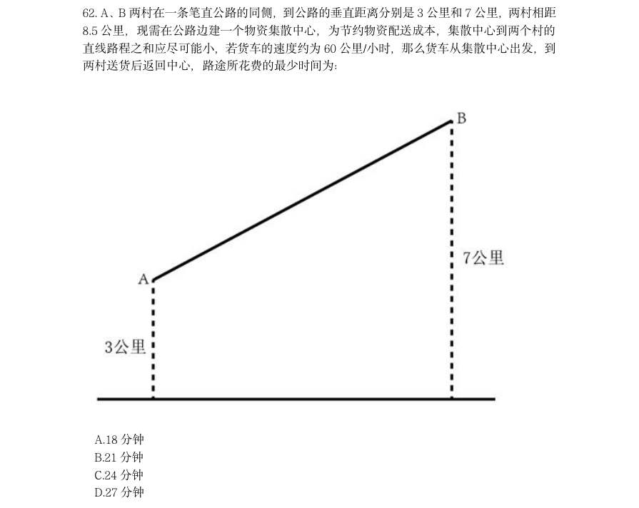

# 常识判断 · 经济常识 · 2020 年代真题

> 所属考点：[CS-JJ](../CS-JJ-经济常识.md)　｜　本片 34 题

> 本片子考点：微观与市场 15　宏观经济 11　经济常识（待细分） 7　经济指标 1

### 2024 国考·副省级　第 7 题　（宏观经济）

习近平指出健全美丽中国建设保障体系,统筹各领域资源,汇聚各方面力量,打好法治、市场、科技、政 策“组合拳”,关于健全美丽中国建设保障体系,下列正确的是( )。 1要全面实行排污许可制,完善自然资源资产管理制度体系,健全国土空间用途管制制度 2要完善绿色低碳发展经济政策,强化财政支持、税收政策支持、金融支持、价格政策支持 3要加快构建环保信用监管体系,规范环境治理市场,促进环保产业和环境服务业健康发展 4要更好发挥政府在碳排放权、用能权、用水权等资源环境要素配置中的决定性

- **A.** 234
- **B.** 124
- **C.** 134
- **D.** 123

**答案：D**

### 2024 国考·副省级　第 13 题　（宏观经济）

下列与宏观经济有关的说法,错误的是( )。

- **A.** 利率变化与资金供求关系有关
- **B.** 央行逆回购会减少市场流动性
- **C.** 国际收支顺差会给本币带来升值压力
- **D.** 提高贷款利率可用于控制通货膨胀

**答案：B**

### 2023 湖北·统一卷　第 2 题　（宏观经济）

党的二十大报告指出:要采取更多惠民生、暖民心举措,着力解决好人民群众急难愁盼 问题,健全基本公共服务体系,提高公共服务水平,增强均衡性和可及性,扎实推进共同富 裕。下列有关内容表述正确的是: 1实施渐进式延迟法定退休年龄 2健全社保基金保值增值和安全监管体系 3加大税收、社会保障、转移支付等的调节力度 4健全终身职业技能培训制度,推动解决周期性就业矛盾 5深化以市场化为导向的公立医院改革,规范民营医院发展 6坚持房子是用来住的、不是用来炒的定位,加快建立多主体供给、多渠道保障、租购并举 的住房制度

- **A.** 1234
- **B.** 1236
- **C.** 2356
- **D.** 1456

**答案：B**

### 2023 湖北·统一卷　第 12 题　（微观与市场）

探索建立长期护理保险制度,是党和政府为应对人口老龄化、健全社会保障体系作出的 一项重要部署。下列关于我国长期护理保险制度的说法正确的是:

- **A.** 长期护理保险属于养老保险范畴
- **B.** 长期护理保险的参保对象是已退休的老年人
- **C.** 根据护理等级、服务提供方式等不同实行差别化待遇保障政策
- **D.** 因突发疾病住院产生的护理费用属于长期护理保险的支付范围

**答案：C**

### 2023 湖北·统一卷　第 62 题　（微观与市场）

A、B 两村在一条笔直公路的同侧,到公路的垂直距离分别是3 公里和7 公里,两村相距 8.5 公里,现需在公路边建一个物资集散中心,为节约物资配送成本,集散中心到两个村的 直线路程之和应尽可能小,若货车的速度约为60 公里/小时,那么货车从集散中心出发,到 两村送货后返回中心,路途所花费的最少时间为: A.18 分钟 B.21 分钟 C.24 分钟 D.27 分钟

> （本题为图形题，选项为图片，见原卷）

**答案：B**

### 2023 广东·乡镇　第 2 题　（微观与市场）

当前,各乡镇纷纷在特色农产品上做文章,但真正能在市场竞争中__________的,还是那 些品类独特、品质优良的农产品。

- **A.** 历久弥新
- **B.** 脱颖而出
- **C.** 一枝独秀
- **D.** 披荆斩棘

**答案：B**

### 2023 广东·乡镇　第 5 题　（微观与市场）

质量__________是产出来的,__________是管出来的,__________是市场竞争出来的。这 就要推动有效市场与有为政府更好结合,共助质量强国建设取得新成效。

- **A.** 不不而
- **B.** 既也更
- **C.** 首先其次再次
- **D.** 要么要么要么

**答案：B**

### 2023 广东·乡镇　第 62 题　（微观与市场）

为推动社区养老服务建设,某社区开设了长者食堂,向社区内符合条件的老年人提供一 日三餐。该食堂饭菜价格远低于市场价,且品种多样、味道极佳、分量充足,然而每天到该 食堂就餐的老年人数量并不多。 以下各项如果为真,最能解释这一现象的是( )。

- **A.** 社区内多数老年人选择送餐上门而非到食堂用餐
- **B.** 该社区内和周边有许多深受当地居民喜爱的餐馆
- **C.** 该长者食堂占地面积较大,食堂内就餐座位充足
- **D.** 符合就餐条件的老年人在社区居民中的占比不高

**答案：A**

### 2023 广东·乡镇　第 91 题　（宏观经济）
> 材料：2021 年,广东省财政科学技术支出为982.76 亿元,占当年全省财政一般公共预算支出 的比重为5.4%。其中,省本级财政科学技术支出为102.05 亿元,占省本级财政一般公共预 算支出的比重为6.6%,同比增加0.84 个百分点。珠江三角洲核心区财政科学技术支出845. 09 亿元,同比增长2.6%。…

2021 年,广东省财政科学技术支出比上年提高了( )亿元。

- **A.** 7.03
- **B.** 17.03
- **C.** 27.03
- **D.** 37.03

**答案：C**

### 2023 广东·乡镇　第 93 题　（宏观经济）

2020 年广东省省本级财政科学技术支出( )。

- **A.** 在60-80 亿元之间
- **B.** 在80-100 亿元之间
- **C.** 在100-120 亿元之间
- **D.** 超过120 亿元

**答案：B**

### 2023 广东·乡镇　第 97 题　（微观与市场）

2022 年,城镇居民人均可支配收入较消费支出多( )元。

- **A.** 3501
- **B.** 7906
- **C.** 12545
- **D.** 18892

**答案：D**

### 2023 国考·行政执法　第 6 题　（宏观经济）

下列与金融活动相关的说法错误的是:

- **A.** 有价证券的债务人可以请求债权人支付相应对价
- **B.** 开展储蓄业务有助于实现货币购买力和商品供应量的平衡
- **C.** 分红型商业保险的收益与保险公司的经营状况有关
- **D.** 办理国家助学贷款的学生不需要办理贷款担保或抵押

**答案：A**

### 2022 广东·乡镇　第 15 题　（经济常识（待细分））

在经济全球化时代,任何一个国家都不可能孤立于世界之外,团结合作是所有国家的必然选择,各国人民 更需要同舟共济、共克时艰。 下列选项最符合该观点内涵的是:

- **A.** 人视水见形,视民知治不
- **B.** 孤举者难起,众行者易趋
- **C.** 安而不忘危,存而不忘亡
- **D.** 天不言而四时行,地不语而百物生

**答案：B**

### 2022 广东·乡镇　第 18 题　（经济常识（待细分））

以下是我国改革开放以来发生的重大事件,按时间先后顺序排列正确的是: 1脱贫攻坚战取得全面胜利2加入世界贸易组织3全面取消农业税 4香港、澳门回归祖国5北京举办第二十九届夏季奥运会

- **A.** 42351
- **B.** 25431
- **C.** 42513
- **D.** 21534

**答案：A**

### 2022 广东·县级　第 14 题　（经济常识（待细分））

在经济全球化时代,任何一个国家都不可能孤立于世界之外,团结合作是所有国家的必然选择,各国人民 更需要同舟共济、共克时艰。 下列选项最符合该观点内涵的是:

- **A.** 人视水见形,视民知治不
- **B.** 孤举者难起,众行者易趋
- **C.** 安而不忘危,存而不忘亡
- **D.** 天不言而四时行,地不语而百物生

**答案：B**

### 2022 国考·地市级　第 2 题　（微观与市场）

习近平总书记指出,要根据我国经济发展实际情况,建立起扩大内需的有效制度,释放内需 潜力,加快培育完整内需体系,加强需求侧管理,扩大居民消费,提升消费层次,使建设超大规模的 国内市场成为一个可持续的历史过程。下列举措不属于需求侧改革的是:

- **A.** 构建“智能+”消费生态体系
- **B.** 完善收入分配制度
- **C.** 严格落实“房住不炒”
- **D.** 剥离企业办社会职能

**答案：D**

### 2022 国考·地市级　第 14 题　（宏观经济）

财政是国家治理的基础和重要支柱,科学的财税体制是优化资源配置、维护市场统一、促进 社会公平、实现国家长治久安的制度保障。下列关于我国财税制度变迁的表述错误的是:

- **A.** 国税地税机构合并后,实行以国家税务总局直接领导的管理体制
- **B.** 《中华苏维埃共和国宪法大纲》宣布取消一切反革命统治时代的苛捐杂税
- **C.** 《中国人民政治协商会议共同纲领》明确规定“简化税制”
- **D.** 营业税改征增值税可减少重复征税,有利于降低企业税负

**答案：A**

### 2022 国考·行政执法　第 2 题　（微观与市场）

(单选题)习近平总书记指出,要根据我国经济发展实际情况,建立起扩大内需的有效制度,释放内需 潜力,加快培育完整内需体系,加强需求侧管理,扩大居民消费,提升消费层次,使建设超大规模的国 内市场成为一个可持续的历史过程。下列举措不属于需求侧改革的是:

- **A.** 构建“智能+”消费生态体系
- **B.** 完善收入分配制度
- **C.** 严格落实“房住不炒”
- **D.** 剥离企业办社会职能

**答案：D**

### 2022 国考·行政执法　第 13 题　（宏观经济）

(单选题)下列经济现象或做法符合经济学常理的是:

- **A.** 中央银行增加外汇储备引起货币供应量减少
- **B.** 通货紧缩时期政府减少在社会福利方面的支出
- **C.** 政府通过降低税率,减少税收,抑制通货膨胀
- **D.** 流动性过剩时中央银行在金融市场上出售国债

**答案：D**

### 2021 国考·副省级　第 14 题　（宏观经济）

下列与贷款有关的说法错误的是:

- **A.** 若采用等额本息的还款方式,每月还款额相同
- **B.** 贷款市场报价利率(LPR)是基于央行公开市场操作利率形成的一种市场化利率
- **C.** 以公益为目的的非营利法人对外提供的贷款担保是有效的
- **D.** 学生在校期间的国家助学贷款利息由财政全额补贴

**答案：暂缺**

### 2021 国考·地市级　第 15 题　（宏观经济）

下列与贷款有关的说法错误的是:

- **A.** 若采用等额本息的还款方式,每月还款额相同
- **B.** 贷款市场报价利率(LPR)是基于央行公开市场操作利率形成的一种市场化利率
- **C.** 以公益为目的的非营利法人对外提供的贷款担保是有效的
- **D.** 学生在校期间的国家助学贷款利息由财政全额补贴

**答案：C**

### 2020 湖北·统一卷　第 7 题　（微观与市场）

下列俗语与其蕴含的经济学道理对应错误的是:

- **A.** 田忌赛马——成本与收益
- **B.** 知人知面不知心——信息不对称
- **C.** 十年树木,百年树人——长期投资
- **D.** 萝卜白菜,各有所爱——偏好理论

**答案：A**

### 2020 广东·乡镇　第 14 题　（宏观经济）

为有效应对新冠疫情对我国经济的影响,相关部门出台了一系列举措帮助企业复工复产。以下属于金融政 策举措的是:

- **A.** 降低政府定价的货物港务费和港口设施保安费收费标准,显著降低物流运输成本
- **B.** 对中小微企业生产经营场所的用电、用水、用气实施阶段性缓缴费用,缓缴期“欠费不停供”
- **C.** 免征中小微企业三项社保的单位缴费,降低企业负担
- **D.** 引导银行加大对民营和小微企业支持的力度,保持贷款额合理增加

**答案：暂缺**

### 2020 广东·乡镇　第 18 题　（微观与市场）

产业增收是脱贫攻坚的主要途径和长久之策。以下举措不属于产业扶贫的是:

- **A.** 种植特色水果
- **B.** 开展乡村旅游
- **C.** 兴建乡村卫生站
- **D.** 成立农产品产业园

**答案：暂缺**

### 2020 广东·乡镇　第 30 题　（经济常识（待细分））

“逆经济风向调节”是指当经济萎缩时要采取扩张的经济政策,当经济过热时要采用紧缩的经济政策。据 此,当一个国家经济过热时,应当采取的政策措施是:

- **A.** 减少政府支出,提高利率
- **B.** 减少政府支出,降低利率
- **C.** 增加政府支出,提高利率
- **D.** 增加政府支出,降红利率

**答案：暂缺**

### 2020 广东·思维能力测验　第 2 题　（经济常识（待细分））

一个企业形象如何,取决于它的经济效益和社会效益。企业管理者需要明确的是,只有不断提高企业 的经济效益,才能不断提高企业的社会效益。 由此可知,下列关系必然正确的是( )。 1企业的经济效益好,其社会效益必然好 2企业的经济效益差,其社会效益必然差 3企业的社会效益好,其经济效益必然好 4企业的社会效益差,其经济效益必然差

- **A.** 13
- **B.** 23
- **C.** 14
- **D.** 24

**答案：B**

### 2020 广东·思维能力测验　第 19 题　（微观与市场）

某地为抑制高房价,实施了严格的商品房限购政策,限制本地户籍家庭只能购买两套住房、外地户 籍家庭只能购买一套住房,并且预测商品房价格会下降。但实际上,限购政策推行后,预期效果并未出现。 下列最有助于解释上述结果的是( )。

- **A.** 流入当地的外来人口不断增加
- **B.** 多数本地户籍家庭已经拥有两套住房
- **C.** 当地的教育资源较好
- **D.** 当地人均收入水平较高

**答案：A**

### 2020 广东·思维能力测验　第 31 题　（微观与市场）

为改变世界钢铁市场供过于求的局面,保护本国钢铁生产商,多个国家开始对进口钢材征收高额关 税,以期促使全球钢铁生产大国控制产能。但关税实施后,国际钢铁价格虽然大跌,全球钢铁产量却并没有 显著下降。 以下能够最好地解释这一情况的是( )。

- **A.** 钢铁生产企业难以在短时间内降低产能
- **B.** 部分发展中国家对钢材的需求量依然比较高
- **C.** 世界钢铁生产大国本身也是钢铁消费大国
- **D.** 大宗钢铁产品订单的生产需要一定周期

**答案：C**

### 2020 广东·思维能力测验　第 32 题　（微观与市场）

没有东西是永恒的。机器用久了就会发生故障,天上的星星最终也会熄灭。人在一生中也难免会生 一两场大病,所以每个人都必须购买重大疾病保险。 下列各项最好地总结了上述论证缺陷的是( )。

- **A.** 暗含了身体的健康也不是永恒的
- **B.** 忽视了购买保险后也无法控制疾病的发生
- **C.** 忽视了不少机器在出现故障之前已经被淘汰
- **D.** 默认了只有购买重大疾病保险才能抵御大病风险

**答案：D**

### 2020 广东·思维能力测验　第 39 题　（微观与市场）

某公益性消费投诉媒体平台发布了2018 年消费投诉报告,该报告指出,2018 年电商行业有效投诉 量最高的前五位如下:A 商城——2999 件,B 商城——2708 件,C 商城——2167 件,D 商城——2026 件,E 商城——815 件。由此可见,在以上五大电商中,E 商城服务质量和用户满意度最高。 下列最不能说明上述论证缺陷的是( )。

- **A.** 忽视了电商用户规模的基数差异
- **B.** 忽视了五大电商的客源之间存在一定的重叠
- **C.** 忽视了各电商对投诉的实际处理效果可能存在差异
- **D.** 忽视了对不同电商进行投诉的便利程度可能存在差异

**答案：B**

### 2020 广东·思维能力测验　第 53 题　（微观与市场）

将各类医疗用品的采购权限由地方上升到国家集中采购显然是很有必要的,采购的金额大了,相对 来说就能够拥有更大的市场话语权,也就能让百姓用上价格更低的医疗用品。 以下最能够质疑上述论证的是( )。

- **A.** 国家集中采购降低了地方选用不同医疗用品的灵活性
- **B.** 中小型医疗用品企业难以在集中采购中中标,反而会加剧市场垄断
- **C.** 医疗用品成本估算未建立统一标准,医疗用品的价格以市场报价为主
- **D.** 国家难以精确地估算各个地方的医疗用品种类和用量

**答案：C**

### 2020 广东·思维能力测验　第 60 题　（经济常识（待细分））

古典经济学的基本假设是所有人都是理性的,然而现实中并没有人能够做到完全理性,因此建立在 理性人假设之上的古典经济学理论无法真正有效地解释现实的经济问题。 下列选项中,与上述推理结构最为相似的是( )。

- **A.** 蛇属于爬行动物,靠腹部的鳞片爬行,因此爬行动物并不都用脚爬行
- **B.** 冰是由水形成的,雪花同样是由水形成的,因此雪花也属于冰
- **C.** 煤炭是一种不可再生能源,而所有的不可再生能源都必将耗尽,因此对人类而言煤炭并非是无穷无尽的
- **D.** 钻石是一种由碳元素组成的单质晶体,而珍珠的主要构成成分为碳酸钙和碳酸镁,因此珍珠并不属于

**答案：C**

### 2020 广东·综合行政能力测验　第 29 题　（经济指标）

近年来,全球贸易保护主义兴起,全球主要大国之间发生贸易摩擦。某经济大国严重依赖出口贸易, 假如该国深陷贸易摩擦,则以下情况中,该国最有可能发生的是( )。

- **A.** 当年的贸易顺差减少
- **B.** 当年的通货膨胀率提升
- **C.** 当年的失业率降低
- **D.** 当年的财政支出增加

**答案：A**

### 2020 广东·综合行政能力测验　第 30 题　（经济常识（待细分））

2019 年11 月10 日,第二届中国国际进口博览会圆满落幕。以下有关此次博览会的说法正确的有 ( )。 1是世界上第一个以进口为主题的国家级展会,是国际贸易发展史上一大创举 2体现了中国支持多边贸易体制,推动发展自由贸易的一贯立场 3是中国推动建设开放型世界经济、支持经济全球化的实际行动 4不是中国的独唱,而是各国的大合唱

- **A.** 23
- **B.** 234
- **C.** 124
- **D.** 1234

**答案：D**
