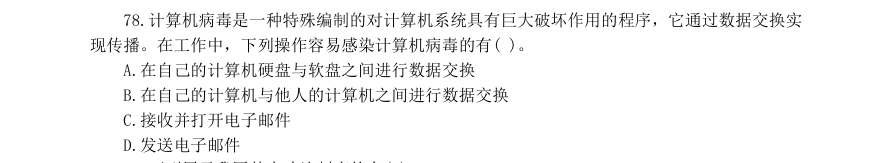

# 常识判断 · 科技常识 · 2000 年代真题

> 所属考点：[CS-KJ](../CS-KJ-科技常识.md)　｜　本片 32 题

> 本片子考点：基础科学 22　科技常识（待细分） 9　科技成就 1

### 【2009 湖北省考·第 6 题】HB-2009-ty-X006　科技常识｜科技常识（待细分）

下列说法中,所含光学知识原理达两种以上的是:

- **A.** 镜中花,水中月
- **B.** 凸透镜
- **C.** 海市蜃楼
- **D.** 潭清疑水浅

**答案：暂缺**

### 【2009 国考·第 4 题】GK-2009-ty-X004　科技常识｜科技成就

新中国成立以后,我国政府制定了“两弹一星”的战略决策,这一战略目标的实现是在:

- **A.** 20 世纪50~60 年代
- **B.** 大跃进时期
- **C.** 20 世纪60~70 年代
- **D.** 文革时期

**答案：C**

### 【2008 湖北省考·第 91 题】HB-2008-ty-X091　科技常识｜基础科学
> 材料：(共25 题,参考时20 分钟) 共25 题。本部分为单项选择题,各题的四个选项中,只有一项是符合题意的,请将答案填在答题卡上。…

科学揭示燃烧现象的是:

- **A.** 哥白尼
- **B.** 牛顿
- **C.** 拉瓦锡
- **D.** 爱迪生

**答案：C**

### 【2008 湖北省考·第 109 题】HB-2008-ty-X109　科技常识｜基础科学

“蚯蚓爬上路,雨水乱如麻”这句气象谚语说明的生物现象是:

- **A.** 蚯蚓是有氧呼吸的生物
- **B.** 蚯蚓喜欢生活在水中
- **C.** 蚯蚓不能生活在水中
- **D.** 蚯蚓能预报天气变化

**答案：D**

### 【2008 国考·第 119 题】GK-2008-ty-X119　科技常识｜科技常识（待细分）

王某持匕首抢劫张某,在争斗中王某头部撞击墙角昏迷倒地,匕首掉在地上。张某见状,捡起匕首往王某 心脏部位猛刺数下,导致王某死亡。对于张某用匕首刺死王某的行为,下列说法正确的是:

- **A.** 属于正当防卫,不负刑事责任
- **B.** 属于意外事件,不负刑事责任
- **C.** 属于防卫过当,应当负刑事责任
- **D.** 属于故意杀人,应当负刑事责任

**答案：D**

### 【2007 广东省考·第 56 题】GD-2007-ty-X056　科技常识｜科技常识（待细分）
> 材料：有多种,你应选择最为合理的一个。…

飞机在万米高空飞行的时候,舱外气温往往在一50。C 以下,由于飞机上有空调设备,故舱内温度如 春。不过此时,空调的作用不是使空气升温,而是降温。高空的大气压比舱内气压低,要使舱内获得新鲜空 气必须使用空气压缩机把空气从舱外压进来。下列关于空调降温的说法,正确的是( )。

- **A.** 由于飞机与空气磨擦,舱内温度升高,需空调降温
- **B.** 由于万米高空空气稀薄,太阳对飞机的照射更强烈,舱内温度升高,需空调降温
- **C.** 由于空气压缩机对气体做功,使气体的内能增加,温度升高,需空调降温
- **D.** 由于舱内密闭,空气不流通,温度高,故需空调降温

**答案：暂缺**

### 【2007 广东省考·第 65 题】GD-2007-ty-X065　科技常识｜科技常识（待细分）

一般泡沫灭火器的灭火原理是( )。

- **A.** 减少明火
- **B.** 隔绝氧气
- **C.** 增加湿度
- **D.** 制造泡沫

**答案：暂缺**

### 【2006 国考·第 100 题】GK-2006-ty-X100　科技常识｜基础科学

红绿色盲是一种常见的遗传性疾病。在生活中可以发现,男性患者的人数远远多于女性患者。 出现这种现象的原因是( )。

- **A.** 控制红绿色盲的基因位于X 染色体上。如果一条X 染色体上携带致病基因,而另一条染色体相应位置上携带正常基因,个体并不会发病。而Y 染色体上没有相应的基因
- **B.** 控制红绿色盲的基因位于Y 染色体上,随Y 染色体进行传递
- **C.** 控制红绿色盲的基因位于X 染色体上。由于男性缺乏一种女性独有的激素,在发育过程中容易受到多种诱因的影响而发病
- **D.** 男女两性的实际患病率是相同的,只是由于两性在日常生活中偏重的领域有所不同,男性

**答案：A**

### 【2005 广东省考·第 58 题】GD-2005-ty-X058　科技常识｜基础科学

分子生物学研究表明,遗传信息的载体是:

- **A.** 细胞
- **B.** 细胞核
- **C.** DNA
- **D.** 染色体

**答案：暂缺**

### 【2005 广东省考·第 59 题】GD-2005-ty-X059　科技常识｜基础科学

地壳中含量最多的元素是:

- **A.** 铁
- **B.** 氧
- **C.** 硅
- **D.** 铝

**答案：暂缺**

### 【2005 广东省考·第 60 题】GD-2005-ty-X060　科技常识｜基础科学

一次能源是指可以从自然界直接获得的能源,下列不属于一次能源的是:

- **A.** 电能
- **B.** 核能
- **C.** 生物能
- **D.** 煤炭

**答案：暂缺**

### 【2005 广东省考·第 62 题】GD-2005-ty-X062　科技常识｜基础科学

大气层中的臭氧层能够保护地球上的生物,这是因为臭氧层可以:

- **A.** 释放出大量氧气
- **B.** 滤除大量的紫外线
- **C.** 屏蔽太阳的辐射
- **D.** 吸收大量的二氧化碳

**答案：暂缺**

### 【2004 广东省考·第 56 题】GD-2004-ty-X056　科技常识｜基础科学
> 材料：乎合理的答案可能有多种,但你应选择最为合理的一个。…

酶是生物体内的一种特殊的:

- **A.** 核酸
- **B.** 蛋白质
- **C.** 酶分子
- **D.** DNA

**答案：暂缺**

### 【2004 广东省考·第 63 题】GD-2004-ty-X063　科技常识｜基础科学

天文学上常用“天文单位”来表示距离,一个天文单位指的是:

- **A.** 地球到月球的平均距离
- **B.** 地球到太阳的平均距离
- **C.** 木星到太阳的平均距离
- **D.** 一光年

**答案：暂缺**

### 【2004 国考（A卷）·第 14 题】GK-2004-a-X014　科技常识｜科技常识（待细分）

下列不属于哺乳动物的是( )。

- **A.** 蝙蝠
- **B.** 鲸
- **C.** 蜂鸟
- **D.** 海豹

**答案：C**

### 【2004 国考（B卷）·第 4 题】GK-2004-b-X004　科技常识｜科技常识（待细分）

下列不属于哺乳类的动物是( )。

- **A.** 蝙蝠
- **B.** 鲸
- **C.** 蜂鸟
- **D.** 海豹

**答案：C**

### 【2004 国考（B卷）·第 6 题】GK-2004-b-X006　科技常识｜基础科学

电话的发明者是( )。

- **A.** 摩尔
- **B.** 爱迪生
- **C.** 贝尔
- **D.** 法拉第

**答案：C**

### 【2003 国考（A卷）·第 64 题】GK-2003-a-X064　科技常识｜科技常识（待细分）

管理学中的“木桶原理”指的是在管理工作中要注意( )。

- **A.** 灵活性
- **B.** 原则性
- **C.** 程序性
- **D.** 整体性

**答案：D**

### 【2003 国考（A卷）·第 67 题】GK-2003-a-X067　科技常识｜基础科学

英国剑桥大学的史蒂芬·霍金教授是当代国际著名物理学大师,也是杰出的科普作家。他1988 年写的一部 在世界上广为流传的科普小说是( )。

- **A.** 《大爆炸探秘》
- **B.** 《自然的终结》
- **C.** 《物理世界奇遇记》
- **D.** 《时间简史》

**答案：D**

### 【2003 国考（B卷）·第 62 题】GK-2003-b-X062　科技常识｜基础科学

人们经常用“摩尔定律”来比喻当代科学技术的进步与发展日新月异,这里“摩尔定律” 指的是( )。

- **A.** 计算机的知识每18 个月更新一半,即18 个月后你的计算机知识有一半将被淘汰
- **B.** 微处理器的处理能力每18 个月到24 个月将增加一倍
- **C.** 世界上每一个小时内就会产生20 项新发明
- **D.** 在未来25 年,主干网的带宽将每6 个月增加一倍

**答案：B**

### 【2003 国考（B卷）·第 78 题】GK-2003-b-X078　科技常识｜基础科学

计算机病毒是一种特殊编制的对计算机系统具有巨大破坏作用的程序,它通过数据交换实 现传播。在工作中,下列操作容易感染计算机病毒的有( )。

- **A.** 在自己的计算机硬盘与软盘之间进行数据交换
- **B.** 在自己的计算机与他人的计算机之间进行数据交换
- **C.** 接收并打开电子邮件
- **D.** 发送电子邮件

**答案：暂缺**

### 【2002 国考（A卷）·第 6 题】GK-2002-a-X006　科技常识｜基础科学

单选、 地球表面的绿色植物通过光合作用,将太阳的辐射能量转化成能被其他生物利用的有机化合能。下面的说法错误 的是( )。

- **A.** 光合作用吸收的主要是太阳光中的绿光
- **B.** 植物的绿色是反射了太阳光中的绿光
- **C.** 不同植物的光合作用效率是不一样的
- **D.** 植物在不同时间的光合作用效率不一样

**答案：A**

### 【2002 国考（A卷）·第 8 题】GK-2002-a-X008　科技常识｜基础科学

单选、 下列电池中不能充电的( )。

- **A.** 镍镉电池
- **B.** 银锌电池
- **C.** 普通干电池
- **D.** 铅蓄电池

**答案：C**

### 【2002 国考（B卷）·第 9 题】GK-2002-b-X009　科技常识｜基础科学

单选、 地球表面的绿色植物通过光合作用,将太阳的辐射能量转化成能被其他生物利用的有机化学能。下面说法错误的 是( )。

- **A.** 光合作用吸收的主要是太阳光中的绿光
- **B.** 植物的绿色是反射的太阳光中的绿色
- **C.** 不同植物的光合作用效率是不一样的
- **D.** 植物在不同时间的光合作用效率不一样

**答案：暂缺**

### 【2002 国考（B卷）·第 10 题】GK-2002-b-X010　科技常识｜基础科学

单选、 月亮上有许多大大小小的环形山,多数科学家认为环形山的成因是( )。

- **A.** 地震
- **B.** 火山爆发
- **C.** 陨星撞击
- **D.** 板块运动

**答案：暂缺**

### 【2002 国考（B卷）·第 13 题】GK-2002-b-X013　科技常识｜科技常识（待细分）

单选、 下列电池中不能充电的( )。

- **A.** 镍镉电池
- **B.** 银锌电池
- **C.** 普通干电池
- **D.** 铅蓄电池

**答案：暂缺**

### 【2002 国考（B卷）·第 15 题】GK-2002-b-X015　科技常识｜基础科学

单选、 下列关于水的物理现象描述正确的是( )。

- **A.** 蒸发时放热,结冰时吸热
- **B.** 蒸发时吸热,结冰时放热
- **C.** 结冰和蒸发时都吸热
- **D.** 结冰和蒸发时都放热

**答案：暂缺**

### 【2002 国考（B卷）·第 16 题】GK-2002-b-X016　科技常识｜基础科学

多选、 计算机技术和通讯技术的结合,诞生了网络,产生了信息高速公路。一台个人计算机采用拨号方式上网,必须具 备的硬件条件是( )。

- **A.** 一条电话线
- **B.** TCP/IP
- **C.** 浏览器
- **D.** 调制解调器

**答案：暂缺**

### 【2002 国考（B卷）·第 32 题】GK-2002-b-X032　科技常识｜基础科学

单选、 近年来,利用现代信息技术手段而建立和发展起来的一种新型组织结构是( )。

- **A.** 矩阵式组织结构
- **B.** 直线职能式组织结构
- **C.** 网络型组织结构
- **D.** 委员会组织结构

**答案：暂缺**

### 【2001 国考·第 3 题】GK-2001-ty-X003　科技常识｜基础科学

人体患急性炎症时,每立方毫米血液中白细胞数可能是( )。

- **A.** 700 个
- **B.** 16 000 个
- **C.** 30 万个
- **D.** 500 万个

**答案：B**

### 【2001 国考·第 20 题】GK-2001-ty-X020　科技常识｜基础科学

大气层中的臭氧层能够保护地球上的生物,这主要是因为臭氧层可以( )。

- **A.** 释放出大量的氧气
- **B.** 滤除大量的紫外光
- **C.** 屏蔽太阳的辐射
- **D.** 吸收大量的二氧化碳

**答案：B**

### 【2000 国考·第 55 题】GK-2000-ty-X055　科技常识｜科技常识（待细分）

目的是使消费者对商品产生良好感觉的广告是( )。

- **A.** 公益广告
- **B.** 劝说性广告
- **C.** 信息性广告
- **D.** 特征广告

**答案：B**
