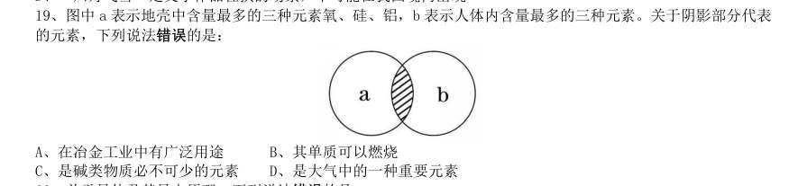

# 常识判断 · 科技常识 · 2010 年代真题

> 所属考点：[CS-KJ](../CS-KJ-科技常识.md)　｜　本片 91 题

> 本片子考点：基础科学 54　科技常识（待细分） 26　科技成就 11

### 2019 湖北·统一卷　第 5 题　（科技成就）

2018 年我国科技界取得了一系列重大成果,这些成果中不包括:

- **A.** 第二艘航母出海试航
- **B.** 嫦娥四号探测器发射成功
- **C.** 造岛神器“天鲲号”下水
- **D.** 国产大型水陆两栖飞机水上首飞

**答案：C**

### 2019 湖北·统一卷　第 19 题　（基础科学）

下列气体是人体能够产生的,能发挥抗炎、神经功能调节和血管松弛等作用,但若吸入过量会与血红素结合 导致中毒的是:

- **A.** 一氧化氮
- **B.** 一氧化碳
- **C.** 硫化氢
- **D.** 氨气

**答案：A**

### 2019 湖北·统一卷　第 20 题　（基础科学）

下列我国空间站发展的重要标志性事件按完成步骤排列正确的是: 1“天宫二号”空间实验室成功发射 2“神舟十一号”成功发射,完成与“天官二号”对接 3陆续发射科学实验舱和空间站核心舱,组建中国空间站 4“天舟一号”货运飞船成功发射,完成与“天官二号”对接

- **A.** 1234
- **B.** 4123
- **C.** 1342
- **D.** 1243

**答案：D**

### 2019 湖北·选调　第 15 题　（科技常识（待细分））

我们党强调理想信念是共产党人精神上的“钙”,强调“革命理想高于天”,这就是精神变物质、物质变精 神的辩证法。广大党员、干部理想信念坚定、干事创业精气神足,人民群众精神振奋、发愤图强,就可以创造出 很多人间奇迹。如果党员、干部理想动摇、宗旨淡化,人民群众精神萎靡、贪图安逸,那往往可以干成的事情也 干不成。这段论述包含的哲学原理是:

- **A.** 社会意识既依赖于社会存在又有其相对独立性
- **B.** 物质决定意识,意识对物质具有能动的反作用
- **C.** 社会意识与社会存在的发展具有不完全同步性
- **D.** 先进社会意识对社会发展起着积极的促进作用

**答案：D**

### 2019 湖北·选调　第 20 题　（科技常识（待细分））

量变和质变辩证关系原理指出,量变是质变的必要准备。任何事物的变化都有一个量变的过程,没有量变的 积累,质变就不会发生;质变是量变的必然结果。单纯的量变不会永远持续下去,量变达到一定程度必然引起质 变。以下哪句话与上述原理无关?

- **A.** 九层之台,从平地垒土起
- **B.** 千丈之堤,以蝼蚁之穴溃
- **C.** 百尺之室,以突隙之烟焚
- **D.** 故夫变者,古今之公理也

**答案：D**

### 2019 湖北·选调　第 60 题　（基础科学）

当前信息技术支持下,在一定规模组织中,管理层次与管理幅度的变化趋势是:

- **A.** 管理层次增加,管理幅度变大
- **B.** 管理层次减少,管理幅度变大
- **C.** 管理层次减少,管理幅度变小
- **D.** 管理层次增加,管理幅度变小

**答案：B**

### 2019 湖北·选调　第 70 题　（科技成就）

关于科技常识,下列表述错误的是:

- **A.** 基因芯片目前主要是应用于基因检测
- **B.** 风能的产生与太阳能有着密切的关系
- **C.** 我国目前的磁悬浮属于超导电动式磁悬浮
- **D.** 人工智能是工业机器人发展的关键技术之一

**答案：C**

### 2019 广东·乡镇　第 76 题　（科技常识（待细分））

“山上多植物,胜似修水库,有雨它能吞,无雨它能吐”。这一谚语形象地说明了森林具有( )的功能。

- **A.** 净化空气
- **B.** 过滤尘埃
- **C.** 减小噪音
- **D.** 涵养水源

**答案：暂缺**

### 2019 广东·乡镇　第 79 题　（科技常识（待细分））

2018 年12 月,中国发射的( )成为人类第一个着陆月球背面的探测器。

- **A.** 神舟七号
- **B.** 长征三号
- **C.** 嫦娥四号
- **D.** 天宫一号

**答案：暂缺**

### 2019 广东·县级　第 82 题　（基础科学）

赤潮是指在特定的环境条件下,海水中某些浮游生物爆发性增殖,引起水体变色的一种生态现象。下列关 于赤潮的说法中,正确的是( )。

- **A.** 海水富营养化是赤潮爆发的基础
- **B.** 赤潮爆发与人类活动关系不大
- **C.** 多数赤潮对环境没有危害
- **D.** 所有的赤潮都是红色的

**答案：暂缺**

### 2019 广东·思维能力测验　第 1 题　（科技常识（待细分））
> 材料：广东省2019 年选调优秀大学毕业生笔试综合行政能力测验真题(11.18) 一、思维能力测验。在这项测验中,可能有一些试题很容易,但也有一些试题有一定的难度, 建议建议不要在一道试题上思考太长时间,遇到不会的试题,可先跳过去,待完成较容易的试题 后,有时间再去思考,试题答错不倒扣分,可根据猜测来解答那些没有把的试题。…

人才是第一资源,科技创新必须依靠人才实力。因此,谁拥有了一流创新人才,谁就能在科技创新的竞 争中取得优势。 以下与上述推理在结构上最为相似的是()。

- **A.** 所有高楼大厦都要打好地基。只要打好地基,就能建成高楼大厦
- **B.** 一切反动派都是纸老虎。所以,我们能够打败反动派
- **C.** 伤心总是难免的。因此,人难免伤心
- **D.** 个人的成长需要依靠自身的努力。只有努力才能获得个人成长

**答案：A**

### 2019 广东·思维能力测验　第 21 题　（基础科学）

空气中的氧是地球上生物赖以生存的基础。近日,有科学家研究发现,火星地下咸水含有充足的分子 氧,足以支持好氧微生物存活,这表明火星上的生物有可能存在于地下。 上述推论最可能基于的假设是()。

- **A.** 火星地下咸水资源充足
- **B.** 火星地表不适合生命生存
- **C.** 氧是生物存在的必要条件
- **D.** 地球生物与火星生物构造不同

**答案：C**

### 2019 广东·思维能力测验　第 24 题　（基础科学）

玻璃幕墙是一种美观新颖的建筑墙体形式,但是不少公众担心它会存在破碎隐患。其实只要选用合格 的材料,就能将玻璃幕墙的破碎隐患降到微乎其微。所以,对于大部分玻璃幕墙,公众不必担心它们的破碎隐 患。 上述论证最可能的潜在假设是()。

- **A.** 破碎隐患是玻璃幕墙最主要的安全隐患
- **B.** 大部分的玻璃幕墙都选用了合格的材料
- **C.** 公众能够识别制造玻璃幕墙所需的材料
- **D.** 公众了解合格材料能减少玻璃幕墙的破碎隐患

**答案：B**

### 2019 广东·思维能力测验　第 28 题　（科技常识（待细分））

几名顾客在某餐厅用餐后,出现了呕吐腹痛等症状。事件发生后,相关部门立刻将剩下的食物送去检 验。结果表明,送检食物中的有害细菌含量不超标。所以,在该餐厅用餐不是他们出现呕吐腹痛等症状的原因。 以下选项最能够指出上述论证缺陷的是()。

- **A.** 暗含了呕吐腹痛等症状并不一定在食物中毒时才会出现
- **B.** 忽视了其他顾客可能在一段时间后才出现呕吐腹痛等症状
- **C.** 忽视了这些出现呕吐腹痛等症状的顾客的消化能力较常人更弱
- **D.** 假设了只有食物中的有害细菌才会导致呕吐腹痛等症状

**答案：D**

### 2019 广东·思维能力测验　第 32 题　（基础科学）

基因检测能够帮助人们了解自己基因的情况,预测某些疾病的患病风险。有价值的基因检测报告至少 符合三项条件:生物学描述明确、基因与疾病的对应关系明确、针对性防治要点明确。 根据上述表述,下列判断一定正确的是()。

- **A.** 针对性防治要点不明确的基因检测报告可能没有价值
- **B.** 一份生物学描述不明确的基因检测报告可能是有价值的
- **C.** 符合上述三项条件的基因检测报告大部分都是有价值的
- **D.** 有的有价值的基因检测报告只符合上述三项条件中的两项

**答案：A**

### 2019 广东·思维能力测验　第 39 题　（科技常识（待细分））

广告模特的选择,会在很大程度上影响一个商业广告的投放效果。最新研究结果表明,那些面带微笑 的广告模特,反而会给人们更“酷”的感觉;而一些面无表情的广告模特虽然俊美,却会令潜在消费者对该产 品印象不佳。因此,专家建议,拍摄广告时应更多地选择面带微笑的模特。 下列各项最好地总结了上述论证缺陷的是()。

- **A.** 忽视了模特的知名度等因素会影响商业广告的效果
- **B.** 暗含了模特的外在形象会影响人们对广告的印象
- **C.** 忽视了俊美的模特可能会使广告更容易吸引人们的关注
- **D.** 假设了更能给消费者“酷”的感觉的广告效果更好

**答案：D**

### 2019 广东·思维能力测验　第 42 题　（基础科学）

2018 年,有的诺贝尔奖授予了技术应用的研究者,例如:诺贝尔化学奖研究成果在能源与医疗领域开 辟了新的实用途径;诺贝尔物理学奖研究成果将可应用于工业和医疗领域。可见今年的诺贝尔奖更看重应用性 研究。 以下与上述推理在结构上最为相似的是()。

- **A.** 今年的年度优秀员工中,好几位都是销售成绩排名靠前的,可知个人的销售业绩是优秀员工评比的主要指标
- **B.** 领导表扬了小白善于团结同事,注重团队合作,可见业绩并非评价员工的唯一指标
- **C.** 在出版行业评选的最受欢迎报刊杂志中,大都是一些关注民生的刊物,因此群众的接受度是评选标准
- **D.** 某高校部分大一新生有考研深造的念头,可见考研深造是不少高校学生本科毕业后的第一选择

**答案：A**

### 2019 广东·思维能力测验　第 44 题　（科技常识（待细分））

我国经济正处于结构转型升级的重要时期,人口老龄化压力也日益增大。开发老年人力资源,对缓解 人口老龄化的压力、促进经济结构转型升级具有十分重要的现实意义。因此,我国应当积极开发老年人力资源。 下列选项中,与上述论证在结构上最为相似的是()。

- **A.** 中国人口迁移存在农村劳动力向城市转移的特点。农村劳动力向城市转移是农业劳动力饱和的必然结果,因此我国的农业劳动力已经饱和
- **B.** 产业空心化是指物质生产部门由高度发达的地区转移到欠发达地区的过程。某地许多工厂转移到了周边地区,因此该地是发达地区
- **C.** 税收减免是应对经济下行的有效举措。当前,我国经济面临一定的下行压力,因此,采取适当的减税措施能有效应对这一压力
- **D.** “一带一路”是一项长远规划,很多工程尚处于规划阶段。因此,“一带一路仅仅是援助计划”的评判

**答案：C**

### 2019 广东·选调　第 20 题　（基础科学）

可再生能源是指不会随它本身的转化或人类的利用而越来越少的能源。下列属于可再生能源的是( )。 1风能 2天然气 3潮汐能 4太阳能 5核燃料

- **A.** 123
- **B.** 134
- **C.** 245
- **D.** 345

**答案：B**

### 2019 国考·地市级　第 16 题　（科技常识（待细分））

关于我国的油料作物,下列说法错误的是:

- **A.** 芝麻喜凉,果实有黑、白之分,山东省产量最高
- **B.** 花生喜温耐瘠,适宜种在排水良好的沙质土壤中
- **C.** 大豆喜温,生长发育期间低温会延迟开花成熟
- **D.** 油菜抗寒力较强,是我国分布最广的油料作物

**答案：A**

### 2019 国考·地市级　第 19 题　（基础科学）

钢是主要由铁元素和碳元素组成的1合金,钢的含碳量2大于生铁。在钢中加入其它元素能够继续改善钢的 性质,例如,加入锰元素主要增加钢的3强度。在钢的锻造中,淬火可以实现其4快速冷却。 这段文字中画线部分错误的是:

- **A.** 1
- **B.** 2
- **C.** 3
- **D.** 4

**答案：B**

### 2019 国考·省级　第 15 题　（基础科学）

关于生物,下列说法错误的是:

- **A.** 酸菜和腐乳的制作过程中都离不开乳酸菌的发酵
- **B.** 病毒只能寄生在活细胞中进行生命活动
- **C.** 细菌有完整的能量代谢系统,可以独立地生长繁殖
- **D.** 木耳是真菌的一种,常生长在阴湿、腐朽的树干上

**答案：A**

### 2018 湖北·统一卷　第 7 题　（基础科学）

通常情况下,使用高压锅可以大大缩短食物的烹煮时间,节约能源。下列对其所用物理原理的解释正确的 是:

- **A.** 锅内蒸汽的压强增大,导致水的沸点降低
- **B.** 锅内水的沸点降低,导致蒸汽的压强增大
- **C.** 锅内蒸汽的压强增大,导致水的沸点升高
- **D.** 锅内水的沸点升高,导致蒸汽的压强增大

**答案：C**

### 2018 湖北·统一卷　第 8 题　（基础科学）

下列现象的物理解释错误的是:

- **A.** 露珠呈球状——液体表面张力
- **B.** 铁轨铺在枕木上——减少压强
- **C.** 道路转弯镜——凸透镜对光发散
- **D.** 微波炉烤面包——涡流感应加热

**答案：C**

### 2018 湖北·统一卷　第 15 题　（科技成就）

下列选项不属于航空航天中货运飞船主要任务的是:

- **A.** 货运飞船发射升空完成后,会与空间站自动或人工交会对接
- **B.** 货运飞船进行空间站实验和技术试验,将获取的研究数据回传
- **C.** 货运飞船为空间站补加推进剂以及空气,带来饮水、食物等补给物资
- **D.** 货运飞船可充当空间站的“垃圾桶”,将站内废弃物品搬运至货运飞船

**答案：B**

### 2018 湖北·统一卷　第 19 题　（基础科学）

“21 世纪金属”具有较高的强度、良好的抗氧化性和优异的耐腐蚀性,对人体无毒且无不良反应,被称 为“亲生物金属”,可作为人造骨材料。下列关于“21 世纪金属”的说法正确的是:

- **A.** “21 世纪金属”是指钛和钛合金
- **B.** “21 世纪金属”只运用于航空航天领域
- **C.** “21 世纪金属”是一种新型石墨烯材料
- **D.** “21 世纪金属”是21 世纪发现的一种金属元素

**答案：A**

### 2018 湖北·统一卷　第 20 题　（科技常识（待细分））

下列事件按时间先后顺序排列正确的是: 1中国女排获得里约奥运会女排比赛冠军 2中国(上海)自由贸易实验区正式设立 3第九届金砖国家领导人会晤在厦门举行 4我国举行纪念中国人民抗日战争暨世界反法西斯战争胜利70 周年阅兵式

- **A.** 2314
- **B.** 4123
- **C.** 2413
- **D.** 2134

**答案：C**

### 2018 广东·统一卷　第 80 题　（基础科学）

沉管隧道就是将若干个预制段分别浮运到海面(河面)现场,并逐个沉放在已疏浚好的基槽内,以此 修建的水下隧道。以下隧道采用了外海环境沉管隧道技术的是( )。

- **A.** 广州珠江隧道
- **B.** 深圳地铁隧道
- **C.** 贵广高铁隧道
- **D.** 港珠澳大桥隧道

**答案：暂缺**

### 2018 广东·统一卷　第 83 题　（科技常识（待细分））

手指表皮上突起的纹线,被称为指纹。指纹人人皆有,它是遗传与环境共同作用产生的。下列关于 指纹的说法有误的是( )。

- **A.** 指纹可以用于身份识别
- **B.** 人的指纹一般终身不变
- **C.** 同卵双胞胎的指纹是相同的
- **D.** 只要不伤及真皮层,手指伤愈后仍能长出同样的指纹

**答案：暂缺**

### 2018 国考·副省级　第 16 题　（科技常识（待细分））

假如地球重力加速度减为现在的一半,下列数值不会发生变化的是:

- **A.** 鱼在相同水深下受到的压强
- **B.** 船在水中的吃水深度
- **C.** 人在体重计上的称量结果
- **D.** 人可以举起的石块的最大质量

**答案：B**

### 2017 湖北·统一卷　第 9 题　（基础科学）

自来水厂用来进行水消毒处理的常用化学试剂是:

- **A.** 臭氧
- **B.** 氯气
- **C.** 过氧化氢
- **D.** 碘伏

**答案：B**

### 2017 湖北·统一卷　第 15 题　（科技常识（待细分））

下列哪两种疾病是由细菌引起的:

- **A.** 手足口病、狂犬病
- **B.** 麻疹、腮腺炎
- **C.** 肺结核、破伤风
- **D.** 非典型肺炎、水痘

**答案：C**

### 2017 广东·统一卷　第 72 题　（基础科学）

角蛋白是一种控制细胞形状和稳定性的蛋白。以下对角蛋白认识错误的是:

- **A.** 人的头发、指甲主要是由角蛋白构成的
- **B.** 角蛋白是爬行动物鳞片、羽毛、爪子的主要成分
- **C.** 在人的皮肤中,角蛋白主要分布在真皮层
- **D.** 角蛋白来源于外胚层分化而来的细胞,是一种硬蛋白

**答案：暂缺**

### 2017 广东·统一卷　第 73 题　（科技成就）

从卫星在外太空拍摄的地球照片来看,地球是一个蓝色的星球,这是因为:

- **A.** 地球上大部分地区都被水覆盖着
- **B.** 天空是蓝色的,而蓝天包围着大地
- **C.** 大气分子、冰晶、水滴等和阳光的共同作用
- **D.** 太阳光穿过地球大气层产生折射

**答案：暂缺**

### 2017 广东·统一卷　第 76 题　（科技常识（待细分））

以下对人的各种感觉描述不正确的是:

- **A.** 触觉感受器大部分存在于皮肤中,指尖尤其敏感
- **B.** 人看到物体时,视网膜上会形成一幅上下颠倒的影像
- **C.** 耳朵可以帮助人体保持平衡
- **D.** 嗅觉和味觉是一起工作的,感知食物味道更多依赖味觉

**答案：暂缺**

### 2017 广东·统一卷　第 79 题　（基础科学）

地球上生物的种类极其丰富,从表面上看,不同的生物之间似乎并没有相同之处,但其实所有的生物都 具有一些共同特征。以下不属于生物共同特征的是:

- **A.** 由单细胞构成
- **B.** 需要能量才能生存
- **C.** 具有生命周期
- **D.** 新陈代谢

**答案：暂缺**

### 2017 国考·副省级　第 11 题　（基础科学）

掩星是一种天文现象,指一个天体在另一个天体与观测者之间通过而产生的遮蔽现象。科学家经常借助观察 这一现象来判断星体是否有大气层。当行星掩过遥远恒星,如果恒星变得模糊之后才消失,那么可以认为:

- **A.** 该行星有稠密的大气层
- **B.** 该恒星有稠密的大气层
- **C.** 该行星无大气层或大气层稀薄
- **D.** 该恒星无大气层或大气层稀薄

**答案：A**

### 2017 国考·副省级　第 13 题　（基础科学）

2016 年3 月,阿尔法围棋程序(AlphaGo)对战世界围棋冠军、职业九段选手李世石,以4:1 的总比分获胜。 阿尔法围棋程序的工作原理基于下列哪项技术?

- **A.** 量子计算
- **B.** 深度学习
- **C.** 纳米技术
- **D.** 基因编辑

**答案：B**

### 2017 国考·副省级　第 16 题　（科技成就）

下列关于航天器的说法正确的是:

- **A.** “风云”系列气象卫星通过光纤实现与地面的数据传输
- **B.** “玉兔”号月球车在月球上行走的动力驱动是电动车
- **C.** “长征一号”属于二级运载火箭
- **D.** “北斗二号”属于通信广播卫星

**答案：B**

### 2017 国考·地市级　第 17 题　（科技成就）

下列关于航天器的说法正确的是:

- **A.** “风云”系列气象卫星通过光纤实现与地面的数据传输
- **B.** “玉兔”号月球车在月球上行走的动力驱动是电动车
- **C.** “长征一号”属于二级运载火箭
- **D.** “北斗二号”属于通信广播卫星

**答案：B**

### 2016 湖北·统一卷　第 5 题　（基础科学）

下列对诗词中的物理现象描述错误的是:

- **A.** 坐地日行八万里,巡天遥看一千河——地球的公转
- **B.** 两岸青山相对出,孤帆一片日边来——运动的相对性
- **C.** 八月秋高风怒号,卷我屋上三重茅——空气振动发声
- **D.** 飞流直下三千尺,疑是银河落九天——势能转化为动能

**答案：A**

### 2016 湖北·统一卷　第 9 题　（科技常识（待细分））

关于疫苗,下列说法错误的是:

- **A.** 根据费用支付方式,分政府免费提供和公民自费自愿接种两类
- **B.** 牛痘疫苗彻底消灭天花,是人类用疫苗迎战病毒的首次胜利
- **C.** 接种疫苗是预防传染病最有效、最经济的手段
- **D.** 目前乙肝疫苗是世界上使用量最大的一种疫苗

**答案：A**

### 2016 湖北·统一卷　第 11 题　（科技常识（待细分））

关于农作物,下列对应错误的是:( )

- **A.** 豆类、薯类——粮食作物
- **B.** 花生、向日葵——经济作物
- **C.** 西红柿、青梅——蔬菜作物
- **D.** 玉米、紫云英——饲料作物

**答案：C**

### 2016 广东·乡镇　第 73 题　（基础科学）

春耕前,农民向田里施用草木灰主要是为了给农作物补充( )元素。

- **A.** 钾
- **B.** 氮
- **C.** 磷
- **D.** 碳

**答案：暂缺**

### 2016 广东·乡镇　第 80 题　（基础科学）

以下选项中的工具或应用所依据的科学原理与其他三项不同的是( )。

- **A.** 温度计
- **B.** 热气球
- **C.** 热继电器
- **D.** 潮汐发电

**答案：暂缺**

### 2016 广东·乡镇　第 81 题　（基础科学）

物质在发生能量转化时通常都存在一系列的物理或化学反应,下列能量转化的过程存在化学 反应的是( )。

- **A.** 风力发电
- **B.** 烧煤取暖
- **C.** 冰雪融化
- **D.** 酒精挥发

**答案：暂缺**

### 2016 广东·乡镇　第 84 题　（科技常识（待细分））

自然界中,我们看到大部分植物的叶片都呈现绿色,对此解释正确的是( )。

- **A.** 叶片进行光合作用吸收了绿光
- **B.** 叶片进行光合作用释放出绿光
- **C.** 叶片反射了太阳光中的绿光
- **D.** 叶片表皮覆盖着一层绿色物质

**答案：暂缺**

### 2016 广东·县级　第 14 题　（基础科学）

木本植物指根和茎因增粗生长形成大量的木质部,而细胞壁也多数木质化的坚固的植物,是草本植物的对 应词,以下属于木本植物的是( )

- **A.** 牡丹
- **B.** 玉米
- **C.** 菊花
- **D.** 棉花

**答案：暂缺**

### 2016 国考·副省级　第 19 题　（基础科学）

图中a 表示地壳中含量最多的三种元素氧、硅、铝,b 表示人体内含量最多的三种元素。关于阴影部分代表 的元素,下列说法错误的是:

- **A.** 在冶金工业中有广泛用途
- **B.** 其单质可以燃烧
- **C.** 是碱类物质必不可少的元素
- **D.** 是大气中的一种重要元素

**答案：B**

### 2016 国考·副省级　第 20 题　（基础科学）

关于导体及其导电原理,下列说法错误的是:

- **A.** 金属导电,是因为金属中有可以自由移动的电子
- **B.** 人体导电,是因为人体内含有大量水分和矿物质
- **C.** 石墨导电,是因为石墨中含有碳元素
- **D.** 酸碱溶液导电,是因为溶液内含有自由离子

**答案：A**

### 2016 国考·地市级　第 20 题　（基础科学）

关于导体及其导电原理,下列说法错误的是:

- **A.** 金属导电,是因为金属中有可以自由移动的电子
- **B.** 人体导电,是因为人体内含有大量水分和矿物质
- **C.** 石墨导电,是因为石墨中含有碳元素
- **D.** 酸碱溶液导电,是因为溶液内含有自由离子

**答案：A**

### 2015 湖北·统一卷　第 9 题　（基础科学）

呼吸作用是生物体细胞把有机物氧化分解并产生能量的过程,没有氧气参与的呼吸称为无氧呼吸,无氧呼吸 是指细胞在缺氧的条件下,通过酶的催化作用把葡萄糖等有机物分解为尚未彻底氧化的产物。下列现象与无氧呼 吸有关的是:

- **A.** 人剧烈运动后肌肉酸痛
- **B.** 用糯米和酒曲酿造米酒
- **C.** 农作物受涝时短时间内不会死亡
- **D.** 把生水果和熟苹果放在密闭的缸里催熟

**答案：A**

### 2015 湖北·统一卷　第 13 题　（基础科学）

通过云计算技术可以实现共享软硬件资源和信息。下列直接使用到云计算技术的是:

- **A.** 将ADSL 升级为光纤线路
- **B.** 设计并制作Web 网站页面
- **C.** 向ISP 申请注册网站域名
- **D.** 使用Google App Engine 服务,部署个人网站

**答案：D**

### 2015 湖北·统一卷　第 14 题　（基础科学）

“旅行者1 号”空间探测器经过36 年的人类星际探索,沿途探索1木星2土星3土卫二4土卫六是否存在 生命迹象,并发回资料。阅读表格,依据探测资料判断将来最有可能孕育生命的天体是

- **A.** 1
- **B.** 2
- **C.** 3
- **D.** 4

**答案：C**

### 2015 湖北·统一卷　第 15 题　（基础科学）

结合化学知识和生活经验,下列说法不能减少环境污染的是:

- **A.** 将废弃的塑料袋、一次性塑料餐具等塑料制品集中堆放焚烧
- **B.** 将汽车发动机产生的尾气通过放有氧化钯催化剂的排气管后排放
- **C.** 在燃烧前对煤进行净化,去除原煤中的硫成分和灰成分
- **D.** 城市公交车和出租车采用液化天然气(LNG)代替普通汽油

**答案：A**

### 2015 湖北·统一卷　第 18 题　（科技成就）

马航MH370 航班失踪之后,国际海事卫星组织试图利用多普勒原理计算出失踪航班的下落。多普勒原理,源 于这样的一种物理现象(多普勒效应):随着飞机高速接近(或远离)接受微波信号的卫星,卫星所侦测到的微波频 率都会越来越高(或越来越低)。下列描述的现象中,哪一种也体现了同样的多普勒效应:

- **A.** 站在铁轨附近的人,听到鸣笛的火车由远及近高速驶来时,汽笛的音调逐渐变得尖锐。
- **B.** 一束自然光射入三棱镜,射出时,被分解为不同的颜色。
- **C.** 向平静的湖面投入一颗小石子,激起涟漪呈圆形逐渐向周围扩散。
- **D.** 在日环食的过程中,观测到太阳黑子的存在。

**答案：A**

### 2015 湖北·统一卷　第 20 题　（基础科学）

现代中医借助西医的物理检验手段,提高传统的“望-闻-问-切-处”的诊断准确性。这样的优化属于:

- **A.** 工期优化
- **B.** 技术优化
- **C.** 成本优化
- **D.** 流程优化

**答案：B**

### 2015 广东·乡镇　第 74 题　（基础科学）

下列现象与物理效应之间无法对应的一组是:

- **A.** 墙内开花墙外香—扩散现象
- **B.** 杯弓蛇影—折射现象
- **C.** 镜中花,水中月—平面镜成像
- **D.** 立竿见影—光沿直线传播现象

**答案：暂缺**

### 2015 广东·乡镇　第 77 题　（科技常识（待细分））

冰冻的肉类在水中比在同温度的空气中解冻得快,这是因为:

- **A.** 水的热容量比空气大
- **B.** 水的密度比空气大
- **C.** 水的热传递性比空气好
- **D.** 水和冰的化学成分完全相同

**答案：暂缺**

### 2015 广东·县级　第 73 题　（基础科学）

下列现象属于化学反应的是:

- **A.** 春江水暖鸭先知
- **B.** 蜡炬成灰泪始干C、玉不琢不成器
- **D.** 绳锯木断、水滴石穿

**答案：暂缺**

### 2015 广东·县级　第 79 题　（科技常识（待细分））

冰冻的肉类在水中比在同温度的空气中解冻得快,这是因为:

- **A.** 水的热容量比空气大
- **B.** 水的密度比空气大
- **C.** 水的热传递性比空气好
- **D.** 水和冰的化学成分完全相同

**答案：暂缺**

### 2015 国考·副省级　第 17 题　（基础科学）

对下列诗词蕴含的化学原理解释错误的是:

- **A.** 蜡炬成灰泪始干——烃类的不完全燃烧
- **B.** 爆竹声中一岁除——爆炸产生二氧化硫
- **C.** 日照香炉生紫烟——多环芳香烃的升华
- **D.** 洪炉照破夜沉沉——燃烧释放二氧化碳

**答案：C**

### 2015 国考·副省级　第 18 题　（基础科学）

下列俗语与对应的成语,二者本意所指属于同一物理现象的是:

- **A.** 宝剑锋从磨砺出——百炼成钢
- **B.** 酒香不怕巷子深——近朱者赤
- **C.** 小小秤砣压千斤——举重若轻
- **D.** 近水楼台先得月——海市蜃楼

**答案：B**

### 2015 国考·地市级　第 16 题　（基础科学）

下列俗语与对应的成语,二者本意所指属于同一物理现象的是:

- **A.** 宝剑锋从磨砺出——百炼成钢
- **B.** 酒香不怕巷子深——近朱者赤
- **C.** 小小秤砣压千斤——举重若轻
- **D.** 近水楼台先得月——海市蜃楼

**答案：B**

### 2015 国考·地市级　第 18 题　（基础科学）

对下列诗词蕴含的化学原理解释错误的是:

- **A.** 蜡炬成灰泪始干——烃类的不完全燃烧
- **B.** 爆竹声中一岁除——爆炸产生二氧化硫
- **C.** 日照香炉生紫烟——多环芳香烃的升华
- **D.** 洪炉照破夜沉沉——燃烧释放二氧化碳

**答案：C**

### 2014 湖北·统一卷　第 11 题　（基础科学）

关于天体及其运行,下列表述错误的是:

- **A.** 天球是为了确定天体位置和运动而假想的圆球
- **B.** 在火星和木星轨道之间存在一个小行星带
- **C.** 黄道面是指月球绕地球运行的轨道面
- **D.** 星座是指在天球上投影位置相近的恒星群落

**答案：A**

### 2014 湖北·统一卷　第 16 题　（科技常识（待细分））

关于农作物,下列说法正确的是:

- **A.** 中国是最早栽培大豆的国家
- **B.** 玉米是通过丝绸之路传入中国的
- **C.** 花生是世界上最主要的油料作物
- **D.** 泰国是世界上最大的稻米出口国

**答案：A**

### 2014 广东·乡镇　第 13 题　（科技常识（待细分））

农作物肥料最主要的三要素是:

- **A.** 硅、钾、磷
- **B.** 钙、镁、铁
- **C.** 氮、磷、钾
- **D.** 锌、钾、氮

**答案：暂缺**

### 2014 广东·县级　第 3 题　（基础科学）

上个世纪,我国提出了“实现工业、农业、科学技术和国防四个现代化”。当前,我国的“新四化”是指:

- **A.** 工业化、信息化、城镇化、农业现代化
- **B.** 工业化、信息化、城镇化、国际化
- **C.** 工业化、信息化、市场化、农业现代化
- **D.** 工业现代化、农业现代化、交通运输业现代化、国防现代化

**答案：暂缺**

### 2014 国考·统一卷　第 16 题　（科技常识（待细分））

下列军事武器装备按发明时间先后排序,错误的是:

- **A.** 弓箭、云梯、火药
- **B.** 火炮、机枪、冲锋枪
- **C.** 雷达、坦克、鱼雷
- **D.** 航母、导弹、原子弹

**答案：A**

### 2014 国考·统一卷　第 20 题　（科技常识（待细分））

一般认为热带雨林是指阴凉、潮湿多雨、高温、结构层次不明显、层外植物丰富的乔木植物群落。下列关于 热带雨林的说法正确的是。

- **A.** 热带雨林有春、夏、秋、冬四季
- **B.** 热带雨林有春季、夏季两个季节
- **C.** 热带雨林有雨季、干季两个季节
- **D.** 热带雨林没有季节之分,常年都是雨季

**答案：D**

### 2013 湖北·统一卷　第 7 题　（科技常识（待细分））

下列物品利用凸透镜透光原理的是:

- **A.** 近视镜
- **B.** 显微镜目镜
- **C.** 汽车观后镜
- **D.** 手电筒反光镜

**答案：A**

### 2013 湖北·统一卷　第 14 题　（科技成就）

下列有关核能的表述,正确的是:

- **A.** 氢弹爆炸发生轻核聚变,其威力比原子弹小
- **B.** 核电站使用的燃料一般是铀等放射性重金属
- **C.** 自然界只有在人为条件下才会发生热核反应
- **D.** 核电站的能量转换过程是直接从核能到电能

**答案：A**

### 2013 湖北·统一卷　第 16 题　（基础科学）

下列关于隐形飞机的原理,说法错误的是:

- **A.** 外层涂料的颜色为天蓝色或银白色,以避免被雷达发现
- **B.** 隐形飞机采用非金属材料或者雷达吸波材料,吸收而不是反射雷达波
- **C.** 改进发动机的进气道和尾喷口等所有能产生镜面反射的表面,以减少对雷达波的反射
- **D.** 除了发动机、电子设备等部件,其他飞机上的部件用透波材料来制作

**答案：A**

### 2013 湖北·统一卷　第 17 题　（科技常识（待细分））

下列哪项没有运用热胀冷缩原理?

- **A.** 医生用水银温度计给病人量体温
- **B.** 架设天线时,两个电线杆之间的电线要略有下垂
- **C.** 夏季自行车胎不能打太足的气
- **D.** 古代人在冬天往岩石缝里灌水,水结冰膨胀后使岩石碎裂

**答案：D**

### 2013 国考·统一卷　第 15 题　（基础科学）

关于地球生物演化史,下列哪组排序是正确的?

- **A.** 蓝藻→蕨类→裸子植物→被子植物
- **B.** 节肢动物→草履虫→软体动物→脊椎动物
- **C.** 细菌→腔肠动物→爬行类→鱼类
- **D.** 苔藓→绿藻→菌类→双子叶植物

**答案：A**

### 2013 国考·统一卷　第 16 题　（科技成就）

下列卫星系列不属于我国对地观测卫星的是:

- **A.** “海洋”
- **B.** “风云”
- **C.** “天绘”
- **D.** “北斗”

**答案：D**

### 2012 湖北·统一卷　第 9 题　（基础科学）

为提高社会管理科学化水平,全国各地积极出台加强和创新社会管理的措施,下列措施中不属于创新社会 管理的是:

- **A.** 组织社区志愿者开展邻里互动活动
- **B.** 提高临床一线医护人员的待遇水平
- **C.** 通过微博向群众提供政务服务资讯
- **D.** 设奖鼓励市民投诉举报食品安全问题

**答案：B**

### 2012 国考·统一卷　第 1 题　（基础科学）

下列哪项是我国在“十二五”开局之年取得的科技成就:

- **A.** 我国首辆高速磁浮国产化样车交付使用,标志着我国已经具备了磁浮车辆国产化设计,整车集成和制造能力
- **B.** 我国具有自产自识产权的戊型肝炎疫苗研制成功,标志着我国在戊型肝炎疫苗研制上已经处于世界领先地位
- **C.** 我国第一台自行设计,自主集成研制的“蛟龙号”载人潜水器3000 米级海试取得成功,标志着我国成为世界上掌握3500 米以上大深度载人深潜技术的国家之一
- **D.** 国内首套具有自主知识产权的“机载SAR 测图系统”研制成功,至此,我国可成功实现全天时、全天候从万

**答案：D**

### 2012 国考·统一卷　第 20 题　（基础科学）

人受伤后,如果伤口范围较大或损伤较严重,那么伤口在康复的过程中,尤其是最后结痂时,会有很痒的感 觉。 产生痒的感觉的原因是:

- **A.** 伤口在愈合时,刺激了毛细血管的修复,旧组织被分解吸收,从而产生痒的感觉
- **B.** 伤口在愈合的过程中,快速生长的新生组织会刺激挤在一起的新生神经,产生痒的感觉
- **C.** 伤口在愈合时,人体的免疫细胞会清除伤口中的细菌、细菌尸体刺激伤口从而产生痒的感觉
- **D.** 伤口在愈合的过程中,新组织的生长和旧组织的脱落会摩擦皮肤、从而在伤口周围产生痒的感觉

**答案：B**

### 2011 湖北·统一卷　第 84 题　（基础科学）

联合国开发计划署把新能源分为:

- **A.** 水能、太阳能、风能、地热能
- **B.** 传统能源之外的各种能源形式
- **C.** 大中型水电、新可再生能源,传统生物质能
- **D.** 小水电、太阳能、风能、现代生物质能,地热能

**答案：C**

### 2011 湖北·统一卷　第 89 题　（基础科学）

下列哪项属于21 世纪取得的科学成就:

- **A.** 器官移植成为常规疗法
- **B.** “炎黄一号”项目的成功
- **C.** 克隆羊“多莉”的诞生
- **D.** 试管婴儿路易斯·布朗诞生

**答案：B**

### 2011 湖北·统一卷　第 90 题　（科技成就）

下列关于卫星导航系统的表述不正确的是:

- **A.** GPS 的信号强度与准度是可控的
- **B.** GPS 是欧盟建立的卫星导航系统
- **C.** 北斗导航系统是我国自主研发的卫星导航系统
- **D.** “伽利略”导航系统是第一个基于民用的全球卫星导航系统

**答案：B**

### 2011 国考·统一卷　第 3 题　（基础科学）

我国的能源条件可以概括为:

- **A.** 缺煤、富油、少气
- **B.** 富煤、缺油、少气
- **C.** 缺煤、缺油、多气
- **D.** 富煤、富油、多气

**答案：B**

### 2011 国考·统一卷　第 10 题　（科技成就）

下列关于人类航天史的说法,正确的是:

- **A.** 载人飞船首次在地球轨道上实现交会和对接是在20 世纪60 年代
- **B.** 前苏联宇航员加加林是世界上第一个进行太空行走的人
- **C.** 成功将世界上第一颗人造地球卫星送入太空的是美国
- **D.** 首次实现登月的载人飞船是"阿波罗13 号"

**答案：A**

### 2011 国考·统一卷　第 11 题　（基础科学）

新中国成立后,我国在一些前沿技术领域取得了一批具有较大国际影响力的创新成果,下列全部属于近30 年来取得的重大突破的一组是:

- **A.** 哥德巴赫猜想、载人航天、古生物考古、南水北调
- **B.** 月球探测、核电工程、反西格玛负超子、陆相成油理论
- **C.** 超大规模集成电路、第三代移动通信、高性能计算机、超级杂交水稻
- **D.** 激光照排技术、量子通信、古生物考古、人工合成牛胰岛素结晶

**答案：A**

### 2011 国考·统一卷　第 23 题　（基础科学）

下列有关天文知识的表述,正确的是:

- **A.** 开普勒制成人类历史上第一台天文望远镜,并证实了哥白尼学说
- **B.** 四象青龙、白虎、朱雀、玄武分别代表东、西、南、北四个方向
- **C.** 世界最早的哈雷彗星记录是《诗经》中的"鲁庄公七年星陨如雨"
- **D.** 月食发生时地球、月球、太阳在一条直线上,且月球居中

**答案：A**

### 2010 湖北·统一卷　第 129 题　（科技常识（待细分））

在被猫、狗咬到以后,为了遏制狂犬病的发生,最好是在( )小时以内打狂犬疫苗。

- **A.** 24 小时
- **B.** 36 小时
- **C.** 48 小时
- **D.** 60 小时

**答案：A**

### 2010 国考·统一卷　第 127 题　（基础科学）

下列关于现代科技的说法中,正确的是:

- **A.** 杂交水稻是通过基因重组改变水稻的基因来提高产量的
- **B.** 纳米材料是指结构单元的尺度达到纳米级而原有性能保持不变的材料
- **C.** 高温超导体是指其超导临界温度在摄氏零度以上
- **D.** 转基因食品是指转移动植物的基因并加以改变,制造出具备新特征的食品

**答案：A**

### 2010 国考·统一卷　第 128 题　（基础科学）

下列有关能源的表述正确的是:

- **A.** 目前核电站对核能的利用方式分为核聚变和核裂变两种
- **B.** 氢气是一种可实现二氧化碳零排放的能源
- **C.** 太阳能电池的工作原理是光化学转换
- **D.** 可燃冰是一种稀缺的能源资源

**答案：A**

### 2010 国考·统一卷　第 133 题　（基础科学）

关于宇宙的起源,最具代表性、影响最大的理论是:

- **A.** 黑洞理论
- **B.** 大爆炸理论
- **C.** 暗物质学说
- **D.** 能量守恒定律

**答案：A**
