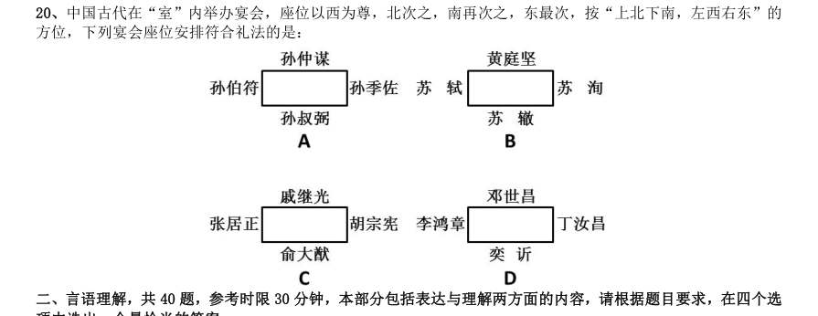
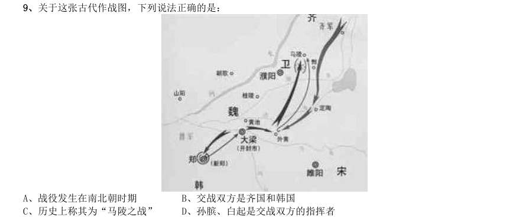

# 常识判断 · 历史人文 · 2010 年代真题

> 所属考点：[CS-LS](../CS-LS-历史人文.md)　｜　本片 80 题

### 2019 湖北·统一卷　第 8 题　（中国古代史）

下列历史事件与人物搭配正确的是:

- **A.** 锦帆未落干戈起——隋炀帝
- **B.** 烽火四起戏诸侯——周宣王
- **C.** 一骑红尘妃子笑——唐睿宗
- **D.** 车同轨,书同文——周武王

**答案：A**

### 2019 湖北·统一卷　第 9 题　（中国古代史）

下列送别诗句中不属于描写目送友人场景的是:

- **A.** 孤帆远影碧空尽,唯见长江天际流
- **B.** 山回路转不见君,雪上空留马行处
- **C.** 日暮酒醒人已远,满天风雨下西楼
- **D.** 青枫江上秋帆远,白帝城边古木疏

**答案：C**

### 2019 湖北·统一卷　第 16 题　（中国古代史）

下列成语和人物的对应关系错误的是:

- **A.** 口蜜腹剑——李义府
- **B.** 十面埋伏——项羽
- **C.** 程门立雪——杨时
- **D.** 东床快婿一一王羲之

**答案：A**

### 2019 湖北·选调　第 11 题　（中国古代史）

山水林田湖草是生命共同体。生态是统一的自然系统,是相互依存、紧密联系的有机链条。人的命脉在田, 田的命脉在水,水的命脉在山,山的命脉在土,土的命脉在林和草,这个生命共同体是人类生存发展的物质基础。 以上论述体现的历史唯物主义观点是: 1人类是自然界长期发展的产物和有机组成部分 2生产方式是社会存在和发展的基础和决定力量 3人们离开一定的自然条件就不可能生活和生产 4一定的自然条件对社会发展起促进和延缓作用

- **A.** 34
- **B.** 23
- **C.** 14
- **D.** 13

**答案：D**

### 2019 湖北·选调　第 17 题　（中国古代史）

十七世纪末以前,欧洲人认为——所有天鹅都是白色的。因为当时他们在实践中看到的天鹅的确都是白色的, 直到1697 年探险家在澳大利亚发现了黑天鹅,人们才知道错了。马克思主义哲学有关理论认为,实践具有历史 性和局限性,不可能对现有一切认识都作出确定的检验,既不能完全证实也不能完全驳倒一定时期提出的各种认 识结论。 这种哲学理论被称为:

- **A.** 实践作为真理标准的唯一性
- **B.** 实践标准的绝对性和确定性
- **C.** 实践标准的相对性和不确定性
- **D.** 实践的客观性、意识性和社会性

**答案：C**

### 2019 湖北·选调　第 67 题　（中国古代史）

以下诗句与湖北有关的是:

- **A.** 日暮乡关何处是,烟波江上使人愁
- **B.** 旧时王谢堂前燕,飞入寻常百姓家
- **C.** 沧海月明珠有泪,蓝田日暖玉生烟
- **D.** 日出江花红胜火,春来江水绿如蓝

**答案：A**

### 2019 广东·乡镇　第 61 题　（中国古代史）

习近平总书记在庆祝改革开放40 周年大会上的重要讲话指出:( )是五四运动以来我国发生的三大历史 性事件,是近代以来实现中华民族伟大复兴的三大里程碑。 1建立中国共产党 2成立中华人民共和国 3全面建成小康社会 4推进改革开放和中国特色社会主义事业

- **A.** 123
- **B.** 124
- **C.** 134
- **D.** 24

**答案：暂缺**

### 2019 广东·乡镇　第 68 题　（中国古代史）

只要把握住历史发展大势,抓住历史变革时机,奋发有为,锐意进取,人类社会就能更好前进。这句话体现的 哲学原理是( )。

- **A.** 物质和意识的辩证关系
- **B.** 规律是可以认识和利用的
- **C.** 事物发展是前进性和曲折性的统一
- **D.** 实践是检验认识正确与否的唯一标准

**答案：暂缺**

### 2019 广东·乡镇　第 71 题　（文学与文化）

自2018 年起,我国将每年农历( )定为“中国农民丰收节”,作为亿万农民庆祝丰收、享受丰收的节日。

- **A.** 立春
- **B.** 芒种
- **C.** 秋分
- **D.** 冬至

**答案：暂缺**

### 2019 广东·乡镇　第 74 题　（文学与文化）

广东属于岭南地区,具有深厚的岭南文化。以下诗句中描写岭南风物的是( )。

- **A.** 此地空余黄鹤楼
- **B.** 罗浮山下四时春
- **C.** 风吹草低见牛羊
- **D.** 不识庐山真面目

**答案：暂缺**

### 2019 广东·乡镇　第 78 题　（中国古代史）

俗话说:正月十五闹元宵。“闹”元宵的习俗包括张灯、观灯、舞龙、舞狮等。以下诗句与元宵节有关的是 ( )。

- **A.** 火树银花合
- **B.** 千里共婵娟
- **C.** 遍插茱萸少一人
- **D.** 爆竹声中一岁除

**答案：暂缺**

### 2019 广东·选调　第 21 题　（文学与文化）
> 材料：合适的1 项填补空缺,使之符合句子所表达的意思。…

传统美德,是一片( )的土地,生长着本真的人生体验,孕育着鲜活的道德追求。

- **A.** 丰收
- **B.** 丰饶
- **C.** 丰产
- **D.** 丰盛

**答案：B**

### 2019 广东·选调　第 25 题　（中国古代史）

浩瀚而宝贵的历史知识,既是人类总结昨天的( ),也是人类把握今天,创造明天的向导。

- **A.** 记录
- **B.** 经历
- **C.** 方式
- **D.** 回忆

**答案：A**

### 2019 广东·选调　第 30 题　（中国古代史）

中国提出的构建人类命运共同体倡议,( )“自由人联合体”“天下观”与“和文化”的思想精华,将 攸关中国前途命运的中国梦与攸关世界各国前途命运的世界梦紧密连接在一起,让世界各国( )中国智慧、 中国方案。

- **A.** 吸收 享有
- **B.** 汲取 共享
- **C.** 吸收 独享
- **D.** 汲取 享受

**答案：B**

### 2019 广东·选调　第 33 题　（中国古代史）

文化类综艺节目要走出同质化、低收视的( ),首先还是要在内容和形式创新上有所突破,让人们印象 中“高冷”的文化真正具有观赏( ),让观众产生共鸣和参与感。比如,《国家宝藏》就用大众喜闻乐见的 形式解读国宝,做到了既有史有据,又生动有趣。

- **A.** 光环 乐趣
- **B.** 怪圈 价值
- **C.** 窘境 价值
- **D.** 困境 乐趣

**答案：D**

### 2019 广东·选调　第 35 题　（中国古代史）

没有人能够完全知道中国何以为“中国”,( )我们可以尽力去认识人们所选择的社会机制、文化决策 和自然环境,( )我们对于那些影响历史进程的诸多因素会有更深入的了解,( )它们使得中国文明与众 不同。

- **A.** 因为 而且 所以
- **B.** 所以 因为 就是
- **C.** 尽管 但是 所以
- **D.** 但是 由此 正是

**答案：D**

### 2019 国考·地市级　第 15 题　（中国古代史）

关于文学作品中的典故,下列解释错误的是:

- **A.** “蓬山此去无多路,青鸟殷勤为探看”中的“青鸟”指的是信使
- **B.** “相顾无相识,长歌怀采薇”中的“采薇”指的是建功立业的抱负
- **C.** “劳歌一曲解行舟,红叶青山水急流”中的“劳歌”指的是送别歌曲
- **D.** “忆君初得昆山玉,同向扬州携手行”中的“昆山玉”指的是杰出人才

**答案：B**

### 2019 国考·省级　第 11 题　（中国古代史）

关于文学作品中的典故,下列解释错误的是:

- **A.** “蓬山此去无多路,青鸟殷勤为探看”中的“青鸟”指的是信使
- **B.** “相顾无相识,长歌怀采薇”中的“采薇”指的是建功立业的抱负
- **C.** “劳歌一曲解行舟,红叶青山水急流”中的“劳歌”指的是送别歌曲
- **D.** “忆君初得昆山玉,同向扬州携手行”中的“昆山玉”指的是杰出人才

**答案：B**

### 2019 国考·省级　第 12 题　（中国古代史）

下列宫殿的名称与典籍不直接相关的是:

- **A.** 两仪殿——《周易》
- **B.** 明德殿——《大学》
- **C.** 关雎宫——《诗经》
- **D.** 坤宁宫——《论语》

**答案：D**

### 2018 湖北·统一卷　第 11 题　（中国古代史）

下列古诗中涉及的历史事件,按先后顺序排列正确的是: 1千寻铁锁沉江底,一片降幡出石头 2剑外忽传收蓟北,初闻涕泪满衣裳 3千载琵琶作胡语,分明怨恨曲中论 4江东子弟多才俊,卷土重来未可知

- **A.** 1342
- **B.** 3412
- **C.** 2341
- **D.** 4312

**答案：D**

### 2018 湖北·统一卷　第 12 题　（中国古代史）

下列可以作为我国古代天子祭祀礼器的有: 1鼎 2爵 3篡 4璧 5璜 6璋

- **A.** 25
- **B.** 36
- **C.** 14
- **D.** 15

**答案：C**

### 2018 湖北·统一卷　第 13 题　（中国古代史）

下列哪一成语的典故不是来自真实历史事件:

- **A.** 暗度陈仓
- **B.** 草木皆兵
- **C.** 逼上梁山
- **D.** 乐不思蜀

**答案：C**

### 2018 国考·副省级　第 9 题　（中国古代史）

下面是对我国一份近代历史文献的描述:是一份改革内政和建设国家的新方案;是发展资本主义的近代化纲 领;因脱离当时社会现实而未能实施。 这份文献可能是:

- **A.** 《海国图志》
- **B.** 《资政新篇》
- **C.** 《天朝田亩制度》
- **D.** 《中华民国临时约法》

**答案：B**

### 2018 国考·副省级　第 11 题　（中国古代史）

某高校学生会干事小王负责策划一个民族文化展示周活动,下列哪个设计方案不合适?

- **A.** 请维吾尔族学生表演手鼓舞
- **B.** 请蒙古族学生制作奶茶
- **C.** 请朝鲜族学生展示唐卡
- **D.** 请彝族学生展示花腰刺绣

**答案：C**

### 2018 国考·副省级　第 13 题　（文学与文化）

下列诗句所描述情景出现的时间与图中标示的时间段,对应正确的是:

- **A.** 今夜月明人尽望,不知秋思落谁家——41之间
- **B.** 接天莲叶无穷碧,映日荷花别样红——23之间
- **C.** 天街小雨润如酥,草色遥看近却无——12之间
- **D.** 半盏屠苏犹未举,灯前小草写桃符——34之间

**答案：D**

### 2017 湖北·统一卷　第 2 题　（文学与文化）

某高校拟结合9 月份我国通行的节日、纪念日举办校园文化系列活动,下列哪些主题会出现在当月的活动项目计 划中: 1学习国防知识,增强国防观念 2缅怀抗战先烈,弘扬抗战精神 3吾爱吾师,感念师恩 4节约粮食,从我做起 5口腔健康,全身健康

- **A.** 2345
- **B.** 1235
- **C.** 1345
- **D.** 1245

**答案：B**

### 2017 湖北·统一卷　第 6 题　（中国古代史）

下列关于世界古代文明的说法正确的是:

- **A.** 《理想国》的作者是古希腊哲学家苏格拉底
- **B.** 古代埃及人建造的胡夫金字塔是世界上现存规模最大的金字塔
- **C.** 公元1 世纪前后,罗马帝国分裂为东罗马帝国和西罗马帝国
- **D.** 世界四大文明古国是指古代埃及、古代希腊、古代印度和古代中国

**答案：A**

### 2017 广东·统一卷　第 71 题　（中国古代史）

“海上丝绸之路”是古代中国与外国交通贸易和文化交往的海上通道,包括东海航线和南海航线。以下 城市不属于“海上丝绸之路”航线中主要港口的是:

- **A.** 广州
- **B.** 泉州
- **C.** 宁波
- **D.** 厦门

**答案：暂缺**

### 2017 广东·统一卷　第 82 题　（历史人文（综合））

人口增长模式包括原始型、传统型、现代型三种。目前,我国已基本实现了从( )的转变。

- **A.** 原始型向传统型
- **B.** 原始型向现代型
- **C.** 现代型向传统型
- **D.** 传统型向现代型

**答案：暂缺**

### 2017 国考·副省级　第 6 题　（中国古代史）

我国古代用“金”“石”“丝”“竹”指代不同材质、类别的乐器。下列诗词涉及“竹”的是:

- **A.** 珠帘夕殿闻钟磬,白日秋天忆鼓鼙
- **B.** 主人有酒欢今夕,请奏鸣琴广陵客
- **C.** 深秋帘幕千家雨,落日楼台一笛风
- **D.** 哀筝一弄湘江曲,声声写尽湘波绿

**答案：C**

### 2017 国考·副省级　第 10 题　（中国古代史）

与 共同构成中国诗歌传统源头的《楚辞》,主要作者是因谗去国、被流放到蛮荒之地的屈原, 他用“ ”这一著名诗句,表现了岁月蹉跎、时不我待的恐惧。 文中画横线部分应依次填入:

- **A.** 《庄子》长太息以掩涕兮,哀民生之多艰
- **B.** 《庄子》日月忽其不淹兮,春与秋其代序
- **C.** 《诗经》惟草木之零落兮,恐美人之迟暮
- **D.** 《诗经》路漫漫其修远兮,吾将上下而求索

**答案：C**

### 2017 国考·地市级　第 6 题　（中国古代史）

如果我国现行个人所得税适用于古代,下列哪一情形不需要缴纳个人所得税?

- **A.** 苏轼发表《赤壁赋》所得的稿酬
- **B.** 包拯任开封府府尹期间所得俸禄
- **C.** 康熙年间旱灾灾民获得的救济款
- **D.** 罗尚德将银两存入钱庄所得利息

**答案：C**

### 2016 湖北·统一卷　第 2 题　（文学与文化）

关于当代文学,下列说法错误的是:

- **A.** 《白鹿原》获得“茅盾文学奖”
- **B.** 《平凡的世界》是史铁生的作品
- **C.** 余华是先锋文学的代表人物之一
- **D.** 电影《大红灯笼高高挂》由苏童的小说改编

**答案：A**

### 2016 湖北·统一卷　第 3 题　（中国古代史）

关于古代思想家,下列对应错误的是:

- **A.** 独与天地精神相往来——荀子
- **B.** 虽千万人,吾往矣——孟子
- **C.** 知其不可而为之——孔子
- **D.** 摩顶放踵利天下——墨子

**答案：A**

### 2016 湖北·统一卷　第 4 题　（中国古代史）

下列古代宫廷建筑与帝王对应错误的是:

- **A.** 鹿台——秦始皇
- **B.** 台城——梁武帝
- **C.** 思子台——汉武帝
- **D.** 大明宫——唐玄宗

**答案：A**

### 2016 湖北·统一卷　第 15 题　（中国古代史）

下列常见的心理现象与成语对应错误的是:( )

- **A.** 晕轮效应——爱屋及乌
- **B.** 首因效应——一鼓作气
- **C.** 门槛效应——得寸进尺
- **D.** 从众效应——人云亦云

**答案：B**

### 2016 广东·乡镇　第 74 题　（中国古代史）

梯田是在山坡上开辟的农田,样子像楼梯,每一级边缘均筑有田埂。一些历史悠久的梯田已 成为受国家保护的文化遗产。修建梯田的主要目的是( )。

- **A.** 保护环境
- **B.** 传承文化
- **C.** 保持水土
- **D.** 节约人力

**答案：暂缺**

### 2016 国考·副省级　第 3 题　（中国古代史）

下列历史人物与其擅长领域对应错误的是:

- **A.** 军事:白起、李靖
- **B.** 经济:桑弘羊、郦道元
- **C.** 天文:张衡、郭守敬
- **D.** 艺术:吴道子、顾恺之

**答案：B**

### 2016 国考·副省级　第 4 题　（中国古代史）

下列文字中画横线部分存在错误的是: 古代的东西方商路主要有三条:一条是从中亚由陆路沿里海、波罗的海(A)到小亚细亚;一条是先由海路至波 斯湾,然后经两河流域到地中海东岸(B)的叙利亚一带;第三条是先由海路至红海,然后再由陆路到埃及(C) 的亚历山大港。在这几条商路中,红海以东由阿拉伯商人(D)掌握;地中海一带则为意大利的威尼斯和热那亚 所垄断。

- **A.** (A)
- **B.** (B)
- **C.** (C)
- **D.** (D)

**答案：A**

### 2016 国考·副省级　第 10 题　（中国古代史）

下列历史人物与其著名言论对应错误的是:

- **A.** 孟子——穷则独善其身,达则兼济天下
- **B.** 林则徐——苟利国家生死以,岂因祸福避趋之
- **C.** 梁启超——国家之主人为谁?即一国之民是也
- **D.** 曾国藩——天变不足畏,祖宗不足法,人言不足恤

**答案：A**

### 2016 国考·地市级　第 10 题　（中国古代史）

下列历史人物与其擅长领域对应错误的是:

- **A.** 军事:白起、李靖
- **B.** 经济:桑弘羊、郦道元
- **C.** 天文:张衡、郭守敬
- **D.** 艺术:吴道子、顾恺之

**答案：B**

### 2016 国考·地市级　第 11 题　（中国古代史）

下列历史人物与其著名言论对应错误的是:

- **A.** 孟子——穷则独善其身,达则兼济天下
- **B.** 林则徐——苟利国家生死以,岂因祸福避趋之
- **C.** 梁启超——国家之主人为谁?即一国之民是也
- **D.** 曾国藩——天变不足畏,祖宗不足法,人言不足恤

**答案：A**

### 2015 湖北·统一卷　第 5 题　（中国古代史）
> 材料：列不属于行政手段的是: A、规定各级电视台每日播出境外各类影视节目时间 B、设立专项经费用于鼓励本土作家创作优秀剧本 C、国家出台“限娱令”规范娱乐节目播出类型 D、每年引进的境外动漫作品同类题材数量设置上限 3、下列雕塑作品表现唐太宗李世民生平战功的是: A、马踏匈奴 B、击鼓说唱俑 C、昭陵六骏 D、乾陵石雕 4、下列诗句背景与科举制实行无关的是: A、慈恩寺下题名处,十七人中最少年 B、太宗皇帝真长策,赚得英雄尽白头 C、黑发不知勤学早,白首方悔读书迟 D、春风得意马蹄…

中国古代小说塑造了很多莽汉形象,他们外表威猛阳刚,性格天真似儿童,深受读者的喜爱。下列小说中莽 汉的时代顺序排列正确的是: 1、张飞 2、程咬金 3、李逵 4、牛皋

- **A.** 2134
- **B.** 2143
- **C.** 4213
- **D.** 1234

**答案：D**

### 2015 湖北·统一卷　第 10 题　（文学与文化）

地球自转一圈的时间是一天,地球半径为6371 千米。毛泽东诗词“坐地日行八万里”是有科学依据的,人 可以随着地球的自转运动,那么与诗句最吻合的可能是哪个国家的人:

- **A.** 阿富汗
- **B.** 南非
- **C.** 新加坡
- **D.** 挪威

**答案：C**

### 2015 湖北·统一卷　第 19 题　（中国古代史）

2014 年是“和平共处五项原则”发表60 周年,下列与其发表时间相同的历史事件是:

- **A.** 东西两德统一
- **B.** 古巴导弹危机
- **C.** 联合国军完全撤出朝鲜
- **D.** 越南抗美战争彻底结束

**答案：A**

### 2015 湖北·统一卷　第 20 题　（历史人文（综合））

现代中医借助西医的物理检验手段,提高传统的“望-闻-问-切-处”的诊断准确性。这样的优化属于:

- **A.** 工期优化
- **B.** 技术优化
- **C.** 成本优化
- **D.** 流程优化

**答案：B**

### 2015 广东·乡镇　第 72 题　（中国古代史）

我国古代有重阳节插茱萸的习俗,这种做法意在表达:

- **A.** 敬老爱老之情
- **B.** 对父母的感恩之情
- **C.** 对亲朋好友的思念之情
- **D.** 对美好生活的向往

**答案：暂缺**

### 2015 广东·乡镇　第 73 题　（文学与文化）

“唇亡齿寒”比喻双方关系利害关系密切,失去一方,另一方就会受到损害,这个成语最初 指代的是 之间的关系:

- **A.** 两个物体
- **B.** 两个人
- **C.** 两个国家
- **D.** 两个器官

**答案：暂缺**

### 2015 广东·乡镇　第 76 题　（中国古代史）

下列选项中,按照诗句所代表的时间先后顺序排列正确的是: 1问东城春色,正谷雨,牡丹期 2露从今夜白,月是故乡明 3微雨众卉新,一雷惊蛰始 4麦穗初齐稚子娇,桑叶正肥蚕食饱

- **A.** 3142
- **B.** 1432
- **C.** 2314
- **D.** 1234

**答案：暂缺**

### 2015 广东·县级　第 84 题　（中国古代史）

我国古代有重阳节插茱萸的习俗,这种做法意在表达:

- **A.** 敬老爱老之情
- **B.** 对父母的感恩之情
- **C.** 对亲朋好友的思念之情
- **D.** 对美好生活的向往

**答案：暂缺**

### 2015 国考·副省级　第 11 题　（文学与文化）

下列哪组成语反映了同一种人际关系:

- **A.** 琴瑟和鸣破镜重圆
- **B.** 负荆请罪载舟覆舟
- **C.** 结草衔环青梅竹马
- **D.** 相濡以沫舐犊情深

**答案：A**

### 2015 国考·副省级　第 18 题　（文学与文化）

下列俗语与对应的成语,二者本意所指属于同一物理现象的是:

- **A.** 宝剑锋从磨砺出——百炼成钢
- **B.** 酒香不怕巷子深——近朱者赤
- **C.** 小小秤砣压千斤——举重若轻
- **D.** 近水楼台先得月——海市蜃楼

**答案：B**

### 2015 国考·副省级　第 20 题　（中国古代史）

中国古代在“室”内举办宴会,座位以西为尊,北次之,南再次之,东最次,按“上北下南,左西右东”的 方位,下列宴会座位安排符合礼法的是: 项中选出一个最恰当的答案。

> （本题为图形题，选项为图片，见原卷）

**答案：A**

### 2015 国考·地市级　第 12 题　（文学与文化）

下列哪组成语反映了同一种人际关系:

- **A.** 琴瑟和鸣破镜重圆
- **B.** 负荆请罪载舟覆舟
- **C.** 结草衔环青梅竹马
- **D.** 相濡以沫舐犊情深

**答案：A**

### 2014 广东·乡镇　第 20 题　（中国古代史）

二十四节气是中国古代订立的一种用来指导农事的补充历法。二十四节中,“立夏”之后的下一个节气是:

- **A.** 芒种
- **B.** 小满
- **C.** 夏至
- **D.** 小暑

**答案：暂缺**

### 2014 广东·县级　第 4 题　（中国古代史）

在我国古代,人们把一夜分为五更,即一更、二更、三更、四更、五更,按更报时。“三更”相当于现在 的时间为:

- **A.** 17 时—19 时
- **B.** 19 时—21 时
- **C.** 21 时—23 时
- **D.** 23 时—1 时

**答案：暂缺**

### 2014 国考·统一卷　第 8 题　（中国古代史）

我国古代文人在诗词中常运用典故表达自己的思想感受,下列作品中没有使用典故的是:

- **A.** 桃花潭水深千尺,不及汪伦送我情
- **B.** 蓬山此去无多路,青鸟殷勤为探看
- **C.** 为报倾城随太守,亲射虎,看孙郎
- **D.** 东篱把酒黄昏后,有暗香盈袖

**答案：A**

### 2014 国考·统一卷　第 10 题　（中国古代史）

下列诗句按其所描写节日的先后顺序,排列正确的是: 1桃符呵笔写,椒酒过花斜 2九日黄花酒,登高会昔闻 3粽包分两髻,艾束著危冠 4马上逢寒食,途中属暮春

- **A.** 4231
- **B.** 1432
- **C.** 2431
- **D.** 3124

**答案：B**

### 2014 国考·统一卷　第 11 题　（中国古代史）

下列加括号词语在古代和现代含义相同的是:

- **A.** 阡陌(交通),鸡犬相闻
- **B.** (烈士)暮年,壮心不已
- **C.** 今天下三分,益州疲弊,此诚(危急)存亡之秋也
- **D.** 若舍郑以为东道主,(行李)之往来,共其乏困,君亦无所害

**答案：A**

### 2014 国考·统一卷　第 13 题　（中国古代史）

下列成语与工艺技术或行业对应不正确的是:

- **A.** 量凿正枘——木工
- **B.** 锦上添花——纺织
- **C.** 炉火纯青——冶炼
- **D.** 青出于蓝——陶瓷

**答案：A**

### 2014 国考·统一卷　第 19 题　（中国古代史）

燃放烟花最佳的气象条件:有较大分散性低云、碎积云,云底高度在1000 米左右,有一定的水汽,相对湿 度70%左右,风力小于3 级。下列诗句描述的天气中最适合欣赏烟花的是:

- **A.** 晴空一鹤排云上,便引诗情到碧霄
- **B.** 黄梅时节家家雨,青草池塘处处蛙
- **C.** 天上灰布悬,雨丝定连绵
- **D.** 风雨从北来,万木皆怒号

**答案：A**

### 2013 湖北·统一卷　第 8 题　（中国古代史）

下列历史文化遗址位于我国最南边的是:

- **A.** 半坡遗址
- **B.** 周口店遗址
- **C.** 河姆渡遗址
- **D.** 大汶口遗址

**答案：C**

### 2013 湖北·统一卷　第 11 题　（中国古代史）

下列选项中,都与中国古代科举考试有关的一组词语是:

- **A.** 蟾宫折桂、桂冠、连中三元
- **B.** 问鼎中原、独占鳌头、蟾宫折桂
- **C.** 连中三元、五子登科、名落孙山
- **D.** 金榜题名、桂冠、独占鳌头

**答案：C**

### 2013 湖北·统一卷　第 18 题　（中国古代史）

下列诗句描写菊花的是:

- **A.** 纵被东风吹作雪,绝胜南陌碾成尘
- **B.** 不要人夸好颜色,只留清气满乾坤
- **C.** 疑是广寒宫里种,一秋三度送天香
- **D.** 寂寞东篱湿露华,依前金靥照泥沙

**答案：A**

### 2013 湖北·统一卷　第 19 题　（历史人文（综合））

“中华老字号”沿袭和传承中华民族优秀的文化传统,每个老字号都有特色的产品、技艺或服务。下列按经 营服务范围对老字号进行归类正确的是:

- **A.** 稻香村、女儿红
- **B.** 小绍兴、王老吉
- **C.** 瑞蚨祥、老凤祥
- **D.** 片仔癀、福胶

**答案：A**

### 2013 国考·统一卷　第 1 题　（历史人文（综合））

《国家“十二五”时期文化改革发展规划纲要》提出要加大政府对文化事业建设的投入力度。 下列属于政府投入保障政策的是:

- **A.** 支持文化企业在海外投资、投标、营销、参展和宣传等活动
- **B.** 继续完善文化市场的准入政策,吸引社会资本投资文化产业
- **C.** 文化内容创意生产、非物质文化遗产项目经营享受税收优惠
- **D.** 通过政府购买服务的方式,鼓励社会力量提供公共文化产品

**答案：D**

### 2013 国考·统一卷　第 2 题　（中国古代史）

关于中国共产党历史上的重要会议,下列说法不正确的是:

- **A.** 古田会议:解决新型人民军队建设问题
- **B.** 遵义会议:纠正“左倾”的军事路线
- **C.** 洛川会议:决定北上抗日的总方针
- **D.** 瓦窑堡会议:确定建立抗日民族统一战线的方针政策

**答案：A**

### 2013 国考·统一卷　第 6 题　（中国古代史）

下列诗句反映的历史事件,按时间先后排序正确的是: 1北师覆没威海卫,签订条约在马关 2鸦片带来民族难,销烟虎门海滩前 3武装起义占三镇,武昌汉口和汉阳

- **A.** 132
- **B.** 231
- **C.** 123
- **D.** 213

**答案：D**

### 2012 湖北·统一卷　第 3 题　（中国古代史）

杨柳是我国古代诗词里面较为常见的意象,往往蕴涵离别之情,下列名句中不是表达送别意象的是:

- **A.** 芜笛何须怨杨柳,春风不度玉门关
- **B.** 渭城朝雨浥轻尘,客舍青青柳色新
- **C.** 今宵酒醒何处?杨柳岸,晓风残月
- **D.** 庭院深深深几许?杨柳堆烟,帘幕无重数

**答案：D**

### 2012 湖北·统一卷　第 5 题　（中国古代史）

下列影视剧情景设计符合历史常识的是:

- **A.** 燕太子丹与荆轲分坐八仙桌两侧,秉烛夜谈,谋划赴咸阳刺杀秦王计划
- **B.** 毛泽东与李宗仁幽默地说:德邻先生,你这次归国,是误上了贼船啊
- **C.** 魏征劝谏李世民时,说道:陛下当先天下之忧而忧,后天下之乐而乐
- **D.** 越王勾践兵败后给吴王夫差当奴仆,以红薯充饥,每晚则睡在柴垛上

**答案：B**

### 2012 国考·统一卷　第 3 题　（中国古代史）

在历史上中国共产党曾提出:1讲学习、讲政治、讲正气;2知识青年到农村去;3枪杆子里面出政权;4 科学技术是第一生产力。按时间先后顺序排列正确的是:

- **A.** 2341
- **B.** 3241
- **C.** 2134
- **D.** 3214

**答案：B**

### 2012 国考·统一卷　第 7 题　（中国古代史）

孔子在中国历史上留下了光辉的文化轨迹,以下关于孔子的说法正确的是:

- **A.** 著作《论语》,记录孔子本人及弟子言行
- **B.** 孔子在教育学上的贡献是打破公学,创办私学
- **C.** “罢黜百家,独尊儒术”使孔子一跃成为当时名家D、孔子核心思想是“仁政”,提出“民贵君轻”观点

**答案：A**

### 2012 国考·统一卷　第 9 题　（中国古代史）

关于这张古代作战图,下列说法正确的是:

- **A.** 战役发生在南北朝时期
- **B.** 交战双方是齐国和韩国
- **C.** 历史上称其为“马陵之战”
- **D.** 孙膑、白起是交战双方的指挥者

**答案：C**

### 2011 湖北·统一卷　第 81 题　（文学与文化）

被称作“雨巷诗人”的现代派诗人是:

- **A.** 戴望舒
- **B.** 徐志摩
- **C.** 胡适
- **D.** 闻一多

**答案：A**

### 2011 湖北·统一卷　第 97 题　（中国古代史）

以下哪部是我国古代的地理学巨著:

- **A.** 《梦溪笔谈》
- **B.** 《太平广记》
- **C.** 《天工开物》
- **D.** 《水经注》

**答案：A**

### 2011 湖北·统一卷　第 98 题　（文学与文化）

下列关于文化艺术的表述不正确的是:

- **A.** 印象派绘画的代表人物是莫奈、马奈、梵高等
- **B.** 芭蕾舞起源于意大利,兴盛于法国
- **C.** 北宋时期的文人画多以山水、花鸟为主要内容
- **D.** 中国传统的弹拨乐器有古筝、扬琴、琵琶、马头琴等

**答案：A**

### 2011 国考·统一卷　第 6 题　（中国古代史）

在西柏坡时期,党中央:1领导了解放区的土改运动;2召开了党的七届二中全会;3组织指挥了辽沈、淮 海、平津三大战役。 上述历史事件出现的先后顺序是:

- **A.** 132
- **B.** 213
- **C.** 231
- **D.** 312

**答案：A**

### 2011 国考·统一卷　第 21 题　（中国古代史）

在几千年人类文明发展进程中,亚洲、非洲、美洲、欧洲都留下许多宝贵的文学、艺术和建筑遗产,下列文 化遗产属于同一个大洲的是:

- **A.** 《最后的晚餐》、雕塑“思想者”、雕塑“大卫”
- **B.** 胡夫金字塔、狮身人面像、帕特农神庙
- **C.** 《百年孤独》、《老人与海》、《海底两万里》
- **D.** 《飞鸟集》、《高老头》、《源氏物语》

**答案：A**

### 2011 国考·统一卷　第 22 题　（中国古代史）

下列有关书法艺术的表达,正确的是:

- **A.** 东汉著名书法家张芝被称为“书圣”
- **B.** 唐代书法家颜真卿是楷书四大家之一
- **C.** 《真书千字文》是唐代著名书法家怀素的代表作
- **D.** “苏、黄、米、蔡”中的“黄”指的是黄公望

**答案：A**

### 2010 湖北·统一卷　第 113 题　（中国古代史）

对民主社会主义认识正确的是: 1最初的民主社会主义是资本主义社会主义 2民主社会主义是马克思社会主义的分支 3民主社会主义否认了社会制度的客观性 4民主社会主义肯定了工人阶级的领导地位 5民主社会主义把社会主义看成是一种道德需要、道德抗议,否认其历史必然性

- **A.** 1234
- **B.** 2345
- **C.** 1345
- **D.** 1245

**答案：C**
