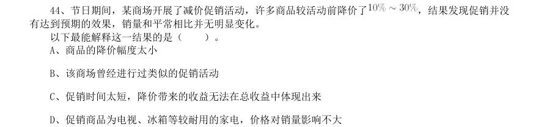
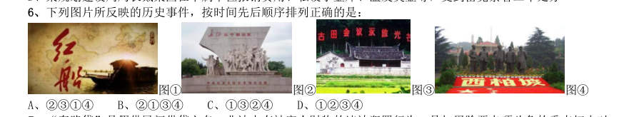

# 常识判断 · 历史人文 · 2020 年代真题

> 所属考点：[CS-LS](../CS-LS-历史人文.md)　｜　本片 60 题

> 本片子考点：中国古代史 29　文学与文化 23　历史人文（待细分） 7　世界史 1

### 【2024 湖北省考·第 10 题】HB-2024-ty-X010　历史人文｜文学与文化

戏曲是中华优秀传统文化的重要组成部分,下列有关说法错误的是:

- **A.** 京剧、豫剧、评剧、黄梅戏、越剧是中国戏剧五大剧种
- **B.** 《群英会》是依据《水浒传》改编的传统京剧
- **C.** 黄梅戏代表剧目中有《天仙配》和《女驸马》
- **D.** 豫剧与梆子腔关系紧密

**答案：B**

### 【2024 湖北省考·第 13 题】HB-2024-ty-X013　历史人文｜中国古代史

瑟是我国古代一种弦乐器,弦发出的音与弦的粗细和张力有关。我国古代这方面的经验积累相当早,文献记载 也很多,以下选项没有体现这一原理的是:

- **A.** 《礼记·乐记》:清庙之瑟,朱弦而疏越,壹倡而三叹,有遗音者也
- **B.** 《韩非子·外储说左下》:夫瑟以小弦为大声,以大弦为小声
- **C.** 《月令章句》:瑟前其柱则清,却其柱则浊
- **D.** 《春诸纪闻》:缓其商弦,与宫同音

**答案：A**

### 【2024 湖北省考·第 14 题】HB-2024-ty-X014　历史人文｜中国古代史

唐代是丝绸之路的鼎盛时期,当时丝绸之路上的商队可能携带的商品是:

- **A.** 线装本的《史记》
- **B.** 精心制作的宣德炉
- **C.** 《司马温公神道碑》拓片
- **D.** 鎏金工艺制作的莲瓣银茶托

**答案：D**

### 【2024 湖北省考·第 15 题】HB-2024-ty-X015　历史人文｜中国古代史

《礼记·曲礼》有言:“男子二十冠而字。”古人名与字的含义通常有一定关联,或相同相近,或相关相辅, 或相反相成,下列历史人物名与字的对应关系与其他三项不同的是:

- **A.** 曹丕,字子桓
- **B.** 周瑜,字公瑾
- **C.** 杜甫,字子美
- **D.** 朱熹,字元晦

**答案：D**

### 【2024 湖北省考·第 16 题】HB-2024-ty-X016　历史人文｜中国古代史

讲述宋史时,“燕云十六州”是绕不开的话题,下列有关叙述不正确的是:

- **A.** 周世宗柴荣北伐时收复了部分州
- **B.** 澶渊之盟正式将燕云十六州割让给辽国
- **C.** 高梁河之战使北宋失去了完全收复燕云十六州的时机
- **D.** 燕云十六州是我国北方以幽州和云州为中心的十六个州

**答案：B**

### 【2024 广东省考·第 7 题】GD-2024-ty-X007　历史人文｜历史人文（待细分）

要挖掘中华优秀传统文化的思想观念、人文精神、道德规范,把艺术创造力和中华文化价值融合起来,把中华 美学精神和当代审美追求结合起来,激活中华文化生命力,下列选项最能体现这一理念的是( )。

- **A.** 立文之道,惟字与义
- **B.** 得道者多助,失道者寡助
- **C.** 收百世之阙文,采千载之遗韵
- **D.** 观古今于须臾,抚四海于一瞬

**答案：C**

### 【2024 广东省考·第 13 题】GD-2024-ty-X013　历史人文｜文学与文化

(多选题)在面对重重困难艰辛探索适合中国国情的社会主义建设道路过程中,涌现出大量先进典型和英雄模 范人物,抒写了无数改天换地的壮丽诗篇,形成跨越时空、历久弥新的时代精神。下列词句关联人物的主要事 迹,发生于社会主义建设时期的有( )。

- **A.** “清澈的爱,只为中国”
- **B.** “干惊天动地事,做隐姓埋名人”
- **C.** “生也沙丘,死也沙丘,父老生死系”
- **D.** “以青春之我,创建青春之家庭,青春之国家,青春之民族”

**答案：BC**

### 【2024 国考（副省级）·第 17 题】GK-2024-fs-X017　历史人文｜中国古代史

关于我国古代文学作品,下列说法不正确的是:

- **A.** 汉乐府诗《孔雀东南飞》和北朝民歌《木兰诗》合称为“乐府双璧”
- **B.** “史学双璧”指的是司马迁的《史记》和司马光的《资治通鉴》
- **C.** 白朴的《西厢记》和汤显祖的《牡丹亭》并称为“古典戏曲双壁”
- **D.** “清代戏曲双璧”是指洪昇的《长生殿》和孔尚任的《桃花扇》

**答案：C**

### 【2023 湖北省考·第 8 题】HB-2023-ty-X008　历史人文｜中国古代史

为了避讳,古代君王的名字在说话或行文中不能直接说出或写出,而以改字、缺字等办 法处理。下列说法不符合这一避讳原则的是:

- **A.** 秦代将金陵这一地名改为秣陵
- **B.** 汉代将彻侯这一爵位更名为通侯
- **C.** 唐代佛经中将“观世音菩萨”译为“观音菩萨”
- **D.** 清代将《千字文》首句“天地玄黄”改为“天地元黄”

**答案：A**

### 【2023 湖北省考·第 9 题】HB-2023-ty-X009　历史人文｜文学与文化

中国书法艺术是中华民族的文化瑰宝,下列说法正确的是:

- **A.** 王献之书写的《兰亭集序》被誉为“天下第一行书”
- **B.** 《九成宫醴泉铭》是由魏征撰文、柳宗元书丹而成
- **C.** 黄庭坚是南宋著名书法家,擅长行书和草书
- **D.** 《颜氏家庙碑》由颜真卿为其父颜惟贞所立

**答案：D**

### 【2023 湖北省考·第 10 题】HB-2023-ty-X010　历史人文｜文学与文化

下列诗句内容与传统节日对应错误的是:

- **A.** “金吾不禁夜,玉漏莫相催”——寒食节
- **B.** “彩缕碧筠粽,香粳白玉团”——端午节
- **C.** “此生此夜不长好,明月明年何处看”——中秋节
- **D.** “桂花香馅裹胡桃,江米如珠井水淘”——元宵节

**答案：A**

### 【2023 湖北省考·第 11 题】HB-2023-ty-X011　历史人文｜中国古代史

下列关于先秦诸子百家叙述不正确的是:

- **A.** 孙武是兵家思想代表人物
- **B.** 老子提出了“内圣外王”的治国思想
- **C.** 韩非子是法家的代表人物,是荀子的学生
- **D.** 墨家学派有严密的组织、严格的纪律,其创始人为墨翟

**答案：B**

### 【2023 湖北省考·第 15 题】HB-2023-ty-X015　历史人文｜文学与文化

成语“沧海桑田”“斗转星移”“日月如梭”所反映的地理现象分别是:

- **A.** 地壳运动、地球自转运动、地球公转运动
- **B.** 地壳运动、地球公转运动、地球自转运动
- **C.** 地球自转运动、地壳运动、地球公转运动
- **D.** 地球自转运动、地球公转运动、地壳运动

**答案：B**

### 【2023 湖北省考·第 60 题】HB-2023-ty-X060　历史人文｜世界史

世界非物质文化遗产高峰论坛召开记者会,共有10 家国内媒体和4 家国外媒体参加。 组委会从中选出3 家媒体回答他们的问题,要求这3 家媒体中既有国内媒体又有国外媒体, 且国内外媒体交叉提问,则不同的提问方式有:

- **A.** 240 种
- **B.** 360 种
- **C.** 480 种
- **D.** 1440 种

**答案：C**

### 【2023 湖北省考·第 66 题】HB-2023-ty-X066　历史人文｜中国古代史

浮雕银杯是我国古代常见的一种盛酒容器,有大银杯和小银杯之分。已知5 个大银杯加 1 个小银杯,可以盛酒3 斛(斛,是古代的一种容量单位),5 个小银杯加1 个大银杯,可 以盛酒2 斛,则1 斛酒至多可以倒满小银杯的数量为:

- **A.** 2 个
- **B.** 3 个
- **C.** 4 个
- **D.** 5 个

**答案：B**

### 【2023 湖北省考·第 93 题】HB-2023-ty-X093　历史人文｜中国古代史

历史朝代:东汉:北宋

- **A.** 热带气旋:台风:飓风
- **B.** 敬辞称谓:家父:令尊
- **C.** 十二时辰:丑时:午时
- **D.** 交通工具:火车:马车

**答案：C**

### 【2023 广东省考（乡镇）·第 18 题】GD-2023-xz-X018　历史人文｜文学与文化

习近平主席在二〇二三年新年贺词中提到了“太空之家”、白鹤滩水电站、“福建号”、 愚公移山,下列与之相关的说法正确的是( )。

- **A.** 航天员刘洋参加了神舟十四号、神舟十五号的载人飞行任务
- **B.** 白鹤滩水电站是世界第一大电站,开启了我国南水北调新篇章
- **C.** “福建号”是我国第三艘航母
- **D.** 愚公移山的故事出自《山海经》

**答案：C**

### 【2023 广东省考（乡镇）·第 29 题】GD-2023-xz-X029　历史人文｜文学与文化

以下诗句描写的节气或节日,发生在秋季的是( )。

- **A.** 玉律传佳节,青阳应此辰
- **B.** 岁阴穷暮纪,献节启新芳
- **C.** 西北望乡何处是,东南见月几回圆
- **D.** 节分端午自谁言,万古传闻为屈原

**答案：C**

### 【2023 广东省考（县级）·第 15 题】GD-2023-xj-X015　历史人文｜文学与文化

以下诗句描写的节气或节日,发生在秋季的是( )。

- **A.** 玉律传佳节,青阳应此辰
- **B.** 岁阴穷暮纪,献节启新芳
- **C.** 西北望乡何处是,东南见月几回圆
- **D.** 节分端午自谁言,万古传闻为屈原

**答案：C**

### 【2023 国考（行政执法）·第 16 题】GK-2023-zf-X016　历史人文｜中国古代史

下列与古人出行有关的说法错误的是:

- **A.** “开远门前万里堠”中的“堠”是一种路标,可以用来导航和计程
- **B.** “乘舟而惑者,不知东西,见斗极则寤矣”中的“极”就是北极星
- **C.** “东有启明,西有长庚”中指示方向的“启明”“长庚”是不同天体
- **D.** “过洋牵星术”是通过测量星辰的高度指数来确定船只所处位置的

**答案：C**

### 【2022 广东省考（乡镇）·第 13 题】GD-2022-xz-X013　历史人文｜中国古代史

《中共中央关于党的百年奋斗重大成就和历史经验的决议》阐明了四个历史时期党面临的主要任务,以下 关于各个历史时期党面临的主要任务表述正确的是:

- **A.** 新民主主义革命时期——继续探索中国建设社会主义的正确道路,解放和发展社会生产力,使人民摆脱贫困、尽快富裕起来,为实现中华民族伟大复兴提供充满新的活力的体制保证和快速发展的物质条件
- **B.** 社会主义革命和建设时期——反对帝国主义、封建主义、官僚资本主义,争取民族独立、人民解放,为实现中华民族伟大复兴创造根本社会条件
- **C.** 改革开放和社会主义现代化建设新时期——实现从新民主主义到社会主义的转变,进行社会主义革命,推进社会主义建设,为实现中华民族伟大复兴奠定根本政治前提和制度基础
- **D.** 中国特色社会主义新时代——实现第一个百年奋斗目标,开启实现第二个百年奋斗目标新征程,朝着实现

**答案：D**

### 【2022 广东省考（乡镇）·第 29 题】GD-2022-xz-X029　历史人文｜文学与文化

下列诗句中描写的季节,按春夏秋冬排序准确的是: 1枯藤老树昏鸦,小桥流水人家,古道西风瘦马 2沾衣欲湿杏花雨,吹面不寒杨柳风 3稻花香里说丰年,听取蛙声一片 4千山鸟飞绝,万径人踪灭

- **A.** 2143
- **B.** 2314
- **C.** 3241
- **D.** 3214

**答案：B**

### 【2022 广东省考（县级）·第 17 题】GD-2022-xj-X017　历史人文｜历史人文（待细分）

结构性就业问题是因经济结构和劳动力结构不对应,使工作岗位要求与劳动者文化技术水平不相适应而产 生的就业问题。以下措施最有助于缓解结构性就业问题的是:

- **A.** 鼓励创业带动就业,支持多渠道灵活就业
- **B.** 持续、大规模、多层次开展职业培训
- **C.** 完善就业失业统计监测调查体系
- **D.** 健全覆盖城乡劳动者的社会保障体系

**答案：B**

### 【2022 广东省考（县级）·第 21 题】GD-2022-xj-X021　历史人文｜文学与文化

毛泽东一生中写下了许多脍炙人口的诗句,其中描写长征的是:

- **A.** 独立寒秋,湘江北去,橘子洲头
- **B.** 宜将剩勇追穷寇,不可沽名学霸王
- **C.** 七百里驱十五日,赣水苍茫闽山碧
- **D.** 更喜岷山千里雪,三军过后尽开颜

**答案：D**

### 【2022 广东省考（县级）·第 25 题】GD-2022-xj-X025　历史人文｜文学与文化

以下诗句和所描述的植物对应有误的是:

- **A.** 暗淡轻黄体性柔,情疏迹远只香留——桂花
- **B.** 千磨万击还坚劲,任尔东西南北风——梅花
- **C.** 菡萏香销翠叶残,西风愁起绿波间——荷花
- **D.** 此心生不背朝日,肯信众草能蘙之——向日葵

**答案：B**

### 【2022 国考（副省级）·第 3 题】GK-2022-fs-X003　历史人文｜中国古代史

(单选题)进入新发展阶段,是中华民族伟大复兴历史进程的大跨越,以下关于新发展阶段的理解,正确 的有几项? 1新发展阶段是中国共产党带领人民迎来从站起来、富起来到强起来历史性跨域的新阶段 2新发展阶段是基本实现社会主义现代化,全面建成小康社会的发展阶段 3新发展阶段是超越社会主义初级阶段,迈入社会主义更高阶段的发展阶段 4新发展阶段是实现第一个百年奋斗目标,向着第二个百年奋斗目标迈进的发展阶段

- **A.** 1 项
- **B.** 2 项
- **C.** 3 项
- **D.** 4 项

**答案：B**

### 【2022 国考（副省级）·第 11 题】GK-2022-fs-X011　历史人文｜文学与文化

(单选题)下列毛泽东诗词与创作背景对应正确的是:

- **A.** 三十八年过去,弹指一挥间。可上九天揽月,可下五洋捉鳖,谈笑凯歌还——1941 年延安整风运动
- **B.** 军叫工农革命,旗号镰刀斧头。匡庐一带不停留,要向潇湘直进——1948 年淮海战役
- **C.** 金沙水拍云崖暖,大渡桥横铁索寒——1930 年第一次反“围剿”
- **D.** 宜将剩勇追穷寇,不可沽名学霸王——1949 年解放南京

**答案：D**

### 【2022 国考（副省级）·第 17 题】GK-2022-fs-X017　历史人文｜中国古代史

(单选题)下列哪一情形在历史上有可能发生?

- **A.** 秦朝时郑某升任西域都护,友人为他摆酒饯行
- **B.** 西汉时张某担任市舶使,负责采购舶来船
- **C.** 唐朝富商李某在女儿出嫁时陪送白瓷数十套
- **D.** 明代官员王某请戏班演出京剧《白蛇传》

**答案：C**

### 【2022 国考（副省级）·第 18 题】GK-2022-fs-X018　历史人文｜文学与文化

(单选题)我国很多成语都与植物有关,下列有关说法错误的是:

- **A.** “投桃报李”中的“桃”和“李”属于同一科植物
- **B.** “藕断丝连”中藕丝的作用是为植物输送水和养分
- **C.** “望梅止渴”和“折梅寄远”中的“梅”分别是果梅和花梅
- **D.** “胸有成竹”中“竹”的年龄可以根据竹节的数量判断

**答案：D**

### 【2022 国考（地市级）·第 15 题】GK-2022-ds-X015　历史人文｜文学与文化

我国很多成语都与植物有关,下列有关说法错误的是:

- **A.** “投桃报李”中的“桃”和“李”属于同一科植物
- **B.** “藕断丝连”中藕丝的作用是为植物输送水和养分
- **C.** “望梅止渴”和“折梅寄远”中的“梅”分别是果梅和花梅
- **D.** “胸有成竹”中“竹”的年龄可以根据竹节的数量判断

**答案：D**

### 【2022 国考（地市级）·第 17 题】GK-2022-ds-X017　历史人文｜中国古代史

下列哪一情形在历史上有可能发生?

- **A.** 秦朝时郑某升任西域都护,友人为他摆酒饯行
- **B.** 西汉时张某担任市舶使,负责采购舶来船
- **C.** 唐朝富商李某在女儿出嫁时陪送白瓷数十套
- **D.** 明代官员王某请戏班演出京剧《白蛇传》

**答案：C**

### 【2022 国考（行政执法）·第 19 题】GK-2022-zf-X019　历史人文｜中国古代史

(单选题)下列哪一情形在历史上有可能发生?

- **A.** 秦朝时郑某升任西域都护,友人为他摆酒饯行
- **B.** 西汉时张某担任市舶使,负责采购舶来船
- **C.** 唐朝富商李某在女儿出嫁时陪送白瓷数十套
- **D.** 明代官员王某请戏班演出京剧《白蛇传》

**答案：C**

### 【2021 广东省考（乡镇）·第 11 题】GD-2021-xz-X011　历史人文｜中国古代史

2021 年是中国共产党成立一百周年,关于党的历史,下列选项有误的是:

- **A.** 中共二大第一次明确提出了彻底的反帝反封建的革命纲领
- **B.** 中国共产党在中国革命中战胜敌人的三个法宝是解放思想、实事求是、武装斗争
- **C.** 确立毛泽东思想为党的指导思想并写入党章,是中共七大的历史性贡献
- **D.** 1954 年一届全国人大一次会议通过并公布了中华人民共和国的第一部宪法

**答案：暂缺**

### 【2021 广东省考（乡镇）·第 13 题】GD-2021-xz-X013　历史人文｜中国古代史

嘉兴南湖革命纪念馆的题诗“革命声传画舫中,诞生共党庆工农”纪念的历史事件是:

- **A.** 中共一大的召开
- **B.** 第一次国共合作
- **C.** 中共工农红军的组建
- **D.** 第一次全国劳动大会的召开

**答案：暂缺**

### 【2021 广东省考（乡镇）·第 20 题】GD-2021-xz-X020　历史人文｜历史人文（待细分）

增强消费对经济发展的基础性作用,顺应消费升级趋势,提升传统消费,培育新型消费,适当增加公共消费。 下列措施中,有助于增强消费对经济发展的基础性作用的有: 1提高服务消费领域市场准入门槛,减少产品供给 2推动汽车等消费品由购买管理向使用管理转变 3完善节假日制度,落实带薪休假制度 4改善消费环境,强化消费者权益保护

- **A.** 14
- **B.** 13
- **C.** 24
- **D.** 234

**答案：暂缺**

### 【2021 广东省考（乡镇）·第 23 题】GD-2021-xz-X023　历史人文｜中国古代史

广东在中国共产党创建史上具有重要历史地位。关于广东的红色历史,下列选项有误的是( )。

- **A.** 广东是全国最早建立中共地方组织的地区之一
- **B.** 省港大罢工是反抗帝国主义屠杀中国人民的政治大罢工
- **C.** 中国共产党领导的土地革命最早在广东海陆丰根据地开展起来
- **D.** 中国共产党在广州举行的第三次全国代表大会,决定实行第二次国共合作

**答案：暂缺**

### 【2021 广东省考（乡镇）·第 29 题】GD-2021-xz-X029　历史人文｜历史人文（待细分）

春季,我国民间有许多民俗活动。下列关于这些民俗活动的表述正确的是( )。

- **A.** 在迎春仪式上,鞭打春牛——打春
- **B.** 立春清晨,到郊外、田野踏青——插春
- **C.** 将采集到的植物枝条插在家里——采春
- **D.** 采集冬青树、松柏、竹枝、青菜等绿色植物——探春

**答案：暂缺**

### 【2021 国考（地市级）·第 8 题】GK-2021-ds-X008　历史人文｜文学与文化

长征是宣言书,长征是宣传队,长征是播种机,下列《长征组歌》中的诗句,按所反映事件发生的先后顺序 排列正确的是: 1六盘山上红旗展,势如破竹扫敌骑 2昼夜兼程二百四,猛打穷追夺泸定 3雪山低头迎远客,草毯泥毡扎营盘 4战士双脚走天下,四渡赤水出奇兵

- **A.** 3142
- **B.** 3421
- **C.** 4312
- **D.** 4231

**答案：D**

### 【2021 国考（地市级）·第 16 题】GK-2021-ds-X016　历史人文｜文学与文化

很多伟大科学家的墓志铭简练而富有诗意,是了解其一生成就的窗口。下列墓志铭与科学家对应错误的是:

- **A.** 我曾测量天空,现在测量幽冥。灵魂飞向天空,肉体安息土中——爱因斯坦
- **B.** 他把世界翻了一个个儿,虽然并不完全——达尔文
- **C.** 他从苍天处取得闪电,从暴君处取得民权——富兰克林
- **D.** 他失明了,因为自然界已经没有剩下什么他没有看见过的东西了——伽利略

**答案：A**

### 【2020 湖北省考·第 6 题】HB-2020-ty-X006　历史人文｜中国古代史

下列诗词所反映的历史时期按时间先后顺序排列正确的是: 1风云突变,军阀重开战,洒向人间都是怨,一枕黄粱再现 2外侮需人御,将军赋采薇。师称机械化,勇夺虎罴威 3宜将剩勇追穷寇,不可沽名学霸王。天若有情天亦老,人间正道是沧桑 4山高路远沟深,大军纵横驰奔,谁敢横刀立马,唯我彭大将军

- **A.** 1234
- **B.** 1243
- **C.** 1423
- **D.** 2314

**答案：C**

### 【2020 湖北省考·第 14 题】HB-2020-ty-X014　历史人文｜中国古代史

下列影视剧情符合历史事实的是:

- **A.** 清朝时称官员为大人,如刘大人、李大人等
- **B.** 宋朝官员大声宣读圣旨道“奉天承运皇帝诏曰”
- **C.** 武则天的父亲见到武则天时,称呼其为“媚娘”
- **D.** 唐贞观年间官员对话讲到唐太宗时,称“吾皇太宗”

**答案：A**

### 【2020 湖北省考·第 15 题】HB-2020-ty-X015　历史人文｜中国古代史

祠堂在中国传统社会是家族成员的重要活动中心,一般情况下姓氏称为某氏宗祠,但有时也会称为某氏家庙。 称为“家庙”的依据是:

- **A.** 该家族与宗教有关
- **B.** 社会习惯约定俗成
- **C.** 该家族受到皇帝册封
- **D.** 该家族有人获得官爵

**答案：D**

### 【2020 广东省考（乡镇）·第 23 题】GD-2020-xz-X023　历史人文｜文学与文化

乡村文化繁荣兴盛重大工程包括“农耕文化保护传承”,以下诗句最能体现农耕文化保护传承的是:

- **A.** 谁知盘中餐,粒粒皆辛苦
- **B.** 离离原上草,一岁一枯荣
- **C.** 尧有欲谏之鼓,舜有诽谤之木
- **D.** 山重水复疑无路,柳暗花明又一村

**答案：暂缺**

### 【2020 广东省考（乡镇）·第 24 题】GD-2020-xz-X024　历史人文｜中国古代史

在中国史、亚洲史上,( )有着深远的意义和影响,它大大地拓宽了古人的地理视野,改变了汉朝的地 域观念,有历史学家甚至将它与哥伦布“发现”美洲相提并论。

- **A.** 昭君出塞
- **B.** 蒙古西征
- **C.** 张骞凿空
- **D.** 鉴真东渡

**答案：暂缺**

### 【2020 广东省考（思维能力测验）·第 3 题】GD-2020-sw-X003　历史人文｜历史人文（待细分）

传承中华传统文化,既要合理创新,又要保留其精华而不失本色,对京剧、昆曲来说亦是如此。 下列选项中,与上述推理结构最为相似的是( )。

- **A.** 老师必须有教师资格证才能上岗,小朱是老师,所以小朱有教师资格证
- **B.** 注射某种药物后,实验室小白鼠失眠情况大大改善,所以给其他动物注射这种药物也能改善其睡眠状况
- **C.** 运动员的身体素质都很好,小吴身体强健,所以小吴很可能是运动员
- **D.** 水是无色无味的,空气是无色无味的,所以空气和水极其相似

**答案：A**

### 【2020 广东省考（思维能力测验）·第 29 题】GD-2020-sw-X029　历史人文｜历史人文（待细分）

有研究显示,学生在课堂学习时大脑内部活动较少,但在做实验、做作业、自学和考试时,学生的 大脑内部活动相对活跃,因此要改变传统的学校教育方式。 要使上述论断成立,需补充的前提不包括( )。

- **A.** 可以用思维活跃度判断课堂学习效果
- **B.** 提升学习效果是学校教育的重要目标
- **C.** 大脑内部活动活跃能够促进学生学习
- **D.** 传统的学校教育方式以课堂学习为主

**答案：B**

### 【2020 广东省考（思维能力测验）·第 33 题】GD-2020-sw-X033　历史人文｜文学与文化

中国戏曲具有丰富的表现力。粤剧是我国著名的戏曲剧种,所以粤剧具有丰富的表现力。 下列选项中,与上述推理结构最为相似的是( )。

- **A.** 公共交通很便捷。地铁是公共交通,所以地铁很便捷
- **B.** 护士是白衣天使。小舟是白衣天使,所以小舟是护士
- **C.** 杜甫是诗人。杜甫是唐朝人,所以唐朝人擅写诗
- **D.** 鸟儿都会飞。鸵鸟不会飞,所以鸵鸟不是鸟

**答案：A**

### 【2020 广东省考（思维能力测验）·第 36 题】GD-2020-sw-X036　历史人文｜中国古代史

工业革命的历史表明,技术进步固然会使一些产品、细分行业、工作岗位消失,从而造成失业,但 同时也会创造出许多新的就业岗位。由此可见,人们完全不必担忧新兴技术对人类社会产生威胁。 下列最不能说明上述论证缺陷的是( )。

- **A.** 默认了技术进步创造的就业岗位数量多于它造成的失业人数
- **B.** 暗含了造成失业是技术进步对人类社会的唯一威胁
- **C.** 假设了新兴技术的发展将会符合工业时代的规律
- **D.** 忽视了普通大众缺乏工业时代历史常识的可能性

**答案：D**

### 【2020 广东省考（思维能力测验）·第 44 题】GD-2020-sw-X044　历史人文｜中国古代史

节日期间,某商场开展了减价促销活动,许多商品较活动前降价了 ,结果发现促销并没 有达到预期的效果,销量和平常相比并无明显变化。 以下最能解释这一结果的是( )。

- **A.** 商品的降价幅度太小
- **B.** 该商场曾经进行过类似的促销活动
- **C.** 促销时间太短,降价带来的收益无法在总收益中体现出来
- **D.** 促销商品为电视、冰箱等较耐用的家电,价格对销量影响不大

**答案：D**

### 【2020 广东省考（思维能力测验）·第 56 题】GD-2020-sw-X056　历史人文｜文学与文化

学校社团负责人要从动漫社、舞蹈社团、新闻社、球类社团、健美操社团和书法协会这6 个社团中 选择3 个社团送教下乡。已知: (1)动漫社和新闻社这两个社团至少要去1 个 (2)舞蹈社团和健美操社团这两个社团至少要去1 个 (3)新闻社和健美操社团都不能与舞蹈社团同时去 根据以上条件,若健美操社团未被选上,则必然同时入选的有( )。

- **A.** 动漫社和书法协会
- **B.** 舞蹈社团和球类杜团
- **C.** 舞蹈社团和新闻社
- **D.** 动漫社和舞蹈社团

**答案：D**

### 【2020 广东省考（综合行政能力测验）·第 11 题】GD-2020-zh-X011　历史人文｜中国古代史

建设社会主义文化强国需要加强文物保护利用和文化遗产保护传承。以下举措不符合文物保护利用 和文化遗产保护传承要求的是( )。

- **A.** 分拆整理出土文物
- **B.** 维护修缮名人故居
- **C.** 培训博物馆志愿讲解员
- **D.** 举办粤绣工艺展览

**答案：A**

### 【2020 广东省考（综合行政能力测验）·第 20 题】GD-2020-zh-X020　历史人文｜中国古代史

2019 年5 月,习近平总书记在江西于都参观中央红军长征出发纪念馆时强调,我们一定要牢记红色 政权是从哪里来的、新中国是怎么建立起来的。以下历史事件不是发生在长征途中的是( )。

- **A.** 井冈山会师
- **B.** 遵义会议
- **C.** 四渡赤水
- **D.** 飞夺泸定桥

**答案：A**

### 【2020 广东省考（综合行政能力测验）·第 38 题】GD-2020-zh-X038　历史人文｜中国古代史

广东音乐是国家级非物质文化遗产,其旋律亮丽、节奏明快,是具有岭南特色韵味的乐种。以下属 于广东音乐的曲目是( )。 1《步步高》2《胡笳十八拍》3《赛龙夺锦》4《雨打芭蕉》5《广陵散》

- **A.** 125
- **B.** 134
- **C.** 2345
- **D.** 1234

**答案：B**

### 【2020 广东省考（综合行政能力测验）·第 39 题】GD-2020-zh-X039　历史人文｜中国古代史

李清照是宋代著名女词人,一生中经历了北宋灭亡和南渡漂泊,在变乱前后其词风也发生了很大的 变化。下列词句中属于其南渡之前所创作的是( )。

- **A.** 空梦长安,认取长安道
- **B.** 故乡何处是?忘了除非醉
- **C.** 物是人非事事休,欲语泪先流
- **D.** 莫道不销魂,帘卷西风,人比黄花瘦

**答案：D**

### 【2020 国考（地市级）·第 12 题】GK-2020-ds-X012　历史人文｜历史人文（待细分）

“套路贷”是假借民间借贷之名,非法占有被害人财物的违法犯罪行为,是扫黑除恶专项斗争的重点打击对 象。下列关于“套路贷”的说法正确的是:

- **A.** “套路贷”犯罪案件可由犯罪行为发生地、结果发生地及犯罪嫌疑人居住地公安机关侦查
- **B.** 因法律规定民间借贷最高年利率为36%,故超过36%的可认定为“套路贷”
- **C.** 因“套路贷”属于非法行为,追债时一般不会采用仲裁、诉讼方式
- **D.** 我国刑法设置有专门针对“套路贷”的罪名

**答案：A**

### 【2020 国考（地市级）·第 16 题】GK-2020-ds-X016　历史人文｜文学与文化

下列与成语有关的描述错误的是:

- **A.** “叶落归根”是因为地球表面的物体会受到重力的作用
- **B.** “青出于蓝”描述的是传统植物染料的提取过程
- **C.** “囊萤映雪”中“囊萤”和“映雪”包含的光学原理相同D、“沙里淘金”中的“金”属于金属单质

**答案：C**

### 【2020 国考（省级）·第 6 题】GK-2020-sj-X006　历史人文｜中国古代史

下列图片所反映的历史事件,按时间先后顺序排列正确的是: 图1 图2 图3 图4

- **A.** 2314
- **B.** 2134
- **C.** 1324
- **D.** 1234

**答案：C**

### 【2020 国考（省级）·第 13 题】GK-2020-sj-X013　历史人文｜文学与文化

关于诗句涉及的物候特征,下列对应错误的是:

- **A.** 不知近水花先发,疑是经冬雪未销——水对温度的调节作用
- **B.** 羌笛何须怨杨柳,春风不度玉门关——冷锋过境产生的天气变化
- **C.** 春风疑不到天涯,二月山城未见花——海拔对植物生长的影响
- **D.** 南枝向暖北枝寒,一种春风有两般——光照对植物的影响

**答案：B**

### 【2020 国考（省级）·第 14 题】GK-2020-sj-X014　历史人文｜文学与文化

下列与成语有关的描述错误的是:

- **A.** “叶落归根”是因为地球表面的物体会受到重力的作用
- **B.** “青出于蓝”描述的是传统植物染料的提取过程
- **C.** “囊萤映雪”中“囊萤”和“映雪”包含的光学原理相同
- **D.** “沙里淘金”中的“金”属于金属单质

**答案：C**

### 【2020 国考（省级）·第 17 题】GK-2020-sj-X017　历史人文｜文学与文化

白居易有诗云:“绿蚁新醅酒,红泥小火炉。晚来天欲雪,能饮一杯无?”下列与该诗相关的说法正确的是:

- **A.** “绿蚁”是因为酒中添加了可食用调色剂
- **B.** “醅酒”的过程利用了微生物的作用
- **C.** 炉火燃烧的过程是内能转化成化学能
- **D.** 从雪到水的转化过程会释放出热量

**答案：B**
