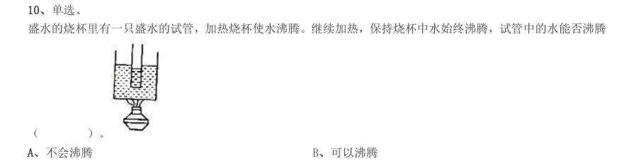

# 常识判断 · 生活常识 · 2000 年代真题

> 所属考点：[CS-SH](../CS-SH-生活常识.md)　｜　本片 201 题

> 本片子考点：常识（待细分） 56　科技常识 41　法律常识 27　历史人文 24　生活常识 19　时政热点 14　地理常识 12　经济常识 8

### 2009 湖北·统一卷　第 2 题　（常识（待细分））

在汉字的形体演变过程中,位于小篆和楷书之间的字体是:

- **A.** 金文
- **B.** 大篆
- **C.** 隶书
- **D.** 草书

**答案：暂缺**

### 2009 湖北·统一卷　第 3 题　（地理常识）

第29 届奥运会与历届奥运会相比,下列说法错误的是:

- **A.** 设置的比赛大项最多
- **B.** 打破的世界纪录最多
- **C.** 金牌和奖牌分布最广
- **D.** 参加国家和地区最多

**答案：暂缺**

### 2009 湖北·统一卷　第 4 题　（生活常识）

剧烈运动后,人们常常满脸通红、大汗淋漓,这主要是因为皮肤的什么功能:

- **A.** 保护和排泄
- **B.** 排泄和调节体温
- **C.** 排泄和感受外界刺激
- **D.** 保护和感受外界刺激

**答案：暂缺**

### 2009 湖北·统一卷　第 9 题　（地理常识）

下列说法错误的是:

- **A.** 大兴安岭在我国黑龙江省境内,是全国面积最大的林区
- **B.** 内蒙古是中国发现岩画最丰富的地区
- **C.** 松辽平原是我国重要的粮食生产基地,是世界著名的玉米带
- **D.** 辽宁省在中华民国时期被称为奉天省

**答案：暂缺**

### 2009 湖北·统一卷　第 17 题　（时政热点）

政府机构和工作人员把制订的计划方案付诸实施的活动过程,是政府的:

- **A.** 计划职能
- **B.** 领导职能
- **C.** 组织职能
- **D.** 控制职能

**答案：C**

### 2009 湖北·统一卷　第 19 题　（法律常识）

孙某丈夫外出做买卖五年未归,也没有任何音讯,孙某欲改嫁,下面说法正确的是:

- **A.** 孙某丈夫视为死亡,孙某可以直接改嫁
- **B.** 孙某丈夫不论是生还是死,孙某均可以改嫁
- **C.** 孙某丈夫经人民法院宣告失踪后,孙某可以改嫁
- **D.** 孙某丈夫经人民法院宣告死亡后,孙某可以改嫁

**答案：D**

### 2009 湖北·统一卷　第 20 题　（法律常识）

下列关于死刑的说法中,错误的是:

- **A.** 死刑只适用于罪行极其严重的犯罪分子
- **B.** 犯罪时不满18 周岁的人和审判时怀孕的妇女不适用死刑
- **C.** 判决死刑立即执行的,由最高人民法院和最高人民法院授权的部分高级人民法院核准
- **D.** 判处死刑缓期执行的,在死刑缓期执行期间,如果没有故意犯罪,两年期满后减为无期徒刑

**答案：A**

### 2009 国考·统一卷　第 1 题　（历史人文）

北京奥运会开幕式上展示的巨大的“和”字,其蕴含的思想源自:

- **A.** 墨家
- **B.** 道家
- **C.** 儒家
- **D.** 法家

**答案：C**

### 2009 国考·统一卷　第 5 题　（历史人文）

从 年元旦起我国政府正式取消了延续 年的农业税。 我国农业税的征收始于:

- **A.** 春秋时期鲁国的初税亩
- **B.** 战国时期的商秧变法
- **C.** 秦朝的按亩纳税
- **D.** 西汉的编户齐民

**答案：A**

### 2009 国考·统一卷　第 7 题　（时政热点）

下列表述错误的一项是:

- **A.** 党的十七大报告明确指出,要更好的实施科教兴国战略、人才强国战略、可持续发展战略
- **B.** 今年5 月12 日发生四川汶川特大地震,是新中国成立以来破坏性最强、波及最广、救灾难度最大的一次地震
- **C.** 神舟七号载人航天飞行圆满成功,标志着我国成为世界上第二个独立掌控空间出舱关键技术的国家
- **D.** 科学发展观,第一要义是发展,核心是以人为本,最基本的要求是全面协调可持续,根本方法是统筹兼顾

**答案：C**

### 2009 国考·统一卷　第 9 题　（常识（待细分））

我国领导人多次表示,西藏事务完全是中国内政,“西藏问题”的实质是:

- **A.** 民族问题
- **B.** 人权问题
- **C.** 宗教问题
- **D.** 主权问题

**答案：D**

### 2009 国考·统一卷　第 10 题　（常识（待细分））

以下节气按时间顺序排列正确的是:

- **A.** 立春、惊蛰、雨水、春分
- **B.** 小暑、大暑、处暑、立秋
- **C.** 白露、秋分、寒露、霜降
- **D.** 立冬、小雪、小寒、冬至

**答案：C**

### 2009 国考·统一卷　第 12 题　（地理常识）

关于中国改革开放 周年成就的描述,下列符合实际的是:

- **A.** 国内生产总值平均增长速度接近10%
- **B.** 人均GDP 已接近中等发达国家水平
- **C.** 主要污染物排放总量逐年减少
- **D.** 已成为世界贸易第一大国

**答案：A**

### 2009 国考·统一卷　第 13 题　（生活常识）

下列做法在日常生活中的可行的是:

- **A.** 医用酒精和工业酒精的主要成份相同,都可用于伤口消毒
- **B.** 喝牛奶、豆浆等富含蛋白质的食品可有效缓解重金属中毒现象
- **C.** 由于淀粉有遇碘变蓝的特性,可利用淀粉检验加碘食盐的真假
- **D.** 低血糖症状出现时,吃馒头要比喝葡萄糖水见效快

**答案：B**

### 2009 国考·统一卷　第 14 题　（经济常识）

美国次贷危机中的“次”是指:

- **A.** 贷款人的第二次贷款
- **B.** 贷款人的收入较低,信用等级较低
- **C.** 贷款机构的实力和规模较小
- **D.** 贷款机构的信用等级较低

**答案：B**

### 2009 国考·统一卷　第 15 题　（地理常识）

关于气象,下列说法正确的是:

- **A.** 沙尘暴发源于蒙古高原
- **B.** 厄尔尼诺现象是由温室气体增多引发的
- **C.** 美国西海岸有暖流、东海岸有寒流通过
- **D.** 飓风指的是在大西洋上生成的热带气旋

**答案：A**

### 2009 国考·统一卷　第 17 题　（科技常识）

下列陈述中错误的是:

- **A.** 隐形飞机机身涂料的主要作用是吸收电磁波
- **B.** 混沌理论在很多研究领域有重要应用
- **C.** U 盘格式化后,信息不可恢复
- **D.** 土星环是圆的

**答案：A**

### 2009 国考·统一卷　第 24 题　（法律常识）

甲被车撞伤倒地,行人乙拦下一辆出租车,将甲送往医院,乙支付了车费,其间甲的手机丢失。下列表述中 正确的是:

- **A.** 车费由甲承担,甲手机丢失的损失由乙赔偿
- **B.** 车费不由甲承担,甲手机丢失的损失由乙赔偿
- **C.** 车费由甲承担,甲手机丢失的损失不由乙赔偿
- **D.** 车费不由甲承担,甲手机丢失的损失不由乙赔偿

**答案：C**

### 2009 国考·统一卷　第 25 题　（生活常识）

根据《突发事件应对法》的规定,下列说法正确的是:

- **A.** 突发事件即为紧急状态
- **B.** 突发事件的预警级别从高到低依次用红色、橙色、蓝色和黄色来标示
- **C.** 突发事件包括自然灾害、事故灾难、公共卫生事件和社会安全事件
- **D.** 突发事件发生后,发生地县级人民政应当立即采取措施控制事态发展,并立即向上一级人民政府报告,不得

**答案：A**

### 2008 湖北·统一卷　第 102 题　（时政热点）

邓小平同志曾深刻指出“我们评价一个国家的政治体制、政治结构和政策是否正确,关键看三条:第一 是看国家的政局是否稳定;第二是看能否增进人民的团结,改善人民的生活;第三是看生产力是否得到持续 发展。”这一重要论断深刻揭示了( )。

- **A.** 社会发展与人的全面发展
- **B.** 人民群众是社会的产物
- **C.** 生产力和生产关系的辩证关系
- **D.** 上层建筑和经济基础的辩证关系

**答案：D**

### 2008 湖北·统一卷　第 103 题　（常识（待细分））

近年来,某地的洪水泛滥越来越严重,对民生危害越来越大,造成洪水泛滥的原因之一是人类活动增多 所造成的地球环境破坏,从哲学上看( )。

- **A.** 事物之间存在着因果联系
- **B.** 改造自然与人类活动存在着矛盾的关系
- **C.** 人类活动必将引起自然灾害的出现
- **D.** 洪水与自然灾害之间存在本质的联系

**答案：A**

### 2008 湖北·统一卷　第 104 题　（生活常识）

“大头娃娃”主要是从小食用劣质奶粉引起,劣质奶粉中是( )含量过少引起的。

- **A.** 蛋白质
- **B.** 脂肪
- **C.** 葡萄糖
- **D.** 维生素

**答案：A**

### 2008 湖北·统一卷　第 107 题　（法律常识）

吊销违法者的经营许可证是:

- **A.** 行政命令
- **B.** 行政处罚
- **C.** 行政处分
- **D.** 行政强制执行

**答案：B**

### 2008 湖北·统一卷　第 110 题　（科技常识）

我们党在长期执政条件下,保持先进性和增强创造力的决定性因素是:

- **A.** 着重从思想上建党
- **B.** 坚持批评与自我批评
- **C.** 坚持解放思想、实事求是的思想路线,弘扬与时俱进的精神
- **D.** 真正做到“三个代表”

**答案：暂缺**

### 2008 湖北·统一卷　第 111 题　（法律常识）

下列属于内部行政行为的是:

- **A.** 行政许可
- **B.** 行政处罚
- **C.** 行政强制
- **D.** 行政处分

**答案：D**

### 2008 湖北·统一卷　第 114 题　（历史人文）

关于平等,以下说法错误的是:

- **A.** 平等是历史的范畴
- **B.** 人人平等这一观念的确立是因为宗教的兴起和不断的传播
- **C.** 平等是人与人的对等对待的社会关系
- **D.** 平等要求采取一视同仁的普遍原则,反对区别对待

**答案：D**

### 2008 湖北·统一卷　第 115 题　（法律常识）

下列做法中符合《公务员法》规定的是:

- **A.** 某市税务局干部沈某到该市某国有企业中挂职锻炼一年
- **B.** 公务员李某因在定期考核中被确定为基本称职,被降低一个职务层次任职
- **C.** 某市公安局与技术员田某签订的公务员聘任合同,应当报该市组织部门批准
- **D.** 公务员王某对其在定期考核中被定为基本称职不服,向有关部门提出申诉

**答案：A**

### 2008 国考·统一卷　第 102 题　（地理常识）

下列关于土地所有权的说法中正确的是:

- **A.** 土地全部属于国家所有
- **B.** 城市土地属于国家所有
- **C.** 土地全部属于集体所有
- **D.** 农村和城市郊区的土地,除由法律规定属于集体所有的以外,属于国家所有

**答案：B**

### 2008 国考·统一卷　第 104 题　（法律常识）

小王参加公务员录用考试被某机关录用,在试用期内因违反公务员纪律被取消录用,小王不服,他可以采 取的正确做法是:

- **A.** 向人民政府申请行政复议
- **B.** 向人民法院提起行政诉讼
- **C.** 向公务员主管部门提出申诉
- **D.** 向人事争议仲裁委员会申请仲裁

**答案：C**

### 2008 国考·统一卷　第 113 题　（法律常识）

张某11 周岁,小学五年级学生,经常在其学校门口的一家小卖部买零食和一些学习用品,部分赊账,年终 时共欠小卖部340 元。小卖部老板拿着账单要求张某父亲付款,遭到张某父亲拒绝。 下列说法正确的是:

- **A.** 张某购买零食和学习用品的行为是无效的民事行为,其父亲作为监护人,无需赔偿
- **B.** 张某购买零食和学习用品的行为是合法有效的民事行为,其父亲作为监护人,应当付款
- **C.** 张某购买零食和学习用品的行为是无效的民事行为,其父亲作为监护人,应当赔偿
- **D.** 张某购买零食和学习用品的行为是合法有效的民事行为,应当由其自己付款,不应当由其父亲付款。

**答案：B**

### 2008 国考·统一卷　第 114 题　（法律常识）

方某在晚上牵狗散步,狗突然挣脱绳索,奔向童某(3 岁),并咬伤童某。当时童某父亲正在用手机给朋 友打电话。关于本案,下列说法正确的是:

- **A.** 方某应当负全部责任
- **B.** 方某和童某父亲都要承担责任
- **C.** 意外事件,方某不需要承担责任
- **D.** 童某父亲没有看管好自己的孩子,应当负全部责任

**答案：A**

### 2008 国考·统一卷　第 115 题　（生活常识）

陈某与陆某是邻居。陈某家建房挖地基,导致陆某房屋墙面出现裂缝。陆某遂找陈某要求修缮,遭到陈某 拒绝。关于本案,下列说法正确的是:

- **A.** 陈某不可以挖地建房,因为挖地建房会损坏邻居陆某的房屋
- **B.** 陆某家墙面出现裂缝,属于意外事件,陈某不需要承担责任
- **C.** 陈某可以挖地建房,但对邻居陆某房屋造成的损害应当给予赔偿
- **D.** 陈某在自家的地基上建房,造成陆某家的墙面出现裂缝,不需要承担责任

**答案：C**

### 2008 国考·统一卷　第 117 题　（法律常识）

关于国有资产管理,下列说法不正确的是:

- **A.** 国家举办的事业单位对其直接支配的动产享有所有权
- **B.** 国家出资的企业,由国务院、地方人民政府依照法律,行政法规规定分别代表国家履行出资人职责,享有出资人权益
- **C.** 履行国有财产管理、监督职责的机构及其工作人员,应当促进国有财产保值增值
- **D.** 违反国有财产管理规定,在企业合并过程中,擅自对外提供担保造成国有财产损失的,应当依法承担法律责

**答案：A**

### 2008 国考·统一卷　第 118 题　（常识（待细分））

甲欲杀死乙,在乙饭碗里投放毒药,不料朋友丙分食了乙的饭菜,甲为了杀死乙,没有阻止丙,结果导致 乙和丙均中毒死亡。甲对丙死亡所持的心理态度是:

- **A.** 过于自信的过失
- **B.** 疏忽大意的过失
- **C.** 间接故意
- **D.** 直接故意

**答案：C**

### 2007 广东·统一卷　第 57 题　（生活常识）

我们平常都用微波炉加热食物,以下对微波炉加热食物表述准确的是( )。

- **A.** 微波炉产生的微波使食物的分子产生剧烈运动而使食物本身发热
- **B.** 微波炉产生的微波使热量从食物外部传递到内部来完成烹调
- **C.** 微波炉产生微波具有极强的热能,从而使食物变热
- **D.** 微波炉利用产生的微波“涡流”直接使食物加热

**答案：暂缺**

### 2007 广东·统一卷　第 58 题　（科技常识）

我们日常生活中的手机、车载导航系统等经常用到GPS,请问GPS 的全称是( )。

- **A.** 全球通讯系统
- **B.** 全球定位系统
- **C.** 卫星定位系统D.移动通讯系统

**答案：暂缺**

### 2007 广东·统一卷　第 59 题　（常识（待细分））

下列关于北半球二十四个节气中“夏至”的说法,错误的是( )。

- **A.** 每年的6 月21 日或22 日,太阳到达黄经90 度,是“夏至”节气
- **B.** 夏至这天是北半球一年中白昼最长的一天
- **C.** 夏至,指夏天即将到来
- **D.** 夏至时南半球正值隆冬

**答案：暂缺**

### 2007 广东·统一卷　第 61 题　（科技常识）

交通信号灯有红、黄、绿三种,其中停车符号用红色,其原理是( )。

- **A.** 世界通用,是一种国际惯例
- **B.** 空气对红光的散射作用最弱,它可以传得最远
- **C.** 红色是一种暖色,能使人在停车时感觉心情舒畅、放松
- **D.** 在可见光中红光的波长最短,穿透能力最强,使人在很远的地方就能看见

**答案：暂缺**

### 2007 广东·统一卷　第 62 题　（生活常识）

现在,很多冰箱生产商推出“绿色冰箱”。关于“绿色冰箱”的说法,正确的是( )。

- **A.** 绿色冰箱就是不再将氟利昂作为制冷剂的冰箱
- **B.** 绿色冰箱能够最大限度地将保存的食物保鲜
- **C.** 随着人们生活水平的提高,对冰箱保存蔬菜的要求不断提高,绿色冰箱对蔬菜的保鲜具有独特功能
- **D.** 绿色冰箱其实就是一些冰箱生产企业打出的一种推销手段

**答案：暂缺**

### 2007 广东·统一卷　第 63 题　（科技常识）

保温瓶瓶胆内壁涂有水银,主要是为了防止( )。

- **A.** 热的蒸发
- **B.** 热的传导
- **C.** 热的辐射
- **D.** 热的对流

**答案：暂缺**

### 2007 国考·统一卷　第 97 题　（常识（待细分））

小李是某市工商局副局长,因工作需要派到某国有企业担任一定职务,在该国有企业工作时间为一年,工作 期,其人事行政关系仍在原单位,这种公务员交流的形式称为:

- **A.** 调任
- **B.** 转任
- **C.** 轮岗
- **D.** 挂职锻炼

**答案：D**

### 2007 国考·统一卷　第 103 题　（法律常识）

下列关于肖像权的表述中,不正确的是:

- **A.** 法人也有肖像权
- **B.** 公民的肖像权受到侵犯时,有权请求精神损害赔偿
- **C.** 使用公民的肖像,应当按照合同约定的用途和规定进行
- **D.** 公民享有肖像权,未经本人同意,不得以营利为目的使用公民的肖像

**答案：A**

### 2007 国考·统一卷　第 105 题　（科技常识）

赵某与黄某2003 年1 月结婚,2005 年10 月协议离婚,但在财产分配上发生争议,下列不属于夫妻共同财 产的是:

- **A.** 2004 年8 月黄某出版一部小说所获得的稿费1 万元
- **B.** 2005 年3 月赵某因车祸受伤所得到的医疗费用赔偿2 万元
- **C.** 2003 年6 月赵某父母赠与赵某、黄某一幢房屋,价值25 万元
- **D.** 2004 年12 月,赵某与黄某共同购置的一套高档家具,价值4 万元

**答案：B**

### 2007 国考·统一卷　第 106 题　（法律常识）

下列关于有限责任公司的监事会的表述,不正确的是:

- **A.** 公司的董事长、总经理可以兼任监事
- **B.** 监事会应当包括股东代表和适当比例的职工代表
- **C.** 监事须忠实履行义务,维护公司利益,不得利用职权牟取私利
- **D.** 股东人数较少或规模较小的有限责任公司可设一至二名监事,不设监事会

**答案：A**

### 2007 国考·统一卷　第 109 题　（法律常识）

根据我国《商标法》的有关规定,不可以作为商标申请注册的是:

- **A.** 数字
- **B.** 三维标志
- **C.** 颜色组合
- **D.** 音乐

**答案：D**

### 2007 国考·统一卷　第 113 题　（生活常识）

下列人员中,可暂予监外执行的是:

- **A.** 马某被判拘役,其声称女儿正在读小学,需要其接送
- **B.** 周某被判无期徒刑,在狱中多次自杀未遂,致使生活不能自理、
- **C.** 刘某被判有期徒刑3 年,服刑过程中患有严重疾病需要保外就医
- **D.** 韩某被判有期徒刑5 年,其声称丈夫在外地工作,老母病重,儿子年幼,需要其照顾

**答案：C**

### 2007 国考·统一卷　第 116 题　（法律常识）

某大学在学校内进行道路整修,施工中没有设置道路整修警示标志,致过路学生受伤。对此,由谁承担责 任:

- **A.** 该学校
- **B.** 受害人自己
- **C.** 该学校和受害人
- **D.** 该学校的上级主管部门

**答案：A**

### 2007 国考·统一卷　第 117 题　（经济常识）

在我国,下列所得中,可以免纳个人所得锐的是:

- **A.** 保险赔款
- **B.** 利息、股息、红利所得
- **C.** 偶然所得
- **D.** 财产转让所得

**答案：A**

### 2007 国考·统一卷　第 120 题　（经济常识）

下列财产中,不能用于抵押的是:

- **A.** 抵押人所有的机器
- **B.** 抵押人依法有权处分的交通运输工具
- **C.** 抵押人依法有权处分的国有的土地使用权
- **D.** 抵押人所有的房屋,但因没有及时归还银行贷款被暂时查封

**答案：D**

### 2006 广东·统一卷　第 56 题　（生活常识）
> 材料：要求的一项…

人身上运动幅度最大的关节是( )。

- **A.** 肘关节
- **B.** 腕关节
- **C.** 膝关节
- **D.** 肩关节

**答案：暂缺**

### 2006 广东·统一卷　第 58 题　（常识（待细分））

中国人自称为“炎黄子孙”其中“黄”是指( )。

- **A.** 黄河
- **B.** 黄土
- **C.** 黄道
- **D.** 黄帝

**答案：暂缺**

### 2006 广东·统一卷　第 59 题　（常识（待细分））

复印机在使用过程中会排放出对人体有害的气体,主要是( )。

- **A.** 一氧化碳
- **B.** 二氧化碳
- **C.** 粉尘
- **D.** 臭氧

**答案：暂缺**

### 2006 广东·统一卷　第 60 题　（科技常识）

下列关于“露”的说法,最准确的是( )。

- **A.** 露水像雨水一样,是从“天上”掉下来的
- **B.** 露水是在空气清新的早上形成的
- **C.** 露水是由于草木等温度下降,使大气低层的水蒸气凝结而成
- **D.** 水蒸气凝结在空气中的尘埃上形成雾,雾因重力下降到草木上而形成露

**答案：暂缺**

### 2006 广东·统一卷　第 61 题　（科技常识）

蘑菇是人们喜欢爱吃的食物,它属于( )。

- **A.** 动物
- **B.** 植物
- **C.** 微生物
- **D.** 藻类

**答案：暂缺**

### 2006 广东·统一卷　第 63 题　（生活常识）

在等量条件下,以下食物中含碘最多的是( )。

- **A.** 紫菜
- **B.** 海带
- **C.** 海参
- **D.** 芹菜

**答案：暂缺**

### 2006 国考·统一卷　第 96 题　（生活常识）
> 材料：(共20 题,参考时限10 分钟) 根据题目要求,在四个选项中选出一个正确答案。 请开始答题:…

城市铁路桥的铁道两边往往留有一定宽度,足够一个人行走。但是铁路桥是严禁行人通行的。 禁止行人通行的主要原因是( )。

- **A.** 担心行人被高速行进中的火车上的突出物剐到
- **B.** 由于铁路桥的护栏间隙较大,行人容易从护栏间隙中坠落
- **C.** 高速行驶的火车扰动空气,气流改变造成向外的推力,有将附近物体推下桥的危险
- **D.** 高速行驶的火车扰动空气,气流改变造成向内的吸力,有将附近物体卷入的危险

**答案：D**

### 2006 国考·统一卷　第 97 题　（科技常识）

夏日雷雨过后,人们会感到空气特别清新。其主要原因是( )。

- **A.** 雷雨过后,空气湿度增加
- **B.** 雷雨过程中气温快速下降
- **C.** 雷雨过程中雷电导致空气中的臭氧分子增加
- **D.** 雷雨过程中空气中的灰尘随雨水降落到地面

**答案：C**

### 2006 国考·统一卷　第 98 题　（科技常识）

船只在海上发生事故后,饮用水缺乏常常是幸存者面临的首要问题。海水不可以饮用的原因 是( )。

- **A.** 海水中含有大量电解质,与人体的电解质构成有很大差异,海水进入人体后会造成人体电解质紊乱,甚至造成死亡
- **B.** 海水中含有大量电解质,渗透压远远大于人体细胞内液,海水进入人体会造成人体细胞脱水,甚至造成死亡
- **C.** 海水中含有大量电解质,某些电解质对于人体而言是有毒的,海水进入人体后会造成中毒,甚至造成死亡
- **D.** 海水中含有大量电解质,味道又咸又涩,难以下咽

**答案：B**

### 2006 国考·统一卷　第 99 题　（科技常识）

人们很早就已经发现,鳄鱼在吃掉捕获的食物前,往往会流出几滴眼泪。于是“鳄鱼的眼泪” 被人们用于形容伪善。鳄鱼流泪的原因是( )。

- **A.** 眼泪均匀覆盖眼球,使眼睛保持良好视力
- **B.** 鳄鱼的肾脏发育不完全,需要靠眼睛附近的腺体排除盐分
- **C.** 鳄鱼的眼泪可以发出特殊的气味,召唤同类前来捕食猎物
- **D.** 鳄鱼进化不完善,唾液腺分泌和泪腺分泌的神经控制系统未完全分离

**答案：B**

### 2006 国考·统一卷　第 106 题　（常识（待细分））

甲和乙共同出资购买了一间房并出租给丙,租房期间甲欲转让自己的份额,乙和丙均表示愿 意购买,应( )。

- **A.** 在同等条件下由乙优先购买
- **B.** 在同等条件下由丙优先购买
- **C.** 在同等条件下由甲决定卖给谁
- **D.** 在同等条件下由乙、丙共同购买,各享有一份份额,形成共有关系

**答案：A**

### 2006 国考·统一卷　第 107 题　（地理常识）

有关海啸,下列说法错误的是( )。

- **A.** 海啸来临时,海水可能会突然先退下去几十米甚至几百米
- **B.** 只有水下地震这种大地活动可能引起海啸
- **C.** 海啸发生时掀起的海浪高度可达几米至几十米不等,形成“水墙”
- **D.** 海啸发生时,从海底到海面整个水体在波动,所含的能量惊

**答案：B**

### 2006 国考·统一卷　第 109 题　（历史人文）

有关人权,下列表述错误的是( )。

- **A.** 人权是一个社会历史的范畴,不同社会、不同阶级有不同的人权观
- **B.** 人权的本质特征是自由和平等,其实质内容和目标是人的生存与发展
- **C.** 享有人权的主体是所有的人,不仅包括单个的人,也包括人的结合
- **D.** 人权就是“人的权利”,是天赋的,和公民权是一回事

**答案：D**

### 2006 国考·统一卷　第 110 题　（时政热点）

下列不属于县市级以上行政机关政务公开内容的是( )。

- **A.** 主要领导成员的履历、分工
- **B.** 政府以监管为目的对监管对象的调查信息
- **C.** 在制定发展战略、规划、政策过程中形成的记录、报告、咨询意见等
- **D.** 政务公开服务机构的名称、办公地址、办公时间及联系方式

**答案：C**

### 2006 国考·统一卷　第 112 题　（法律常识）

工人孙某休假回村,一日主动携带邻居6 岁小孩进入村旁林深路险、豺狼出没的山林中狩猎 玩。走入山林约5 公里的时候,两人失散。孙某继续独自狩猎,之后既不寻找小孩,也没返村告 知小孩家人,便径直回县城工作单位。4 日后,林中发现被野兽咬伤致死的小孩尸体。孙某的行 为属于( )。

- **A.** 故意杀人
- **B.** 意外事件
- **C.** 过失杀人
- **D.** 不构成犯罪

**答案：A**

### 2006 国考·统一卷　第 113 题　（法律常识）

受理申请宣告公民失踪或死亡的机关是( )。

- **A.** 民政机关
- **B.** 司法行政机关
- **C.** 人民法院
- **D.** 公证机关

**答案：C**

### 2006 国考·统一卷　第 114 题　（科技常识）

下列属于管制性行政指导的是( )。

- **A.** 禁止在公共场合吸烟
- **B.** 提倡晚婚晚育
- **C.** 建议科学种田
- **D.** 抑制物价暴涨

**答案：A**

### 2005 广东·统一卷　第 61 题　（常识（待细分））

下列是关于水的密度的说法,正确的是:

- **A.** 水在4°C时密度最大
- **B.** 水在O°C时密度最大
- **C.** 冰的密度比水大
- **D.** O°C时水与冰的密度一样大

**答案：暂缺**

### 2005 广东·统一卷　第 64 题　（常识（待细分））

澄清的石灰水用气吹过之后,便成混浊的颜色,其原因是:

- **A.** 呼出的气体中含有水蒸气
- **B.** 呼出的气体中不含氧气
- **C.** 呼出、吸入的气体不同D.呼出的气体中含有二氧化碳

**答案：暂缺**

### 2005 广东·统一卷　第 65 题　（经济常识）

尽管许多有识之士早就呼吁解决环境污染问题,可直到今天,污染不但没有被治住,有些地方反而愈来 愈严重。其主要原因是:

- **A.** 尚未发现综合治理环境的有效方法
- **B.** 人们特别是领导干部的环境保护意识还不强
- **C.** 一味治理环境污染会影响经济发展
- **D.** 专门的环境保护机构的功能尚未完全发挥作用

**答案：暂缺**

### 2005 国考·统一卷　第 97 题　（时政热点）

下列行为中,没有违反《中华人民共和国妇女权益保障法》的是( )。

- **A.** 某单位辞退了怀孕的小李
- **B.** 某单位招收了一位年满17 周岁的未成年女工
- **C.** 由于家庭生活困难,老王让自己正在上小学的女儿辍学回家干活
- **D.** 某公司未经王女士同意,以营利为目的,将其肖像印发在广告画上

**答案：B**

### 2005 国考·统一卷　第 99 题　（常识（待细分））

在我国,乡、民族乡、镇的人民政府与村民委员会、居民委员会的关系是( )。

- **A.** 领导与被领导关系
- **B.** 委托与被委托关系
- **C.** 监督与被监督关系
- **D.** 指导与被指导关系

**答案：D**

### 2005 国考·统一卷　第 101 题　（经济常识）

2003 年1 月1 日, 《中华人民共和国政府采购法》正式开始生效。所谓的政府采购,本质上是( )。

- **A.** 政府直接购买商品和劳务
- **B.** 政府依法购买商品和劳务
- **C.** 政府委托民营企业为其购买商品和劳务
- **D.** 政府在购买商品和劳务的过程中,引入竞争性的招投标机制

**答案：D**

### 2005 国考·统一卷　第 102 题　（常识（待细分））

根据现代统计学的研究成果,“关键的事情总是少数,一般的事情常常是多数。”这意味着管理工 作最应该重视( )。

- **A.** 灵活、及时、适度
- **B.** 客观、精确、具体
- **C.** 突出重点,强调例外
- **D.** 协调计划和组织工作

**答案：D**

### 2005 国考·统一卷　第 103 题　（科技常识）

组织的领导者应该学会“弹钢琴”,这种说法指的是( )。

- **A.** 领导者要全面地看问题
- **B.** 领导者要集中精力于领导和决策工作
- **C.** 领导者应该是懂行的专家
- **D.** 领导者应该具有开放型的性格

**答案：A**

### 2005 国考·统一卷　第 108 题　（法律常识）

李某将与其有私仇的王某打昏在地后逃跑,此时张某路过,见王某不省人事,遂将其所带手表、 钱物偷走。本案中( )。

- **A.** 李某、张某构成共同犯罪
- **B.** 李某构成故意伤害罪,张某构成盗窃罪
- **C.** 李某构成故意伤害罪,张某构成抢劫罪
- **D.** 李某、张某共同构成故意伤害罪、盗窃罪

**答案：B**

### 2005 国考·统一卷　第 110 题　（经济常识）

在全国人大闭会期间,全国人大常委会根据国务院总理的提名,有权决定的人选不包括( )。

- **A.** 秘书长
- **B.** 审计长
- **C.** 财政部部长
- **D.** 国务委员

**答案：D**

### 2005 国考·统一卷　第 111 题　（法律常识）

张某家住北京市东城区,在朝阳区有一处商业用房,市拆迁办(在西城区)决定对其房屋拆迁,张某 不服,诉至法院,应由( )受理。

- **A.** 朝阳区法院
- **B.** 东城区法院
- **C.** 西城区法院
- **D.** 以上三个法院都可以

**答案：A**

### 2005 国考·统一卷　第 114 题　（法律常识）

中国摄影协会所属的法人类别是( )。

- **A.** 机关法人
- **B.** 事业单位法人
- **C.** 社会团体法人
- **D.** 企业法人

**答案：C**

### 2005 国考·统一卷　第 115 题　（法律常识）

我国最基层人民政府是( )。

- **A.** 乡(镇)人民政府
- **B.** 街道办事处
- **C.** 县人民政府
- **D.** 村民委员会

**答案：A**

### 2004 广东·统一卷　第 57 题　（科技常识）

与针式和喷墨打印机相比,不属于激光打印机特点的是:

- **A.** 价格低
- **B.** 噪声小
- **C.** 速度快
- **D.** 打印分辨率高

**答案：暂缺**

### 2004 广东·统一卷　第 58 题　（常识（待细分））

下列重量最大的是:

- **A.** 4.5 磅
- **B.** 2 千克
- **C.** 70 盎司
- **D.** 3.8 斤

**答案：暂缺**

### 2004 广东·统一卷　第 59 题　（常识（待细分））

鸭绿江的最后入海口在哪个海?

- **A.** 渤海
- **B.** 黄海
- **C.** 北海
- **D.** 日本海

**答案：暂缺**

### 2004 广东·统一卷　第 60 题　（常识（待细分））

阳历闰年比其他年份多一天,主要原因是:

- **A.** 因为月亮绕地球一周的运行时间很接近29 天
- **B.** 为了使历法与地球的自转周期更接近
- **C.** 为了使历法与地球的公转周期相吻合
- **D.** 平年二月只有28 天,与其他月份的天数相差太大

**答案：暂缺**

### 2004 广东·统一卷　第 61 题　（科技常识）

我们平时常用“度”来衡量用电量,一度电可供一只50 瓦的灯泡照明几小时?

- **A.** 5
- **B.** 10
- **C.** 20
- **D.** 36

**答案：暂缺**

### 2004 广东·统一卷　第 62 题　（常识（待细分））

下列不属于“五谷丰登”中的“五谷”的是:

- **A.** 水稻
- **B.** 大豆
- **C.** 高梁
- **D.** 小麦

**答案：暂缺**

### 2004 广东·统一卷　第 65 题　（生活常识）

我们平常都用微波炉加热食物,以下对微波炉加热食物的描述准确的是:

- **A.** 微波炉产生的微波具有极强的热能,从而使食物变热
- **B.** 微波炉产生的微波使食物内部的分子产生剧烈运动而使食物本身发热
- **C.** 微波炉产生的微波使热量从食物外部传递到内部来完成烹调
- **D.** 微波炉利用产生的微波“涡流”直接使食物加热

**答案：暂缺**

### 2004 国考·A卷　第 3 题　（历史人文）

2003 年1 月1 日起生效的《中华人民共和国政府采购法》所建立的政府采购制度的核心特点是( )。

- **A.** 有偿采购
- **B.** 竞争性招标采购
- **C.** 分散采购
- **D.** 灵活采购

**答案：B**

### 2004 国考·A卷　第 4 题　（科技常识）

条件反射的发现者是( )。

- **A.** 巴甫洛夫
- **B.** 弗洛伊德
- **C.** 弗鲁姆
- **D.** 卢因

**答案：A**

### 2004 国考·A卷　第 5 题　（生活常识）

联合国安理会常任理事国进行决策的规则是( )。

- **A.** 简单多数规则
- **B.** 绝对多数规则
- **C.** 加权多数规则
- **D.** 全体一致规则

**答案：D**

### 2004 国考·A卷　第 7 题　（历史人文）

与私人产品相比,公共产品的核心特征是( )。

- **A.** 强制性
- **B.** 无偿性
- **C.** 排他性
- **D.** 非排他性

**答案：D**

### 2004 国考·A卷　第 8 题　（历史人文）

我国政府恢复对澳门行使主权的日期是( )。

- **A.** 36342
- **B.** 36525
- **C.** 36514
- **D.** 36160

**答案：C**

### 2004 国考·A卷　第 11 题　（历史人文）

“一丝不苟”中的“丝”的本意是( )。

- **A.** 计量单位
- **B.** 丝线
- **C.** 丝绸
- **D.** 发丝

**答案：A**

### 2004 国考·A卷　第 13 题　（科技常识）

人类最早使用的金属是( )。

- **A.** 铜
- **B.** 铁
- **C.** 银
- **D.** 铅

**答案：A**

### 2004 国考·A卷　第 15 题　（科技常识）

造成大气污染的有害气体是( )。

- **A.** 氮气、氧气
- **B.** 稀有气体、二氧化碳
- **C.** 一氧化碳、二氧化硫
- **D.** 氮气、二氧化碳

**答案：C**

### 2004 国考·A卷　第 16 题　（科技常识）

中国最早的工艺百科全书是完成于17 世纪30 年代的《天工开物》。它的作者是( )。

- **A.** 徐霞客
- **B.** 沈括
- **C.** 郦道元
- **D.** 宋应星

**答案：D**

### 2004 国考·B卷　第 3 题　（科技常识）

人类最早使用的金属是( )。

- **A.** 铜
- **B.** 铁
- **C.** 银
- **D.** 铅

**答案：A**

### 2004 国考·B卷　第 8 题　（历史人文）

不是德国古典哲学主要代表人物的是( )。

- **A.** 康德
- **B.** 黑格尔
- **C.** 谢林
- **D.** 尼采

**答案：D**

### 2004 国考·B卷　第 9 题　（常识（待细分））

作为一般性公文的结构层次序数,正确的是( )。

- **A.** 一、1、1
- **B.** 一、(一)、1、(1)
- **C.** (一)、(1)、1
- **D.** 一、(一)、1、1

**答案：B**

### 2004 国考·B卷　第 10 题　（地理常识）

我国水资源总量居世界第六,但人均水资源占有量为世界平均数的( )。

- **A.** 41641
- **B.** 41643
- **C.** 41645
- **D.** 41647

**答案：B**

### 2004 国考·B卷　第 11 题　（历史人文）

人们常说的“知天命”的年龄是指( )。

- **A.** 40 岁
- **B.** 50 岁
- **C.** 60 岁
- **D.** 80 岁

**答案：B**

### 2004 国考·B卷　第 13 题　（历史人文）

“一丝不苟”中的“丝”的含义是( )。

- **A.** 计量单位
- **B.** 丝线
- **C.** 丝绸
- **D.** 发丝

**答案：A**

### 2004 国考·B卷　第 15 题　（历史人文）

提出“知识就是力量”这句世界名言的是( )。

- **A.** 英国哲学家弗兰西斯·培根
- **B.** 法国启蒙运动的旗手伏尔泰
- **C.** 古希腊哲学家苏格拉底
- **D.** 中国历史上伟大的思想家孔子

**答案：A**

### 2003 国考·A卷　第 51 题　（常识（待细分））
> 材料：常识判断(共30 题,参考时限20 分钟) 本部分包括两种类型的题目,请根据题目要求做出正确选择。多项选择题错选、多选、少选均不得分,但 也不倒扣分。 请开始答题: 一、单项选择题(20 题)…

第二次世界大战全面爆发的标志性事件是( )。

- **A.** 1939 年9 月1 日德国突袭波兰
- **B.** 1937 年7 月7 日日本制造卢沟桥事变
- **C.** 1941 年12 月8 日日本突袭珍珠港
- **D.** 1941 年6 月22 日德国突袭苏联

**答案：A**

### 2003 国考·A卷　第 52 题　（时政热点）

重庆直辖市的设置是由下列哪个机构通过的( )。

- **A.** 国务院
- **B.** 全国人民代表大会常务委员会
- **C.** 全国人民代表大会
- **D.** 国家主席

**答案：C**

### 2003 国考·A卷　第 54 题　（历史人文）

下列说法正确的是( )。

- **A.** 2000 年9 月15,秋风送爽,悉尼奥运会在一派欢乐气氛中开幕
- **B.** 《诗经》里的“七月流火”,非常形象的描绘了夏天天气的炎热
- **C.** 人们经常说的“绿色食品”指以绿色植物为主要原料制作的食品
- **D.** 水晶和沙子虽然外表差别很大,但它们的主要成分是一样的

**答案：D**

### 2003 国考·A卷　第 55 题　（经济常识）

某地有一些无经济来源的孤寡残幼,政府关心并对他们提供基本的生活保障,这种情况应属于( )。

- **A.** 社会救助
- **B.** 社会保险
- **C.** 社会捐助
- **D.** 社会优抚

**答案：A**

### 2003 国考·A卷　第 56 题　（时政热点）

我国现阶段的外交政策是( )。

- **A.** 和平共处五项原则
- **B.** 求同存异
- **C.** 建立国际经济新秩序
- **D.** 独立自主的和平外交政策

**答案：D**

### 2003 国考·A卷　第 57 题　（法律常识）

我国实行的政党制度是( )。

- **A.** 多党制
- **B.** 人民民主专政
- **C.** 中国共产党一党执政
- **D.** 中国共产党领导的多党合作与政治协商

**答案：D**

### 2003 国考·A卷　第 58 题　（法律常识）

人民法院审理行政案件,可以依据的规范性文件是( )。

- **A.** 北京市某区政府发布的政府采购实施办法
- **B.** 云南某自治州制定的在本州范围内实施的单行条例
- **C.** 国务院对其最终裁决行为的规定
- **D.** 人事部发布的在本部门系统内部施行的规定

**答案：B**

### 2003 国考·A卷　第 60 题　（科技常识）

最近,有人在美国境内发现了一种在中国常被视为“盘中佳肴”的黑鱼,在美国上下引起不小的风波。引 起这场“黑鱼风波”的主要原因是( )。

- **A.** 美国人不喜欢吃黑鱼
- **B.** 美国人认为黑鱼是名贵物种,应该被保护起来
- **C.** 黑鱼会破坏美国当地的生态平衡
- **D.** 黑鱼非常凶猛,危害人类

**答案：C**

### 2003 国考·A卷　第 61 题　（常识（待细分））

中国恢复在联合国大会的席位是在( )。

- **A.** 1971 年
- **B.** 1972 年
- **C.** 1978 年
- **D.** 1979 年

**答案：A**

### 2003 国考·A卷　第 65 题　（常识（待细分））

以下组织结构形式,能够有效结合组织的纵向垂直管理和横向水平管理的是( )。

- **A.** 直线指挥式
- **B.** 职能参谋式
- **C.** 事业部制
- **D.** 矩阵式

**答案：D**

### 2003 国考·A卷　第 66 题　（时政热点）

世贸组织规则,要求所有成员对来自某一成员的产品所给予的利益、优待、特权和豁免,应当无条件地给 予来自其他所有成员的相同产品。这一原则被称为( )。

- **A.** 最惠国待遇原则
- **B.** 国民待遇原则
- **C.** 互惠原则
- **D.** 贸易政策透明度原则

**答案：A**

### 2003 国考·A卷　第 68 题　（科技常识）

开电扇使人感到凉快的主要原因是( )。

- **A.** 电扇有制冷作用
- **B.** 汗水在空气流通中迅速蒸发
- **C.** 空气流通后室内温度降低
- **D.** 心理作用,其实并没有凉快多少

**答案：B**

### 2003 国考·A卷　第 69 题　（常识（待细分））

在处理实际问题时,往往不能“一刀切”的主要原因是( )。

- **A.** 事物矛盾之间存在有机联系
- **B.** 事物矛盾具有特殊性
- **C.** 事物矛盾具有共同点
- **D.** 事物矛盾具有普遍性

**答案：B**

### 2003 国考·A卷　第 70 题　（常识（待细分））

“不以物喜,不以己悲”告诉我们( )。

- **A.** 不能因为自己的成功或失败而或喜或悲
- **B.** 不能因为环境的好坏和自己的得失而或喜或悲
- **C.** 不能因为自己的物质条件好坏而或喜或悲
- **D.** 不能因为自己强于或不如别人而或喜或悲

**答案：B**

### 2003 国考·A卷　第 74 题　（法律常识）

下列人员,享有选举权的有( )。

- **A.** 因盗窃被判处有期徒刑三年的罪犯
- **B.** 年满12 周岁,正在上中学的学生
- **C.** 在我国长期居住的无国籍人
- **D.** 完全不能辨认和控制自己行为能力的精神病人

**答案：暂缺**

### 2003 国考·A卷　第 80 题　（常识（待细分））

下列观点正确的有( )。

- **A.** 一切事物的存在和发展都是有条件的
- **B.** 有些事物的存在和发展是有条件的,有些则不然
- **C.** 事物存在和发展的条件变了,事物本身也要发生变化
- **D.** 事物存在和发展的条件变了,事物不一定随之而改变

**答案：暂缺**

### 2003 国考·B卷　第 52 题　（常识（待细分））

“五岳”中的南岳指的是( )。

- **A.** 恒山
- **B.** 衡山
- **C.** 黄山
- **D.** 庐山

**答案：B**

### 2003 国考·B卷　第 53 题　（历史人文）

《荷塘月色》的作者是( )。

- **A.** 郁达夫
- **B.** 朱自清
- **C.** 鲁迅
- **D.** 郭沫若

**答案：B**

### 2003 国考·B卷　第 55 题　（地理常识）

当北京时间21:00 时,东京时间是( )。

- **A.** 20:00
- **B.** 21:00
- **C.** 22:00
- **D.** 23:00

**答案：C**

### 2003 国考·B卷　第 56 题　（生活常识）

近代奥林匹克运动会首次举办的时间和举办城市是( )。

- **A.** 1896 年,雅典
- **B.** 1898 年,雅典
- **C.** 1896 年,巴黎
- **D.** 1898 年,巴黎

**答案：暂缺**

### 2003 国考·B卷　第 58 题　（生活常识）

在马斯洛的五个需求层次理论中,最高需求层次为( )。

- **A.** 爱和归属的需要
- **B.** 受人尊重需要
- **C.** 安全需要
- **D.** 自我实现需要

**答案：D**

### 2003 国考·B卷　第 59 题　（地理常识）

下述说法正确的有( )。

- **A.** 街道办事处是城市居民自治组织
- **B.** 街道办事处是城市最基层的一级政府
- **C.** 街道办事处是政府的派出机关
- **D.** 街道办事处工作人员不是国家公务员

**答案：C**

### 2003 国考·B卷　第 60 题　（常识（待细分））

揭示公共部门管理人员具有“相互制造工作”特性,从而导致管理机构不断自我膨胀规律 的法则是( )。

- **A.** 寡头政治铁律
- **B.** “跳板”法则
- **C.** 彼得原理
- **D.** 帕金森定律

**答案：D**

### 2003 国考·B卷　第 61 题　（法律常识）

我国审判机关对行政机关监督的主要形式是( )。

- **A.** 对行政行为的违宪审查
- **B.** 对行政行为是否有效率进行监督
- **C.** 通过行政诉讼对行政行为进行监督
- **D.** 对行政人员是否违纪进行监督

**答案：C**

### 2003 国考·B卷　第 63 题　（常识（待细分））

从经度来看,中国、科威特、法国、英国四国从东往西的顺序是( )。

- **A.** 中国、科威特、英国、法国
- **B.** 科威特、中国、法国、英国
- **C.** 英国、法国、科威特、中国
- **D.** 中国、科威特、法国、英国

**答案：暂缺**

### 2003 国考·B卷　第 64 题　（常识（待细分））

近代画家中,最擅长画马的是( )。

- **A.** 徐悲鸿
- **B.** 齐白石
- **C.** 张大千
- **D.** 丰子恺

**答案：暂缺**

### 2003 国考·B卷　第 65 题　（历史人文）

孔子思想的核心是( )。

- **A.** 仁
- **B.** 义
- **C.** 孝
- **D.** 信

**答案：暂缺**

### 2003 国考·B卷　第 69 题　（科技常识）

目前,联合国正在抓紧制定《禁止生殖性克隆人国际公约》。主要是因为( )。

- **A.** 克隆人会导致世界人口大幅度增加
- **B.** 克隆人会造成世界范围内的就业困难
- **C.** 克隆人会造成人类伦理道德的滑坡
- **D.** 克隆人会消耗本已匮乏的自然资源

**答案：暂缺**

### 2003 国考·B卷　第 70 题　（地理常识）

当前,造成世界动荡不安的主要根源是( )。

- **A.** 日益频繁的国际贸易争端
- **B.** 强权政治和霸权主义
- **C.** 国家之间日益扩大的贫富差距
- **D.** 巴勒斯坦和以色列之间持续不断的冲突

**答案：B**

### 2003 国考·B卷　第 73 题　（生活常识）

空气是没有颜色的,而晴朗的天空呈现出蓝色,关于这一现象说法正确的有( )。

- **A.** 空气中含有很多尘粒、水滴、冰晶等,太阳光中波长较短的蓝光、紫光等被它们阻挡,光线产生了折射,从而使天空呈现为蓝色
- **B.** 空气中含有很多尘粒、水滴、冰晶等,太阳光中波长较短的蓝光、紫光等遇到这些粒子,光线散射到四方,从而使天空呈现为蓝色
- **C.** 空气中含有很多尘粒、水滴、冰晶等,太阳光中波长较短的蓝光、紫光等,大部分被这些粒子阻挡回去,从而使天空呈现蓝色
- **D.** 越是晴朗的天气天越蓝,是因为晴朗的天气空气中的尘粒、水滴、冰晶等更多

**答案：暂缺**

### 2003 国考·B卷　第 75 题　（常识（待细分））

沟通是管理的重要环节之一,但往往会有诸多因素成为沟通的障碍,使沟通变得无效。 下列情形中影响沟通有效性的有( )。

- **A.** 双方在沟通前彼此陌生
- **B.** 双方具有不同的思想观念
- **C.** 双方的业余爱好不同
- **D.** 双方在沟通前彼此存在成见

**答案：暂缺**

### 2003 国考·B卷　第 76 题　（常识（待细分））

在行政公文中,可用于上行文的公文种类有( )。

- **A.** 报告
- **B.** 请示
- **C.** 批复
- **D.** 意见

**答案：暂缺**

### 2003 国考·B卷　第 77 题　（经济常识）

据有关部门统计,目前我国库存积压商品约3 万亿元人民币,国内有86%的商品供过于求。 下列措施中有助于缓解此问题的有( )。

- **A.** 扩大政府支出规模
- **B.** 增加税收
- **C.** 削减政府支出规模
- **D.** 调整产业结构

**答案：A**

### 2002 国考·A卷　第 2 题　（科技常识）
> 材料：1:单选、 计算机系统的下列设备中,既可作输入设备又可作输出设备的是( )。 A、扫描仪 B、磁盘驱动器 C、键盘 D、显示器…

单选、 香烟点燃后,冒出的烟雾看上去是蓝色的,这是因为( )。

- **A.** 烟雾的颗粒本身是蓝色的
- **B.** 烟雾将光线中其他色光滤掉,只有蓝光透射出来
- **C.** 烟雾的颗粒对蓝色光散射强烈
- **D.** 烟雾的颗粒吸收光线后,发出蓝色荧光

**答案：C**

### 2002 国考·A卷　第 3 题　（科技常识）

单选、 在电磁波谱中,红外线、可见光和紫外线三个波段的频率大小关系是( )。

- **A.** 红外线频率最高,可见光频率最低
- **B.** 紫外线频率最高,红外线频率最低
- **C.** 可见光频率最高,红外线频率最低
- **D.** 紫外线频率最高,可见光频率最低

**答案：B**

### 2002 国考·A卷　第 4 题　（常识（待细分））

单选、 DNA 是人类进行亲子鉴定的主要依据。就DNA 的组成,下面说法正确的是( )。

- **A.** DNA 由核糖、碱基和磷酸组成
- **B.** DNA 由脱氧核糖、磷酸和碱基组成
- **C.** DNA 由脱氧核糖、磷酸、碱基和蛋白质组成
- **D.** DNA 由脱氧核糖、磷酸、碱基和脂肪组成

**答案：B**

### 2002 国考·A卷　第 5 题　（生活常识）

单选、 多数鱼类背部发黑、腹部发白,其原因是( )。

- **A.** 长期进化形成的保护色
- **B.** 背部比腹部接受光线多,导致色素沉淀
- **C.** 背部比腹部粘膜厚,吸收光线多
- **D.** 背部鱼鳞多,吸收光线多

**答案：A**

### 2002 国考·A卷　第 9 题　（科技常识）

单选、 远程电力传输一般采用50-100 万伏的高电压,其主要原因是( )。

- **A.** 确保远程电力传输的安全
- **B.** 减少传输线路上的电能损失
- **C.** 节约传输线路上的设备和材料
- **D.** 减少雷电对传输线路的破坏

**答案：B**

### 2002 国考·A卷　第 10 题　（科技常识）

单选、 盛水的烧杯里有一只盛水的试管,加热烧杯使水沸腾。继续加热,保持烧杯中水始终沸腾,试管中的水能否沸腾 ( )。

- **A.** 不会沸腾
- **B.** 可以沸腾
- **C.** 用急火加热时,才可能沸腾
- **D.** 烧杯里液体的液面超过试管液体液面时,才可以沸腾

**答案：A**

### 2002 国考·A卷　第 12 题　（常识（待细分））

单选、 孙中山建立的兴中会的纲领是( )。

- **A.** 驱除鞑虏,恢复中国,创立合众政府
- **B.** 养成尚武精神,实行民族主义
- **C.** 驱除鞑虏,恢复中国,创立民国,平均地权
- **D.** 民族、民生、民权

**答案：A**

### 2002 国考·A卷　第 14 题　（历史人文）

单选、 以出世的精神做入世的事情的思想源自( )。

- **A.** 儒家学派
- **B.** 法家学派
- **C.** 老庄学派
- **D.** 阴阳家学派

**答案：C**

### 2002 国考·A卷　第 18 题　（常识（待细分））

多选、 “人类失去联想,世界将会怎样?”属于( )。

- **A.** 发散式思维
- **B.** 聚合式思维
- **C.** 逻辑思维
- **D.** 形象思维

**答案：A**

### 2002 国考·A卷　第 21 题　（时政热点）

单选、 某省政府办公厅的郭某受命组建省政府调研中心。为此他在政府内挑选了一些人员作为调研中心的工作人员,包 括小王、小张和老林等。在郭某看来,小王虽能力有限,但为人踏实,容易和别的同志搞好团结,还是自己的老 同学。据此可以判断郭某的领导方式是( )。

- **A.** 任务导向型
- **B.** 关系导向型
- **C.** 民主型
- **D.** 专制型

**答案：B**

### 2002 国考·A卷　第 23 题　（时政热点）

单选、 决策过程中遇到首次出现的问题,无先例可循,此类决策属于( )。

- **A.** 确定型决策
- **B.** 风险型决策
- **C.** 单一性决策
- **D.** 非程序性决策

**答案：D**

### 2002 国考·A卷　第 24 题　（时政热点）

单选、 在一般情况下,行政机关对有关决策议案表决所采取的规则是( )。

- **A.** 一票否决原则
- **B.** 少数服从多数原则
- **C.** 在发扬民主的基础上由行政首长抉择
- **D.** 淘汰投票制原则

**答案：C**

### 2002 国考·A卷　第 27 题　（常识（待细分））

单选、 关于管理幅度、管理层次与组织规模三者的关系,表述正确的是( )。

- **A.** 管理幅度既定,管理层次与组织规模成反比
- **B.** 管理幅度既定,管理层次与组织规模成正比
- **C.** 组织规模既定,管理层次与管理幅度成正比
- **D.** 管理层次既定,管理幅度与组织规模成反比

**答案：B**

### 2002 国考·A卷　第 28 题　（法律常识）

单选、 中国的行政领导体制属于( )。

- **A.** 首长负责制
- **B.** 委员会制
- **C.** 党委领导下的行政首长负责制
- **D.** 混合制

**答案：A**

### 2002 国考·A卷　第 29 题　（常识（待细分））

多选、 下面属于行政工作人员违反回避制度的有( )。

- **A.** 某行政人员在原籍乡任乡长
- **B.** 某行政人员在原籍县任县长
- **C.** 属于少数民族的某行政人员在原籍民族自治县任县长
- **D.** 某行政执法人员参与处理自己原籍家乡发生的行政案件

**答案：A**

### 2002 国考·A卷　第 30 题　（历史人文）

多选、 下面关于政府职能与行政权力的关系表述正确的有( )。

- **A.** 行政权力是政府职能的外在表现
- **B.** 政府职能是行政权力的外在表现
- **C.** 行政权力是履行政府职能的基本条件
- **D.** 政府职能是配置行政权力的依据

**答案：B**

### 2002 国考·A卷　第 31 题　（常识（待细分））

多选、 下列说法正确的有( )。

- **A.** 受双重领导的机关向其中一个领导机关主送请示,应同时将公文抄送另一个领导机关
- **B.** 越级行文时,应同时向被越过的机关抄送
- **C.** 向下级机关制发指示时,应同时向自己的直接上级机关抄送
- **D.** 向上级机关制发请示时,应同时向自己的直接下级机关抄送

**答案：A**

### 2002 国考·A卷　第 32 题　（常识（待细分））

多选、 根据现代激励理论,下列因素中真正能对组织员工产生激励作用的是( )。

- **A.** 职业认同
- **B.** 职业保障
- **C.** 工作的挑战性
- **D.** 工作条件

**答案：A**

### 2002 国考·A卷　第 33 题　（生活常识）

多选、 下列说法中,正确的是( )。

- **A.** 行政机关中的非正式组织是非法的组织
- **B.** 只有在管理失控时,行政机关内部才会出现非正式组织
- **C.** 行政机关内部总是存在着非正式组织
- **D.** 非正式组织对于行政机关管理目标的实现具有一定影响

**答案：C**

### 2002 国考·A卷　第 34 题　（常识（待细分））

多选、 下面是某机关的组织结构图,根据该图,下列说法中正确的是( )。

- **A.** A 部门能指挥所有其他部门
- **B.** B 部门不能指挥C 部门和D 部门
- **C.** B 部门能指挥E 部门、F 部门和G 部门
- **D.** C 部门和D 部门能指挥E 部门、F 部门和G 部门

**答案：A**

### 2002 国考·A卷　第 37 题　（时政热点）

单选、 我国国务院各部、委的设立、撤销或合并,其决定权在于( )。

- **A.** 全国人民代表大会
- **B.** 国务院总理
- **C.** 国家主席
- **D.** 国务院全体会议

**答案：A**

### 2002 国考·B卷　第 1 题　（科技常识）
> 材料：此套题原题有听力20 道,题型已淘汰,故略去。…

单选、 具有多媒体功能的微型计算机系统中,常用的CD-ROM 是( )。

- **A.** 只读型光盘
- **B.** 半导体只读存储器
- **C.** 只读型硬盘
- **D.** 只读型大容量软盘

**答案：暂缺**

### 2002 国考·B卷　第 3 题　（科技常识）

单选、 远程电力传输一般采用50 万~100 万伏的高电压,其主要原因是( )。

- **A.** 确保远程电力传输的安全
- **B.** 减少传输线路上的电能损失
- **C.** 节约传输线路上的设备和材料
- **D.** 减少雷电对传输线路的破坏

**答案：暂缺**

### 2002 国考·B卷　第 4 题　（科技常识）

单选、 香烟点燃后,冒出的烟雾看上去是蓝色的,这是因为( )。

- **A.** 烟雾的颗粒本身是蓝色的
- **B.** 烟雾将光线中其他色光滤掉,只有蓝色光透射出来
- **C.** 烟雾的颗粒对蓝色光散射强烈
- **D.** 烟雾的颗粒吸收光线后,发出蓝色荧光

**答案：暂缺**

### 2002 国考·B卷　第 5 题　（科技常识）

单选、 多数汽车的前窗都是倾斜的,最主要原因是( )。

- **A.** 避免因反光而影响驾驶员视线
- **B.** 减少空气阻力
- **C.** 结构合理,视野开阔,承受冲击能力强
- **D.** 便于雨水流走

**答案：暂缺**

### 2002 国考·B卷　第 6 题　（常识（待细分））

单选、 人向竖直的平面镜走近时,镜中所成的像( )。

- **A.** 缩小
- **B.** 变大
- **C.** 大小不变
- **D.** 先小后大

**答案：暂缺**

### 2002 国考·B卷　第 7 题　（科技常识）

单选、 在太空中,宇航员观察星星时发现( )。

- **A.** 星光闪烁
- **B.** 星星十分清晰
- **C.** 有时闪烁,有时清晰
- **D.** 当太空舱位于地球和太阳之间时,星光闪烁

**答案：暂缺**

### 2002 国考·B卷　第 8 题　（科技常识）

单选、 多数鱼类背部发黑、腹部发白,其原因是( )。

- **A.** 长期进化形成的保护色
- **B.** 背部比腹部接受光线多,导致色素沉淀
- **C.** 背部比腹部黏膜厚,吸收光线多
- **D.** 背部鱼鳞多,吸收光线多

**答案：暂缺**

### 2002 国考·B卷　第 14 题　（常识（待细分））

单选、 夏天,打开冰箱冷冻室的门,常常看到冷冻室中冒出一股白雾,这是( )。

- **A.** 冰箱里的冰升华后,又凝结成小水滴
- **B.** 冰箱里原有的水蒸气凝结成的小水滴
- **C.** 冰箱里的水变为水蒸气
- **D.** 冰箱外部空气中的水蒸气凝结成的小水滴

**答案：暂缺**

### 2002 国考·B卷　第 17 题　（常识（待细分））

多选、 青春期生理上显著的变化是( )。

- **A.** 体形、体态和身体成分剧变
- **B.** 大脑重量突增
- **C.** 各系统器官的形态和功能走向成熟健全
- **D.** 性器官发育成熟

**答案：暂缺**

### 2002 国考·B卷　第 18 题　（科技常识）

多选、 以下情况属于无性繁殖的是( )。

- **A.** 异卵双胞胎
- **B.** 植物插条繁殖
- **C.** 植物嫁接
- **D.** 细菌繁殖

**答案：暂缺**

### 2002 国考·B卷　第 20 题　（科技常识）

多选、 1990 年4 月美国把耗资21 亿美元的哈勃太空望远镜送入太空。这样做的原因是( )。

- **A.** 地球的大气层阻碍了对宇宙的清晰观察
- **B.** 地球的引力会引起大透镜变形,影响分辨率
- **C.** 地面易出现振动干扰,影响观测精度
- **D.** 地球上气候变化对观测有影响

**答案：暂缺**

### 2002 国考·B卷　第 22 题　（时政热点）

单选、 2001 年是辛亥革命90 周年,标志其发生的事件是( )。

- **A.** 清帝退位
- **B.** 南京临时政府成立
- **C.** 武昌起义
- **D.** 孙中山任临时大总统

**答案：暂缺**

### 2002 国考·B卷　第 26 题　（历史人文）

单选、 根据被管理者的成就需要、权力需要和合群需要对其进行管理,其出发点是将被管理者视为( )。

- **A.** 经济人
- **B.** 社会人
- **C.** 决策人
- **D.** 文化人

**答案：暂缺**

### 2002 国考·B卷　第 31 题　（历史人文）

单选、 俗话说:“一条船不能有两个船长”。从管理的角度看,下列解释最恰当的是( )。

- **A.** 在领导班子中如果有多个固执己见的人物最终会降低管理效率
- **B.** 需要集权管理的组织不能允许有多个直线领导核心
- **C.** 一个组织中的能人太多必然会造成内耗增加从而导致效率下降
- **D.** 组织中不能允许存在两种以上的观点,否则易造成管理混乱

**答案：暂缺**

### 2002 国考·B卷　第 33 题　（常识（待细分））

单选、 目标管理中的目标是由谁确定的?( )

- **A.** 实施单位的上级
- **B.** 实施单位的下级
- **C.** 实施单位自己
- **D.** 实施单位与其上级

**答案：暂缺**

### 2002 国考·B卷　第 34 题　（常识（待细分））

单选、 下列各项职位中,最适宜于运用观察法来进行考核的是( )。

- **A.** 处长
- **B.** 打字员
- **C.** 会计师
- **D.** 巡视员

**答案：暂缺**

### 2002 国考·B卷　第 35 题　（常识（待细分））

单选、 在下列各项中,属于现场控制的是( )。

- **A.** 指导
- **B.** 计划
- **C.** 预算
- **D.** 财务报告分析

**答案：暂缺**

### 2002 国考·B卷　第 36 题　（时政热点）

多选、 我国五年发展计划属于的决策类型是( )。

- **A.** 程序性决策
- **B.** 战略决策
- **C.** 战术决策
- **D.** 风险型决策

**答案：暂缺**

### 2002 国考·B卷　第 37 题　（科技常识）

多选、 下面关于政府职能与行政权力的关系表述正确的有( )。

- **A.** 行政权力是政府职能的外在表现
- **B.** 政府职能是行政权力的外在表现
- **C.** 行政权力是履行政府职能的基本条件
- **D.** 政府职能是配置行政权力的依据

**答案：暂缺**

### 2002 国考·B卷　第 38 题　（常识（待细分））

多选、 根据现行公务员制度的有关规定,下列各项中属于行政处分的有( )。

- **A.** 降级
- **B.** 撤职
- **C.** 降职
- **D.** 严重警告

**答案：暂缺**

### 2002 国考·B卷　第 39 题　（常识（待细分））

多选、 下列各项中,属于地方行政组织层级的是( )。

- **A.** 省
- **B.** 县
- **C.** 乡
- **D.** 村

**答案：暂缺**

### 2002 国考·B卷　第 40 题　（常识（待细分））

多选、 为了应付复杂的行政管理事务,我们在进行行政决策时要拟定多个方案。主要有( )。

- **A.** 积极方案
- **B.** 消极方案
- **C.** 临时方案
- **D.** 应变方案

**答案：暂缺**

### 2002 国考·B卷　第 41 题　（常识（待细分））

多选、 下面属于行政工作人员违反回避制度的有( )。

- **A.** 某行政人员在原籍乡任乡长
- **B.** 某行政人员在原籍县任县长
- **C.** 属于少数民族的某行政人员在原籍民族自治县任县长
- **D.** 某行政执法人员参与处理自己原籍家乡发生的行政案件

**答案：暂缺**

### 2002 国考·B卷　第 42 题　（法律常识）

多选、 下列行为中,属于行政裁决的有( )。

- **A.** 某县人民政府解决甲乙双方土地使用权归属的纠纷
- **B.** 某劳动争议仲裁委员会解决某企业与某职工之间因解除劳动合同而产生的争议
- **C.** 某环境保护部门调解甲乙双方因环境污染引起的损害赔偿纠纷
- **D.** 某公安机关责令违法行为人甲赔偿被侵害人乙的医疗费

**答案：暂缺**

### 2002 国考·B卷　第 45 题　（法律常识）

多选、 某公司严重违法经营,工商行政机关欲对其作出吊销营业执照的处罚。在处罚决定前,工商行政机关告知该公司 有权要求听证。两日后该公司提出听证要求。工商行政机关在五天之后通知该公司参加听证会。听证会上,听证 主持人当场作出了吊销营业执照的处罚,并向该公司收取了100 元的听证费用。本案中的错误做法有( )。

- **A.** 本处罚适用了听证程序
- **B.** 经当事人申请,工商行政机关举行了听证会
- **C.** 听证主持人作出了处罚决定
- **D.** 听证收取了当事人的费用

**答案：暂缺**

### 2001 国考·统一卷　第 1 题　（科技常识）
> 材料：(共20 题,参考时限10 分钟) 要求你依据常识作出判断。请注意,似乎合理的答案可能有多种,你应选择最为合理的一个。…

E-mail 邮件本质上是( )。

- **A.** 一个文件
- **B.** 一份传真
- **C.** 一个电话
- **D.** 一个电报

**答案：A**

### 2001 国考·统一卷　第 2 题　（历史人文）

下列作家不是法国人的是( )。

- **A.** 都德
- **B.** 莫泊桑
- **C.** 雨果
- **D.** 海涅

**答案：D**

### 2001 国考·统一卷　第 4 题　（科技常识）

含羞草的感应性对它生存的主要意义是( )。

- **A.** 防止损伤枝叶
- **B.** 利用捕食昆虫
- **C.** 利用水分运输
- **D.** 利于体内有机物的分配

**答案：A**

### 2001 国考·统一卷　第 6 题　（常识（待细分））

我国少数民族中人口最多的民族是( )。

- **A.** 朝鲜族
- **B.** 蒙古族
- **C.** 壮族
- **D.** 回族

**答案：C**

### 2001 国考·统一卷　第 7 题　（生活常识）

Internet 的缺点是( )。

- **A.** 不够安全
- **B.** 不能传输文件
- **C.** 不能实现即时对话
- **D.** 不能传送声音

**答案：A**

### 2001 国考·统一卷　第 8 题　（常识（待细分））

破坏臭氧层的物质主要是( )。

- **A.** 氟利昂
- **B.** 二氧化碳
- **C.** 酸雨
- **D.** 紫外线

**答案：A**

### 2001 国考·统一卷　第 10 题　（科技常识）

计算机鼠标是一种( )。

- **A.** 输出设备
- **B.** 输入设备
- **C.** 光标
- **D.** 控制器

**答案：B**

### 2001 国考·统一卷　第 11 题　（历史人文）

主张“人性善”的是( )。

- **A.** 孔子
- **B.** 孟子
- **C.** 荀子
- **D.** 韩非子

**答案：B**

### 2001 国考·统一卷　第 12 题　（历史人文）

首先提出“无为而治”主张的是( )。

- **A.** 孔子
- **B.** 孟子
- **C.** 老子
- **D.** 庄子

**答案：C**

### 2001 国考·统一卷　第 13 题　（常识（待细分））

月蚀发生时( )。

- **A.** 月球在地球和太阳之间
- **B.** 太阳在月球和地球之间
- **C.** 地球在太阳和月球之间
- **D.** 是在新月的时候

**答案：C**

### 2001 国考·统一卷　第 14 题　（常识（待细分））

红色颜料与(1)色颜料可配成紫色,黄色颜料与(2)色颜料可配成绿色。

- **A.** 1绿;2蓝
- **B.** 1蓝;2蓝
- **C.** 1蓝;2红
- **D.** 1绿;2红

**答案：B**

### 2001 国考·统一卷　第 15 题　（科技常识）

与针式打印机和喷墨打印机相比,不属于激光打印机特点的是( )。

- **A.** 打印分辨率高
- **B.** 噪声小
- **C.** 速度快
- **D.** 价格低

**答案：D**

### 2001 国考·统一卷　第 17 题　（常识（待细分））

一个人( )越过国际日期变更线时,钟表的时刻不变,但日期应加一天。

- **A.** 自西向东
- **B.** 自东向西
- **C.** 自南向北
- **D.** 自北向南

**答案：B**

### 2000 国考·统一卷　第 52 题　（历史人文）

“出师未捷身先死,长使英雄泪满襟。”此句中所指人物和作者分别是( )。

- **A.** 岳飞,辛弃疾
- **B.** 周瑜,杜甫
- **C.** 诸葛亮,杜甫
- **D.** 诸葛亮,李白

**答案：暂缺**

### 2000 国考·统一卷　第 53 题　（历史人文）

著名的《春之声圆舞曲》出自( )。

- **A.** 贝多芬
- **B.** 柴可夫斯基
- **C.** 舒伯特
- **D.** 斯特劳斯

**答案：暂缺**

### 2000 国考·统一卷　第 54 题　（常识（待细分））

“水能载舟,亦能覆舟”一语出自( )。

- **A.** 孔子
- **B.** 宋太祖
- **C.** 唐太宗
- **D.** 乾隆

**答案：暂缺**

### 2000 国考·统一卷　第 56 题　（地理常识）

著名的意大利比萨斜塔倾斜的主要原因是( )。

- **A.** 受到地震的影响
- **B.** 常年遭受飓风吹袭的结果
- **C.** 塔底地层下陷的缘故
- **D.** 钟塔的木料砖石年久破损失修

**答案：C**

### 2000 国考·统一卷　第 57 题　（地理常识）

在我们居住的北半球上,出现冬天冷夏天热这一自然现象的主要原因是( )。

- **A.** 季风
- **B.** 地球自转
- **C.** 地球公转
- **D.** 海洋暖流

**答案：C**

### 2000 国考·统一卷　第 59 题　（科技常识）

“千年虫”问题是指( )。

- **A.** 计算机系统的时间变换问题
- **B.** 2000 年黑客同时入侵
- **C.** 计算机的一种病毒
- **D.** 1000 年发作一次的病毒

**答案：A**

### 2000 国考·统一卷　第 60 题　（常识（待细分））

只要两件事总是同时发生,则(

> （本题为图形题，选项为图片，见原卷）

**答案：D**
