# 常识判断 · 生活常识 · 2010 年代真题

> 所属考点：[CS-SH](../CS-SH-生活常识.md)　｜　本片 357 题

> 本片子考点：科技常识 92　常识（待细分） 75　历史人文 52　生活常识 38　法律常识 29　时政热点 27　经济常识 24　地理常识 20

### 2019 湖北·统一卷　第 3 题　（经济常识）

关于生态文明建设,下列说法正确的是:

- **A.** 蓝天保卫战是全面建成小康社会的三大攻坚战之一
- **B.** 加快构建生态文明体系是解决污染问题的根本之策
- **C.** 生态环境安全是经济社会持续健康发展的重要保障
- **D.** 地方政府主要领导是本行政区域生态环境保护第一责任人

**答案：C**

### 2019 湖北·统一卷　第 6 题　（科技常识）

下列关于血糖的说法错误的是:

- **A.** 正常人进食后血糖浓度会升高
- **B.** 正常人空腹超过12 小时会引起低血糖
- **C.** 南瓜能抑制葡萄糖吸收,具有降血糖作用
- **D.** 胰岛素是人体产生的唯一能够降低血糖的激素

**答案：B**

### 2019 湖北·统一卷　第 7 题　（生活常识）

下列选项对“夏满芒夏暑相连”中节气的表述错误的是:

- **A.** “小满”表明了降水的时间和强度
- **B.** “芒种”反映了自然物候现象或农事活动
- **C.** “立夏”“夏至”体现了寒来暑往的季节变化
- **D.** “小暑”“大暑”标明了一年之中最热的时段

**答案：A**

### 2019 湖北·统一卷　第 10 题　（科技常识）

荷花虽生长于池塘的污泥中,但荷叶却出污泥而不染,其主要原因是:

- **A.** 荷叶含有大量的叶绿素,能与太阳光发生光合作用,产生自清洁
- **B.** 荷叶表面光滑,具有非常强的光洁度,污泥很难在它的表面吸附
- **C.** 荷叶含有疏水的纳米级蜡质,雨露落在上面会形成水珠清洁叶面
- **D.** 荷花枝干细长,水珠落在荷叶上,容易造成荷叶晃动,甩出污泥

**答案：C**

### 2019 湖北·统一卷　第 12 题　（科技常识）

下列关于粉尘爆炸的说法错误的是:

- **A.** 颗粒越小越易燃烧,爆炸也越剧烈
- **B.** 越易氧化的物质,其粉尘越易爆炸
- **C.** 越易带电的物质,其粉尘越易爆炸
- **D.** 含卤素和钾、钠的粉尘,爆炸趋势增强

**答案：暂缺**

### 2019 湖北·统一卷　第 13 题　（地理常识）

下列表述正确的是:

- **A.** 鄱阳湖栖息着世界上最大的白鹤群
- **B.** 我国最早出现的种植业位于松花江流域
- **C.** 被誉为“天上云霞,地下鲜花”的是四川蜀绣D、东北平原是中国第二大平原,也是中国重要的粮棉生产基地

**答案：A**

### 2019 湖北·统一卷　第 14 题　（历史人文）

唐太宗李世民曾言:为官择人,唯才是与;苟或不才,虽亲不用。下列哪一人才选拔制度与其所言体现的用 人理念最契合:

- **A.** 科举制
- **B.** 察举制
- **C.** 世卿世禄制
- **D.** 九品中正制

**答案：A**

### 2019 湖北·统一卷　第 15 题　（科技常识）

下列说法错误的是:

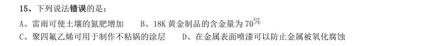

- **A.** 雷雨可使土壤的氮肥增加
- **B.** 18K 黄金制品的含金量为70
- **C.** 聚四氟乙烯可用于制作不粘锅的涂层
- **D.** 在金属表面喷漆可以防止金属被氧化腐蚀

**答案：B**

### 2019 湖北·统一卷　第 18 题　（常识（待细分））

管理大师杰克·韦尔奇有句名言:管得少,就是管得好。他主要强调管理应该注重:

- **A.** 沟通
- **B.** 分权
- **C.** 组织
- **D.** 控制

**答案：B**

### 2019 湖北·选调　第 6 题　（生活常识）

我国社会主要矛盾已经转化为人民日益增长的美好生活需要和不平衡不充分的发展之间的矛盾。这表明:

- **A.** 我国基本国情已经发生变化
- **B.** 我国的国际地位发生了改变
- **C.** 我国已进入到社会主义中级阶段
- **D.** 我国仍处于并将长期处于社会主义初级阶段

**答案：D**

### 2019 湖北·选调　第 7 题　（科技常识）

全面深化改革的总目标是:

- **A.** 着力解决好发展不平衡不充分问题
- **B.** 实现社会主义现代化和中华民族伟大复兴
- **C.** 推动我国经济实力、科技实力、国防实力、综合国力进入世界前列
- **D.** 完善和发展中国特色社会主义制度,推进国家治理体系和治理能力现代化

**答案：D**

### 2019 湖北·选调　第 16 题　（常识（待细分））

一个盲人到亲戚家做客。天黑回家时,亲戚点了个灯笼给他,说:“路黑,你打个灯笼回家吧!”盲人气愤 地说:“你明知我是瞎子,还让我打灯笼照路,这不是奚落我吗!”亲戚说:“你在路上走,许多人也在路上走, 你打着灯笼,别人可以看到你,就不会撞到你了。”在这件事中,盲人和他亲戚看问题方法的不同点表现为: 1孤立还是联系地看问题 2抽象还是具体地看问题 3片面还是全面地看问题 4主观还是客观地看问题

- **A.** 34
- **B.** 23
- **C.** 14
- **D.** 13

**答案：D**

### 2019 湖北·选调　第 22 题　（时政热点）

根据打赢脱贫攻坚战的任务目标,到2020 年,要确保现行标准下农村贫困人口实现脱贫,消除________; 确保贫困县全部摘帽,解决________。

- **A.** 相对贫困集中连片贫困
- **B.** 绝对贫困区域性整体贫困
- **C.** 绝对贫困集中连片贫困
- **D.** 相对贫困

**答案：B**

### 2019 湖北·选调　第 25 题　（时政热点）

农业农村工作,说一千、道一万,________是关键。

- **A.** 发展农业生产
- **B.** 完善乡村治理
- **C.** 美化农村环境
- **D.** 增加农民收入

**答案：D**

### 2019 湖北·选调　第 26 题　（时政热点）

巩固和完善农村基本经营制度,要坚持________基础性地位,赋予双层经营体制新的内涵。

- **A.** 企业经营
- **B.** 家庭经营
- **C.** 集体经营
- **D.** 合作经营

**答案：B**

### 2019 湖北·选调　第 27 题　（时政热点）

农村承包地“三权分置”中的“三权”是指: 1所有权 2承包权 3使用权 4经营权

- **A.** 124
- **B.** 234
- **C.** 134
- **D.** 123

**答案：A**

### 2019 湖北·选调　第 29 题　（时政热点）

抓实建强农村基层党组织,要落实村党组织________年任期规定,推动全国________换届与县乡换届同步进 行。

- **A.** 3村党组织
- **B.** 5村“两委”
- **C.** 5村委会
- **D.** 3

**答案：B**

### 2019 湖北·选调　第 30 题　（科技常识）

把提高脱贫质量放在首位,要强化________和________扶持,帮助有劳动能力的贫困人口摆脱贫困,这是可 持续脱贫的根本之策。

- **A.** 产业就业
- **B.** 技术资金
- **C.** 健康教育
- **D.** 项目

**答案：A**

### 2019 湖北·选调　第 32 题　（时政热点）

调整优化农业结构,需要大力发展紧缺和绿色优质农产品生产,推进农业由________导向转向________导向。

- **A.** 增量提效
- **B.** 增速提质
- **C.** 增收提效
- **D.** 增产

**答案：D**

### 2019 湖北·选调　第 34 题　（时政热点）

加强社区治理体系建设,要推动社会治理重心向基层下移,打造________的社区治理格局。 1共建 2共创 3共治 4共生 5共享

- **A.** 123
- **B.** 245
- **C.** 135
- **D.** 125

**答案：C**

### 2019 湖北·选调　第 36 题　（法律常识）

根据《中华人民共和国民法总则》,以下行为中属于无效民事行为的是:

- **A.** 年满10 周岁的周某接受他人赠予的铅笔一支
- **B.** 年满7 周岁的李某到村头的小商店购买酱油一瓶
- **C.** 年满9 周岁的赵某到村头的小商店购买饮料一瓶
- **D.** 年满16 周岁,以自己的劳动收入为主要生活来源的王某到超市购买了彩电一台

**答案：B**

### 2019 湖北·选调　第 47 题　（法律常识）

根据我国农业法相关规定,下列行为合法的是:

- **A.** 甲县政府向辖区农民收取摊派性费用
- **B.** 乙县政府在辖区农村开展集资活动
- **C.** 丙县政府应该督促有关部门保障农产品运输畅通
- **D.** 丁县教育局通过村小学向学生家长收教育费附加

**答案：C**

### 2019 湖北·选调　第 48 题　（时政热点）

关于我国现行个人所得税法,下列表述不正确的是:

- **A.** 我国个人所得税实行超额累进税率
- **B.** 继续教育支出可以在个人所得税应纳税所得中扣除
- **C.** 个人取得单位发放的实物不属于个人所得税的应纳税所得
- **D.** 非独生子女在进行个人所得税的赡养老人专项附加扣除时最高不超过1000 元

**答案：C**

### 2019 湖北·选调　第 50 题　（法律常识）

根据我国商标法相关规定,下列表述正确的是:

- **A.** 声音不可以作为商标申请注册
- **B.** 行政机关可以成为商标权的主体
- **C.** 注册商标的有效期自核准注册之日起计算
- **D.** 商标的地理标志主要由该地区的经济因素所决定

**答案：C**

### 2019 湖北·选调　第 51 题　（常识（待细分））

根据我国村民委员会组织法和居民委员会组织法,下列表述正确的是:

- **A.** 村民委员会委员可以由上级政府委派
- **B.** 居民会议有权撤换和补选居民委员会成员
- **C.** 村集体的宅基地使用方案应由村民委员会讨论决定
- **D.** 机关、团体、部队、企业事业组织可以参加所在地的居民委员会

**答案：B**

### 2019 湖北·选调　第 53 题　（历史人文）

现代行政管理多应用系统工程思想和方法,以减少人力、物力、财力和时间的支出,提高行政管理的:

- **A.** 水平
- **B.** 效率
- **C.** 技巧
- **D.** 效益

**答案：B**

### 2019 湖北·选调　第 54 题　（科技常识）
> 材料：实施工作。在严重的自然灾害面前,市水利局局长黄某勇于担当,积极组织当地干部群众,团结一心,奋力抢险 救灾。黄某多次到相关街道进行宣传教育、沟通协调,保证了救灾工作的顺利进行,完满地完成了抢险救灾任务。 2018 年水利局绩效考核中,群众满意度位居前列。请回答54-57 题:…

行政指挥者必须具备的能力素质有: 1敢于指挥2善于指挥3精于指挥4亲临指挥

- **A.** 123
- **B.** 234
- **C.** 12
- **D.** 13

**答案：A**

### 2019 湖北·选调　第 55 题　（经济常识）

案例中黄某采取的行政方法属于:

- **A.** 强制性行政方法
- **B.** 诱导性行政方法
- **C.** 参与管理方法
- **D.** 行政责任方法

**答案：B**

### 2019 湖北·选调　第 56 题　（时政热点）

在全部行政管理实践工作中,最实际、最经常、最具体的活动是:

- **A.** 行政实施
- **B.** 行政控制
- **C.** 行政协调
- **D.** 行政计划

**答案：A**

### 2019 湖北·选调　第 57 题　（科技常识）

市政府对市水利局的行政授权属于:

- **A.** 特定授权
- **B.** 充分授权
- **C.** 复合授权
- **D.** 柔性授权

**答案：B**

### 2019 湖北·选调　第 58 题　（经济常识）

近年来,“大众创业,万众创新”方兴未艾。各地政府为促进“以创业带动就业”,从工商登记、资金筹措、 信息咨询、技能培训、经营用地方面对农民工返乡创业给予大力支持,这主要体现了政府行政管理中的________ 职能。

- **A.** 市场监管
- **B.** 社会管理
- **C.** 公共服务
- **D.** 经济调节

**答案：C**

### 2019 湖北·选调　第 59 题　（经济常识）

某市通过电视问政或电话调查了解公民对政府公共服务和公共管理的满意程度。公民满意度属于政府部门绩 效考核的:

- **A.** 业绩指标
- **B.** 效能指标
- **C.** 效率指标
- **D.** 成本指标

**答案：A**

### 2019 湖北·选调　第 65 题　（科技常识）

下列说法正确的是:

- **A.** 卫星指宇宙中环绕恒星轨道运行的天体
- **B.** 目前国际天文组织公认的星座有88 个
- **C.** 金星、天王星、海王星都属于远日行星
- **D.** 太阳光包括可见光、不可见光和红外线

**答案：B**

### 2019 湖北·选调　第 68 题　（科技常识）

下列表述错误的是:

- **A.** 世界四大通讯社之一的路透社创立于英国
- **B.** 意大利和加拿大的国球分别为足球、冰球
- **C.** 诺贝尔奖设有物理学奖、数学奖等奖项
- **D.** 自由女神像是法国送给美国的国庆礼物

**答案：C**

### 2019 湖北·选调　第 69 题　（历史人文）

下列说法错误的是:

- **A.** 《知否?知否?应是绿肥红瘦》的电视剧名来源于李清照词
- **B.** 莎士比亚的经典剧作《李尔王》又被称作“王子复仇记”
- **C.** 纪晓岚著有《阅微草堂笔记》,“阅微草堂”是其书斋名
- **D.** 鲁滨逊是英国作家丹尼尔·笛福塑造的小说人物形象

**答案：B**

### 2019 广东·乡镇　第 70 题　（常识（待细分））

扶贫先扶智,治贫先治愚。以下扶贫举措中不属于“扶智”的是( )。

- **A.** 在贫困村建设图书室
- **B.** 开展农业实用技能培训
- **C.** 组织大学生到贫困地区支教
- **D.** 向贫困户发放现代化农业机具

**答案：暂缺**

### 2019 广东·乡镇　第 75 题　（生活常识）

港珠澳大桥跨越( ),东接香港,西接广东珠海和澳门,总长约55 公里,是粤港澳三地首次合作共建的 超大型跨海交通工程。

- **A.** 渤海
- **B.** 东海
- **C.** 北部湾
- **D.** 伶仃洋

**答案：暂缺**

### 2019 广东·县级　第 84 题　（常识（待细分））

用水银体温计依次给甲、乙、丙三人测量体温时,一直没有甩体温计。已知测量甲的体温时读数为 , 乙、丙的实际体温分别为 和 ,那么在测量乙、丙的体温时,体温计的读数分别是( )。

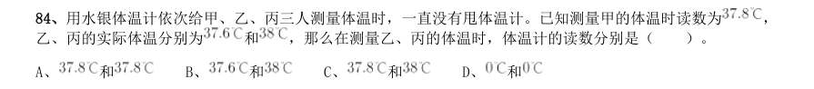

- **A.** 和
- **B.** 和
- **C.** 和
- **D.** 

**答案：暂缺**

### 2019 广东·思维能力测验　第 2 题　（科技常识）

新时代对党员干部提出了更高的要求。在现实中,由于一些党员干部理论学习不足,“本领恐慌”问题 越来越突出。因此,只要广大党员干部切实加强理论学习,就可以避免出现“本领恐慌”。 上述论证最可能的潜在假设是()。

- **A.** 解决“本领恐慌”问题必须依靠党员干部自身努力
- **B.** 理论学习不足是出现“本领恐慌”的唯一原因
- **C.** 广大党员干部都存在理论学习不足的问题
- **D.** 只有加强学习才能达到新时代的更高要求

**答案：B**

### 2019 广东·思维能力测验　第 4 题　（地理常识）

目前,我国民用航空市场还不够发达,民航飞行时长与一些发达国家有较大差距。不过,随着我国经济 的发展与人民生活水平的提高,人民群众的旅游需求日益增长。因此,我国民用航空市场潜力巨大。 上述论证最可能基于的潜在假设是()。

- **A.** 我国旅游需求仍有较大的增长空间
- **B.** 旅游需求的增长能够有效推动民用航空市场的发展
- **C.** 我国民航飞行时长将达到与发达国家相当的水平
- **D.** 经济的发展与人民生活水平的提高有关

**答案：B**

### 2019 广东·思维能力测验　第 5 题　（科技常识）

有甲、乙两个品牌的电脑专卖店,甲品牌专卖店客流量略高于乙品牌专卖店,因此,甲品牌专卖店的电 脑销量比乙品牌专卖店的大。 上述推论最可能基于的假设是()。

- **A.** 乙品牌开通了网络销售渠道
- **B.** 甲品牌专卖店规模比乙品牌的大
- **C.** 两个专卖店的进店购买率相当
- **D.** 甲品牌的广告投入更大

**答案：C**

### 2019 广东·思维能力测验　第 6 题　（常识（待细分））

某公司正在招聘管理人员。如果应聘人员有七年以上相关工作经验,或有研究生学历,就能够进入面试。 小赵获得了面试资格。 据此,不能推出的是()。

- **A.** 小赵或者有七年以上相关工作经验,或者有研究生学历
- **B.** 如果小赵有七年以上相关工作经验,那么他一定没有研究生学历
- **C.** 如果小赵没有七年以上相关工作经验,那么他一定有研究生学历
- **D.** 如果小赵没有研究生学历,那么他一定有七年以上相关工作经验

**答案：B**

### 2019 广东·思维能力测验　第 7 题　（常识（待细分））

如果旅行车程超过3 小时,选择自驾游的游客数量就会大大减少。目前,从乙市驾车前往甲市至少需要 5 小时。如果开通甲、乙两市间的高速公路,从乙市前往甲市的自驾游游客将会显著增加。 上述论证最可能基于的潜在假设是()。

- **A.** 该高速公路能够在短时间内开通使用
- **B.** 绝大多数游客以自驾的方式前往甲市
- **C.** 该高速公路开通后,两市车程将小于3 小时
- **D.** 很多乙市居民喜欢前往周边城市旅游

**答案：C**

### 2019 广东·思维能力测验　第 9 题　（科技常识）

去年,某市共发生道路安全交通事故764 起,死亡456 人。据估算,只有不到8%的交通工具配备了急 救医疗包。如果有更多的交通工具配备急救医疗包,那么道路安全交通事故死亡人数会大大减少。 以下选项最能够指出上述论证缺陷的是()。

- **A.** 忽视了遭遇交通事故立即死亡的案例
- **B.** 忽略了绝大多数交通工具从来没有发生过交通事故
- **C.** 默认了未配备急救医疗包是导致交通事故死亡的主要原因
- **D.** 暗含了配备急救医疗包能有效避免交通事故的发生

**答案：C**

### 2019 广东·思维能力测验　第 11 题　（生活常识）

当前,乡村教师留不住是个大问题。对此,有人认为,只要大幅提升乡村教师待遇,就能让他们安心 留下来,从而有效解决这一问题。 以下选项中无法削弱上述论断的是()。

- **A.** 不是所有乡村教师都看重待遇
- **B.** 有的乡村教师收入很高
- **C.** 乡村教师收入普遍偏低
- **D.** 不少乡村教师由于生活环境差而辞职

**答案：C**

### 2019 广东·思维能力测验　第 14 题　（常识（待细分））

ETC 是我国高速公路使用的不停车收费系统。事实上,所有需要停车缴费的场合,都可以借助ETC 实 现不停车缴费,而不仅限于在高速公路使用。 根据上述表述,下列判断一定错误的是()。

- **A.** 高速公路是需要停车缴费的场合
- **B.** 有的高速公路无法借助ETC 实现不停车缴费
- **C.** 有的需要停车缴费的场合,可以借助ETC 实现不停车缴费
- **D.** 能够借助ETC 实现不停车缴费的场合,可能是需要停车缴费的场合

**答案：B**

### 2019 广东·思维能力测验　第 15 题　（科技常识）

员工的业务能力,对企业来说是至关重要的。某企业对符合招聘条件的应聘者进行面试筛选后发现, 通过了面试并工作了一段时间的员工业务能力都很强。所以,完全有理由相信该企业使用的面试筛选方法是非 常有效的。 以下最能说明上述推论漏洞的是()。

- **A.** 未说明员工的业务能力对企业至关重要的原因
- **B.** 假设了即使依据一个实例,也可以得出一般性的结论
- **C.** 忽视了应聘者即使业务能力很强,也无法保证其今后表现
- **D.** 忽视了只有业务能力强的人才能满足该企业的招聘条件

**答案：D**

### 2019 广东·思维能力测验　第 19 题　（地理常识）

调查发现,只有平均每天摄入超过5 克钠的人,才会面临心血管疾病风险,在我国接受该调查的人群 中,80%的人日均钠摄入量超过5 克。 如果上述调查抽样有代表性,可以推出的是()。

- **A.** 我国80%地区的人口面临着很高的心血管疾病风险
- **B.** 发展中国家的人口大都面临心血管疾病风险
- **C.** 如果某人日均钠摄入量不超过5 克,他便不会面临心血管疾病风险
- **D.** 如果某人日均钠摄入量超过5 克,他一定会患心血管疾病

**答案：C**

### 2019 广东·思维能力测验　第 23 题　（常识（待细分））

如果日出前出现鲜红的朝霞,那么今天会下雨。今天下雨了,所以今天日出前出现了鲜红的朝霞。 以下与上述推理在结构上最为相似的是()。

- **A.** 如果冬天有瑞雪,那么来年一定会丰收。今年丰收了,所以去年冬天有瑞雪
- **B.** 长时间下雨,突然起了大雾,大雾过后必定是晴天。大雾过后出现了晴天,是因为大雾前长时间下雨
- **C.** 如果立秋这天下雨,接下来百天内不会有霜冻。立秋之后出现了霜冻,那么立秋这天下雨了
- **D.** 如果今天早上露水多,那么明天就会是晴天。今天早上没有露水,明天一定不会是晴天

**答案：A**

### 2019 广东·思维能力测验　第 26 题　（经济常识）

近日,有研究小组成功地改进了手机回收中的关键环节,减少了手机回收利用过程中对环境造成的污 染。由于不必再为废旧手机产生环境污染而担忧,人们将会更为频繁地购买和更换新手机。 以下选项最能够指出上述论证缺陷的是()。

- **A.** 假设了该研究小组的研究成果能够很快投入使用
- **B.** 暗含了人们在考虑购买和更换新手机时比较关注环保因素
- **C.** 假设了回收废旧手机能够获得经济利益
- **D.** 忽视了人们在购买新手机后,一般不会立刻丢弃旧手机

**答案：B**

### 2019 广东·思维能力测验　第 27 题　（科技常识）

21 世纪是信息大爆炸的时代,随着互联网和移动智能设备的普及,人们获得信息越来越多,越来越容 易。有理由相信,这样的条件为我们提供了更多了解真相的机会,也表示我们离事物的真相越来越近。 上述推论最可能基于的假设是()。

- **A.** 过多的信息会对人们的生活造成干扰
- **B.** 信息加工过程对每个人来说存在差别
- **C.** 互联网上充斥着大量虚假信息
- **D.** 信息是了解事物真相的基础

**答案：D**

### 2019 广东·思维能力测验　第 29 题　（经济常识）

据调查,90%以上的在校大学生更看重手表的装饰效果,而不是实用性。因此,国产手表生产商只要生 产更多符合潮流的“好看”的手表,就能极大提高手表销量。 上述推论最可能基于的假设是()。

- **A.** 在校大学生是国产手表的主要目标消费群体
- **B.** 国产手表在实用性方面已处于国际先进水平
- **C.** 现在的青年已不仅仅局限于购买经典款手表
- **D.** 潜在消费群体对于手表的产地没有特殊偏好

**答案：A**

### 2019 广东·思维能力测验　第 30 题　（经济常识）

改革开放40 年来,我国的交通巨变产生了一个又一个世界之最。交通既是经济发展的服务者,又是 40 年建设成就的最佳象征。 根据上述表述,下列判断一定错误的是()。

- **A.** 交通可能是经济发展的服务者
- **B.** 交通不可能不是经济发展的服务者
- **C.** 交通将继续为我国改革发展作出贡献
- **D.** 交通可能不是40 年建设成就的最佳象征

**答案：D**

### 2019 广东·思维能力测验　第 31 题　（常识（待细分））

某单位准备派3 名员工外出参加培训学习,计划从财务部的甲、乙、丙和行政部的丁、戊、己6 人中 选派人员。由于工作安排限制,参加培训学习的人员安排必须符合以下条件:财务部和行政部分别至少有一人 参加;甲和乙不能同时参加;如果丁或戊参加,则丙不能参加。 以下人员名单符合条件的是()。

- **A.** 甲、丙、戊
- **B.** 乙、丙、己
- **C.** 甲、乙、戊
- **D.** 丁、戊、己

**答案：B**

### 2019 广东·思维能力测验　第 36 题　（常识（待细分））

如果领导干部在单位中扮演“和事佬”的角色,不愿指出下属错误、不愿得罪人,将严重影响单位工作的 正常开展。所以,领导干部必须公开指出下属错误并进行严厉的批评。 以下选项最好地总结了上述论证缺陷的是()。

- **A.** 假设了“和事佬”现象大量存在
- **B.** 暗含了“和事佬”现象危害严重
- **C.** 忽视了指出下属错误的其他方式
- **D.** 忽视了不同单位的不同情况

**答案：C**

### 2019 广东·思维能力测验　第 45 题　（常识（待细分））

某部门有甲、乙、丙、丁4 名干部,只有一个人同时有硕士学位、注册会计师证和高级职称,有三个 人有硕士学位,两个人有注册会计师证,只有一个人有高级职称,但每个人至少具备这三个条件中的一项。已 知甲和丁要么都有硕士学位,要么都没有;乙和丙要么都有注册会计师证,要么都没有;丙和丁只有一个人有 硕士学位。 那么,该部门同时有硕士学位、注册会计师证和高级职称的是()。

- **A.** 甲
- **B.** 乙
- **C.** 丙
- **D.** 丁

**答案：B**

### 2019 广东·思维能力测验　第 48 题　（常识（待细分））

对企业而言,产品质量是其生存发展的关键。企业要加快发展,提升品质,需要的是更高水平的工人, 涌现越来越多的大国工匠,传承工匠精神。因此,企业对于工匠精神的培养是其实现高质量发展的关键。 以下与上述论断结构最为相似的是()。

- **A.** 生态环境保护离不开生态文明体系构建,所以要建设美丽中国,必须加快生态文明制度建设
- **B.** 创新发展必须以创新型人才为基础,创新成果是创造性劳动的结果。因此,创新发展都是创新型人才实现的
- **C.** 理论研究离不开严密的论证过程,严密的论证需要有普遍性和规律性的论点,所以,理论研究一般都有普遍性和规律性的论点
- **D.** 人才培养离不开社会实践,大学生都要通过社会实践考核,所以只有通过社会实践考核的大学生才能毕

**答案：C**

### 2019 广东·思维能力测验　第 49 题　（科技常识）

一项调查表明,有38.6%的人表示记得一两岁时的经历,更有13.4%的人可以描述出自己1 岁以前的家 庭情景。然而,针对这些幼时记忆的分析发现,其中40%不可能是实际发生过的事情。实际上,这些2 岁前的 幼时记忆都是人们根据家庭照片和他人叙述而虚构出来的“伪记忆”。 根据以上表述,下列判断一定正确的是()。

- **A.** 2 岁前的孩子不具有记忆能力
- **B.** 在这些2 岁前的幼时记忆中,有60%是实际发生过的
- **C.** 成人容易在与儿时玩伴交谈时虚构出共同的“伪记忆”
- **D.** 有些人可以通过家庭照片和他人叙述描述自己早期的家庭情景

**答案：D**

### 2019 广东·思维能力测验　第 51 题　（常识（待细分））

某单位组织员工进行爱心募捐,鼓励员工捐款捐物。所有员工都参加了,其中捐物的有45 人,捐款的 有75 人,既捐款又捐物的有31 人,则该单位共有员工()人。

- **A.** 89
- **B.** 90
- **C.** 95
- **D.** 99

**答案：A**

### 2019 广东·思维能力测验　第 52 题　（科技常识）

某企业生产清洁机器人,9 月至12 月共生产3800 台,第四季度每月生产900 台,则该企业9 月份生 产()台。

- **A.** 900
- **B.** 1100
- **C.** 1300
- **D.** 1500

**答案：B**

### 2019 广东·思维能力测验　第 53 题　（常识（待细分））

某单位购买了30 个文件袋,有大、中、小三个型号。已知大号文件袋和中号文件袋数量之比为 5:6,中号文件袋和小号文件袋数量之比为3:2。那么,所购的小号文件袋有()个。

- **A.** 4
- **B.** 6
- **C.** 8
- **D.** 10

**答案：C**

### 2019 广东·思维能力测验　第 54 题　（常识（待细分））

某单位有若干个部门,每个部门有12 名职员。后因业务重组,增加了2 个部门,新增了4 名职员,现 每个部门有8 名职员。该单位原有()个部门。

- **A.** 3
- **B.** 4
- **C.** 5
- **D.** 6

**答案：A**

### 2019 广东·思维能力测验　第 55 题　（生活常识）

某超市的食品供货商每2 天送货一次,日用品供货商每5 天送货一次,办公用品供货商每10 天送货一 次。已知这三家供货商在10 月1 日这天同时送货,那么下次他们同时送货的日期是()。

- **A.** 10 月10 日
- **B.** 10 月11 日
- **C.** 10 月16 日
- **D.** 10 月20 日

**答案：B**

### 2019 广东·思维能力测验　第 56 题　（常识（待细分））

某公司38 名员工一起去划船,共租了8 条船,大船坐6 人,小船坐4 人,刚好坐满,则小船共有() 条。

- **A.** 5
- **B.** 4
- **C.** 3
- **D.** 2

**答案：A**

### 2019 广东·思维能力测验　第 57 题　（常识（待细分））

甲乙两人相距50 千米,同时出发相向而行,甲的前进速度为6 千米/小时,乙的前进速度为8 千米/小 时。在途中,甲休息了1 个小时再继续前进,则甲、乙在出发()小时后相遇。

- **A.** 2
- **B.** 3
- **C.** 3.5
- **D.** 4

**答案：D**

### 2019 广东·思维能力测验　第 59 题　（常识（待细分））

一项考试共有35 道试题,答对一题得2 分,答错一题扣1 分,不答则不得分。一名考生一共得了47 分,那么,他最多答对()题。

- **A.** 26
- **B.** 27
- **C.** 29
- **D.** 30

**答案：B**

### 2019 广东·思维能力测验　第 60 题　（常识（待细分））

在长120 米、宽100 米的空地上开挖若干个边长大于1 米的正方形鱼池,相邻鱼池之间要预留至少1 米的走道,则开挖的鱼池总面积最大为()平方米。

- **A.** 11097
- **B.** 11444
- **C.** 11559
- **D.** 11805

**答案：D**

### 2019 广东·思维能力测验　第 66 题　（常识（待细分））

, , , ,()

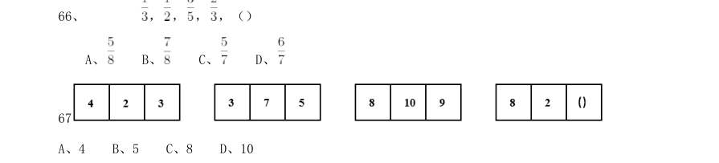

> （本题为图形题，选项为图片，见原卷）

**答案：C**

### 2019 广东·思维能力测验　第 69 题　（常识（待细分））

-3,8,2,18,22,()

- **A.** 43
- **B.** 58
- **C.** 60
- **D.** 76

**答案：B**

### 2019 广东·思维能力测验　第 70 题　（常识（待细分））

0.02,3.13,8.24,5.35,4.46,()

- **A.** 5.57
- **B.** 5.68
- **C.** 6.57
- **D.** 6.68

**答案：A**

### 2019 广东·思维能力测验　第 72 题　（常识（待细分））

下图是从不同角度观察同一个正方体得到的图像。该正方体的六个面分别被标记为1 到6。则不可能 相对的两个面是()。

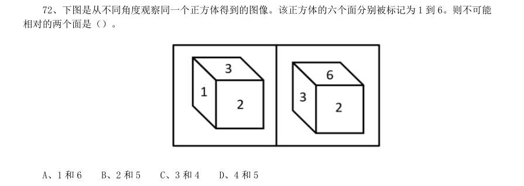

- **A.** 1 和6
- **B.** 2 和5
- **C.** 3 和4
- **D.** 4 和5

**答案：D**

### 2019 广东·思维能力测验　第 77 题　（常识（待细分））

下列各项中不可能是如图所示立方体组成部分的是()。

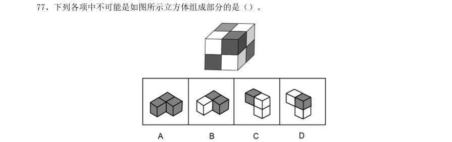

> （本题为图形题，选项为图片，见原卷）

**答案：C**

### 2019 广东·思维能力测验　第 78 题　（常识（待细分））

左图是一个正四面体的外表面。右边不能由它折叠而成的是()。

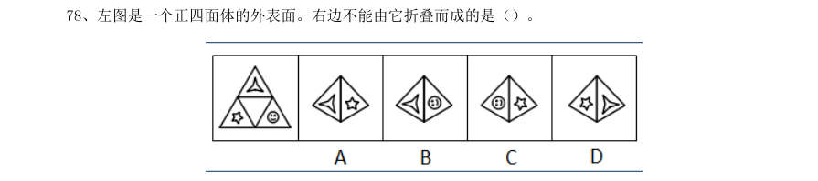

> （本题为图形题，选项为图片，见原卷）

**答案：B**

### 2019 广东·选调　第 4 题　（地理常识）

我国是世界上最大的发展中国家,改善民生不能脱离( )这个最大实际提出过高目标,只能根据经济发展 和财力状况逐步提高人民生活水平。

- **A.** 人均国民生产总值不高
- **B.** 人口多,资源相对匮乏
- **C.** 社会主义市场经济体制有待进一步完善
- **D.** 我国仍处于并将长期处于社会主义初级阶段

**答案：D**

### 2019 广东·选调　第 6 题　（时政热点）

“治天下也,必先公,公则天下平矣”符合新发展理念的( )。

- **A.** 协调发展
- **B.** 绿色发展
- **C.** 共享发展
- **D.** 创新发展

**答案：C**

### 2019 广东·选调　第 7 题　（生活常识）

( )是中华民族永续发展的千年大计,必须树立和践行绿水青山就是金山银山的理念,像对待生命一样对 待生态环境。

- **A.** 建设生态文明
- **B.** 形成绿色发展方式
- **C.** 节约资源和保护环境
- **D.** 实行最严格的生态环境保护制

**答案：A**

### 2019 广东·选调　第 10 题　（时政热点）

坚持在发展中保障和改善民生,( )是发展的根本目的,必须多谋民生之利、多解民生之忧,在发展中 补齐民生短板。

- **A.** 提高获得感
- **B.** 加大民生投入
- **C.** 实现共同富裕
- **D.** 增进民生福祉

**答案：D**

### 2019 广东·选调　第 18 题　（科技常识）

“他说你行你就行,不行也行;他说你不行你就不行,行也不行。”在哲学上属于( )。

- **A.** 唯物辩证法
- **B.** 辩证唯物主义
- **C.** 客观唯心主义
- **D.** 主观唯心主义

**答案：D**

### 2019 广东·选调　第 22 题　（科技常识）

党和政府与人民群众的关系问题,直接( )党风、政风。党员干部为谁代言,直接决定人心向背,也决 定着党和人民的事业能否长盛不衰。

- **A.** 反映
- **B.** 显现
- **C.** 确定
- **D.** 联系

**答案：A**

### 2019 广东·选调　第 23 题　（经济常识）

近年来,“提倡开短会、讲短话,讲管用的话,力戒空话套话”的要求,自上而下( )全党,形成了一 种改文风、转作风的鲜明导向和浩大声势。

- **A.** 激励
- **B.** 勉励
- **C.** 培育
- **D.** 教育

**答案：B**

### 2019 广东·选调　第 24 题　（常识（待细分））

“进去,只留下脚印;出来,只带走照片”,这句话直观地提示我们,依托生态发展旅游,必须遵循自然 规律,( )保护生态环境。

- **A.** 坚守
- **B.** 强调
- **C.** 注重
- **D.** 重点

**答案：C**

### 2019 广东·选调　第 28 题　（历史人文）

或许一个人的力量( ),但如果全国人民同心同德,和衷共济,心往一处想,劲往一处使,那便能积沙 成塔,集腋成裘,为民族复兴注入不竭动力。

- **A.** 差强人意
- **B.** 沧海一粟
- **C.** 微不足道
- **D.** 轻如鸿毛

**答案：C**

### 2019 广东·选调　第 32 题　（科技常识）

互联网大大拓展了思想和行动的( ),但网络空间总会有阳光照射不到的( )角落,缺乏辨别能力的 孩子极有可能被“暗箭”所伤。

- **A.** 维度 偏僻
- **B.** 界限 阴冷
- **C.** 边界 阴暗
- **D.** 空间 偏远

**答案：C**

### 2019 广东·选调　第 34 题　（时政热点）

当前,党在形势下的强军目标( )确立,政治建军深入推进,练兵备战紧锣密鼓,改革攻坚大刀阔斧, 正风肃纪( )。

- **A.** 鲜明 雷霆万钧
- **B.** 明显 雷霆万钧
- **C.** 鲜明 千钧一发
- **D.** 明显 千钧一发

**答案：A**

### 2019 国考·地市级　第 4 题　（时政热点）

下列与扶贫有关的说法正确的是:

- **A.** 习近平总书记首次提出了“精准扶贫”的理念
- **B.** 扶贫工作坚持扶贫同扶志相结合,“大水漫灌”与“精准滴灌”相结合
- **C.** 全面发展高新技术产业是《“十三五”脱贫攻坚规划》提出的一项重要举措
- **D.** 脱贫目标是到2035 年稳定实现现行标准下农村贫困人口“两不愁、三保障”

**答案：A**

### 2019 国考·地市级　第 6 题　（时政热点）

下列与我国军事国防相关的说法错误的是:

- **A.** 大力发展军民融合是维护国家主权和安全的战略基石
- **B.** 新形势下我军的军事战略方针是积极防御
- **C.** 中国位于海洋地缘战略区和欧亚大陆地缘战略区的交接处
- **D.** 维护地区和世界和平是我国军队担负的主要战略任务之一

**答案：A**

### 2019 国考·地市级　第 10 题　（法律常识）

某有限责任公司有股东甲、乙、丙、丁、戊5 人,注册资本为200 万元,其中甲出资10 万元、乙20 万元、 丙10 万元、丁10 万元、戊150 万元。公司运行3 年后,效益良好,甲、乙、丙、丁在戊出差期间自行商量后通 过了进一步增加注册资本50 万元的决议。下列说法正确的是:

- **A.** 甲、乙、丙、丁通过的决议有效
- **B.** 该增资决议应由全体股东一致同意
- **C.** 戊可以自行决定是否增加注册资本,无需经过甲乙丙丁的同意
- **D.** 戊可以向人民法院起诉确认该增资决议无效

**答案：D**

### 2019 国考·地市级　第 14 题　（历史人文）

这幅图反映了某次重要会议,这次会议可能是:

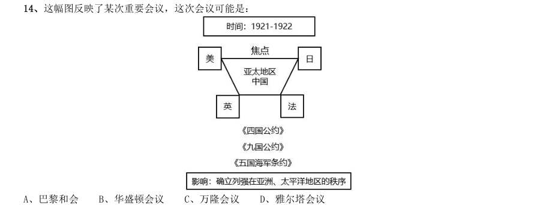

- **A.** 巴黎和会
- **B.** 华盛顿会议
- **C.** 万隆会议
- **D.** 雅尔塔会议

**答案：B**

### 2019 国考·地市级　第 18 题　（科技常识）

关于核磁共振,下列说法错误的是:

- **A.** 核磁共振技术可以进行地下水探测
- **B.** 核磁共振技术常用于脑肿瘤的检测
- **C.** 核磁共振会产生电离辐射影响人体健康
- **D.** 带有心脏起搏器的病人不能做核磁共振

**答案：C**

### 2019 国考·地市级　第 20 题　（科技常识）

某人扁桃体化脓,医生建议其静脉注射头孢,药液从其手背静脉到达扁桃体患处所经过的途径是:上肢静脉 →右心房→1→2→左心房→3→4→动脉→扁桃体毛细血管(患处)。依次填入1234正确的是:

- **A.** 肺循环;右心室;左心室;主动脉
- **B.** 左心室;肺循环;主动脉;右心室
- **C.** 主动脉;右心室;左心室;肺循环
- **D.** 右心室;肺循环;左心室;主动脉

**答案：D**

### 2019 国考·省级　第 4 题　（时政热点）

下列与扶贫有关的说法正确的是:

- **A.** 习近平总书记首次提出了“精准扶贫”的理念
- **B.** 扶贫工作坚持扶贫同扶志相结合,“大水漫灌”与“精准滴灌”相结合
- **C.** 全面发展高新技术产业是《“十三五”脱贫攻坚规划》提出的一项重要举措
- **D.** 脱贫目标是到2035 年稳定实现现行标准下农村贫困人口“两不愁、三保障”

**答案：A**

### 2019 国考·省级　第 6 题　（时政热点）

下列与我国军事国防相关的说法错误的是:

- **A.** 大力发展军民融合是维护国家主权和安全的战略基石
- **B.** 新形势下我军的军事战略方针是积极防御
- **C.** 中国位于海洋地缘战略区和欧亚大陆地缘战略区的交接处
- **D.** 维护地区和世界和平是我国军队担负的主要战略任务之一

**答案：A**

### 2019 国考·省级　第 7 题　（经济常识）

关于农村土地流转,下列说法错误的是:

- **A.** 坚持依法、自愿、有偿的基本原则
- **B.** 鼓励农户依法采取转包、出租、互换等方式流转承包地
- **C.** 没有农户的书面委托,农村基层组织无权以任何方式决定流转农户的承包地
- **D.** 各地要鼓励工商企业租赁农户承包地,不应在时间、面积上设限

**答案：D**

### 2019 国考·省级　第 13 题　（科技常识）

下面能正确反映我国农业生产工具或生产方式演变顺序的是: 1曲辕犁 2水车 3石斧 4牛耕 5铜铲

- **A.** 35421
- **B.** 34152
- **C.** 42513
- **D.** 41325

**答案：A**

### 2019 国考·省级　第 14 题　（生活常识）

在日常生活中,我们经常根据不同的需求去增大或减小压强,下列哪种做法对于压强的改变与其他三项不同?

- **A.** 挖掘机上装有履带
- **B.** 沙发被设计得很柔软
- **C.** 破窗锤锤头被设计成锥形
- **D.** 滑雪板比较宽大

**答案：C**

### 2019 国考·省级　第 16 题　（科技常识）

关于照明用品,下列说法错误的是:

- **A.** 手术室里的无影灯利用了光沿直线传播的原理
- **B.** 手电筒用凹面镜作反射面是为了增强照明效果
- **C.** 声控灯利用麦克风接收声音信号来实现灯的开启
- **D.** 家用台灯正常工作时流过灯丝的电流约为2 安培

**答案：D**

### 2019 国考·省级　第 18 题　（地理常识）

摄影师在野外环境中最不可能拍摄到的是:

- **A.** 在云南丽江拍摄成片的针叶林
- **B.** 在青海拍摄成群的藏羚羊
- **C.** 在阿拉伯半岛拍摄海豹
- **D.** 在冰岛拍摄火山喷发

**答案：C**

### 2019 国考·省级　第 19 题　（科技常识）

下列关于激光的表述错误的是:

- **A.** 条码扫描器可以利用红外线或者激光进行扫描
- **B.** CD 唱片利用激光束扫描,通过光电转换重现语言和音乐
- **C.** 眼科医生常使用激光技术进行近视矫正手术
- **D.** 激光武器可全天候作战,不受大雾、大雪等天气的影响

**答案：D**

### 2018 湖北·统一卷　第 1 题　（法律常识）

中国共产党第十九届中央委员会第二次全体会议于2018 年1 月18 日至19 日在北京召开,会议的主要议程 是:

- **A.** 研究制定国民经济发展计划
- **B.** 研究全面从严治党的重大问题
- **C.** 讨论修改宪法部分内容的建议
- **D.** 研究党和政府机构改革的重大问题

**答案：C**

### 2018 湖北·统一卷　第 2 题　（科技常识）

下列关于我国C919 大型客机研发意义的表述错误的是:

- **A.** 社会效益方面,C919 能带动上下游产业发展,增加就业岗位,促进经济社会发展
- **B.** 技术方面,C919 能提升我国航空工业研发能力,促进航空人才队伍建设,提升民航工业水平
- **C.** 军事方面,以C919 为平台改装成大型军用特种飞机的潜力巨大,短期内实现其军民两用前景良好
- **D.** 经济方面,C919 使我国民航不再依赖进口中层干线客机,打破了西方航空垄断,进而节省外汇

**答案：C**

### 2018 湖北·统一卷　第 3 题　（历史人文）

下列教育家与其名言对应不正确的是:

- **A.** 孔子:“性相近也,习相远也”
- **B.** 孟子:“尽信书,则不如无书”
- **C.** 墨子:“道之所存,师之所存”
- **D.** 荀子:“骐骥一跃,不能十步;驽马十驾,功在不舍”

**答案：C**

### 2018 湖北·统一卷　第 5 题　（科技常识）

某患者深夜因剧烈的关节疼痛而惊醒,触摸其手足多个关节,发现有黄白色结晶体隆起。造成这种症状的 代谢改变最有可能是:

- **A.** 糖的无氧分解增强,生成过多乳酸
- **B.** 嘌呤核苷酸分解增强,生成过多尿酸
- **C.** 肝中脂肪酸氧化增强,生成大量酮体
- **D.** 氨基酸脱氨基作用增强,生成大量尿素

**答案：B**

### 2018 湖北·统一卷　第 6 题　（科技常识）

面包制作过程中使用酵母主要是利用其哪一种特性:

- **A.** 酵母在生长过程中可合成蛋白
- **B.** 酵母在生长过程中可分解淀粉
- **C.** 酵母在生长过程中可产生乙醇
- **D.** 酵母在生长过程中可产生二氧化碳

**答案：D**

### 2018 湖北·统一卷　第 9 题　（生活常识）

下列四个节气所表示的含义错误的是:

- **A.** 处暑:炎热夏季即将到来
- **B.** 惊蛰:天气回暖,春雷始鸣
- **C.** 冬至:冬季最寒冷的日子开始
- **D.** 小满:夏熟作物籽粒开始灌浆饱满但未成熟

**答案：A**

### 2018 湖北·统一卷　第 14 题　（生活常识）

下列药物不适用于清热利咽的是:

- **A.** 胖大海
- **B.** 板蓝根
- **C.** 片仔癀
- **D.** 珍珠粉

**答案：D**

### 2018 广东·统一卷　第 71 题　（常识（待细分））

我国提出“创新、协调、绿色、开放、共享”五大发展理念。下列措施体现五大发展理念的是( )。 1建设粤港澳大湾区 2强化知识产权创造与保护 3“一带一路”建设 4降低农村学生辍学率 5淘汰黄标车和老旧车 6精准扶贫

- **A.** 135
- **B.** 2456
- **C.** 23456
- **D.** 123456

**答案：暂缺**

### 2018 广东·统一卷　第 81 题　（科技常识）

许多食物在超过 的温度下烘焙煎炸烤时,食物中的碳水化合物和蛋白质在高温烹制过程中, 很容易产生丙烯酰胺,这种物质对人类健康有潜在危害。为避免摄入过多丙烯酰胺,以下食物最应减少食用 的是( )。

- **A.** 热茶
- **B.** 馒头
- **C.** 炒白菜
- **D.** 炸鸡

**答案：暂缺**

### 2018 广东·统一卷　第 82 题　（常识（待细分））

海又称为“大海”,是指与“大洋”相连接的大面积咸水区域,即大洋的边缘部分。以下不属于海 的是( )。

- **A.** 死海
- **B.** 红海
- **C.** 地中海
- **D.** 亚丁湾

**答案：暂缺**

### 2018 广东·统一卷　第 84 题　（生活常识）

在阴雨天,由于空气潮湿,衣物容易发霉。下列措施不能防止房间里衣物发霉的是( )。

- **A.** 打开室内暖气设备
- **B.** 在潮湿天气适当打开门窗通风透气
- **C.** 开启室内空调抽湿功能或抽风装置
- **D.** 将石灰用布或麻袋包装起来,放在房间的角落

**答案：暂缺**

### 2018 国考·副省级　第 2 题　（时政热点）

关于2015 年中央军委改革工作会议召开以来进行的改革,下列说法错误的是:

- **A.** 全面停止军队有偿服务活动
- **B.** 组建中央军委联勤保障部队
- **C.** 军委机关由多部门制改为总部制
- **D.** 成立陆军领导机构和战略支援部队

**答案：C**

### 2018 国考·副省级　第 3 题　（法律常识）

下列关于“三农”问题的说法错误的是:

- **A.** 民政部门是农民专业合作社登记机关
- **B.** 征地补偿费的使用、分配方案,经村民会议讨论决定方可办理
- **C.** 深入推进农业供给侧结构性改革是当前和今后一个时期农业农村工作的主线
- **D.** 村民委员会作出的决定侵害村民合法权益的,受侵害的村民可以申请人民法院予以撤销

**答案：A**

### 2018 国考·副省级　第 4 题　（科技常识）

关于我国自主研发的新成果,下列说法错误的是:

- **A.** 在世界上首次实现卫星与地面之间的量子通信
- **B.** 实现总装下线的“蛟龙一600”属于水陆两栖飞机
- **C.** 已成功下潜的“潜龙二号”是有缆遥控水下机器人D、超级计算机“神威•太湖之光”的运算速度居世界第一

**答案：C**

### 2018 国考·副省级　第 7 题　（法律常识）

甲国与乙国因领土纠纷发生争端,下列说法不符合国际法相关规定的是:

- **A.** 甲乙两国可以派出外交使节进行谈判,这是解决争端最直接的方法
- **B.** 甲乙两国可以约定将争端交付仲裁机构处理,但仲裁裁决不具有法律制裁性质
- **C.** 丙国可以调停者的身份参加两国的谈判,但其提出的解决方案对甲乙两国没有约束力
- **D.** 甲乙两国可用请求书方式将争端提交国际法院,国际法院作出的判决交由联合国强制执行

**答案：B**

### 2018 国考·副省级　第 12 题　（历史人文）

美国社会学家帕森斯认为:在公元前的第一个千年之内,“哲学的突破”以截然不同的方式分别发生在希腊、 以色列、印度和中国等地。下列思想观点产生于这一时代的是:

- **A.** 致虚守静,道法自然
- **B.** 心外无物,心外无理
- **C.** 人民为主,工商皆本
- **D.** 师夷长技,中体西用

**答案：A**

### 2018 国考·副省级　第 18 题　（科技常识）

下列与果树有关的说法正确的是:

- **A.** 富含氮的肥料可促进果树开花结果
- **B.** 杏树是耐旱能力比较弱的树种
- **C.** 冬季不需要对果树进行病虫防治
- **D.** 嫁接是一种常用的果树繁殖方式

**答案：D**

### 2018 国考·副省级　第 19 题　（科技常识）

关于北斗七星,下列说法正确的是:

- **A.** 北斗七星的相对位置始终不变
- **B.** 北斗七星是七颗亮度相等的恒星
- **C.** 北斗七星中的开阳星与其辅星构成双星
- **D.** 古代“斗牛”中的“斗”指北斗七星

**答案：C**

### 2018 国考·副省级　第 20 题　（科技常识）

下列关于蛋白质的说法错误的是:

- **A.** 蛋白质是鸟类羽毛的构成成分
- **B.** 蛋白质缺乏会导致儿童发育迟缓
- **C.** 蛋白质摄入过量会在人体内转化为脂肪
- **D.** 植物蛋白比动物蛋白更易被人类消化吸收

**答案：D**

### 2018 国考·地市级　第 1 题　（法律常识）

《中华人民共和国民法总则》自2017 年10 月1 日起施行。关于民法总则和民法通则的关系,下列说法错误的 是:

- **A.** 民法总则施行后,民法通则暂不废止
- **B.** 民法通则规定了我国民法的基本规则,而民法总则的内容更加广泛
- **C.** 民法总则是编纂民法典的第一步,吸取和借鉴了民法通则的相关条款
- **D.** 民法通则规定向人民法院请求保护民事权利的诉讼时效期间为二年,民法总则将其改为三年

**答案：B**

### 2018 国考·地市级　第 4 题　（法律常识）

下列关于“三农”问题的说法错误的是:

- **A.** 民政部门是农民专业合作社登记机关
- **B.** 征地补偿费的使用、分配方案,经村民会议讨论决定方可办理
- **C.** 深入推进农业供给侧结构性改革是当前和今后一个时期农业农村工作的主线
- **D.** 村民委员会作出的决定侵害村民合法权益的,受侵害的村民可以申请人民法院予以撤销

**答案：A**

### 2018 国考·地市级　第 7 题　（法律常识）

下列情形中,甲和乙只需承担双方责任,无需承担共同责任的是:

- **A.** 甲养的羊误入乙的菜地,乙发现后不管不问导致损失扩大
- **B.** 甲乙共同实施了故意伤害行为
- **C.** 甲乙合伙办了一家快递企业,乙在运输过程中丢失包裹
- **D.** 甲与乙协商共同买下一套房屋,二人约定各欠卖方十万元房款

**答案：A**

### 2018 国考·地市级　第 8 题　（科技常识）

下列对法谚的解读正确的是:

- **A.** 法无授权不可为——每个公民都应当严格按照法律的规定作为
- **B.** 枪炮作响法无声——战乱时,平常法律所维系的社会秩序荡然无存
- **C.** 法律必须被信仰,否则它将形同虚设——法律规定与道德信仰相辅相成,互相促进
- **D.** 法不阿贵,绳不挠曲——即使初衷是好的,如果触犯了法律还是要一视同仁

**答案：B**

### 2018 国考·地市级　第 10 题　（法律常识）

下列有关律师的说法错误的是:

- **A.** 律师不得在同一案件中为双方当事人担任代理人
- **B.** 律师根据案情的需要,可以申请人民法院通知证人出庭作证
- **C.** 律师可以在多个律师事务所执业,律师执业不受地域限制
- **D.** 律师担任辩护人的,有权查阅、摘抄、复制本案的案卷材料

**答案：C**

### 2018 国考·地市级　第 11 题　（法律常识）

甲乙丙三人从丁处购买我国公民的个人信息,并组织人员利用网络电话实施诈骗行为,获利一百余万元,并 由戊负责转账。下列说法错误的是:

- **A.** 若甲乙丙三人在境外实施该电信网络诈骗行为,则不予追究刑事责任
- **B.** 甲乙丙三人为组织者,三人对全部的诈骗行为承担责任
- **C.** 丁明知甲乙丙三人实施电信网络诈骗犯罪,依然非法向其出售公民个人信息,丁为共犯
- **D.** 戊明知款项为诈骗所得,仍帮助甲乙丙在不同银行账户间频繁划转,戊为共犯

**答案：A**

### 2018 国考·地市级　第 13 题　（经济常识）

下列与我国农村土地产权制度有关的说法错误的是:

- **A.** 不得以退出土地承包权作为农民进城落户的条件
- **B.** 农村土地农民集体所有是农村基本经营制度的根本
- **C.** 家庭承包经营的重要特征是土地所有权和承包经营权分离
- **D.** 农村集体土地使用权不包括宅基地使用权

**答案：D**

### 2018 国考·地市级　第 20 题　（科技常识）

下列与果树有关的说法正确的是:

- **A.** 富含氮的肥料可促进果树开花结果
- **B.** 杏树是耐旱能力比较弱的树种
- **C.** 冬季不需要对果树进行病虫防治
- **D.** 嫁接是一种常用的果树繁殖方式

**答案：D**

### 2017 湖北·统一卷　第 1 题　（历史人文）

下列关于“海上丝绸之路”的说法错误的是:

- **A.** 是陆上丝绸之路的一种补充形式
- **B.** 是意大利人马可·波罗回国所走之路
- **C.** 始于秦汉,繁荣于唐宋,衰落于明清
- **D.** 是古代中外贸易和对外交往的海上通道

**答案：C**

### 2017 湖北·统一卷　第 3 题　（历史人文）

下列我国的世界遗产不属于多省联合申遗的是:

- **A.** 土司遗址
- **B.** 丝绸之路
- **C.** 中国丹霞
- **D.** 大足石刻

**答案：D**

### 2017 湖北·统一卷　第 4 题　（历史人文）

下列关于国际战争的说法错误的是:

- **A.** 前苏联于1978 年入侵阿富汗,持续十余年
- **B.** 1990 年开始的海湾战争源于伊朗入侵科威特
- **C.** 中东战争是以色列与周边阿拉伯国家所进行的5 次大规模战争
- **D.** 1982 年4 月-6 月,英国和阿根廷爆发了马尔维纳斯群岛海战

**答案：B**

### 2017 湖北·统一卷　第 5 题　（历史人文）

“云母屏风烛影深,长河渐落晓星沉”描写的是一天之中的哪一时段:

- **A.** 黄昏
- **B.** 夜半
- **C.** 黎明
- **D.** 午后

**答案：C**

### 2017 湖北·统一卷　第 7 题　（历史人文）

人们常用“杏林春暖”、“杏林满园”、“誉满杏林”来赞扬医生的精湛医术和高尚医德,“杏林”典出下列哪 一医家:

- **A.** 张仲景
- **B.** 华佗
- **C.** 董奉
- **D.** 扁鹊

**答案：A**

### 2017 湖北·统一卷　第 8 题　（历史人文）

下列哪一项不属于孔子提倡的教学方法?

- **A.** 因材施教
- **B.** 学而优则仕
- **C.** 启发诱导
- **D.** 学思行结合

**答案：B**

### 2017 湖北·统一卷　第 11 题　（历史人文）

历法是推算年月日、使其与相关天象对应并协调时间的方法。现行历法主要有三种:阳历即太阳历,主要依据为 回归年;阴历或称太阴历,主要依据为朔望月;阴阳历的平均历年为回归年,历月为朔望月。那么,我国农历属于:

- **A.** 阴历
- **B.** 阳历
- **C.** 阴阳历
- **D.** 以上都不是

**答案：C**

### 2017 湖北·统一卷　第 12 题　（生活常识）

下列关于生活常识的表述错误的是:

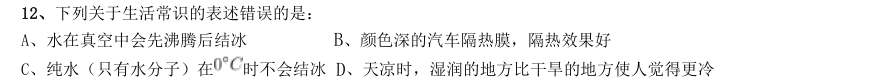

- **A.** 水在真空中会先沸腾后结冰
- **B.** 颜色深的汽车隔热膜,隔热效果好
- **C.** 纯水(只有水分子)在时不会结冰D、天凉时,湿润的地方比干旱的地方使人觉得更冷

**答案：A**

### 2017 湖北·统一卷　第 13 题　（科技常识）

下列关于胎儿与母体关系的表述错误的是:

- **A.** 胎儿与母体具有不同的遗传物质
- **B.** 胎儿与母体的血液通过脐带相通
- **C.** 胎儿在母体中的发育场所是子宫
- **D.** 胎儿与母体通过胎盘进行物质交换

**答案：A**

### 2017 湖北·统一卷　第 17 题　（科技常识）

近年来,粉尘爆炸事件屡见不鲜。下列粉尘中不容易引起爆炸的是:

- **A.** 肥皂粉
- **B.** 水泥粉
- **C.** 面粉
- **D.** 奶粉

**答案：B**

### 2017 湖北·统一卷　第 19 题　（科技常识）

对着电视画面拍照,应关闭照相机闪光灯和室内照明灯,这样照出的照片画面更清晰。这是因为:

- **A.** 闪光灯和照明灯在电视屏上的反射光会干扰电视画面的透射光
- **B.** 闪光灯和照明灯在电视屏上的反射光会干扰电视画面的散射光
- **C.** 闪光灯和照明灯在电视屏上的透射光会干扰电视画面的散射光
- **D.** 闪光灯和照明灯在电视屏上的透射光会干扰电视画面的反射光

**答案：A**

### 2017 湖北·统一卷　第 20 题　（常识（待细分））

香烟点燃后,所产生的能减低红血球将氧输送到全身的成分是:

- **A.** 焦油
- **B.** 一氧化碳
- **C.** 苯丙芘
- **D.** 尼古丁

**答案：A**

### 2017 广东·统一卷　第 80 题　（科技常识）

水银可用于制作体温计,其主要原因不包括:

- **A.** 水银对温度变化敏感
- **B.** 水银容易获得
- **C.** 水银的熔点低,沸点高
- **D.** 水银的化学性质稳定

**答案：暂缺**

### 2017 广东·统一卷　第 81 题　（科技常识）

如果将豆腐冰冻一段时间再解冻,豆腐内部会出现非常多的小孔。这一变化的原因是:

- **A.** 豆腐内的水分聚集凝结成冰晶,体积增大,挤出了这些小孔
- **B.** 豆腐在低温下组织纤维变硬,体积膨大,露出了空隙
- **C.** 温度骤然变化导致豆腐的组织纤维热胀冷缩,露出了空隙
- **D.** 豆腐中的某些成分在低温环境下释放出大量气体,挤出了这些小孔

**答案：暂缺**

### 2017 广东·统一卷　第 83 题　（生活常识）

准备活动是指在比赛、训练和体育课正式开始前,为克服内脏器官的生理惰性,缩短进入运动状态的时 间和预防运动创伤而进行的身体练习,为接下来的剧烈运动或比赛做好准备。下列不属于准备活动主要作用 的是:

- **A.** 提高中枢神经系统的兴奋性
- **B.** 增加皮肤血流量以利于散热
- **C.** 提高运动时对氧气的利用率
- **D.** 提高机体的代谢水平

**答案：暂缺**

### 2017 广东·统一卷　第 84 题　（科技常识）

以下不属于导致听力下降、听力减退原因的是:

- **A.** 太多的噪音伤害了内耳中的细毛
- **B.** 经常用耳勺掏挖耳朵碰伤了耳道
- **C.** 精神压力过大导致内耳供血障碍
- **D.** 戴耳机听音乐导致听觉中枢受损

**答案：暂缺**

### 2017 国考·副省级　第 3 题　（时政热点）

关于中国外交,下列说法错误的是:

- **A.** 二十世纪八九十年代,邓小平提出“韬光养晦、有所作为”的外交战略
- **B.** “另起炉灶”是毛泽东在新中国成立前夕提出的外交方针
- **C.** 周恩来和陈毅都曾担任过外交部长
- **D.** 委内瑞拉是第一个同新中国建交的拉丁美洲国家

**答案：D**

### 2017 国考·副省级　第 5 题　（历史人文）

关于我国著名园林,下列说法正确的是:

- **A.** 《枫桥夜泊》涉及的城市是留园所在地
- **B.** 十二兽首曾是颐和园的镇园之宝
- **C.** 承德避暑山庄始建于明代崇祯年间
- **D.** 苏州拙政园整体呈现均衡对称的格局

**答案：A**

### 2017 国考·副省级　第 7 题　（常识（待细分））

柏拉图认为处于变化之中的事物不是真正的存在,持这种理念的人会认为以下哪项最真实?

- **A.** 一棵树
- **B.** 勾股定理
- **C.** 人的照片
- **D.** 关于马的概念

**答案：B**

### 2017 国考·副省级　第 9 题　（历史人文）

下列艺术领域与专业术语对应有误的是:

- **A.** 摄影:噪点、景深
- **B.** 绘画:散点透视、写意
- **C.** 音乐:调式、声部
- **D.** 舞蹈:变位跳、变奏

**答案：D**

### 2017 国考·副省级　第 15 题　（历史人文）

下列与汽车有关的说法错误的是:

- **A.** 手动挡和自动挡汽车的主要区别在于是否人为控制离合装置
- **B.** 冬天路面结冰时在车轮上挂铁链是为了增大摩擦
- **C.** 遥控钥匙通过发射无线电波控制车门的开关
- **D.** 手刹的制动原理是切断汽车的动力系统

**答案：D**

### 2017 国考·副省级　第 17 题　（生活常识）

关于垃圾分类处理,下列说法错误的是:

- **A.** 速冻饺子的包装袋属于厨余垃圾
- **B.** 塑料制品不可采用深度填埋的处理方法
- **C.** 果皮等食品类废物可进行堆肥处理
- **D.** 红色的收集容器用于收集有害垃圾

**答案：A**

### 2017 国考·副省级　第 18 题　（科技常识）

氢气是重要的工业燃料,下列关于氢气的说法正确的是:

- **A.** 氢气在氧气中燃烧发出明亮的红色火焰
- **B.** 电解水生成氢气的过程是一个吸热过程
- **C.** 人工降雨过程中通常使用氢气作催化剂
- **D.** 氢气在自然界中含量很少,故为稀有气体

**答案：B**

### 2017 国考·副省级　第 20 题　（常识（待细分））

关于农业生产中使用的草木灰,下列说法错误的是:

- **A.** 在种有大白菜的地里撒上草木灰可防病虫害
- **B.** 花卉移栽时,可以用草木灰做底料增加养分
- **C.** 育苗时,草木灰和氮肥同时施用效果更好
- **D.** 往鱼塘撒用草木灰能够降低鱼类的发病率

**答案：C**

### 2017 国考·地市级　第 2 题　（时政热点）

关于中国外交,下列说法错误的是:

- **A.** 二十世纪八九十年代,邓小平提出“韬光养晦、有所作为”的外交战略
- **B.** “另起炉灶”是毛泽东在新中国成立前夕提出的外交方针
- **C.** 周恩来和陈毅都曾担任过外交部长
- **D.** 委内瑞拉是第一个同新中国建交的拉丁美洲国家

**答案：D**

### 2017 国考·地市级　第 9 题　（历史人文）

关于我国著名园林,下列说法正确的是:

- **A.** 《枫桥夜泊》涉及的城市是留园所在地
- **B.** 十二兽首曾是颐和园的镇园之宝
- **C.** 承德避暑山庄始建于明代崇祯年间
- **D.** 苏州拙政园整体呈现均衡对称的格局

**答案：A**

### 2017 国考·地市级　第 13 题　（历史人文）

下列艺术领域与专业术语对应有误的是:

- **A.** 摄影:噪点、景深
- **B.** 绘画:散点透视、写意
- **C.** 音乐:调式、声部
- **D.** 舞蹈:变位跳、变奏

**答案：D**

### 2017 国考·地市级　第 18 题　（科技常识）

氢气是重要的工业燃料,下列关于氢气的说法正确的是:

- **A.** 氢气在氧气中燃烧发出明亮的红色火焰
- **B.** 电解水生成氢气的过程是一个吸热过程
- **C.** 人工降雨过程中通常使用氢气作催化剂
- **D.** 氢气在自然界中含量很少,故为稀有气体

**答案：B**

### 2017 国考·地市级　第 19 题　（生活常识）

关于垃圾分类处理,下列说法错误的是:

- **A.** 速冻饺子的包装袋属于厨余垃圾
- **B.** 塑料制品不可采用深度填埋的处理方法
- **C.** 果皮等食品类废物可进行堆肥处理
- **D.** 红色的收集容器用于收集有害垃圾

**答案：A**

### 2017 国考·地市级　第 20 题　（常识（待细分））

关于农业生产中使用的草木灰,下列说法错误的是:

- **A.** 在种有大白菜的地里撒上草木灰可防病虫害
- **B.** 花卉移栽时,可以用草木灰做底料增加养分
- **C.** 育苗时,草木灰和氮肥同时施用效果更好
- **D.** 往鱼塘撒用草木灰能够降低鱼类的发病率

**答案：C**

### 2016 湖北·统一卷　第 6 题　（生活常识）

关于生活知识,下列说法错误的是:

- **A.** 缺碘可能会患“大脖子病”
- **B.** 吃水果有助于补充维生素
- **C.** 甲醛可以用作药品的防腐剂
- **D.** 回收废电池可减少重金属污染

**答案：A**

### 2016 湖北·统一卷　第 7 题　（科技常识）

下列关于微波的说法正确的是:

- **A.** 微波的频率比一般无线电波的频率低
- **B.** 含水量多少对微波加热效果没有影响
- **C.** 微波会被玻璃、塑料和瓷器等物体反射
- **D.** 微波通信容量大、质量好、传输距离远

**答案：A**

### 2016 湖北·统一卷　第 8 题　（生活常识）

在生活中,下列哪一做法或现象与热胀冷缩无关?

- **A.** 夏天在架设电线时,不宜把电线绷得太紧
- **B.** 往保温瓶灌开水时,不灌满比灌满更容易保温
- **C.** 把刚煮熟的鸡蛋放到冷水中浸一下,更容易剥壳
- **D.** 冬天往玻璃杯中倒开水,应先用少量开水预热杯子

**答案：B**

### 2016 湖北·统一卷　第 10 题　（生活常识）

关于药品,下列说法错误的是:

- **A.** 大部分药品属于处方药,如注射剂、毒麻药品等
- **B.** 非处方药不需要凭执业医师处方即可自行购买和使用
- **C.** 处方药不可擅自使用、停用或增减剂量,否则可能引起严重后果
- **D.** 药品说明书用以指导医生和患者选择、使用药品,但不具法律意义

**答案：D**

### 2016 湖北·统一卷　第 13 题　（科技常识）

下列哪组气体对环境的负面影响最大?

- **A.** 一氧化氮、二氧化硫
- **B.** 二氧化碳、水蒸气
- **C.** 氢气、稀有气体
- **D.** 甲烷、氮气

**答案：A**

### 2016 湖北·统一卷　第 14 题　（经济常识）

关于“螳螂捕蝉,黄雀在后”,下列说法错误的是:

- **A.** 蝉、螳螂和黄雀都是消费者
- **B.** 螳螂和黄雀的行为都属于先天性行为
- **C.** 螳螂、蝉和黄雀组成了一个生态系统
- **D.** 蝉和螳螂属于节肢动物,黄雀属于鸟类

**答案：A**

### 2016 湖北·统一卷　第 17 题　（生活常识）

下列哪种球类运动的场地面积最大?

- **A.** 网球
- **B.** 篮球
- **C.** 排球
- **D.** 足球

**答案：D**

### 2016 湖北·统一卷　第 19 题　（法律常识）

下列不属于夫妻共同财产的是:

- **A.** 婚前房屋在婚后所得的租金
- **B.** 夫妻关系存续期间,军人的复员费和自主择业费
- **C.** 婚后由一方父母出资购买的不动产,产权登记在出资人子女名下
- **D.** 婚姻存续期间虽未实际取得,但明确可以取得的知识产权收益

**答案：C**

### 2016 湖北·统一卷　第 20 题　（法律常识）

甲于2010 年3 月1 日开始使用“红红太阳”牌商标,乙同年4 月1 日开始使用相同商标。商标局于2011 年 5 月10 日同一天收到甲、乙关于“红红太阳”商标的申请文件,但甲的文件是5 月8 日寄出的,乙的文件是5 月5 日寄出的。商标局应初步审定公告谁的申请?

- **A.** 公告甲的申请,因甲、乙虽同时申请,但甲使用在先
- **B.** 同时公告,因甲、乙申请日期相同
- **C.** 公告乙的申请,因乙申请在先
- **D.** 可以由商标局自由裁定

**答案：A**

### 2016 广东·乡镇　第 72 题　（常识（待细分））

以下适合于建设防火林带的树种是( )。

- **A.** 木荷
- **B.** 松树
- **C.** 樟树
- **D.** 杉木

**答案：暂缺**

### 2016 广东·乡镇　第 76 题　（生活常识）

在众多色彩中,人们往往对红色“情有独钟”,常采用红灯做指示,比如指挥交通的红灯, 汽车尾部的红灯,公共场所安全门的红灯。这是因为,红色光在可见光中( )。

- **A.** 波长最长,且不容易被散射
- **B.** 波长最短,且不容易被散射
- **C.** 波长最长,且容易被散射
- **D.** 波长最短,且容易被散射

**答案：暂缺**

### 2016 广东·乡镇　第 79 题　（科技常识）

人们在厨房做菜时,如果不小心把水滴进热油锅中,常常会发生溅油的现象。这是因为 ( )。

- **A.** 水与油一起加热产生了化学反应,释放出热量
- **B.** 水密度比油大而沸点比油低,会在油面下迅速汽化
- **C.** 油在加热情况下与水相溶,更容易蒸发而产生气泡
- **D.** 水在加热时对流速度加快,与油发生摩擦而产生了热量

**答案：暂缺**

### 2016 广东·乡镇　第 82 题　（科技常识）

声音可以在固态、液态和气态的介质中传播,传播的速度与介质分子间距有关,分子间距越 小,声音的传播速度越快。下列介质中声音传播速度最快的是( )。

- **A.** 铁棒
- **B.** 竹竿
- **C.** 盐水
- **D.** 液态汞

**答案：暂缺**

### 2016 广东·乡镇　第 83 题　（生活常识）

吸烟严重威胁人体健康。针对香烟产生的各种有害物质的描述,下列说法错误的是( )。

- **A.** 尼古丁可让吸烟者成瘾,并有较强的毒性
- **B.** 烟焦油易沉积于肺等器官,可诱发癌变
- **C.** 香烟燃烧时物质分解放出的射线可以致癌
- **D.** 一氧化碳易溶于水,从而与血红蛋白结合

**答案：暂缺**

### 2016 广东·乡镇　第 85 题　（生活常识）

通常情况下,冰雹会出现在( )天气。

- **A.** 春日的阴雨
- **B.** 夏日的雷暴
- **C.** 秋日的晴朗
- **D.** 冬日的寒冷

**答案：暂缺**

### 2016 广东·县级　第 2 题　（常识（待细分））

以下适合于建设防火林带的树种是( )。

- **A.** 木荷
- **B.** 松树
- **C.** 樟树
- **D.** 杉木

**答案：暂缺**

### 2016 广东·县级　第 13 题　（生活常识）

在我国的一些地区,冰雹通常出现在( )天气。

- **A.** 春日的阴雨
- **B.** 夏日的雷暴
- **C.** 秋日的晴朗
- **D.** 冬日的寒冷

**答案：暂缺**

### 2016 国考·副省级　第 2 题　（地理常识）

关于我国农业国情,下列说法错误的是:

- **A.** 五大牧区的简称为新、藏、青、蒙和陇
- **B.** 南北方最主要的糖料作物分别是甘蔗和甜菜
- **C.** “湖广熟,天下足”,江汉平原是最大的商品粮产区
- **D.** 红壤是一种粘性酸壤,主要分布于长江以南的低山丘陵区

**答案：C**

### 2016 国考·副省级　第 7 题　（历史人文）

下列与对联有关的说法错误的是( )。

- **A.** “不夜灯光,便是玲珑世界;通宵月色,无非圆满乾坤”写的是元宵佳节
- **B.** “暮鼓晨钟,惊醒世间名利客;经声佛号,唤回苦海梦迷人”是西汉人写的
- **C.** “新年的余庆,嘉节号长春”符合对联“仄起平落”的书写习惯
- **D.** “入门尽是弹冠客,去后应无搔首人”适合作为理发店的对联

**答案：B**

### 2016 国考·副省级　第 8 题　（历史人文）

下列作品与第二次世界大战有关的是:

- **A.** 《辛德勒名单》
- **B.** 《静静的顿河》
- **C.** 《智取威虎山》
- **D.** 《战争与和平》

**答案：A**

### 2016 国考·副省级　第 9 题　（历史人文）

下列哪项不属于非战争军事行动?( )

- **A.** 反恐维稳
- **B.** 安保警戒
- **C.** 国际援助
- **D.** 防空反导

**答案：D**

### 2016 国考·副省级　第 11 题　（历史人文）

“乐以天下,忧以天下,然而不王者,未之有也”与下列哪一观点属于同一学派?

- **A.** 刑过不避大臣,赏善不遗匹夫
- **B.** 天之道,损有余而补不足;人之道,则不然,损不足以奉有余
- **C.** 域民不以封疆之界,固国不以山溪之险,威天下不以兵革之利
- **D.** 其用战也胜,久则钝兵挫锐,攻城则力屈,久暴师则国用不足

**答案：C**

### 2016 国考·副省级　第 12 题　（科技常识）

下列哪种情形可能发生?

- **A.** 辛亥革命发生时,希腊人在体育场观看世界杯足球赛
- **B.** 五四运动发生时,中国大学生利用半导体收音机收听广播
- **C.** 冷战时期,苏联某地电影院放映彩色电影
- **D.** 越战期间,美国人在家里用计算机访问互联网

**答案：C**

### 2016 国考·副省级　第 13 题　（科技常识）

下列关于恐龙的说法正确的是:

- **A.** 主要活跃在中生代时期
- **B.** 霸王龙和剑龙都是肉食性动物
- **C.** 属于脊椎亚门类动物中的哺乳纲
- **D.** 可通过某个DNA 片段克隆出恐龙

**答案：A**

### 2016 国考·副省级　第 14 题　（常识（待细分））

某城市空气质量较差,检测结果显示,在主要污染物中, 颗粒浓度严重超标, 颗粒浓度及有害气 体浓度尚在正常范围。如果你是城市决策者,采取以下哪些措施能在影响最小的情况下,最有效地改善空气质量? 1整改郊区水泥厂 2整改郊区造纸厂 3市区车辆限号行驶 4改善郊区植被环境

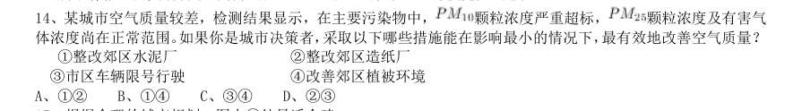

- **A.** 12
- **B.** 14
- **C.** 34
- **D.** 23

**答案：B**

### 2016 国考·副省级　第 16 题　（常识（待细分））

京沪铁路没有经过下列哪一名胜所在的省份?

- **A.** 景德镇古窑民俗博览区
- **B.** 蓬莱阁风景区
- **C.** 承德避暑山庄
- **D.** 黄山风景区

**答案：A**

### 2016 国考·副省级　第 18 题　（历史人文）

下列与雪有关的说法正确的是:

- **A.** 大气中有足够的凝结核是形成降雪的必要条件
- **B.** 食盐可作为融雪物质,是因为盐水的凝固点比纯水高
- **C.** “下雪不冷化雪冷”是因为凝固吸热,有降温制冷作用
- **D.** “六月飞雪”是文学作品杜撰的场景,不可能在我国境内出现

**答案：A**

### 2016 国考·地市级　第 6 题　（法律常识）

下列情形中,行为人不负刑事责任的是:

- **A.** 十四周岁的张某,贩卖冰毒0.2 克
- **B.** 十五周岁的李某,因过失导致他人伤残
- **C.** 二十周岁的周某,醉酒后殴打他人致人重伤
- **D.** 三十五周岁的聋哑人宋某,入户盗窃现金5000 元

**答案：A**

### 2016 国考·地市级　第 8 题　（地理常识）

关于我国农业国情,下列说法错误的是:

- **A.** 五大牧区的简称为新、藏、青、蒙和陇
- **B.** 南北方最主要的糖料作物分别是甘蔗和甜菜
- **C.** “湖广熟,天下足”,江汉平原是最大的商品粮产区
- **D.** 红壤是一种粘性酸壤,主要分布于长江以南的低山丘陵区

**答案：C**

### 2016 国考·地市级　第 13 题　（历史人文）

下列作品与第二次世界大战有关的是:

- **A.** 《辛德勒名单》
- **B.** 《静静的顿河》
- **C.** 《智取威虎山》
- **D.** 《战争与和平》

**答案：A**

### 2016 国考·地市级　第 16 题　（常识（待细分））

京沪铁路没有经过下列哪一名胜所在的省份?

- **A.** 景德镇古窑民俗博览区
- **B.** 蓬莱阁风景区
- **C.** 承德避暑山庄
- **D.** 黄山风景区

**答案：A**

### 2016 国考·地市级　第 17 题　（科技常识）

下列哪种情形可能发生?

- **A.** 辛亥革命发生时,希腊人在体育场观看世界杯足球赛
- **B.** 五四运动发生时,中国大学生利用半导体收音机收听广播
- **C.** 冷战时期,苏联某地电影院放映彩色电影
- **D.** 越战期间,美国人在家里用计算机访问互联网

**答案：C**

### 2016 国考·地市级　第 18 题　（科技常识）

下列关于恐龙的说法正确的是:

- **A.** 主要活跃在中生代时期
- **B.** 霸王龙和剑龙都是肉食性动物
- **C.** 属于脊椎亚门类动物中的哺乳纲
- **D.** 可通过某个DNA 片段克隆出恐龙

**答案：A**

### 2015 湖北·统一卷　第 2 题　（经济常识）

如果你是“单独家庭”,那么可以生育第二胎

> （本题为图形题，选项为图片，见原卷）

**答案：B**

### 2015 湖北·统一卷　第 3 题　（常识（待细分））

如果你是农村户口,那么宅基地可以私有

> （本题为图形题，选项为图片，见原卷）

**答案：C**

### 2015 湖北·统一卷　第 4 题　（历史人文）

如果你是劳动者,那么可能可以延迟退休

- **A.** 123
- **B.** 234
- **C.** 124
- **D.** 1234

**答案：A**

### 2015 湖北·统一卷　第 7 题　（科技常识）

下列不属于心理学效应的是:

- **A.** 晕轮效应
- **B.** 马太效应
- **C.** 破窗效应
- **D.** 配位效应

**答案：D**

### 2015 湖北·统一卷　第 16 题　（科技常识）

下列生活中保存食物的方法,理解错误的是:

- **A.** 盐腌制食品是因为盐可以形成高渗环境,抑制了微生物的生理活动
- **B.** 真空保存食物可以破坏需氧菌类的生存环境
- **C.** 冷藏保存食物是因为低温可以将细菌冻死
- **D.** 充入氮气保存食品是为了隔绝食品和氧气的接触

**答案：C**

### 2015 湖北·统一卷　第 17 题　（科技常识）

在计算机网络通信领域中,防火墙是一项协助确保信息安全的设备。它会依据特定的规则,允许或是限制传 输的数据通过。小张在自己电脑上安装了防火墙软件,下列论述正确的是( )

- **A.** 防火墙软件有可能导致小张的电脑不能访问特定的Web 网站
- **B.** 防火墙软件有可能导致小张无法访问自己电脑硬盘上存储的文档
- **C.** 防火墙软件使得小张在网络购物时,不容易被虚假广告所欺骗
- **D.** 防火墙软件使得小张在和陌生网友聊天时,可以伪装自己的性别和姓名。

**答案：A**

### 2015 广东·乡镇　第 71 题　（常识（待细分））
> 材料：最恰当的答案。…

蜻蜓点水是指蜻蜓在水面飞行时轻触水面的动作,其主要是为了:

- **A.** 求偶
- **B.** 饮水
- **C.** 产卵
- **D.** 呼吸

**答案：暂缺**

### 2015 广东·乡镇　第 75 题　（常识（待细分））

根据干支纪年法,2015 年是乙未羊年,那么2020 年是:

- **A.** 癸丑牛年
- **B.** 庚丑牛年
- **C.** 庚子鼠年
- **D.** 壬子鼠年

**答案：暂缺**

### 2015 广东·乡镇　第 78 题　（常识（待细分））

在我国,野外迷路时,下列辨别方向的方法不正确的是:

- **A.** 树木年轮较密的一侧是南方
- **B.** 树木枝叶茂盛的一侧是南方
- **C.** 岩石上布满青苔的一侧是北方
- **D.** 蚂蚁的洞口朝向的一侧是南方

**答案：暂缺**

### 2015 广东·乡镇　第 79 题　（生活常识）

下列选项中,用热水比用冷水洗涤效果更好的是:

- **A.** 有油渍的碗筷
- **B.** 有汗渍的衣服
- **C.** 有血渍的衣服
- **D.** 有农药残留的蔬菜

**答案：暂缺**

### 2015 广东·乡镇　第 81 题　（常识（待细分））

某商店贴出下列四个标语,不合法的是: 1特价商品,概不退还 2商品打折,不开发票 3小本买卖,概不赊欠 4损一赔十,偷一罚十

- **A.** 123
- **B.** 124
- **C.** 134
- **D.** 234

**答案：暂缺**

### 2015 广东·乡镇　第 84 题　（科技常识）

举重运动员、体操运动员比赛前,会抓一些白色粉末(主要成分是碳酸镁)涂抹在手掌上, 来增加手掌与器械之间的摩擦力。这主要是利用碳酸镁的:

- **A.** 润滑作用
- **B.** 吸湿作用
- **C.** 中和作用
- **D.** 保温作用

**答案：暂缺**

### 2015 广东·县级　第 72 题　（常识（待细分））

蜻蜓点水是指蜻蜓在水面飞行时轻触水面的动作,其主要是为了:

- **A.** 求偶
- **B.** 饮水
- **C.** 产卵
- **D.** 呼吸

**答案：暂缺**

### 2015 广东·县级　第 76 题　（常识（待细分））

随着社会的发展,一些新的职业会不断出现。下列选项中,按照职业出现时间先后顺序排列正确的是:

- **A.** 大学教师,火车司机,汽车修理工,软件工程师
- **B.** 大学教师,汽车修理工,火车司机,软件工程师
- **C.** 汽车修理工,火车司机,软件工程师,大学教师
- **D.** 汽车修理工,软件工程师,大学教师,火车司机

**答案：暂缺**

### 2015 广东·县级　第 82 题　（常识（待细分））

在我国,野外迷路时,下列辨别方向的方法不正确的是:

- **A.** 树木年轮较密的一侧是南方
- **B.** 树木枝叶茂盛的一侧是南方
- **C.** 岩石上布满青苔的一侧是北方
- **D.** 蚂蚁的洞口朝向的一侧是南方

**答案：暂缺**

### 2015 广东·县级　第 83 题　（生活常识）

下列选项中,用热水比用冷水洗涤效果更好的是:

- **A.** 有油渍的碗筷
- **B.** 有汗渍的衣服
- **C.** 有血渍的衣服
- **D.** 有农药残留的蔬菜

**答案：暂缺**

### 2015 广东·县级　第 85 题　（常识（待细分））

根据干支纪年法,2015 年是乙未羊年,那么2020 年是:

- **A.** 癸丑牛年
- **B.** 庚丑牛年
- **C.** 庚子鼠年
- **D.** 壬子鼠年

**答案：暂缺**

### 2015 国考·副省级　第 2 题　（科技常识）

关于我国农村三级卫生服务网络,下列说法正确的是:

- **A.** 主要承担预防保健、基本医疗、健康教育、计生指导等任务
- **B.** 包括乡镇卫生院、村卫生室和家庭自我保健
- **C.** 以让农民“看病不出乡镇”为发展目标
- **D.** 以乡镇卫生院为基础

**答案：A**

### 2015 国考·副省级　第 4 题　（历史人文）

下列说法错误的是:

- **A.** 成语“南橘北枳”是与晏婴出使楚国有关
- **B.** 苏武牧羊的地点在今天的贝加尔湖一带
- **C.** 东汉使者班超同时也是《汉书》的作者
- **D.** 西汉张骞与唐代鉴真出行的方向不同

**答案：A**

### 2015 国考·副省级　第 5 题　（科技常识）

关于现代武器,下列说法错误的是:

- **A.** 迫击炮通常配属装甲兵使用
- **B.** 陆军航空兵以直升机为主要装备
- **C.** 洲际弹道导弹是目前射程最远的导弹
- **D.** 驱逐舰具有防空、反潜和对地攻击的综合作战能力

**答案：A**

### 2015 国考·副省级　第 6 题　（法律常识）

关于我国政府信息公开,下列说法错误的是:

- **A.** 行政机关对政府信息不能确定是否可以公开时,应不公开
- **B.** 公民可以根据自身生产、生活和科研等特殊需要申请政府信息公开
- **C.** 行政机关逾期不答复公民申请信息公开的,公民可依法提起行政诉讼
- **D.** 县级以上各级人民政府的办公厅(室)可以作为本级政府信息公开工作的主管部门

**答案：A**

### 2015 国考·副省级　第 7 题　（法律常识）

下列哪种情形最可能实行一审终审:

- **A.** 基层人民法院审理被告提出反诉的买卖合同纠纷案件
- **B.** 基层人民法院审理夫妻双方争夺子女抚养权的离婚案件
- **C.** 中级人民法院审理在本辖区有重大影响的合同纠纷案件
- **D.** 基层人民法院审理权利义务关系明确的租赁合同纠纷案件

**答案：D**

### 2015 国考·副省级　第 9 题　（科技常识）

下列语句按出现时间先后排序正确的是: 1劳心者治人,劳力者治于人 2少年富则国富,少年强则国强 3苟全性命于乱世,不求闻达于诸侯 4业精于勤,荒于嬉;行成于思,毁于随

- **A.** 3142
- **B.** 3214
- **C.** 1342
- **D.** 1234

**答案：C**

### 2015 国考·副省级　第 10 题　（历史人文）

下列选项所描述的对象,哪一项与其他三项不同:

- **A.** 挥毫掣电,随手万变
- **B.** 池墨泼飞云,紫毫挥广宇
- **C.** 湖光秋月两相和,潭面无风镜未磨
- **D.** 怳怳如闻神鬼惊,时时只见龙蛇走

**答案：A**

### 2015 国考·副省级　第 13 题　（地理常识）

一跨国企业计划7 月份在全球两个大城市同期举办大型室外活动。为避免降雨影响活动效果,选择下列哪两 个城市最为合理:

- **A.** 北京和纽约
- **B.** 东京和马德里
- **C.** 上海和伦敦
- **D.** 罗马和洛杉矶

**答案：D**

### 2015 国考·副省级　第 14 题　（生活常识）

日常生活中经常可以依据动物的某些行为预判天气,下列对应正确的是:

- **A.** 麻雀囤食——雨天
- **B.** 蚂蚁垒窝——晴天
- **C.** 蜻蜓低飞——雨天
- **D.** 龟背冒“汗”——晴天

**答案：A**

### 2015 国考·副省级　第 16 题　（科技常识）

下列情景不可能发生在19 世纪的是:

- **A.** 杰克打电话约玛丽一起去看电影
- **B.** 史蒂芬逊乘火车到斯托克顿旅行
- **C.** 约翰乘电梯登大楼楼顶拍照留念
- **D.** 汤姆通过广播收听葛底斯堡演说

**答案：D**

### 2015 国考·副省级　第 19 题　（科技常识）

关于生活常识,下列说法错误的是:

- **A.** 吃松花蛋时佐以食醋,是为了减少松花蛋的涩味
- **B.** 电灯泡中加入少量红磷,是为了防止灯丝氧化
- **C.** 纯碱使馒头稀松多孔,是因为化学反应产生二氧化碳
- **D.** 千滚水不宜饮用,是因为其中的细菌含量会大大增加

**答案：D**

### 2015 国考·地市级　第 3 题　（法律常识）

下列哪种情形最可能实行一审终审:

- **A.** 基层人民法院审理被告提出反诉的买卖合同纠纷案件
- **B.** 基层人民法院审理夫妻双方争夺子女抚养权的离婚案件
- **C.** 中级人民法院审理在本辖区有重大影响的合同纠纷案件
- **D.** 基层人民法院审理权利义务关系明确的租赁合同纠纷案件

**答案：D**

### 2015 国考·地市级　第 6 题　（历史人文）

下列说法错误的是:

- **A.** 成语“南橘北枳”是与晏婴出使楚国有关
- **B.** 苏武牧羊的地点在今天的贝加尔湖一带
- **C.** 东汉使者班超同时也是《汉书》的作者
- **D.** 西汉张骞与唐代鉴真出行的方向不同

**答案：A**

### 2015 国考·地市级　第 8 题　（法律常识）

关于我国政府信息公开,下列说法错误的是:

- **A.** 行政机关对政府信息不能确定是否可以公开时,应不公开
- **B.** 公民可以根据自身生产、生活和科研等特殊需要申请政府信息公开
- **C.** 行政机关逾期不答复公民申请信息公开的,公民可依法提起行政诉讼
- **D.** 县级以上各级人民政府的办公厅(室)可以作为本级政府信息公开工作的主管部门

**答案：A**

### 2015 国考·地市级　第 9 题　（科技常识）

关于我国农村三级卫生服务网络,下列说法正确的是:

- **A.** 主要承担预防保健、基本医疗、健康教育、计生指导等任务
- **B.** 包括乡镇卫生院、村卫生室和家庭自我保健
- **C.** 以让农民“看病不出乡镇”为发展目标
- **D.** 以乡镇卫生院为基础

**答案：A**

### 2015 国考·地市级　第 10 题　（科技常识）

关于现代武器,下列说法错误的是:

- **A.** 迫击炮通常配属装甲兵使用
- **B.** 陆军航空兵以直升机为主要装备
- **C.** 洲际弹道导弹是目前射程最远的导弹
- **D.** 驱逐舰具有防空、反潜和对地攻击的综合作战能力

**答案：A**

### 2015 国考·地市级　第 13 题　（生活常识）

下列说法符合生活实际的是:

- **A.** 小满时节,我国东部由低温导致呼吸疾病明显增多
- **B.** 芒种时节,我国南方居民发现春困的感觉有所加剧
- **C.** 处暑时节,我国北方医院里中暑病人相对有所减少
- **D.** 雨水过后我国西部蚊蝇所传播的疾病开始明显增多

**答案：C**

### 2015 国考·地市级　第 17 题　（科技常识）

下列情景不可能发生在19 世纪的是:

- **A.** 杰克打电话约玛丽一起去看电影
- **B.** 史蒂芬逊乘火车到斯托克顿旅行
- **C.** 约翰乘电梯登大楼楼顶拍照留念
- **D.** 汤姆通过广播收听葛底斯堡演说

**答案：D**

### 2015 国考·地市级　第 19 题　（科技常识）

关于生活常识,下列说法错误的是:

- **A.** 吃松花蛋时佐以食醋,是为了减少松花蛋的涩味
- **B.** 电灯泡中加入少量红磷,是为了防止灯丝氧化
- **C.** 纯碱使馒头稀松多孔,是因为化学反应产生二氧化碳
- **D.** 千滚水不宜饮用,是因为其中的细菌含量会大大增加

**答案：D**

### 2014 湖北·统一卷　第 1 题　（法律常识）

关于我国公务员制度,下列叙述正确的是:

- **A.** 正在接受纪律审查的公务员不得辞去公职
- **B.** 我国公务员培训基地是党校
- **C.** 公务员对降职不服,可以向人民法院提出申诉
- **D.** 公务员考核的基本内容包括德、能、勤、绩、才

**答案：A**

### 2014 湖北·统一卷　第 2 题　（历史人文）

关于我国的农民工现象,下列说法错误的是:

- **A.** 农民工是我国特有的城乡二元体制的产物
- **B.** 近年来跨省流动农民工所占比重继续下降
- **C.** 从输出地看,中部地区输出农民工最多,西部次之,东部最少
- **D.** “新生代农民工”主要指80 后、90 后,目前在农民工群体中占一半以上

**答案：A**

### 2014 湖北·统一卷　第 4 题　（地理常识）

关于四大文明古国及其数学成就,下列对应错误的是:

- **A.** 古埃及:“0”的发现
- **B.** 古印度:阿拉伯数字
- **C.** 古巴比伦:六十进位制
- **D.** 古中国:勾股定理

**答案：A**

### 2014 湖北·统一卷　第 5 题　（历史人文）

下列思想流派与产生时代对应错误的是:

- **A.** 心学——明代
- **B.** 玄学——魏晋
- **C.** 理学——宋代
- **D.** 儒学——汉代

**答案：A**

### 2014 湖北·统一卷　第 6 题　（地理常识）

关于政治思想,下列表述错误的是:

- **A.** 孟德斯鸠提出三权分立学说
- **B.** 伏尔泰最早提出社会契约论的思想
- **C.** 柏拉图主张建立哲学王统治的国家
- **D.** 让·布丹提出君主主权学说

**答案：A**

### 2014 湖北·统一卷　第 7 题　（历史人文）

关于下列各组人物说法错误的是:

- **A.** 苏格拉底、柏拉图和亚里士多德被称为“古希腊三贤”
- **B.** 颜回、曾子都属孔子七十二门徒
- **C.** 荀子及其弟子韩非子是法家学派的代表人物
- **D.** 康有为、梁启超都是“公车上书”的发起人

**答案：A**

### 2014 湖北·统一卷　第 8 题　（科技常识）

下列关于铅的说法错误的是:

- **A.** 铅笔芯的主要成分是铅
- **B.** 香烟中是含铅的
- **C.** 铅在人体内日积月累,不会分解
- **D.** 汽油中添加铅元素可以起到防爆的作用

**答案：A**

### 2014 湖北·统一卷　第 9 题　（科技常识）

下列说法错误的是:

- **A.** 蓝藻对地球表面从无氧到有氧的大气环境起了巨大作用
- **B.** 植物光合作用主要在细胞的线粒体进行
- **C.** 呼吸作用分为有氧呼吸和无氧呼吸两种类型
- **D.** 种子植物是地球表面绿色的主体

**答案：A**

### 2014 湖北·统一卷　第 12 题　（生活常识）

下列关于石灰的说法错误的是:

- **A.** 生石灰通常可以作为食品干燥剂
- **B.** 澄清石灰水放置在空气中易变浑浊
- **C.** 汉白玉与石灰石的主要成分相同
- **D.** “烈火焚烧若等闲”指熟石灰的高温煅烧

**答案：A**

### 2014 湖北·统一卷　第 13 题　（科技常识）

下列哪组不属于夺命“急症”:

- **A.** 肺栓塞、哮喘
- **B.** 冠心病、毒品过量
- **C.** 脑出血、急性坏死性胰腺炎
- **D.** 阑尾炎、腹膜炎

**答案：D**

### 2014 湖北·统一卷　第 14 题　（常识（待细分））

下列哪组物品均属可燃固体?

- **A.** 香蕉水、酒精
- **B.** 面粉、油漆
- **C.** 沥青、松香
- **D.** 甲烷、乙炔

**答案：A**

### 2014 湖北·统一卷　第 17 题　（历史人文）

下列体育人物与其擅长领域对应错误的是:

- **A.** 罗尼·奥沙利文:斯诺克台球
- **B.** 拉菲尔·纳达尔:棒球
- **C.** 罗杰·费德勒:网球
- **D.** 泰格·伍兹:高尔夫

**答案：A**

### 2014 湖北·统一卷　第 18 题　（历史人文）

下列事件与相关人物对应错误的是:

- **A.** 三藩之乱:吴三桂、康熙
- **B.** 七国之乱:吴王刘濞、汉景帝
- **C.** 八王之乱:苻坚、谢玄
- **D.** 安史之乱:郭子仪、史思明

**答案：C**

### 2014 广东·乡镇　第 1 题　（法律常识）

乡镇人民政府是:

- **A.** 国家行政机关
- **B.** 国家立法机关
- **C.** 国家权力机关
- **D.** 国家司法机关

**答案：暂缺**

### 2014 广东·乡镇　第 2 题　（科技常识）

2014 年中央一号文件提出,推进中国特色农业现代化,要始终把改革作为根本动力,立足国情农情,顺应 时代要求,坚持( )为基础与多种经营形式共同发展。

- **A.** 家庭经营
- **B.** 集体经营
- **C.** 合作经营
- **D.** 企业经营

**答案：暂缺**

### 2014 广东·乡镇　第 3 题　（时政热点）

农村村民实现村民自治的基本手段是:

- **A.** 党的政策
- **B.** 村民会议
- **C.** 村规民约
- **D.** 法律法规

**答案：暂缺**

### 2014 广东·乡镇　第 5 题　（常识（待细分））

中国共产党党员的党龄,从( )算起。

- **A.** 递交入党申请书之日
- **B.** 成为入党积极分子之日
- **C.** 成为预备党员之日
- **D.** 预备期满转为正式党员之日

**答案：暂缺**

### 2014 广东·乡镇　第 6 题　（常识（待细分））

根据《城市居民委员会组织法》,居民委员会决定问题,采取( )的原则。

- **A.** 民主集中制
- **B.** 少数服从多数
- **C.** 居民委员会成员集体决定
- **D.** 居民小组组长讨论决定

**答案：暂缺**

### 2014 广东·乡镇　第 7 题　（常识（待细分））

乡、民族乡、镇的人民政府对村民委员会的工作给予指导、支持和帮助,( )依法属于村民自治范围内 的事项。

- **A.** 不得干预
- **B.** 必要时责令改正
- **C.** 根据工作需要决定
- **D.** 根据村民委员会申请决定

**答案：暂缺**

### 2014 广东·乡镇　第 8 题　（生活常识）

某镇人民政府镇长是该镇安全生产的第一责任人,对辖区范围内的安全生产:

- **A.** 负间接责任
- **B.** 负普通责任
- **C.** 不负责任
- **D.** 负全面责任

**答案：暂缺**

### 2014 广东·乡镇　第 10 题　（科技常识）

根据《村民委员会组织法》,登记参加选举的村民,选举期间外出不能参加投票的,可以( )本村有选 举权的近亲属代为投票,村民选举委员会应当公布委托人和受委托人的名单。

- **A.** 间接委托
- **B.** 口头委托
- **C.** 书面委托
- **D.** 电话委托

**答案：暂缺**

### 2014 广东·乡镇　第 11 题　（常识（待细分））

李某是甲村村民委员会成员,根据《村民委员会组织法》,以下人员可以担任该村村务监督机构成员的是:

- **A.** 李某的妻子
- **B.** 李某的父亲
- **C.** 李某的哥哥
- **D.** 李某的朋友

**答案：暂缺**

### 2014 广东·乡镇　第 12 题　（常识（待细分））

以下不属于村民委员会职责的是:

- **A.** 调解民间纠纷
- **B.** 促进农村公共服务
- **C.** 协助维护社会治安
- **D.** 林木砍伐的罚没

**答案：暂缺**

### 2014 广东·乡镇　第 16 题　（常识（待细分））

根据《广东省社会抚养费征收管理办法》,当事人一次缴纳社会抚养费确有实际困难的,应当按规定向委 托作出征收决定的机关提出分期缴纳申请,缴纳期限不得超过:

- **A.** 两年
- **B.** 三年
- **C.** 四年
- **D.** 五年

**答案：暂缺**

### 2014 广东·乡镇　第 17 题　（时政热点）

根据《村民委员会组织法》,村民委员会实行村务公开制度。下列不属于村务公开内容的是:

- **A.** 国家计划生育政策的落实方案
- **B.** 政府拨付和接受社会捐献的救灾救助、补贴补助等资金、物资的管理使用情况
- **C.** 村民委员会协助人民政府开展工作的情况
- **D.** 村民委员会干部个人财产信息

**答案：暂缺**

### 2014 广东·乡镇　第 19 题　（地理常识）

村民委员会设立的治安保卫委员会,俗称“治保会”,是:

- **A.** 国家机关
- **B.** 行政机关
- **C.** 事业单位
- **D.** 群众性自治组织

**答案：暂缺**

### 2014 广东·县级　第 5 题　（常识（待细分））

火车轨道由两道钢轨组成。一般来说,转弯处的火车轨道,内外两侧钢轨的高低关系为:

- **A.** 内侧比外侧高
- **B.** 外侧比内侧高
- **C.** 两侧一样高
- **D.** 有时内侧高,有时外侧高

**答案：暂缺**

### 2014 广东·县级　第 6 题　（常识（待细分））

“斗柄东指,天下皆春”的意思是指,北斗七星斗柄指向东方的时候,春天就来了。那么,在冬季,北斗 七星的斗柄指向:

- **A.** 北方
- **B.** 南方
- **C.** 西方
- **D.** 东方

**答案：暂缺**

### 2014 广东·县级　第 7 题　（地理常识）

以下路况,一般来说,驾驶员最容易出现视觉疲劳的是:

- **A.** 高速公路
- **B.** 盘山水泥公路
- **C.** 平原砂石公路
- **D.** 城市街道

**答案：暂缺**

### 2014 广东·县级　第 8 题　（历史人文）

《清明上河图》是北宋作品,描述了八百多个人物,七十多匹牲畜,二十多辆车、桥,二十九艘大小船只, 以及各具特色的房屋、桥梁、城楼等。这幅画主要表现的是:

- **A.** 祭祀风光
- **B.** 山水景色
- **C.** 田园风光
- **D.** 社会风俗

**答案：暂缺**

### 2014 广东·县级　第 9 题　（科技常识）

当海面上空气各层的密度有较大差异时,远处的光线通过密度不同的空气层发生折射或全反射,海面上会 出现远处物体的影像,这一现象被称为海市蜃楼。海市蜃楼最有可能发生的季节是:

- **A.** 春季
- **B.** 夏季
- **C.** 秋季
- **D.** 冬季

**答案：暂缺**

### 2014 广东·县级　第 10 题　（常识（待细分））

今年,农历闰九月。下列说法正确的是:

- **A.** 农历九月有31 天
- **B.** 农历全年有390 天
- **C.** 闰九月有28 天
- **D.** 农历全年有13 个月

**答案：暂缺**

### 2014 国考·统一卷　第 2 题　（生活常识）

关于宇航员在太空的生活,下列说法不正确的是:

- **A.** 宇航员可使用特定的加热器对食品进行加热
- **B.** 宇航员从太空返回地面后,失重状态消失,质量会有所增加
- **C.** 宇航员应睡在固定的睡袋中,以免被气流推动误碰仪器设备开关
- **D.** 在同一航空器中的宇航员可以直接交谈,无须借助无线电通讯设备

**答案：B**

### 2014 国考·统一卷　第 4 题　（生活常识）

下列情形可能发生的是:

- **A.** 南北朝贵族妇女去佛寺礼佛
- **B.** 半坡原始居民种植玉米
- **C.** 周武王穿着铁制铠甲伐纣
- **D.** 秦朝儿童春天放纸风筝

**答案：A**

### 2014 国考·统一卷　第 6 题　（常识（待细分））

《人民日报》评论指出:“一个人挥舞胳膊的自由止于别人鼻子的地方。”下列可以代替该评论的名言是:

- **A.** 哪里没有法律,哪里就没有自由
- **B.** 法典就是人民自由的圣经
- **C.** 法律是自由的保姆
- **D.** 自由只服从法律

**答案：D**

### 2014 国考·统一卷　第 9 题　（科技常识）

俗语说“绣花要得手绵巧,打铁还须自身硬”,下列与该俗语哲学道理相同的是:

- **A.** 身正不怕影子斜
- **B.** 师傅领进门,修行靠个人
- **C.** 水大漫不过船
- **D.** 有理不在声高

**答案：B**

### 2014 国考·统一卷　第 12 题　（常识（待细分））

下列关于自然现象的说法错误的是:

- **A.** 霾通常呈黄色或橙灰色,吸入后有害
- **B.** 露水会对农作物的生长造成危害
- **C.** 雾和云是由于温度下降造成的
- **D.** 彩虹有时会同时出现两条

**答案：A**

### 2014 国考·统一卷　第 14 题　（地理常识）

关于图中示意的自然现象,下列说法错误的是:

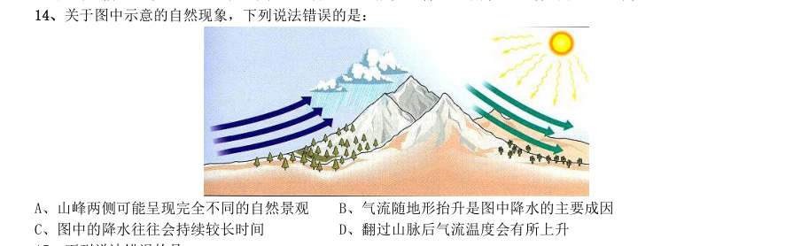

- **A.** 山峰两侧可能呈现完全不同的自然景观
- **B.** 气流随地形抬升是图中降水的主要成因
- **C.** 图中的降水往往会持续较长时间
- **D.** 翻过山脉后气流温度会有所上升

**答案：A**

### 2014 国考·统一卷　第 15 题　（科技常识）

下列说法错误的是:

- **A.** 根据光的偏振原理可以制成看立体电影的立体眼镜
- **B.** 打枪瞄准时闭上一只眼利用了光沿直线传播的原理
- **C.** 光在光纤中传播利用的是光的全反射原理
- **D.** 潜望镜利用了光的折射原理

**答案：D**

### 2014 国考·统一卷　第 17 题　（生活常识）

关于目前的国际体育赛事,下列说法正确的是:

- **A.** 世界一级方程式锦标赛所用赛车的发动机排量没有限制
- **B.** 进入世界杯和欧洲杯足球赛决赛圈的球队数量相同
- **C.** 斯诺克台球属于奥运会的比赛项目之一
- **D.** 法国网球公开赛属于大满贯的赛事

**答案：A**

### 2014 国考·统一卷　第 18 题　（生活常识）

下列关于农业的说法正确的是:

- **A.** 花生、大豆、向日葵和芝麻都属于油料作物
- **B.** 农药在夏天中午气温较高时喷洒灭虫效果最好
- **C.** 有机农作物通常种在便于运输的交通主干线附近
- **D.** 追肥是农闲时期为调节土地所含养分而施用的肥料

**答案：A**

### 2013 湖北·统一卷　第 4 题　（科技常识）

下列奖项与其表彰的对象,对应关系错误的是:

- **A.** 菲尔兹奖——数学家
- **B.** 普利策奖——记者
- **C.** 南丁格尔奖——医生
- **D.** 图灵奖——计算机科学家

**答案：C**

### 2013 湖北·统一卷　第 6 题　（科技常识）

下列关于医学常识的说法,错误的是:

- **A.** 临床上一般以红血球蛋白的浓度值作为诊断贫血的依据
- **B.** 卡介苗是一种疫苗,一般在婴儿出生后接种,可以预防结核病
- **C.** 游泳时应避免将水咽入口中,以免水通过鼻咽进入中耳引发中耳炎
- **D.** 人体骨密度在达到高峰值后会逐渐下降,男性下降幅度较女性大

**答案：D**

### 2013 湖北·统一卷　第 9 题　（历史人文）

关于《四库全书》,下列说法错误的是:

- **A.** 编修于乾隆时期
- **B.** 反映了清代图书的全貌
- **C.** 在编纂过程中纪晓岚贡献突出
- **D.** 分经、史、子、集四目

**答案：B**

### 2013 湖北·统一卷　第 12 题　（常识（待细分））

《三国演义》开篇称“天下大势,分久必合,合久必分”。 但是这句话未必准确,因为:

- **A.** 事物的发展需以条件为前提
- **B.** 事物的本质不以时间为转移
- **C.** 事物的质变是从量变开始的
- **D.** 矛盾双方是可以相互转化的

**答案：B**

### 2013 湖北·统一卷　第 15 题　（法律常识）

下列行为侵犯到他人知识产权的是:

- **A.** 甲模仿某知名作家的写作风格创作小说并以该作家名字公开发表
- **B.** 甲因无法分辨真假销售某高仿皮具,但未给商标权利人造成损失
- **C.** 甲开发“A 之C”游戏并公开销售,但“AC”商标的权利人是乙
- **D.** 甲申请注册“AC”琴行,“AC”二字与某知名电脑商标完全重合

**答案：A**

### 2013 湖北·统一卷　第 23 题　（常识（待细分））

下列语句与出处对应错误的是:

- **A.** 不战而屈人之兵——《孙子兵法》
- **B.** 知之为知之,不知为不知,是知也——《韩非子》
- **C.** 天时不如地利,地利不如人和——《孟子》
- **D.** 青出于蓝而胜于蓝——《荀子》

**答案：B**

### 2013 湖北·统一卷　第 25 题　（地理常识）

当前下列国家中,国民用于购买食物费用占日常支出平均比重最高的是:

- **A.** 美国
- **B.** 智利
- **C.** 希腊
- **D.** 刚果

**答案：D**

### 2013 国考·统一卷　第 5 题　（经济常识）

下列不属于收入再分配手段的是:

- **A.** 最低工资保障
- **B.** 最低生活保障
- **C.** 税收
- **D.** 社会保险

**答案：A**

### 2013 国考·统一卷　第 7 题　（生活常识）

某县开展行政执法大检查:1某食品厂生产腐竹时非法添加硼砂被当场查获,县工商局以证据确凿为由吊销 该厂营业执照,不再另行举行听证会;2县矿业公司将含镉的工业废渣倾倒入河,造成河水镉浓度超标,县环保 局、县水利局分别决定对其罚款10 万元和5 万元;3县卫生局接到群众举报某火锅店使用过期牛油,遂派一工 作人员前往检查,对牛油进行查封、送检。 上述县直单位做法妥当的是:

- **A.** 县工商局
- **B.** 县环保局
- **C.** 县水利局
- **D.** 县卫生局

**答案：B**

### 2013 国考·统一卷　第 11 题　（历史人文）

下列作品与评价对应不正确的是:

- **A.** 《桃花扇》——借离合之情,写兴亡之感
- **B.** 《石头记》——满纸荒唐言,一把辛酸泪
- **C.** 《儒林外史》——一部儒林,终之以琴,滔滔天下,谁是知音
- **D.** 《聊斋志异》——神魔皆有人情,精魅亦通世故

**答案：A**

### 2013 国考·统一卷　第 12 题　（科技常识）

下列表述正确的是:

- **A.** 人的唾液是由舌头分泌的
- **B.** 胆分泌胆汁不足,容易导致胆囊炎
- **C.** 食盐、鱼肝油可被消化道直接吸收
- **D.** 正常情况下,卵细胞在子宫内受精

**答案：A**

### 2013 国考·统一卷　第 13 题　（生活常识）

关于中药,下列归类正确的是:

- **A.** 辛味药:连翘、杏仁
- **B.** 甘味药:当归、人参
- **C.** 酸味药:陈皮、黄连
- **D.** 苦味药:黄柏、乌梅

**答案：A**

### 2013 国考·统一卷　第 14 题　（地理常识）

国家气象局地面观测规范规定,降水量仅包括垂直降水,即由空中降落到地面上的水汽凝结物。按照这一标 准,下列哪组现象都会被计入“降水量”?

- **A.** 雹、霜、雾
- **B.** 雨、雪、霜
- **C.** 雪、露、雾
- **D.** 雨、雪、雹

**答案：D**

### 2013 国考·统一卷　第 17 题　（生活常识）

《撒马拉斯颂歌》于1958 年被正式确定为现代奥林匹克运动会永久会歌,并改名《奥林匹克颂歌》。下列 关于该会歌的表述错误的是:

- **A.** 《奥林匹克颂歌》是首庄严悠扬的乐曲
- **B.** 开、闭幕式都要演唱《奥林匹克颂歌》
- **C.** 《撒马拉斯颂歌》改编自古罗马管弦乐
- **D.** 《撒马拉斯颂歌》出现时间早于五环旗

**答案：C**

### 2013 国考·统一卷　第 19 题　（生活常识）

对下列道路交通标志解释不正确的是:

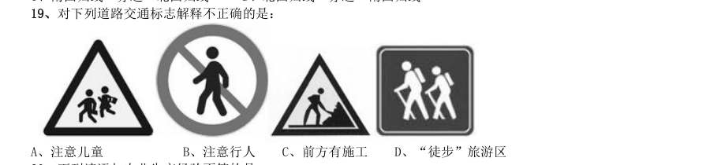

- **A.** 注意儿童
- **B.** 注意行人
- **C.** 前方有施工
- **D.** “徒步”旅游区

**答案：B**

### 2013 国考·统一卷　第 20 题　（科技常识）

下列谚语与农业生产经验不符的是:

- **A.** 人在屋里热得跳,稻在田里哈哈笑
- **B.** 麦苗盖上雪花被,来年枕着馍馍睡
- **C.** 立秋无雨样样有,立秋有雨收半秋
- **D.** 下秧太冷怕烂秧,小秧出水怕青霜

**答案：A**

### 2012 湖北·统一卷　第 4 题　（历史人文）

中国古典戏剧作品塑造了王昭君、李香君、杜丽娘和崔莺莺等经典女性形象,下列作品与上述人物对应关 系正确的是( )。

- **A.** 《西厢记》—《汉宫秋》—《桃花扇》—《牡丹亭》
- **B.** 《西厢记》—《桃花扇》—《汉宫秋》—《牡丹亭》
- **C.** 《汉宫秋》—《桃花扇》—《牡丹亭》—《西厢记》
- **D.** 《汉宫秋》—《牡丹亭》—《桃花扇》—《西厢记》

**答案：C**

### 2012 湖北·统一卷　第 6 题　（历史人文）

下列选项中三国典故与哲学论断对应错误的是:

- **A.** 士别三日,当刮目相看——用发展的眼光看问题
- **B.** 草船借箭——人可以认识并利用规律
- **C.** 张飞醉酒失徐州,借酒破张郃——矛盾是对立统一的
- **D.** 望梅止渴——理性认识依赖于感性认识

**答案：D**

### 2012 湖北·统一卷　第 7 题　（历史人文）

中美关系是全球最重要的双边关系之一,中美建交前后曾发生过以下事件: 1邓小平访美 2中美发布上海联合公报 3尼克松总统访华 4福特总统访华 按时间先后顺序排列正确的是:

- **A.** 2314
- **B.** 2143
- **C.** 1234
- **D.** 3241

**答案：D**

### 2012 湖北·统一卷　第 8 题　（地理常识）

我国作为非成员国参加的政府间国际组织是:

- **A.** 上合组织
- **B.** 东盟十国
- **C.** 金砖国家
- **D.** G20

**答案：B**

### 2012 湖北·统一卷　第 10 题　（历史人文）

下列论断属于邓小平同志在1992 年“南方谈话”时提出的是:

- **A.** 社会主义首先要发展生产力
- **B.** 社会主义也可以搞市场经济
- **C.** 中国要警惕右,但主要是防止“左”
- **D.** 搞建设至少不比搞革命容易

**答案：C**

### 2012 湖北·统一卷　第 12 题　（法律常识）

下列请求应依法予以支持的是:

- **A.** 某男擅自按市价出售双方共有住房,其妻要求追回
- **B.** 某女起诉请求离婚,要求分割其丈夫的工伤补助金
- **C.** 按父母遗嘱某女继承全部家产,其兄要求平分家产
- **D.** 某夫妻已育有一个健康男孩,现申请收养一名孤儿

**答案：D**

### 2012 湖北·统一卷　第 15 题　（经济常识）

如果美元贬值,因此可能产生的后果是:

- **A.** 以美元计价的大宗商品价格上涨
- **B.** 世界新兴经济体将增加美元储备
- **C.** 我国产品在美国市场竞争力上升
- **D.** 我国经销商将减少进口美国产品

**答案：A**

### 2012 湖北·统一卷　第 17 题　（常识（待细分））

关于我国兵役制度,下列表述错误的是:

- **A.** 我国实行义务兵与志愿兵相结合、民兵与预备役相结合的兵役制度
- **B.** 普通高等学校毕业生征集服现役的年龄可以放宽至二十四周岁
- **C.** 义务兵服现役的期限为三年,士官服现役的期限一般不超过三十年
- **D.** 士兵预备役的年龄为十八周岁至三十五周岁,根据需要可适当延长

**答案：A**

### 2012 湖北·统一卷　第 20 题　（地理常识）

下列关于二十四节气说法错误的是:

- **A.** 雨水、谷雨反映降水现象
- **B.** 立春、春分反映季节变化
- **C.** 惊蛰、清明反映自然物候现象
- **D.** 小满、芒种与农作物成熟和收成相关

**答案：B**

### 2012 国考·统一卷　第 2 题　（科技常识）

下列关于推进“十二五”期间资源节约和环境保护的表述,不正确的是:

- **A.** 我国耕地资源有限,要加大耕地保护工作的力度
- **B.** 提高森林蓄积量和覆盖率是“十二五”期间的重要任务
- **C.** 提高化石能源消费的比重,以降低能耗总值和排放水平
- **D.** 坚持保护优先和自然修复为主,加大生态保护和建设力度

**答案：A**

### 2012 国考·统一卷　第 4 题　（常识（待细分））

下列关于我国民主党派和无党派人士的说法,不正确的是:

- **A.** 工商联不属于民主党派
- **B.** 民主党派是参政党,不是在野党
- **C.** 无党派人士是指既不参加中国共产党也不参加民主党派的普通群众
- **D.** 中国共产党与各民主党派将长期共存,互相监督、肝胆相照、荣辱与共

**答案：C**

### 2012 国考·统一卷　第 8 题　（科技常识）

下列关于《共产党宣言》的说法不正确的是:

- **A.** 是法国大革命的理论基础
- **B.** 标志着马克思主义的正式诞生
- **C.** 贯穿全书的基本思想是唯物主义的历史观
- **D.** 把马克思主义哲学、政治经济学和科学社会主义原理融为一体

**答案：A**

### 2012 国考·统一卷　第 10 题　（常识（待细分））

关于佛教、基督教和伊斯兰教,下列说法正确的是:

- **A.** 都是一神论宗教
- **B.** 都以亚洲为发源地
- **C.** 基督教产生时间最早
- **D.** 目前佛教信仰人数最多

**答案：B**

### 2012 国考·统一卷　第 14 题　（科技常识）

下列说法中正确的一项是:

- **A.** 日光灯通过电流加热钨丝产生热量,继而产生光辐射来发光
- **B.** 数码相机利用电子传感器技术,与普通相同记录图像的原理基本相同
- **C.** 等离子电视显示器采用荧光粉显示屏幕,因而亮度高于液晶电视
- **D.** 激光打印机是把射到感光器的图像传印到打印板(或复印纸)上,其原理与复印机不同

**答案：A**

### 2012 国考·统一卷　第 15 题　（科技常识）

下列表述不正确的是:

- **A.** 自然界中的金属在常温下一般呈固态
- **B.** 惰性气体不与其他物质发生化学反应
- **C.** 天然气是一种无色无味无毒的气体燃料
- **D.** 钢是铁和碳按照一定比例加工而成的合金

**答案：A**

### 2012 国考·统一卷　第 16 题　（历史人文）

作家肖伯纳说“人生有两大悲剧,一是没得到你心爱的东西,另一是得到了你心爱的东西”;学者周国平则 说“人生有两大快乐,一是没有得到你心爱的东西,于是你可以去寻求和创造,另一是得到了你心爱的东西,于 是你可去品味和体验”。 从哲学角度看,两个观点存在差异的主要原因是:

- **A.** 追求真理是一个永无止境的认识过程
- **B.** 价值判断和价值选择具有社会历史性特征
- **C.** 人们的认识结果是由客体对主体的作用决定的
- **D.** 意识对于客观事物的反映是主动的、有选择的

**答案：D**

### 2012 国考·统一卷　第 17 题　（常识（待细分））

世界大河中,与长江流向大致相同的是:

- **A.** 尼罗河
- **B.** 印度河
- **C.** 亚马逊河
- **D.** 伏尔加河

**答案：A**

### 2012 国考·统一卷　第 18 题　（历史人文）

下列音乐作品与创作作者对应不正确的是:

- **A.** 《蓝色多瑙河》——巴赫
- **B.** 《安魂曲》——莫扎特
- **C.** 《天鹅湖》——柴可夫斯基
- **D.** 《命运交响曲》——贝多芬

**答案：A**

### 2012 国考·统一卷　第 19 题　（生活常识）

海鸥是最常见的海鸟,被称为海上航行安全的“预报员”,下列对海鸥“预报员”称号的解释不符合事实的 是:

- **A.** 如果海鸥贴近海面飞行,那么未来的天气将是晴好的
- **B.** 海鸥常落在浅滩、岩石或暗礁周围、航海者可据此判断附近是否有暗礁
- **C.** 海鸥有沿港口出入飞行的习性,迷失方向时可观察海欧的飞行方向寻找港口
- **D.** 如果海鸥离开水面高高飞翔,成群结队地从海边飞向大海远处,则预示着暴风雨即将来临

**答案：A**

### 2012 国考·统一卷　第 21 题　（历史人文）

匾额是中国古建筑的重要组成部分,显示建筑物的性质,下列匾额与建筑物对应正确的一组是:

- **A.** 明镜高悬——贡院
- **B.** 万世师表——关帝庙
- **C.** 还我河山——武侯祠
- **D.** 正大光明——乾清宫

**答案：A**

### 2012 国考·统一卷　第 23 题　（科技常识）

现代生活中,手机的普及和应用给人们的生活带来了极大的便利,但在现实生活中,使用手机时也需要注 意安全。以下安全问题不是由于手机无线通讯引起的是:

- **A.** 在加油站不能打手机
- **B.** 坐飞机时不能打手机
- **C.** 驾驶机动车时不能打手机
- **D.** 在使用医疗器械的病区不能打手机

**答案：A**

### 2012 国考·统一卷　第 25 题　（科技常识）

在超市里常常看到牛奶装在方形的容器中出售,而碳酸饮料则常装在圆形的容器中出售。下列关于此现象的 原因解释不合理的是:

- **A.** 视觉上圆形比方形更柔和舒缓,吸引更多的顾客购买
- **B.** 圆柱形易拉罐下底可做成半球形凹槽以承受更大的压力
- **C.** 牛奶通常需要存放在冷藏柜中,立方体容器更节约空间
- **D.** 碳酸饮料通常直接用包装罐饮用,圆柱体拿在手里更舒服

**答案：A**

### 2011 湖北·统一卷　第 82 题　（常识（待细分））

改革开放30 多年来,中国的选人用人制度改革逐步展开、不断深化,取得了巨大成就。以下不能体现中 国干部人事制度变迁轨迹的一项是:

- **A.** 建立公务员制度
- **B.** 推行新闻发言人制度
- **C.** 实行企事业单位人员聘用制
- **D.** 实现干部“四化”

**答案：A**

### 2011 湖北·统一卷　第 86 题　（科技常识）

下列关于照明灯的描述不正确的是:

- **A.** 荧光节能灯的节能效果比LED 灯效果好
- **B.** LED 灯长时间工作会光衰引起老化
- **C.** 荧光节能灯的发光原理是采用高压电子撞击荧光粉而产生
- **D.** 白炽灯直接由钨丝加热产生亮度,用久了会发黑是因为钨丝升华

**答案：A**

### 2011 湖北·统一卷　第 91 题　（法律常识）

下列关于行政监督的说法正确的是:

- **A.** 人民法院可以通过法纪检查对国家行政机关和公务员实行监督
- **B.** 王某不服从交警处罚向交警支队提起行政复议不属于行政监督的范畴
- **C.** 人民政协委员可以通过视察、调查、研究等方式进行行政监督
- **D.** 行政监督的主体是执政党以外的政党组织、国家机关、各人民团体、群众组织和社会公众

**答案：A**

### 2011 湖北·统一卷　第 92 题　（科技常识）

下列关于医学常识的说法正确的是:

- **A.** 人体内缺乏维生素E 易患夜盲症
- **B.** 现有抗生素药物对超级细菌不起作用
- **C.** 贫血指血液中红细胞和白细胞数量低于正常水平
- **D.** 手足口病的最主要传播途径是血液传播和母婴传播

**答案：A**

### 2011 湖北·统一卷　第 93 题　（经济常识）

下列关于我国武装力量的说法不正确的是( )。

- **A.** 我国武装力量受中国共产党领导
- **B.** 中国人民武装警察的职责中不包括防卫作战
- **C.** 国务院、中央军委共同领导全国的国防动员工作
- **D.** 我国的武装力量由中国人民解放军现役部队及预备役部队、武装警察和民兵组成

**答案：A**

### 2011 湖北·统一卷　第 94 题　（科技常识）

下列说法不正确的是:

- **A.** 当交通信号灯、交通标志与交警的指挥不一致时,应当服从信号灯的指挥
- **B.** 强降水是泥石流、滑坡的主要诱因
- **C.** 举办大型会展和文化体育等重大活动,主办单位应制定应急预案并报当地人民政府备案
- **D.** 有关单位和人员报送、报告突发事件信息,应当做到及时、客观、真实,不得迟报、谎报、瞒报、漏报

**答案：A**

### 2011 湖北·统一卷　第 95 题　（科技常识）

下列关于太阳风的说法不正确的是:

- **A.** 由于太阳风的作用,彗星周围的灰尘和气体会形成彗尾
- **B.** 太阳风会促进大气中臭氧的产生,影响地球的空间环境
- **C.** 太阳风是太阳黑子活动高峰阶段射出的超音速等离子体流
- **D.** 两极的高层大气受到太阳风的袭击会发出光芒,形成极光

**答案：B**

### 2011 湖北·统一卷　第 96 题　（地理常识）

下列说法正确的是:

- **A.** 我国有6 个省级行政区与邻国接壤
- **B.** 庐山在黄山以北,嵩山以南
- **C.** 在我国,丹顶鹤的主要栖息地是东北
- **D.** 新疆和青海的部分地区是属于印度洋流域

**答案：A**

### 2011 湖北·统一卷　第 99 题　（经济常识）

下列说法不正确的是:

- **A.** 为反映某年度政府预算执行的结果,需要编制该年度的政府决算
- **B.** 为提高出口货物在国际市场上的竞争力,世界各国一般多在本国实行出口退税制度
- **C.** 如果货币的期汇比现汇贵,则称该货币远期升水,否则,称该货币远期贴水
- **D.** 根据现代企业制度,公司的权力机构是董事会

**答案：A**

### 2011 国考·统一卷　第 2 题　（地理常识）

随着综合国力的提升,我国在国际社会中的作用与影响越来越突出,下列说法正确的是:

- **A.** 我国的出口贸易额在“金砖四国”中位居第二
- **B.** 我国目前是二十国集团中唯一的亚洲发展中国家
- **C.** 我国在哥本哈根气候峰会上提出了单位GDP 碳减排的量化目标
- **D.** 我国已与周边所有邻国建立正式的外交关系

**答案：A**

### 2011 国考·统一卷　第 4 题　（经济常识）

关于我国第六次人口普查,下列表述正确的是:

- **A.** 其标准时点是2010 年1 月1 日至2010 年12 月31 日
- **B.** 所取得的数据不得作为对普查对象实施处罚的依据
- **C.** 所需经费由中央政府完全负担,列入相应年度的财政预算
- **D.** 采用按户口所在地登记的原则

**答案：A**

### 2011 国考·统一卷　第 5 题　（时政热点）

2010 年7 月,党中央、国务院召开了西部大开发工作会议,总结西部大开发10 年取得的巨大成就和丰富经 验,全面分析国内外形势和西部大开发面临的新机遇、新挑战。 关于西部大开发战略,下列表述不正确的是:

- **A.** 西部大开发在我国区域协调发展总体战略中居于优先地位
- **B.** 西部大开发战略实施的最主要目的是解决沿海同内地的贫富差距
- **C.** 西部大开发覆盖地域指陕、甘、宁、青、新西北五省(区)及西藏自治区
- **D.** 实施西部大开发的核心工作是保障和改善民生

**答案：C**

### 2011 国考·统一卷　第 8 题　（时政热点）

根据我国《国防动员法》的有关规定,在国家的主权、统一、领土完整和安全遭受威胁时,决定全国总动员 或局部动员和发布动员令的分别是:

- **A.** 全国人民代表大会、国务院总理
- **B.** 国家主席、国务院总理
- **C.** 全国人民代表大会常务委员会、国家主席
- **D.** 全国人民代表大会常务委员长、国家主席

**答案：C**

### 2011 国考·统一卷　第 9 题　（时政热点）

下列关于我国人大代表选举的表述,不正确的是:

- **A.** 1953 年通过的选举法规定,全国人大代表的选举,各省按每80 万人选代表1 人,直辖市和人口在50 万以上的直辖市按每10 万人选代表1 人
- **B.** 1979 年修订的选举法规定,自治州、县、自治县人大代表中,农村每一代表的人口数4 倍于镇每一代表所代表的人口数、省、自治区人大为5:1,全国人大为8:1
- **C.** 1995 年修改的选举法规定,省、自治区和全国人大代表中,农村每一代表与城市每一代表所代表的人口数为4:1,自治州、县、自治县仍是4:1
- **D.** 2010 年修改的选举法规定,全国人民代表大会代表名额,按照每一代表所代表的城乡人口数2:1 的原则,

**答案：A**

### 2011 国考·统一卷　第 12 题　（历史人文）

关于我国的军衔制度,下列说法正确的是:

- **A.** 士兵军衔肩章版面底色有棕绿色、天蓝色、黑色三种
- **B.** 一般分帅、将、校、尉、士五个等级
- **C.** 刘伯承、陈毅、粟裕等人曾被授予元帅军衔
- **D.** 中国人民解放军第一次实行军衔制度是在1949 年

**答案：A**

### 2011 国考·统一卷　第 13 题　（经济常识）

关于中国交通建设,下列说法不正确的是:

- **A.** 目前国道线采用数字编号,分别以1、2、3、4 开头
- **B.** 我国自建的第一条铁路--京张铁路由詹天佑主持设计修建
- **C.** 20 世纪50 年代,新中国第一架自制飞机在南昌试飞成功
- **D.** 宋元时期的泉州港是当时世界上最大的贸易港口之一

**答案：A**

### 2011 国考·统一卷　第 16 题　（时政热点）

我国民族关系中的“三个离不开”是指:

- **A.** 少数民族的发展离不开自身的努力,离不开发达地区的帮助,离不开国家民族政策的支持
- **B.** 汉族离不开少数民族,少数民族离不开汉族,少数民族之间也相互离不开
- **C.** 民族关系的和谐离不开经济发展,离不开民族政策教育,离不开法制建设
- **D.** 各民族的团结离不开共同繁荣,离不开共同发展,离不开共同进步

**答案：B**

### 2011 国考·统一卷　第 17 题　（经济常识）

2010 年新成立的我国第三个副省级新区是:

- **A.** 新疆喀什
- **B.** 上海浦东
- **C.** 天津滨海
- **D.** 重庆两江

**答案：D**

### 2011 国考·统一卷　第 24 题　（科技常识）

下列关于日常生活中的做法,不正确的是:

- **A.** 为了使用方便和最大限度地利用材料,机器上用的螺母大多是六角形
- **B.** 在加油站不能使用手机,是因为手机在使用时产生的射频火花很容易引起爆炸,发生危险
- **C.** 交通信号灯中红色被用做停车信号是因为红色波长最长
- **D.** 家中遇到煤气泄漏事件应立即使用房间的电话报警

**答案：D**

### 2011 国考·统一卷　第 25 题　（科技常识）

下列有关生活常识的说法,不正确的是:

- **A.** 夏天不宜穿深色衣服,深色衣服比浅色衣服更易吸收辐射热
- **B.** 驱肠虫药若饭后服用,不易达到最好的驱虫效果
- **C.** 按照建筑采光要求,相同高度的住宅群,昆明的楼房间距应该比哈尔滨的楼房间距大
- **D.** 在汽车玻璃清洗液中加入适当比例的酒精,可使其抗冻效果更好

**答案：C**

### 2010 湖北·统一卷　第 111 题　（科技常识）

(多选题) 【不定选】下列日常生活常识,正确的是:

- **A.** 甲烷的主要成分是氢气
- **B.** 焚烧塑料会产生白色污染
- **C.** 棉花、涤纶是高分子有机材料
- **D.** 蛋白质是人体所需要的六大营养元素之一

**答案：C**

### 2010 湖北·统一卷　第 112 题　（历史人文）

下列名言与出处,对应正确的是:

- **A.** 《管子》:学而时习之,不亦说乎
- **B.** 《老子》:四海之内皆兄弟
- **C.** 《论语》:天行健,君子以自强不息
- **D.** 《庄子》:吾生也有涯,而知也无涯

**答案：D**

### 2010 湖北·统一卷　第 114 题　（常识（待细分））

实践高于理论的原因是因为实践有:

- **A.** 普遍有用性
- **B.** 主观能动性
- **C.** 直接现实性
- **D.** 客观现实性

**答案：C**

### 2010 湖北·统一卷　第 115 题　（科技常识）

马克思说:“蒸汽、电力和自动纺织机甚至是比巴尔贝斯、拉斯拜尔和布朗基诸位公民更危险万分的革命家。” 这一论断的含义是:

- **A.** 科技革命对统治者的地位有威胁
- **B.** 科技革命会导致政治变革
- **C.** 科技革命对社会变革有直接决定作用
- **D.** 滥用科技革命的成果会给人类带来危险

**答案：B**

### 2010 湖北·统一卷　第 117 题　（经济常识）

根据《公务员法》的回避原则,下列哪种情况不需要回避:

- **A.** 一个市内,丈夫是公安局局长,妻子是教育局局长
- **B.** 父亲是某市公安局局长,儿子是下级分局局长
- **C.** 丈夫是某市公安局局长,妻子的妹妹的女儿是该局财政科科员
- **D.** 丈夫是某市公安局局长,妻子是该局财政科科员

**答案：C**

### 2010 湖北·统一卷　第 118 题　（地理常识）

把长江分为上游、中游、下游的两个城市是:

- **A.** 重庆、湖口
- **B.** 宜昌、湖口
- **C.** 宜昌、九江
- **D.** 重庆、九江

**答案：B**

### 2010 湖北·统一卷　第 119 题　（常识（待细分））

成立股份有限公司,向公司登记机关登记的应该是:

- **A.** 全体股东指定的代表
- **B.** 全体股东指定的法律代理人
- **C.** 公司董事长
- **D.** 公司总经理

**答案：A**

### 2010 湖北·统一卷　第 122 题　（法律常识）

赵某下班以后去财务科领取工资,财务因粗心多给了他500 元,赵某因赶着回家,所以拿到钱,没有数,就 直接塞进了口袋。他的行为属于:

- **A.** 无因管理
- **B.** 不当得利
- **C.** 无权处分行为
- **D.** 盗窃

**答案：B**

### 2010 湖北·统一卷　第 123 题　（常识（待细分））

下列属于后果预测法的有: 1德尔菲法 2对演法 3会议法 4集思广益法 5推理法

- **A.** 1234
- **B.** 24
- **C.** 135
- **D.** 12345

**答案：C**

### 2010 湖北·统一卷　第 125 题　（历史人文）

( ),法国人攻克巴士底狱,揭开了法国资产阶级革命的序幕。

- **A.** 1789 年7 月12 日
- **B.** 1789 年7 月14 日
- **C.** 1789 年7 月16 日
- **D.** 1789 年12 月12 日

**答案：B**

### 2010 湖北·统一卷　第 126 题　（法律常识）

自然人的( )始于出生,终于死亡。

- **A.** 行为能力
- **B.** 责任能力
- **C.** 权利能力
- **D.** 法律能力

**答案：C**

### 2010 湖北·统一卷　第 128 题　（常识（待细分））

下列战役按时间先后顺序排列正确的是: 1武汉会战 2淞沪会战 3徐州会战 4太原会战 5枣庄会战

- **A.** 24315
- **B.** 23415
- **C.** 32145
- **D.** 32541

**答案：A**

### 2010 湖北·统一卷　第 130 题　（时政热点）

“政权是从枪杆子中打出来的”,毛泽东的这句话是在哪次会议中提出来的:

- **A.** 八七会议
- **B.** 遵义会议
- **C.** 古田会议
- **D.** 瓦窑堡会议

**答案：A**

### 2010 湖北·统一卷　第 131 题　（历史人文）

“存在即被感知”这句话是谁提出来的:

- **A.** 柏拉图
- **B.** 黑格尔
- **C.** 康德
- **D.** 贝克莱

**答案：D**

### 2010 湖北·统一卷　第 135 题　（常识（待细分））

为了加快文件的传递,可以:

- **A.** 直接行文
- **B.** 越级行文
- **C.** 逐级行文
- **D.** 多级行文

**答案：D**

### 2010 湖北·统一卷　第 136 题　（经济常识）

甲、乙、丙三人共同享有一所房屋的所有权,甲占 70%,现在甲想把这间房屋向银行抵押 万元,需 要:

- **A.** 经得乙和丙的同意
- **B.** 经得乙或丙一人的同意
- **C.** 无处分权利
- **D.** 不需经得任何人同意

**答案：D**

### 2010 湖北·统一卷　第 137 题　（法律常识）

劳动教养的对象不包括:

- **A.** 未成年人一般违法人员
- **B.** 犯罪情节显著轻微的未成年人
- **C.** 违反法律16 岁以下的未成年人
- **D.** 违反法律18 岁以下的未成年人

**答案：C**

### 2010 湖北·统一卷　第 138 题　（法律常识）

下列文件不能成为法官处理行政案件的依据的是:

- **A.** 国务院的行政法规
- **B.** 国务院部委的规章
- **C.** 省人大制定的地方性法规
- **D.** 民族自治地区的自治性法规

**答案：B**

### 2010 湖北·统一卷　第 140 题　（经济常识）

评价工人工资最标准的是:

- **A.** 货币工资
- **B.** 实际工资
- **C.** 计件工资
- **D.** 绩效工资

**答案：B**

### 2010 国考·统一卷　第 116 题　（历史人文）

关于新中国成立60 周年取得的成就,下列说法不正确的是:

- **A.** 截止2008 年底,我国已成为世界第三大经济体
- **B.** 截止2008 年底,我国进出口贸易总额已跃居世界第一
- **C.** 2008 年我国国民平均受教育年限已提高到8.7 年,相当于初中文化程度
- **D.** 我国人均期望寿命由新中国成立前的不足40 岁上升到70 多岁

**答案：B**

### 2010 国考·统一卷　第 118 题　（科技常识）

关于我国重大工程与建设项目,下列说法不正确的是:

- **A.** 三峡工程是目前世界上建筑规模最大的水利工程
- **B.** “嫦娥一号”是中国自主研发的首个月球探测卫星
- **C.** 2008 年建成通车的杭州湾跨海大桥是目前世界上最长的桥梁
- **D.** 2006 年全线通车青藏铁路是目前世界上海拔最高的铁路

**答案：C**

### 2010 国考·统一卷　第 119 题　（经济常识）

下列关于国际组织的表述不正确的是:

- **A.** 蒙古国是上海合作组织的成员国之一
- **B.** 国际货币基金组织是联合国的专门机构
- **C.** 博鳌亚洲论坛是第一个总部设在中国的国际会议组织
- **D.** 石油输出国组织通过实行石油生产配额制维护石油生产国利益

**答案：A**

### 2010 国考·统一卷　第 122 题　（历史人文）

下列关于中国近代史上的事件表述不正确的是:

- **A.** 北洋水师是19 世纪末中国建立的第一支近代海军舰队
- **B.** 第五次反“围剿”失败后,中国工农红军开始长征
- **C.** 中国人民解放军第二炮兵组建于20 世纪60 年代中期
- **D.** 日军在东北发动的“七七事变”标志着全面侵华战争的开始

**答案：D**

### 2010 国考·统一卷　第 124 题　（常识（待细分））

一艘油轮自科威特港驶往大连,其最短航线为:

- **A.** 波斯湾→红海→马六甲海峡→南海→黄海→东海
- **B.** 波斯湾→阿拉伯海→马六甲海峡→南海→东海→黄海
- **C.** 红海→阿拉伯海→孟加拉湾→南海→东海→黄海
- **D.** 红海→孟加拉湾→马六甲海峡→南海→黄海→东海

**答案：B**

### 2010 国考·统一卷　第 125 题　（常识（待细分））

下列对哲学家及其思想的认定不正确的是:

- **A.** 老子早于庄子,庄子早于韩非子
- **B.** 亚里士多德师从柏拉图,柏拉图师从苏格拉底
- **C.** 毛泽东的实践观同于列宁,列宁的实践观同于马克思
- **D.** 尼采的非理性主义源于叔本华,叔本华的非理性主义源于培根

**答案：D**

### 2010 国考·统一卷　第 126 题　（历史人文）

“四书五经”中的“四书”指的是:

- **A.** 《诗经》《孟子》《孝经》《尔雅》
- **B.** 《周易》《尚书》《礼记》《春秋》
- **C.** 《大学》《中庸》《论语》《孟子》
- **D.** 《尚书》《周易》《论语》《孝经》

**答案：C**

### 2010 国考·统一卷　第 129 题　（科技常识）

下列对人物及其贡献表述不正确的是:

- **A.** 凯恩斯撰写了《国富论》,使经济学成为一门独立科学
- **B.** 孟德尔发现遗传学定律,为遗传因子理论奠定了框架基础
- **C.** 冯·诺依曼开创了现代计算机理论,其体系结构沿用至今
- **D.** 法拉第发现电磁感应定律,并据此发明了早期的发电机

**答案：A**

### 2010 国考·统一卷　第 130 题　（时政热点）

下列关于武器装备的说法不正确的是:

- **A.** 核潜艇装备的主要是核武器
- **B.** “歼十”战斗机是国产飞机
- **C.** 弩是中国最早发明的
- **D.** AK-47 是前苏联研制的一种自动步枪

**答案：A**

### 2010 国考·统一卷　第 132 题　（常识（待细分））

如果父亲和孩子都是A 型血,那么孩子的母亲的血型有几种可能:

- **A.** 四种
- **B.** 三种
- **C.** 两种
- **D.** 一种

**答案：A**

### 2010 国考·统一卷　第 134 题　（历史人文）

下列关于医学知识的说法不正确的是:

- **A.** 肝脏的主要功能之一是分解排除血液中的毒素
- **B.** 放疗中要使用放射线进行照射
- **C.** 砒霜在中医里可以入药
- **D.** 针灸中的“灸”是指用针扎刺人体穴位

**答案：D**

### 2010 国考·统一卷　第 135 题　（生活常识）

下列有关生活常识的叙述正确的是:

- **A.** 空调工作的时候有水流出而冰箱没有,由此可判断常见的家用空调和电冰箱的制冷原理不同
- **B.** 鸡蛋带壳在微波炉中加热比较好,这样受热更快更均匀
- **C.** 液晶电视机与等离子电视机的成像原理相同
- **D.** 使用无磷洗衣粉是因为磷易造成环境水体富营养化,破坏水质

**答案：D**

### 2010 国考·统一卷　第 138 题　（常识（待细分））

下列做法符合《政府信息公开条列》的是:

- **A.** 甲县规定,乡、镇的政府信息统一由县政府负责公开
- **B.** 乙省不允许本省内各级行政机关提供政府信息时收取任何费用
- **C.** 丙区规定行政机关应当编制,公布政府信息公开指南或政府信息公开目录并及时更新
- **D.** 丁市政府在图书馆设置政府信息查询场所并配备相应的设备,为公民、法人或者其他组织获取政府信息提供

**答案：A**

### 2010 国考·统一卷　第 139 题　（经济常识）

根据《食品安全法》,下列说法正确的:

- **A.** 对食品生产、食品流通实施监督的部门分别为质量监督部门、工商行政管理部门
- **B.** 食品安全监督管理部门在进行抽样检验时,不需要购买样品
- **C.** 名人在虚假广告中向消费者推荐食品,使消费者的合法权益受到损害的,应当由食品生产经营者和销售者承担连带责任
- **D.** 食品安全监督管理部门可以对食品实施免检

**答案：A**

### 2010 国考·统一卷　第 140 题　（法律常识）

下列说法正确的是:

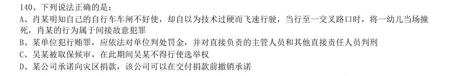

- **A.** 肖某明知自己的自行车车闸不好使,却自以为技术过硬而飞速行驶,当行至一交叉路口时,将一幼儿当场撞死,肖某的行为属于间接故意犯罪
- **B.** 某单位犯行贿罪,应依法对单位判处罚金,并对直接负责的主管人员和其他直接责任人员判刑
- **C.** 吴某被取保候审,在此期间吴某不得行使选举权
- **D.** 某公司承诺向灾区捐款,该公司可以在交付捐款前撤销承诺

**答案：A**
