# 常识判断 · 生活常识 · 2020 年代真题

> 所属考点：[CS-SH](../CS-SH-生活常识.md)　｜　本片 245 题

> 本片子考点：其他常识（综合） 170　生活常识 75

### 2026 国考·行政执法　第 24 题　（其他常识（综合））

甲乙系夫妻关系。甲盗窃他人3 万元人民币后回家告诉了乙,要其帮忙联系去外地朋友家 “躲几天风头”。对此,下列说法正确的是:

- **A.** 若乙为甲盗窃案的证人,在人民法院通知其出庭作证时可以拒绝
- **B.** 由于甲乙为夫妻,即使乙帮助甲逃匿,其行为也不构成犯罪
- **C.** 若甲逃匿后公安机关联系到乙,乙陪同甲至公安机关投案,甲不构成自首
- **D.** 若甲最终被判处刑罚,乙可以不经过甲的同意直接提出上诉

**答案：A**

### 2026 国考·行政执法　第 27 题　（其他常识（综合））

2025 年3 月,中共中央办公厅、国务院办公厅印发《逐步把永久基本农田建成高标准农田实 施方案》,下列有关说法正确的是:

- **A.** 西北区要重点加强水平梯田改造建设
- **B.** 25 度以上坡耕地、沿海内陆滩涂是开展建设的重点区域
- **C.** 高标准农田建设标准中的“两通”是指通水通路
- **D.** 黄淮海区应该把改善田块细碎化问题作为一个工作重点

**答案：C**

### 2026 国考·行政执法　第 28 题　（生活常识）

“体重管理年”三年行动旨在引导全社会养成重视体重、科学饮食与锻炼的习惯,科学减 重,健康生活。关于肥胖对健康的影响,下列说法错误的是:

- **A.** 肥胖容易引发胰岛素抵抗,增加患2 型糖尿病风险
- **B.** 内脏脂肪组织分泌的炎症因子与动脉粥样硬化发展相关
- **C.** 肥胖者的排尿次数多,会导致血尿酸水平远低于正常人
- **D.** 肥胖引起的气道狭窄可能诱发阻塞性睡眠呼吸暂停

**答案：C**

### 2026 国考·行政执法　第 29 题　（生活常识）

下列与自然界中的颜色有关的说法错误的是:

- **A.** “橙色月亮”通常发生在大气层中水汽或颗粒物质较多时
- **B.** 火烈鸟羽毛呈朱红色与摄入食物中的虾青素累积有关
- **C.** 蓝闪蝶翅膀呈蓝色是由于其表面鳞片具有特殊的微结构
- **D.** 蓝莓呈现靛蓝色是因为表面蜡质层中含高浓度花青素

**答案：D**

### 2026 国考·行政执法　第 35 题　（生活常识）

某学院要制作一款与爱因斯坦有关的纪念手提袋,下列哪项不适合用作印刷图案?

- **A.** F=ma
- **B.** 光电效应
- **C.** E=mc2
- **D.** 引力是时空弯曲的效应

**答案：A**

### 2025 湖北·统一卷　第 17 题　（生活常识）

藻蓝蛋白是一种可从螺旋藻中提取分离得到的色素蛋白,可制成营养保健品,以下关于藻蓝蛋白说法错误的 是:

- **A.** 藻蓝蛋白在强酸环境下不稳定
- **B.** 藻蓝蛋白是一种可食用的天然色素
- **C.** 藻蓝蛋白至少由C、H、O、N四种元素组成
- **D.** 藻蓝蛋白呈现蓝色是由于其吸收了蓝光的缘故

**答案：C**

### 2025 湖北·统一卷　第 19 题　（其他常识（综合））

以下关于我国航母的说法错误的是:

- **A.** 目前我国列装的航母满载排水量均超过5万吨
- **B.** “福建舰”是我国自主建造的弹射型国产航母,采用平直通长飞行板
- **C.** 我国首艘国产航母“辽宁舰”于2012年入列,目前已形成体系作战能力
- **D.** 2019年12月,中国第二艘航母被正式命名为“山东舰”,其突破了船体结构,动力核心设备这两项重大技术

**答案：B**

### 2025 湖北·统一卷　第 20 题　（其他常识（综合））

瓶颈 下列案例中,当事人的主张能够获得法院支持的是:

- **A.** 王某以妻子未经自己同意擅自流产为由,主张妻子侵犯自己的生育权,要求进行损害赔偿
- **B.** 张某与妻子离婚时,以女方一天也没有回家住过为由,主张返还按照习俗给付的18万元彩礼
- **C.** 李某认为自己在婚后通过转让发明专利获得的收入为个人财产,主张不能用于偿还夫妻共同债务
- **D.** 某父母为已婚女儿出资购房,并约定房屋为女儿所有,其女婿孙某离婚时主张该房屋属于家庭共同财产

**答案：B**

### 2025 国考·副省级　第 26 题　（其他常识（综合））

下图为夏季某天我国两个城市的日月升落时间示意图,下列与之相关的说法正确的是:

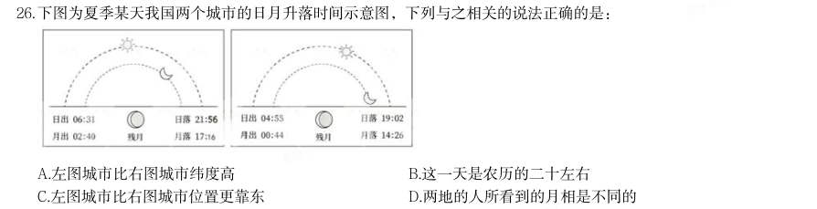

- **A.** 左图城市比右图城市纬度高
- **B.** 这一天是农历的二十左右
- **C.** 左图城市比右图城市位置更靠东
- **D.** 两地的人所看到的月相是不同的

**答案：A**

### 2025 国考·副省级　第 29 题　（生活常识）

关于医学检查方法,下列说法错误的是:

- **A.** 做心脏超声检查,无需患者做憋尿、空腹等特殊准备
- **B.** 造影利用了造影剂与人体组织密度的区别
- **C.** 磁共振检查没有放射性,适用于孕妇、婴幼儿等人群
- **D.** 血清检查是判断幽门螺旋杆菌感染的最佳方法

**答案：D**

### 2025 国考·副省级　第 32 题　（生活常识）

在关于真菌的科普文章中,下列表述存在错误的是:

- **A.** 古人很早就利用真菌发酵食物,比如利用乳酸菌酿造果酒
- **B.** 人类历史上发现的第一种抗生素来自微型真菌
- **C.** 羊肚菌、松茸等食用真菌味道鲜美,含有丰富的优质蛋白质
- **D.** 植物的根能和真菌形成共生关系,菌丝吸收水分、无机盐等供给植物

**答案：A**

### 2025 国考·副省级　第 33 题　（其他常识（综合））

关于温室栽培,下列说法错误的是:

- **A.** 夜间降低温室内的温度,可以减少农作物营养物质的消耗
- **B.** 相比普通塑料温室大棚,玻璃温室可以让阳光更容易进入
- **C.** 紫外线灯是一种大棚中经常使用且效果较好的植物补光灯
- **D.** 在作物栽培过程中通入适量的二氧化碳可以提高作物产量

**答案：C**

### 2025 国考·副省级　第 34 题　（其他常识（综合））
> 材料：下列情境中的两个物理量成正比例的是: 1通过某一电阻器的电流与其两端的电压 2物体所受浮力与其体积…

3弹性限度内弹簧的伸长量与其所受拉力 4汽车行驶时的加速度与速度

- **A.** 12
- **B.** 24
- **C.** 34
- **D.** 13

**答案：D**

### 2025 国考·副省级　第 35 题　（生活常识）

下列与体育比赛有关的说法错误的是:

- **A.** 跳水运动的难度系数涉及动作姿势和翻腾转体周数等方面
- **B.** 篮球比赛中罚球时允许球员双脚离地
- **C.** 足球比赛的常规时间长度为90分钟
- **D.** 举重运动中判定试举成功需要三名裁判均亮白灯

**答案：D**

### 2025 国考·地市级　第 23 题　（其他常识（综合））

关于所有权的取得,下列说法正确的是:

- **A.** 甲在公园捡到一条金项链,经多方寻找失主未果,此时甲获得项链的所有权
- **B.** 乙以市价购买了一辆自行车,后发现该车是卖家借来的,乙仍可获得该车的所有权
- **C.** 丙继承了一处房产,但尚未办理变更登记,丙此时还未获得该房产的所有权
- **D.** 丁从村集体处承包了一块田地用于农作物种植,丁同时取得这块田地的所有权

**答案：B**

### 2025 国考·地市级　第 29 题　（生活常识）

在关于真菌的科普文章中,下列表述存在错误的是:

- **A.** 古人很早就利用真菌发酵食物,比如利用乳酸菌酿造果酒
- **B.** 人类历史上发现的第一种抗生素来自微型真菌
- **C.** 羊肚菌、松茸等食用真菌味道鲜美,含有丰富的优质蛋白质
- **D.** 植物的根能和真菌形成共生关系,菌丝吸收水分、无机盐等供给植物

**答案：A**

### 2025 国考·地市级　第 32 题　（生活常识）

关于医学检查方法,下列说法错误的是:

- **A.** 做心脏超声检查,无需患者做憋尿、空腹等特殊准备
- **B.** 造影利用了造影剂与人体组织密度的区别
- **C.** 磁共振检查没有放射性,适用于孕妇、婴幼儿等人群
- **D.** 血清检查是判断幽门螺旋杆菌感染的最佳方法

**答案：D**

### 2025 国考·地市级　第 35 题　（生活常识）

下列与船只行驶有关的说法错误的是:

- **A.** 皮筏在顺流而下的过程中动能转化为重力势能
- **B.** 船舵利用杠杆原理改变行船的方向
- **C.** 使用船桨划船前进时利用了力的相互作用
- **D.** 帆船实现逆风行驶是利用了伯努利原理

**答案：A**

### 2025 国考·行政执法　第 23 题　（其他常识（综合））

2024年5月,甲驾驶重型半挂车行驶至某县辖区内被交警临检。该县公安局交警大队认定甲存在驾驶故意污损 机动车号牌的机动车在道路行驶的行为,遂当场作出罚款200元、记9分的处罚决定。甲认为其不存在故意污损 号牌的行为,对处罚决定不服。下列说法正确的是( )。

- **A.** 甲可以不经行政复议,直接向人民法院提起行政诉讼
- **B.** 甲若申请行政复议,复议机关为该县公安局
- **C.** 甲若申请行政复议,不适用简易程序审理
- **D.** 甲若申请行政复议,该案可适用调解

**答案：D**

### 2025 国考·行政执法　第 25 题　（其他常识（综合））

关于所有权的取得,下列说法正确的是:

- **A.** 甲在公园捡到一条金项链,经多方寻找失主未果,此时甲获得项链的所有权
- **B.** 乙以市价购买了一辆自行车,后发现该车是卖家借来的,乙仍可获得该车的所有权
- **C.** 丙继承了一处房产,但尚未办理变更登记,丙此时还未获得该房产的所有权
- **D.** 丁从村集体处承包了一块田地用于农作物种植,丁同时取得这块田地的所有权

**答案：B**

### 2025 国考·行政执法　第 27 题　（其他常识（综合））

下列情形中甲的主张最可能得到人民法院支持的是:

- **A.** 甲竞买人在现场拍卖中拍得一件艺术品,甲主张合同自拍卖师落槌时成立
- **B.** 甲乙企业签订的合作备忘录仅表达了双方深度合作的意向,甲主张预约合同成立
- **C.** 甲游戏平台在采用格式条款订立合同时,仅以设置勾选的方式提示用户,甲主张已履行提示义务
- **D.** 甲与乙的房产买卖合同存在可撤销的情形,但已办理产权变更登记手续,甲以此为由主张合同有效

**答案：A**

### 2025 国考·行政执法　第 33 题　（生活常识）

下列与体育比赛有关的说法错误的是:

- **A.** 跳水运动的难度系数涉及动作姿势和翻腾转体周数等方面
- **B.** 篮球比赛中罚球时允许球员双脚离地
- **C.** 足球比赛的常规时间长度为90分钟
- **D.** 举重运动中判定试举成功需要三名裁判均亮白灯

**答案：D**

### 2025 国考·行政执法　第 35 题　（其他常识（综合））

关于温室栽培,下列说法错误的是:

- **A.** 夜间降低温室内的温度,可以减少农作物营养物质的消耗
- **B.** 相比普通塑料温室大棚,玻璃温室可以让阳光更容易进入
- **C.** 紫外线灯是一种大棚中经常使用且效果较好的植物补光灯
- **D.** 在作物栽培过程中通入适量的二氧化碳可以提高作物产量

**答案：C**

### 2024 湖北·统一卷　第 11 题　（生活常识）

小明被困在一个无人、无食物来源但有淡水的荒岛上。假如他在等待救援期间可以从相同重量的葡萄、馒头、 酸奶、花生仁这四种食物中选择一种,那么为了能在岛上生存的时间最长,他应该选择的食物是( )。

- **A.** 葡萄
- **B.** 馒头
- **C.** 酸奶
- **D.** 花生仁

**答案：D**

### 2024 广东·统一卷　第 3 题　（其他常识（综合））

(判断题)对中华民族形成起决定作用的是对中华民族共同体的认同。

- **A.** 正确
- **B.** 错误

**答案：B**

### 2024 广东·统一卷　第 6 题　（其他常识（综合））

（本题题干为图形/公式，文字层无题干，图见原卷）

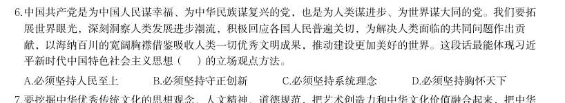

- **A.** 必须坚持人民至上
- **B.** 必须坚持守正创新
- **C.** 必须坚持系统理念
- **D.** 必须坚持胸怀天下

**答案：A**

### 2024 广东·统一卷　第 8 题　（其他常识（综合））

1930年,毛泽东同志在文章中强调调查研究是一切工作的第一步,提出了“没有调查,没有发言权”的著名论 断。这一论断出自他的( )。

- **A.** 《星星之火,可以燎原》
- **B.** 《反对本本主义》
- **C.** 《中国革命和中国共产党》
- **D.** 《论十大关系》

**答案：B**

### 2024 广东·统一卷　第 12 题　（其他常识（综合））

(多选题)矛盾是反映事物内部或者事物之间对立统一关系的哲学范畴。矛盾的同一性是指矛盾着的对立面相 互依存、相互贯通的性质和趋势。关于矛盾的同一性,以下表述正确的有( )。

- **A.** 在矛盾双方中,一方的发展以另一方的发展为条件
- **B.** 矛盾双方相互吸取有利于自身的因素,在相互作用中各自得到发展
- **C.** 事物的发展方向、趋势不是随意的,而是有规律地向自己的对立面转化
- **D.** 矛盾双方的统一是一种矛盾统一体向另一种矛盾统一体过渡的决定性力量

**答案：C**

### 2024 广东·统一卷　第 15 题　（其他常识（综合））

(多选题)根据《中华人民共和国爱国主义教育法》,以下属于爱国主义教育主要内容的有( )。

- **A.** 马克思列宁主义、毛泽东思想、邓小平理论、“三个代表”重要思想、科学发展观、习近平新时代中国特色社会主义思想
- **B.** 国旗、国歌、国徽等国家象征和标志
- **C.** 祖国的壮美河山和历史文化遗产
- **D.** 宪法和法律,国家统一和民族团结、国家安全和国防等方面的意识和观念

**答案：B**

### 2024 国考·副省级　第 10 题　（其他常识（综合））

根据《审计法》下列说法错误的是( )。

- **A.** 某审计机关通过政务信息系统取得数据后,要求被审计单位提供同一数据
- **B.** 某审计机关对外国政府贷款项目的财务收支进行审计监督
- **C.** 某审计机关组成三人调查小组前往某国有企业进行调查
- **D.** 某审计机关为完成紧急工作任务,聘请某会计师事务所人员共同参与审计工作

**答案：A**

### 2024 国考·副省级　第 11 题　（生活常识）

根据《中华人民共和国反间谍法》,下列说法或做法错误的是( )。

- **A.** 甲涉嫌间谍行为被传唤,在其嫌疑消除前不得将传唤原因通知其家属
- **B.** 乙涉嫌间谍行为,移民管理机构接到省国家安全机关通知后,不准其出境
- **C.** 丙在境外受胁迫参加间谍组织后,及时向大使馆如实说明情况,并有悔改表现,可以不予追究
- **D.** 丁因协助反间谍工作导致财产损失,根据国家有关规定,可获得补偿

**答案：A**

### 2024 国考·副省级　第 12 题　（其他常识（综合））

下列关于《预备役人员法》的说法错误的是( )。

- **A.** 预备役人员参加军事训练期间,军队为其购买人身意外伤害保险
- **B.** 预备役人员从事个体经营,可以按照国家有关规定享受出资优惠政策
- **C.** 预备役人员退出预备役的,其预备役军衔予以保留
- **D.** 预备役军官分为预备役指挥管理军官和预备役专业技术军官

**答案：B**

### 2024 国考·副省级　第 14 题　（其他常识（综合））

某展览馆举办的“奋进新时代”主题成就展设置了一些地方展区。下列场景最可能出现的是:

- **A.** 在天津展区,观众仔细阅读着展柜中黄文秀生前的日记,久久不愿离去
- **B.** 在江苏展区,杨柳青年画代表性传承人正忙着给观众们制作年画作品
- **C.** 在河北展区,观众在“地球卫士奖”奖杯前感叹荒原变林海的人间奇迹
- **D.** 在广西展区,观众在“今日开山岛”模型前聆听王继才、王仕花夫妇的守岛事迹

**答案：C**

### 2024 国考·副省级　第 18 题　（生活常识）

下列与花卉有关的说法正确的是( )。

- **A.** 水培花卉应选用洁净的偏碱性的水
- **B.** 压条是一种常用的多肉植物繁殖方式
- **C.** 叶面施肥通常选择在早晨或傍晚进行
- **D.** 日照时间过长会导致短日照花卉死亡

**答案：C**

### 2024 国考·地市级　第 10 题　（生活常识）

根据《中华人民共和国反间谍法》,下列说法或做法错误的是( )。

- **A.** 甲涉嫌间谍行为被传唤,在其嫌疑消除前不得将传唤原因通知其家属
- **B.** 乙涉嫌间谍行为,移民管理机构接到省国家安全机关通知后,不准其出境
- **C.** 丙在境外受胁迫参加间谍组织后,及时向大使馆如实说明情况,并有悔改表现,可以不予追究
- **D.** 丁因协助反间谍工作导致财产损失,根据国家有关规定,可获得补偿

**答案：A**

### 2024 国考·地市级　第 12 题　（其他常识（综合））

下列不能被授予专利权的是:

- **A.** 一种医疗口腔内科专用的喷药器
- **B.** 一种治疗主动脉夹层的新型手术方法
- **C.** 一种计算机控制油墨颜色配制的装置
- **D.** 一种针对水稻辐射诱变育种的新技术

**答案：B**

### 2024 国考·地市级　第 13 题　（其他常识（综合））

下列与企业应负担的税种有关的说法正确的是:

- **A.** 对纳税人出口应税消费品,一般免征消费税
- **B.** 所有印花税税目均按照统一的税率征收
- **C.** 增值税专用发票是增值税小规模纳税人销售货物等开具的发票
- **D.** 企业所得税应纳税所得额不包括向投资者支付的股息、红利

**答案：A**

### 2024 国考·地市级　第 17 题　（其他常识（综合））

下列与统计学相关的说法正确的是: 1两个变量相关程度很高,说明两者存在因果关系 2回归可以利用过去的数据预测未来的趋势 3自变量是一种随机变量 4众数的大小可能与样本数据中的部分数据无关

- **A.** 13
- **B.** 14
- **C.** 24
- **D.** 23

**答案：C**

### 2024 国考·地市级　第 19 题　（生活常识）

关于肥料,下列说法错误的是:

- **A.** 化肥宜用金属器皿密封储藏,以防潮湿变质
- **B.** 秸秆、餐厨垃圾都是有机肥料的原料
- **C.** 细菌肥料一般应避光保存
- **D.** 水溶性肥料适合滴灌施肥

**答案：A**

### 2024 国考·地市级　第 20 题　（生活常识）

下列与家庭用电有关的说法错误的是:

- **A.** 电能表应安装在家庭电路的干路上
- **B.** 空气开关需要搭配保险丝使用才能起到保护电路的作用
- **C.** 使用同一插线板供电的家用小电器之间是并联连接方式
- **D.** 白炽灯利用电流的热效应进行工作

**答案：B**

### 2024 国考·行政执法　第 14 题　（其他常识（综合））

老张常居国外,其儿子小张常住老张名下房子内。小张在外欠债较多,伪造手续后将老张名下房屋卖给了不知 情的小王,小王支付对价并办理了产权变更手续。下列有关说法正确的是:

- **A.** 因小张伪造手续,该买卖行为无效
- **B.** 小张与小王之间的买卖合同关系有效,但不发生物权变动效力
- **C.** 小张与小王之间的买卖合同及物权变动均有效
- **D.** 老张有权向小王请求损害赔偿

**答案：C**

### 2024 国考·行政执法　第 15 题　（其他常识（综合））

下列不能被授予专利权的是:

- **A.** 一种医疗口腔内科专用的喷药器
- **B.** 一种治疗主动脉夹层的新型手术方法
- **C.** 一种计算机控制油墨颜色配制的装置
- **D.** 一种针对水稻辐射诱变育种的新技术

**答案：B**

### 2024 国考·行政执法　第 19 题　（生活常识）

下列与家庭用电有关的说法错误的是:

- **A.** 电能表应安装在家庭电路的干路上
- **B.** 空气开关需要搭配保险丝使用才能起到保护电路的作用
- **C.** 使用同一插线板供电的家用小电器之间是并联连接方式
- **D.** 白炽灯利用电流的热效应进行工作

**答案：B**

### 2024 国考·行政执法　第 20 题　（生活常识）

关于肥料,下列说法错误的是:

- **A.** 化肥宜用金属器皿密封储藏,以防潮湿变质
- **B.** 秸秆、餐厨垃圾都是有机肥料的原料
- **C.** 细菌肥料一般应避光保存
- **D.** 水溶性肥料适合滴灌施肥

**答案：A**

### 2023 湖北·统一卷　第 13 题　（其他常识（综合））

下列所描述的现象不会出现的是:

- **A.** 喝可乐或其它碳酸饮料时,表面的泡沫或是聚成一团,或是贴着杯壁,很少有零星的小泡泡独自游荡
- **B.** 不小心洒落到桌子上的茶或者咖啡,干燥后会留下一个污渍,其边缘部分颜色比中间深
- **C.** 让小汤匙的凸面轻轻触碰水龙头流出的小水流,水流会被吸引,沿着汤匙的凸面往下流
- **D.** 让两枚图钉漂在水面上,它们靠近时会相互排斥无法碰在一起

**答案：D**

### 2023 湖北·统一卷　第 17 题　（其他常识（综合））

下列所描述的现象不会出现的是:

- **A.** 到大柱子后面可以躲避寒风,柱子越大背后风速越小
- **B.** 慢慢倒酒水时,酒水会在酒瓶口的边缘附壁流下来
- **C.** 让小汤匙的凸面轻轻接触水龙头流出的小水流,水流会被吸引,沿着汤匙的凸面往下流
- **D.** 拿一个鸡蛋放在水龙头的细小水流下,鸡蛋上半部的水流并没有沿着切向垂直向下流,

**答案：A**

### 2023 湖北·统一卷　第 19 题　（其他常识（综合））

甲的牛不慎走失,乙在路边发现,遂牵回家去饲养,并请邻居帮忙寻找失主,一周后, 甲听说乙曾捡到一头牛,登门辨认后,确认是自家走失的牛并要求其归还,乙同意返还,但 是要求甲支付报酬2000 元和饲养牛所用的青草、杂粮等费用200 元,共计2200 元。甲拒绝 支付,两人发生争议。下列说法正确的是:

- **A.** 甲无需支付任何费用
- **B.** 甲应当支付2200 元
- **C.** 甲应当支付2000 元
- **D.** 甲应当支付200 元

**答案：D**

### 2023 湖北·统一卷　第 41 题　（其他常识（综合））

我们往往喜欢弄清楚某件事“到底是黑还是白”,这种思维方式称为“非黑即白的思维 方式”。但是,“非A 即B”的思维方式从逻辑学来看是错误的。当陷入非黑即白的思维方 式时,我们所看到的只有极端的选择,所以容易做出错误判断,甚至上当受骗。例如,“不 买这个壶会招来不幸哦”,卖壶的骗子巧妙利用语言,让人陷入“买这个壶会招来好运,不 买这个壶会招来不幸”的非黑即白的思维方式中。实际上,还有“不买壶会招来好运”“买 了壶会招来不幸”的情况。因此,当你被迫做出“A 或B”的选择时,不妨停下来思考一下 所有的4 个选择。

- **A.** 世界充满了非黑即白的思维方式
- **B.** 要避免陷入非黑即白的思维误区
- **C.** “非A 即B”从逻辑上讲是错误的
- **D.** “非A 即B”易让人做出错误判断

**答案：B**

### 2023 湖北·统一卷　第 57 题　（其他常识（综合））

某智慧公共停车场的收费标准如下:停车不超过15 分钟,不收费;超过15 分钟但不超 过60 分钟,按1 小时计,收费5 元;超过1 小时后,超过的部分按每30 分钟4 元收费(不 足30 分钟,按30 分钟计)。若李先生支付停车费17 元,则他停车的时长可能为:

- **A.** 2 小时
- **B.** 2 小时15 分钟
- **C.** 2 小时45 分钟
- **D.** 3 小时

**答案：B**

### 2023 湖北·统一卷　第 58 题　（其他常识（综合））

某小区物业准备了230 盒口罩免费派发给10 栋楼,要求任意两栋楼派发的口罩数量都 不相同,但最多相差不超过1 倍。假设口罩不拆盒发放,那么派发口罩数量最少的那栋楼最 少可派发口罩:

- **A.** 18 盒
- **B.** 15 盒
- **C.** 14 盒
- **D.** 12 盒

**答案：C**

### 2023 湖北·统一卷　第 59 题　（其他常识（综合））

某空军基地举行飞行训练,有8 架歼击机、3 架预警直升机、2 架反潜直升机参与训练, 每架飞机编号不同。训练时,需派出3 架歼击机、2 架预警直升机、1 架反潜直升机进行起 降飞行。若每次只能起飞1 架飞机,其中3 架歼击机必须相邻起飞,2 架预警直升机不能相 邻起飞,那么不同的起飞方式有多少种?

- **A.** 504
- **B.** 4032
- **C.** 8064
- **D.** 24192

**答案：D**

### 2023 湖北·统一卷　第 64 题　（其他常识（综合））

厦门鼓浪屿海滨覆鼎岩上屹立着一尊郑成功雕像。为了测量石像的高度,某测量小组选 取的测量点A 与覆鼎岩底部D 在同一水平线上,如下图所示。已知覆鼎岩高CD 为24 米, 在A 处测得石像头顶部B 的仰角为 ,石像底部C 的仰角为 (参考数据: , , ),则像BC 的高度约为:

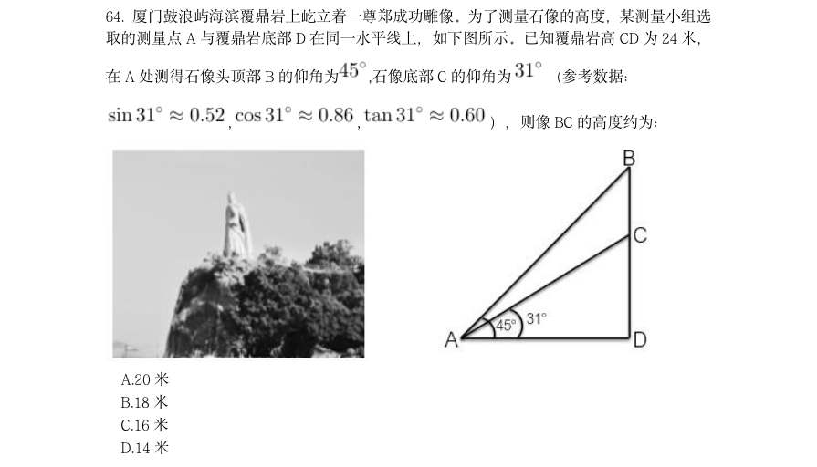

- **A.** 20 米
- **B.** 18 米
- **C.** 16 米
- **D.** 14 米

**答案：C**

### 2023 湖北·统一卷　第 67 题　（其他常识（综合））

某餐馆承诺25 分钟内上齐一桌菜,若超时则未上的菜品免单。每张餐桌上都有一个装 满后正好25 分钟漏完的圆锥形沙漏(如下图所示)。某位顾客在等待的过程中发现沙漏内 上方沙子的高度为原先的一半,此时还差一道菜未上,则再过多久还未上菜,这位顾客将享 受免单服务?

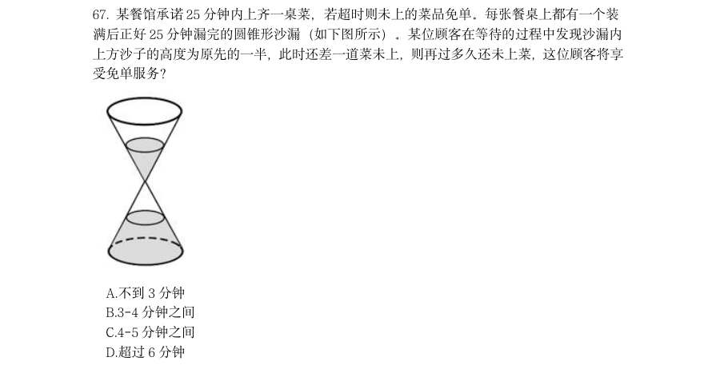

- **A.** 不到3 分钟
- **B.** 3-4 分钟之间
- **C.** 4-5 分钟之间
- **D.** 超过6 分钟

**答案：B**

### 2023 湖北·统一卷　第 68 题　（其他常识（综合））

某品牌圆形扫地机器人升级设计方案,是在原有扫地机器人的前端伸出8cm 可转动的边 刷进行清扫(如下图所示),目的是将无法触及的边边角角都彻底清扫干净,那么,为保证 这一效果,该型号扫地机器人圆形机身的最大直径是:(答案取整数位)

- **A.** 30cm
- **B.** 36cm
- **C.** 38cm
- **D.** 40cm

**答案：C**

### 2023 湖北·统一卷　第 69 题　（其他常识（综合））

某村拟建造一个容积为144 立方米,深度为4 米的长方体无盖蓄水池。经测算,蓄水池 底部造价为260 元/平方米,侧面造价为180 元/平方米。那么该水池的最低总造价为:

- **A.** 11440 元
- **B.** 25920 元
- **C.** 26640 元
- **D.** 31680 元

**答案：C**

### 2023 湖北·统一卷　第 70 题　（其他常识（综合））

下图所示是一种帐篷屋顶的示意图,底面是一个长4 米宽3 米的长方形,屋顶高1 米, 上棱长2 米且平行于底面,那么该帐篷屋顶的体积是:

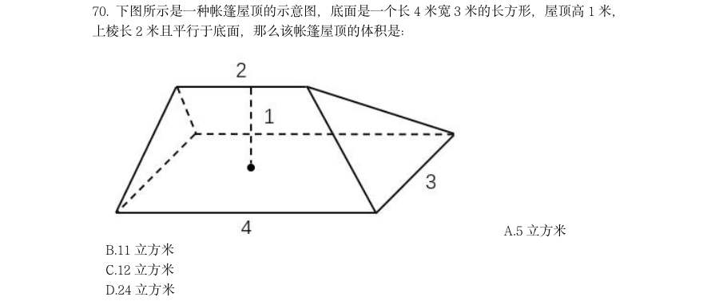

- **A.** 5 立方米
- **B.** 11 立方米
- **C.** 12 立方米
- **D.** 24 立方米

**答案：A**

### 2023 湖北·统一卷　第 86 题　（其他常识（综合））

葡萄:葡萄酒

- **A.** 黄金:黄金档
- **B.** 香蕉:香蕉水
- **C.** 杜鹃:杜鹃花
- **D.** 枇杷:枇杷膏

**答案：D**

### 2023 湖北·统一卷　第 87 题　（其他常识（综合））

天荒地老:海枯石烂

- **A.** 同心同德:反目成仇
- **B.** 披荆斩棘:斩钉截铁
- **C.** 孜孜矻矻:夙夜不懈
- **D.** 望而却步:望风披靡

**答案：C**

### 2023 湖北·统一卷　第 88 题　（其他常识（综合））

全真阅读:沉浸式

- **A.** 企业销售:盈利性
- **B.** 乡村教育:均衡化
- **C.** 人工智能:数字化
- **D.** 线上课程:直播性

**答案：C**

### 2023 湖北·统一卷　第 89 题　（其他常识（综合））

龋齿:嗜食甜品

- **A.** 海鲜:食物过敏
- **B.** 缺钙:骨质疏松
- **C.** 运动:增强体质
- **D.** 塌方:地下渗水

**答案：D**

### 2023 湖北·统一卷　第 90 题　（其他常识（综合））

针灸:疏通经脉

- **A.** 慢跑:增强体质
- **B.** 涅槃:化茧成蝶
- **C.** 缺铁:供血不足
- **D.** 促销:商品展示

**答案：A**

### 2023 湖北·统一卷　第 91 题　（其他常识（综合））

游艇:钢材:船舶

- **A.** 古玺:玉石:隶书
- **B.** 旗袍:丝绸:服饰
- **C.** 版画:油画:绘画
- **D.** 砧板:厨具:木材

**答案：B**

### 2023 湖北·统一卷　第 92 题　（其他常识（综合））

书柜:书籍:书页

- **A.** 花坛:花卉:花蕊
- **B.** 舞池:舞蹈:舞伴
- **C.** 面粉:面条:面片
- **D.** 鞋盒:鞋子:鞋油

**答案：A**

### 2023 湖北·统一卷　第 95 题　（其他常识（综合））

佶屈聱牙对于(________)相当于(________)对于教诲

- **A.** 文句;春风化雨
- **B.** 书写;和光同尘
- **C.** 表达;无微不至
- **D.** 描述;刚柔相济

**答案：A**

### 2023 湖北·统一卷　第 105 题　（生活常识）

某医院刘佳、郑毅、郭斌、丁晓、吴芳、施文6 位医生拟报名参加“一心向党,健康 为民”进社区义诊活动,已知下列情况为真: (1)要么刘佳参加,要么郑毅参加; (2)只有吴芳参加,刘佳才参加; (3)如果郭斌和吴芳都参加,那么施文也会参加; (4)或者丁晓不参加,或者郭斌参加; (5)施文、丁晓至少有1 人参加。 现施文确定无法参加,那么6 位医生中最后参加义诊活动的是:

- **A.** 刘佳、郭斌、丁晓
- **B.** 郑毅、郭斌、丁晓
- **C.** 郑毅、丁晓、吴芳
- **D.** 刘佳、丁晓、吴芳

**答案：B**

### 2023 湖北·统一卷　第 107 题　（其他常识（综合））

华西秋雨正常年份结束的时间是:

- **A.** 11 月8 日
- **B.** 11 月6 日
- **C.** 11 月1 日
- **D.** 10 月30 日

**答案：C**

### 2023 湖北·统一卷　第 109 题　（其他常识（综合））

华西2021 年雨季降水量与正常年份雨季降水量相比增加了约:

- **A.** 153.4 毫米
- **B.** 176.7 毫米
- **C.** 203.2 毫米
- **D.** 232.5 毫米

**答案：B**

### 2023 湖北·统一卷　第 110 题　（其他常识（综合））

能够从上述资料推出的是:

- **A.** 2021 年10 月7 日属于西南雨季期内
- **B.** 2020 年梅雨量高出正常年份的227.9%
- **C.** 2020 年华西雨季总雨量超过379.9 毫米
- **D.** 东北正常年份雨季长度为华北正常年份雨季长度的2 倍多

**答案：D**

### 2023 湖北·统一卷　第 111 题　（其他常识（综合））
> 材料：2021 年,全国城市供水总量673.34 亿立方米,同比增长6.96%;城市供水管道长度 105.99 万公里,同比增长5.26%;人均日生活用水量185.03 升;供水普及率99.38%,比上 年增加0.39 个百分点。天津、河北、上海、江苏、浙江和广东6 个省(市)城市供水普及 率达到100%;福建、山东、湖北、广西、安徽、辽宁、宁夏、新疆、内蒙古、山西、甘肃、 河南、黑龙江、江西、云南和湖南16 个省(区)超过99%(含);西藏、青海、北京、四 川、贵州和陕西6 个省…

2021 年全国城市供水管道长度比2020 年增长约:

- **A.** 5 万公里
- **B.** 5.3 万公里
- **C.** 5.6 万公里
- **D.** 6 万公里

**答案：B**

### 2023 湖北·统一卷　第 113 题　（生活常识）

图2 所列的全国部分省(区、市)中,2021 年城市人均日生活用水量超过全国平均值 的有:

- **A.** 5 个
- **B.** 6 个
- **C.** 7 个
- **D.** 8 个

**答案：A**

### 2023 湖北·统一卷　第 114 题　（生活常识）

图2 中,城市人均日生活用水量最高的省份是用水量中位数省份的约:

- **A.** 1.78 倍
- **B.** 1.88 倍
- **C.** 1.95 倍
- **D.** 2.03 倍

**答案：B**

### 2023 湖北·统一卷　第 115 题　（其他常识（综合））

能够从上述资料推出的是:

- **A.** 2012~2021 年,全国城市供水普及率逐年增长
- **B.** 2021 年,浙江和广东的供水普及率低于新疆建设兵团
- **C.** 2012~2021 年,全国城市人均日生活用水量平均值不超过176 升
- **D.** 图2 中,用水量排名前三名的省(区、市)城市人均日生活用水量之和是排名后三位的

**答案：B**

### 2023 湖北·统一卷　第 117 题　（其他常识（综合））

2012~2021 年,最接近全国羊肉年平均产量的是:

- **A.** 2015 年
- **B.** 2016 年
- **C.** 2017 年
- **D.** 2018 年

**答案：C**

### 2023 湖北·统一卷　第 120 题　（其他常识（综合））

不能从上述资料推出的是:

- **A.** 2012~2021 年,全国羊肉产量逐年增长
- **B.** 2020 年,牛肉批发价格不足零售价格的90%
- **C.** 2020 年,鸡肉零售价格与批发价格之比大于牛肉
- **D.** 2012~2021 年,鸡蛋批发价格同比增速最快的年份是2018 年

**答案：B**

### 2023 湖北·统一卷　第 121 题　（其他常识（综合））
> 材料：2012~2021 的10 年间,辽宁、天津、河北、山东、江苏、上海、浙江、福建、广东、 广西、海南11 个沿海省市的核电、火电、钢铁、石化等行业的海水冷却用水量稳步增长(图 1),其中浙江、福建、广东3 省海水冷却用水量相对较高(表1)。截至2021 年底,11 个沿海省市共建有海水冷却工程22 个,2021 年全国11 个沿海省市海水冷却工程年总循环 量为169.5 亿吨。…

图1 中相较于2012 年,11 个沿海省市海水冷却用水量实现翻一番的年份首次出现在:

- **A.** 2018 年
- **B.** 2019 年
- **C.** 2020 年
- **D.** 2021 年

**答案：D**

### 2023 湖北·统一卷　第 122 题　（其他常识（综合））

图1 中2012~2021 年期间海水冷却用水量年增量高于2012~2021 年期间全国海水冷 却用水量年平均增长量的年份共有几个?

- **A.** 2
- **B.** 3
- **C.** 4
- **D.** 5

**答案：C**

### 2023 湖北·统一卷　第 123 题　（其他常识（综合））

表1 中,2021 年除浙江、福建、广东外的5 个沿海省市海水冷却用水量占全国11 个沿 海省市的:

- **A.** 24.6%
- **B.** 33.8%
- **C.** 47.6%
- **D.** 66.2%

**答案：C**

### 2023 湖北·统一卷　第 125 题　（其他常识（综合））

可以从上述资料推出的是:

- **A.** 2021 年全国11 个沿海省份海水冷却用水量前4 名依次为:广东、浙江、福建、江苏
- **B.** 2012~2021 年浙江、广东年海水冷却用水量之和均超过全国同期的60%
- **C.** 2012~2021 年表1 的8 个省市中福建的海水冷却用水量年平均增速最快
- **D.** 2012~2021 年间,广东的海水冷却用水量均为辽宁同期的3 倍以上

**答案：D**

### 2023 广东·乡镇　第 4 题　（其他常识（综合））

备耕种先行。种子作为春耕时必不可少的农资,数量和质量都至关重要。如今,乡村储备 仓库里一袋袋优质早稻种子__________,还会有专业人员定时查看种子情况,确保 __________。

- **A.** 琳琅满目分毫不差
- **B.** 漫山遍野巨细无遗
- **C.** 堆积如山万无一失
- **D.** 铺天盖地滴水不漏

**答案：C**

### 2023 广东·乡镇　第 16 题　（其他常识（综合））

党纪国法不能成为“橡皮泥”、“稻草人”,无论是因为“法盲”导致违纪违法,还是 故意违规违法,都要受到追究,否则就会形成“破窗效应”。以下哪句与上述理论意思最为 一致?( )

- **A.** 靡不有初,鲜克有终
- **B.** 不矜细行,终累大德
- **C.** 浇风易渐,淳化难归
- **D.** 纪纲一废,何事不生

**答案：D**

### 2023 广东·乡镇　第 17 题　（生活常识）

新时代十年,我国实行更加积极主动的开放战略,形成更大范围、更宽领域、更深层次 的对外开放格局。以下不属于新时代十年对外开放领域成就的是( )。

- **A.** 加快推进海南自由贸易港建设
- **B.** 推动共建“一带一路”
- **C.** 货物贸易总额居世界第一
- **D.** 共建共治共享的制度进一步健全

**答案：D**

### 2023 广东·乡镇　第 21 题　（其他常识（综合））

“风雨浸衣骨更硬,野菜充饥志越坚;官兵一致同甘苦,革命理想高于天。”该文句最 有可能描述的事件是( )。

- **A.** 三湾改编
- **B.** 红军长征
- **C.** 百团大战
- **D.** 淮海战役

**答案：B**

### 2023 广东·乡镇　第 23 题　（其他常识（综合））

中国共产党很早就认识到农民问题的重要性,早在1923 年就在( )成立了中国第一 个县级农会组织。

- **A.** 安徽金寨
- **B.** 湖南宁乡
- **C.** 江西永新
- **D.** 广东海丰

**答案：D**

### 2023 广东·乡镇　第 28 题　（生活常识）

以下关于我国社会保障体系相关内容的表述,错误的是( )。

- **A.** 我国已建成世界上规模最大的社会保障体系
- **B.** 经济发展和社会保障是水涨船高的关系
- **C.** 以市场主体和社会力量承担的保障为核心
- **D.** 以社会保险为主体,包括社会救助、社会福利、社会优抚等制度

**答案：C**

### 2023 广东·乡镇　第 31 题　（其他常识（综合））

11,-13,15,-17,19,( )

- **A.** -21
- **B.** -22
- **C.** 21
- **D.** 22

**答案：A**

### 2023 广东·乡镇　第 33 题　（其他常识（综合））

1.24,2.48,3.612,4.816,( )

- **A.** 5.102
- **B.** 6.224
- **C.** 5.1020
- **D.** 6.1224

**答案：C**

### 2023 广东·乡镇　第 35 题　（其他常识（综合））

, , , ,( )

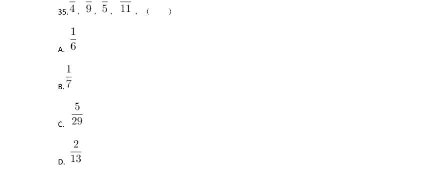

> （本题为图形题，选项为图片，见原卷）

**答案：A**

### 2023 广东·乡镇　第 36 题　（其他常识（综合））

某社区计划组建多支社工团队,为此招幕了一批社工。如果每支团队由3 名社工组成, 则剩余2 名社工;如果每支团队由4 名社工组成,同样剩余2 名社工,则该社区可能招募了 ( )名社工。

- **A.** 32
- **B.** 34
- **C.** 36
- **D.** 38

**答案：D**

### 2023 广东·乡镇　第 37 题　（其他常识（综合））

甲、乙两个仓库共存有340 吨粮食。如果甲仓库存放的粮食是乙仓库的2 倍多10 吨,则 甲仓库存有粮食( )吨。

- **A.** 110
- **B.** 120
- **C.** 230
- **D.** 240

**答案：C**

### 2023 广东·乡镇　第 38 题　（其他常识（综合））

某单位共有8 名安保队员,并根据序号每天安排2 名队员轮流值班:第一天由队员1、2 负责值班;第二天由队员3、4 负责值班······以此类推。如果队员3 今天负责了值 班,则他将在( )天后再次负责值班。

- **A.** 4
- **B.** 5
- **C.** 6
- **D.** 7

**答案：A**

### 2023 广东·乡镇　第 39 题　（其他常识（综合））

某地有4 片果园需要施肥。使用1 台无人机为4 片果园施肥分别需要1.2、1.3、2、2.5 小时。如果使用2 台无人机,则完成所有施肥任务至少需要( )小时。

- **A.** 2.5
- **B.** 3.5
- **C.** 3.8
- **D.** 4.8

**答案：B**

### 2023 广东·乡镇　第 40 题　（其他常识（综合））

某工厂加工出一批正方体奶酪,抽检时质检员从奶酪中切下了一个厚度为2 厘米的长方体 (如图所示)。如果剩余奶酪的体积为144 立方厘米,则奶酪原本的边长为( )厘米。

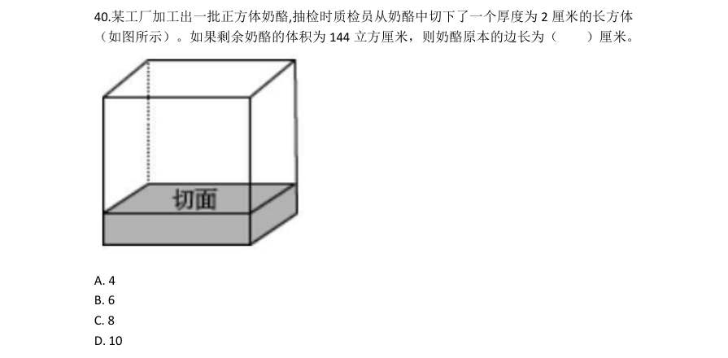

- **A.** 4
- **B.** 6
- **C.** 8
- **D.** 10

**答案：B**

### 2023 广东·乡镇　第 41 题　（其他常识（综合））

某单位去年报名参加志愿活动的党员与非党员之比为1∶3。今年的报名总人数提高了20%, 党员与非党员之比为1∶2,党员人数比去年多了6 人。则今年该单位报名参加志愿活动的 党员共有( )人。

- **A.** 16
- **B.** 24
- **C.** 32
- **D.** 48

**答案：A**

### 2023 广东·乡镇　第 42 题　（其他常识（综合））

某牧场的草,匀速生长。如果20 头牛来吃,20 天可将草吃光;如果10 头牛和10 只羊 来吃,30 天可以恰好吃光。已知一头牛每天的吃草量是一只羊的2 倍,则30 只羊吃该牧场 的草,多少天可以吃光?

- **A.** 10
- **B.** 20
- **C.** 30
- **D.** 40

**答案：C**

### 2023 广东·乡镇　第 43 题　（其他常识（综合））

某单位共有员工200 人,其中订阅杂志的人数比只订阅报纸的人数多88%。则报纸和杂 志均未订阅的员工有( )人。

- **A.** 36
- **B.** 56
- **C.** 76
- **D.** 96

**答案：B**

### 2023 广东·乡镇　第 44 题　（其他常识（综合））

某公司向餐馆订购盒饭,要求每份盒饭包含2 种荤菜、2 种素菜。如果餐馆共准备了4 种荤菜和3 种素菜,则最多有( )种盒饭。

- **A.** 6
- **B.** 12
- **C.** 18
- **D.** 24

**答案：C**

### 2023 广东·乡镇　第 45 题　（其他常识（综合））

小明骑车从甲镇前往乙镇。如果骑车的速度为每小时20 千米,那么将准时到达。如果骑 车的速度为每小时24 千米,那么将提早5 分钟到达。则甲镇到乙镇的距离为( )千米。

- **A.** 8
- **B.** 10
- **C.** 12
- **D.** 16

**答案：B**

### 2023 广东·乡镇　第 49 题　（其他常识（综合））

某物体由两个相同的正三棱柱组合而成,则其侧面轮廓最不可能是( )。

- **A.** A
- **B.** B
- **C.** C
- **D.** D

**答案：D**

### 2023 广东·乡镇　第 55 题　（其他常识（综合））

下列选项与框内字符串规律最接近的是( )。

- **A.** A
- **B.** B
- **C.** C
- **D.** D

**答案：A**

### 2023 广东·乡镇　第 56 题　（其他常识（综合））

章:节

- **A.** 年:月
- **B.** 桌:椅
- **C.** 中考:高考
- **D.** 班主任:班长

**答案：A**

### 2023 广东·乡镇　第 58 题　（其他常识（综合））

鱼∶渔网

- **A.** 蜜蜂∶蜂果
- **B.** 光线∶镜子
- **C.** 警察∶防弹衣
- **D.** 灰尘∶吸尘器

**答案：D**

### 2023 广东·乡镇　第 59 题　（其他常识（综合））

风扇:风:电

- **A.** 火电厂:电:煤
- **B.** 水龙头:水:阀门
- **C.** 篮球:球框:橡胶
- **D.** 榨汁机:果汁:水果

**答案：A**

### 2023 广东·乡镇　第 60 题　（其他常识（综合））

海底捞月:缘木求鱼

- **A.** 抱薪救火:釜底抽薪
- **B.** 七嘴八舌:鹦鹉学舌
- **C.** 趁火打劫:浑水摸鱼
- **D.** 锦上添花:画蛇添足

**答案：C**

### 2023 广东·乡镇　第 61 题　（其他常识（综合））

某街道计划将3 名男性干部甲、乙、丙和3 名女性干部张、李、王下沉至各个社区开展 工作,可供选择的社区有

- **A.** 丙去了A 社区
- **B.** 张去了B 社区
- **C.** 甲去了C 社区
- **D.** 王去了D 社区

**答案：D**

### 2023 广东·乡镇　第 65 题　（生活常识）

优秀的企业家既要有杰出的领导能力,也必须积极承担相应的社会责任。因此,能运用 出色的领导力引领企业发展却不愿承担任何社会责任的人,一定不是优秀的企业家。 以下选项的逻辑结构与题干最为相似的是( )。

- **A.** 真正的“美丽”不仅体现在外表上,还体现在心灵上。因此,心灵美丽的人外表也一定出众
- **B.** 设计要源于现实生活才能发挥意义而成为真正伟大的设计。因此,脱离生话的设计是不切实际的,更是毫无现实意义的
- **C.** 优秀的学习成绩和良好的道德品质在评奖评优中缺一不可。因此,即使有优秀的学习成绩,要想评奖评优,良好的道德品质仍然不可或缺
- **D.** 流量明星一定程度带动了经济发展,也带来了一些新的社会问题。因此,片面强调流量

**答案：C**

### 2023 广东·乡镇　第 67 题　（其他常识（综合））

水平地面上有甲、乙两块由不同材质构成、质地分布均匀的长方体金属块。已知甲的体 积>乙的体积,甲的底面积<乙的底面积,甲的质量>乙的质量。则以下判断一定正确的有 ( )。 1甲的高度>乙的高度 2甲的高度<乙的高度 3甲的密度>乙的密度 4甲的密度<乙的密度

- **A.** 1
- **B.** 3
- **C.** 13
- **D.** 24

**答案：A**

### 2023 广东·乡镇　第 68 题　（生活常识）

如图,物体M 在恒力F 的作用下沿粗糙的斜面匀速向上移动。下列说法不准确的是( )。

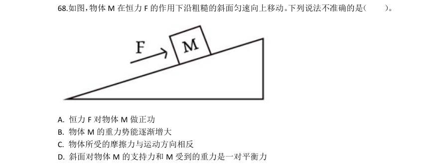

- **A.** 恒力F 对物体M 做正功
- **B.** 物体M 的重力势能逐渐增大
- **C.** 物体所受的摩擦力与运动方向相反
- **D.** 斜面对物体M 的支持力和M 受到的重力是一对平衡力

**答案：D**

### 2023 广东·乡镇　第 69 题　（生活常识）

小李驾驶卡丁车驶过一个半圆形弯道时,滑离了原定赛道,撞到了安全护栏。为了避免 卡丁车转弯时滑离赛道,下列做法最可能有效的是( )。

- **A.** 增加卡丁车的质量
- **B.** 减少卡丁车的质量
- **C.** 使用更加粗糙的轮胎
- **D.** 减小半圆形弯道的半径

**答案：C**

### 2023 广东·乡镇　第 70 题　（其他常识（综合））

小张观察发现,自家房屋的北面在夏天能够被阳光照射,而在冬天,房屋的南面可以被 阳光照射。则他家最有可能位于以下城市中的( )。

- **A.** 海口
- **B.** 武汉
- **C.** 上海
- **D.** 北京

**答案：A**

### 2023 广东·乡镇　第 71 题　（其他常识（综合））

以下延长粮食存放时间的措施,最不合理的是( )。

- **A.** 粮库的粮食存放区保持较低温度
- **B.** 将其真空包装,以避免接触氧气
- **C.** 适当在粮库中洒水,保持空气湿度
- **D.** 给粮库的粮食存放区充入二氧化碳

**答案：C**

### 2023 广东·乡镇　第 73 题　（其他常识（综合））

透过一块纯绿色的玻璃窗观察白墙上写的纯红色大字,最有可能看到( )。

- **A.** 绿墙无字
- **B.** 绿墙黑字
- **C.** 绿墙橙字
- **D.** 黑墙无字

**答案：B**

### 2023 广东·乡镇　第 75 题　（其他常识（综合））

目前,我国许多城市已经实现5G 网络全覆盖,由于5G 基站覆盖范围比4G 基站的覆盖 范围要小,这就意味着想要覆盖同样的区域,5G 网络基站数量要比4G 基站多。由此可知, 与4G 信号相比,5G 信号( )。

- **A.** 频率较低,波长较短
- **B.** 频率较低,波长较长
- **C.** 频率较高,波长较短
- **D.** 频率较高,波长较长

**答案：C**

### 2023 广东·乡镇　第 76 题　（其他常识（综合））

下图是一束光在空气和玻璃两种不同的介质中传播的路径示意图,则下列说法正确的是 ( )。

- **A.** 是界面
- **B.** AO 是入射光线
- **C.** OC 是反射光线
- **D.** 

**答案：D**

### 2023 广东·乡镇　第 78 题　（生活常识）

“庄稼一枝花,全靠肥当家。”以下有关农业种植中肥料使用的说法,错误的是( )。

- **A.** 肥料的主要作用是给农作物提供有机物
- **B.** 除了根部,肥料也可以通过叶片等部位被农作物吸收
- **C.** 施肥浓度过高导致“烧根”,是由于农作物根部的细胞在高浓度溶液中失水
- **D.** 应根据不同农作物和农作物不同生长阶段的实际需要,有针对性地施用肥料

**答案：A**

### 2023 广东·乡镇　第 79 题　（生活常识）

下图是某物体做直线运动时,其速度v 与时间t 关系的折线图,则以下说法准确的有 ( )。 1在 ~ ,物体匀速运动 2在0~ 和 ~ ,物体做同方向运动 3在 时,物体离出发点距离最远 4在 ~ 和 ~ ,物体的加速度方向相反 5在 时,物体改变运动方向

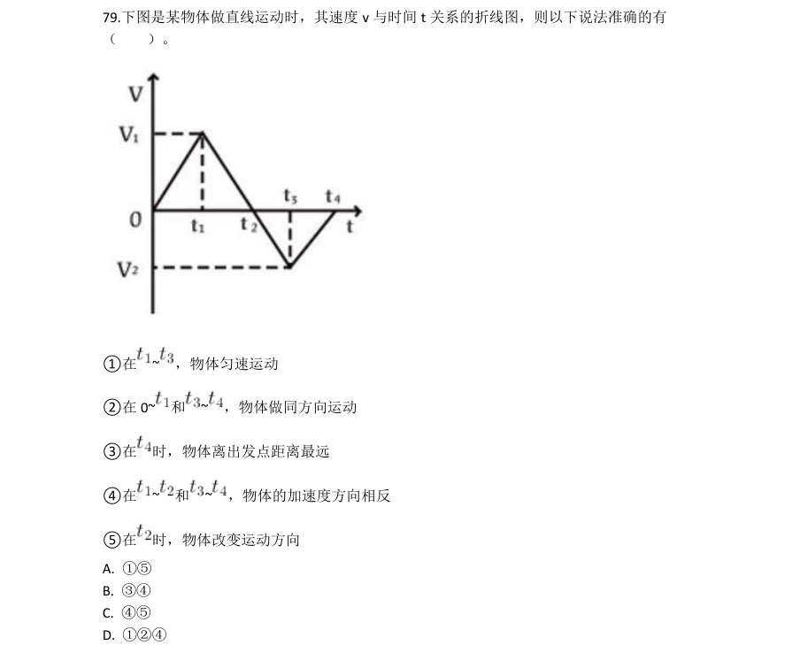

- **A.** 15
- **B.** 34
- **C.** 45
- **D.** 124

**答案：C**

### 2023 广东·乡镇　第 80 题　（其他常识（综合））

甲酸(HCOOH)具有清洁制氢的巨大潜力,其反应前后分子种类变化的微观示意图如下 图所示。则下列说法正确的是( )。

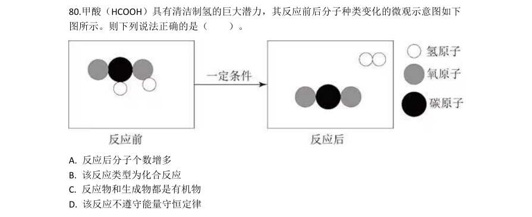

- **A.** 反应后分子个数增多
- **B.** 该反应类型为化合反应
- **C.** 反应物和生成物都是有机物
- **D.** 该反应不遵守能量守恒定律

**答案：A**

### 2023 广东·乡镇　第 86 题　（其他常识（综合））

( )广东农林牧渔业总产值首次突破了5000 亿元。

- **A.** 2014 年
- **B.** 2015 年
- **C.** 2017 年
- **D.** 2018 年

**答案：A**

### 2023 广东·乡镇　第 87 题　（其他常识（综合））

2021 年广东农林牧渔业总产值约为9 年前的( )倍。

- **A.** 1.2
- **B.** 1.4
- **C.** 1.6
- **D.** 1.8

**答案：D**

### 2023 广东·乡镇　第 89 题　（其他常识（综合））

题目正在全力以赴征集,将会在征集到后第一时间上传(该题选择A 项默认得分)

- **A.** 缺失
- **B.** 缺失
- **C.** 缺失
- **D.** 缺失

**答案：暂缺**

### 2023 广东·乡镇　第 95 题　（其他常识（综合））

根据资料,下列说法有误的是( )。

- **A.** 2021 年,广东省财政一般公共预算支出超过了2 万亿元
- **B.** 2021 年,广东省省本级财政一般公共预算支出超过了1000 亿元
- **C.** 2020 年和2021 年,其他科学技术支出在广东省财政科学技术支出中的比重均未超过一半
- **D.** 与2020 年相比,2021 年科学技术普及支出在广东省财政科学技术支出中的比重略有增

**答案：A**

### 2023 广东·乡镇　第 96 题　（其他常识（综合））
> 材料：材料 2022 年,全国居民人均可支配收入36883 元,比上年增长(以下如无特别说明,均为同 比名义增长)5.0%。分城乡看,城镇居民人均可支配收入49283 元,增长3.9%;农村居民 人均可支配收入20133 元,增长6.3%。 2022 年,全国居民人均消费支出24538 元,比上年增长1.8%。分城乡看,城镇居民人 均消费支出30391 元,增长0.3%;农村居民人均消费支出16632 元,增长4.5%。…

2021 年,全国居民人均可支配收入约为( )万元。

- **A.** 3.33
- **B.** 3.42
- **C.** 3.51
- **D.** 3.60

**答案：C**

### 2023 广东·乡镇　第 99 题　（其他常识（综合））

2022 年,我国城镇居民与农村居民人数之比最接近( )。

- **A.** 2:3
- **B.** 3:2
- **C.** 3:4
- **D.** 4:3

**答案：D**

### 2023 广东·乡镇　第 100 题　（其他常识（综合））

根据资料,下列说法正确的是( )。

- **A.** 2022 年,农村居民人均可支配收入较去年增加上千元
- **B.** 2021 年,全国居民人均消费支出首次超过了2.4 万元
- **C.** 与2021 年相比,2022 年城镇居民在衣着上的消费支出减少最多
- **D.** 2021 年,无论在城镇还是农村,居民消费支出的重点都是食品烟酒支出和医疗保健支出

**答案：A**

### 2023 国考·行政执法　第 8 题　（其他常识（综合））

根据《中华人民共和国退役军人保障法》,下列说法正确的是:

- **A.** 参战退役军人的随迁子女入学可以得到优先保障
- **B.** 退役的军士和义务兵可以逐月领取退役金
- **C.** 已被大学录取的现役军人可以在退伍后四年内入学
- **D.** 退役军人创办企业可以享受免税、贷款免息等优惠政策

**答案：A**

### 2023 国考·行政执法　第 10 题　（生活常识）

根据《中华人民共和国噪声污染防治法》,下列噪声污染情形与作出责令改正或处罚决定的主体对应错误的 是:

- **A.** 甲企业在噪声敏感建筑物集中区域改建厂房造成工业噪声污染——住房和城乡建设部门
- **B.** 乙企业无排污许可证排放工业噪声——生态环境主管部门
- **C.** 丙商场在促销时持续使用高音喇叭发出噪声——地方人民政府指定的部门
- **D.** 丁驾驶拆除消声器的机动车轰鸣行驶——公安机关交通管理部门

**答案：A**

### 2023 国考·行政执法　第 12 题　（生活常识）

关于电信诈骗,下列说法错误的是:

- **A.** 非法使用“伪基站”实施电信诈骗的以非法侵入计算机信息系统罪追究刑事责任
- **B.** 实施电信诈骗最高可被判处无期徒刑
- **C.** 电信诈骗受害人可以通过诉讼程序要求服务存在缺陷的电信运营商承担相应责任
- **D.** 负责招募他人实施电信网络诈骗犯罪活动的,以共同犯罪论处

**答案：A**

### 2023 国考·行政执法　第 13 题　（生活常识）

下列与交通安全有关的说法错误的是:

- **A.** 机动车载运放射性危险物品应当经公安机关批准后按指定的时间、路线、速度行驶
- **B.** 在允许拖拉机通行的道路上,拖拉机可以从事货运,但是不得用于载人
- **C.** 行人故意碰撞机动车造成交通事故的,机动车一方承担次要责任
- **D.** 前车为执行紧急任务的救护车、工程救险车的,后车不得超车

**答案：C**

### 2023 国考·行政执法　第 14 题　（其他常识（综合））

根据《中华人民共和国职业教育法》,关于企业开展职业教育,下列说法错误的是:

- **A.** 企业设立产教融合实训基地的,在公共事业费用上享受高于职业学校的优惠政策
- **B.** 企业应当按照职工工资总额一定比例提取使用职工教育经费
- **C.** 用于一线职工职业教育的经费应当达到国家规定的比例
- **D.** 企业安排职工到职业学校接受职业教育的,应支付职业教育期间工资

**答案：A**

### 2023 国考·行政执法　第 17 题　（其他常识（综合））

下列关于化石的说法正确的是:

- **A.** 三叶虫化石是侏罗纪地层中的典型化石
- **B.** 硅化木是树木埋入地下后形成的化石
- **C.** 琥珀的硬度比和田玉大
- **D.** 大多数化石是在侵入岩中被发现的

**答案：B**

### 2023 国考·行政执法　第 19 题　（其他常识（综合））

关于自然节律变化,下列说法错误的是:

- **A.** 惊蛰后华北地区可能会出现“万里雪飘”的现象
- **B.** 2月北回归线附近会出现“儿童急走追黄蝶,飞入菜花无处寻”的现象
- **C.** 冬至时,在广东汕头竖直立杆会出现“立竿无影”的现象
- **D.** 谷雨前后江浙地区可能会出现“一把青秧趁手青,轻烟漠漠雨冥冥”的现象

**答案：C**

### 2023 国考·行政执法　第 20 题　（生活常识）

关于人体的生理现象,下列说法正确的是:

- **A.** 人体在流汗时汗腺内的盐分浓度会降低
- **B.** 蚊虫叮咬造成的皮肤发痒属于过敏反应
- **C.** 打嗝声是由胃部痉挛和声带闭合造成的
- **D.** 皮肤受伤流血处的血管会先扩张后收缩

**答案：B**

### 2022 广东·乡镇　第 14 题　（其他常识（综合））

近年来,我国在“大国重器”的研发上成果显著,捷报频传。以下关于“大国重器”与其宣传语的对应关 系不正确的是:

- **A.** “奋斗者号”——只有沉得下去,才能浮得上来
- **B.** “复兴号”——暂时地降落是为了下一次更好地起飞
- **C.** “北斗三号”——其实,方向比方法更重要
- **D.** “中国天眼”——要仰望星空,也要脚踏实地

**答案：B**

### 2022 广东·乡镇　第 20 题　（生活常识）

2020 年底我国区域性整体贫困得到解决,提前实现《联合国2030 年可持续发展议程》减贫目标。下列关 于我国在减贫事业获得的成就与其具体表现对应不正确的是:

- **A.** 贫困人口食物权得到稳定保障——实现农产品产量稳定增长,解决食物匮乏和营养不良问题,“不愁吃”问题基本解决
- **B.** 贫困人口饮水安全得到有力保障——实施农村饮水安全巩固提升工程,累计解决2889 万贫困人口饮水安全问题,3.82 亿农村人口受益
- **C.** 贫困地区义务教育得到充分保障——农村贫困家庭子女义务教育阶段辍学问题实现动态清零
- **D.** 贫困人口基本医疗得到有效保障——基本形成包括疾病预防控制、健康教育、妇幼保健、精神卫生防治等

**答案：D**

### 2022 广东·乡镇　第 22 题　（其他常识（综合））

第一次国共合作实现后,以( )为中心汇集全国革命力量,很快开创了反对帝国主义和封建军阀的革 命新局面。

- **A.** 北京
- **B.** 广州
- **C.** 上海
- **D.** 武汉

**答案：B**

### 2022 国考·副省级　第 2 题　（其他常识（综合））

(单选题)“七一勋章”获得者都来自人民、植根人民,是立足本职、默默奉献的平凡英雄。他们的事迹 可学可做,他们的精神可追可及,以下“七一勋章”获得者与其先进事迹表述对应正确的是:

- **A.** 张桂梅——坚持志愿服务十余载群众心中的“活雷锋”
- **B.** 王兰花——点亮贫困山区女孩梦想的“校长妈妈”
- **C.** 孙景坤——公而忘私永葆革命本色的战斗功臣
- **D.** 李宏塔——为国守海寸步不让带领群众共同致富

**答案：C**

### 2022 国考·副省级　第 6 题　（生活常识）

(单选题)在中国共产党成立一百周年的重要时刻,我国脱贫攻坚战取得了全面胜利。下列与之相关的 说法错误的是:

- **A.** 现行标准下区域性整体贫困得到解决
- **B.** “输血式”扶贫方针是中国特色减贫道路的鲜明特征
- **C.** 锻造形成了“上下同心、尽锐出战、精准务实、开拓创新、攻坚克难、不负人民”的脱贫攻坚精神
- **D.** 从集中资源支持脱贫攻坚转向巩固拓展脱贫攻坚成果和全面推进乡村振兴

**答案：B**

### 2022 国考·副省级　第 9 题　（生活常识）

(单选题)根据《中华人民共和国政务处分法》,下列哪一处分不恰当?

- **A.** 甲系某行政主管部门公务员,犯故意伤害罪被判处有期徒刑六个月,缓刑一年,被撤职
- **B.** 乙系交通运输部门公务员,交通肇事犯罪情节轻微,检察机关对其作出不起诉决定,乙被撤职
- **C.** 丙系某国有企业管理人员,犯盗窃罪被单处罚金,被撤职
- **D.** 丁系某公办高校事业编管理人员,犯侵占罪但被免予刑事处罚,被撤职

**答案：A**

### 2022 国考·副省级　第 10 题　（生活常识）

(单选题)2021 年4 月27 日,国务院常务会议上确定了知识产权领域“放管服”改革新举措。下列与之 相关的说法错误的是:

- **A.** 进一步压缩商标、专利审查周期,推行商标电子注册证
- **B.** 提高知识产权质量,增加对商标和专利申请阶段的资助和奖励
- **C.** 确保数据安全基础上,开放知识产权基础数据,助力企业研发创新
- **D.** 加强知识产权全链条保护,依法打击违法违规代理和商标恶意注册行为

**答案：B**

### 2022 国考·副省级　第 15 题　（其他常识（综合））

(单选题)我国自古十分重视对人的品德的培养。下列有关“德”的表述与出处对应错误的是:

- **A.** 大德不逾闲,小德出入可也——《论语》
- **B.** 富有之谓大业,日新之谓盛德——《周易》
- **C.** 所求于己者多,故德行立——《管子》
- **D.** 道生之,德畜之,物形之,势成之——《庄子》

**答案：D**

### 2022 国考·副省级　第 16 题　（其他常识（综合））

(单选题)关于常见气体的工业制备方法,下列说法错误的是:

- **A.** 木炭和二氧化碳可以作为制备一氧化碳的原料
- **B.** 电解水时制备得到的氢气体积比氧气体积更大
- **C.** 通过低温液化的方法,可以分离出沼气中的甲烷
- **D.** 煅烧石灰石制备二氧化碳属于复分解反应

**答案：D**

### 2022 国考·副省级　第 20 题　（生活常识）

(单选题)下列与急救有关的说法正确的是:

- **A.** 误服氨水者应该立即进行洗胃或催吐
- **B.** 误食强酸可以立即口服氢氧化铝凝胶
- **C.** 农药沾染皮肤中毒可以立即用热水擦洗
- **D.** 烧伤时应立即饮用大量凉水补充体液

**答案：B**

### 2022 国考·地市级　第 4 题　（其他常识（综合））

关于中国共产党成立百年的宝贵经验,下列说法不准确的是:

- **A.** 爱国统一战线是实现中华民族伟大复兴的战略支撑
- **B.** 勇于自我革命是中国共产党区别于其他政党的显著标志
- **C.** 马克思主义是我们立党立国的根本指导思想
- **D.** 中国特色社会主义是实现中华民族伟大复兴的正确道路

**答案：A**

### 2022 国考·地市级　第 5 题　（生活常识）

在中国共产党成立一百周年的重要时刻,我国脱贫攻坚战取得了全面胜利。下列与之相关的 说法错误的是:

- **A.** 现行标准下区域性整体贫困得到解决
- **B.** “输血式”扶贫方针是中国特色减贫道路的鲜明特征
- **C.** 锻造形成了“上下同心、尽锐出战、精准务实、开拓创新、攻坚克难、不负人民”的脱贫攻坚精神
- **D.** 从集中资源支持脱贫攻坚转向巩固拓展脱贫攻坚成果和全面推进乡村振兴

**答案：B**

### 2022 国考·地市级　第 8 题　（生活常识）

根据《中华人民共和国政务处分法》,下列哪一处分不恰当?

- **A.** 甲系某行政主管部门公务员,犯故意伤害罪被判处有期徒刑六个月,缓刑一年,被撤职
- **B.** 乙系交通运输部门公务员,交通肇事犯罪情节轻微,检察机关对其作出不起诉决定,乙被撤职
- **C.** 丙系某国有企业管理人员,犯盗窃罪被单处罚金,被撤职
- **D.** 丁系某公办高校事业编管理人员,犯侵占罪但被免予刑事处罚,被撤职

**答案：A**

### 2022 国考·地市级　第 19 题　（生活常识）

下列与急救有关的说法正确的是:

- **A.** 误服氨水者应该立即进行洗胃或催吐
- **B.** 误食强酸可以立即口服氢氧化铝凝胶
- **C.** 农药沾染皮肤中毒可以立即用热水擦洗
- **D.** 烧伤时应立即饮用大量凉水补充体液

**答案：B**

### 2022 国考·地市级　第 20 题　（其他常识（综合））

我国自古十分重视对人的品德的培养。下列有关“德”的表述与出处对应错误的是:

- **A.** 大德不逾闲,小德出入可也——《论语》
- **B.** 富有之谓大业,日新之谓盛德——《周易》
- **C.** 所求于己者多,故德行立——《管子》
- **D.** 道生之,德畜之,物形之,势成之——《庄子》

**答案：D**

### 2022 国考·行政执法　第 4 题　（其他常识（综合））

(单选题)关于中国共产党成立百年的宝贵经验,下列说法不准确的是:

- **A.** 爱国统一战线是实现中华民族伟大复兴的战略支撑
- **B.** 勇于自我革命是中国共产党区别于其他政党的显著标志
- **C.** 马克思主义是我们立党立国的根本指导思想
- **D.** 中国特色社会主义是实现中华民族伟大复兴的正确道路

**答案：A**

### 2022 国考·行政执法　第 10 题　（其他常识（综合））

(单选题)下列甲乙丙丁的行为构成利用影响力受贿罪的是:

- **A.** 甲为某生态环境局副局长,某项目经理王某为减轻环境行政罚款向其行贿5 万元,后甲向下属监察大队负责人打招呼撤销罚款决定
- **B.** 乙为某市场监督管理局局长,某项目经理张某为减轻国土资源行政罚款向其行贿5 万元,后乙向自然资源局领导打招呼撤销罚款决定
- **C.** 丙为某税务局公务员,其夫为教育局局长,丙收受李某5 万元并通过其夫职权解决李某小孩跨区入学问题,其夫不知情
- **D.** 丁为某教育局局长,其妻为私企员工,私下收受刘某5 万元并通过其夫职权解决刘某小孩跨区入学问

**答案：C**

### 2022 国考·行政执法　第 11 题　（其他常识（综合））

(单选题)甲乙丙丁4 人发起设立某商贸股份有限公司,并租赁了1 处办公场所。在公司设立过程中, 甲由于疏忽忘关水龙头致办公场所被淹,给办公场所业主戊造成5 万元损失。公司设立后,业主戊向公 司索赔。下列说法正确的是:

- **A.** 因公司已设立,5 万元损失由公司承担即可
- **B.** 因系发起人责任,5 万元损失由发起人共同承担
- **C.** 因在公司设立过程中产生损失,5 万元由公司和发起人共同承担
- **D.** 公司可以先行向业主戊赔偿,再向甲追偿

**答案：D**

### 2022 国考·行政执法　第 20 题　（生活常识）

(单选题)下列与急救有关的说法正确的是:

- **A.** 误服氨水者应该立即进行洗胃或催吐
- **B.** 误食强酸可以立即口服氢氧化铝凝胶
- **C.** 农药沾染皮肤中毒可以立即用热水擦洗
- **D.** 烧伤时应立即饮用大量凉水补充体液

**答案：B**

### 2021 广东·乡镇　第 17 题　（其他常识（综合））

青少年是祖国的未来,民族的希望。青少年教育最重要的是教给他们正确的思想。引导他们走正路。其中, ( )是落实立德树人根本任务的关键课程。

- **A.** 思政课
- **B.** 劳动课
- **C.** 通识课
- **D.** 美育课

**答案：暂缺**

### 2021 广东·乡镇　第 18 题　（其他常识（综合））

以下人物被党中央、国务院授予“全国脱贫攻坚先进个人”荣誉称号的有: 1李保国 2张桂梅 3钟南山 4焦裕禄 5黄文秀

- **A.** 125
- **B.** 234
- **C.** 124
- **D.** 1235

**答案：暂缺**

### 2021 广东·乡镇　第 19 题　（其他常识（综合））

2020 年是中国人民志愿军抗美援朝出国作战70 周年。以下战役发生在抗美援朝战争期间的是:

- **A.** 辽沈战役
- **B.** 百团大战
- **C.** 上甘岭战役
- **D.** 仁川登陆战

**答案：暂缺**

### 2021 广东·乡镇　第 21 题　（生活常识）

习近平总书记指出,体育强国的基础在于( ),要通过举办北京冬奥会、冬残奥会,把我国冰雪运动特 别是雪上运动搞上去,在3 亿人中更好推广冰雪运动。

- **A.** 群众体育
- **B.** 竞技体育
- **C.** 体育文化
- **D.** 体育产业

**答案：暂缺**

### 2021 广东·乡镇　第 22 题　（其他常识（综合））

构建新的发展格局,是根据我国发展阶段、环境、条件变化作出的战略决策。关于构建新发展格局,以下表 述有误的是()。

- **A.** 以国际大循环为主体
- **B.** 关键在于经济循环的畅通无阻
- **C.** 坚持深化供给侧结构性改革这条主线
- **D.** 最本质的特征是实现高水平的自立自强

**答案：暂缺**

### 2021 广东·乡镇　第 24 题　（其他常识（综合））

2021 年2 月25 日召开的全国脱贫攻坚总结表彰大会宣告,我国脱贫攻坚战取得了全面胜利。关于脱贫攻坚, 以下表述准确的有( )。 1完成了消除相对贫困的艰巨任务 22018 年底拉开了新时代脱贫攻坚的序幕 3我国提前10 年实现《联合国2030 年可持续发展议程》减贫目标 4精准扶贫是打赢脱贫攻坚战的制胜法宝 5开发式扶贫方针是中国特色减贫道路的鲜明特征

- **A.** 135
- **B.** 345
- **C.** 1245
- **D.** 2345

**答案：暂缺**

### 2021 广东·乡镇　第 28 题　（生活常识）

下列关于生活常识的说法,正确的是:

- **A.** 发现煤气中毒病人后,施救者应立即进行人工呼吸
- **B.** 商场中绿色的消防安全标志用于指示安全和疏散通道
- **C.** 暴雨黄色预警信号生效时,所在区域的中小学校应当自动停课
- **D.** 隔夜茶指放置时间超过6 小时的茶,其致癌物的含量会显著增加

**答案：暂缺**

### 2021 国考·副省级　第 12 题　（其他常识（综合））

下列与军事武器有关说法错误的是:

- **A.** 东风-31 是我国最新一代洲际战略核导弹
- **B.** 电磁脉冲武器可以打击敌军导弹防护系统
- **C.** 护卫舰在吨位和火力上一般次于驱逐舰
- **D.** 机枪的有效射程和射速优于突击步枪

**答案：暂缺**

### 2021 国考·副省级　第 15 题　（其他常识（综合））

关于探测设备,下列说法错误的是:

- **A.** 热像仪可以在黑夜之中使用
- **B.** 声呐主要用于在陆地上及空中探测距离
- **C.** 雷达测距利用了无线电波沿直线传播的原理
- **D.** 地下金属探测仪器利用了电磁感应原理

**答案：暂缺**

### 2021 国考·副省级　第 19 题　（其他常识（综合））

下列与口罩相关的说法正确的是:

- **A.** 纱布口罩可达到防雾霾的效果
- **B.** 活性炭口罩可吸附过滤空气中的甲醛
- **C.** 医用外科口罩是医用口罩中防护等级最高的一类
- **D.** 在成分不明的毒气污染环境中应佩戴过滤式防毒口罩

**答案：暂缺**

### 2021 国考·地市级　第 7 题　（其他常识（综合））

根据2020 年7 月1 日起实施的《中华人民共和国公职人员政务处分法》,下列说法错误的是:

- **A.** 政务处分的对象不仅包括公务员,也包括国有企业管理人员
- **B.** 政务处分不同于党纪处分
- **C.** 政务处分决定由监察机关依法作出,也可以由公职人员任免机关、单位作出
- **D.** 对公职人员的同一违法行为,监察机关和公职人员任免机关、单位不得重复给予政务处分和处分

**答案：C**

### 2021 国考·地市级　第 10 题　（其他常识（综合））

中共中央、国务院于2019 年12 月4 日印发了《关于营造更好发展环境支持民营企业改革发展的意见》,下 列说法与之不符的是:

- **A.** 招投标时不得设置与业务能力无关的企业规模门槛
- **B.** 在人才引进支持政策方面对民营企业一视同仁,支持民营企业引进海外高层次人才
- **C.** 鼓励民营企业积极参与社会公益、慈善事业
- **D.** 在电力、电信、铁路、石油等行业和领域,向民营企业全面开放

**答案：D**

### 2021 国考·地市级　第 11 题　（生活常识）

《中共中央 国务院关于抓好“三农”领域重点工作确保如期实现全面小康的意见》(2020 年中央一号文 件)未提及以下哪一内容:

- **A.** 强化粮食安全省长责任制考核
- **B.** 坚持和发展新时代“枫桥经验”
- **C.** 全面加强基层司法所建设
- **D.** 有计划安排县城学校教师到乡村支教

**答案：C**

### 2021 国考·地市级　第 14 题　（生活常识）

某市开展交通整治活动,扣押了一批乱停放的货运机动车。主管部门与某民营停车场签订租赁协议,停放扣 押车辆。下列情形属于行政法调整范围的是:

- **A.** 车主甲对该主管部门的扣押决定不服产生争议
- **B.** 民营停车场与该主管部门产生租赁费纠纷
- **C.** 车主乙因车辆被扣押而与托运人产生承运合同纠纷D、车主丙在车辆被扣押过程中暴力抗法且情节严重

**答案：A**

### 2021 国考·地市级　第 17 题　（其他常识（综合））

下面是一款路由器的参数规格说明,对此描述错误的是:

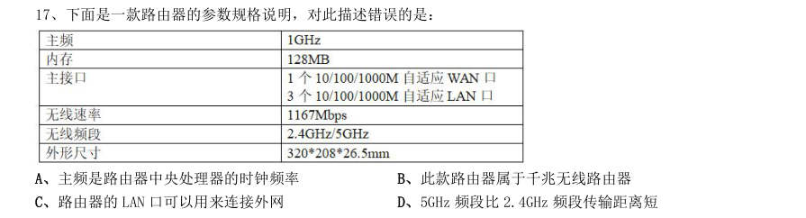

- **A.** 主频是路由器中央处理器的时钟频率
- **B.** 此款路由器属于千兆无线路由器
- **C.** 路由器的LAN 口可以用来连接外网
- **D.** 5GHz 频段比2.4GHz 频段传输距离短

**答案：C**

### 2021 国考·地市级　第 19 题　（生活常识）

下列与口罩相关的说法正确的是:

- **A.** 纱布口罩可达到防雾霾的效果
- **B.** 活性炭口罩可吸附过滤空气中的甲醛
- **C.** 医用外科口罩是医用口罩中防护等级最高的一类
- **D.** 在成分不明的毒气污染环境中应佩戴过滤式防毒口罩

**答案：B**

### 2020 湖北·统一卷　第 3 题　（生活常识）

为提升生态文明、建设美丽中国,党和政府做了一系列重要工作。下列有关生态文明建设的说法不正确的是:

- **A.** 自2020 年1 月起,黄河流域的自然保护区将全面禁止生产性捕捞
- **B.** 2019 年8 月第一届国家公园论坛在青海省举行,与会代表形成了8 条“西宁共识”
- **C.** 2019 年,第二轮中央生态环保督察启动,拟用三年时间完成例行督查,再用一年时间开展回头看
- **D.** 2019 年11 月,住建部发布了新修订《生活垃圾分类标志》标准,将生活垃圾类别调整为可回收物、有害垃

**答案：A**

### 2020 湖北·统一卷　第 4 题　（其他常识（综合））

为应对新冠肺炎疫情,我国出台了一系列政策举措,帮助企业和个体工商户减负纾困,促进复工复产。下列 哪一选项不属于我国在支持复工复产方面的优惠政策:

- **A.** 阶段性减免增值税小规模纳税人增值税
- **B.** 阶段性减免企业和个体工商户物业租金
- **C.** 阶段性减征职工基本医疗保险单位缴费
- **D.** 阶段性减免企业养老、失业、工伤保险单位的缴费

**答案：B**

### 2020 湖北·统一卷　第 5 题　（生活常识）

下列有关公共卫生的说法正确的是:

- **A.** 突发公共卫生事件应急响应分为I级,II级,III级三个等级
- **B.** 按照我国现行标准,甲类传染病有鼠疫、霍乱、传染性非典型肺炎三种
- **C.** 省,自治区,直辖市人民政府卫生行政主管部门有权向社会发布本行政区域内突发事件的信息
- **D.** 医疗卫生机构发现可能发生传染病暴发、流行的,应当在2 小时内向所在地县级人民政府卫生行政主管部门

**答案：D**

### 2020 湖北·统一卷　第 9 题　（生活常识）

下列政府举措中,不能够直接促进城镇居民人均可支配收入增长的是:

- **A.** 减税
- **B.** 发行政府债券
- **C.** 将学前教育纳入义务教育
- **D.** 提高退休职工养老金发放标准

**答案：B**

### 2020 湖北·统一卷　第 10 题　（生活常识）

下列作家与其作品中所展现的地域对应错误的是:

- **A.** 鲁迅——《阿Q 正传》——绍兴
- **B.** 沈从文——《边城》——湘西
- **C.** 汪曾祺——《受戒》——高邮
- **D.** 莫言——《红高粱》——东北

**答案：D**

### 2020 湖北·统一卷　第 11 题　（生活常识）

下列名言中出现最晚的一项是:

- **A.** 笛卡尔:我思故我在
- **B.** 亚里士多德:人是天生的政治动物
- **C.** 亚当·斯密:人天生,并且永远,是自私的动物
- **D.** 阿基米德:给我一个支点,我就能撬起整个地球

**答案：C**

### 2020 湖北·统一卷　第 17 题　（生活常识）

为治疗维生素缺乏导致的夜盲症、败血病、佝偻病和脚气病而需要补充相对应的食物依次是:

- **A.** 谷类、深海鱼、胡萝卜、柑橘
- **B.** 柑橘、深海鱼、谷类、胡萝卜
- **C.** 深海鱼、胡萝卜、谷类、柑橘
- **D.** 胡萝卜、柑橘、深海鱼、谷类

**答案：D**

### 2020 湖北·统一卷　第 19 题　（生活常识）

下列食物经过人体口腔能够初步消化的是:

- **A.** 牛肉和鱼
- **B.** 鸡蛋和牛奶
- **C.** 青菜和螃蟹
- **D.** 米饭和馒头

**答案：D**

### 2020 广东·乡镇　第 19 题　（其他常识（综合））

新冠肺炎疫情发生以来,中国始终同国际社会开展交流合作,并提出( )的新理念:倡导团结合作共同 抗疫。

- **A.** 构建人类命运共同体
- **B.** 建立疫苗协作开发机制
- **C.** 构建人类卫生健康共同体
- **D.** 建立全球治理体系

**答案：暂缺**

### 2020 广东·乡镇　第 20 题　（其他常识（综合））

2020 年4 月,经国务院批准,海南省三沙市设立南沙区,南沙区人民政府驻永暑礁。以下对永暑礁的描述 有误的是:

- **A.** 永暑礁位于海南省东南部
- **B.** 永暑礁位于西沙群岛
- **C.** 永暑礁的气候为热带季风气候
- **D.** 永暑礁拥有丰富的渔业和矿产资源

**答案：暂缺**

### 2020 广东·乡镇　第 26 题　（生活常识）

在日常生活中,下列说法符合科学原理的是:

- **A.** 使用碳酸饮料可以有效溶解水壶内的水垢
- **B.** 成年人体内的水分大约能占到体重的40%—50%
- **C.** 烧开的水放置一个晚上后,亚硝酸盐含量会显著增加
- **D.** 剧烈运动后,人们应当避免摄入电解质,以免增加肾脏负担

**答案：暂缺**

### 2020 广东·县级　第 18 题　（生活常识）

在日常生活中,下列说法符合科学原理的是:

- **A.** 使用碳酸饮料可以有效溶解水壶内的水垢
- **B.** 成年人体内的水分大约能占到体重的40%—50%
- **C.** 烧开的水放置一个晚上后,亚硝酸盐含量会显著增加
- **D.** 剧烈运动后,人们应当避免摄入电解质,以免增加肾脏负担

**答案：暂缺**

### 2020 广东·思维能力测验　第 1 题　（其他常识（综合））
> 材料：2020 年度广东省选调生和急需紧缺专业公务员招录笔试 思维能力测验 一、思维能力测验。在这项测验中,可能有一些试题很容易,但也有一些试题有一定的难度,建议不要 在一道试题上思考太长时间,遇到不会的试题,可先跳过去,待完成较容易的试题后,有时间再去思考,试 题答错不倒扣分,可根据猜测来解答那些没有把握的试题。…

建设一流大学、一流学科,离不开一流校舍、一流教师,更离不开一流学生。然而当前国内许多高校 “严进宽出”的培养观念导致许多大学生放松了自我管理,严重降低了高校毕业生质量。因此把牢毕业“出 口”是大学必然的选择。 下列选项中,与上述推理结构最为相似的是( )。

- **A.** 好的书籍能够增进人的知识、陶冶人的性情,由于诗歌既能增进人的知识,又能陶冶人的性情,因此诗歌是好的书籍
- **B.** 现代主义建筑强调建筑的功能性,反对毫无功用的纯美学装饰,然而缺乏美学装饰的建筑反而会令人感到单调,因此许多现代主义建筑并不受人喜爱
- **C.** 预防近视必须适度用眼,尤其要避免长时间近距离用眼,但当前许多学生的学业压力过大,难以避免长时间伏案用眼,因此许多学生都会近视
- **D.** 想拥有高超的钢琴技艺必须积累丰富的经验,而“三天打鱼两天晒网”式的练习是无法积累足够的经

**答案：D**

### 2020 广东·思维能力测验　第 5 题　（其他常识（综合））

许多城市都实行了垃圾分类,但不少市民在丢垃圾时仍然没有正确地分类投放。有专家建议对没有正 确垃圾分类的人罚款,这样人们为避免罚款就可能会正确地分类投放垃圾。 上述论证若成立,则必须补充的前提是( )。

- **A.** 与正确进行垃圾分类相比,人们更加不愿意被罚款
- **B.** 每一个没有正确进行垃圾分类的人都一定会被抓到并罚款
- **C.** 罚款金额的大小不会影响到垃圾分类政策的效果
- **D.** 对没正确垃圾分类的人罚款是改变其行为的唯一有效方法

**答案：A**

### 2020 广东·思维能力测验　第 6 题　（其他常识（综合））

甲乙丙丁四人参加象棋比赛,根据比赛规定每两人之间要比试一次,胜者计2 分,平者计1 分,负者 计0 分。已知全部比赛结束后,只出现了1 次平局,且甲获得4 分,乙获得3 分,丙获得0 分,丁获得5 分。 则下列陈述不正确的是( )。

- **A.** 甲胜过了乙
- **B.** 乙胜过了丁
- **C.** 丁胜过了甲
- **D.** 乙获得一胜一平一负

**答案：B**

### 2020 广东·思维能力测验　第 8 题　（其他常识（综合））

集训队教练宣称,只要集训队全体队员都在承诺书上签名,那么,如果发生训练迟到的情况,则全部 队员都要接受惩罚。结果训练时仍然有人迟到,但是队长没有接受惩罚。 根据以上情况可以得知( )。

- **A.** 迟到的人是队长本人
- **B.** 集训队多数人没有迟到
- **C.** 集训队有人没在承诺书上签名
- **D.** 集训队没有人在承诺书上签名

**答案：C**

### 2020 广东·思维能力测验　第 9 题　（其他常识（综合））

某单位计划外出调研,在人员的安排上,需要综合考虑以下因素: (1)甲或乙至少要派一人。 (2)如果派了乙,还要派丙才合适。 (3)甲和丙至多派一人。 (4)若派了甲,还必须派丁一起去。 (5)乙和丁是多年的搭档,应该一起去。 则参与此次调研的至少有( )人。

- **A.** 1
- **B.** 2
- **C.** 3
- **D.** 4

**答案：C**

### 2020 广东·思维能力测验　第 12 题　（其他常识（综合））

某外贸公司中有许多懂英语的人不懂法语,但是所有懂法语的人都懂英语。 由此,不能推出该公司中( )。

- **A.** 有些懂英语的人也懂法语
- **B.** 有些懂法语的人不懂英语
- **C.** 没有一个懂法语的人不懂英语
- **D.** 有些不懂法语的人懂英语

**答案：B**

### 2020 广东·思维能力测验　第 15 题　（生活常识）

某高档住宅小区远离市中心,小区附近开往市中心的公共交通线路很少。为此,开发商提供了免费 穿梭巴士服务,在每天的上下班高峰期,免费接送业主往返于小区和市中心。但一段时间后发现,免费巴士 的空座率很高。 以下最无法解释这一现象的是( )。

- **A.** 不少业主只会在周末住在该小区
- **B.** 楼巴经常出现故障
- **C.** 楼巴残旧不舒适
- **D.** 楼巴的班次并不多

**答案：D**

### 2020 广东·思维能力测验　第 17 题　（其他常识（综合））

统计数据显示,G 市的餐饮企业数量从5 年前的20000 个,逐年下降至今年的8000 个。但是,该市 餐饮企业的经营资本在整个服务行业中所占的比例却大幅增加了。 以下对解释上述现象最没有帮助的是( )。

- **A.** 5 年来,G 市每年的餐饮业的经营资本总额逐年增加
- **B.** G 市餐饮企业今年的平均经营资本额比5 年前有显著增长
- **C.** 5 年来,由于竞争激烈,G 市部分餐饮企业扩大了经营规模
- **D.** 5 年来,G 市服务行业经营资本占全市产业经营总资本的比例逐年下降

**答案：D**

### 2020 广东·思维能力测验　第 20 题　（其他常识（综合））

现在研究生毕业的难度比十年前要高得多。因为现在大部分学校都要求研究生毕业前必须在期刊上 发表论文,而众所周知,现在各类期刊的退稿率比十年前提高了好几倍。 以下最能够质疑上述观点的是( )。

- **A.** 各类期刊对投稿论文的审核标准比十年前严格了很多
- **B.** 各类期刊的种类、数量比十年前均略有增长
- **C.** 现在的研究生倾向于重复投稿,这会导致被退稿
- **D.** 部分专业的研究生不需要在期刊上发表论文也能毕业

**答案：C**

### 2020 广东·思维能力测验　第 22 题　（其他常识（综合））

某中学地处山区,每年暑假时都会有高校学生前来开展一个月左右的支教活动。该中学有教师对此 提出质疑,认为尽管高校学生受教育程度高,但他们没有教师资格证,因此无法开展专业有效的教学。 要使上述论证成立,必须补充的前提是( )。

- **A.** 只有专业有效的教学才是学生们喜爱的教学
- **B.** 高校学生不具备考取教师资格证的能力
- **C.** 受教育程度高的人未必能开展专业有效的教学
- **D.** 只有拥有教师资格证的人才能够开展专业有效的教学

**答案：D**

### 2020 广东·思维能力测验　第 26 题　（其他常识（综合））

所有电竞专业的毕业生都支持举办电竞赛事,所有支持举办电竞赛事的人都喜欢打游戏。有的电竞 专业的毕业生在电视台体育频道工作,电视台体育频道有50 岁以上的工作人员。所有50 岁以上的人都不喜 欢打游戏。 由此不能推出的结论是( )。

- **A.** 没有一个50 岁以上的人支持举办电竞赛事
- **B.** 电视台体育频道中有工作人员喜欢打游戏
- **C.** 有的电竞专业的毕业生年龄在50 岁以上
- **D.** 所有电竞专业的毕业生都喜欢打游戏

**答案：C**

### 2020 广东·思维能力测验　第 27 题　（其他常识（综合））

天天公司将生产线由A 县搬至B 县,这对两个县来说都是好事,因为这一做法提高了两县企业的平 均生产效率。 若上述论断成立,则必须补充的前提是( )。 1天天公司的生产效率比A 县其他企业都低 2天天公司的生产效率低于A 县企业的平均生产效率 3B 县企业的平均生产效率低于A 县企业 4B 县企业的生产效率普遍低于A 县企业

- **A.** 14
- **B.** 13
- **C.** 23
- **D.** 24

**答案：C**

### 2020 广东·思维能力测验　第 30 题　（生活常识）

某运动会有跳高、跳远、铅球和长跑四个项目,甲乙丙丁四人报名参加了其中一个项目,且四人参 加的项目各不相同,四人并不知道其他人参加的项目。 甲猜测:乙参加的是跳高。 乙猜测:丙没参加跳远。 丙猜测:丁没参加跳远。 丁猜测:甲没参加长跑。 结果表明,只有跳高和长跑项目的参加者猜对了。下列陈述正确的是( )。

- **A.** 甲参加的是跳远
- **B.** 乙参加的是长跑
- **C.** 丙参加的是铅球
- **D.** 丁参加的是跳高

**答案：C**

### 2020 广东·思维能力测验　第 35 题　（其他常识（综合））

有研究显示,中国脑卒中(俗称中风)的患者数量正迅速上升,但对于中风防治效果好、费用低的 颈动脉内膜剥脱手术(CEA)却尚未得到普及,该研究进而建议要培养大量能够熟练施行CEA 手术的医生以应 对严峻形势。 上述论证最可能基于的潜在假设是( )。

- **A.** CEA 手术的普及能够使患者、医生双赢
- **B.** CEA 手术的难度极高
- **C.** CEA 手术普及的瓶颈在于熟练施行该手术的人才缺乏
- **D.** CEA 手术的尚未普及使脑卒中患者数量上升

**答案：C**

### 2020 广东·思维能力测验　第 37 题　（其他常识（综合））

近些年来,电视剧的资本投入越来越大了,数量和类型越来越丰富了,真正能够走入并留存于观众 内心的荧屏形象却越来越少了,并未能如以前一样对观众产生较为深刻的影响。这种现象背后的根本原因是 电视剧的质量不如以往。 上述论证所隐含的前提是( )。

- **A.** 电视剧的高资本投入不能带来高质量
- **B.** 观众对于电视剧的要求越来越高
- **C.** 经典电视剧难以超越
- **D.** 质量上乘的电视剧才能对观众产生深刻影响

**答案：D**

### 2020 广东·思维能力测验　第 43 题　（生活常识）

某研究人员为了解企业家进行企业选址的决策心理,从高校学生中寻找到30 名志愿者,让其扮演某 种类型企业的总经理,并为其提供了企业的相关信息资料以及8 个不同地区的相关信息资料,要求志愿者从 8 个地区中选择一个作为企业驻地并阐述原因。实验结束后,该研究者得出结论,交通状况和地区经济发展 水平是影响企业选址最重要的两个因素。 下列最不能指出上述论证缺陷的是( )。

- **A.** 默认了这些志愿者与现实中的企业家有着相同的思维方式
- **B.** 假设了提供的8 个地区能代表现实中企业选址面临的情况
- **C.** 假设了这些志愿者获得的相关信息资料是真实可靠的
- **D.** 默认了现实中企业家的选址决策仅取决于企业信息和地区信息

**答案：C**

### 2020 广东·思维能力测验　第 45 题　（其他常识（综合））

“限塑令”实施以来取得了一定成效。但随着快递、外卖行业的蓬勃发展,我国的塑料制品使用量 反而增加了。因此有人认为,只有实行更为严格的“禁塑”规定:全面禁止使用一次性餐具、塑料袋、吸管 等不可降解塑料制品,才能从根本上降低塑料制品的使用量,保护生态环境。 下列各项最好地总结了上述论证缺陷的是( )。

- **A.** 假设了不可降解塑料制品是塑料制品的主要类别
- **B.** 忽视了塑料制品生产成本低廉,短时间内难以被替代
- **C.** 忽视了随着科技发展,越来越多的塑料制品具有了可降解性
- **D.** 默认了除“禁塑”外的其他方法都不能有效降低塑料制品的使用量

**答案：A**

### 2020 广东·思维能力测验　第 46 题　（其他常识（综合））

某教育机构在选拔学生的时候提出:我们录取学生,不看他的学习成绩,而是看他的潜力。有的同 学各科成绩都很好,但是我们仍要怀疑他未来的发展空间。 以下和该教育机构选拔学生的逻辑最不一样的是( )。

- **A.** 投资公司在评价项目的时候,主要看行业的发展前景
- **B.** 小王在交朋友的时候,主要看对方的家庭条件好不好
- **C.** 某专业就业相对困难,小张很感兴趣但是并没有选择报考
- **D.** 老王判断某地房价将会持续上涨,在该地投资买了一栋房子

**答案：B**

### 2020 广东·思维能力测验　第 47 题　（其他常识（综合））

为了探究居住环境对流动人口融入城市的影响,某研究小组对居住在商品房小区和出租房社区的部 分流动人口进行了问卷调查,结果发现居住在商品房小区的流动人口表现出了更高的城市融入水平。据此该 研究小组认为,相比出租房社区,居住在商品房小区能够显著提升流动人口的城市融入水平。 下列最能指出上述论断缺陷的是( )。

- **A.** 忽视了流动人口在选择居住环境时可能存在同乡聚居的现象
- **B.** 忽视了调查的商品房小区和出租房社区之间相隔很远
- **C.** 忽视了对两组流动人口进行调查的可能并非同一批调查员
- **D.** 忽视了居住在这两类小区的流动人口本身的社会经济地位不同

**答案：D**

### 2020 广东·思维能力测验　第 48 题　（其他常识（综合））

某健身房如果在同一天既开设瑜伽课程又开设动感单车课程,则该健身房一定也开设了形体芭蕾课 程。该健身房只在每星期一开设形体芭蕾课程,王女士只有在开设瑜伽课程时才会去健身房。 根据以上表述,下列判断不一定正确的是( )。

- **A.** 如果王女士在星期一参加了瑜伽课程,则当天该健身房一定开设了动感单车课程
- **B.** 如果该健身房在星期二开设了动感单车课程,则王女士星期二必定不会去该健身房
- **C.** 如果王女士在该健身房参加了形体芭蕾课程那么她不可能是在星期三去的
- **D.** 如果王女士这周四去了该健身房,那么王女士并没有参加该健身房的动感单车课程

**答案：A**

### 2020 广东·思维能力测验　第 50 题　（其他常识（综合））

我国的省会城市都通铁路,然而有的省会城市没有高铁站,因此通铁路的城市不一定有高铁站。 下列选项,与上述论证方式最相似的是( )。

- **A.** 所有的大跨度桥梁都是悬索桥,而有的悬索桥未必用铁索作为主要承重构件,因此有的大跨度桥梁的承重构件不是铁索
- **B.** 大多数公交车都采用了无人售票系统,然而无人售票公交车并不一定支持电子支付,因此有的公交车尚不支持电子支付
- **C.** 有的出租车并非采用燃油驱动,而出租车都是四轮驱动的,因此四轮驱动的车辆未必采用燃油驱动
- **D.** 现役民用客机都无法实现垂直起降,但有的民用客机能够实现洲际飞行,因此能够实现洲际飞行的飞

**答案：C**

### 2020 广东·思维能力测验　第 51 题　（生活常识）

近日,一则关于某品牌婴幼儿爽身粉含有某种有害物质的新闻,在朋友圈流传开来。但据调查,该 新闻似乎对婴幼儿家长的影响很小,因为几乎没有婴幼儿家长表示将不再使用该品牌婴幼儿爽身粉。尽管如 此,在新闻出现两个月后的10 月份,该品牌婴幼儿爽身粉的销量却显著下降了。 下列各项能够最为合理地解释以上陈述的是( )。

- **A.** 针对新生儿家长的调查出自某母婴杂志,调查结果可能并不真实
- **B.** 在10 月份,为了显示维护产品质量的决心,一些大型超市主动下架了该品牌婴幼儿爽身粉
- **C.** 市场监管部门表示,该有害物质只低于国家标准,不会对婴幼儿健康产生任何影响
- **D.** 爽身粉主要功能为吸收汗液,滑爽皮肤,因此当气温降低时,其需求量将有所减少

**答案：B**

### 2020 广东·思维能力测验　第 54 题　（其他常识（综合））

电话手表越来越受家长和小朋友的青睐,它能让孩子随时随地与家长进行通话,并且带有GPS 定位 功能,能够让家长很方便地知道孩子的位置。但是,电话手表还是应该被禁用,这是因为一些电话手表带有 游戏功能,可能会对孩子的学习造成影响。 下列选项,与上述论证过程最为类似的是( )。

- **A.** 大多数电动汽车都存在续航问题,所以我不会买电动汽车
- **B.** 小张的经济收入并不稳定,这导致了他很容易出现入不敷出的情况
- **C.** 小赵工作很勤奋,但这并不意味着他能高效地完成工作
- **D.** 虽然同样具有节能功能,但另一个品牌空调的节能效果要比您选的这一款更好,所以我建议您购买另

**答案：A**

### 2020 广东·思维能力测验　第 68 题　（其他常识（综合））

下列各项中不可能是如左图所示立方体组成部分的是( )。

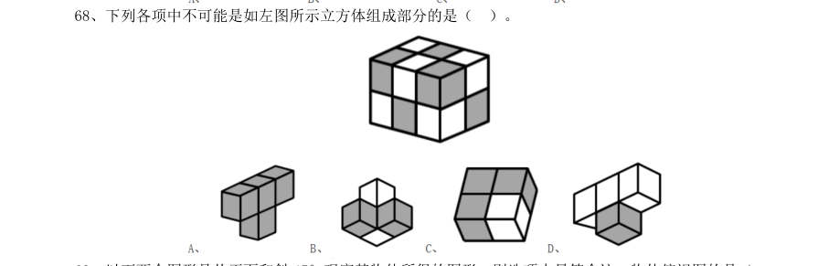

> （本题为图形题，选项为图片，见原卷）

**答案：D**

### 2020 广东·思维能力测验　第 71 题　（生活常识）

某单位组织趣味运动会,运动会一共安排了8 个项目,一个项目结束才进行下一个项目。如果每个 项目每支队伍都要派出4 人参加,同时每个队员参赛的项目不超过3 个。则每支队伍至少需要( )名队 员。

- **A.** 11
- **B.** 12
- **C.** 13
- **D.** 14

**答案：A**

### 2020 广东·思维能力测验　第 72 题　（其他常识（综合））

某学校对500 名学生进行了一次调查,结果显示,会游泳的学生比不会游泳的学生多34 人,而在会 游泳的学生中,会自由泳的学生只占1/3。则在500 名学生中,不会自由泳的学生比会自由泳的学生多( )人。

- **A.** 322
- **B.** 237
- **C.** 231
- **D.** 79

**答案：A**

### 2020 广东·思维能力测验　第 73 题　（其他常识（综合））

如图所示,一个边长为16 厘米的大正方形,在距离角一定距离位置处与对角线平行折叠四次,得到 中部小正方形的边长为4 厘米。如果CB 与大正方形的边平行,则三角形ABC 的面积为( )。

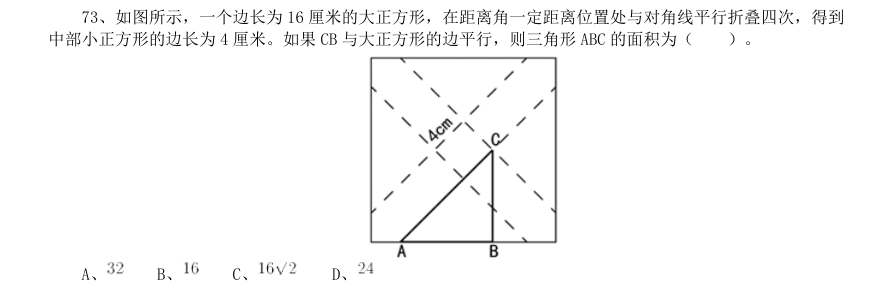

- **A.** 
- **B.** 
- **C.** 
- **D.** 

**答案：A**

### 2020 广东·思维能力测验　第 75 题　（其他常识（综合））

一个大的正方体的6 个面分别写有数字1~6,甲乙丙丁四人分别面对正方体的四个侧面,分别能看 到正方体的一个侧面和顶部。甲乙丙三人看到的正方体侧面和顶部的点数之和分别是4、9 和5,则正方体底 部的点数是( )。

- **A.** 4 或5
- **B.** 3 或4
- **C.** 2 或3
- **D.** 1 或2

**答案：A**

### 2020 广东·思维能力测验　第 76 题　（其他常识（综合））

甲、乙二人绕着圆形操场跑道散步,甲顺时针走,乙逆时针走。两人在跑道A 处同时出发,甲每分 钟走90 米,乙每分钟走60 米,当甲、乙两人在跑道B 处相遇时,乙加快了速度,甲在原地停留4 分钟后保 持原来的速度继续往前走,最后甲、乙二人仍在A 处相遇。已知该操场的周长为1800 米,那么相遇后,乙的 速度变为每分钟( )米。

- **A.** 70
- **B.** 80
- **C.** 90
- **D.** 100

**答案：C**

### 2020 广东·思维能力测验　第 78 题　（其他常识（综合））

服务大厅每天上午8 点半开始办理业务。某天8 点半,已经有15 位市民正在排队,并且每3 分钟都 会新增一位前来办理业务的市民。由于大厅只开放了3 个窗口,到10 点整时发现,仍有18 位市民正在排队。 如果每个窗口办理一项业务的时间相同,则大厅还需要至少再增开( )个窗口,才能在中午12 点前办理 完所有业务。

- **A.** 1
- **B.** 2
- **C.** 3
- **D.** 4

**答案：B**

### 2020 广东·思维能力测验　第 79 题　（其他常识（综合））

有一批边长为1 厘米的小正方体,其中一面涂红色的有400 个,相邻两面涂红色的有30 个,相邻三 面涂红色的有1 个,其余小正方体各面都没有涂颜色。用这一批小正方体组成一个大正方体,要求这个大正 方体有三个面是红色,且这三个面两两相邻,其余的三个面没有颜色。假如没有涂颜色的小正方体数量足够 多,那么这个正方体的边长最大是( )厘米。

- **A.** 10
- **B.** 11
- **C.** 12
- **D.** 13

**答案：B**

### 2020 广东·思维能力测验　第 80 题　（其他常识（综合））

某展览使用了序号为1~100 的100 盏灯,现在有两个开关,开关A 能切换所有序号为偶数的灯的开 关状态,开关B 能切换所有序号为3 的倍数的灯的开关状态。若在100 盏灯都打开的状态下,先后按下开关

- **A.** 和B,则还有( )盏灯处于打开状态。
- **B.** 34
- **C.** 49
- **D.** 50

**答案：C**

### 2020 广东·思维能力测验　第 83 题　（其他常识（综合））

, , , ,( )

> （本题为图形题，选项为图片，见原卷）

**答案：C**

### 2020 广东·思维能力测验　第 86 题　（其他常识（综合））

0.02,3.13,8.24,15.35,24.46,35.57,48.68,( )

- **A.** 63.79
- **B.** 73.89
- **C.** 66.79
- **D.** 76.89

**答案：A**

### 2020 广东·思维能力测验　第 90 题　（其他常识（综合））

（本题题干为图形/公式，文字层无题干，图见原卷）

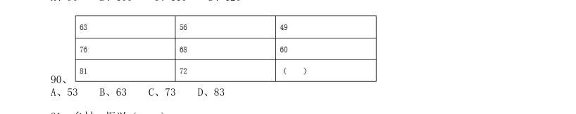

- **A.** 53
- **B.** 63
- **C.** 73
- **D.** 83

**答案：B**

### 2020 广东·思维能力测验　第 91 题　（其他常识（综合））

乡村:振兴( )

- **A.** 西部:开发
- **B.** 改革:创新
- **C.** 人才:强国
- **D.** 国际:合作

**答案：A**

### 2020 广东·思维能力测验　第 92 题　（生活常识）

计划:总结( )

- **A.** 跑步:运动
- **B.** 预习:复习
- **C.** 授权:审批
- **D.** 分析:统计

**答案：B**

### 2020 广东·思维能力测验　第 93 题　（其他常识（综合））

江河:湖海( )

- **A.** 名山:大川
- **B.** 风吹:雨打
- **C.** 日月:星辰
- **D.** 湖光:山色

**答案：C**

### 2020 广东·思维能力测验　第 94 题　（其他常识（综合））

电费:( )相当于 重量:( )

- **A.** 用电量 质量
- **B.** 水费 热量
- **C.** 电器 物体
- **D.** 功率 密度

**答案：A**

### 2020 广东·思维能力测验　第 95 题　（生活常识）

行距:( )相当于 品德:( )

- **A.** 段落 道德
- **B.** 字体 规范
- **C.** 排版 教育
- **D.** 缩小 高尚

**答案：C**

### 2020 广东·思维能力测验　第 96 题　（生活常识）

税务局:收税( )

- **A.** 医院:健康
- **B.** 回收站:分类
- **C.** 企业:投资
- **D.** 学校:教育

**答案：D**

### 2020 广东·思维能力测验　第 97 题　（其他常识（综合））

鹤发童颜:敬老尊贤( )

- **A.** 垂髫稚子:童言无忌
- **B.** 桃李芬芳:后生可畏
- **C.** 豆蔻年华:高风亮节
- **D.** 窈窕淑女:君子好逑

**答案：A**

### 2020 广东·思维能力测验　第 98 题　（其他常识（综合））

环保:发电:太阳能( )

- **A.** 民主:选举:选票
- **B.** 高效:配置:市场
- **C.** 公正:审判:法官
- **D.** 精准:扶贫:资金

**答案：C**

### 2020 广东·思维能力测验　第 99 题　（生活常识）

指纹:钥匙:密码( )

- **A.** 公交:地铁:客轮
- **B.** 月季:玫瑰:花朵
- **C.** 现金:信用卡:手机
- **D.** 宣纸:毛笔:狼毫

**答案：A**

### 2020 广东·思维能力测验　第 100 题　（其他常识（综合））

工人:齿轮:机械表( )

- **A.** 诗人:诗词:出版物
- **B.** 老师:教材:优等生
- **C.** 画家:画笔:画作
- **D.** 厨师:面粉:馒头

**答案：D**

### 2020 广东·综合行政能力测验　第 4 题　（生活常识）

今年是五四运动100 周年。以下关于五四运动表述错误的是( )。

- **A.** 五四运动是中国共产党领导的第一次爱国青年运动
- **B.** 五四运动是中国旧民主主义革命走向新民主主义革命的转折点
- **C.** 五四精神以爱国、进步、民主、科学为主要内容
- **D.** 五四运动具有彻底反帝反封建的革命性

**答案：A**

### 2020 广东·综合行政能力测验　第 5 题　（生活常识）

关于新时代我国社会主要矛盾的变化,下列说法有误的是( )。

- **A.** 我国社会主要矛盾已经转化为人民日益增长的美好生活需要和不平衡不充分的发展之间的矛盾
- **B.** 生产力水平低已经成为满足人民日益增长的美好生活需要的主要制约因素
- **C.** 我国社会主要矛盾的变化是关系全局的历史性变化,对党和国家工作提出了许多新要求
- **D.** 我国社会主要矛盾的变化,没有改变我们对我国社会主义所处历史阶段的判断

**答案：B**

### 2020 广东·综合行政能力测验　第 8 题　（其他常识（综合））

构建国土空间开发保护制度,完善主体功能区配套政策,建立以( )为主体的自然保护地体系。

- **A.** 生态保护区
- **B.** 生态发展区
- **C.** 自然公园
- **D.** 国家公园

**答案：D**

### 2020 广东·综合行政能力测验　第 9 题　（生活常识）

坚持和完善共建共治共享的社会治理制度,保持社会稳定、维护国家安全。以下举措不属于打造共建 共治共享的社会治理格局的是( )。

- **A.** 畅通民意表达渠道
- **B.** 依法有序的信息公开
- **C.** 降低城乡人口流动性
- **D.** 开展行业公共安全风险评估

**答案：C**

### 2020 广东·综合行政能力测验　第 17 题　（其他常识（综合））

2019 年7 月,展现新石器时代我国长江下游稻作文明发展程度的( )被正式列入“世界遗产名 录”。

- **A.** 马坝人遗址
- **B.** 南越王宫署遗址
- **C.** 平遥古城遗址
- **D.** 良渚古城遗址

**答案：D**

### 2020 广东·综合行政能力测验　第 19 题　（其他常识（综合））

2019 年9 月29 日,中华人民共和国( )颁授仪式在北京人民大会堂隆重举行。

- **A.** 和平勋章和友谊勋章
- **B.** “十一”勋章和军队功勋
- **C.** 人民满意的公务员和集体
- **D.** 国家勋章和国家荣誉称号

**答案：D**

### 2020 广东·综合行政能力测验　第 23 题　（生活常识）

为了降低食品袋中食物湿度,防止食品变质腐败,常常会在食品袋中放入干燥剂。下列干燥剂中, 其干燥原理与其他不同的是( )。

- **A.** 硅胶
- **B.** 活性炭
- **C.** 碱石灰
- **D.** 活性氧化铝

**答案：C**

### 2020 广东·综合行政能力测验　第 24 题　（其他常识（综合））

大雾天气,公路两旁路灯的灯光会变得朦胧,其主要原因是( )。

- **A.** 雾气吸收了路灯的光线
- **B.** 灯光照射在雾气上发生了散射
- **C.** 雾气吸附在灯罩表面,阻挡了灯光
- **D.** 雾气阻挡了人的视线

**答案：B**

### 2020 广东·综合行政能力测验　第 26 题　（其他常识（综合））

PUE 值是国际通用的数据中心电力使用效率指标,数据中心的冷却占机房总功耗的 ,降低机房制 冷的耗电量能有效降低PUE 值。为使大型云计算数据中心建设达到国际标准,以下计算数据中心建设选址不 是从利用自然环境降低PUE 这一方面考虑的是( )。

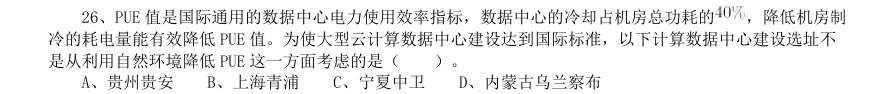

- **A.** 贵州贵安
- **B.** 上海青浦
- **C.** 宁夏中卫
- **D.** 内蒙古乌兰察布

**答案：B**

### 2020 广东·综合行政能力测验　第 27 题　（其他常识（综合））

2018 年,我国将每年农历“秋分”这一天设立为中国农民丰收节。如果按照“日出而作,日落而息” 的习惯,中国农民丰收节当天,下列地方的农民耕作时间(按北京时间)最早的是( )。

- **A.** 位于华北平原的北京市郊
- **B.** 位于珠江三角洲平原的广州市郊
- **C.** 绿茶产地,地处云贵高原的大理州
- **D.** “中国大豆之乡”,东北嫩江县

**答案：D**

### 2020 广东·综合行政能力测验　第 37 题　（其他常识（综合））

在我国,有人用“青如天,明如镜,薄如纸,声如磬”来形容优秀的( )作品。

- **A.** 漆器
- **B.** 瓷器
- **C.** 玉器
- **D.** 铜器

**答案：B**

### 2020 广东·综合行政能力测验　第 40 题　（生活常识）

某高校开设了《中国画鉴赏》选修课,其中一节课的内容是介绍明清两代的国画发展特点。则以下 画作适合作为例子给学生讲解介绍的是( )。

- **A.** 《簪花仕女图》——周昉
- **B.** 《果蔬图卷》——八大山人
- **C.** 《天王送子图》——吴道子
- **D.** 《洛神赋图》——顾恺之

**答案：B**

### 2020 国考·地市级　第 1 题　（其他常识（综合））

下列有关“不忘初心、牢记使命”主题教育的说法正确的是:

- **A.** 总要求是坚守初心使命,积极担当作为
- **B.** 根本任务是建设高素质党员干部队伍
- **C.** 把学习教育、调查研究、检视问题、整改落实贯穿主题教育全过程
- **D.** 具体目标是找差距、抓落实

**答案：C**

### 2020 国考·地市级　第 4 题　（其他常识（综合））

时代楷模是具有很强先进性、代表性、时代性和典型性的先进人物。下列时代楷模与事迹特点对应正确的是:

- **A.** 张富清—95 岁老党员的本色人生
- **B.** 杜富国—践行社会主义核心价值观的优秀知识分子
- **C.** 黄文秀—用生命担当使命的新时代英雄战士
- **D.** 黄大年—乡村教育守望者

**答案：A**

### 2020 国考·地市级　第 8 题　（其他常识（综合））

关于党在新时代的强军目标,下列说法正确的是:

- **A.** 力争到本世纪中叶基本实现国防和军队现代化
- **B.** 建设一支听党指挥、能打胜仗、作风优良的人民军队
- **C.** 到2035 年把人民军队全面建成世界一流军队
- **D.** 确保到2020 年全面实现机械化

**答案：B**

### 2020 国考·地市级　第 11 题　（生活常识）

甲乘坐公交车时因到站未停与司机发生争执,一怒之下抢夺正在行驶的公交车方向盘,致公交车失控撞到路 边电线杆,乘客及行人受伤、公交车严重受损。甲的行为构成:

- **A.** 以危险方法危害公共安全罪
- **B.** 交通肇事罪
- **C.** 寻衅滋事罪
- **D.** 危险驾驶罪

**答案：A**

### 2020 国考·地市级　第 15 题　（其他常识（综合））

下列言论中涉及到的人才选拔制度,按出现顺序先后排列正确的是: 1学通行修,经中博士 2宗室非有军功论,不得为属籍 3九品访人,唯问中正 4风吹金榜落凡世,三十三人名字香

- **A.** 2134
- **B.** 3241
- **C.** 2413
- **D.** 1324

**答案：A**

### 2020 国考·地市级　第 19 题　（生活常识）

下列关于生活现象的说法错误的是:

- **A.** 无风时落叶各处受空气作用力不均,因此呈曲线翻转落下
- **B.** 衣服湿后对光线的反射能力减弱,因此颜色比干的时候深
- **C.** 挂钟电池耗尽后,秒针因受到重力矩的作用,会停在30 秒的位置
- **D.** 自来水中含有少量次氯酸,因此不宜直接用自来水养鱼

**答案：C**

### 2020 国考·省级　第 8 题　（其他常识（综合））

关于党在新时代的强军目标,下列说法正确的是:

- **A.** 力争到本世纪中叶基本实现国防和军队现代化
- **B.** 建设一支听党指挥、能打胜仗、作风优良的人民军队
- **C.** 到2035 年把人民军队全面建成世界一流军队
- **D.** 确保到2020 年全面实现机械化

**答案：B**

### 2020 国考·省级　第 12 题　（生活常识）

关于陶瓷,下列说法错误的是:

- **A.** “入窑一色,出窑万彩”是钧瓷的特点
- **B.** 紫砂壶是用含铁量较高的黏土制成的
- **C.** 景德镇在宋代时期主要烧制青白瓷
- **D.** 唐三彩中最具代表性的造型是虎和骆驼

**答案：D**

### 2020 国考·省级　第 16 题　（生活常识）

关于能量与做功,下列说法正确的是:

- **A.** 雨点从高空中匀速下落时只有重力做功
- **B.** 匀速圆周运动的物体动能始终发生变化
- **C.** 自由落体过程中物体的机械能保持不变
- **D.** 向上飞的石子重力做负功导致势能减小

**答案：C**

### 2020 国考·省级　第 18 题　（生活常识）

关于塑料大棚,下列说法正确的是:

- **A.** 塑料大棚的薄膜能够提高光照强度
- **B.** 搭建塑料大棚能有效防御地质灾害
- **C.** 冬季在塑料大棚内熏烟有助于防御霜冻
- **D.** 无土栽培技术必须在塑料大棚中进行

**答案：C**
