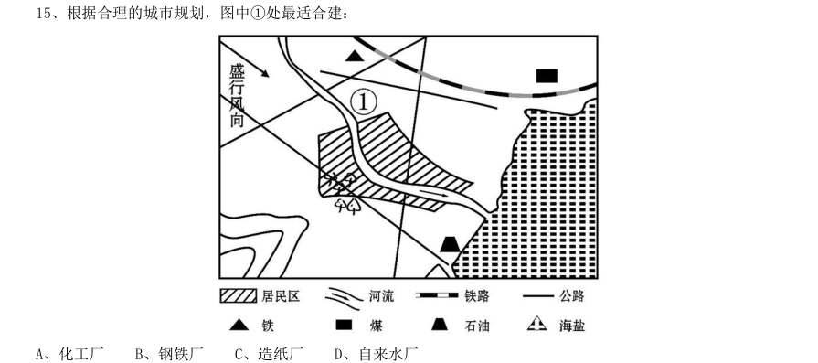
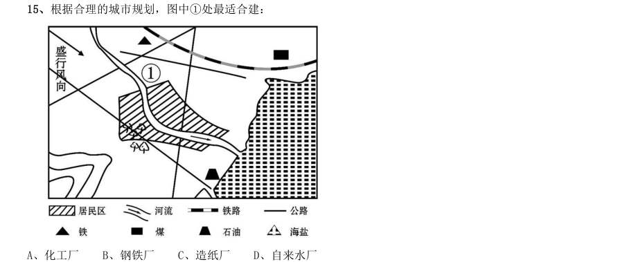

# 常识判断 · 时事政治 · 2010 年代真题

> 所属考点：[CS-SZ](../CS-SZ-时事政治.md)　｜　本片 21 题

> 本片子考点：政策文件 13　重要会议 7　时事政治（待细分） 1

### 【2019 湖北省考·第 1 题】HB-2019-ty-X001　时事政治｜重要会议

习近平总书记在中央政治局第十三次集体学习时强调,要精准有效处置重点领域风险,深化金融改革开放, 增强金融服务 能力,坚决打好防范化解包括金融风险在内的重大风险攻坚战,推动我国金融业健康发展。

- **A.** 实体经济
- **B.** 私营经济
- **C.** 中小企业
- **D.** 国有企业

**答案：A**

### 【2019 湖北省考（选调）·第 5 题】HB-2019-xd-X005　时事政治｜政策文件

党的十九大报告明确中国特色社会主义事业战略布局是:

- **A.** “五位一体”
- **B.** “四个全面”
- **C.** “四个意识”
- **D.** “四个自信”

**答案：B**

### 【2019 湖北省考（选调）·第 13 题】HB-2019-xd-X013　时事政治｜时事政治（待细分）

我们既对全面建成小康社会作出全面部署,又强调“小康不小康,关键看老乡”;既对全面深化改革作出顶 层设计,又强调突出抓好重要领域和关键环节的改革;既对全面推进依法治国作出系统部署,又强调以中国特色 社会主义法治体系为总目标和总抓手;既对全面从严治党提出系列要求,又把党风廉政建设作为突破口,着力解 决人民群众反映强烈的“四风”问题,着力解决不敢腐、不能腐、不想腐的问题。从唯物辩证法的角度看,这坚 持了:

- **A.** 对具体问题具体分析的工作方法
- **B.** “两点论”和“重点论”的统一
- **C.** “唯物论”和“辩证法”的统一
- **D.** 从实际出发实事求是的思想路线

**答案：B**

### 【2019 湖北省考（选调）·第 21 题】HB-2019-xd-X021　时事政治｜政策文件

2019 年中央1 号文件强调,坚持农业农村优先发展,各级党委和政府必须把落实“四个优先”的要求作为 做好“三农”工作的头等大事。“四个优先”是指: 1在政策制定上优先决策 2在干部配备上优先考虑 3在规划布局上优先编制 4在要素配置上优先满足5 在资金投入上优先保障 6在公共服务上优先安排

- **A.** 1234
- **B.** 1356
- **C.** 2456
- **D.** 2345

**答案：C**

### 【2019 湖北省考（选调）·第 35 题】HB-2019-xd-X035　时事政治｜重要会议

2018 年3 月11 日,第十三届全国人民代表大会第一次会议通过了《中华人民共和国宪法修正案(2018)》, 该修正案指出,中国特色社会主义最本质的特征是:

- **A.** 坚持人民民主专政
- **B.** 坚持民主集中制原则
- **C.** 坚持人民代表大会制度
- **D.** 坚持中国共产党的领导

**答案：D**

### 【2019 湖北省考（选调）·第 64 题】HB-2019-xd-X064　时事政治｜政策文件

2019 年3 月,李克强总理在十三届全国人大二次会议所作的政府工作报告中,宣布实施更大规模减税时, 人民大会堂内接连响起两次掌声。“减税降费”主要有利于:

- **A.** 提高财政收入
- **B.** 提振实体经济
- **C.** 提振股市行情
- **D.** 保持社会稳定

**答案：B**

### 【2019 广东省考（乡镇）·第 63 题】GD-2019-xz-X063　时事政治｜重要会议

2019 年3 月12 日,十三届全国人大二次会议举行第三次全体会议,听取审议最高人民法院工作报告和最高人 民检察院工作报告。这体现了人民代表大会的( )。

- **A.** 立法权
- **B.** 决定权
- **C.** 任免权
- **D.** 监督权

**答案：该题答案缺失，见原卷**

### 【2019 广东省考（思维能力测验）·第 8 题】GD-2019-sw-X008　时事政治｜政策文件

2017 年抑郁症调查报告显示,中国约有3%的人患有抑郁症。因此,如果2030 年中国人口达到15 亿, 届时,抑郁症患者人数约为4500 万。 上述论证最可能基于的潜在假设是()。

- **A.** 中国人口数量将持续增加
- **B.** 中国人口结构将保持稳定
- **C.** 到2030 年,中国人口中抑郁症患者的比例保持不变
- **D.** 到2030 年,仍未研发出能够有效防治抑郁症的药物

**答案：C**

### 【2019 国考（地市级）·第 2 题】GK-2019-ds-X002　时事政治｜政策文件

根据党的十九大报告,下列说法不准确的是:

- **A.** 发展是解决我国一切问题的基础和关键
- **B.** 完善就业保障是中华民族永续发展的千年大计
- **C.** 文化自信是一个国家、一个民族发展中更基本、更深沉、更持久的力量
- **D.** 带领人民创造美好生活是我们党始终不渝的奋斗目标

**答案：B**

### 【2019 国考（省级）·第 2 题】GK-2019-sj-X002　时事政治｜政策文件

根据党的十九大报告,下列说法不准确的是:

- **A.** 发展是解决我国一切问题的基础和关键
- **B.** 完善就业保障是中华民族永续发展的千年大计
- **C.** 文化自信是一个国家、一个民族发展中更基本、更深沉、更持久的力量
- **D.** 带领人民创造美好生活是我们党始终不渝的奋斗目标

**答案：B**

### 【2018 广东省考·第 73 题】GD-2018-ty-X073　时事政治｜政策文件

党的十九大报告指出:“中国特色社会主义进入新时代。”这一论断体现的哲学原理是( )。

- **A.** 事物是质变与量变的统一
- **B.** “两点论”与“重点论”的统一
- **C.** 矛盾是社会发展的动力
- **D.** 事物是普遍联系的

**答案：该题答案缺失，见原卷**

### 【2018 广东省考·第 75 题】GD-2018-ty-X075　时事政治｜重要会议

2018 年3 月11 日第十三届全国人民代表大会第一次会议通过《中华人民共和国宪法修正案》,确 立了( )是中国特色社会主义最本质的特征。

- **A.** 人民当家作主
- **B.** 中国共产党领导
- **C.** 解放和发展社会生产力
- **D.** 我国仍处于并将长期处于社会主义初级阶段

**答案：该题答案缺失，见原卷**

### 【2018 广东省考·第 76 题】GD-2018-ty-X076　时事政治｜政策文件

党的十九大报告提出“开启全面建设社会主义现代化国家新征程”。下列关于“社会主义现代化” 表述不准确的是( )。

- **A.** 把我国建成富强民主文明和谐的社会主义现代化强国
- **B.** “三步走”目标是我国社会主义现代化建设的战略安排
- **C.** 从十九大到二十大,是“两个一百年”奋斗目标的历史交汇期
- **D.** 实现社会主义现代化是新时代坚持和发展中国特色社会主义的总任务之一

**答案：该题答案缺失，见原卷**

### 【2016 国考（副省级）·第 15 题】GK-2016-fs-X015　时事政治｜政策文件

根据合理的城市规划,图中1处最适合建:

- **A.** 化工厂
- **B.** 钢铁厂
- **C.** 造纸厂
- **D.** 自来水厂

**答案：D**

### 【2016 国考（地市级）·第 15 题】GK-2016-ds-X015　时事政治｜政策文件

根据合理的城市规划,图中1处最适合建:

- **A.** 化工厂
- **B.** 钢铁厂
- **C.** 造纸厂
- **D.** 自来水厂

**答案：D**

### 【2015 湖北省考·第 1 题】HB-2015-ty-X001　时事政治｜重要会议

党的十八届三中全会审议通过了《中共中央关于全面深化改革若干重大问题的决定》(以下简称《决定》), 对全面深化改革作出了总体部署。在未来一个阶段,《决定》对普通公民的生活可能带来的改变有: 1、如果你要考大学,那么可能不必文理分科

> （本题为图形题，选项为图片，见原卷）

**答案：C**

### 【2014 广东省考（乡镇）·第 15 题】GD-2014-xz-X015　时事政治｜重要会议

广东省人民代表大会常务委员会于( )通过了《关于修改〈广东省人口与计划生育条例〉的决定》, “单独二孩”政策在我省开始实施。

- **A.** 2014 年1 月1 日
- **B.** 2014 年3 月27 日
- **C.** 2014 年6 月15 日
- **D.** 2014 年7 月1 日

**答案：该题答案缺失，见原卷**

### 【2013 湖北省考·第 1 题】HB-2013-ty-X001　时事政治｜政策文件
> 材料：注:此套题为联考题库,联考省份一般从里面抽110-120 题…

十八大报告提出“两个翻番”,到2020 年实现国内生产总值(GDP)和城乡居民人均收入比2010 年翻一番。 下列关于“两个翻番”,表述错误的是:

- **A.** 党的十八大首次对城乡居民收入增长提出了量化目标
- **B.** 到2020 年我国城乡居民每人收入预计都能够实现倍增
- **C.** 城乡居民人均收入翻番是GDP 翻番的出发点和落脚点
- **D.** 到2020 年我国GDP 预计将超过2000 年GDP 的4 倍

**答案：B**

### 【2011 湖北省考·第 100 题】HB-2011-ty-X100　时事政治｜政策文件

城市建设与发展过程中如果规划不当,到了炎热的夏天往往会出现热岛效应。下列有关热岛效应的表述 不正确的是:

- **A.** 热岛效应只会在大城市出现,中小城市不会出现这种情况
- **B.** 城市增加的车辆与住户的空调加剧了热岛效应
- **C.** 出现热岛效应的地方,温度比周围郊区一般要高两三度甚至四五度
- **D.** 城市高楼大厦越来越多,通风与气流不畅是造热岛效应的原因之一

**答案：A**

### 【2011 国考·第 1 题】GK-2011-ty-X001　时事政治｜政策文件

社会建设与人民幸福安康息息相关,党的十七大报告提出,要加快推进以改善民生为重点的社会建设,下列 各项不属于社会建设范畴的是:

- **A.** 在学校建立贫困生资助体系
- **B.** 为低收入家庭提供住房保障
- **C.** 扩大各项社会保险的覆盖范围
- **D.** 强化政府服务职能,建设服务型政府

**答案：D**

### 【2010 湖北省考·第 116 题】HB-2010-ty-X116　时事政治｜重要会议

2009 年,中共十七届四中全会强调,在新时期加强党的建设,应着重: 1坚持解放思想,坚持改革开放,创建和谐社会 2提高党的执政能力建设 3增强党员的责任感和使命感 4立法为公、执政为民 5加强党与人民群众的血肉联系

- **A.** 1234
- **B.** 2345
- **C.** 1345
- **D.** 1235

**答案：D**
