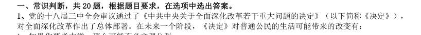

# 常识判断 · 时事政治 · 2010 年代真题

> 所属考点：[CS-SZ](../CS-SZ-时事政治.md)　｜　本片 21 题

### 2019 湖北·统一卷　第 1 题　（重要会议）

习近平总书记在中央政治局第十三次集体学习时强调,要精准有效处置重点领域风险,深化金融改革开放, 增强金融服务 能力,坚决打好防范化解包括金融风险在内的重大风险攻坚战,推动我国金融业健康发展。

- **A.** 实体经济
- **B.** 私营经济
- **C.** 中小企业
- **D.** 国有企业

**答案：A**

### 2019 湖北·选调　第 5 题　（重要会议）

党的十九大报告明确中国特色社会主义事业战略布局是:

- **A.** “五位一体”
- **B.** “四个全面”
- **C.** “四个意识”
- **D.** “四个自信”

**答案：B**

### 2019 湖北·选调　第 10 题　（时事政治（综合））

习近平总书记在哲学社会科学工作座谈会上说“在解读中国实践、构建中国理论上,我们应该最有发言权。” 中国实践给理论创造、学术繁荣提供了强大动力和广阔空间,中国哲学社会科学唯有深深植根于中国实践,从中 国特色社会主义伟大实践的源头汲取活水,方能具有强大的理论生命力。以上论述所蕴含的认识论原理是:

- **A.** 认识是否有客观真理性,这是个实践问题
- **B.** 实践是认识的基础,对认识具有决定作用
- **C.** 认识只有回到实践中去才能得到检验发展
- **D.** 认识是在实践基础上不断深化的发展过程

**答案：B**

### 2019 湖北·选调　第 21 题　（政策文件）

2019 年中央1 号文件强调,坚持农业农村优先发展,各级党委和政府必须把落实“四个优先”的要求作为 做好“三农”工作的头等大事。“四个优先”是指: 1在政策制定上优先决策 2在干部配备上优先考虑 3在规划布局上优先编制 4在要素配置上优先满足5 在资金投入上优先保障 6在公共服务上优先安排

- **A.** 1234
- **B.** 1356
- **C.** 2456
- **D.** 2345

**答案：C**

### 2019 湖北·选调　第 23 题　（时政热点）

实施乡村振兴战略,必须坚持城乡融合发展,加快形成新型工农城乡关系。新型工农城乡关系的内涵包括: 1工农互促 2以工促农 3城乡互补 4以城带乡 5全面融合 6一体统筹 7共同繁荣 8协调均衡

- **A.** 2468
- **B.** 1368
- **C.** 2457
- **D.** 1357

**答案：D**

### 2019 湖北·选调　第 64 题　（政策文件）

2019 年3 月,李克强总理在十三届全国人大二次会议所作的政府工作报告中,宣布实施更大规模减税时, 人民大会堂内接连响起两次掌声。“减税降费”主要有利于:

- **A.** 提高财政收入
- **B.** 提振实体经济
- **C.** 提振股市行情
- **D.** 保持社会稳定

**答案：B**

### 2019 广东·乡镇　第 63 题　（重要会议）

2019 年3 月12 日,十三届全国人大二次会议举行第三次全体会议,听取审议最高人民法院工作报告和最高人 民检察院工作报告。这体现了人民代表大会的( )。

- **A.** 立法权
- **B.** 决定权
- **C.** 任免权
- **D.** 监督权

**答案：暂缺**

### 2019 广东·乡镇　第 64 题　（时政热点）

人才是实施乡村振兴战略的关键因素。以下举措不属于推动乡村人才振兴的是( )。

- **A.** 大力支持乡村休闲旅游
- **B.** 实施新乡贤返乡工程
- **C.** 扩大“三支一扶”计划人员招募规模
- **D.** 完善农村劳动力技能培训补贴机制

**答案：暂缺**

### 2019 广东·乡镇　第 73 题　（时事政治（综合））

习近平总书记提出“绿水青山就是金山银山”的发展理念。以下最能体现这一理念的是( )。

- **A.** 精准扶贫
- **B.** 共建“一带一路”
- **C.** 实行“河长制”
- **D.** 加强知识产权保护

**答案：暂缺**

### 2019 国考·地市级　第 14 题　（时事政治（综合））

这幅图反映了某次重要会议,这次会议可能是:

- **A.** 巴黎和会
- **B.** 华盛顿会议
- **C.** 万隆会议
- **D.** 雅尔塔会议

**答案：B**

### 2018 湖北·统一卷　第 1 题　（重要会议）

中国共产党第十九届中央委员会第二次全体会议于2018 年1 月18 日至19 日在北京召开,会议的主要议程 是:

- **A.** 研究制定国民经济发展计划
- **B.** 研究全面从严治党的重大问题
- **C.** 讨论修改宪法部分内容的建议
- **D.** 研究党和政府机构改革的重大问题

**答案：C**

### 2018 国考·副省级　第 2 题　（政策文件）

关于2015 年中央军委改革工作会议召开以来进行的改革,下列说法错误的是:

- **A.** 全面停止军队有偿服务活动
- **B.** 组建中央军委联勤保障部队
- **C.** 军委机关由多部门制改为总部制
- **D.** 成立陆军领导机构和战略支援部队

**答案：C**

### 2016 国考·副省级　第 1 题　（重要会议）
> 材料：案。…

“四个全面”是新一届党的领导集体治国理政的战略布局。下列与“四个全面”有关的说法正确的是:

- **A.** 党的十八大通过了《中共中央关于全面深化改革若干重大问题的决定》
- **B.** 十八届三中全会通过了《中共中央关于全面推进依法治国若干重大问题的决定》
- **C.** 十八届四中全会提出了“全面建成小康社会”的战略目标
- **D.** 习近平总书记在江苏调研时将“从严治党”首次提升到“全面从严”的高度

**答案：D**

### 2016 国考·副省级　第 15 题　（政策文件）

根据合理的城市规划,图中1处最适合建:

- **A.** 化工厂
- **B.** 钢铁厂
- **C.** 造纸厂
- **D.** 自来水厂

**答案：D**

### 2016 国考·地市级　第 15 题　（政策文件）

根据合理的城市规划,图中1处最适合建:

- **A.** 化工厂
- **B.** 钢铁厂
- **C.** 造纸厂
- **D.** 自来水厂

**答案：D**

### 2015 湖北·统一卷　第 1 题　（重要会议）

党的十八届三中全会审议通过了《中共中央关于全面深化改革若干重大问题的决定》(以下简称《决定》), 对全面深化改革作出了总体部署。在未来一个阶段,《决定》对普通公民的生活可能带来的改变有: 1、如果你要考大学,那么可能不必文理分科

> （本题为图形题，选项为图片，见原卷）

**答案：C**

### 2011 湖北·统一卷　第 83 题　（重要会议）

在新民主主义革命和社会主义建设的重要关头,中国共产党成功地完成了三次重大转变:武装反抗国民党 反动派;工作重心由农村转向城市、由战争转向生产建设;拨乱反正,开辟了中国特色社会主义道路。以下四 项中哪一会议与这些转变无关:

- **A.** 十一届三中全会
- **B.** 八七会议
- **C.** 七届二中全会
- **D.** 遵义会议

**答案：A**

### 2011 湖北·统一卷　第 100 题　（政策文件）

城市建设与发展过程中如果规划不当,到了炎热的夏天往往会出现热岛效应。下列有关热岛效应的表述 不正确的是:

- **A.** 热岛效应只会在大城市出现,中小城市不会出现这种情况
- **B.** 城市增加的车辆与住户的空调加剧了热岛效应
- **C.** 出现热岛效应的地方,温度比周围郊区一般要高两三度甚至四五度
- **D.** 城市高楼大厦越来越多,通风与气流不畅是造热岛效应的原因之一

**答案：A**

### 2011 国考·统一卷　第 5 题　（时政热点）

2010 年7 月,党中央、国务院召开了西部大开发工作会议,总结西部大开发10 年取得的巨大成就和丰富经 验,全面分析国内外形势和西部大开发面临的新机遇、新挑战。 关于西部大开发战略,下列表述不正确的是:

- **A.** 西部大开发在我国区域协调发展总体战略中居于优先地位
- **B.** 西部大开发战略实施的最主要目的是解决沿海同内地的贫富差距
- **C.** 西部大开发覆盖地域指陕、甘、宁、青、新西北五省(区)及西藏自治区
- **D.** 实施西部大开发的核心工作是保障和改善民生

**答案：C**

### 2010 湖北·统一卷　第 123 题　（时事政治（综合））

下列属于后果预测法的有: 1德尔菲法 2对演法 3会议法 4集思广益法 5推理法

- **A.** 1234
- **B.** 24
- **C.** 135
- **D.** 12345

**答案：C**

### 2010 湖北·统一卷　第 130 题　（重要会议）

“政权是从枪杆子中打出来的”,毛泽东的这句话是在哪次会议中提出来的:

- **A.** 八七会议
- **B.** 遵义会议
- **C.** 古田会议
- **D.** 瓦窑堡会议

**答案：A**
