# 常识判断 · 政治常识 · 2020 年代真题

> 所属考点：[CS-ZZ](../CS-ZZ-政治常识.md)　｜　本片 139 题

> 本片子考点：新时代理论 92　政治常识（待细分） 25　马克思主义基本原理 13　毛中特与党史 9

### 【2026 湖北省考·第 13 题】HB-2026-ty-X013　政治常识｜毛中特与党史

加强数字政府建设是创新政府治理理念和方式、形成数字治理新格局、推进国家治理体系和治理能力现代化的 重要举措。下列关于数字政府建设的基本原则,表述正确的有几项? 1坚持党的全面领导,充分发挥党总揽全局、协调各方的领导核心作用 2坚持以市场为中心,始终把满足人民群众物质生活的迫切需求作为目标 3坚持整体协同,强化系统观念,加强系统集成,全面提升数字政府集约化建设水平 4坚持数据赋能,建立健全数据治理制度和标准体系,加强数据汇聚融合、共享开放和开发利用

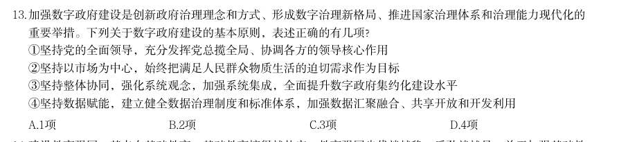

- **A.** 1项
- **B.** 2项
- **C.** 3项
- **D.** 4项

**答案：C**

### 【2026 湖北省考·第 14 题】HB-2026-ty-X014　政治常识｜政治常识（待细分）

建设教育强国,基点在基础教育。基础教育搞得越扎实,教育强国步伐就越稳、后劲就越足。关于加强基础教 育,下列举措正确的有几项? 1提升寄宿制学校办学条件和管理水平,办好必要的乡村小规模学校 2统筹推进市域内高中阶段学校多样化发展,加快扩大普通高中教育资源供给 3强化家庭教育主阵地作用,健全学校家庭社会协同育人机制 4建立基础教育各学段学龄人口变化监测预警制度,优化中小学和幼儿园布局 5深入开展县域义务教育优质均衡督导评估,有序推进市域义务教育优质均衡发展

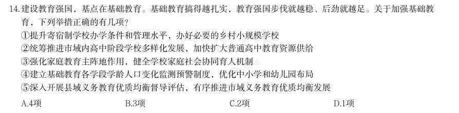

- **A.** 4项
- **B.** 3项
- **C.** 2项
- **D.** 1项

**答案：A**

### 【2026 湖北省考·第 15 题】HB-2026-ty-X015　政治常识｜政治常识（待细分）

优化政务服务、提升行政效能是优化营商环境、建设全国统一大市场的必然要求,对加快构建新发展格局、推 动高质量发展具有重要意义。关于优化政务服务、提升行政效能,下列举措恰当的是: 1推进关联事项集成办,为企业和群众提供“一件事一次办”“一类事一站办”服务 2推进线下办事“只进一门”,要求所有的银行网点、邮政网点、园区等都要设置便民服务点 3推进企业和群众诉求“一线应答”,根据需要设置重点领域专席,不断提升12345热线接办效率 4推进线上办事“一网通办”,推动各类政务服务事项和应用“应接尽接、应上尽上”,政府服务事项全面纳 入同级政务服务平台管理和办理

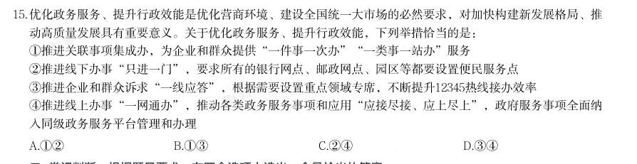

- **A.** 12
- **B.** 13
- **C.** 24
- **D.** 34

**答案：B**

### 【2026 湖北省考·第 16 题】HB-2026-ty-X016　政治常识｜毛中特与党史

中国共产党党报党刊的发展历程,与中国共产党的奋斗历程密不可分。下列说法错误的是:

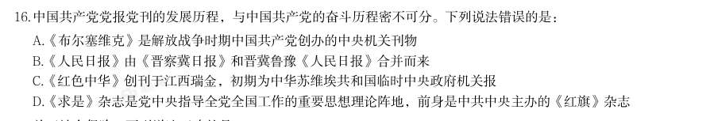

- **A.** 《布尔塞维克》是解放战争时期中国共产党创办的中央机关刊物
- **B.** 《人民日报》由《晋察冀日报》和晋冀鲁豫《人民日报》合并而来
- **C.** 《红色中华》创刊于江西瑞金,初期为中华苏维埃共和国临时中央政府机关报
- **D.** 《求是》杂志是党中央指导全党全国工作的重要思想理论阵地,前身是中共中央主办的《红旗》杂志

**答案：A**

### 【2026 广东省考·第 1 题】GD-2026-ty-X001　政治常识｜新时代理论
> 材料：(网友回忆版) (判断题)广东增创新优势、实现新突破,必须大力弘扬改革开放精神、特区精神,以全面深化改革开放推动 高质量发展。( )…

(判断题)农业农村现代化关系中国式现代化全局和成色。( )

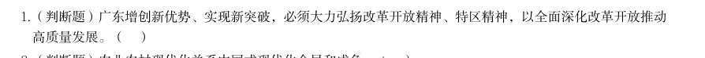

- **A.** 正确
- **B.** 错误

**答案：暂缺**

### 【2026 广东省考·第 2 题】GD-2026-ty-X002　政治常识｜新时代理论

(判断题)现代化产业体系是中国式现代化的物质技术基础。( )

- **A.** 正确
- **B.** 错误

**答案：暂缺**

### 【2026 广东省考·第 3 题】GD-2026-ty-X003　政治常识｜政治常识（待细分）

(判断题)生产关系是人类社会发展的根本动力,也是一切社会变迁和政治变革的终极原因。( )

- **A.** 正确
- **B.** 错误

**答案：暂缺**

### 【2026 广东省考·第 4 题】GD-2026-ty-X004　政治常识｜新时代理论

习近平总书记指出:“必须坚持守正创新。我们从事的是前无古人的伟大事业,守正才能不迷失方向,不犯颠 覆性错误,创新才能把握时代、引领时代。”关于守正创新,以下说法有误的是( )。

> （本题为图形题，选项为图片，见原卷）

**答案：暂缺**

### 【2026 广东省考·第 5 题】GD-2026-ty-X005　政治常识｜新时代理论

（本题题干为图形/公式，文字层无题干，图见原卷）

- **A.** 创新是守正的基础和前提
- **B.** 创新是守正的目的和路径
- **C.** 守正创新揭示了“变”与“不变”、继承与发展的辩证统一
- **D.** 守正就是坚持实事求是,坚持真理性认识,坚持正确的政治方向

**答案：A**

### 【2026 广东省考·第 6 题】GD-2026-ty-X006　政治常识｜新时代理论

推进碳达峰碳中和是党中央作出的重大战略决策,是我们对国际社会的庄严承诺,也是推动经济结构转型升 级、形成绿色低碳产业竞争优势,实现高质量发展的内在要求。以下有关推进碳达峰碳中和的表述,最准确的 是( )。

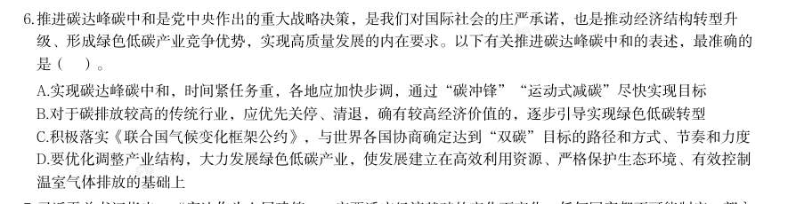

- **A.** 实现碳达峰碳中和,时间紧任务重,各地应加快步调,通过“碳冲锋”“运动式减碳”尽快实现目标
- **B.** 对于碳排放较高的传统行业,应优先关停、清退,确有较高经济价值的,逐步引导实现绿色低碳转型
- **C.** 积极落实《联合国气候变化框架公约》,与世界各国协商确定达到“双碳”目标的路径和方式、节奏和力度
- **D.** 要优化调整产业结构,大力发展绿色低碳产业,使发展建立在高效利用资源、严格保护生态环境、有效控制

**答案：D**

### 【2026 广东省考·第 7 题】GD-2026-ty-X007　政治常识｜新时代理论

温室气体排放的基础上 习近平总书记指出:“宪法作为上层建筑,一定要适应经济基础的变化而变化。任何国家都不可能制定一部永 远适用的宪法。”下列古语与这一观点最为契合的是( )。

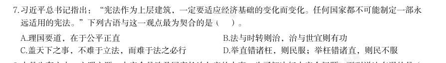

- **A.** 理国要道,在于公平正直
- **B.** 法与时转则治,治与世宜则有功
- **C.** 盖天下之事,不难于立法,而难于法之必行
- **D.** 举直错诸枉,则民服;举枉错诸直,则民不服

**答案：B**

### 【2026 广东省考·第 8 题】GD-2026-ty-X008　政治常识｜新时代理论

水是生存之本、文明之源,水安全是涉及国家长治久安的大事。为了解决好水安全问题,下列说法有误的是( )。

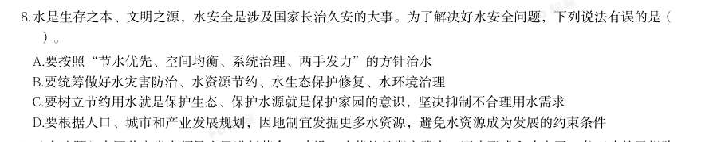

- **A.** 要按照“节水优先、空间均衡、系统治理、两手发力”的方针治水
- **B.** 要统筹做好水灾害防治、水资源节约、水生态保护修复、水环境治理
- **C.** 要树立节约用水就是保护生态、保护水源就是保护家园的意识,坚决抑制不合理用水需求
- **D.** 要根据人口、城市和产业发展规划,因地制宜发掘更多水资源,避免水资源成为发展的约束条件

**答案：D**

### 【2026 广东省考·第 9 题】GD-2026-ty-X009　政治常识｜马克思主义基本原理

(多选题)中国共产党在领导人民进行革命、建设、改革的长期实践中,逐步形成和确定了一条正确的思想路 线······这条思想路线是中国共产党对马克思主义理论发展作出的重大贡献,其核心是实事求是。关 于“实事求是”,以下表述正确的有( )。

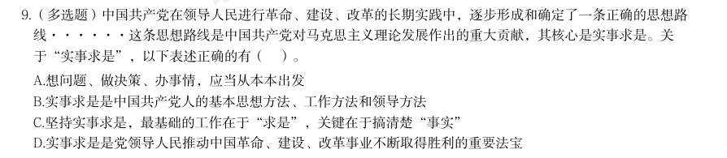

- **A.** 想问题、做决策、办事情,应当从本本出发
- **B.** 实事求是是中国共产党人的基本思想方法、工作方法和领导方法
- **C.** 坚持实事求是,最基础的工作在于“求是”,关键在于搞清楚“事实”
- **D.** 实事求是是党领导人民推动中国革命、建设、改革事业不断取得胜利的重要法宝

**答案：BD**

### 【2026 广东省考·第 10 题】GD-2026-ty-X010　政治常识｜马克思主义基本原理

(多选题)物质范畴是一切唯物主义哲学的理论基石。马克思主义的物质范畴是一个高度抽象的哲学概念,是 对世界上客观存在的各种事物共同本质的概括。关于马克思主义的物质范畴,下列选项正确的有( )。

- **A.** 物质的根本属性是运动
- **B.** 世界的本原是多种物质的集合
- **C.** 物质是标志客观实在的哲学范畴
- **D.** 物质资料的生产方式构成了人类社会存在的基础

**答案：暂缺**

### 【2026 国考（副省级）·第 1 题】GK-2026-fs-X001　政治常识｜新时代理论

习近平总书记强调,必须坚持自信自立。中国人民和中华民族从近代以后的深重苦难走向伟大 复兴的光明前景,从来就没有教科书,更没有现成答案。关于坚持自信自立,下列表述正确的有 几项? 1走自己的路,是党的全部理论和实践立足点,更是党百年奋斗得出的历史结论 2推进中国式现代化,必须坚持把国家和民族发展放在自己力量的基点上 3中国式现代化既要物质财富极大丰富,也要精神财富极大丰富、在思想文化上自信自强 4独立自主是中华民族的优良传统,是中国共产党、中华人民共和国立党立国的重要原则

- **A.** 1 项
- **B.** 2 项
- **C.** 3 项
- **D.** 4 项

**答案：D**

### 【2026 国考（副省级）·第 2 题】GK-2026-fs-X002　政治常识｜新时代理论

习近平总书记强调,科学制定和接续实施五年规划,是我们党治国理政一条重要经验,也是中 国特色社会主义一个重要政治优势。关于五年规划编制工作,下列说法正确的是:

- **A.** 我国五年规划(计划)编制工作起始于1949 年,有力推动了经济社会发展、综合国力提升、人民生活改善
- **B.** 中长期发展规划有助于充分发挥政府在资源配置中的决定性作用,彰显了政府对经济社会发展的宏观调控能力
- **C.** 从第一个五年计划到当前的五年规划,一以贯之的主题是把我国建设成为社会主义现代化国家
- **D.** 通过互联网就“十五五”规划编制向全社会征求意见和建议,在我国五年规划编制史上是第

**答案：C**

### 【2026 国考（副省级）·第 3 题】GK-2026-fs-X003　政治常识｜新时代理论

建设文化强国,事关中国式现代化建设全局,事关中华民族复兴大业,事关提升国际竞争力, 锚定2 035 年建成社会主义文化强国的战略目标,必须始终坚持文化建设着眼于人、落脚于人。 下列有关说法正确的是: 1文化强国之“强”最终要体现在为人民提供文化服务和文化产品的能力上 2坚持以人民为中心,着眼满足人民群众多样化、多层次、多方面的精神文化需求 3文化创造核心在人,要建设一支规模宏大、结构合理、锐意创新的高水平文化人才队伍 4尊重人才成长规律,完善符合文化领域特点的人才选拔、培养、使用、激励机制,营造识才、 重才、爱才的良好政策环境

- **A.** 123
- **B.** 234
- **C.** 124
- **D.** 134

**答案：B**

### 【2026 国考（副省级）·第 4 题】GK-2026-fs-X004　政治常识｜政治常识（待细分）

中共中央、国务院印发《加快建设农业强国规划(2024-2035 年)》,提出面对新形势新要 求,必须把加快建设农业强国作为统领“三农”工作的战略总纲,摆上建设社会主义现代化强 国的重要位置,下列与加快建设农业强国有关的说法正确的是:

- **A.** 推进生态综合补偿,健全横向生态保护补偿机制,统筹推进生态环境损害赔偿
- **B.** 建立健全长江流域信息共享系统,推进长江流域农业深度节水控水
- **C.** 完善粮食产销奖补制度,中央预算内投资向粮食主销区倾斜
- **D.** 推进农业科技推广体系,从经营性向公益性转变

**答案：A**

### 【2026 国考（副省级）·第 5 题】GK-2026-fs-X005　政治常识｜政治常识（待细分）

全面推进依法治国是一个系统工程,必须坚持法治国家、法治政府、法治社会一体建设。下列 相关表述不准确的是:

- **A.** 法治社会是构筑法治国家、法治政府的基础
- **B.** 建设法治政府对建设法治社会具有重要引领和带动作用
- **C.** 法治政府、法治社会建设必须服从、服务于法治国家建设
- **D.** 法治国家是依法治国的主体,是法治社会建设的先导和示范

**答案：D**

### 【2026 国考（副省级）·第 6 题】GK-2026-fs-X006　政治常识｜新时代理论

2025 年7 月,习近平总书记在中央城市工作会议上发表重要讲话,明确做好城市工作的总体 要求、重要原则、重点任务,为做好新时代新征程的城市工作提供了根本遵循。关于城市工作, 下列说法正确的是:

- **A.** 要把握“我国城镇化正从快速增长期转向稳定发展期”的历史方位
- **B.** 城市工作重心应向更加注重建设投入转变
- **C.** 着力通过外延扩张发展组团式的现代化城市群和都市圈
- **D.** 城市政府应从城市事务管理的“掌舵人”转变为“划桨人”

**答案：A**

### 【2026 国考（副省级）·第 7 题】GK-2026-fs-X007　政治常识｜新时代理论

经济工作千头万绪,必须统筹好有效市场和有为政府的关系、总供给和总需求的关系、培育新 动能和更新旧动能的关系、做优增量和盘活存量的关系、提升质量和做大总量的关系。下列相关 说法不准确的是:

- **A.** 要加快推动作为经济增长和就业收入基本依托的传统产业改造升级
- **B.** 要加快补上内需特别是消费短板,使内需成为拉动经济增长的主动力和稳定锚
- **C.** 要坚持以量取胜、充分发挥规模效应,用好超大规模市场优势和丰富应用场景
- **D.** 要用好各类增量资源和存量资源,通过盘活存量来带动增量

**答案：C**

### 【2026 国考（副省级）·第 8 题】GK-2026-fs-X008　政治常识｜新时代理论

2025 年7 月3 0 日,中共中央政治局召开会议,对扎实做好民生保障工作作了重要部署。下 列相关表述不准确的是:

- **A.** 巩固拓展脱贫攻坚成果,确保不发生规模性返贫致贫
- **B.** 夯实“三农”基础,推动粮食和重要农产品价格保持在合理水平
- **C.** 突出就业优先政策导向,促进高校毕业生、退役军人、农民工等重点群体就业
- **D.** 始终把人民群众财产安全放在第一位,加强安全生产监管

**答案：D**

### 【2026 国考（副省级）·第 9 题】GK-2026-fs-X009　政治常识｜新时代理论

做好新时代人口工作,要完善新时代人口发展战略,认识、适应、引领人口发展新常态,以人 口高质量发展支撑中国式现代化。关于做好新时代人口工作,下列说法正确的是:

- **A.** 要树立“大人口观”,推动人口与财政、货币、就业、产业、投资、消费、生态、区域等政策形成系统集成效应
- **B.** 必须推动人口工作由稳定总量、畅通流动向调节数量、优化结构转变
- **C.** 要更加重视“引导”和“激励”的办法,由社会治理向政府治理转变
- **D.** 坚持人民主体地位,把人口高速增长同人民高品质生活紧密结合起来

**答案：A**

### 【2026 国考（副省级）·第 10 题】GK-2026-fs-X010　政治常识｜政治常识（待细分）

《中共中央关于制定国民经济和社会发展第十五个五年规划的建议》提出,推进国家安全体 系和能力现代化,建设更高水平平安中国。下列有关说法正确的是:

- **A.** 锻造实战实用的国家安全能力,把捍卫国土安全摆在首位
- **B.** 统筹推进房地产、地方政府债务、中小金融机构等风险有序化解
- **C.** 健全国家安全体系,坚持以风险防控为先导、法治保障为落脚点
- **D.** 完善公共安全体系,推动公共安全治理模式由事后处理向事中控制转型

**答案：B**

### 【2026 国考（副省级）·第 11 题】GK-2026-fs-X011　政治常识｜新时代理论

习近平总书记高度重视战略思维,多次强调党员领导干部要加强战略思维,增强战略定力。 下列体现战略思维的说法,正确的有几项? 1粮食多一点少一点是战略问题,粮食安全是战术问题 2统战工作的本质要求是大团结大联合,解决的是人心和力量问题 3要心怀“国之大者”,站在全局和战略的高度想问题、办事情,一切工作都要以贯彻落实党 中央决策部署为前提 4自觉把党的对外工作放到党和国家工作大局中来认识,放到中国与世界关系的发展变化中来把 握

- **A.** 1 项
- **B.** 2 项
- **C.** 3 项
- **D.** 4 项

**答案：C**

### 【2026 国考（副省级）·第 12 题】GK-2026-fs-X012　政治常识｜新时代理论

习近平总书记指出,我们要建成的教育强国,是中国特色社会主义教育强国,应当具有强大 的思政引领力、人才竞争力、科技支撑力、民生保障力、社会协同力、国际影响力,为以中国式 现代化全面推进强国建设、民族复兴伟业提供有力支撑。关于建设教育强国,下列说法正确的 是:

- **A.** 要坚持教育均等化原则,把教育公平作为国家基本教育政策
- **B.** 要完善人才培养与经济社会发展需要适配机制,顺应时代发展要求,适度增加学科专业数量
- **C.** 要把引进全球顶尖科学家摆到更加突出位置,着力培育拔尖创新人才,推动实现高水平科技自立自强
- **D.** 从教育大国到教育强国是一个系统性跃升和质变,必须以改革创新为动力

**答案：D**

### 【2026 国考（副省级）·第 13 题】GK-2026-fs-X013　政治常识｜新时代理论

习近平主席在二十国集团领导人第十九次峰会上指出,要完善全球贸易治理,建设开放型世 界经济。下列相关表述正确的是:

- **A.** 要适应经济问题政治化的潮流,通过强化绿色低碳要求推行贸易保护政策
- **B.** 要积极构建更具平等性、包容性和建设性的产业链供应链伙伴关系,呼吁各方加强合作
- **C.** 要把安全置于国际经贸议程中心地位,持续推动贸易和投资自由化便利化
- **D.** 要一以贯之保持世界贸易组织规则不变,提高多边贸易体制的权威性、有效性和相关性

**答案：B**

### 【2026 国考（副省级）·第 14 题】GK-2026-fs-X014　政治常识｜新时代理论

中国式现代化要靠科技现代化作支撑,实现高质量发展要靠科技创新培育新动能。关于建成 科技强国的举措,下列说法正确的是:

- **A.** 要坚持有所为有所不为,突出经济发展需求,在重要领域实施科技战略部署
- **B.** 要充分发挥人才在科技资源配置中的决定性作用,调动产学研各环节的积极性
- **C.** 要充分发挥科技领军企业龙头作用,鼓励中小企业和民营企业科技创新,支持企业牵头或参与国家重大科技项目
- **D.** 要降低基础研究组织化程度,强化自由探索,鼓励面向重大科学问题的协同攻关

**答案：C**

### 【2026 国考（副省级）·第 15 题】GK-2026-fs-X015　政治常识｜新时代理论

习近平总书记强调,选人用人要加强党性鉴别,注重考察干部的境界格局和忠诚度廉洁度。 下列与党性相关的说法正确的是:

- **A.** 树立和践行正确政绩观,起决定性作用的是党性
- **B.** 强党性,就是要自觉用马克思主义思想改造客观世界
- **C.** 党性、党风、党纪是有机整体,党性是根本,党风是保障,党纪是表现
- **D.** 作风问题本质上是党性问题,要把作风建设摆在党性修养的首位

**答案：A**

### 【2026 国考（副省级）·第 16 题】GK-2026-fs-X016　政治常识｜新时代理论

坚持问题导向是习近平新时代中国特色社会主义思想的世界观和方法论的重要内容。关于坚 持问题导向,下列说法不准确的是:

- **A.** 坚持问题导向是马克思主义的鲜明特点
- **B.** 坚持问题导向要抓住人民最关心最直接最现实的利益问题
- **C.** 坚持问题导向体现了矛盾的普遍性和客观性
- **D.** 坚持问题导向本质是变与不变、继承与发展的辩证统一

**答案：D**

### 【2026 国考（副省级）·第 17 题】GK-2026-fs-X017　政治常识｜马克思主义基本原理

恩格斯深刻指出:“马克思的整个世界观不是教义,而是方法。它提供的不是现成的教条, 而是进一步研究的出发点和供这种研究使用的方法。”下列有关马克思主义理论的说法不准确 的是:

- **A.** 马克思创立了辩证法,成为我们认识世界和改造世界的根本方法
- **B.** 科学社会主义的原则不能丢,但科学社会主义也绝不是一成不变的教条
- **C.** 当代中国的伟大社会变革不是简单套用马克思主义经典作家设想的模板
- **D.** 《共产党宣言》发表至今,人类社会发生了翻天覆地的变化,但马克思主义所阐述的一般原理

**答案：A**

### 【2026 国考（副省级）·第 18 题】GK-2026-fs-X018　政治常识｜马克思主义基本原理

以实践为基础,从整体上把握人与世界的关系,是马克思主义世界观的重要内容。关于马克 思主义实践观,下列说法正确的是:

- **A.** 正确发挥主观能动性是实践的根本途径
- **B.** 实践的过程就是对于结果的检验和评价
- **C.** 实践是人类生存和发展最基本的活动
- **D.** 实践是一种无目的的适应环境的本能活动

**答案：C**

### 【2026 国考（副省级）·第 19 题】GK-2026-fs-X019　政治常识｜新时代理论

习近平总书记在对各省区市进行深入考察调研的过程中,结合各地实际情况,对推进高质量 发展作出一系列重要部署。下列对应关系正确的是:

- **A.** 江苏——要建设国家资源型经济转型综合配套改革试验区,重点抓好能源转型、产业升级和适度多元发展
- **B.** 山东——要发挥海洋资源丰富的得天独厚优势,经略海洋、向海图强,打造世界级海洋港口群,打造现代海洋经济发展高地
- **C.** 云南——要把握好挑大梁的着力点,在推动科技创新和产业创新融合上打头阵
- **D.** 贵州——聚焦实现贸易、投资、跨境资金流动、人员进出、运输来往自由便利和数据安全有序

**答案：B**

### 【2026 国考（副省级）·第 20 题】GK-2026-fs-X020　政治常识｜新时代理论

2025 年是中国人民抗日战争暨世界反法西斯战争胜利80 周年。中国人民对战争带来的苦难 有着刻骨铭心的记忆,对和平有着孜孜不倦的追求。关于中国人民抗日战争,下列表述不准确的 是:

- **A.** 中国人民抗日战争的伟大胜利,是以爱国主义为核心的民族精神的伟大胜利
- **B.** 中国人民抗日战争的伟大胜利,第一次确立了中国在世界上的大国地位,使中国人民赢得了世界爱好和平人民的尊敬
- **C.** 中国人民抗日战争的伟大胜利,是近代以来中国抗击外敌入侵的第一次完全胜利
- **D.** 中国人民抗日战争的伟大胜利,为中华民族由近代以来陷入深重危机走向伟大复兴确立了历史

**答案：B**

### 【2025 湖北省考·第 1 题】HB-2025-ty-X001　政治常识｜新时代理论

习近平总书记指出,现代化产业体系是现代化国家的物质技术基础,关于现代化产业体系建设,下列表述正确 的有几项? 1坚持把发展经济的着力点放在国有企业上 2推动制造业高端化、智能化、绿色化发展 3推动战略性新兴产业融合集群发展 4推动现代服务业同先进制造业、现代农业深度融合 5优化基础设施布局、结构、功能和系统集成,构建现代化基础设施体系

- **A.** 5项
- **B.** 4项
- **C.** 3项
- **D.** 2项

**答案：B**

### 【2025 湖北省考·第 2 题】HB-2025-ty-X002　政治常识｜新时代理论

习近平总书记指出,我们要坚定不移走中国特色社会主义政治发展道路,坚持和完善我国根本政治制度、基本 政治制度、重要政治制度,不断健全人民当家作主制度体系。以下哪项是我国根本政治制度:

- **A.** 党领导的多党合作和政治协商制度
- **B.** 人民代表大会制度
- **C.** 民族区域自治制度
- **D.** 基层群众自治制度

**答案：B**

### 【2025 湖北省考·第 3 题】HB-2025-ty-X003　政治常识｜新时代理论

习近平总书记强调,要坚持城乡融合发展,畅通城乡要素流动。关于城乡融合发展,下列说法正确的有几项? 1城乡融合发展是中国式现代化的必然要求 2推进以乡镇为重要载体的新型城镇化建设,发展各具特色的乡镇经济 3发展新型农村集体经济,构建产权明晰、分配合理的运行机制 4完善覆盖农村人口的常态化防止返贫致贫机制 5允许农户合法拥有的住房通过出租、入股、合作等方式盘活利用

- **A.** 1项
- **B.** 2项
- **C.** 3项
- **D.** 4项

**答案：D**

### 【2025 湖北省考·第 4 题】HB-2025-ty-X004　政治常识｜新时代理论

习近平总书记指出,人心是最大的政治,统一战线是凝聚人心、汇聚力量的强大法宝,关于统一战线,下列表 述正确的是: 1统战工作的本质要求是大团结大联合,解决的就是人心和力量问题 2统一战线是党领导的统一战线,其最鲜明的特征是坚持以人民为中心 3发展壮大爱国爱港爱澳力量,增强港澳同胞的爱国精神,形成更广泛的国内外支持“一国两制”的统一战线 4关键是要坚持求同存异,发扬“团结一批评一团结”的优良传统,在尊重多样性中寻求一致性

- **A.** 123
- **B.** 124
- **C.** 134
- **D.** 234

**答案：C**

### 【2025 湖北省考·第 5 题】HB-2025-ty-X005　政治常识｜新时代理论

习近平总书记指出,纵观人类历史,教育兴则国家兴,教育强则国家强,世界强国无一不是教育强国,教育始 终是强国兴起的关键因素。关于建设教育强国,下列表述正确的有几项? 1要坚持不懈用新时代中国特色社会主义思想铸魂育人,着力加强社会主义核心价值观教育 2必须以坚持党对教育事业的全面领导为根本保证 3坚持把高速高效发展作为各级各类教育的生命线 4建设教育强国,龙头是义务教育

- **A.** 1项
- **B.** 2项
- **C.** 3项
- **D.** 4项

**答案：B**

### 【2025 湖北省考·第 6 题】HB-2025-ty-X006　政治常识｜新时代理论

党的二十届三中全会提出,高水平社会主义市场经济体制是中国式现代化的重要保障,关于构建高水平社会主 义市场经济体制,下列举措不恰当的是:

- **A.** 完善市场准入制度,优化新业态新领域市场准入环境
- **B.** 推动市场基础制度规则统一、市场监管公平统一、市场设施高标准联通
- **C.** 加强财政政策和货币政策协调配合,着力扩大内需,增强消费对优化供给结构的基础性作用
- **D.** 建立国有企业履行战略使命评价制度,完善国有企业分类考核评价体系,开展国有经济增加值核算

**答案：C**

### 【2025 湖北省考·第 7 题】HB-2025-ty-X007　政治常识｜政治常识（待细分）

坚定理想信念,坚守共产党人精神追求,始终是共产党人安身立命的根本。关于推动理想信念教育常态化制度 化,下列表述不恰当的是:

- **A.** 形成网上思想道德教育统一化、标准化实施机制
- **B.** 建立健全道德领域突出问题协同治理机制,完善“扫黄打非”长效机制
- **C.** 健全诚信建设长效机制,教育引导全社会自觉遵守法律,遵循公序良俗
- **D.** 优化英模人物宣传学习机制,创新爱国主义教育和各类群众性主题活动组织机制

**答案：A**

### 【2025 湖北省考·第 8 题】HB-2025-ty-X008　政治常识｜政治常识（待细分）

统一开放的交通运输市场是有效衔接供需、促进国民经济循环畅通的重要基础,关于加快建设统一开放的交通 运输市场,下列举措不恰当的是:

- **A.** 建立交通运输装备能源清洁替代机制,保障规划实施全类运输工具应用新能源、清洁能源
- **B.** 对交通运输领域招标投标、政府采购等相关规章制度按照有关规定进行公平竞争审查
- **C.** 依托全国一体化大数据中心协同创新体系布局,构建综合交通大数据中心体系
- **D.** 防止利用数据、算法、技术等手段排除限制竞争、侵害从业人员合法权益

**答案：A**

### 【2025 湖北省考·第 9 题】HB-2025-ty-X009　政治常识｜新时代理论

习近平总书记指出,如期实现建军一百年奋斗目标,加快把人民军队建成世界一流军队,是全面建设社会主义 现代化国家的战略要求。关于实现建军一百年奋斗目标,下列举措恰当的是: 1加强军史学习教育,繁荣发展强军文化,强化战斗精神培育 2加强军人军属荣誉激励和权益保障,做好退役军人服务保障工作 3积极开展军事斗争,塑造安全态势,遏控危机冲突,阻止局部战争 4研究掌握信息化智能化战争特点规律,创新军事战略指导,发展人民战争战略战术

- **A.** 123
- **B.** 124
- **C.** 134
- **D.** 234

**答案：B**

### 【2025 湖北省考·第 10 题】HB-2025-ty-X010　政治常识｜新时代理论

习近平总书记强调,现代化产业体系是现代化国家的物质技术基础,必须把发展经济的着力点放在实体经济 上,为实现第二个百年奋斗目标提供坚强物质支撑。下列与之相关说法正确的有几项? 1推进实施绿色发展战略,充分发挥绿色化赋能实体经济发展效应 2促进数字技术和实体经济深度融合,催生新产业新业态新模式替代传统产业 3重视现代服务业的发展,推动现代服务业与先进制造业、现代农业深度融合 4推动重点产业在国内外有序转移、促进国内外产业深度融合与实体经济发展相结合

- **A.** 1
- **B.** 2
- **C.** 3
- **D.** 4

**答案：C**

### 【2025 湖北省考·第 11 题】HB-2025-ty-X011　政治常识｜政治常识（待细分）

题目正在全力以赴征集,将会第一时间上传。(正确答案默认设置为A项。)

- **A.** 缺失
- **B.** 缺失
- **C.** 缺失
- **D.** 缺失

**答案：D**

### 【2025 湖北省考·第 12 题】HB-2025-ty-X012　政治常识｜政治常识（待细分）

题目正在全力以赴征集,将会第一时间上传。(正确答案默认设置为A项。)

- **A.** 缺失
- **B.** 缺失
- **C.** 缺失
- **D.** 缺失

**答案：B**

### 【2025 湖北省考·第 13 题】HB-2025-ty-X013　政治常识｜新时代理论

习近平总书记强调,要加强新时代廉洁文化建设,教育引导广大党员、干部增强不想腐的自觉,清清白白做 人、干干净净做事。下列属于加强新时代廉洁文化建设的举措有几项? 1开办红色廉洁文化专题展览,在红色教育中传承党的廉洁基因 2对新入职党员、干部及时开展廉洁教育,扣好年轻干部廉洁从政第一粒扣子 3注重从优秀传统家训家规中汲取营养,开展红色家风传承活动 4挖掘历史文献、文化经典、文物古迹中的廉洁思想,整理古圣先贤、清官廉吏的嘉言懿行

- **A.** 1项
- **B.** 2项
- **C.** 3项
- **D.** 4项

**答案：D**

### 【2025 湖北省考·第 14 题】HB-2025-ty-X014　政治常识｜新时代理论

党的二十大强调,国家安全是民族复兴的根基,社会稳定是国家强盛的前提,必须坚定不移贯彻总体国家安全 观,把维护国家安全贯穿党和国家工作各方面全过程,确保国家安全和社会稳定。下列表述不正确的是:

- **A.** 坚持党中央对国家安全工作的集中统一领导,完善高效权威的国家安全领导体制
- **B.** 坚持安全第一、应急为主,建立大安全大应急框架,完善公共安全体系
- **C.** 加强海外安全保障能力建设,维护我国公民、法人在海外合法权益
- **D.** 强化食品药品安全监管,健全生物安全监管预警防控体系

**答案：B**

### 【2025 广东省考·第 1 题】GD-2025-ty-X001　政治常识｜新时代理论
> 材料：重大成果,其中“第二个结 合”是指把马克思主义基本原理同中华优秀传统文化相结合。( )…

(判断题)科技创新能够催生新产业、新模式、新动能,是发展新质生产力的核心要素。( )

- **A.** 正确
- **B.** 错误

**答案：暂缺**

### 【2025 广东省考·第 2 题】GD-2025-ty-X002　政治常识｜新时代理论

(判断题)国家安全是中国式现代化行稳致远的重要基础。( )

- **A.** 正确
- **B.** 错误

**答案：暂缺**

### 【2025 广东省考·第 3 题】GD-2025-ty-X003　政治常识｜马克思主义基本原理

(判断题)科学性是马克思主义理论区别于其他理论的根本特征。( )

- **A.** 正确
- **B.** 错误

**答案：暂缺**

### 【2025 广东省考·第 4 题】GD-2025-ty-X004　政治常识｜政治常识（待细分）

古人说:“志之所趋,无远勿届,穷山距海,不能限也。志之所向,无坚不入,锐兵精甲,不能御也。”下列 好干部的标准与这一古语的意思最为接近的是( )。

> （本题为图形题，选项为图片，见原卷）

**答案：B**

### 【2025 广东省考·第 5 题】GD-2025-ty-X005　政治常识｜政治常识（待细分）

（本题题干为图形/公式，文字层无题干，图见原卷）

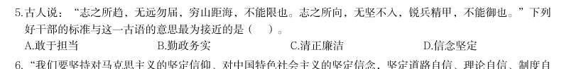

- **A.** 敢于担当
- **B.** 勤政务实
- **C.** 清正廉洁
- **D.** 信念坚定

**答案：D**

### 【2025 广东省考·第 6 题】GD-2025-ty-X006　政治常识｜新时代理论

“我们要坚持对马克思主义的坚定信仰、对中国特色社会主义的坚定信念,坚定道路自信、理论自信、制度自 信、文化自信,以更加积极的历史担当和创造精神为发展马克思主义作出新的贡献,既不能刻舟求剑、封闭僵 化,也不能照抄照搬、食洋不化。”这段话最能体现习近平新时代中国特色社会主义思想( )的立场观点方 法。

- **A.** 必须坚持问题导向
- **B.** 必须坚持守正创新
- **C.** 必须坚持自信自立
- **D.** 必须坚持胸怀天下

**答案：C**

### 【2025 广东省考·第 7 题】GD-2025-ty-X007　政治常识｜新时代理论

习近平指出,法律是成文的道德,道德是内心的法律。法治和德治不可分离、不可偏废,国家治理需要法律和 道德协同发力。下列关于思想道德和法律的认识不正确的是( )。

- **A.** 思想道德和法律都是上层建筑的重要组成部分
- **B.** 思想道德建设为法治建设提供思想指引和价值基础
- **C.** 思想道德是调节人们思想的重要手段,但法律不是
- **D.** 法治建设为思想道德建设提供制度支撑和法律保障

**答案：C**

### 【2025 广东省考·第 8 题】GD-2025-ty-X008　政治常识｜政治常识（待细分）

坚持以人民为中心的发展思想,体现了党的理想信念、性质宗旨、初心使命,也是对党的奋斗历程和实践经验 的深刻总结。领导人在不同场合不多次强调,必须坚持人民至上。以下选项最能体现必须坚持人民至上这一理 念的是( )。

- **A.** 能用众力,则无敌于天下矣;能用众智,则无畏于圣人矣
- **B.** 与天下同利者,天下持之;擅天下之利者,天下谋之
- **C.** 贤良之士众,则国家之治厚;贤良之士寡,则国家之治薄
- **D.** 畏则不敢肆而德以成,无畏则从其所欲而及于祸

**答案：B**

### 【2025 广东省考·第 9 题】GD-2025-ty-X009　政治常识｜新时代理论

(多选题)习近平总书记说,一百年来,中国共产党团结带领中国人民,以“为有牺牲多壮志,敢教日月换新 天”的大无畏气概,书写了中华民族几千年历史上最恢宏的史诗。以下有关党的奋斗历程的表述符合历史事实 的有( )。

- **A.** 中国早期马克思主义思想运动,没有明确的与第二国际的社会民主主义划清界线
- **B.** 第一次国共合作发生在新民主主义革命时期
- **C.** 在社会主义建设时期,中共中央制定了“三步走”现代化发展战略
- **D.** 党在社会主义初级阶段的基本路线的核心内容是“一个中心、两个基本点”

**答案：BD**

### 【2025 广东省考·第 10 题】GD-2025-ty-X010　政治常识｜新时代理论

(多选题)一个民族要走在时代前列,就一刻不能没有理论思维,一刻不能没有正确思想指引。中国共产党为 什么能,中国特色社会主义为什么好,归根到底是马克思主义行,是中国化时代化的马克思主义行。唯物辩证 法是马克思主义世界观和方法论的核心内容,为人们认识世界和改造世界提供了根本方法。以下关于唯物辩证 法的认识正确的有( )。

- **A.** 矛盾分析法在唯物辩证法的方法论体系中居于核心地位
- **B.** 唯物辩证法是客观辩证法在人的思维中的反映
- **C.** 分析与综合不属于提高辩证思维能力的方法
- **D.** 唯物辩证法本质上是批判的和革命的

**答案：ABD**

### 【2025 国考（副省级）·第 1 题】GK-2025-fs-X001　政治常识｜新时代理论

习近平总书记指出,马克思主义是为人民立言、为人民代言的理论,是为改变人民命运而创立、在人民求解放 的实践中丰富和发展的,人民的创造性实践是马克思主义理论创新的不竭源泉。下列说法与这一论述相符的 是: 1人民不仅是物质财富的创造者,也是精神财富的创造者 2要坚持以理论工作者的首创精神为引领,注重从理论创新中总结实践经验 3无论是毛泽东思想、中国特色社会主义理论体系,还是习近平新时代特色社会主义思想,无不源自于人民的 智慧、人民的探索、人民的创造 4各级领导干部身处实践最前沿,对实践变化感知最敏感、感受最深切,也最聪慧

- **A.** 12
- **B.** 13
- **C.** 24
- **D.** 34

**答案：B**

### 【2025 国考（副省级）·第 2 题】GK-2025-fs-X002　政治常识｜新时代理论

习近平总书记指出,问题是事物矛盾的表现形式,我们强调增强问题意识、坚持问题导向,就是承认矛盾的普 遍性、客观性,就是要善于把认识和化解矛盾作为打开工作局面的突破口。关于矛盾的普遍性、客观性,下列 说法正确的是:

- **A.** 矛盾的普遍性是有条件的,并根据条件的变化而变化
- **B.** 矛盾的客观性从属于主观性,不能脱离人的认知、情感、意志而存在
- **C.** 矛盾的普遍性是矛盾的共性,矛盾的特殊性是矛盾的个性
- **D.** 矛盾的普遍性、客观性决定了事物的不同性质,是认清事物本质和发展规律的基础

**答案：C**

### 【2025 国考（副省级）·第 3 题】GK-2025-fs-X003　政治常识｜马克思主义基本原理

关于马克思主义政治经济学,下列说法正确的是:

- **A.** 商品的价值量是由生产该商品所需的个别劳动时间决定的
- **B.** 货币的价值尺度职能是通过实际的物质交换来实现的
- **C.** 具体劳动和抽象劳动是不同商品生产过程中的不同劳动
- **D.** 具体劳动创造商品的使用价值,抽象劳动形成商品的价值

**答案：D**

### 【2025 国考（副省级）·第 4 题】GK-2025-fs-X004　政治常识｜新时代理论

习近平总书记指出:“中国共产党人的理想信念,建立在马克思主义科学真理的基础之上,建立在马克思主义 揭示的人类社会发展规律的基础之上,建立在为最广大人民谋利益的崇高价值的基础之上。我们坚定,是因为 我们追求的是真理。我们坚定,是因为我们遵循的是规律。我们坚定,是因为我们代表的是最广大人民根本利 益。”这一论述最直接体现了马克思主义的哪一基本观点?

- **A.** 真理尺度与价值尺度的辩证统一
- **B.** 认识世界与改造世界的辩证统一
- **C.** 量变与质变的辩证统一
- **D.** 矛盾的特殊性与普遍性的辩证统一

**答案：A**

### 【2025 国考（副省级）·第 5 题】GK-2025-fs-X005　政治常识｜新时代理论

高质量发展是全面建设社会主义现代化国家的首要任务,金融要为经济社会发展提供高质量服务。下列与之相 关的表述不准确的是:

- **A.** 优化资金供给结构,把更多金融资源用于促进科技创新、绿色发展、传统制造和国有企业
- **B.** 要着力营造良好的货币金融环境,切实加强对重大战略、重点领域和薄弱环节的优质金融服务
- **C.** 始终保持货币政策的稳健性,更加注重做好跨周期和逆周期调节,充实货币政策工具箱
- **D.** 完善机构定位,支持国有大型金融机构做优做强,当好服务实体经济的主力军和维护金融稳定的压舱石

**答案：A**

### 【2025 国考（副省级）·第 6 题】GK-2025-fs-X006　政治常识｜新时代理论

习近平总书记强调,粮食安全是“国之大者”。下列保障粮食安全的举措正确的有几项? 1全面落实粮食安全党政同责,坚持稳面积、增单产两手发力 2树立大农业观、大食物观,农林牧渔并举,构建多元化食物供给体系 3加大高标准农田建设投入和管护力度,确保耕地数量有保障、质量有提升 4扩大粮食领域高水平对外开放,逐步加大国外优质种业资源和海外粮食产品在我国市场的占有率 5强化科技和改革双轮驱动,加大核心技术攻关力度

- **A.** 2项
- **B.** 3项
- **C.** 4项
- **D.** 5项

**答案：C**

### 【2025 国考（副省级）·第 7 题】GK-2025-fs-X007　政治常识｜新时代理论

习近平总书记强调,要坚定不移贯彻新发展理念,更加自觉地把高质量充分就业作为经济社会发展的优先目 标。下列关于高质量充分就业的表述正确的是: 1全面贯彻劳动者自主就业、政府主导就业、市场促进就业的方针 2坚持扩大就业容量和提升就业质量相结合 3坚持就业带动创业 4加强灵活就业和新就业形态劳动者权益保障,扩大职业伤害保障试点

- **A.** 12
- **B.** 13
- **C.** 24
- **D.** 34

**答案：C**

### 【2025 国考（副省级）·第 8 题】GK-2025-fs-X008　政治常识｜毛中特与党史

党的十八大以来,在推进全面从严治党的伟大实践中,我们不断进行实践探索和理论思考,在毛泽东同志当年 给出“让人民来监督政府”的第一个答案基础上,给出了第二个答案,那就是不断推进党的自我革命。关于深 入推进党的自我革命实践,下列表述不准确的是:

- **A.** 以引领伟大社会革命为根本目的
- **B.** 以跳出历史周期率为战略目标
- **C.** 以解决大党独有难题为主攻方向
- **D.** 以自我监督和法律监督相结合为强大动力

**答案：D**

### 【2025 国考（副省级）·第 9 题】GK-2025-fs-X009　政治常识｜毛中特与党史

总书记指出,要加强科技基础能力建设,深化科技体制改革,打造科创高地。关于深化科技体制改革,下列表 述正确的是:

- **A.** 建立以竞争性支持取代稳定支持的基础研究投入机制
- **B.** 允许科研类事业单位实行比一般事业单位更灵活的管理制度
- **C.** 限制开展高风险、高投入基础研究
- **D.** 降低科技人员在科技成果转化收益分配上的自主权

**答案：B**

### 【2025 国考（副省级）·第 10 题】GK-2025-fs-X010　政治常识｜毛中特与党史

完善收入分配制度,构建初次分配、再分配、第三次分配协调配套的制度体系,是进一步全面深化改革的重要 任务。关于完善收入分配制度,下列表述不准确的是:

- **A.** 提高劳动报酬在初次分配中的比重
- **B.** 完善劳动者工资决定、合理增长、支付保障机制,健全按要素分配政策制度
- **C.** 规范财富积累机制,多渠道增加城乡居民财产性收入
- **D.** 完善税收、社会保障、转移支付等第三次分配调节机制

**答案：D**

### 【2025 国考（副省级）·第 11 题】GK-2025-fs-X011　政治常识｜新时代理论

习近平总书记强调,要牢牢扭住自主创新这个“牛鼻子”。关于自主创新的举措,下列表述正确的有几项? 1主动对接国家战略需求,整合和优化科教创新资源 2培育产业园区,加强对口合作,加快科研成果落地转化 3培育新能源、新材料、先进制造、电子信息等战略性新兴产业 4建设风光火核储一体化能源基地 5逐步弱化央地合作,鼓励各地自主发展新兴产业

- **A.** 2项
- **B.** 3项
- **C.** 4项
- **D.** 5项

**答案：C**

### 【2025 国考（副省级）·第 12 题】GK-2025-fs-X012　政治常识｜新时代理论

党的二十届三中全会提出,要稳步扩大制度型开放。关于稳步扩大制度型开放,下列举措不恰当的是:

- **A.** 独立自主构建不同于国际经贸规则的中国特色经贸规则体系
- **B.** 有序扩大我国商品市场、服务市场、资本市场、劳务市场等对外开放
- **C.** 积极参与全球经济治理体系改革,提供更多全球公共产品
- **D.** 扩大对最不发达国家单边开放

**答案：A**

### 【2025 国考（副省级）·第 13 题】GK-2025-fs-X013　政治常识｜新时代理论

习近平总书记指出,宣传思想文化工作事关党的前途命运,事关国家长治久安,事关民族凝聚力和向心力,是 一项极端重要的工作。宣传思想文化工作的首要政治任务是:

- **A.** 培育和践行社会主义核心价值观
- **B.** 用党的创新理论武装全党、教育人民
- **C.** 提升国家文化软实力和中华文化影响力
- **D.** 赓续中华文脉、推动中华优秀传统文化创造性转化和创新性发展

**答案：B**

### 【2025 国考（副省级）·第 14 题】GK-2025-fs-X014　政治常识｜新时代理论

完善大统战工作格局,是习近平总书记关于做好新时代党的统一战线工作的重要思想的重要内容,是做好新时 代统战工作的重要保障,也是进一步全面深化改革、为推进中国式现代化凝心聚力的重要举措。下列各项不属 于完善大统战格局措施的是:

- **A.** 更好发挥党外人士作用,健全党外代表人士队伍建设制度
- **B.** 制定民族团结进步促进法,健全铸牢中华民族共同体意识制度机制
- **C.** 全面构建亲清政商关系,健全促进非公有制经济健康发展、非公有制经济人士健康成长工作机制
- **D.** 健全人大议事规则和论证、评估、评议、听证制度

**答案：D**

### 【2025 国考（副省级）·第 15 题】GK-2025-fs-X015　政治常识｜新时代理论

党的二十届三中全会提出,健全绿色低碳发展机制,实施支持绿色低碳发展的财税、金融、投资、价格政策和 标准体系,发展绿色低碳产业,健全绿色消费激励机制,促进绿色低碳循环发展经济体系建设。关于健全绿色 低碳发展机制,下列举措不恰当的是:

- **A.** 优化政府绿色采购政策,完善绿色税制
- **B.** 建立碳排放双控向能耗双控全面转型新机制
- **C.** 完善资源总量管理和全面节约制度,健全废弃物循环利用体系
- **D.** 加快规划建设新型能源体系,完善新能源消纳和调控政策措施

**答案：B**

### 【2025 国考（副省级）·第 16 题】GK-2025-fs-X016　政治常识｜毛中特与党史

深化医药卫生体制改革,是进一步全面深化改革的重要任务。关于深化医药卫生体制改革,下列举措不恰当的 是:

- **A.** 促进优质医疗资源扩容下沉和区域均衡布局
- **B.** 加快建设分级诊疗体系,强化基层医疗卫生服务
- **C.** 完善公立医院薪酬制度,严格限制、缩减编制数量
- **D.** 促进医疗、医保、医药协同发展和治理

**答案：C**

### 【2025 国考（副省级）·第 17 题】GK-2025-fs-X017　政治常识｜新时代理论

完善市场经济基础制度是构建高水平社会主义市场经济体制的重要内容。下列不属于完善市场经济基础制度内 容的是:

- **A.** 完善财政转移支付体系
- **B.** 完善市场信息披露制度
- **C.** 完善市场准入制度
- **D.** 完善产权制度

**答案：A**

### 【2025 国考（副省级）·第 18 题】GK-2025-fs-X018　政治常识｜新时代理论

习近平总书记强调,加强党风廉政建设,一体推进不敢腐、不能腐、不想腐,严格落实中央八项规定精神,督 促党员、干部特别是领导干部清廉自守、廉洁从政、干净做事。根据《中国共产党纪律处分条例》,下列违纪 情况属于违反廉洁纪律的是:

- **A.** 在重大原则问题上不同党中央保持一致且有实际言论、行为或者造成不良后果的
- **B.** 拒不执行党组织的分配、调动、交流等决定的
- **C.** 干涉生产经营自主权,致使群众财产遭受较大损失的
- **D.** 滥用职权或者职务上的影响操办婚丧喜庆事宜,造成不良影响的

**答案：D**

### 【2025 国考（副省级）·第 19 题】GK-2025-fs-X019　政治常识｜新时代理论

习近平总书记指出,要推动各级领导班子认真践行正确政绩观,切实形成正确工作导向。下列表述与正确政绩 观要求相符合的是:

- **A.** 领导干部要树牢竞争优先、力争上游的政绩观
- **B.** 坚持高质量发展,要完善推动高质量发展的政绩考核评价办法
- **C.** 坚持打基础利长远,要注重在做强发展指标、做优发展数据上下功夫
- **D.** 坚持出实招求实效,要大力发展高标准、大气派的工程

**答案：B**

### 【2025 国考（副省级）·第 20 题】GK-2025-fs-X020　政治常识｜新时代理论

西部地区在全国改革发展稳定大局中举足轻重。要一以贯之抓好党中央推动西部大开发政策举措的贯彻落实, 进一步形成大保护、大开放、高质量发展新格局。关于新时代推动西部大开发,下列表述不正确的是:

- **A.** 要坚持把全面发展新兴产业作为主攻方向,加快西部地区产业转型升级
- **B.** 要坚持以大开放促进大开发,提高西部地区对内对外开放水平
- **C.** 要坚持统筹发展和安全,提升能源资源等重点领域安全保障能力
- **D.** 要坚持推进新型城镇化和乡村全面振兴有机结合,在发展中保障和改善民生

**答案：A**

### 【2025 国考（地市级）·第 3 题】GK-2025-ds-X003　政治常识｜马克思主义基本原理

关于马克思主义政治经济学,下列说法正确的是:

- **A.** 商品的价值量是由生产该商品所需的个别劳动时间决定的
- **B.** 货币的价值尺度职能是通过实际的物质交换来实现的
- **C.** 具体劳动和抽象劳动是不同商品生产过程中的不同劳动
- **D.** 具体劳动创造商品的使用价值,抽象劳动形成商品的价值

**答案：D**

### 【2025 国考（行政执法）·第 3 题】GK-2025-zf-X003　政治常识｜马克思主义基本原理

关于马克思主义政治经济学,下列说法正确的是:

- **A.** 商品的价值量是由生产该商品所需的个别劳动时间决定的
- **B.** 货币的价值尺度职能是通过实际的物质交换来实现的
- **C.** 具体劳动和抽象劳动是不同商品生产过程中的不同劳动
- **D.** 具体劳动创造商品的使用价值,抽象劳动形成商品的价值

**答案：D**

### 【2024 湖北省考·第 1 题】HB-2024-ty-X001　政治常识｜新时代理论

习近平新时代中国特色社会主义思想是当代中国马克思主义、21世纪马克思主义。下列对此理解正确的有几 项: 1党的十九大把习近平新时代中国特色社会主义思想确立为党必须长期坚持的指导思想并庄严地写入党章 2习近平新时代中国特色社会主义思想是马克思主义中国化最新成果,是当今时代最现实、最鲜活的马克思主 义 3今天我们所处的时代同马克思所处的时代相比发生了巨大而深刻的变化,已经脱离了马克思主义所指明的历 史时代 4习近平新时代中国特色社会主义思想,始终把马克思主义作为中国共产党人的“真经”,始终坚持马克思主 义基本原理

- **A.** 1项
- **B.** 2项
- **C.** 3项
- **D.** 4项

**答案：C**

### 【2024 湖北省考·第 2 题】HB-2024-ty-X002　政治常识｜新时代理论

2023年,《习近平著作选读》第一卷、第二卷出版发行,这是党和国家政治生活中的一件大事。下列著作内容 和篇名对应正确的是:

- **A.** 生态环境是关系党的使命宗旨的重大政治问题,也是关系民生的重大社会问题——《加强生态文明建设必须坚持的原则》
- **B.** 做好新形势下宣传思想工作,必须自觉承担起举旗帜、聚民心、育新人、兴文化、展形象的使命任务——《开展党史学习教育要突出重点》
- **C.** 我们说的共同富裕是全体人民共同富裕,是人民群众物质生活和精神生活都富裕,不是少数人的富裕,也不是整齐划一的平均主义——《在全国脱贫攻坚总结表彰大会上的讲话》
- **D.** “两个维护”要体现在坚决贯彻党中央决策部署的行动上,体现在履职尽责、做好本职工作的实效上,体现

**答案：A**

### 【2024 广东省考·第 1 题】GD-2024-ty-X001　政治常识｜新时代理论
> 材料：(判断题)中国特色社会主义制度的最大优势是中国共产党领导。…

(判断题)党确立习近平同志党中央的核心、全党的核心地位,确立习近平新时代中国特色社会主义思想的指 导地位,反映了全党全军全国各族人民的共同心愿。

- **A.** 正确
- **B.** 错误

**答案：暂缺**

### 【2024 广东省考·第 5 题】GD-2024-ty-X005　政治常识｜新时代理论

中国共产党是为中国人民谋幸福、为中华民族谋复兴的党,也是为人类谋进步、为世界谋大同的党。我们要拓 展世界眼光,深刻洞察人类发展进步潮流,积极回应各国人民普遍关切,为解决人类面临的共同问题作出贡 献,以海纳百川的宽阔胸襟借鉴吸收人类一切优秀文明成果,推动建设更加美好的世界。这段话最能体现习近 平新时代中国特色社会主义思想( )的立场观点方法。

> （本题为图形题，选项为图片，见原卷）

**答案：C**

### 【2024 广东省考·第 9 题】GD-2024-ty-X009　政治常识｜新时代理论

2023年4月,习近平总书记在广东视察时指出,粤港澳大湾区在全国新发展格局中具有重要战略地位,以下不 属于粤港澳大湾区战略地位的是( )。

- **A.** 具有世界凝合力的双向开放枢纽
- **B.** 新发展格局的战略支点
- **C.** 高质量发展的示范地
- **D.** 中国式现代化的引领地

**答案：A**

### 【2024 广东省考·第 10 题】GD-2024-ty-X010　政治常识｜新时代理论

2024年2月,广东召开全省高质量发展大会,会议强调,推进产业科技创新,发展新质生产力是广东的战略之 举、长远之策。以下有关广东高质量发展要求的表述,不准确的是( )。

- **A.** 要坚持以开放促改革、促创新
- **B.** 要持续营造有利于创新的政策和制度环境
- **C.** 要全力支持高校做创新的主角,推动创新资源向高校集聚
- **D.** 要依托市场优势吸聚创新资源,运用市场机制兑现创新价值

**答案：C**

### 【2024 广东省考·第 14 题】GD-2024-ty-X014　政治常识｜马克思主义基本原理

(多选题)马克思主义道德观认为,人类社会的实际情况是“物质生活的生产方式制约着整个社会生活、政治 生活和精神生活的过程。”关于道德起源问题,以下认识正确的有( )。

- **A.** 劳动是道德起源的首要前提
- **B.** 道德起源于人与生俱来的善性
- **C.** 社会关系是道德赖以产生的客观条件
- **D.** 人的自我意识是道德产生的主观条件

**答案：ACD**

### 【2024 国考（副省级）·第 1 题】GK-2024-fs-X001　政治常识｜新时代理论

习近平总书记强调,在五千多年中华文明深厚基础上开辟和发展中国特色社会主义两个结合,关于后半个结 合,下列理解正确的有( )项。 1结合的前提是彼此契合,马克思主义和中华优秀传统文化彼此存在高度契合性 2结合的结果是互相成就,造就了一个有机统一的新的文化生命体 3结合筑牢了道路根基,让中国特色社会主义道路有了更加宏阔深远的历史纵深 4结合打开了创新空间,让我们在被动顺应中迎来思想和文化的繁荣 5结合巩固文化主体性,创立新时代中国特色社会主义思想就是这一文化主体性的最有力体现

- **A.** 5
- **B.** 4
- **C.** 3
- **D.** 2

**答案：B**

### 【2024 国考（副省级）·第 2 题】GK-2024-fs-X002　政治常识｜马克思主义基本原理

习总书记强调,要引导民营企业和民营企业家正确理解党中央方针政策,增强信心、轻装上阵、大胆发展,实 现民营经济健康发展、高质量发展。关于推动民营经济高质量发展,下列选项正确的是( )。 1民营企业要践行新发展理念,转变发展方式、调整产业结构、转换增长动力,坚守主业、做强实业,自觉走 高质量发展路子 2有能力、有条件的民营企业要加强自主创新,在推进科技自立自强和科技成果转化中发挥更大作用 3要激发民间资本投资活力,鼓励和吸引民间资本参与互联网投资和境外投资,为促进国内外双循环做出更大 贡献 4要依法规范和引导各类资本健康发展,有效防范化解系统性金融风险,为各类所有制企业创造公平竞争、竞 相发展的环境

- **A.** 124
- **B.** 123
- **C.** 134
- **D.** 234

**答案：A**

### 【2024 国考（副省级）·第 3 题】GK-2024-fs-X003　政治常识｜新时代理论

习总书记强调,要大兴调查研究之风,深入了解群众需求,切实解决广大老百姓关心关切的利益问题,不断提 高人民群众的获得感、幸福感、安全感,关于调查研究正确的有几项? 1调查研究是我们党的传家宝,是做好各项工作的基本功 2要大兴务实之风,抓好调查研究,在察实情、出实招、求实效上下功夫 3检验调查研究成效,要看是否摸清社情民意、是否解决实际问题 4调查研究是了解情况的主要渠道,不能通过二手材料了解情况

- **A.** 4
- **B.** 3
- **C.** 2
- **D.** 1

**答案：B**

### 【2024 国考（副省级）·第 4 题】GK-2024-fs-X004　政治常识｜新时代理论

习近平总书记强调全面建设社会主义现代化国家,扎实推进共同富裕,最艰巨最繁重的任务仍然在农村,必须 逐步缩小城乡差距。下列符合党和国家政策精神的是( )。 1积极推进以建制镇为重要载体的新型城镇化建设,构建以建制镇为枢纽的县镇经济体系 2持续实施动态监测,不断增强脱贫地区内生发展动力,坚决守住不发生规模性返贫底线 3因地制宜大力发展特色产业,推进农村一、二、三产业融合发展 4持续深化农村人居环境整治,加强传统村落和乡村特色风貌保护,加强农村精神文明建设

- **A.** 123
- **B.** 124
- **C.** 234
- **D.** 134

**答案：C**

### 【2024 国考（副省级）·第 5 题】GK-2024-fs-X005　政治常识｜新时代理论

习近平总书记强调,实现党在新时代新征程的使命任务,党的建设和组织工作要有新担当新作为。关于深入推 进新时代党的建设新的伟大工程,下列表述正确的有几项? 1以坚持和加强党中央集中统一领导为最高原则 2以忠诚为党护党、全力兴党强党为根本使命 3以解决大党独有难题、健全全面从严治党体系为重大任务 4以加强党的组织体系建设为主线 5以党的制度建设为统领,以坚定理想信念宗旨为根基

- **A.** 2项
- **B.** 3项
- **C.** 4项
- **D.** 5项

**答案：B**

### 【2024 国考（副省级）·第 8 题】GK-2024-fs-X008　政治常识｜毛中特与党史

2022年11月28日,中共中央办公厅、国务院办公厅发布《乡村振兴责任制实施办法》。下列与乡村振兴责任制 有关的说法不准确的是:

- **A.** 坚持党对农村工作的全面领导,省市县乡村五级书记抓乡村振兴
- **B.** 中央和国家机关有关部门要以健全城乡融合发展体制为主线深化农村改革
- **C.** 地方政府乡村振兴要把确保粮食和重要农产品供给作为首要任务
- **D.** 县级党委和政府是乡村振兴“一线指挥部”

**答案：B**

### 【2024 国考（地市级）·第 1 题】GK-2024-ds-X001　政治常识｜新时代理论

习近平总书记指出,我们要坚守人民至上理念,突出现代化方向的人民性。关于现代化方向的人民性,下列表 述正确的有几项? 1人民是历史的创造者,是推进现代化最坚实的根基、最深厚的力量 2现代化道路最终能否走得通、行得稳,关键要看是否坚持以人民为中心 3现代化不仅要看纸面上的指标数据,更要看人民的幸福安康 4政党要锚定人民对美好生活的向往,让现代化更好回应人民各方面诉求和多层次需要

- **A.** 1项
- **B.** 2项
- **C.** 3项
- **D.** 4项

**答案：D**

### 【2024 国考（地市级）·第 2 题】GK-2024-ds-X002　政治常识｜新时代理论

习近平总书记指出,农业强国是社会主义现代化强国的根基,满足人民美好生活需要、实现高质量发展、夯实 国家安全基础,都离不开农业发展。下列关于建设农业强国的表述正确的是: 1农业科技创新要以农业关键核心技术攻关为引领,以促进大规模经营为导向 2要坚持把增加农民收入作为“三农”工作的中心任务 3要一体推进农业现代化和农村现代化,实现乡村由表及里、形神兼备的全面提升 4扩大耕地面积是建设农业强国的首要任务

- **A.** 13
- **B.** 14
- **C.** 23
- **D.** 24

**答案：C**

### 【2024 国考（地市级）·第 7 题】GK-2024-ds-X007　政治常识｜新时代理论

在2023年7月召开的全国生态环境保护大会上,习近平总书记全面总结我国生态文明建设取得的举世瞩目的巨 大成就,精辟概括了“四个重大转变”,这四个重大转变是: 1实现由重点整治到系统治理的重大转变 2实现由被动应对到主动作为的重大转变 3实现由全球环境治理参与者到引领者的重大转变 4实现由实践探索到科学理论指导的重大转变 5实现由多重压力叠加到单一结构性压力的重大转变

- **A.** 1234
- **B.** 1235
- **C.** 2345
- **D.** 1345

**答案：A**

### 【2024 国考（行政执法）·第 8 题】GK-2024-zf-X008　政治常识｜新时代理论

为深入学习贯彻习近平新时代中国特色社会主义思想,全面贯彻落实党的二十大精神,党中央决定,在全党大 兴调查研究,作为在全党开展的主题教育的重要内容。下列与调查研究有关的说法不准确的是:

- **A.** 调查研究是中国共产党克敌制胜的“三大法宝”之一
- **B.** “没有调查,没有发言权”是针对“左”倾主义提出的
- **C.** 1961 年是党史上有名的“调查研究年”、“实事求是年”
- **D.** 《寻乌调查》是毛泽东调查研究的经典之作

**答案：A**

### 【2023 湖北省考·第 5 题】HB-2023-ty-X005　政治常识｜新时代理论

习近平总书记常以回信的形式问候、勉励广大干部群众和专家学者。下列习近平总书记 回信原文和出处的对应关系正确的是:

- **A.** “你们长年在山崖间清洁环境,日复一日呵护着千年迎客松,用心用情守护美丽的黄山,充分体现了敬业奉献精神”——给“中国好人”李培生、胡晓春的回信
- **B.** “希望同志们大力弘扬爱国奉献、开拓创新、艰苦奋斗的优良传统,积极践行绿色发展理念”——给外文出版社的外国专家的回信
- **C.** “你们通过课堂学习和支教实践,增长了学识,开阔了眼界”——给陆军步兵学院2022届全体学员的回信
- **D.** “建设航天强国要靠一代代人接续奋斗”——给中国航空工业集团沈飞“罗阳青年突击

**答案：A**

### 【2023 广东省考（乡镇）·第 1 题】GD-2023-xz-X001　政治常识｜政治常识（待细分）

我国将采取有力措施全面推进乡村振兴,巩固脱贫成果。要在守住不发生规模性返贫底线 的基础上,__________、再接再厉,朝着实现农业农村现代化的目标接续奋斗。

- **A.** 运筹帷幄
- **B.** 急流勇进
- **C.** 逆流而上
- **D.** 乘势而上

**答案：D**

### 【2023 广东省考（乡镇）·第 11 题】GD-2023-xz-X011　政治常识｜新时代理论

中国式现代化是我们党领导全国各族人民在长期探索和实践中历经千辛万苦、付出巨大 代价取得的重大成果,党的领导与中国式现代化关系正确的是( )。 1党的领导决定中国式现代化的根本性质 2党的领导确保中国式现代化锚定奋斗目标行稳致远 3党的领导激发建设中国式现代化的强劲动力 4党的领导凝聚建设中国式现代化的磅礴力量

- **A.** 123
- **B.** 124
- **C.** 134
- **D.** 1234

**答案：D**

### 【2023 广东省考（乡镇）·第 19 题】GD-2023-xz-X019　政治常识｜政治常识（待细分）

高质量发展是全面建设社会主义现代化国家的首要任务。2023 年1 月28 日,广东召开 全省高质量发展大会。关于广东的高质量发展,下列表述不正确的是( )。

- **A.** 坚持把发展经济的着力点放在数字经济上
- **B.** 打造更多享誉世界的广东产品、广东企业、广东产业
- **C.** 扎实抓好“双区”和横琴、前海、南沙三大平台建设
- **D.** 实施“百县千镇万村高质量发展工程”,推动产业有序转移

**答案：A**

### 【2023 广东省考（乡镇）·第 22 题】GD-2023-xz-X022　政治常识｜毛中特与党史

毛泽东同志说:“我们共产党人从来不隐瞒自己的政治主张。我们的将来纲领或最高纲 领,是要将中国推进到社会主义社会和共产主义社会去的,这是确定的和毫无疑义的。”这 段话出自( )。

- **A.** 《井冈山的斗争》
- **B.** 《中国共产党在抗日时期的任务》
- **C.** 《论联合政府》
- **D.** 《论十大关系》

**答案：C**

### 【2023 广东省考（乡镇）·第 26 题】GD-2023-xz-X026　政治常识｜政治常识（待细分）

根据《中华人民共和国乡村振兴促进法》,下列说法错误的是( )。

- **A.** 国家实行永久基本农田保护制度
- **B.** 每年农历秋分日为中国农民丰收节
- **C.** 各级人民政府应当采取措施发挥村规民约积极作用
- **D.** 县级人民代表大会应当对本县乡村振兴战略实施情况进行评估

**答案：D**

### 【2023 国考（行政执法）·第 7 题】GK-2023-zf-X007　政治常识｜新时代理论

根据《中华人民共和国乡村振兴促进法》,下列说法正确的是:

- **A.** 全面实施乡村振兴战略,应当坚持乡村城镇融合、城镇优先发展带动乡村原则
- **B.** 国家构建以高质量绿色发展为导向的新型农业补贴政策体系
- **C.** 省、自治区、直辖市人民政府应当采取措施确保耕地总量稳步增加
- **D.** 乡镇人民政府应设立法律顾问和公职律师,根据需要在村民委员会建立公共法律服务工作室

**答案：B**

### 【2022 广东省考（乡镇）·第 11 题】GD-2022-xz-X011　政治常识｜新时代理论

党的十八大以来,我们深化对民主政治发展规律的认识,提出( )的重大理念,其不仅有完整的制度 程序,而且有完整的参与实践。

- **A.** 全方位人民民主
- **B.** 全链条人民民主
- **C.** 全过程人民民主
- **D.** 全覆盖人民民主

**答案：C**

### 【2022 广东省考（乡镇）·第 16 题】GD-2022-xz-X016　政治常识｜马克思主义基本原理

马克思主义指引中国成功走上了全面建设社会主义现代化强国的康庄大道,事业越向前发展,新情况新问 题势必越多,更应重视理论的作用,增强理论自信和战略定力。这主要体现了:

- **A.** 认识对实践有着巨大的指导作用
- **B.** 一切从实际出发,实事求是
- **C.** 实践是检验真理的唯一标准
- **D.** 认识是主体对客体的能动反映

**答案：A**

### 【2022 广东省考（乡镇）·第 17 题】GD-2022-xz-X017　政治常识｜新时代理论

《中华人民共和国乡村振兴促进法》全面实施乡村振兴战略,应该遵循的原则不包括:

- **A.** 坚持政府主体地位
- **B.** 坚持人与自然和谐共生
- **C.** 坚持农业农村优先发展
- **D.** 坚持因地制宜、规划先行、循序渐进

**答案：A**

### 【2022 广东省考（乡镇）·第 25 题】GD-2022-xz-X025　政治常识｜政治常识（待细分）

推进农业绿色发展,有助于加快农业现代化,全面推进乡村振兴。关于“推进农业绿色发展”,下列说法 准确的是:

- **A.** 全面实行全国草原禁牧
- **B.** 放开对非农建设占用耕地的限制
- **C.** 发展节水农业和旱作农业
- **D.** 鼓励发展各种形式规模的农业经营

**答案：C**

### 【2022 国考（副省级）·第 1 题】GK-2022-fs-X001　政治常识｜新时代理论

(单选题)习近平总书记在庆祝中国共产党成立100 周年大会上的讲话指出,中国共产党团结带领中国人 民,浴血奋战、百折不挠,创造了新民主主义革命的伟大成就。以下属于新民主主义革命的伟大成就的是: 1彻底消灭了在中国延续几千年的封建剥削压迫制度 2彻底结束了旧中国半殖民地半封建社会的历史 3彻底结束了旧中国一盘散沙的局面 4彻底废除了列强强加给中国的不平等条约和帝国主义在中国的一切特权

- **A.** 123
- **B.** 124
- **C.** 134
- **D.** 234

**答案：D**

### 【2022 国考（副省级）·第 4 题】GK-2022-fs-X004　政治常识｜新时代理论

(单选题)习近平总书记在党史学习教育动员大会上的讲话指出:“历史充分证明,江山就是人民,人民 就是江山,人心向背关系党的生死存亡。”佐证习近平总书记这一观点的以下两幅历史图片,其拍摄背景为 哪一时期?

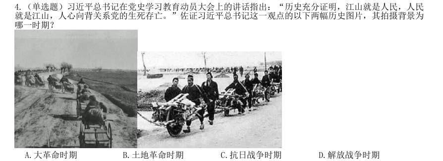

- **A.** 大革命时期
- **B.** 土地革命时期
- **C.** 抗日战争时期
- **D.** 解放战争时期

**答案：D**

### 【2022 国考（副省级）·第 5 题】GK-2022-fs-X005　政治常识｜新时代理论

(单选题)2021 年4 月,在全党开展党史学习教育之际,习近平总书记在广西考察时强调:“学史增 信,就是要增强信仰、信念、信心,这是我们战胜一切强敌、克服一切困难、夺取一切胜利的强大精神 力量。”下列有关信仰和信念的名句,按出现的时间先后排序正确的是: 1试看将来的环球,必是赤旗的世界! 2砍头不要紧,只要主义真。 3敌人只能砍下我们的头颅,决不能动摇我们的信仰!因为我们信仰的主义,乃是宇宙的真理! 4为了免除下一代的苦难,我们愿——愿把这牢底坐穿!

- **A.** 1234
- **B.** 2134
- **C.** 1243
- **D.** 2143

**答案：A**

### 【2022 国考（副省级）·第 12 题】GK-2022-fs-X012　政治常识｜新时代理论

(单选题)2020 年12 月8 日,国家主席习近平同尼泊尔总统班达里互致信函,共同宣布珠穆朗玛峰高 程。关于此次珠峰高程测量,下列说法错误的是:

- **A.** 水准测量从日喀则一等水准点起测
- **B.** 使用北斗卫星导航系统进行高精度定位
- **C.** 探测峰顶雪深的雪深雷达通过超声波探测
- **D.** 首次在珠峰北侧开展航空重力测量

**答案：C**

### 【2022 国考（地市级）·第 1 题】GK-2022-ds-X001　政治常识｜新时代理论

习近平总书记在庆祝中国共产党成立100 周年大会上的讲话指出,坚持党指挥枪、建设自己 的人民军队,是党在血与火的斗争中得出的颠扑不破的真理。下列关于党对军队绝对领导的根本原则 和制度的表述正确的有几项? 1南昌起义,标志着党独立领导革命战争、创建人民军队和武装夺取政权的开端 2三湾改编,从组织上确立了党对军队的领导 3古田会议,确立了马克思主义建党建军原则,确立了军队政治工作的方针、原则、制度 4党的十八大,把坚持党对人民军队绝对领导上升为新时代坚持和发展中国特色社会主义的基本 方略 5党的十九大,把“中央军事委员会实行主席负责制”写入党章

- **A.** 2 项
- **B.** 3 项
- **C.** 4 项
- **D.** 5 项

**答案：C**

### 【2022 国考（地市级）·第 3 题】GK-2022-ds-X003　政治常识｜新时代理论

2020 年11 月,习近平总书记在中央全面依法治国工作会议上发表重要讲话,要求坚定不移 走中国特色社会主义法治道路,在法治轨道上推进国家治理体系和治理能力现代化,为全面建设社会 主义现代化国家、实现中华民族伟大复兴的中国梦提供有力法治保障。以下对全面依法治国理解正确 的是: 1党的领导是推进全面依法治国的根本保证 2依法保障人民权益是推进全面依法治国的根本目的 3法治社会建设是推进全面依法治国的重点任务和主体工程 4领导干部具体行使党的执政权和国家立法权、行政权、监察权、司法权,是全面依法治国的关 键

- **A.** 124
- **B.** 123
- **C.** 134
- **D.** 234

**答案：A**

### 【2022 国考（地市级）·第 12 题】GK-2022-ds-X012　政治常识｜新时代理论

2020 年12 月8 日,国家主席习近平同尼泊尔总统班达里互致信函,共同宣布珠穆朗玛峰高 程。关于此次珠峰高程测量,下列说法错误的是:

- **A.** 水准测量从日喀则一等水准点起测
- **B.** 使用北斗卫星导航系统进行高精度定位
- **C.** 探测峰顶雪深的雪深雷达通过超声波探测
- **D.** 首次在珠峰北侧开展航空重力测量

**答案：C**

### 【2022 国考（行政执法）·第 5 题】GK-2022-zf-X005　政治常识｜新时代理论

(单选题)习近平总书记在全国脱贫攻坚总结表彰大会上的讲话指出∶“贫困是人类社会的顽疾。反贫 困始终是古今中外治国安邦的一件大事。一部中国史,就是一部中华民族同贫困作斗争的历史。从 1 ‘长太息以掩涕兮,哀民生之多艰’的感慨,到杜甫‘ 2 ’的憧憬,再到 3 ‘家给人 足,四海之内无一夫不获其所’的夙愿,都反映了中华民族对摆脱贫困,丰衣足食的深深渴望。” 123处应分别填入:

- **A.** 司马迁;安得广厦千万间,大庇天下寒士俱欢颜;严复
- **B.** 屈原;安得广厦千万间,大庇天下寒士俱欢颜;孙中山
- **C.** 司马迁;岂辞云水三千里,犹济疮痍十万民;孙中山
- **D.** 屈原;岂辞云水三千里,犹济疮痍十万民;严复

**答案：B**

### 【2022 国考（行政执法）·第 12 题】GK-2022-zf-X012　政治常识｜政治常识（待细分）

(单选题)下列做法符合《中华人民共和国乡村振兴促进法》的是:

- **A.** 某县政府为培育良种,划定一块永久基本农田作为重要农产品生产保护区
- **B.** 某省政府严控农用地转为建设用地,不限制耕地转为林地
- **C.** 某市政府为了方便规模经营,对农用地未分类而进行统一管理
- **D.** 某乡政府遵循法定程序撤并村庄,要求涉及的农民无条件配合

**答案：A**

### 【2021 广东省考（乡镇）·第 15 题】GD-2021-xz-X015　政治常识｜政治常识（待细分）

党的新闻舆论工作必须“坚持正确舆论导向,坚持正面宣传为主,唱响主旋律,弘扬正能量,做大做强主流 思想舆论”。下列选项最能体现这一理念的是:

- **A.** 独阴不成,独阳不生
- **B.** 事必有法,然后可成
- **C.** 事不凝滞,理贵变通
- **D.** 先立乎其大者,则其小者不能夺也

**答案：暂缺**

### 【2021 广东省考（乡镇）·第 16 题】GD-2021-xz-X016　政治常识｜政治常识（待细分）

以下机构按照成立时间的先后顺序排列,正确的是: 1国家乡村振兴局 2中华人民共和国教育部 3中华人民共和国文化和旅游部 4中央人民政府驻香港特别行政区维护国家安全公署

- **A.** 1243
- **B.** 2341
- **C.** 3214
- **D.** 3421

**答案：暂缺**

### 【2021 国考（副省级）·第 3 题】GK-2021-fs-X003　政治常识｜新时代理论

党的十八大以来,习近平总书记多次指出,实现中国梦必须弘扬中国精神。下列与之相关的说法不准确的是:

- **A.** “延安精神”以谦虚谨慎、艰苦奋斗,敢于斗争、敢于胜利,依靠群众、团结统一的精神为核心内容
- **B.** 水乳交融、生死与共是“沂蒙精神”的鲜明特质
- **C.** “焦裕禄精神”体现了对群众的亲劲、抓工作的韧劲、干事业的拼劲
- **D.** 在同新冠肺炎疫情的殊死较量中,中国人民和中华民族铸就了生命至上、举国同心、舍生忘死、尊重科学、

**答案：暂缺**

### 【2021 国考（地市级）·第 2 题】GK-2021-ds-X002　政治常识｜新时代理论

习近平总书记指出,要强化对市场主体的金融支持,发展普惠金融,有效缓解企业特别是中小微企业融资难 融资贵的问题。下列哪个措施最有助于新增融资重点流向中小微企业?

- **A.** 深化市场报价利率改革,引导贷款利率继续下行
- **B.** 探索优化教育、养老领域中长期融资的配套政策和运作模式
- **C.** 综合运用清收、核销、重组、证券化、债转股等多种处置手段,大力化解不良资产风险
- **D.** 银行业金融机构优先、快速对在中国人民银行征信报告中无贷款记录的企业提供贷款

**答案：D**

### 【2021 国考（地市级）·第 4 题】GK-2021-ds-X004　政治常识｜政治常识（待细分）

2020 年3 月9 日中共中央办公厅发布《党委(党组)落实全面从严治党主体责任规定》,根据该规定,党组 (党委)应当加强对本单位(本系统)全面从严治党各项工作的领导。在加强党的建设方面,下列理解不准确的 是:

- **A.** 支持纪检监察机关履行监督责任,一体推进不敢腐、不能腐、不想腐
- **B.** 持续整治“四风”特别是形式主义、官僚主义,反对特权思想和特权现象
- **C.** 把党的思想建设摆在首位,坚定政治信仰,强化政治领导,提高政治能力,净化政治生态
- **D.** 党组(党委)带头遵守党内法规制度,严格落实党内法规执行责任制

**答案：C**

### 【2021 国考（地市级）·第 6 题】GK-2021-ds-X006　政治常识｜毛中特与党史

下列先烈的书信,按时间先后排序正确的是: 1“看最近之情况,敌人或要再来碰一下钉子,只要敌来犯,兄即到河东与弟等共同去牺牲。......更相信,只要 我等能本此决心,我们的国家及我五千年历史之民族,决不致亡于区区三岛倭奴之手。” 2“志兰!亲爱的,别时容易见时难,分离二十一个月了,何日相聚?愿在党的整顿之风下各自努力,力求进步 吧!以进步来安慰自己,以进步来酬报别后衷情。” 3“母亲因为坚决地做了反满抗日的斗争,今天已经到了牺牲的前夕了。......母亲不用千言万语来教育你,就用 实行来教育你。在你长大成人之后,希望不要忘记你的母亲是为国而牺牲的!” 4“山东交涉及北京学界之举动,迪纯兄归,当知原委。......现每日有游行演讲,有救国日刊,各举动积极进行, 但取不越轨范以外,以稳健二字为宗旨。”

- **A.** 3421
- **B.** 4213
- **C.** 3412
- **D.** 4312

**答案：D**

### 【2020 湖北省考·第 1 题】HB-2020-ty-X001　政治常识｜新时代理论

习近平总书记2020 年3 月6 日在决战决胜脱贫攻坚座谈会上强调,这次会议的主要任务是,分析当前形势, 克服新冠肺炎疫情影响,凝心聚力,打赢脱贫攻坚战,做到“两个确保”。下列属于“两个确保”内容的是: 1如期完成脱贫攻坚目标任务2实现经济社会高质量发展 3打赢疫情防控阻击战4全面建成小康社会

- **A.** 12
- **B.** 13
- **C.** 24
- **D.** 14

**答案：D**

### 【2020 湖北省考·第 2 题】HB-2020-ty-X002　政治常识｜新时代理论

习近平总书记2020 年1 月8 日在“不忘初心、牢记使命”主题教育总结大会上的讲话中引用了一句古语“君 子之过也,如日月之食焉:过也,人皆见之;更也,人皆仰之。”下列选项最能体现这一古语精髓的是:

- **A.** 敢于自我革命,勇于开拓创新
- **B.** 敢于坚持真理,勇于担当作为
- **C.** 敢于直面问题,勇于修正错误
- **D.** 敢于坚持原则,勇于承担责任

**答案：C**

### 【2020 广东省考（乡镇）·第 11 题】GD-2020-xz-X011　政治常识｜新时代理论

针对我国疫情防控工作,习近平总书记指出“要变压力为动力,善于化危为机”。以下典故与“善于化危 为机”所蕴含的哲学原理一致的是:

- **A.** 塞翁失马,焉知非福
- **B.** 绳锯木断,水滴石穿
- **C.** 千里之堤,溃于蚁穴
- **D.** 南橘北枳,便分两等

**答案：暂缺**

### 【2020 广东省考（乡镇）·第 13 题】GD-2020-xz-X013　政治常识｜新时代理论

习近平总书记指出“不平衡是普遍的,要在发展中促进相对平衡”,这句话体现了( )发展理念。

- **A.** 开放
- **B.** 协调
- **C.** 创新
- **D.** 共享

**答案：暂缺**

### 【2020 广东省考（乡镇）·第 16 题】GD-2020-xz-X016　政治常识｜政治常识（待细分）

打赢脱贫攻坚战、实施乡村振兴战略,需要强化科技支撑作用。以下措施属于强化科技支撑作用的是: 1完善村规民约 2支持丘陵山区农田宜机化改造 3推进相对贫困户危房改造 4建设农业科技成果转化交易平台 5推动复合型农业机械研发

- **A.** 124
- **B.** 245
- **C.** 1245
- **D.** 12345

**答案：暂缺**

### 【2020 广东省考（综合行政能力测验）·第 6 题】GD-2020-zh-X006　政治常识｜马克思主义基本原理

马克思主义是科学的理论,创造性地揭示了人类社会发展规律。以下关于马克思主义表述错误的是 ( )。

- **A.** 实践性是马克思主义理论区别于其他理论的显著特征
- **B.** 马克思主义第一次创立了人民实现自身解放的思想体系
- **C.** 马克思主义政党同其他政党的根本区别在于为民族利益而奋斗
- **D.** 中国共产党是用马克思主义武装起来的政党

**答案：C**

### 【2020 广东省考（综合行政能力测验）·第 7 题】GD-2020-zh-X007　政治常识｜新时代理论

习近平总书记指出:“我们追求人与自然的和谐、经济与社会的和谐,通俗地讲就是要‘两座山’: 既要金山银山,又要绿水青山,绿水青山就是金山银山。”这句话体现的哲学原理是( )。

- **A.** 对立统一关系原理
- **B.** 质量互变关系原理
- **C.** 否定之否定关系原理
- **D.** 物质与意识关系原理

**答案：A**

### 【2020 广东省考（综合行政能力测验）·第 13 题】GD-2020-zh-X013　政治常识｜新时代理论

习近平总书记指出,全球治理体系变革源于( ),我们要坚持以经济发展为中心,集中力量办好 自己的事情,不断增强我们在国际上说话办事的实力。

- **A.** 国际力量对比变化
- **B.** 全球治理观念更新
- **C.** 世界经济持续增长
- **D.** 坚持共商共建共赢

**答案：A**

### 【2020 广东省考（综合行政能力测验）·第 14 题】GD-2020-zh-X014　政治常识｜政治常识（待细分）

党的十八大以来,我国经济保持中高速增长,国内生产总值稳居世界( ),对世界经济增长贡献 率超过百分之三十。

- **A.** 第一
- **B.** 第二
- **C.** 第三
- **D.** 第四

**答案：B**

### 【2020 广东省考（综合行政能力测验）·第 16 题】GD-2020-zh-X016　政治常识｜新时代理论

当前,各地政府高度重视生态环境保护,习近平总书记曾引用“子钓而不纲,弋不射宿”来强调生 态环境的重要性,以下与这句古文表达的理念不同的是( )。

- **A.** 不夭其生,不绝其长也
- **B.** 竭泽而渔,岂不得鱼,而明年无鱼
- **C.** 斧斤以时入山林,林木不可胜用也
- **D.** 天之于民厚矣!殖五谷,生鱼鸟,以为之用

**答案：D**

### 【2020 广东省考（综合行政能力测验）·第 21 题】GD-2020-zh-X021　政治常识｜新时代理论

习近平总书记曾说:“泰山半腰有一段平路叫‘快活三里’,一些人爬累了,喜欢在此歇脚。然而, 挑山工一般不在此久留,因为休息时间长了,腿就会‘发懒’,再上‘十八盘’就更困难了。”这对党的建 设的启示是( )。

- **A.** 要以钉钉子精神担当尽责
- **B.** 要全面提高领导能力和执政水平
- **C.** 作风建设永远在路上,必须常抓不懈
- **D.** 应当以马克思主义科学理论武装头脑

**答案：C**

### 【2020 国考（地市级）·第 5 题】GK-2020-ds-X005　政治常识｜政治常识（待细分）

党内监督必须把纪律挺在前面,运用监督执纪“四种形态”,经常开展批评和自我批评、约谈函询,让“红 红脸、出出汗”成为常态;党纪轻处分、组织调整成为违纪处理的大多数;党纪重处分、重大职务调整的成为少 数;严重违纪涉嫌违法立案审查的成为极少数。这是从中国共产党的历史和党的十八大以来管党治党实践中总结 出来的,体现了惩前毖后、治病救人的一贯方针。下列党员受到处理的案例,属于“党纪重处分、重大职务调整 的成为少数”这种形态的是:

- **A.** 某市农业农村局办公室主任黄某因公车私用问题,受到党内警告处分,违纪款予以收缴
- **B.** 某镇政府公益性岗位工作人员杜某因违反工作纪律,被解除劳动关系
- **C.** 某市政协原副主席杨某因涉嫌严重违纪违法问题,移送检察机关依法审查起诉
- **D.** 某规划建设局局长戴某因在下属单位报销费用、私设小金库、滥发奖金等,受到留党察看二年处分

**答案：D**

### 【2020 国考（地市级）·第 6 题】GK-2020-ds-X006　政治常识｜政治常识（待细分）

坚持农村基本经营制度,是党的农村政策的基石,是乡村振兴的制度基础。关于农村基本经营制度,下列说 法错误的是:

- **A.** 实行家庭承包经营为基础、统分结合的双层经营体制
- **B.** 保持土地承包关系稳定并长久不变,第二轮土地承包到期后再延长三十年
- **C.** 完善农村承包地所有权、承包权、经营权“三权”分置制度
- **D.** 支持进城落户农民依法自愿有偿转让集体土地所有权

**答案：D**

### 【2020 国考（地市级）·第 7 题】GK-2020-ds-X007　政治常识｜新时代理论

党的十八大以来,我国在重要历史节点已依法实施两次特赦,具有重大意义。下列与之相关的说法错误的是:

- **A.** 两次特赦时间分别为2015 年和2019 年
- **B.** 特赦对象包括被判处监禁刑和非监禁刑的罪犯
- **C.** 特赦令由全国人民代表大会常务委员会签发
- **D.** 特赦须经人民法院裁定

**答案：C**

### 【2020 国考（省级）·第 2 题】GK-2020-sj-X002　政治常识｜新时代理论

习近平总书记为我国生态文明建设倾注了巨大心血,足迹遍布大江南北、城市乡村,对各地的生态环境情况 都了然于心、深思细究,对很多地域的生态环境寄予了期望。以下“期望”与地域对应正确的是:

- **A.** 要留住“飞泉泻万仞,舞鹤双低昂”那样的风景--贵州
- **B.** 要确保“一江清水向东流”--重庆
- **C.** “长烟一空,皓月千里,浮光跃金,静影沉璧”这样的乡情美景不能弄没了--湖南
- **D.** 要保护好“洞庭波涌连天雪,长岛人歌动地诗”--江西

**答案：C**

### 【2020 国考（省级）·第 4 题】GK-2020-sj-X004　政治常识｜马克思主义基本原理

坚决打好“三大攻坚战”,是党的十九大提出的重大政治任务,是2020 年决胜全面建成小康社会的迫切要求。 以下哪幅漫画不适合用于“三大攻坚战”的宣传?

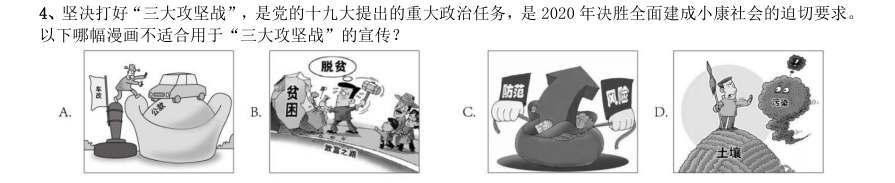

> （本题为图形题，选项为图片，见原卷）

**答案：A**
