# 常识判断 · 政治常识 · 2020 年代真题

> 所属考点：[CS-ZZ](../CS-ZZ-政治常识.md)　｜　本片 401 题

### 2026 湖北·统一卷　第 13 题　（毛中特与党史）

加强数字政府建设是创新政府治理理念和方式、形成数字治理新格局、推进国家治理体系和治理能力现代化的 重要举措。下列关于数字政府建设的基本原则,表述正确的有几项? 1坚持党的全面领导,充分发挥党总揽全局、协调各方的领导核心作用 2坚持以市场为中心,始终把满足人民群众物质生活的迫切需求作为目标 3坚持整体协同,强化系统观念,加强系统集成,全面提升数字政府集约化建设水平 4坚持数据赋能,建立健全数据治理制度和标准体系,加强数据汇聚融合、共享开放和开发利用

- **A.** 1项
- **B.** 2项
- **C.** 3项
- **D.** 4项

**答案：C**

### 2026 湖北·统一卷　第 14 题　（政治常识（综合））

建设教育强国,基点在基础教育。基础教育搞得越扎实,教育强国步伐就越稳、后劲就越足。关于加强基础教 育,下列举措正确的有几项? 1提升寄宿制学校办学条件和管理水平,办好必要的乡村小规模学校 2统筹推进市域内高中阶段学校多样化发展,加快扩大普通高中教育资源供给 3强化家庭教育主阵地作用,健全学校家庭社会协同育人机制 4建立基础教育各学段学龄人口变化监测预警制度,优化中小学和幼儿园布局 5深入开展县域义务教育优质均衡督导评估,有序推进市域义务教育优质均衡发展

- **A.** 4项
- **B.** 3项
- **C.** 2项
- **D.** 1项

**答案：A**

### 2026 湖北·统一卷　第 15 题　（政治常识（综合））

优化政务服务、提升行政效能是优化营商环境、建设全国统一大市场的必然要求,对加快构建新发展格局、推 动高质量发展具有重要意义。关于优化政务服务、提升行政效能,下列举措恰当的是: 1推进关联事项集成办,为企业和群众提供“一件事一次办”“一类事一站办”服务 2推进线下办事“只进一门”,要求所有的银行网点、邮政网点、园区等都要设置便民服务点 3推进企业和群众诉求“一线应答”,根据需要设置重点领域专席,不断提升12345热线接办效率 4推进线上办事“一网通办”,推动各类政务服务事项和应用“应接尽接、应上尽上”,政府服务事项全面纳 入同级政务服务平台管理和办理

- **A.** 12
- **B.** 13
- **C.** 24
- **D.** 34

**答案：B**

### 2026 湖北·统一卷　第 16 题　（毛中特与党史）

中国共产党党报党刊的发展历程,与中国共产党的奋斗历程密不可分。下列说法错误的是:

- **A.** 《布尔塞维克》是解放战争时期中国共产党创办的中央机关刊物
- **B.** 《人民日报》由《晋察冀日报》和晋冀鲁豫《人民日报》合并而来
- **C.** 《红色中华》创刊于江西瑞金,初期为中华苏维埃共和国临时中央政府机关报
- **D.** 《求是》杂志是党中央指导全党全国工作的重要思想理论阵地,前身是中共中央主办的《红旗》杂志

**答案：A**

### 2026 湖北·统一卷　第 17 题　（政治常识（综合））
> 材料：关于社会保险,下列说法正确的是:…

· 本试卷由粉笔用户上岸张同学66生成

- **A.** 灵活就业人员可以参加职工基本医疗保险
- **B.** 失业者领取失业保险金的期限与累计缴费年限无关
- **C.** 同一统筹地区内用人单位工伤保险执行统一缴费费率
- **D.** 生育保险待遇中的生育津贴按职工本人上年度的月平均工资计发

**答案：A**

### 2026 湖北·统一卷　第 21 题　（政治常识（综合））

关于我国考古发现,下列说法错误的是:

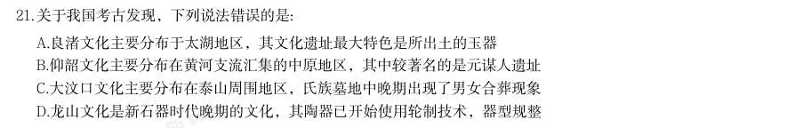

- **A.** 良渚文化主要分布于太湖地区,其文化遗址最大特色是所出土的玉器
- **B.** 仰韶文化主要分布在黄河支流汇集的中原地区,其中较著名的是元谋人遗址
- **C.** 大汶口文化主要分布在泰山周围地区,氏族墓地中晚期出现了男女合葬现象
- **D.** 龙山文化是新石器时代晚期的文化,其陶器已开始使用轮制技术,器型规整

**答案：B**

### 2026 湖北·统一卷　第 25 题　（政治常识（综合））
> 材料：肥胖会严重影响人体健康,饮食控制是治疗肥胖症的一种有效手段。在摄入量相同且不考虑烹饪方式的情况 下,下列四份食谱中热量值最低的是( )。…

· 本试卷由粉笔用户上岸张同学66生成

- **A.** 鸭肉、馒头、马铃薯、葡萄
- **B.** 鲈鱼、大米饭、黄瓜、橙子
- **C.** 鸡蛋、花卷、胡萝卜、榴莲
- **D.** 五花肉、烧饼、鲜香菇、西瓜

**答案：B**

### 2026 广东·统一卷　第 1 题　（毛中特与党史）
> 材料：· 本试卷由粉笔用户上岸张同学66生成 (网友回忆版) · 本试卷由粉笔用户上岸张同学66生成 (判断题)广东增创新优势、实现新突破,必须大力弘扬改革开放精神、特区精神,以全面深化改革开放推动 高质量发展。( )…

(判断题)农业农村现代化关系中国式现代化全局和成色。( )

- **A.** 正确
- **B.** 错误

**答案：暂缺**

### 2026 广东·统一卷　第 2 题　（新时代理论）

(判断题)现代化产业体系是中国式现代化的物质技术基础。( )

- **A.** 正确
- **B.** 错误

**答案：暂缺**

### 2026 广东·统一卷　第 3 题　（政治常识（综合））

(判断题)生产关系是人类社会发展的根本动力,也是一切社会变迁和政治变革的终极原因。( )

- **A.** 正确
- **B.** 错误

**答案：暂缺**

### 2026 广东·统一卷　第 4 题　（马克思主义基本原理）

习近平总书记指出:“必须坚持守正创新。我们从事的是前无古人的伟大事业,守正才能不迷失方向,不犯颠 覆性错误,创新才能把握时代、引领时代。”关于守正创新,以下说法有误的是( )。

> （本题为图形题，选项为图片，见原卷）

**答案：暂缺**

### 2026 广东·统一卷　第 5 题　（新时代理论）

（本题题干为图形/公式，文字层无题干，图见原卷）

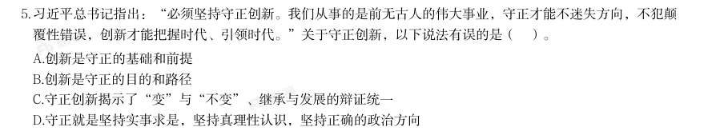

- **A.** 创新是守正的基础和前提
- **B.** 创新是守正的目的和路径
- **C.** 守正创新揭示了“变”与“不变”、继承与发展的辩证统一
- **D.** 守正就是坚持实事求是,坚持真理性认识,坚持正确的政治方向

**答案：A**

### 2026 广东·统一卷　第 6 题　（新时代理论）

推进碳达峰碳中和是党中央作出的重大战略决策,是我们对国际社会的庄严承诺,也是推动经济结构转型升 级、形成绿色低碳产业竞争优势,实现高质量发展的内在要求。以下有关推进碳达峰碳中和的表述,最准确的 是( )。

- **A.** 实现碳达峰碳中和,时间紧任务重,各地应加快步调,通过“碳冲锋”“运动式减碳”尽快实现目标
- **B.** 对于碳排放较高的传统行业,应优先关停、清退,确有较高经济价值的,逐步引导实现绿色低碳转型
- **C.** 积极落实《联合国气候变化框架公约》,与世界各国协商确定达到“双碳”目标的路径和方式、节奏和力度
- **D.** 要优化调整产业结构,大力发展绿色低碳产业,使发展建立在高效利用资源、严格保护生态环境、有效控制

**答案：D**

### 2026 广东·统一卷　第 7 题　（马克思主义基本原理）

温室气体排放的基础上 习近平总书记指出:“宪法作为上层建筑,一定要适应经济基础的变化而变化。任何国家都不可能制定一部永 远适用的宪法。”下列古语与这一观点最为契合的是( )。

- **A.** 理国要道,在于公平正直
- **B.** 法与时转则治,治与世宜则有功
- **C.** 盖天下之事,不难于立法,而难于法之必行
- **D.** 举直错诸枉,则民服;举枉错诸直,则民不服

**答案：B**

### 2026 广东·统一卷　第 8 题　（新时代理论）

水是生存之本、文明之源,水安全是涉及国家长治久安的大事。为了解决好水安全问题,下列说法有误的是( )。

- **A.** 要按照“节水优先、空间均衡、系统治理、两手发力”的方针治水
- **B.** 要统筹做好水灾害防治、水资源节约、水生态保护修复、水环境治理
- **C.** 要树立节约用水就是保护生态、保护水源就是保护家园的意识,坚决抑制不合理用水需求
- **D.** 要根据人口、城市和产业发展规划,因地制宜发掘更多水资源,避免水资源成为发展的约束条件

**答案：D**

### 2026 广东·统一卷　第 9 题　（马克思主义基本原理）

(多选题)中国共产党在领导人民进行革命、建设、改革的长期实践中,逐步形成和确定了一条正确的思想路 线······这条思想路线是中国共产党对马克思主义理论发展作出的重大贡献,其核心是实事求是。关 于“实事求是”,以下表述正确的有( )。

- **A.** 想问题、做决策、办事情,应当从本本出发
- **B.** 实事求是是中国共产党人的基本思想方法、工作方法和领导方法
- **C.** 坚持实事求是,最基础的工作在于“求是”,关键在于搞清楚“事实”
- **D.** 实事求是是党领导人民推动中国革命、建设、改革事业不断取得胜利的重要法宝

**答案：B**

### 2026 广东·统一卷　第 10 题　（马克思主义基本原理）
> 材料：(多选题)物质范畴是一切唯物主义哲学的理论基石。马克思主义的物质范畴是一个高度抽象的哲学概念,是 对世界上客观存在的各种事物共同本质的概括。关于马克思主义的物质范畴,下列选项正确的有( )。…

· 本试卷由粉笔用户上岸张同学66生成

- **A.** 物质的根本属性是运动
- **B.** 世界的本原是多种物质的集合
- **C.** 物质是标志客观实在的哲学范畴
- **D.** 物质资料的生产方式构成了人类社会存在的基础

**答案：暂缺**

### 2026 广东·统一卷　第 11 题　（新时代理论）

科学制定和接续实施五年规划,是我们党治国理政一条重要经验。下列有关五年规划(计划)的表述,正确的 是( )。

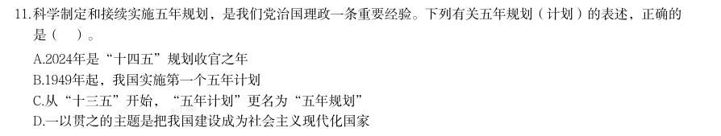

- **A.** 2024年是“十四五”规划收官之年
- **B.** 1949年起,我国实施第一个五年计划
- **C.** 从“十三五”开始,“五年计划”更名为“五年规划”
- **D.** 一以贯之的主题是把我国建设成为社会主义现代化国家

**答案：D**

### 2026 广东·统一卷　第 13 题　（政治常识（综合））

近年来,港珠澳大桥、深中通道等粤港澳大湾区跨江跨海通道相继开通,推动形成大湾区“路相连、人相通、 心相融”的融合面貌。关于粤港澳大湾区跨江跨海通道,以下说法有误的是( )。

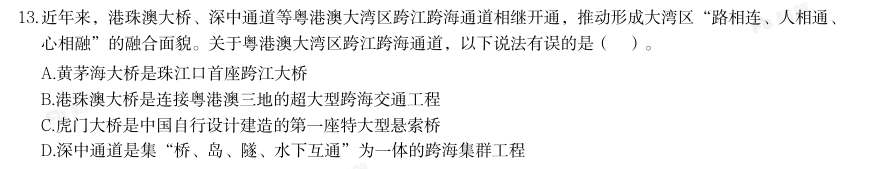

- **A.** 黄茅海大桥是珠江口首座跨江大桥
- **B.** 港珠澳大桥是连接粤港澳三地的超大型跨海交通工程
- **C.** 虎门大桥是中国自行设计建造的第一座特大型悬索桥
- **D.** 深中通道是集“桥、岛、隧、水下互通”为一体的跨海集群工程

**答案：暂缺**

### 2026 广东·统一卷　第 14 题　（政治常识（综合））

根据《中华人民共和国国歌法》,中华人民共和国国歌是中华人民共和国的象征和标志。一切公民和组织都应 当尊重国歌,维护国歌的尊严。下列场合对国歌的使用,违反我国国歌法的是( )。

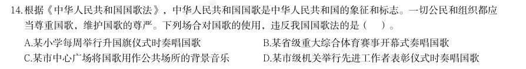

- **A.** 某小学每周举行升国旗仪式时奏唱国歌
- **B.** 某省级重大综合体育赛事开幕式奏唱国歌
- **C.** 某市中心广场将国歌用作公共场所的背景音乐
- **D.** 某市级机关举行先进工作者表彰仪式时奏唱国歌

**答案：暂缺**

### 2026 国考·副省级　第 1 题　（毛中特与党史）

习近平总书记强调,必须坚持自信自立。中国人民和中华民族从近代以后的深重苦难走向伟大 复兴的光明前景,从来就没有教科书,更没有现成答案。关于坚持自信自立,下列表述正确的有 几项? 1走自己的路,是党的全部理论和实践立足点,更是党百年奋斗得出的历史结论 2推进中国式现代化,必须坚持把国家和民族发展放在自己力量的基点上 3中国式现代化既要物质财富极大丰富,也要精神财富极大丰富、在思想文化上自信自强 4独立自主是中华民族的优良传统,是中国共产党、中华人民共和国立党立国的重要原则

- **A.** 1 项
- **B.** 2 项
- **C.** 3 项
- **D.** 4 项

**答案：D**

### 2026 国考·副省级　第 2 题　（毛中特与党史）

习近平总书记强调,科学制定和接续实施五年规划,是我们党治国理政一条重要经验,也是中 国特色社会主义一个重要政治优势。关于五年规划编制工作,下列说法正确的是:

- **A.** 我国五年规划(计划)编制工作起始于1949 年,有力推动了经济社会发展、综合国力提升、人民生活改善
- **B.** 中长期发展规划有助于充分发挥政府在资源配置中的决定性作用,彰显了政府对经济社会发展的宏观调控能力
- **C.** 从第一个五年计划到当前的五年规划,一以贯之的主题是把我国建设成为社会主义现代化国家
- **D.** 通过互联网就“十五五”规划编制向全社会征求意见和建议,在我国五年规划编制史上是第

**答案：C**

### 2026 国考·副省级　第 3 题　（新时代理论）

建设文化强国,事关中国式现代化建设全局,事关中华民族复兴大业,事关提升国际竞争力, 锚定2 035 年建成社会主义文化强国的战略目标,必须始终坚持文化建设着眼于人、落脚于人。 下列有关说法正确的是: 1文化强国之“强”最终要体现在为人民提供文化服务和文化产品的能力上 2坚持以人民为中心,着眼满足人民群众多样化、多层次、多方面的精神文化需求 3文化创造核心在人,要建设一支规模宏大、结构合理、锐意创新的高水平文化人才队伍 4尊重人才成长规律,完善符合文化领域特点的人才选拔、培养、使用、激励机制,营造识才、 重才、爱才的良好政策环境

- **A.** 123
- **B.** 234
- **C.** 124
- **D.** 134

**答案：B**

### 2026 国考·副省级　第 4 题　（政治常识（综合））

中共中央、国务院印发《加快建设农业强国规划(2024-2035 年)》,提出面对新形势新要 求,必须把加快建设农业强国作为统领“三农”工作的战略总纲,摆上建设社会主义现代化强 国的重要位置,下列与加快建设农业强国有关的说法正确的是:

- **A.** 推进生态综合补偿,健全横向生态保护补偿机制,统筹推进生态环境损害赔偿
- **B.** 建立健全长江流域信息共享系统,推进长江流域农业深度节水控水
- **C.** 完善粮食产销奖补制度,中央预算内投资向粮食主销区倾斜
- **D.** 推进农业科技推广体系,从经营性向公益性转变

**答案：A**

### 2026 国考·副省级　第 5 题　（政治常识（综合））

全面推进依法治国是一个系统工程,必须坚持法治国家、法治政府、法治社会一体建设。下列 相关表述不准确的是:

- **A.** 法治社会是构筑法治国家、法治政府的基础
- **B.** 建设法治政府对建设法治社会具有重要引领和带动作用
- **C.** 法治政府、法治社会建设必须服从、服务于法治国家建设
- **D.** 法治国家是依法治国的主体,是法治社会建设的先导和示范

**答案：D**

### 2026 国考·副省级　第 6 题　（新时代理论）

2025 年7 月,习近平总书记在中央城市工作会议上发表重要讲话,明确做好城市工作的总体 要求、重要原则、重点任务,为做好新时代新征程的城市工作提供了根本遵循。关于城市工作, 下列说法正确的是:

- **A.** 要把握“我国城镇化正从快速增长期转向稳定发展期”的历史方位
- **B.** 城市工作重心应向更加注重建设投入转变
- **C.** 着力通过外延扩张发展组团式的现代化城市群和都市圈
- **D.** 城市政府应从城市事务管理的“掌舵人”转变为“划桨人”

**答案：A**

### 2026 国考·副省级　第 7 题　（毛中特与党史）

经济工作千头万绪,必须统筹好有效市场和有为政府的关系、总供给和总需求的关系、培育新 动能和更新旧动能的关系、做优增量和盘活存量的关系、提升质量和做大总量的关系。下列相关 说法不准确的是:

- **A.** 要加快推动作为经济增长和就业收入基本依托的传统产业改造升级
- **B.** 要加快补上内需特别是消费短板,使内需成为拉动经济增长的主动力和稳定锚
- **C.** 要坚持以量取胜、充分发挥规模效应,用好超大规模市场优势和丰富应用场景
- **D.** 要用好各类增量资源和存量资源,通过盘活存量来带动增量

**答案：C**

### 2026 国考·副省级　第 8 题　（新时代理论）

2025 年7 月3 0 日,中共中央政治局召开会议,对扎实做好民生保障工作作了重要部署。下 列相关表述不准确的是:

- **A.** 巩固拓展脱贫攻坚成果,确保不发生规模性返贫致贫
- **B.** 夯实“三农”基础,推动粮食和重要农产品价格保持在合理水平
- **C.** 突出就业优先政策导向,促进高校毕业生、退役军人、农民工等重点群体就业
- **D.** 始终把人民群众财产安全放在第一位,加强安全生产监管

**答案：D**

### 2026 国考·副省级　第 9 题　（毛中特与党史）

做好新时代人口工作,要完善新时代人口发展战略,认识、适应、引领人口发展新常态,以人 口高质量发展支撑中国式现代化。关于做好新时代人口工作,下列说法正确的是:

- **A.** 要树立“大人口观”,推动人口与财政、货币、就业、产业、投资、消费、生态、区域等政策形成系统集成效应
- **B.** 必须推动人口工作由稳定总量、畅通流动向调节数量、优化结构转变
- **C.** 要更加重视“引导”和“激励”的办法,由社会治理向政府治理转变
- **D.** 坚持人民主体地位,把人口高速增长同人民高品质生活紧密结合起来

**答案：A**

### 2026 国考·副省级　第 10 题　（政治常识（综合））

《中共中央关于制定国民经济和社会发展第十五个五年规划的建议》提出,推进国家安全体 系和能力现代化,建设更高水平平安中国。下列有关说法正确的是:

- **A.** 锻造实战实用的国家安全能力,把捍卫国土安全摆在首位
- **B.** 统筹推进房地产、地方政府债务、中小金融机构等风险有序化解
- **C.** 健全国家安全体系,坚持以风险防控为先导、法治保障为落脚点
- **D.** 完善公共安全体系,推动公共安全治理模式由事后处理向事中控制转型

**答案：B**

### 2026 国考·副省级　第 11 题　（新时代理论）

习近平总书记高度重视战略思维,多次强调党员领导干部要加强战略思维,增强战略定力。 下列体现战略思维的说法,正确的有几项? 1粮食多一点少一点是战略问题,粮食安全是战术问题 2统战工作的本质要求是大团结大联合,解决的是人心和力量问题 3要心怀“国之大者”,站在全局和战略的高度想问题、办事情,一切工作都要以贯彻落实党 中央决策部署为前提 4自觉把党的对外工作放到党和国家工作大局中来认识,放到中国与世界关系的发展变化中来把 握

- **A.** 1 项
- **B.** 2 项
- **C.** 3 项
- **D.** 4 项

**答案：C**

### 2026 国考·副省级　第 12 题　（毛中特与党史）

习近平总书记指出,我们要建成的教育强国,是中国特色社会主义教育强国,应当具有强大 的思政引领力、人才竞争力、科技支撑力、民生保障力、社会协同力、国际影响力,为以中国式 现代化全面推进强国建设、民族复兴伟业提供有力支撑。关于建设教育强国,下列说法正确的 是:

- **A.** 要坚持教育均等化原则,把教育公平作为国家基本教育政策
- **B.** 要完善人才培养与经济社会发展需要适配机制,顺应时代发展要求,适度增加学科专业数量
- **C.** 要把引进全球顶尖科学家摆到更加突出位置,着力培育拔尖创新人才,推动实现高水平科技自立自强
- **D.** 从教育大国到教育强国是一个系统性跃升和质变,必须以改革创新为动力

**答案：D**

### 2026 国考·副省级　第 13 题　（毛中特与党史）

习近平主席在二十国集团领导人第十九次峰会上指出,要完善全球贸易治理,建设开放型世 界经济。下列相关表述正确的是:

- **A.** 要适应经济问题政治化的潮流,通过强化绿色低碳要求推行贸易保护政策
- **B.** 要积极构建更具平等性、包容性和建设性的产业链供应链伙伴关系,呼吁各方加强合作
- **C.** 要把安全置于国际经贸议程中心地位,持续推动贸易和投资自由化便利化
- **D.** 要一以贯之保持世界贸易组织规则不变,提高多边贸易体制的权威性、有效性和相关性

**答案：B**

### 2026 国考·副省级　第 14 题　（新时代理论）

中国式现代化要靠科技现代化作支撑,实现高质量发展要靠科技创新培育新动能。关于建成 科技强国的举措,下列说法正确的是:

- **A.** 要坚持有所为有所不为,突出经济发展需求,在重要领域实施科技战略部署
- **B.** 要充分发挥人才在科技资源配置中的决定性作用,调动产学研各环节的积极性
- **C.** 要充分发挥科技领军企业龙头作用,鼓励中小企业和民营企业科技创新,支持企业牵头或参与国家重大科技项目
- **D.** 要降低基础研究组织化程度,强化自由探索,鼓励面向重大科学问题的协同攻关

**答案：C**

### 2026 国考·副省级　第 15 题　（马克思主义基本原理）

习近平总书记强调,选人用人要加强党性鉴别,注重考察干部的境界格局和忠诚度廉洁度。 下列与党性相关的说法正确的是:

- **A.** 树立和践行正确政绩观,起决定性作用的是党性
- **B.** 强党性,就是要自觉用马克思主义思想改造客观世界
- **C.** 党性、党风、党纪是有机整体,党性是根本,党风是保障,党纪是表现
- **D.** 作风问题本质上是党性问题,要把作风建设摆在党性修养的首位

**答案：A**

### 2026 国考·副省级　第 16 题　（马克思主义基本原理）

坚持问题导向是习近平新时代中国特色社会主义思想的世界观和方法论的重要内容。关于坚 持问题导向,下列说法不准确的是:

- **A.** 坚持问题导向是马克思主义的鲜明特点
- **B.** 坚持问题导向要抓住人民最关心最直接最现实的利益问题
- **C.** 坚持问题导向体现了矛盾的普遍性和客观性
- **D.** 坚持问题导向本质是变与不变、继承与发展的辩证统一

**答案：D**

### 2026 国考·副省级　第 17 题　（马克思主义基本原理）

恩格斯深刻指出:“马克思的整个世界观不是教义,而是方法。它提供的不是现成的教条, 而是进一步研究的出发点和供这种研究使用的方法。”下列有关马克思主义理论的说法不准确 的是:

- **A.** 马克思创立了辩证法,成为我们认识世界和改造世界的根本方法
- **B.** 科学社会主义的原则不能丢,但科学社会主义也绝不是一成不变的教条
- **C.** 当代中国的伟大社会变革不是简单套用马克思主义经典作家设想的模板
- **D.** 《共产党宣言》发表至今,人类社会发生了翻天覆地的变化,但马克思主义所阐述的一般原理

**答案：A**

### 2026 国考·副省级　第 18 题　（马克思主义基本原理）

以实践为基础,从整体上把握人与世界的关系,是马克思主义世界观的重要内容。关于马克 思主义实践观,下列说法正确的是:

- **A.** 正确发挥主观能动性是实践的根本途径
- **B.** 实践的过程就是对于结果的检验和评价
- **C.** 实践是人类生存和发展最基本的活动
- **D.** 实践是一种无目的的适应环境的本能活动

**答案：C**

### 2026 国考·副省级　第 19 题　（毛中特与党史）

习近平总书记在对各省区市进行深入考察调研的过程中,结合各地实际情况,对推进高质量 发展作出一系列重要部署。下列对应关系正确的是:

- **A.** 江苏——要建设国家资源型经济转型综合配套改革试验区,重点抓好能源转型、产业升级和适度多元发展
- **B.** 山东——要发挥海洋资源丰富的得天独厚优势,经略海洋、向海图强,打造世界级海洋港口群,打造现代海洋经济发展高地
- **C.** 云南——要把握好挑大梁的着力点,在推动科技创新和产业创新融合上打头阵
- **D.** 贵州——聚焦实现贸易、投资、跨境资金流动、人员进出、运输来往自由便利和数据安全有序

**答案：B**

### 2026 国考·副省级　第 20 题　（新时代理论）

2025 年是中国人民抗日战争暨世界反法西斯战争胜利80 周年。中国人民对战争带来的苦难 有着刻骨铭心的记忆,对和平有着孜孜不倦的追求。关于中国人民抗日战争,下列表述不准确的 是:

- **A.** 中国人民抗日战争的伟大胜利,是以爱国主义为核心的民族精神的伟大胜利
- **B.** 中国人民抗日战争的伟大胜利,第一次确立了中国在世界上的大国地位,使中国人民赢得了世界爱好和平人民的尊敬
- **C.** 中国人民抗日战争的伟大胜利,是近代以来中国抗击外敌入侵的第一次完全胜利
- **D.** 中国人民抗日战争的伟大胜利,为中华民族由近代以来陷入深重危机走向伟大复兴确立了历史

**答案：B**

### 2026 国考·副省级　第 21 题　（政治常识（综合））

根据《中华人民共和国全国人民代表大会和地方各级人民代表大会代表法》,下列说法错误 的是:

- **A.** 代表在本级人民代表大会闭会期间,原则上不得跨原选举单位进行视察、调研
- **B.** 县级以上的各级人民代表大会常务委员会设立代表工作委员会,作为常务委员会的工作机构
- **C.** 乡镇人民代表大会主席团按照就地就近的原则,定期组织和协助本乡镇代表开展联系人民群众的活动
- **D.** 代表辞职或者责令辞职被接受的,其代表资格终止

**答案：A**

### 2026 国考·副省级　第 24 题　（政治常识（综合））

我国始终高度重视荒漠化的治理工作,把防沙治沙作为荒漠化防治工作的主要任务。下列与 我国荒漠化防治有关的说法错误的是:

- **A.** 我国是全球首个实现土地退化零增长的国家
- **B.** 塔克拉玛干沙漠实现生态屏障全面“锁边合龙”
- **C.** 草方格固沙技术最早用于治理宁夏中卫的沙坡头地区
- **D.** 甘肃民勤治沙工程有效阻止了毛乌素沙漠的推进

**答案：D**

### 2026 国考·副省级　第 25 题　（毛中特与党史）

《贺新郎·读史》是毛泽东创作的咏史词,高度凝练了人类社会发展历程。下列相关说法不 恰当的是:

- **A.** 成汤创立商朝是“五帝三皇神圣事”之一
- **B.** 在“只几个石头磨过”时人类学会了用火
- **C.** 利簋是“铜铁炉中翻火焰”时代留下的器物
- **D.** “更陈王奋起挥黄钺”揭开了秦末农民起义的序幕

**答案：A**

### 2026 国考·副省级　第 28 题　（政治常识（综合））

某物流公司要优化长三角到乌鲁木齐的易腐货物运输路线,下列方案最可行的是:

- **A.** 夏季采用陇海——兰新铁路运输利用沿线低温天气自然保鲜
- **B.** 冬季选择长江——京杭大运河——黄河水运组合避开陆路交通拥堵
- **C.** 春秋季采用铁路冷藏集装箱运输平衡运输成本与时效性
- **D.** 全年优先使用连霍高速公路运输以追求最低的运输成本

**答案：C**

### 2026 国考·副省级　第 29 题　（政治常识（综合））

下列与自然界中的颜色有关的说法错误的是:

- **A.** “橙色月亮”通常发生在大气层中水汽或颗粒物质较多时
- **B.** 火烈鸟羽毛呈朱红色与摄入食物中的虾青素累积有关
- **C.** 蓝闪蝶翅膀呈蓝色是由于其表面鳞片具有特殊的微结构
- **D.** 蓝莓呈现靛蓝色是因为表面蜡质层中含高浓度花青素

**答案：D**

### 2026 国考·副省级　第 31 题　（政治常识（综合））

某款创意时钟要用不同的符号替代表盘上的数字,下列设计不合适的是:

- **A.** 用45 度角的正弦“sin450” 替代“ 1 ”
- **B.** . 用3 的阶乘“ 3 ! ” 替代“ 6 ”
- **C.** 用重力加速度“g”替代“10”
- **D.** 用二进制数“ (1100)2”替代“12”

**答案：A**

### 2026 国考·副省级　第 34 题　（政治常识（综合））

关于医学治疗手段及其原理,下列说法正确的是:

- **A.** 体外冲击波碎石术利用次声波可以将肾结石击碎成小块,使其随尿液排出体外
- **B.** 免疫疗法治疗癌症,能够通过激活自身免疫系统,利用T 细胞直接吞噬癌细胞
- **C.** 血液透析依据半透膜原理,将血液中的有害物质以及多余的水分清除出体外
- **D.** 激光治疗近视,利用激光对视网膜进行切割,改变视网膜的曲率,从而矫正视力

**答案：C**

### 2026 国考·副省级　第 35 题　（政治常识（综合））

关于汽车自动驾驶技术,下列说法错误的是:

- **A.** 激光雷达通过发射激光束来探测目标的位置、速度
- **B.** 相对于毫米波雷达,超声波雷达更适合远距离探测
- **C.** 强化学习有助于实现车辆的自主学习和智能决策
- **D.** 陀螺仪和加速度计可用来测算车辆的姿态和运动信息

**答案：B**

### 2026 国考·地市级　第 30 题　（政治常识（综合））

下列与自然界中的颜色有关的说法错误的是:

- **A.** “橙色月亮”通常发生在大气层中水汽或颗粒物质较多时
- **B.** 火烈鸟羽毛呈朱红色与摄入食物中的虾青素累积有关
- **C.** 蓝闪蝶翅膀呈蓝色是由于其表面鳞片具有特殊的微结构
- **D.** 蓝莓呈现靛蓝色是因为表面蜡质层中含高浓度花青素

**答案：D**

### 2026 国考·地市级　第 32 题　（政治常识（综合））

某款创意时钟要用不同的符号替代表盘上的数字,下列设计不合适的是: 是这个时候,越要扛稳责任

- **A.** 用45 度角的正弦“sin45"” 替代“ 1 ”
- **B.** . 用3 的阶乘“ 3 ! ” 替代“ 6 ”
- **C.** 用重力加速度“g”替代“10”
- **D.** 用二进制数“ (1100)2”替代“12”

**答案：A**

### 2026 国考·地市级　第 34 题　（政治常识（综合））

关于医学治疗手段及其原理,下列说法正确的是:

- **A.** 体外冲击波碎石术利用次声波可以将肾结石击碎成小块,使其随尿液排出体外
- **B.** 免疫疗法治疗癌症,能够通过激活自身免疫系统,利用T 细胞直接吞噬癌细胞
- **C.** 血液透析依据半透膜原理,将血液中的有害物质以及多余的水分清除出体外
- **D.** 激光治疗近视,利用激光对视网膜进行切割,改变视网膜的曲率,从而矫正视力

**答案：C**

### 2026 国考·地市级　第 35 题　（政治常识（综合））

下列技术与其在考古领域的应用,对应错误的是:

- **A.** 光谱分析——揭示青铜器金属元素的含量和组成
- **B.** 中子成像技术——推断殷商青铜器铸造工艺
- **C.** 碳14 测年技术——精确判定青铜器的铸造年代
- **D.** 3D 数字建模结合X 射线断层扫描——分析青铜器内部结构

**答案：C**

### 2026 国考·行政执法　第 23 题　（政治常识（综合））

根据《中华人民共和国反洗钱法》,下列说法错误的是:

- **A.** 在我国境内设立的非银行支付机构应履行该法规定的金融机构反洗钱义务
- **B.** 我国境内宝石现货交易应当及时向反洗钱监测分析机构报告
- **C.** 在业务关系结束后,金融机构应将客户身份资料至少保存十年
- **D.** 出入境人员携带的现金超过规定金额的,应当按照规定向海关申报

**答案：B**

### 2026 国考·行政执法　第 24 题　（政治常识（综合））

甲乙系夫妻关系。甲盗窃他人3 万元人民币后回家告诉了乙,要其帮忙联系去外地朋友家 “躲几天风头”。对此,下列说法正确的是:

- **A.** 若乙为甲盗窃案的证人,在人民法院通知其出庭作证时可以拒绝
- **B.** 由于甲乙为夫妻,即使乙帮助甲逃匿,其行为也不构成犯罪
- **C.** 若甲逃匿后公安机关联系到乙,乙陪同甲至公安机关投案,甲不构成自首
- **D.** 若甲最终被判处刑罚,乙可以不经过甲的同意直接提出上诉

**答案：A**

### 2026 国考·行政执法　第 29 题　（政治常识（综合））

下列与自然界中的颜色有关的说法错误的是:

- **A.** “橙色月亮”通常发生在大气层中水汽或颗粒物质较多时
- **B.** 火烈鸟羽毛呈朱红色与摄入食物中的虾青素累积有关
- **C.** 蓝闪蝶翅膀呈蓝色是由于其表面鳞片具有特殊的微结构
- **D.** 蓝莓呈现靛蓝色是因为表面蜡质层中含高浓度花青素

**答案：D**

### 2026 国考·行政执法　第 31 题　（政治常识（综合））

关于汽车自动驾驶技术,下列说法错误的是:

- **A.** 激光雷达通过发射激光束来探测目标的位置、速度
- **B.** 相对于毫米波雷达,超声波雷达更适合远距离探测
- **C.** 强化学习有助于实现车辆的自主学习和智能决策
- **D.** 陀螺仪和加速度计可用来测算车辆的姿态和运动信息

**答案：B**

### 2026 国考·行政执法　第 35 题　（马克思主义基本原理）

某学院要制作一款与爱因斯坦有关的纪念手提袋,下列哪项不适合用作印刷图案?

- **A.** F=ma
- **B.** 光电效应
- **C.** E=mc2
- **D.** 引力是时空弯曲的效应

**答案：A**

### 2025 湖北·统一卷　第 1 题　（新时代理论）

习近平总书记指出,现代化产业体系是现代化国家的物质技术基础,关于现代化产业体系建设,下列表述正确 的有几项? 1坚持把发展经济的着力点放在国有企业上 2推动制造业高端化、智能化、绿色化发展 3推动战略性新兴产业融合集群发展 4推动现代服务业同先进制造业、现代农业深度融合 5优化基础设施布局、结构、功能和系统集成,构建现代化基础设施体系

- **A.** 5项
- **B.** 4项
- **C.** 3项
- **D.** 2项

**答案：B**

### 2025 湖北·统一卷　第 2 题　（新时代理论）

习近平总书记指出,我们要坚定不移走中国特色社会主义政治发展道路,坚持和完善我国根本政治制度、基本 政治制度、重要政治制度,不断健全人民当家作主制度体系。以下哪项是我国根本政治制度:

- **A.** 党领导的多党合作和政治协商制度
- **B.** 人民代表大会制度
- **C.** 民族区域自治制度
- **D.** 基层群众自治制度

**答案：B**

### 2025 湖北·统一卷　第 3 题　（新时代理论）

习近平总书记强调,要坚持城乡融合发展,畅通城乡要素流动。关于城乡融合发展,下列说法正确的有几项? 1城乡融合发展是中国式现代化的必然要求 2推进以乡镇为重要载体的新型城镇化建设,发展各具特色的乡镇经济 3发展新型农村集体经济,构建产权明晰、分配合理的运行机制 4完善覆盖农村人口的常态化防止返贫致贫机制 5允许农户合法拥有的住房通过出租、入股、合作等方式盘活利用

- **A.** 1项
- **B.** 2项
- **C.** 3项
- **D.** 4项

**答案：D**

### 2025 湖北·统一卷　第 4 题　（新时代理论）

习近平总书记指出,人心是最大的政治,统一战线是凝聚人心、汇聚力量的强大法宝,关于统一战线,下列表 述正确的是: 1统战工作的本质要求是大团结大联合,解决的就是人心和力量问题 2统一战线是党领导的统一战线,其最鲜明的特征是坚持以人民为中心 3发展壮大爱国爱港爱澳力量,增强港澳同胞的爱国精神,形成更广泛的国内外支持“一国两制”的统一战线 4关键是要坚持求同存异,发扬“团结一批评一团结”的优良传统,在尊重多样性中寻求一致性

- **A.** 123
- **B.** 124
- **C.** 134
- **D.** 234

**答案：C**

### 2025 湖北·统一卷　第 5 题　（新时代理论）

习近平总书记指出,纵观人类历史,教育兴则国家兴,教育强则国家强,世界强国无一不是教育强国,教育始 终是强国兴起的关键因素。关于建设教育强国,下列表述正确的有几项? 1要坚持不懈用新时代中国特色社会主义思想铸魂育人,着力加强社会主义核心价值观教育 2必须以坚持党对教育事业的全面领导为根本保证 3坚持把高速高效发展作为各级各类教育的生命线 4建设教育强国,龙头是义务教育

- **A.** 1项
- **B.** 2项
- **C.** 3项
- **D.** 4项

**答案：B**

### 2025 湖北·统一卷　第 6 题　（新时代理论）

党的二十届三中全会提出,高水平社会主义市场经济体制是中国式现代化的重要保障,关于构建高水平社会主 义市场经济体制,下列举措不恰当的是:

- **A.** 完善市场准入制度,优化新业态新领域市场准入环境
- **B.** 推动市场基础制度规则统一、市场监管公平统一、市场设施高标准联通
- **C.** 加强财政政策和货币政策协调配合,着力扩大内需,增强消费对优化供给结构的基础性作用
- **D.** 建立国有企业履行战略使命评价制度,完善国有企业分类考核评价体系,开展国有经济增加值核算

**答案：C**

### 2025 湖北·统一卷　第 7 题　（政治常识（综合））

坚定理想信念,坚守共产党人精神追求,始终是共产党人安身立命的根本。关于推动理想信念教育常态化制度 化,下列表述不恰当的是:

- **A.** 形成网上思想道德教育统一化、标准化实施机制
- **B.** 建立健全道德领域突出问题协同治理机制,完善“扫黄打非”长效机制
- **C.** 健全诚信建设长效机制,教育引导全社会自觉遵守法律,遵循公序良俗
- **D.** 优化英模人物宣传学习机制,创新爱国主义教育和各类群众性主题活动组织机制

**答案：A**

### 2025 湖北·统一卷　第 8 题　（政治常识（综合））

统一开放的交通运输市场是有效衔接供需、促进国民经济循环畅通的重要基础,关于加快建设统一开放的交通 运输市场,下列举措不恰当的是:

- **A.** 建立交通运输装备能源清洁替代机制,保障规划实施全类运输工具应用新能源、清洁能源
- **B.** 对交通运输领域招标投标、政府采购等相关规章制度按照有关规定进行公平竞争审查
- **C.** 依托全国一体化大数据中心协同创新体系布局,构建综合交通大数据中心体系
- **D.** 防止利用数据、算法、技术等手段排除限制竞争、侵害从业人员合法权益

**答案：A**

### 2025 湖北·统一卷　第 9 题　（新时代理论）

习近平总书记指出,如期实现建军一百年奋斗目标,加快把人民军队建成世界一流军队,是全面建设社会主义 现代化国家的战略要求。关于实现建军一百年奋斗目标,下列举措恰当的是: 1加强军史学习教育,繁荣发展强军文化,强化战斗精神培育 2加强军人军属荣誉激励和权益保障,做好退役军人服务保障工作 3积极开展军事斗争,塑造安全态势,遏控危机冲突,阻止局部战争 4研究掌握信息化智能化战争特点规律,创新军事战略指导,发展人民战争战略战术

- **A.** 123
- **B.** 124
- **C.** 134
- **D.** 234

**答案：B**

### 2025 湖北·统一卷　第 10 题　（新时代理论）

习近平总书记强调,现代化产业体系是现代化国家的物质技术基础,必须把发展经济的着力点放在实体经济 上,为实现第二个百年奋斗目标提供坚强物质支撑。下列与之相关说法正确的有几项? 1推进实施绿色发展战略,充分发挥绿色化赋能实体经济发展效应 2促进数字技术和实体经济深度融合,催生新产业新业态新模式替代传统产业 3重视现代服务业的发展,推动现代服务业与先进制造业、现代农业深度融合 4推动重点产业在国内外有序转移、促进国内外产业深度融合与实体经济发展相结合

- **A.** 1
- **B.** 2
- **C.** 3
- **D.** 4

**答案：C**

### 2025 湖北·统一卷　第 11 题　（政治常识（综合））

题目正在全力以赴征集,将会第一时间上传。(正确答案默认设置为A项。)

- **A.** 缺失
- **B.** 缺失
- **C.** 缺失
- **D.** 缺失

**答案：D**

### 2025 湖北·统一卷　第 13 题　（新时代理论）

习近平总书记强调,要加强新时代廉洁文化建设,教育引导广大党员、干部增强不想腐的自觉,清清白白做 人、干干净净做事。下列属于加强新时代廉洁文化建设的举措有几项? 1开办红色廉洁文化专题展览,在红色教育中传承党的廉洁基因 2对新入职党员、干部及时开展廉洁教育,扣好年轻干部廉洁从政第一粒扣子 3注重从优秀传统家训家规中汲取营养,开展红色家风传承活动 4挖掘历史文献、文化经典、文物古迹中的廉洁思想,整理古圣先贤、清官廉吏的嘉言懿行

- **A.** 1项
- **B.** 2项
- **C.** 3项
- **D.** 4项

**答案：C**

### 2025 湖北·统一卷　第 14 题　（新时代理论）

党的二十大强调,国家安全是民族复兴的根基,社会稳定是国家强盛的前提,必须坚定不移贯彻总体国家安全 观,把维护国家安全贯穿党和国家工作各方面全过程,确保国家安全和社会稳定。下列表述不正确的是:

- **A.** 坚持党中央对国家安全工作的集中统一领导,完善高效权威的国家安全领导体制
- **B.** 坚持安全第一、应急为主,建立大安全大应急框架,完善公共安全体系
- **C.** 加强海外安全保障能力建设,维护我国公民、法人在海外合法权益
- **D.** 强化食品药品安全监管,健全生物安全监管预警防控体系

**答案：D**

### 2025 湖北·统一卷　第 16 题　（政治常识（综合））

下列关于法规的表述正确的是:

- **A.** 国家监察委员会根据宪法、法律和行政法规,制定监察法规
- **B.** 《中华人民共和国军事设施保护法》和《国际军事合作工作条例》都属于军事法规
- **C.** 地方性法规是指各地方政府按照宪法、法律、行政法规的规定制定的规范性法律文件
- **D.** 党内法规是体现党的统一意志,规范党的领导和党的建设活动、依靠党的纪律保证实施的专门规章制度

**答案：B**

### 2025 湖北·统一卷　第 17 题　（政治常识（综合））

藻蓝蛋白是一种可从螺旋藻中提取分离得到的色素蛋白,可制成营养保健品,以下关于藻蓝蛋白说法错误的 是:

- **A.** 藻蓝蛋白在强酸环境下不稳定
- **B.** 藻蓝蛋白是一种可食用的天然色素
- **C.** 藻蓝蛋白至少由C、H、O、N四种元素组成
- **D.** 藻蓝蛋白呈现蓝色是由于其吸收了蓝光的缘故

**答案：C**

### 2025 湖北·统一卷　第 18 题　（政治常识（综合））

人们日常体检中的很多仪器,其原理都和射线有关,目前最常用的是伽马射线和伦琴射线,下列关于这两种射 线的说法错误的是( )。

- **A.** 这两种射线都属于电磁波
- **B.** 伽马射线的辐射性较强,不能用于食品杀菌
- **C.** 伦琴射线可用于CT(电子计算机断层扫描)检查中
- **D.** 这两种射线的辐射伤害可以用不同厚度的铅板来阻挡

**答案：B**

### 2025 湖北·统一卷　第 19 题　（政治常识（综合））

以下关于我国航母的说法错误的是:

- **A.** 目前我国列装的航母满载排水量均超过5万吨
- **B.** “福建舰”是我国自主建造的弹射型国产航母,采用平直通长飞行板
- **C.** 我国首艘国产航母“辽宁舰”于2012年入列,目前已形成体系作战能力
- **D.** 2019年12月,中国第二艘航母被正式命名为“山东舰”,其突破了船体结构,动力核心设备这两项重大技术

**答案：B**

### 2025 湖北·统一卷　第 20 题　（政治常识（综合））

瓶颈 下列案例中,当事人的主张能够获得法院支持的是:

- **A.** 王某以妻子未经自己同意擅自流产为由,主张妻子侵犯自己的生育权,要求进行损害赔偿
- **B.** 张某与妻子离婚时,以女方一天也没有回家住过为由,主张返还按照习俗给付的18万元彩礼
- **C.** 李某认为自己在婚后通过转让发明专利获得的收入为个人财产,主张不能用于偿还夫妻共同债务
- **D.** 某父母为已婚女儿出资购房,并约定房屋为女儿所有,其女婿孙某离婚时主张该房屋属于家庭共同财产

**答案：B**

### 2025 湖北·统一卷　第 21 题　（政治常识（综合））

下列选项与无线充电器主要工作原理相同的是:

- **A.** 微波炉
- **B.** 电磁炉
- **C.** 电热毯
- **D.** 电熨斗

**答案：B**

### 2025 广东·统一卷　第 1 题　（新时代理论）
> 材料：【认准淘宝店铺:通关达人资料库】公考,事业编,遴选,考研,一站式备考,持续更新 (判断题)习近平文化思想是坚持“两个结合”、推进马克思主义文化理论创新的重大成果,其中“第二个结 合”是指把马克思主义基本原理同中华优秀传统文化相结合。( )…

(判断题)科技创新能够催生新产业、新模式、新动能,是发展新质生产力的核心要素。( )

- **A.** 正确
- **B.** 错误

**答案：D**

### 2025 广东·统一卷　第 2 题　（新时代理论）

(判断题)国家安全是中国式现代化行稳致远的重要基础。( )

- **A.** 正确
- **B.** 错误

**答案：C**

### 2025 广东·统一卷　第 3 题　（马克思主义基本原理）

(判断题)科学性是马克思主义理论区别于其他理论的根本特征。( )

- **A.** 正确
- **B.** 错误

**答案：C**

### 2025 广东·统一卷　第 4 题　（政治常识（综合））

古人说:“志之所趋,无远勿届,穷山距海,不能限也。志之所向,无坚不入,锐兵精甲,不能御也。”下列 好干部的标准与这一古语的意思最为接近的是( )。

> （本题为图形题，选项为图片，见原卷）

**答案：B**

### 2025 广东·统一卷　第 5 题　（政治常识（综合））

（本题题干为图形/公式，文字层无题干，图见原卷）

- **A.** 敢于担当
- **B.** 勤政务实
- **C.** 清正廉洁
- **D.** 信念坚定

**答案：B**

### 2025 广东·统一卷　第 6 题　（马克思主义基本原理）

“我们要坚持对马克思主义的坚定信仰、对中国特色社会主义的坚定信念,坚定道路自信、理论自信、制度自 信、文化自信,以更加积极的历史担当和创造精神为发展马克思主义作出新的贡献,既不能刻舟求剑、封闭僵 化,也不能照抄照搬、食洋不化。”这段话最能体现习近平新时代中国特色社会主义思想( )的立场观点方 法。

- **A.** 必须坚持问题导向
- **B.** 必须坚持守正创新
- **C.** 必须坚持自信自立
- **D.** 必须坚持胸怀天下

**答案：A**

### 2025 广东·统一卷　第 7 题　（新时代理论）

习近平指出,法律是成文的道德,道德是内心的法律。法治和德治不可分离、不可偏废,国家治理需要法律和 道德协同发力。下列关于思想道德和法律的认识不正确的是( )。

- **A.** 思想道德和法律都是上层建筑的重要组成部分
- **B.** 思想道德建设为法治建设提供思想指引和价值基础
- **C.** 思想道德是调节人们思想的重要手段,但法律不是
- **D.** 法治建设为思想道德建设提供制度支撑和法律保障

**答案：A**

### 2025 广东·统一卷　第 8 题　（政治常识（综合））

坚持以人民为中心的发展思想,体现了党的理想信念、性质宗旨、初心使命,也是对党的奋斗历程和实践经验 的深刻总结。领导人在不同场合不多次强调,必须坚持人民至上。以下选项最能体现必须坚持人民至上这一理 念的是( )。

- **A.** 能用众力,则无敌于天下矣;能用众智,则无畏于圣人矣
- **B.** 与天下同利者,天下持之;擅天下之利者,天下谋之
- **C.** 贤良之士众,则国家之治厚;贤良之士寡,则国家之治薄
- **D.** 畏则不敢肆而德以成,无畏则从其所欲而及于祸

**答案：B**

### 2025 广东·统一卷　第 9 题　（新时代理论）

(多选题)习近平总书记说,一百年来,中国共产党团结带领中国人民,以“为有牺牲多壮志,敢教日月换新 天”的大无畏气概,书写了中华民族几千年历史上最恢宏的史诗。以下有关党的奋斗历程的表述符合历史事实 的有( )。

- **A.** 中国早期马克思主义思想运动,没有明确的与第二国际的社会民主主义划清界线
- **B.** 第一次国共合作发生在新民主主义革命时期
- **C.** 在社会主义建设时期,中共中央制定了“三步走”现代化发展战略
- **D.** 党在社会主义初级阶段的基本路线的核心内容是“一个中心、两个基本点”

**答案：D**

### 2025 广东·统一卷　第 10 题　（马克思主义基本原理）

(多选题)一个民族要走在时代前列,就一刻不能没有理论思维,一刻不能没有正确思想指引。中国共产党为 什么能,中国特色社会主义为什么好,归根到底是马克思主义行,是中国化时代化的马克思主义行。唯物辩证 法是马克思主义世界观和方法论的核心内容,为人们认识世界和改造世界提供了根本方法。以下关于唯物辩证 法的认识正确的有( )。

- **A.** 矛盾分析法在唯物辩证法的方法论体系中居于核心地位
- **B.** 唯物辩证法是客观辩证法在人的思维中的反映
- **C.** 分析与综合不属于提高辩证思维能力的方法
- **D.** 唯物辩证法本质上是批判的和革命的

**答案：A**

### 2025 国考·副省级　第 1 题　（马克思主义基本原理）

习近平总书记指出,马克思主义是为人民立言、为人民代言的理论,是为改变人民命运而创立、在人民求解放 的实践中丰富和发展的,人民的创造性实践是马克思主义理论创新的不竭源泉。下列说法与这一论述相符的 是: 1人民不仅是物质财富的创造者,也是精神财富的创造者 2要坚持以理论工作者的首创精神为引领,注重从理论创新中总结实践经验 3无论是毛泽东思想、中国特色社会主义理论体系,还是习近平新时代特色社会主义思想,无不源自于人民的 智慧、人民的探索、人民的创造 4各级领导干部身处实践最前沿,对实践变化感知最敏感、感受最深切,也最聪慧

- **A.** 12
- **B.** 13
- **C.** 24
- **D.** 34

**答案：B**

### 2025 国考·副省级　第 2 题　（马克思主义基本原理）

习近平总书记指出,问题是事物矛盾的表现形式,我们强调增强问题意识、坚持问题导向,就是承认矛盾的普 遍性、客观性,就是要善于把认识和化解矛盾作为打开工作局面的突破口。关于矛盾的普遍性、客观性,下列 说法正确的是:

- **A.** 矛盾的普遍性是有条件的,并根据条件的变化而变化
- **B.** 矛盾的客观性从属于主观性,不能脱离人的认知、情感、意志而存在
- **C.** 矛盾的普遍性是矛盾的共性,矛盾的特殊性是矛盾的个性
- **D.** 矛盾的普遍性、客观性决定了事物的不同性质,是认清事物本质和发展规律的基础

**答案：C**

### 2025 国考·副省级　第 3 题　（马克思主义基本原理）

关于马克思主义政治经济学,下列说法正确的是:

- **A.** 商品的价值量是由生产该商品所需的个别劳动时间决定的
- **B.** 货币的价值尺度职能是通过实际的物质交换来实现的
- **C.** 具体劳动和抽象劳动是不同商品生产过程中的不同劳动
- **D.** 具体劳动创造商品的使用价值,抽象劳动形成商品的价值

**答案：D**

### 2025 国考·副省级　第 4 题　（马克思主义基本原理）

习近平总书记指出:“中国共产党人的理想信念,建立在马克思主义科学真理的基础之上,建立在马克思主义 揭示的人类社会发展规律的基础之上,建立在为最广大人民谋利益的崇高价值的基础之上。我们坚定,是因为 我们追求的是真理。我们坚定,是因为我们遵循的是规律。我们坚定,是因为我们代表的是最广大人民根本利 益。”这一论述最直接体现了马克思主义的哪一基本观点?

- **A.** 真理尺度与价值尺度的辩证统一
- **B.** 认识世界与改造世界的辩证统一
- **C.** 量变与质变的辩证统一
- **D.** 矛盾的特殊性与普遍性的辩证统一

**答案：A**

### 2025 国考·副省级　第 5 题　（新时代理论）

高质量发展是全面建设社会主义现代化国家的首要任务,金融要为经济社会发展提供高质量服务。下列与之相 关的表述不准确的是:

- **A.** 优化资金供给结构,把更多金融资源用于促进科技创新、绿色发展、传统制造和国有企业
- **B.** 要着力营造良好的货币金融环境,切实加强对重大战略、重点领域和薄弱环节的优质金融服务
- **C.** 始终保持货币政策的稳健性,更加注重做好跨周期和逆周期调节,充实货币政策工具箱
- **D.** 完善机构定位,支持国有大型金融机构做优做强,当好服务实体经济的主力军和维护金融稳定的压舱石

**答案：A**

### 2025 国考·副省级　第 6 题　（毛中特与党史）

习近平总书记强调,粮食安全是“国之大者”。下列保障粮食安全的举措正确的有几项? 1全面落实粮食安全党政同责,坚持稳面积、增单产两手发力 2树立大农业观、大食物观,农林牧渔并举,构建多元化食物供给体系 3加大高标准农田建设投入和管护力度,确保耕地数量有保障、质量有提升 4扩大粮食领域高水平对外开放,逐步加大国外优质种业资源和海外粮食产品在我国市场的占有率 5强化科技和改革双轮驱动,加大核心技术攻关力度

- **A.** 2项
- **B.** 3项
- **C.** 4项
- **D.** 5项

**答案：C**

### 2025 国考·副省级　第 7 题　（毛中特与党史）

习近平总书记强调,要坚定不移贯彻新发展理念,更加自觉地把高质量充分就业作为经济社会发展的优先目 标。下列关于高质量充分就业的表述正确的是: 1全面贯彻劳动者自主就业、政府主导就业、市场促进就业的方针 2坚持扩大就业容量和提升就业质量相结合 3坚持就业带动创业 4加强灵活就业和新就业形态劳动者权益保障,扩大职业伤害保障试点

- **A.** 12
- **B.** 13
- **C.** 24
- **D.** 34

**答案：C**

### 2025 国考·副省级　第 8 题　（毛中特与党史）

党的十八大以来,在推进全面从严治党的伟大实践中,我们不断进行实践探索和理论思考,在毛泽东同志当年 给出“让人民来监督政府”的第一个答案基础上,给出了第二个答案,那就是不断推进党的自我革命。关于深 入推进党的自我革命实践,下列表述不准确的是:

- **A.** 以引领伟大社会革命为根本目的
- **B.** 以跳出历史周期率为战略目标
- **C.** 以解决大党独有难题为主攻方向
- **D.** 以自我监督和法律监督相结合为强大动力

**答案：D**

### 2025 国考·副省级　第 9 题　（毛中特与党史）

总书记指出,要加强科技基础能力建设,深化科技体制改革,打造科创高地。关于深化科技体制改革,下列表 述正确的是:

- **A.** 建立以竞争性支持取代稳定支持的基础研究投入机制
- **B.** 允许科研类事业单位实行比一般事业单位更灵活的管理制度
- **C.** 限制开展高风险、高投入基础研究
- **D.** 降低科技人员在科技成果转化收益分配上的自主权

**答案：B**

### 2025 国考·副省级　第 10 题　（毛中特与党史）

完善收入分配制度,构建初次分配、再分配、第三次分配协调配套的制度体系,是进一步全面深化改革的重要 任务。关于完善收入分配制度,下列表述不准确的是:

- **A.** 提高劳动报酬在初次分配中的比重
- **B.** 完善劳动者工资决定、合理增长、支付保障机制,健全按要素分配政策制度
- **C.** 规范财富积累机制,多渠道增加城乡居民财产性收入
- **D.** 完善税收、社会保障、转移支付等第三次分配调节机制

**答案：D**

### 2025 国考·副省级　第 11 题　（新时代理论）

习近平总书记强调,要牢牢扭住自主创新这个“牛鼻子”。关于自主创新的举措,下列表述正确的有几项? 1主动对接国家战略需求,整合和优化科教创新资源 2培育产业园区,加强对口合作,加快科研成果落地转化 3培育新能源、新材料、先进制造、电子信息等战略性新兴产业 4建设风光火核储一体化能源基地 5逐步弱化央地合作,鼓励各地自主发展新兴产业

- **A.** 2项
- **B.** 3项
- **C.** 4项
- **D.** 5项

**答案：C**

### 2025 国考·副省级　第 12 题　（马克思主义基本原理）

党的二十届三中全会提出,要稳步扩大制度型开放。关于稳步扩大制度型开放,下列举措不恰当的是:

- **A.** 独立自主构建不同于国际经贸规则的中国特色经贸规则体系
- **B.** 有序扩大我国商品市场、服务市场、资本市场、劳务市场等对外开放
- **C.** 积极参与全球经济治理体系改革,提供更多全球公共产品
- **D.** 扩大对最不发达国家单边开放

**答案：A**

### 2025 国考·副省级　第 13 题　（新时代理论）

习近平总书记指出,宣传思想文化工作事关党的前途命运,事关国家长治久安,事关民族凝聚力和向心力,是 一项极端重要的工作。宣传思想文化工作的首要政治任务是:

- **A.** 培育和践行社会主义核心价值观
- **B.** 用党的创新理论武装全党、教育人民
- **C.** 提升国家文化软实力和中华文化影响力
- **D.** 赓续中华文脉、推动中华优秀传统文化创造性转化和创新性发展

**答案：B**

### 2025 国考·副省级　第 14 题　（毛中特与党史）

完善大统战工作格局,是习近平总书记关于做好新时代党的统一战线工作的重要思想的重要内容,是做好新时 代统战工作的重要保障,也是进一步全面深化改革、为推进中国式现代化凝心聚力的重要举措。下列各项不属 于完善大统战格局措施的是:

- **A.** 更好发挥党外人士作用,健全党外代表人士队伍建设制度
- **B.** 制定民族团结进步促进法,健全铸牢中华民族共同体意识制度机制
- **C.** 全面构建亲清政商关系,健全促进非公有制经济健康发展、非公有制经济人士健康成长工作机制
- **D.** 健全人大议事规则和论证、评估、评议、听证制度

**答案：D**

### 2025 国考·副省级　第 15 题　（新时代理论）

党的二十届三中全会提出,健全绿色低碳发展机制,实施支持绿色低碳发展的财税、金融、投资、价格政策和 标准体系,发展绿色低碳产业,健全绿色消费激励机制,促进绿色低碳循环发展经济体系建设。关于健全绿色 低碳发展机制,下列举措不恰当的是:

- **A.** 优化政府绿色采购政策,完善绿色税制
- **B.** 建立碳排放双控向能耗双控全面转型新机制
- **C.** 完善资源总量管理和全面节约制度,健全废弃物循环利用体系
- **D.** 加快规划建设新型能源体系,完善新能源消纳和调控政策措施

**答案：B**

### 2025 国考·副省级　第 16 题　（毛中特与党史）

深化医药卫生体制改革,是进一步全面深化改革的重要任务。关于深化医药卫生体制改革,下列举措不恰当的 是:

- **A.** 促进优质医疗资源扩容下沉和区域均衡布局
- **B.** 加快建设分级诊疗体系,强化基层医疗卫生服务
- **C.** 完善公立医院薪酬制度,严格限制、缩减编制数量
- **D.** 促进医疗、医保、医药协同发展和治理

**答案：C**

### 2025 国考·副省级　第 17 题　（马克思主义基本原理）

完善市场经济基础制度是构建高水平社会主义市场经济体制的重要内容。下列不属于完善市场经济基础制度内 容的是:

- **A.** 完善财政转移支付体系
- **B.** 完善市场信息披露制度
- **C.** 完善市场准入制度
- **D.** 完善产权制度

**答案：A**

### 2025 国考·副省级　第 18 题　（新时代理论）

习近平总书记强调,加强党风廉政建设,一体推进不敢腐、不能腐、不想腐,严格落实中央八项规定精神,督 促党员、干部特别是领导干部清廉自守、廉洁从政、干净做事。根据《中国共产党纪律处分条例》,下列违纪 情况属于违反廉洁纪律的是:

- **A.** 在重大原则问题上不同党中央保持一致且有实际言论、行为或者造成不良后果的
- **B.** 拒不执行党组织的分配、调动、交流等决定的
- **C.** 干涉生产经营自主权,致使群众财产遭受较大损失的
- **D.** 滥用职权或者职务上的影响操办婚丧喜庆事宜,造成不良影响的

**答案：D**

### 2025 国考·副省级　第 19 题　（新时代理论）

习近平总书记指出,要推动各级领导班子认真践行正确政绩观,切实形成正确工作导向。下列表述与正确政绩 观要求相符合的是:

- **A.** 领导干部要树牢竞争优先、力争上游的政绩观
- **B.** 坚持高质量发展,要完善推动高质量发展的政绩考核评价办法
- **C.** 坚持打基础利长远,要注重在做强发展指标、做优发展数据上下功夫
- **D.** 坚持出实招求实效,要大力发展高标准、大气派的工程

**答案：B**

### 2025 国考·副省级　第 20 题　（毛中特与党史）

西部地区在全国改革发展稳定大局中举足轻重。要一以贯之抓好党中央推动西部大开发政策举措的贯彻落实, 进一步形成大保护、大开放、高质量发展新格局。关于新时代推动西部大开发,下列表述不正确的是:

- **A.** 要坚持把全面发展新兴产业作为主攻方向,加快西部地区产业转型升级
- **B.** 要坚持以大开放促进大开发,提高西部地区对内对外开放水平
- **C.** 要坚持统筹发展和安全,提升能源资源等重点领域安全保障能力
- **D.** 要坚持推进新型城镇化和乡村全面振兴有机结合,在发展中保障和改善民生

**答案：A**

### 2025 国考·副省级　第 23 题　（政治常识（综合））

下列情形不在申请行政复议范围之内的是:

- **A.** 餐馆甲因食品卫生不达标,被吊销餐饮服务许可证,甲不服
- **B.** 建设单位乙在申请建筑工程施工许可证时,因申请材料不全被拒绝,乙不服
- **C.** 公务员丙不能胜任工作,其所属行政机关作出降职处理决定,丙不服
- **D.** 工人丁提出工伤认定申请,当地人力资源和社会保障局作出不予受理决定,丁不服

**答案：C**

### 2025 国考·副省级　第 26 题　（政治常识（综合））

下图为夏季某天我国两个城市的日月升落时间示意图,下列与之相关的说法正确的是:

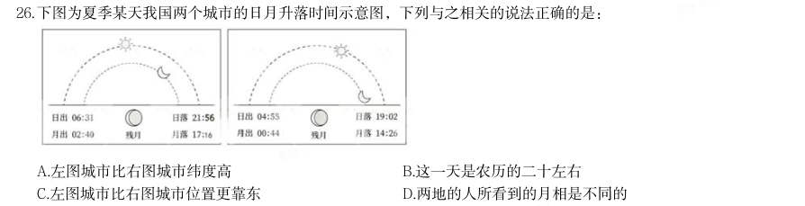

- **A.** 左图城市比右图城市纬度高
- **B.** 这一天是农历的二十左右
- **C.** 左图城市比右图城市位置更靠东
- **D.** 两地的人所看到的月相是不同的

**答案：A**

### 2025 国考·副省级　第 28 题　（政治常识（综合））

纪录片《何以中国》讲述了多元一体中华民族的形成和中华文明创生的故事。下列哪句解说词不可能出现在 《秦汉》一集中?

- **A.** 他登峰山,攀泰山,上琅琊,经之罘,过东观,临碣石,至会稽,巡行之处皆刊石勒铭
- **B.** 武丁左手扶住卜骨,右手持炭棒,灼烧着钻槽,通红的棒头神秘地闪烁,不久后,裂缝在钻槽边绽开,发出脆响
- **C.** 从长安出发时,车马粼粼百余人,回程路上,只有两人,一十三年间,有利益相诱,有武力相胁,温柔乡、囹圄境,却从未丢失身为汉使的旌节,从未磨灭此行的初心
- **D.** 龙首原上,长乐、未央两宫东西并峙,于高处制掣全城。桂宫、北宫、明光宫横列两宫之北

**答案：B**

### 2025 国考·副省级　第 29 题　（政治常识（综合））

关于医学检查方法,下列说法错误的是:

- **A.** 做心脏超声检查,无需患者做憋尿、空腹等特殊准备
- **B.** 造影利用了造影剂与人体组织密度的区别
- **C.** 磁共振检查没有放射性,适用于孕妇、婴幼儿等人群
- **D.** 血清检查是判断幽门螺旋杆菌感染的最佳方法

**答案：D**

### 2025 国考·副省级　第 32 题　（政治常识（综合））

在关于真菌的科普文章中,下列表述存在错误的是:

- **A.** 古人很早就利用真菌发酵食物,比如利用乳酸菌酿造果酒
- **B.** 人类历史上发现的第一种抗生素来自微型真菌
- **C.** 羊肚菌、松茸等食用真菌味道鲜美,含有丰富的优质蛋白质
- **D.** 植物的根能和真菌形成共生关系,菌丝吸收水分、无机盐等供给植物

**答案：A**

### 2025 国考·副省级　第 33 题　（政治常识（综合））

关于温室栽培,下列说法错误的是:

- **A.** 夜间降低温室内的温度,可以减少农作物营养物质的消耗
- **B.** 相比普通塑料温室大棚,玻璃温室可以让阳光更容易进入
- **C.** 紫外线灯是一种大棚中经常使用且效果较好的植物补光灯
- **D.** 在作物栽培过程中通入适量的二氧化碳可以提高作物产量

**答案：C**

### 2025 国考·副省级　第 34 题　（政治常识（综合））
> 材料：下列情境中的两个物理量成正比例的是: 1通过某一电阻器的电流与其两端的电压 2物体所受浮力与其体积…

3弹性限度内弹簧的伸长量与其所受拉力 4汽车行驶时的加速度与速度

- **A.** 12
- **B.** 24
- **C.** 34
- **D.** 13

**答案：D**

### 2025 国考·副省级　第 35 题　（政治常识（综合））

下列与体育比赛有关的说法错误的是:

- **A.** 跳水运动的难度系数涉及动作姿势和翻腾转体周数等方面
- **B.** 篮球比赛中罚球时允许球员双脚离地
- **C.** 足球比赛的常规时间长度为90分钟
- **D.** 举重运动中判定试举成功需要三名裁判均亮白灯

**答案：D**

### 2025 国考·地市级　第 3 题　（马克思主义基本原理）

关于马克思主义政治经济学,下列说法正确的是:

- **A.** 商品的价值量是由生产该商品所需的个别劳动时间决定的
- **B.** 货币的价值尺度职能是通过实际的物质交换来实现的
- **C.** 具体劳动和抽象劳动是不同商品生产过程中的不同劳动
- **D.** 具体劳动创造商品的使用价值,抽象劳动形成商品的价值

**答案：D**

### 2025 国考·地市级　第 22 题　（政治常识（综合））

下列情形不在申请行政复议范围之内的是:

- **A.** 餐馆甲因食品卫生不达标,被吊销餐饮服务许可证,甲不服
- **B.** 建设单位乙在申请建筑工程施工许可证时,因申请材料不全被拒绝,乙不服
- **C.** 公务员丙不能胜任工作,其所属行政机关作出降职处理决定,丙不服
- **D.** 工人丁提出工伤认定申请,当地人力资源和社会保障局作出不予受理决定,丁不服

**答案：C**

### 2025 国考·地市级　第 23 题　（政治常识（综合））

关于所有权的取得,下列说法正确的是:

- **A.** 甲在公园捡到一条金项链,经多方寻找失主未果,此时甲获得项链的所有权
- **B.** 乙以市价购买了一辆自行车,后发现该车是卖家借来的,乙仍可获得该车的所有权
- **C.** 丙继承了一处房产,但尚未办理变更登记,丙此时还未获得该房产的所有权
- **D.** 丁从村集体处承包了一块田地用于农作物种植,丁同时取得这块田地的所有权

**答案：B**

### 2025 国考·地市级　第 29 题　（政治常识（综合））

在关于真菌的科普文章中,下列表述存在错误的是:

- **A.** 古人很早就利用真菌发酵食物,比如利用乳酸菌酿造果酒
- **B.** 人类历史上发现的第一种抗生素来自微型真菌
- **C.** 羊肚菌、松茸等食用真菌味道鲜美,含有丰富的优质蛋白质
- **D.** 植物的根能和真菌形成共生关系,菌丝吸收水分、无机盐等供给植物

**答案：A**

### 2025 国考·地市级　第 32 题　（政治常识（综合））

关于医学检查方法,下列说法错误的是:

- **A.** 做心脏超声检查,无需患者做憋尿、空腹等特殊准备
- **B.** 造影利用了造影剂与人体组织密度的区别
- **C.** 磁共振检查没有放射性,适用于孕妇、婴幼儿等人群
- **D.** 血清检查是判断幽门螺旋杆菌感染的最佳方法

**答案：D**

### 2025 国考·地市级　第 34 题　（政治常识（综合））

下列《三国演义》中的回目,按照先后顺序排列正确的是: 1宴长江曹操赋诗,锁战船北军用武 2战官渡本初败绩,劫乌巢孟德烧粮 3刘先主遗诏托孤儿,诸葛亮安居平五路 4王司徒巧使连环计,董太师大闹凤仪亭

- **A.** 1342
- **B.** 3241
- **C.** 2143
- **D.** 4213

**答案：D**

### 2025 国考·地市级　第 35 题　（政治常识（综合））

下列与船只行驶有关的说法错误的是:

- **A.** 皮筏在顺流而下的过程中动能转化为重力势能
- **B.** 船舵利用杠杆原理改变行船的方向
- **C.** 使用船桨划船前进时利用了力的相互作用
- **D.** 帆船实现逆风行驶是利用了伯努利原理

**答案：A**

### 2025 国考·行政执法　第 3 题　（马克思主义基本原理）

关于马克思主义政治经济学,下列说法正确的是:

- **A.** 商品的价值量是由生产该商品所需的个别劳动时间决定的
- **B.** 货币的价值尺度职能是通过实际的物质交换来实现的
- **C.** 具体劳动和抽象劳动是不同商品生产过程中的不同劳动
- **D.** 具体劳动创造商品的使用价值,抽象劳动形成商品的价值

**答案：D**

### 2025 国考·行政执法　第 23 题　（政治常识（综合））

2024年5月,甲驾驶重型半挂车行驶至某县辖区内被交警临检。该县公安局交警大队认定甲存在驾驶故意污损 机动车号牌的机动车在道路行驶的行为,遂当场作出罚款200元、记9分的处罚决定。甲认为其不存在故意污损 号牌的行为,对处罚决定不服。下列说法正确的是( )。

- **A.** 甲可以不经行政复议,直接向人民法院提起行政诉讼
- **B.** 甲若申请行政复议,复议机关为该县公安局
- **C.** 甲若申请行政复议,不适用简易程序审理
- **D.** 甲若申请行政复议,该案可适用调解

**答案：D**

### 2025 国考·行政执法　第 25 题　（政治常识（综合））

关于所有权的取得,下列说法正确的是:

- **A.** 甲在公园捡到一条金项链,经多方寻找失主未果,此时甲获得项链的所有权
- **B.** 乙以市价购买了一辆自行车,后发现该车是卖家借来的,乙仍可获得该车的所有权
- **C.** 丙继承了一处房产,但尚未办理变更登记,丙此时还未获得该房产的所有权
- **D.** 丁从村集体处承包了一块田地用于农作物种植,丁同时取得这块田地的所有权

**答案：B**

### 2025 国考·行政执法　第 27 题　（政治常识（综合））

下列情形中甲的主张最可能得到人民法院支持的是:

- **A.** 甲竞买人在现场拍卖中拍得一件艺术品,甲主张合同自拍卖师落槌时成立
- **B.** 甲乙企业签订的合作备忘录仅表达了双方深度合作的意向,甲主张预约合同成立
- **C.** 甲游戏平台在采用格式条款订立合同时,仅以设置勾选的方式提示用户,甲主张已履行提示义务
- **D.** 甲与乙的房产买卖合同存在可撤销的情形,但已办理产权变更登记手续,甲以此为由主张合同有效

**答案：A**

### 2025 国考·行政执法　第 32 题　（政治常识（综合））

如果要写一部《地球史诗》,下列描述与地质年代对应不当的是:

- **A.** 虽然这时的大陆荒凉一片,但大海的子民空前繁盛,藻类欣欣向荣,三叶虫风头最劲,生命是这个时代永恒的主题——寒武纪
- **B.** 新生的纪元始于大灭绝之后,哺乳动物继恐龙成为新主,被子植物极度繁盛,裸子植物只有松柏长青——志留纪
- **C.** 鱼类是这个时代的代言人,裸蕨在大地上站稳了脚根,成片的森林改写了历史,登陆的两栖类颠覆了乾坤——泥盆纪
- **D.** 森林以裸子植物为名养育了恐龙,鸟类首次翱翔于天空,恐龙最终征服了世界——侏罗纪

**答案：B**

### 2025 国考·行政执法　第 33 题　（政治常识（综合））

下列与体育比赛有关的说法错误的是:

- **A.** 跳水运动的难度系数涉及动作姿势和翻腾转体周数等方面
- **B.** 篮球比赛中罚球时允许球员双脚离地
- **C.** 足球比赛的常规时间长度为90分钟
- **D.** 举重运动中判定试举成功需要三名裁判均亮白灯

**答案：D**

### 2025 国考·行政执法　第 35 题　（政治常识（综合））

关于温室栽培,下列说法错误的是:

- **A.** 夜间降低温室内的温度,可以减少农作物营养物质的消耗
- **B.** 相比普通塑料温室大棚,玻璃温室可以让阳光更容易进入
- **C.** 紫外线灯是一种大棚中经常使用且效果较好的植物补光灯
- **D.** 在作物栽培过程中通入适量的二氧化碳可以提高作物产量

**答案：C**

### 2024 湖北·统一卷　第 11 题　（政治常识（综合））

小明被困在一个无人、无食物来源但有淡水的荒岛上。假如他在等待救援期间可以从相同重量的葡萄、馒头、 酸奶、花生仁这四种食物中选择一种,那么为了能在岛上生存的时间最长,他应该选择的食物是( )。

- **A.** 葡萄
- **B.** 馒头
- **C.** 酸奶
- **D.** 花生仁

**答案：D**

### 2024 湖北·统一卷　第 12 题　（政治常识（综合））

下列病毒与其主要感染的人体系统对应正确的是:

- **A.** 狂犬病毒——免疫系统
- **B.** 流感病毒——神经系统
- **C.** 乙肝病毒——消化系统
- **D.** 艾滋病毒——生殖系统

**答案：C**

### 2024 湖北·统一卷　第 14 题　（政治常识（综合））

唐代是丝绸之路的鼎盛时期,当时丝绸之路上的商队可能携带的商品是:

- **A.** 线装本的《史记》
- **B.** 精心制作的宣德炉
- **C.** 《司马温公神道碑》拓片
- **D.** 鎏金工艺制作的莲瓣银茶托

**答案：D**

### 2024 湖北·统一卷　第 16 题　（政治常识（综合））

讲述宋史时,“燕云十六州”是绕不开的话题,下列有关叙述不正确的是:

- **A.** 周世宗柴荣北伐时收复了部分州
- **B.** 澶渊之盟正式将燕云十六州割让给辽国
- **C.** 高梁河之战使北宋失去了完全收复燕云十六州的时机
- **D.** 燕云十六州是我国北方以幽州和云州为中心的十六个州

**答案：B**

### 2024 湖北·统一卷　第 18 题　（政治常识（综合））

下列关于国债逆回购的说法正确的是:

- **A.** 投资者可以通过银行网点购买国债逆回购
- **B.** 国债逆回购是以国家为主体进行债券回购
- **C.** 国债逆回购本质上是一种短期资金借贷方式
- **D.** 国债逆回购利率上行20个基点表示利率增加2%

**答案：C**

### 2024 广东·统一卷　第 5 题　（新时代理论）

中国共产党是为中国人民谋幸福、为中华民族谋复兴的党,也是为人类谋进步、为世界谋大同的党。我们要拓 展世界眼光,深刻洞察人类发展进步潮流,积极回应各国人民普遍关切,为解决人类面临的共同问题作出贡 献,以海纳百川的宽阔胸襟借鉴吸收人类一切优秀文明成果,推动建设更加美好的世界。这段话最能体现习近 平新时代中国特色社会主义思想( )的立场观点方法。

> （本题为图形题，选项为图片，见原卷）

**答案：C**

### 2024 广东·统一卷　第 6 题　（政治常识（综合））

（本题题干为图形/公式，文字层无题干，图见原卷）

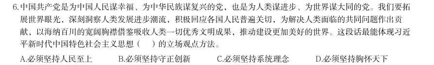

- **A.** 必须坚持人民至上
- **B.** 必须坚持守正创新
- **C.** 必须坚持系统理念
- **D.** 必须坚持胸怀天下

**答案：A**

### 2024 广东·统一卷　第 8 题　（毛中特与党史）

1930年,毛泽东同志在文章中强调调查研究是一切工作的第一步,提出了“没有调查,没有发言权”的著名论 断。这一论断出自他的( )。

- **A.** 《星星之火,可以燎原》
- **B.** 《反对本本主义》
- **C.** 《中国革命和中国共产党》
- **D.** 《论十大关系》

**答案：B**

### 2024 广东·统一卷　第 12 题　（马克思主义基本原理）

(多选题)矛盾是反映事物内部或者事物之间对立统一关系的哲学范畴。矛盾的同一性是指矛盾着的对立面相 互依存、相互贯通的性质和趋势。关于矛盾的同一性,以下表述正确的有( )。

- **A.** 在矛盾双方中,一方的发展以另一方的发展为条件
- **B.** 矛盾双方相互吸取有利于自身的因素,在相互作用中各自得到发展
- **C.** 事物的发展方向、趋势不是随意的,而是有规律地向自己的对立面转化
- **D.** 矛盾双方的统一是一种矛盾统一体向另一种矛盾统一体过渡的决定性力量

**答案：C**

### 2024 广东·统一卷　第 13 题　（政治常识（综合））

(多选题)在面对重重困难艰辛探索适合中国国情的社会主义建设道路过程中,涌现出大量先进典型和英雄模 范人物,抒写了无数改天换地的壮丽诗篇,形成跨越时空、历久弥新的时代精神。下列词句关联人物的主要事 迹,发生于社会主义建设时期的有( )。

- **A.** “清澈的爱,只为中国”
- **B.** “干惊天动地事,做隐姓埋名人”
- **C.** “生也沙丘,死也沙丘,父老生死系”
- **D.** “以青春之我,创建青春之家庭,青春之国家,青春之民族”

**答案：B**

### 2024 广东·统一卷　第 14 题　（马克思主义基本原理）

(多选题)马克思主义道德观认为,人类社会的实际情况是“物质生活的生产方式制约着整个社会生活、政治 生活和精神生活的过程。”关于道德起源问题,以下认识正确的有( )。

- **A.** 劳动是道德起源的首要前提
- **B.** 道德起源于人与生俱来的善性
- **C.** 社会关系是道德赖以产生的客观条件
- **D.** 人的自我意识是道德产生的主观条件

**答案：D**

### 2024 广东·统一卷　第 15 题　（政治常识（综合））

(多选题)根据《中华人民共和国爱国主义教育法》,以下属于爱国主义教育主要内容的有( )。

- **A.** 马克思列宁主义、毛泽东思想、邓小平理论、“三个代表”重要思想、科学发展观、习近平新时代中国特色社会主义思想
- **B.** 国旗、国歌、国徽等国家象征和标志
- **C.** 祖国的壮美河山和历史文化遗产
- **D.** 宪法和法律,国家统一和民族团结、国家安全和国防等方面的意识和观念

**答案：B**

### 2024 国考·副省级　第 8 题　（毛中特与党史）

2022年11月28日,中共中央办公厅、国务院办公厅发布《乡村振兴责任制实施办法》。下列与乡村振兴责任制 有关的说法不准确的是:

- **A.** 坚持党对农村工作的全面领导,省市县乡村五级书记抓乡村振兴
- **B.** 中央和国家机关有关部门要以健全城乡融合发展体制为主线深化农村改革
- **C.** 地方政府乡村振兴要把确保粮食和重要农产品供给作为首要任务
- **D.** 县级党委和政府是乡村振兴“一线指挥部”

**答案：B**

### 2024 国考·副省级　第 10 题　（政治常识（综合））

根据《审计法》下列说法错误的是( )。

- **A.** 某审计机关通过政务信息系统取得数据后,要求被审计单位提供同一数据
- **B.** 某审计机关对外国政府贷款项目的财务收支进行审计监督
- **C.** 某审计机关组成三人调查小组前往某国有企业进行调查
- **D.** 某审计机关为完成紧急工作任务,聘请某会计师事务所人员共同参与审计工作

**答案：A**

### 2024 国考·副省级　第 11 题　（政治常识（综合））

根据《中华人民共和国反间谍法》,下列说法或做法错误的是( )。

- **A.** 甲涉嫌间谍行为被传唤,在其嫌疑消除前不得将传唤原因通知其家属
- **B.** 乙涉嫌间谍行为,移民管理机构接到省国家安全机关通知后,不准其出境
- **C.** 丙在境外受胁迫参加间谍组织后,及时向大使馆如实说明情况,并有悔改表现,可以不予追究
- **D.** 丁因协助反间谍工作导致财产损失,根据国家有关规定,可获得补偿

**答案：A**

### 2024 国考·副省级　第 12 题　（政治常识（综合））

下列关于《预备役人员法》的说法错误的是( )。

- **A.** 预备役人员参加军事训练期间,军队为其购买人身意外伤害保险
- **B.** 预备役人员从事个体经营,可以按照国家有关规定享受出资优惠政策
- **C.** 预备役人员退出预备役的,其预备役军衔予以保留
- **D.** 预备役军官分为预备役指挥管理军官和预备役专业技术军官

**答案：B**

### 2024 国考·副省级　第 14 题　（新时代理论）

某展览馆举办的“奋进新时代”主题成就展设置了一些地方展区。下列场景最可能出现的是:

- **A.** 在天津展区,观众仔细阅读着展柜中黄文秀生前的日记,久久不愿离去
- **B.** 在江苏展区,杨柳青年画代表性传承人正忙着给观众们制作年画作品
- **C.** 在河北展区,观众在“地球卫士奖”奖杯前感叹荒原变林海的人间奇迹
- **D.** 在广西展区,观众在“今日开山岛”模型前聆听王继才、王仕花夫妇的守岛事迹

**答案：C**

### 2024 国考·副省级　第 18 题　（政治常识（综合））

下列与花卉有关的说法正确的是( )。

- **A.** 水培花卉应选用洁净的偏碱性的水
- **B.** 压条是一种常用的多肉植物繁殖方式
- **C.** 叶面施肥通常选择在早晨或傍晚进行
- **D.** 日照时间过长会导致短日照花卉死亡

**答案：C**

### 2024 国考·地市级　第 10 题　（政治常识（综合））

根据《中华人民共和国反间谍法》,下列说法或做法错误的是( )。

- **A.** 甲涉嫌间谍行为被传唤,在其嫌疑消除前不得将传唤原因通知其家属
- **B.** 乙涉嫌间谍行为,移民管理机构接到省国家安全机关通知后,不准其出境
- **C.** 丙在境外受胁迫参加间谍组织后,及时向大使馆如实说明情况,并有悔改表现,可以不予追究
- **D.** 丁因协助反间谍工作导致财产损失,根据国家有关规定,可获得补偿

**答案：A**

### 2024 国考·地市级　第 12 题　（政治常识（综合））

下列不能被授予专利权的是:

- **A.** 一种医疗口腔内科专用的喷药器
- **B.** 一种治疗主动脉夹层的新型手术方法
- **C.** 一种计算机控制油墨颜色配制的装置
- **D.** 一种针对水稻辐射诱变育种的新技术

**答案：B**

### 2024 国考·地市级　第 13 题　（政治常识（综合））

下列与企业应负担的税种有关的说法正确的是:

- **A.** 对纳税人出口应税消费品,一般免征消费税
- **B.** 所有印花税税目均按照统一的税率征收
- **C.** 增值税专用发票是增值税小规模纳税人销售货物等开具的发票
- **D.** 企业所得税应纳税所得额不包括向投资者支付的股息、红利

**答案：A**

### 2024 国考·地市级　第 15 题　（政治常识（综合））

2023年2月6日,自然资源部印发《公开地图内容表示规范》,下列说法与之不相符的是:

- **A.** 香港特别行政区、澳门特别行政区在地图上应按省级行政单位表示
- **B.** 表现地为我国境内的地图不得表示未对社会公众开放的卫星导航定位基准站
- **C.** 台湾省地图的图幅范围,应当绘出钓鱼岛和赤尾屿
- **D.** 表现地为我国境内的遥感影像,地面分辨率不得优于0.1米

**答案：D**

### 2024 国考·地市级　第 17 题　（政治常识（综合））

下列与统计学相关的说法正确的是: 1两个变量相关程度很高,说明两者存在因果关系 2回归可以利用过去的数据预测未来的趋势 3自变量是一种随机变量 4众数的大小可能与样本数据中的部分数据无关

- **A.** 13
- **B.** 14
- **C.** 24
- **D.** 23

**答案：C**

### 2024 国考·地市级　第 19 题　（政治常识（综合））

关于肥料,下列说法错误的是:

- **A.** 化肥宜用金属器皿密封储藏,以防潮湿变质
- **B.** 秸秆、餐厨垃圾都是有机肥料的原料
- **C.** 细菌肥料一般应避光保存
- **D.** 水溶性肥料适合滴灌施肥

**答案：A**

### 2024 国考·地市级　第 20 题　（政治常识（综合））

下列与家庭用电有关的说法错误的是:

- **A.** 电能表应安装在家庭电路的干路上
- **B.** 空气开关需要搭配保险丝使用才能起到保护电路的作用
- **C.** 使用同一插线板供电的家用小电器之间是并联连接方式
- **D.** 白炽灯利用电流的热效应进行工作

**答案：B**

### 2024 国考·行政执法　第 6 题　（新时代理论）
> 材料：在2023年7月召开的全国生态环境保护大会上,习近平总书记全面总结我国生态文明建设取得的举世瞩目的巨 大成就,精辟概括了“四个重大转变”,这四个重大转变是: 1实现由重点整治到系统治理的重大转变…

2实现由被动应对到主动作为的重大转变 3实现由全球环境治理参与者到引领者的重大转变 4实现由实践探索到科学理论指导的重大转变 5实现由多重压力叠加到单一结构性压力的重大转变

- **A.** 1234
- **B.** 1235
- **C.** 2345
- **D.** 1345

**答案：A**

### 2024 国考·行政执法　第 14 题　（政治常识（综合））

老张常居国外,其儿子小张常住老张名下房子内。小张在外欠债较多,伪造手续后将老张名下房屋卖给了不知 情的小王,小王支付对价并办理了产权变更手续。下列有关说法正确的是:

- **A.** 因小张伪造手续,该买卖行为无效
- **B.** 小张与小王之间的买卖合同关系有效,但不发生物权变动效力
- **C.** 小张与小王之间的买卖合同及物权变动均有效
- **D.** 老张有权向小王请求损害赔偿

**答案：C**

### 2024 国考·行政执法　第 15 题　（政治常识（综合））

下列不能被授予专利权的是:

- **A.** 一种医疗口腔内科专用的喷药器
- **B.** 一种治疗主动脉夹层的新型手术方法
- **C.** 一种计算机控制油墨颜色配制的装置
- **D.** 一种针对水稻辐射诱变育种的新技术

**答案：B**

### 2024 国考·行政执法　第 19 题　（政治常识（综合））

下列与家庭用电有关的说法错误的是:

- **A.** 电能表应安装在家庭电路的干路上
- **B.** 空气开关需要搭配保险丝使用才能起到保护电路的作用
- **C.** 使用同一插线板供电的家用小电器之间是并联连接方式
- **D.** 白炽灯利用电流的热效应进行工作

**答案：B**

### 2024 国考·行政执法　第 20 题　（政治常识（综合））

关于肥料,下列说法错误的是:

- **A.** 化肥宜用金属器皿密封储藏,以防潮湿变质
- **B.** 秸秆、餐厨垃圾都是有机肥料的原料
- **C.** 细菌肥料一般应避光保存
- **D.** 水溶性肥料适合滴灌施肥

**答案：A**

### 2023 湖北·统一卷　第 11 题　（政治常识（综合））

下列关于先秦诸子百家叙述不正确的是:

- **A.** 孙武是兵家思想代表人物
- **B.** 老子提出了“内圣外王”的治国思想
- **C.** 韩非子是法家的代表人物,是荀子的学生
- **D.** 墨家学派有严密的组织、严格的纪律,其创始人为墨翟

**答案：B**

### 2023 湖北·统一卷　第 12 题　（政治常识（综合））

探索建立长期护理保险制度,是党和政府为应对人口老龄化、健全社会保障体系作出的 一项重要部署。下列关于我国长期护理保险制度的说法正确的是:

- **A.** 长期护理保险属于养老保险范畴
- **B.** 长期护理保险的参保对象是已退休的老年人
- **C.** 根据护理等级、服务提供方式等不同实行差别化待遇保障政策
- **D.** 因突发疾病住院产生的护理费用属于长期护理保险的支付范围

**答案：C**

### 2023 湖北·统一卷　第 13 题　（政治常识（综合））

下列所描述的现象不会出现的是:

- **A.** 喝可乐或其它碳酸饮料时,表面的泡沫或是聚成一团,或是贴着杯壁,很少有零星的小泡泡独自游荡
- **B.** 不小心洒落到桌子上的茶或者咖啡,干燥后会留下一个污渍,其边缘部分颜色比中间深
- **C.** 让小汤匙的凸面轻轻触碰水龙头流出的小水流,水流会被吸引,沿着汤匙的凸面往下流
- **D.** 让两枚图钉漂在水面上,它们靠近时会相互排斥无法碰在一起

**答案：D**

### 2023 湖北·统一卷　第 17 题　（政治常识（综合））

下列所描述的现象不会出现的是:

- **A.** 到大柱子后面可以躲避寒风,柱子越大背后风速越小
- **B.** 慢慢倒酒水时,酒水会在酒瓶口的边缘附壁流下来
- **C.** 让小汤匙的凸面轻轻接触水龙头流出的小水流,水流会被吸引,沿着汤匙的凸面往下流
- **D.** 拿一个鸡蛋放在水龙头的细小水流下,鸡蛋上半部的水流并没有沿着切向垂直向下流,

**答案：A**

### 2023 湖北·统一卷　第 19 题　（政治常识（综合））

甲的牛不慎走失,乙在路边发现,遂牵回家去饲养,并请邻居帮忙寻找失主,一周后, 甲听说乙曾捡到一头牛,登门辨认后,确认是自家走失的牛并要求其归还,乙同意返还,但 是要求甲支付报酬2000 元和饲养牛所用的青草、杂粮等费用200 元,共计2200 元。甲拒绝 支付,两人发生争议。下列说法正确的是:

- **A.** 甲无需支付任何费用
- **B.** 甲应当支付2200 元
- **C.** 甲应当支付2000 元
- **D.** 甲应当支付200 元

**答案：D**

### 2023 湖北·统一卷　第 20 题　（政治常识（综合））

老张和老伴李某育有两儿一女,小儿子早逝。老张不幸去世后,没有留下遗嘱,下列关 于遗产继承的说法错误的是:

- **A.** 遗产分割时,应当先将老张和李某共有的财产分出一半,归李某所有,其余的属于老张的遗产
- **B.** 大儿子在外地工作,长期对老张不闻不问,应当不分或少分遗产
- **C.** 女儿因工伤丧失了劳动能力,她的配偶患病长期服药,两个孩子都还在读中学,女儿与其他继承人均等继承遗产份额
- **D.** 小儿子的妻子陈某念及公婆二人无人照顾、行动不便,平日里悉心照料二老的生活,陈

**答案：C**

### 2023 湖北·统一卷　第 56 题　（政治常识（综合））

某公司自主研发生产的A、B、C 三种型号氢燃料电池,解决了该公司今年生产轿车所 需电池数量的10%(按一辆车配一块电池计算)。其中A 型号氢燃料电池的产量是B 型号 的2 倍,C 型号的产量比A、B 两种型号的产量之和还多400 块。预计该公司今年的轿车总 产量是42.4 万辆,那么B 型号氢燃料电池的产量是:

- **A.** 3500 块
- **B.** 7000 块
- **C.** 14000 块
- **D.** 21400 块

**答案：B**

### 2023 湖北·统一卷　第 57 题　（政治常识（综合））

某智慧公共停车场的收费标准如下:停车不超过15 分钟,不收费;超过15 分钟但不超 过60 分钟,按1 小时计,收费5 元;超过1 小时后,超过的部分按每30 分钟4 元收费(不 足30 分钟,按30 分钟计)。若李先生支付停车费17 元,则他停车的时长可能为:

- **A.** 2 小时
- **B.** 2 小时15 分钟
- **C.** 2 小时45 分钟
- **D.** 3 小时

**答案：B**

### 2023 湖北·统一卷　第 58 题　（政治常识（综合））

某小区物业准备了230 盒口罩免费派发给10 栋楼,要求任意两栋楼派发的口罩数量都 不相同,但最多相差不超过1 倍。假设口罩不拆盒发放,那么派发口罩数量最少的那栋楼最 少可派发口罩:

- **A.** 18 盒
- **B.** 15 盒
- **C.** 14 盒
- **D.** 12 盒

**答案：C**

### 2023 湖北·统一卷　第 59 题　（政治常识（综合））

某空军基地举行飞行训练,有8 架歼击机、3 架预警直升机、2 架反潜直升机参与训练, 每架飞机编号不同。训练时,需派出3 架歼击机、2 架预警直升机、1 架反潜直升机进行起 降飞行。若每次只能起飞1 架飞机,其中3 架歼击机必须相邻起飞,2 架预警直升机不能相 邻起飞,那么不同的起飞方式有多少种?

- **A.** 504
- **B.** 4032
- **C.** 8064
- **D.** 24192

**答案：D**

### 2023 湖北·统一卷　第 61 题　（政治常识（综合））

小林因病入院需挂瓶输液,上午9 点开始输液,输液袋上标有“容量300 毫升,每毫升 15 滴”等药液信息。输液开始时,药液滴速为75 滴/分钟。输液5 分钟后小林感觉身体不适, 护士帮忙调整了药液滴速(调整时间不计),又继续输液10 分钟,药液还剩235 毫升,那 么输液结束的时间是:

- **A.** 10 点26 分
- **B.** 10 点18 分
- **C.** 10 点14 分
- **D.** 10 点10 分

**答案：C**

### 2023 湖北·统一卷　第 62 题　（政治常识（综合））

A、B 两村在一条笔直公路的同侧,到公路的垂直距离分别是3 公里和7 公里,两村相距 8.5 公里,现需在公路边建一个物资集散中心,为节约物资配送成本,集散中心到两个村的 直线路程之和应尽可能小,若货车的速度约为60 公里/小时,那么货车从集散中心出发,到 两村送货后返回中心,路途所花费的最少时间为: A.18 分钟 B.21 分钟 C.24 分钟 D.27 分钟

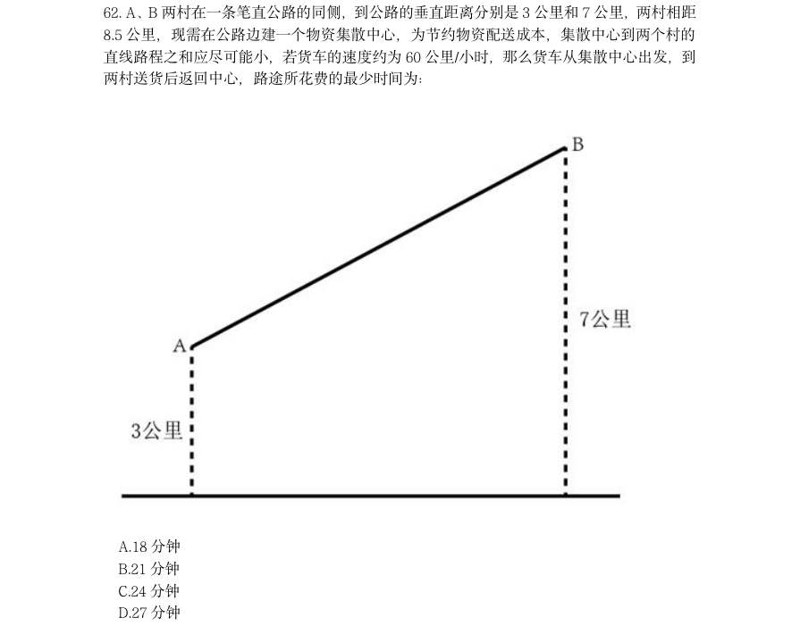

> （本题为图形题，选项为图片，见原卷）

**答案：B**

### 2023 湖北·统一卷　第 64 题　（政治常识（综合））

厦门鼓浪屿海滨覆鼎岩上屹立着一尊郑成功雕像。为了测量石像的高度,某测量小组选 取的测量点A 与覆鼎岩底部D 在同一水平线上,如下图所示。已知覆鼎岩高CD 为24 米, 在A 处测得石像头顶部B 的仰角为 ,石像底部C 的仰角为 (参考数据: , , ),则像BC 的高度约为:

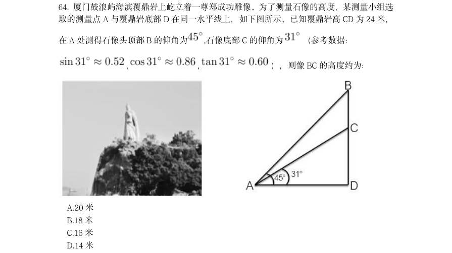

- **A.** 20 米
- **B.** 18 米
- **C.** 16 米
- **D.** 14 米

**答案：C**

### 2023 湖北·统一卷　第 67 题　（政治常识（综合））

某餐馆承诺25 分钟内上齐一桌菜,若超时则未上的菜品免单。每张餐桌上都有一个装 满后正好25 分钟漏完的圆锥形沙漏(如下图所示)。某位顾客在等待的过程中发现沙漏内 上方沙子的高度为原先的一半,此时还差一道菜未上,则再过多久还未上菜,这位顾客将享 受免单服务?

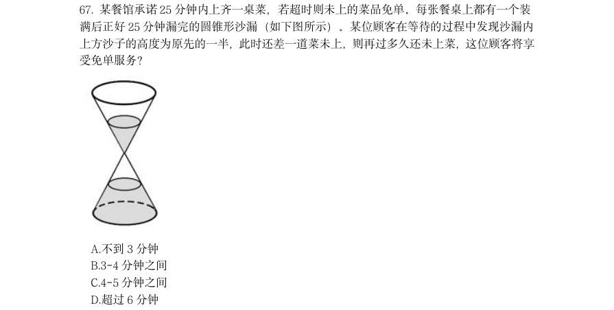

- **A.** 不到3 分钟
- **B.** 3-4 分钟之间
- **C.** 4-5 分钟之间
- **D.** 超过6 分钟

**答案：B**

### 2023 湖北·统一卷　第 68 题　（政治常识（综合））

某品牌圆形扫地机器人升级设计方案,是在原有扫地机器人的前端伸出8cm 可转动的边 刷进行清扫(如下图所示),目的是将无法触及的边边角角都彻底清扫干净,那么,为保证 这一效果,该型号扫地机器人圆形机身的最大直径是:(答案取整数位)

- **A.** 30cm
- **B.** 36cm
- **C.** 38cm
- **D.** 40cm

**答案：C**

### 2023 湖北·统一卷　第 69 题　（政治常识（综合））

某村拟建造一个容积为144 立方米,深度为4 米的长方体无盖蓄水池。经测算,蓄水池 底部造价为260 元/平方米,侧面造价为180 元/平方米。那么该水池的最低总造价为:

- **A.** 11440 元
- **B.** 25920 元
- **C.** 26640 元
- **D.** 31680 元

**答案：C**

### 2023 湖北·统一卷　第 70 题　（政治常识（综合））

下图所示是一种帐篷屋顶的示意图,底面是一个长4 米宽3 米的长方形,屋顶高1 米, 上棱长2 米且平行于底面,那么该帐篷屋顶的体积是:

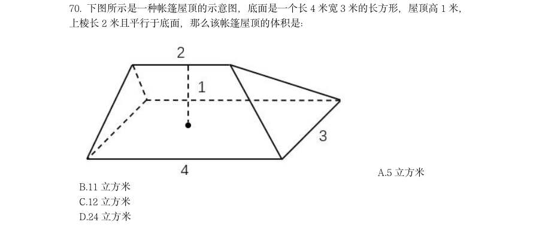

- **A.** 5 立方米
- **B.** 11 立方米
- **C.** 12 立方米
- **D.** 24 立方米

**答案：A**

### 2023 湖北·统一卷　第 86 题　（政治常识（综合））

葡萄:葡萄酒

- **A.** 黄金:黄金档
- **B.** 香蕉:香蕉水
- **C.** 杜鹃:杜鹃花
- **D.** 枇杷:枇杷膏

**答案：D**

### 2023 湖北·统一卷　第 87 题　（政治常识（综合））

天荒地老:海枯石烂

- **A.** 同心同德:反目成仇
- **B.** 披荆斩棘:斩钉截铁
- **C.** 孜孜矻矻:夙夜不懈
- **D.** 望而却步:望风披靡

**答案：C**

### 2023 湖北·统一卷　第 88 题　（政治常识（综合））

全真阅读:沉浸式

- **A.** 企业销售:盈利性
- **B.** 乡村教育:均衡化
- **C.** 人工智能:数字化
- **D.** 线上课程:直播性

**答案：C**

### 2023 湖北·统一卷　第 89 题　（政治常识（综合））

龋齿:嗜食甜品

- **A.** 海鲜:食物过敏
- **B.** 缺钙:骨质疏松
- **C.** 运动:增强体质
- **D.** 塌方:地下渗水

**答案：D**

### 2023 湖北·统一卷　第 90 题　（政治常识（综合））

针灸:疏通经脉

- **A.** 慢跑:增强体质
- **B.** 涅槃:化茧成蝶
- **C.** 缺铁:供血不足
- **D.** 促销:商品展示

**答案：A**

### 2023 湖北·统一卷　第 91 题　（政治常识（综合））

游艇:钢材:船舶

- **A.** 古玺:玉石:隶书
- **B.** 旗袍:丝绸:服饰
- **C.** 版画:油画:绘画
- **D.** 砧板:厨具:木材

**答案：B**

### 2023 湖北·统一卷　第 92 题　（政治常识（综合））

书柜:书籍:书页

- **A.** 花坛:花卉:花蕊
- **B.** 舞池:舞蹈:舞伴
- **C.** 面粉:面条:面片
- **D.** 鞋盒:鞋子:鞋油

**答案：A**

### 2023 湖北·统一卷　第 95 题　（政治常识（综合））

佶屈聱牙对于(________)相当于(________)对于教诲

- **A.** 文句;春风化雨
- **B.** 书写;和光同尘
- **C.** 表达;无微不至
- **D.** 描述;刚柔相济

**答案：A**

### 2023 湖北·统一卷　第 103 题　（政治常识（综合））

北极放大效应是指冰雪和气温之间容易形成正反馈,即气温升高则冰雪消融增多,没 有冰雪覆盖的裸地能吸收更多的太阳辐射,加热大气,进一步加剧冰雪消融。观测显示,位 于北极格陵兰岛的大多数冰川都呈现出消退趋势,这是世界上流失速度最快的冰川之一。因 此,格陵兰岛的冰川消融受到放大效应影响。 要得到上述结论,需要补充的前提是:

- **A.** 近30 年,格陵兰岛冰川融化已导致全球海平面上升了11 毫米,如果全部融化,全球海平面预计会上升7 米
- **B.** 格陵兰岛冰川消退会导致大大小小冰川入海,形成冰山,进而导致海啸,摧毁近岸上因纽特人的家园
- **C.** 格陵兰岛的冰川融化后显现出大量陆地,陆地比海洋吸收热量更快
- **D.** 同样是极地,南极地区的冰川消退并不明显

**答案：C**

### 2023 湖北·统一卷　第 106 题　（政治常识（综合））
> 材料：2021 年中国雨季特征为华南前汛期于4 月26 日开始,7 月2 日结束,雨季长度为67 天,总雨量494.6 毫米。与正常年份相比,开始偏晚20 天,结束偏早4 天,雨季长度偏短 24 天,雨量偏少31%。 西南雨季于6 月4 日开始,10 月4 日结束,雨季长度为122 天,总雨量634.5 毫米。 与正常年份相比,开始偏晚9 天,结束偏早10 天,雨季长度偏短19 天,雨量偏少15%。 华北雨季于7 月12 日开始,9 月9 日结束,雨季长度为59 天,总雨量276.…

正常年份雨季长度最长的地区是:

- **A.** 华南
- **B.** 西南
- **C.** 东北
- **D.** 华西

**答案：B**

### 2023 湖北·统一卷　第 107 题　（政治常识（综合））

华西秋雨正常年份结束的时间是:

- **A.** 11 月8 日
- **B.** 11 月6 日
- **C.** 11 月1 日
- **D.** 10 月30 日

**答案：C**

### 2023 湖北·统一卷　第 108 题　（政治常识（综合））

下列地区中2021 年雨季期平均每天降雨量最大的地区是:

- **A.** 西南
- **B.** 华北
- **C.** 东北
- **D.** 华西

**答案：A**

### 2023 湖北·统一卷　第 109 题　（政治常识（综合））

华西2021 年雨季降水量与正常年份雨季降水量相比增加了约:

- **A.** 153.4 毫米
- **B.** 176.7 毫米
- **C.** 203.2 毫米
- **D.** 232.5 毫米

**答案：B**

### 2023 湖北·统一卷　第 110 题　（政治常识（综合））

能够从上述资料推出的是:

- **A.** 2021 年10 月7 日属于西南雨季期内
- **B.** 2020 年梅雨量高出正常年份的227.9%
- **C.** 2020 年华西雨季总雨量超过379.9 毫米
- **D.** 东北正常年份雨季长度为华北正常年份雨季长度的2 倍多

**答案：D**

### 2023 湖北·统一卷　第 111 题　（政治常识（综合））
> 材料：2021 年,全国城市供水总量673.34 亿立方米,同比增长6.96%;城市供水管道长度 105.99 万公里,同比增长5.26%;人均日生活用水量185.03 升;供水普及率99.38%,比上 年增加0.39 个百分点。天津、河北、上海、江苏、浙江和广东6 个省(市)城市供水普及 率达到100%;福建、山东、湖北、广西、安徽、辽宁、宁夏、新疆、内蒙古、山西、甘肃、 河南、黑龙江、江西、云南和湖南16 个省(区)超过99%(含);西藏、青海、北京、四 川、贵州和陕西6 个省…

2021 年全国城市供水管道长度比2020 年增长约:

- **A.** 5 万公里
- **B.** 5.3 万公里
- **C.** 5.6 万公里
- **D.** 6 万公里

**答案：B**

### 2023 湖北·统一卷　第 115 题　（政治常识（综合））

能够从上述资料推出的是:

- **A.** 2012~2021 年,全国城市供水普及率逐年增长
- **B.** 2021 年,浙江和广东的供水普及率低于新疆建设兵团
- **C.** 2012~2021 年,全国城市人均日生活用水量平均值不超过176 升
- **D.** 图2 中,用水量排名前三名的省(区、市)城市人均日生活用水量之和是排名后三位的

**答案：B**

### 2023 湖北·统一卷　第 117 题　（政治常识（综合））

2012~2021 年,最接近全国羊肉年平均产量的是:

- **A.** 2015 年
- **B.** 2016 年
- **C.** 2017 年
- **D.** 2018 年

**答案：C**

### 2023 湖北·统一卷　第 120 题　（政治常识（综合））

不能从上述资料推出的是:

- **A.** 2012~2021 年,全国羊肉产量逐年增长
- **B.** 2020 年,牛肉批发价格不足零售价格的90%
- **C.** 2020 年,鸡肉零售价格与批发价格之比大于牛肉
- **D.** 2012~2021 年,鸡蛋批发价格同比增速最快的年份是2018 年

**答案：B**

### 2023 湖北·统一卷　第 121 题　（政治常识（综合））
> 材料：2012~2021 的10 年间,辽宁、天津、河北、山东、江苏、上海、浙江、福建、广东、 广西、海南11 个沿海省市的核电、火电、钢铁、石化等行业的海水冷却用水量稳步增长(图 1),其中浙江、福建、广东3 省海水冷却用水量相对较高(表1)。截至2021 年底,11 个沿海省市共建有海水冷却工程22 个,2021 年全国11 个沿海省市海水冷却工程年总循环 量为169.5 亿吨。…

图1 中相较于2012 年,11 个沿海省市海水冷却用水量实现翻一番的年份首次出现在:

- **A.** 2018 年
- **B.** 2019 年
- **C.** 2020 年
- **D.** 2021 年

**答案：D**

### 2023 湖北·统一卷　第 122 题　（政治常识（综合））

图1 中2012~2021 年期间海水冷却用水量年增量高于2012~2021 年期间全国海水冷 却用水量年平均增长量的年份共有几个?

- **A.** 2
- **B.** 3
- **C.** 4
- **D.** 5

**答案：C**

### 2023 湖北·统一卷　第 123 题　（政治常识（综合））

表1 中,2021 年除浙江、福建、广东外的5 个沿海省市海水冷却用水量占全国11 个沿 海省市的:

- **A.** 24.6%
- **B.** 33.8%
- **C.** 47.6%
- **D.** 66.2%

**答案：C**

### 2023 湖北·统一卷　第 125 题　（政治常识（综合））

可以从上述资料推出的是:

- **A.** 2021 年全国11 个沿海省份海水冷却用水量前4 名依次为:广东、浙江、福建、江苏
- **B.** 2012~2021 年浙江、广东年海水冷却用水量之和均超过全国同期的60%
- **C.** 2012~2021 年表1 的8 个省市中福建的海水冷却用水量年平均增速最快
- **D.** 2012~2021 年间,广东的海水冷却用水量均为辽宁同期的3 倍以上

**答案：D**

### 2023 广东·乡镇　第 1 题　（政治常识（综合））

我国将采取有力措施全面推进乡村振兴,巩固脱贫成果。要在守住不发生规模性返贫底线 的基础上,__________、再接再厉,朝着实现农业农村现代化的目标接续奋斗。

- **A.** 运筹帷幄
- **B.** 急流勇进
- **C.** 逆流而上
- **D.** 乘势而上

**答案：D**

### 2023 广东·乡镇　第 4 题　（政治常识（综合））

备耕种先行。种子作为春耕时必不可少的农资,数量和质量都至关重要。如今,乡村储备 仓库里一袋袋优质早稻种子__________,还会有专业人员定时查看种子情况,确保 __________。

- **A.** 琳琅满目分毫不差
- **B.** 漫山遍野巨细无遗
- **C.** 堆积如山万无一失
- **D.** 铺天盖地滴水不漏

**答案：C**

### 2023 广东·乡镇　第 11 题　（毛中特与党史）

中国式现代化是我们党领导全国各族人民在长期探索和实践中历经千辛万苦、付出巨大 代价取得的重大成果,党的领导与中国式现代化关系正确的是( )。 1党的领导决定中国式现代化的根本性质 2党的领导确保中国式现代化锚定奋斗目标行稳致远 3党的领导激发建设中国式现代化的强劲动力 4党的领导凝聚建设中国式现代化的磅礴力量

- **A.** 123
- **B.** 124
- **C.** 134
- **D.** 1234

**答案：D**

### 2023 广东·乡镇　第 16 题　（新时代理论）

党纪国法不能成为“橡皮泥”、“稻草人”,无论是因为“法盲”导致违纪违法,还是 故意违规违法,都要受到追究,否则就会形成“破窗效应”。以下哪句与上述理论意思最为 一致?( )

- **A.** 靡不有初,鲜克有终
- **B.** 不矜细行,终累大德
- **C.** 浇风易渐,淳化难归
- **D.** 纪纲一废,何事不生

**答案：D**

### 2023 广东·乡镇　第 17 题　（新时代理论）

新时代十年,我国实行更加积极主动的开放战略,形成更大范围、更宽领域、更深层次 的对外开放格局。以下不属于新时代十年对外开放领域成就的是( )。

- **A.** 加快推进海南自由贸易港建设
- **B.** 推动共建“一带一路”
- **C.** 货物贸易总额居世界第一
- **D.** 共建共治共享的制度进一步健全

**答案：D**

### 2023 广东·乡镇　第 21 题　（毛中特与党史）

“风雨浸衣骨更硬,野菜充饥志越坚;官兵一致同甘苦,革命理想高于天。”该文句最 有可能描述的事件是( )。

- **A.** 三湾改编
- **B.** 红军长征
- **C.** 百团大战
- **D.** 淮海战役

**答案：B**

### 2023 广东·乡镇　第 22 题　（马克思主义基本原理）

毛泽东同志说:“我们共产党人从来不隐瞒自己的政治主张。我们的将来纲领或最高纲 领,是要将中国推进到社会主义社会和共产主义社会去的,这是确定的和毫无疑义的。”这 段话出自( )。

- **A.** 《井冈山的斗争》
- **B.** 《中国共产党在抗日时期的任务》
- **C.** 《论联合政府》
- **D.** 《论十大关系》

**答案：C**

### 2023 广东·乡镇　第 23 题　（政治常识（综合））

中国共产党很早就认识到农民问题的重要性,早在1923 年就在( )成立了中国第一 个县级农会组织。

- **A.** 安徽金寨
- **B.** 湖南宁乡
- **C.** 江西永新
- **D.** 广东海丰

**答案：D**

### 2023 广东·乡镇　第 26 题　（政治常识（综合））

根据《中华人民共和国乡村振兴促进法》,下列说法错误的是( )。

- **A.** 国家实行永久基本农田保护制度
- **B.** 每年农历秋分日为中国农民丰收节
- **C.** 各级人民政府应当采取措施发挥村规民约积极作用
- **D.** 县级人民代表大会应当对本县乡村振兴战略实施情况进行评估

**答案：D**

### 2023 广东·乡镇　第 28 题　（政治常识（综合））

以下关于我国社会保障体系相关内容的表述,错误的是( )。

- **A.** 我国已建成世界上规模最大的社会保障体系
- **B.** 经济发展和社会保障是水涨船高的关系
- **C.** 以市场主体和社会力量承担的保障为核心
- **D.** 以社会保险为主体,包括社会救助、社会福利、社会优抚等制度

**答案：C**

### 2023 广东·乡镇　第 30 题　（政治常识（综合））

碳中和是指某个地区在一定时间内,人类活动直接和间接排放的二氧化碳总量,与通过 植树造林、工业固碳等吸收的碳总量相互抵消,实现碳“净零排放”,以下不属于实现碳中 和的科学手段的是( )。

- **A.** 用清洁能源来替代传统的化石能源
- **B.** 利用化学或生物手段将二氧化碳转化为有用的化学品或燃料
- **C.** 提倡极简生活,限制社会总需求,降低工业生产总量
- **D.** 利用技术手段使碳以其他的形式与大气隔绝并封存

**答案：C**

### 2023 广东·乡镇　第 31 题　（政治常识（综合））

11,-13,15,-17,19,( )

- **A.** -21
- **B.** -22
- **C.** 21
- **D.** 22

**答案：A**

### 2023 广东·乡镇　第 33 题　（政治常识（综合））

1.24,2.48,3.612,4.816,( )

- **A.** 5.102
- **B.** 6.224
- **C.** 5.1020
- **D.** 6.1224

**答案：C**

### 2023 广东·乡镇　第 35 题　（政治常识（综合））

, , , ,( )

- **A.** 
- **B.** 
- **C.** 
- **D.** 

**答案：A**

### 2023 广东·乡镇　第 36 题　（政治常识（综合））

某社区计划组建多支社工团队,为此招幕了一批社工。如果每支团队由3 名社工组成, 则剩余2 名社工;如果每支团队由4 名社工组成,同样剩余2 名社工,则该社区可能招募了 ( )名社工。

- **A.** 32
- **B.** 34
- **C.** 36
- **D.** 38

**答案：D**

### 2023 广东·乡镇　第 37 题　（政治常识（综合））

甲、乙两个仓库共存有340 吨粮食。如果甲仓库存放的粮食是乙仓库的2 倍多10 吨,则 甲仓库存有粮食( )吨。

- **A.** 110
- **B.** 120
- **C.** 230
- **D.** 240

**答案：C**

### 2023 广东·乡镇　第 38 题　（政治常识（综合））

某单位共有8 名安保队员,并根据序号每天安排2 名队员轮流值班:第一天由队员1、2 负责值班;第二天由队员3、4 负责值班······以此类推。如果队员3 今天负责了值 班,则他将在( )天后再次负责值班。

- **A.** 4
- **B.** 5
- **C.** 6
- **D.** 7

**答案：A**

### 2023 广东·乡镇　第 39 题　（政治常识（综合））

某地有4 片果园需要施肥。使用1 台无人机为4 片果园施肥分别需要1.2、1.3、2、2.5 小时。如果使用2 台无人机,则完成所有施肥任务至少需要( )小时。

- **A.** 2.5
- **B.** 3.5
- **C.** 3.8
- **D.** 4.8

**答案：B**

### 2023 广东·乡镇　第 40 题　（政治常识（综合））

某工厂加工出一批正方体奶酪,抽检时质检员从奶酪中切下了一个厚度为2 厘米的长方体 (如图所示)。如果剩余奶酪的体积为144 立方厘米,则奶酪原本的边长为( )厘米。

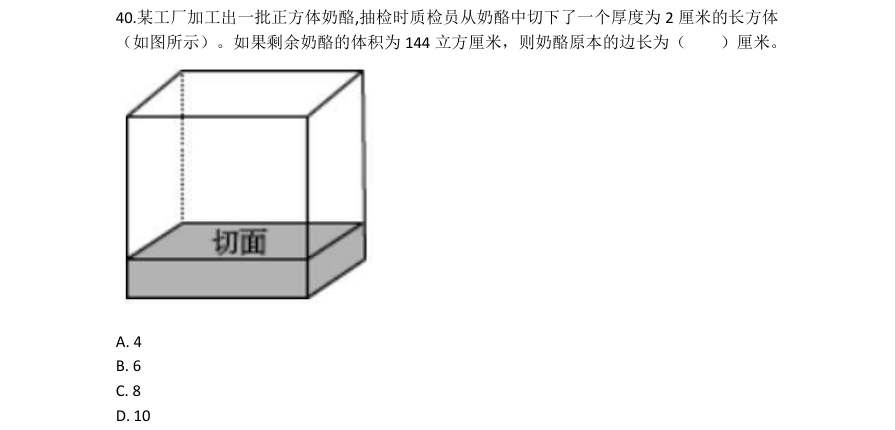

- **A.** 4
- **B.** 6
- **C.** 8
- **D.** 10

**答案：B**

### 2023 广东·乡镇　第 41 题　（政治常识（综合））

某单位去年报名参加志愿活动的党员与非党员之比为1∶3。今年的报名总人数提高了20%, 党员与非党员之比为1∶2,党员人数比去年多了6 人。则今年该单位报名参加志愿活动的 党员共有( )人。

- **A.** 16
- **B.** 24
- **C.** 32
- **D.** 48

**答案：A**

### 2023 广东·乡镇　第 42 题　（政治常识（综合））

某牧场的草,匀速生长。如果20 头牛来吃,20 天可将草吃光;如果10 头牛和10 只羊 来吃,30 天可以恰好吃光。已知一头牛每天的吃草量是一只羊的2 倍,则30 只羊吃该牧场 的草,多少天可以吃光?

- **A.** 10
- **B.** 20
- **C.** 30
- **D.** 40

**答案：C**

### 2023 广东·乡镇　第 43 题　（政治常识（综合））

某单位共有员工200 人,其中订阅杂志的人数比只订阅报纸的人数多88%。则报纸和杂 志均未订阅的员工有( )人。

- **A.** 36
- **B.** 56
- **C.** 76
- **D.** 96

**答案：B**

### 2023 广东·乡镇　第 44 题　（政治常识（综合））

某公司向餐馆订购盒饭,要求每份盒饭包含2 种荤菜、2 种素菜。如果餐馆共准备了4 种荤菜和3 种素菜,则最多有( )种盒饭。

- **A.** 6
- **B.** 12
- **C.** 18
- **D.** 24

**答案：C**

### 2023 广东·乡镇　第 45 题　（政治常识（综合））

小明骑车从甲镇前往乙镇。如果骑车的速度为每小时20 千米,那么将准时到达。如果骑 车的速度为每小时24 千米,那么将提早5 分钟到达。则甲镇到乙镇的距离为( )千米。

- **A.** 8
- **B.** 10
- **C.** 12
- **D.** 16

**答案：B**

### 2023 广东·乡镇　第 49 题　（政治常识（综合））

某物体由两个相同的正三棱柱组合而成,则其侧面轮廓最不可能是( )。

- **A.** A
- **B.** B
- **C.** C
- **D.** D

**答案：D**

### 2023 广东·乡镇　第 55 题　（政治常识（综合））

下列选项与框内字符串规律最接近的是( )。

- **A.** A
- **B.** B
- **C.** C
- **D.** D

**答案：A**

### 2023 广东·乡镇　第 56 题　（政治常识（综合））

章:节

- **A.** 年:月
- **B.** 桌:椅
- **C.** 中考:高考
- **D.** 班主任:班长

**答案：A**

### 2023 广东·乡镇　第 57 题　（政治常识（综合））

农作物:农民

- **A.** 草原:斑马
- **B.** 锯子:木匠
- **C.** 文章:编辑
- **D.** 报纸:记者

**答案：C**

### 2023 广东·乡镇　第 58 题　（政治常识（综合））

鱼∶渔网

- **A.** 蜜蜂∶蜂果
- **B.** 光线∶镜子
- **C.** 警察∶防弹衣
- **D.** 灰尘∶吸尘器

**答案：D**

### 2023 广东·乡镇　第 59 题　（政治常识（综合））

风扇:风:电

- **A.** 火电厂:电:煤
- **B.** 水龙头:水:阀门
- **C.** 篮球:球框:橡胶
- **D.** 榨汁机:果汁:水果

**答案：A**

### 2023 广东·乡镇　第 60 题　（政治常识（综合））

海底捞月:缘木求鱼

- **A.** 抱薪救火:釜底抽薪
- **B.** 七嘴八舌:鹦鹉学舌
- **C.** 趁火打劫:浑水摸鱼
- **D.** 锦上添花:画蛇添足

**答案：C**

### 2023 广东·乡镇　第 61 题　（政治常识（综合））

某街道计划将3 名男性干部甲、乙、丙和3 名女性干部张、李、王下沉至各个社区开展 工作,可供选择的社区有

- **A.** 丙去了A 社区
- **B.** 张去了B 社区
- **C.** 甲去了C 社区
- **D.** 王去了D 社区

**答案：D**

### 2023 广东·乡镇　第 65 题　（政治常识（综合））

优秀的企业家既要有杰出的领导能力,也必须积极承担相应的社会责任。因此,能运用 出色的领导力引领企业发展却不愿承担任何社会责任的人,一定不是优秀的企业家。 以下选项的逻辑结构与题干最为相似的是( )。

- **A.** 真正的“美丽”不仅体现在外表上,还体现在心灵上。因此,心灵美丽的人外表也一定出众
- **B.** 设计要源于现实生活才能发挥意义而成为真正伟大的设计。因此,脱离生话的设计是不切实际的,更是毫无现实意义的
- **C.** 优秀的学习成绩和良好的道德品质在评奖评优中缺一不可。因此,即使有优秀的学习成绩,要想评奖评优,良好的道德品质仍然不可或缺
- **D.** 流量明星一定程度带动了经济发展,也带来了一些新的社会问题。因此,片面强调流量

**答案：C**

### 2023 广东·乡镇　第 68 题　（政治常识（综合））

如图,物体M 在恒力F 的作用下沿粗糙的斜面匀速向上移动。下列说法不准确的是( )。

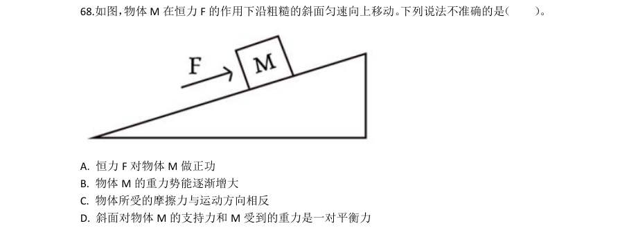

- **A.** 恒力F 对物体M 做正功
- **B.** 物体M 的重力势能逐渐增大
- **C.** 物体所受的摩擦力与运动方向相反
- **D.** 斜面对物体M 的支持力和M 受到的重力是一对平衡力

**答案：D**

### 2023 广东·乡镇　第 70 题　（政治常识（综合））

小张观察发现,自家房屋的北面在夏天能够被阳光照射,而在冬天,房屋的南面可以被 阳光照射。则他家最有可能位于以下城市中的( )。

- **A.** 海口
- **B.** 武汉
- **C.** 上海
- **D.** 北京

**答案：A**

### 2023 广东·乡镇　第 71 题　（政治常识（综合））

以下延长粮食存放时间的措施,最不合理的是( )。

- **A.** 粮库的粮食存放区保持较低温度
- **B.** 将其真空包装,以避免接触氧气
- **C.** 适当在粮库中洒水,保持空气湿度
- **D.** 给粮库的粮食存放区充入二氧化碳

**答案：C**

### 2023 广东·乡镇　第 73 题　（政治常识（综合））

透过一块纯绿色的玻璃窗观察白墙上写的纯红色大字,最有可能看到( )。

- **A.** 绿墙无字
- **B.** 绿墙黑字
- **C.** 绿墙橙字
- **D.** 黑墙无字

**答案：B**

### 2023 广东·乡镇　第 76 题　（政治常识（综合））

下图是一束光在空气和玻璃两种不同的介质中传播的路径示意图,则下列说法正确的是 ( )。

- **A.** 是界面
- **B.** AO 是入射光线
- **C.** OC 是反射光线
- **D.** 

**答案：D**

### 2023 广东·乡镇　第 77 题　（政治常识（综合））

下图是动物养殖场自动喂水装置的简要示意图。当动物通过饮水口饮水后,水箱内的水 位下降,水瓶中的水将自动流入水箱,使水位回到一定的高度。关于这一装置,下列说法正 确的是( )。

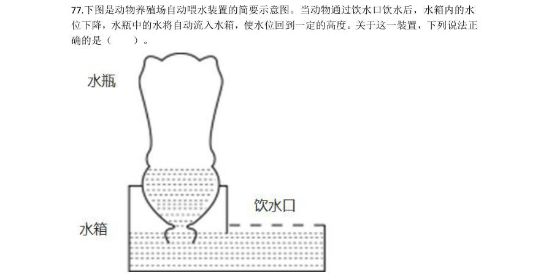

- **A.** 水瓶最终会处于真空状态
- **B.** 水瓶内的气压始终等于水箱内的气压
- **C.** 装置达到平衡时,水瓶内的气压高于大气压
- **D.** 该装置是利用水瓶、水箱之间的气压差实现的

**答案：D**

### 2023 广东·乡镇　第 78 题　（政治常识（综合））

“庄稼一枝花,全靠肥当家。”以下有关农业种植中肥料使用的说法,错误的是( )。

- **A.** 肥料的主要作用是给农作物提供有机物
- **B.** 除了根部,肥料也可以通过叶片等部位被农作物吸收
- **C.** 施肥浓度过高导致“烧根”,是由于农作物根部的细胞在高浓度溶液中失水
- **D.** 应根据不同农作物和农作物不同生长阶段的实际需要,有针对性地施用肥料

**答案：A**

### 2023 广东·乡镇　第 79 题　（政治常识（综合））

下图是某物体做直线运动时,其速度v 与时间t 关系的折线图,则以下说法准确的有 ( )。 1在 ~ ,物体匀速运动 2在0~ 和 ~ ,物体做同方向运动 3在 时,物体离出发点距离最远 4在 ~ 和 ~ ,物体的加速度方向相反 5在 时,物体改变运动方向

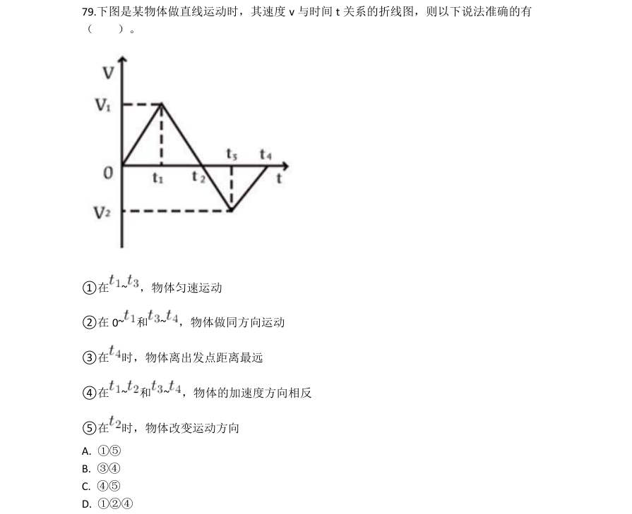

- **A.** 15
- **B.** 34
- **C.** 45
- **D.** 124

**答案：C**

### 2023 广东·乡镇　第 80 题　（政治常识（综合））

甲酸(HCOOH)具有清洁制氢的巨大潜力,其反应前后分子种类变化的微观示意图如下 图所示。则下列说法正确的是( )。

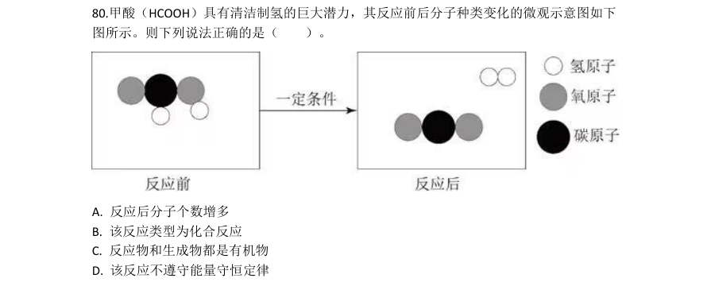

- **A.** 反应后分子个数增多
- **B.** 该反应类型为化合反应
- **C.** 反应物和生成物都是有机物
- **D.** 该反应不遵守能量守恒定律

**答案：A**

### 2023 广东·乡镇　第 83 题　（政治常识（综合））

夏日,小王调制了一杯 的蔗糖水,尝了一口后感觉不够甜,又加入了一些蔗糖, 搅拌后蔗糖完全溶解。之后他把蔗糖水放入冰箱,一段时间后取出时发现杯子底部有少许晶 体析出,则下列说法正确的有( )。 1刚放入冰箱的蔗糖溶液一定不是饱和溶液 2从冰箱中取出的蔗糖溶液一定是饱和溶液 3放入冰箱前后,蔗糖溶液中溶质的质量相等 4用加热蒸发溶剂的方法能够得到与析出晶体相同的物质

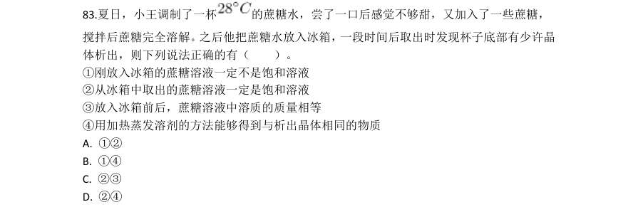

- **A.** 12
- **B.** 14
- **C.** 23
- **D.** 24

**答案：D**

### 2023 广东·乡镇　第 84 题　（政治常识（综合））

大棚种植是一种被广泛采用的农作物种植方式。以下大棚种植的增产做法,有误的是 ( )。

- **A.** 在大棚内补充二氧化碳,促进农作物的光合作用
- **B.** 维持大棚昼夜温度相对稳定,提高农作物的生长速度
- **C.** 傍晚和夜间在大棚内开灯,增加光照时间和光照强度
- **D.** 合理密植农作物,增加单位面积内农作物的光照面积

**答案：B**

### 2023 广东·乡镇　第 85 题　（政治常识（综合））

从北极上空俯视,地球围绕地轴呈逆时针方向自转。如果在北极的地轴正上方有一颗肉 眼可见的星星,有一人站在赤道上整晚观察这颗星星。他有可能观察到( )。 1这颗星星东升西落 2这颗星星没有东升西落 3周围的星星以这颗星星为中心呈逆时针方向转动 4周围的星星以这颗星星为中心呈顺时针方向转动

- **A.** 23
- **B.** 14
- **C.** 13
- **D.** 24

**答案：A**

### 2023 广东·乡镇　第 86 题　（政治常识（综合））

( )广东农林牧渔业总产值首次突破了5000 亿元。

- **A.** 2014 年
- **B.** 2015 年
- **C.** 2017 年
- **D.** 2018 年

**答案：A**

### 2023 广东·乡镇　第 87 题　（政治常识（综合））

2021 年广东农林牧渔业总产值约为9 年前的( )倍。

- **A.** 1.2
- **B.** 1.4
- **C.** 1.6
- **D.** 1.8

**答案：D**

### 2023 广东·乡镇　第 89 题　（政治常识（综合））

题目正在全力以赴征集,将会在征集到后第一时间上传(该题选择A 项默认得分)

- **A.** 缺失
- **B.** 缺失
- **C.** 缺失
- **D.** 缺失

**答案：暂缺**

### 2023 广东·乡镇　第 95 题　（政治常识（综合））

根据资料,下列说法有误的是( )。

- **A.** 2021 年,广东省财政一般公共预算支出超过了2 万亿元
- **B.** 2021 年,广东省省本级财政一般公共预算支出超过了1000 亿元
- **C.** 2020 年和2021 年,其他科学技术支出在广东省财政科学技术支出中的比重均未超过一半
- **D.** 与2020 年相比,2021 年科学技术普及支出在广东省财政科学技术支出中的比重略有增

**答案：A**

### 2023 广东·乡镇　第 96 题　（政治常识（综合））
> 材料：材料 2022 年,全国居民人均可支配收入36883 元,比上年增长(以下如无特别说明,均为同 比名义增长)5.0%。分城乡看,城镇居民人均可支配收入49283 元,增长3.9%;农村居民 人均可支配收入20133 元,增长6.3%。 2022 年,全国居民人均消费支出24538 元,比上年增长1.8%。分城乡看,城镇居民人 均消费支出30391 元,增长0.3%;农村居民人均消费支出16632 元,增长4.5%。…

2021 年,全国居民人均可支配收入约为( )万元。

- **A.** 3.33
- **B.** 3.42
- **C.** 3.51
- **D.** 3.60

**答案：C**

### 2023 广东·乡镇　第 99 题　（政治常识（综合））

2022 年,我国城镇居民与农村居民人数之比最接近( )。

- **A.** 2:3
- **B.** 3:2
- **C.** 3:4
- **D.** 4:3

**答案：D**

### 2023 广东·乡镇　第 100 题　（政治常识（综合））

根据资料,下列说法正确的是( )。

- **A.** 2022 年,农村居民人均可支配收入较去年增加上千元
- **B.** 2021 年,全国居民人均消费支出首次超过了2.4 万元
- **C.** 与2021 年相比,2022 年城镇居民在衣着上的消费支出减少最多
- **D.** 2021 年,无论在城镇还是农村,居民消费支出的重点都是食品烟酒支出和医疗保健支出

**答案：A**

### 2023 国考·行政执法　第 6 题　（政治常识（综合））

下列与金融活动相关的说法错误的是:

- **A.** 有价证券的债务人可以请求债权人支付相应对价
- **B.** 开展储蓄业务有助于实现货币购买力和商品供应量的平衡
- **C.** 分红型商业保险的收益与保险公司的经营状况有关
- **D.** 办理国家助学贷款的学生不需要办理贷款担保或抵押

**答案：A**

### 2023 国考·行政执法　第 7 题　（马克思主义基本原理）

根据《中华人民共和国乡村振兴促进法》,下列说法正确的是:

- **A.** 全面实施乡村振兴战略,应当坚持乡村城镇融合、城镇优先发展带动乡村原则
- **B.** 国家构建以高质量绿色发展为导向的新型农业补贴政策体系
- **C.** 省、自治区、直辖市人民政府应当采取措施确保耕地总量稳步增加
- **D.** 乡镇人民政府应设立法律顾问和公职律师,根据需要在村民委员会建立公共法律服务工作室

**答案：B**

### 2023 国考·行政执法　第 8 题　（政治常识（综合））

根据《中华人民共和国退役军人保障法》,下列说法正确的是:

- **A.** 参战退役军人的随迁子女入学可以得到优先保障
- **B.** 退役的军士和义务兵可以逐月领取退役金
- **C.** 已被大学录取的现役军人可以在退伍后四年内入学
- **D.** 退役军人创办企业可以享受免税、贷款免息等优惠政策

**答案：A**

### 2023 国考·行政执法　第 10 题　（政治常识（综合））

根据《中华人民共和国噪声污染防治法》,下列噪声污染情形与作出责令改正或处罚决定的主体对应错误的 是:

- **A.** 甲企业在噪声敏感建筑物集中区域改建厂房造成工业噪声污染——住房和城乡建设部门
- **B.** 乙企业无排污许可证排放工业噪声——生态环境主管部门
- **C.** 丙商场在促销时持续使用高音喇叭发出噪声——地方人民政府指定的部门
- **D.** 丁驾驶拆除消声器的机动车轰鸣行驶——公安机关交通管理部门

**答案：A**

### 2023 国考·行政执法　第 12 题　（政治常识（综合））

关于电信诈骗,下列说法错误的是:

- **A.** 非法使用“伪基站”实施电信诈骗的以非法侵入计算机信息系统罪追究刑事责任
- **B.** 实施电信诈骗最高可被判处无期徒刑
- **C.** 电信诈骗受害人可以通过诉讼程序要求服务存在缺陷的电信运营商承担相应责任
- **D.** 负责招募他人实施电信网络诈骗犯罪活动的,以共同犯罪论处

**答案：A**

### 2023 国考·行政执法　第 14 题　（政治常识（综合））

根据《中华人民共和国职业教育法》,关于企业开展职业教育,下列说法错误的是:

- **A.** 企业设立产教融合实训基地的,在公共事业费用上享受高于职业学校的优惠政策
- **B.** 企业应当按照职工工资总额一定比例提取使用职工教育经费
- **C.** 用于一线职工职业教育的经费应当达到国家规定的比例
- **D.** 企业安排职工到职业学校接受职业教育的,应支付职业教育期间工资

**答案：A**

### 2023 国考·行政执法　第 16 题　（政治常识（综合））

下列与古人出行有关的说法错误的是:

- **A.** “开远门前万里堠”中的“堠”是一种路标,可以用来导航和计程
- **B.** “乘舟而惑者,不知东西,见斗极则寤矣”中的“极”就是北极星
- **C.** “东有启明,西有长庚”中指示方向的“启明”“长庚”是不同天体
- **D.** “过洋牵星术”是通过测量星辰的高度指数来确定船只所处位置的

**答案：C**

### 2023 国考·行政执法　第 17 题　（政治常识（综合））

下列关于化石的说法正确的是:

- **A.** 三叶虫化石是侏罗纪地层中的典型化石
- **B.** 硅化木是树木埋入地下后形成的化石
- **C.** 琥珀的硬度比和田玉大
- **D.** 大多数化石是在侵入岩中被发现的

**答案：B**

### 2023 国考·行政执法　第 18 题　（政治常识（综合））

下列与氢燃料电池车有关的说法错误的是:

- **A.** 氢燃料电池车的最终排出物是水
- **B.** 氢气可以通过生物发酵和电解水等方法制取
- **C.** 北京冬奥会中大量使用了氢燃料电池车
- **D.** 氢气和氧气在内燃机中反应产生电能

**答案：D**

### 2023 国考·行政执法　第 19 题　（政治常识（综合））

关于自然节律变化,下列说法错误的是:

- **A.** 惊蛰后华北地区可能会出现“万里雪飘”的现象
- **B.** 2月北回归线附近会出现“儿童急走追黄蝶,飞入菜花无处寻”的现象
- **C.** 冬至时,在广东汕头竖直立杆会出现“立竿无影”的现象
- **D.** 谷雨前后江浙地区可能会出现“一把青秧趁手青,轻烟漠漠雨冥冥”的现象

**答案：C**

### 2023 国考·行政执法　第 20 题　（政治常识（综合））

关于人体的生理现象,下列说法正确的是:

- **A.** 人体在流汗时汗腺内的盐分浓度会降低
- **B.** 蚊虫叮咬造成的皮肤发痒属于过敏反应
- **C.** 打嗝声是由胃部痉挛和声带闭合造成的
- **D.** 皮肤受伤流血处的血管会先扩张后收缩

**答案：B**

### 2022 广东·乡镇　第 11 题　（新时代理论）

党的十八大以来,我们深化对民主政治发展规律的认识,提出( )的重大理念,其不仅有完整的制度 程序,而且有完整的参与实践。

- **A.** 全方位人民民主
- **B.** 全链条人民民主
- **C.** 全过程人民民主
- **D.** 全覆盖人民民主

**答案：C**

### 2022 广东·乡镇　第 14 题　（新时代理论）

近年来,我国在“大国重器”的研发上成果显著,捷报频传。以下关于“大国重器”与其宣传语的对应关 系不正确的是:

- **A.** “奋斗者号”——只有沉得下去,才能浮得上来
- **B.** “复兴号”——暂时地降落是为了下一次更好地起飞
- **C.** “北斗三号”——其实,方向比方法更重要
- **D.** “中国天眼”——要仰望星空,也要脚踏实地

**答案：B**

### 2022 广东·乡镇　第 16 题　（马克思主义基本原理）

马克思主义指引中国成功走上了全面建设社会主义现代化强国的康庄大道,事业越向前发展,新情况新问 题势必越多,更应重视理论的作用,增强理论自信和战略定力。这主要体现了:

- **A.** 认识对实践有着巨大的指导作用
- **B.** 一切从实际出发,实事求是
- **C.** 实践是检验真理的唯一标准
- **D.** 认识是主体对客体的能动反映

**答案：A**

### 2022 广东·乡镇　第 17 题　（毛中特与党史）

《中华人民共和国乡村振兴促进法》全面实施乡村振兴战略,应该遵循的原则不包括:

- **A.** 坚持政府主体地位
- **B.** 坚持人与自然和谐共生
- **C.** 坚持农业农村优先发展
- **D.** 坚持因地制宜、规划先行、循序渐进

**答案：A**

### 2022 广东·乡镇　第 18 题　（毛中特与党史）

以下是我国改革开放以来发生的重大事件,按时间先后顺序排列正确的是: 1脱贫攻坚战取得全面胜利2加入世界贸易组织3全面取消农业税 4香港、澳门回归祖国5北京举办第二十九届夏季奥运会

- **A.** 42351
- **B.** 25431
- **C.** 42513
- **D.** 21534

**答案：A**

### 2022 广东·乡镇　第 20 题　（政治常识（综合））

2020 年底我国区域性整体贫困得到解决,提前实现《联合国2030 年可持续发展议程》减贫目标。下列关 于我国在减贫事业获得的成就与其具体表现对应不正确的是:

- **A.** 贫困人口食物权得到稳定保障——实现农产品产量稳定增长,解决食物匮乏和营养不良问题,“不愁吃”问题基本解决
- **B.** 贫困人口饮水安全得到有力保障——实施农村饮水安全巩固提升工程,累计解决2889 万贫困人口饮水安全问题,3.82 亿农村人口受益
- **C.** 贫困地区义务教育得到充分保障——农村贫困家庭子女义务教育阶段辍学问题实现动态清零
- **D.** 贫困人口基本医疗得到有效保障——基本形成包括疾病预防控制、健康教育、妇幼保健、精神卫生防治等

**答案：D**

### 2022 广东·乡镇　第 22 题　（毛中特与党史）

第一次国共合作实现后,以( )为中心汇集全国革命力量,很快开创了反对帝国主义和封建军阀的革 命新局面。

- **A.** 北京
- **B.** 广州
- **C.** 上海
- **D.** 武汉

**答案：B**

### 2022 广东·乡镇　第 24 题　（政治常识（综合））

《乡村振兴战略规划(2018-2022 年)》提出,到2050 年,乡村全面振兴,要全面实现的目标不包括:

- **A.** 农业强
- **B.** 农贸兴
- **C.** 农村美
- **D.** 农民富

**答案：B**

### 2022 广东·乡镇　第 25 题　（政治常识（综合））

推进农业绿色发展,有助于加快农业现代化,全面推进乡村振兴。关于“推进农业绿色发展”,下列说法 准确的是:

- **A.** 全面实行全国草原禁牧
- **B.** 放开对非农建设占用耕地的限制
- **C.** 发展节水农业和旱作农业
- **D.** 鼓励发展各种形式规模的农业经营

**答案：C**

### 2022 广东·乡镇　第 26 题　（政治常识（综合））

以下广告宣传用语中,不存在科学性错误的是:

- **A.** 矿泉水营养丰富,喝了就能满足你和家人每日的矿物质需求
- **B.** 当季新鲜柑橘含有丰富的维生素C,有助于提高人体免疫力
- **C.** 本台灯采用0 频闪技术,灯光不再有闪烁,更能保护眼睛
- **D.** 新款无糖月饼只用果糖,不添加蔗糖,让你多吃也不发胖

**答案：B**

### 2022 广东·县级　第 24 题　（政治常识（综合））

以下广告宣传用语中,不存在科学性错误的是:

- **A.** 矿泉水营养丰富,喝了就能满足你和家人每日的矿物质需求
- **B.** 当季新鲜柑橘含有丰富的维生素C,有助于提高人体免疫力
- **C.** 本台灯采用0 频闪技术,灯光不再有闪烁,更能保护眼睛
- **D.** 新款无糖月饼只用果糖,不添加蔗糖,让你多吃也不发胖

**答案：B**

### 2022 国考·副省级　第 2 题　（毛中特与党史）

(单选题)“七一勋章”获得者都来自人民、植根人民,是立足本职、默默奉献的平凡英雄。他们的事迹 可学可做,他们的精神可追可及,以下“七一勋章”获得者与其先进事迹表述对应正确的是:

- **A.** 张桂梅——坚持志愿服务十余载群众心中的“活雷锋”
- **B.** 王兰花——点亮贫困山区女孩梦想的“校长妈妈”
- **C.** 孙景坤——公而忘私永葆革命本色的战斗功臣
- **D.** 李宏塔——为国守海寸步不让带领群众共同致富

**答案：C**

### 2022 国考·副省级　第 6 题　（新时代理论）

(单选题)在中国共产党成立一百周年的重要时刻,我国脱贫攻坚战取得了全面胜利。下列与之相关的 说法错误的是:

- **A.** 现行标准下区域性整体贫困得到解决
- **B.** “输血式”扶贫方针是中国特色减贫道路的鲜明特征
- **C.** 锻造形成了“上下同心、尽锐出战、精准务实、开拓创新、攻坚克难、不负人民”的脱贫攻坚精神
- **D.** 从集中资源支持脱贫攻坚转向巩固拓展脱贫攻坚成果和全面推进乡村振兴

**答案：B**

### 2022 国考·副省级　第 9 题　（政治常识（综合））

(单选题)根据《中华人民共和国政务处分法》,下列哪一处分不恰当?

- **A.** 甲系某行政主管部门公务员,犯故意伤害罪被判处有期徒刑六个月,缓刑一年,被撤职
- **B.** 乙系交通运输部门公务员,交通肇事犯罪情节轻微,检察机关对其作出不起诉决定,乙被撤职
- **C.** 丙系某国有企业管理人员,犯盗窃罪被单处罚金,被撤职
- **D.** 丁系某公办高校事业编管理人员,犯侵占罪但被免予刑事处罚,被撤职

**答案：A**

### 2022 国考·副省级　第 10 题　（毛中特与党史）

(单选题)2021 年4 月27 日,国务院常务会议上确定了知识产权领域“放管服”改革新举措。下列与之 相关的说法错误的是:

- **A.** 进一步压缩商标、专利审查周期,推行商标电子注册证
- **B.** 提高知识产权质量,增加对商标和专利申请阶段的资助和奖励
- **C.** 确保数据安全基础上,开放知识产权基础数据,助力企业研发创新
- **D.** 加强知识产权全链条保护,依法打击违法违规代理和商标恶意注册行为

**答案：B**

### 2022 国考·副省级　第 11 题　（毛中特与党史）

(单选题)下列毛泽东诗词与创作背景对应正确的是:

- **A.** 三十八年过去,弹指一挥间。可上九天揽月,可下五洋捉鳖,谈笑凯歌还——1941 年延安整风运动
- **B.** 军叫工农革命,旗号镰刀斧头。匡庐一带不停留,要向潇湘直进——1948 年淮海战役
- **C.** 金沙水拍云崖暖,大渡桥横铁索寒——1930 年第一次反“围剿”
- **D.** 宜将剩勇追穷寇,不可沽名学霸王——1949 年解放南京

**答案：D**

### 2022 国考·副省级　第 15 题　（政治常识（综合））

(单选题)我国自古十分重视对人的品德的培养。下列有关“德”的表述与出处对应错误的是:

- **A.** 大德不逾闲,小德出入可也——《论语》
- **B.** 富有之谓大业,日新之谓盛德——《周易》
- **C.** 所求于己者多,故德行立——《管子》
- **D.** 道生之,德畜之,物形之,势成之——《庄子》

**答案：D**

### 2022 国考·副省级　第 16 题　（政治常识（综合））

(单选题)关于常见气体的工业制备方法,下列说法错误的是:

- **A.** 木炭和二氧化碳可以作为制备一氧化碳的原料
- **B.** 电解水时制备得到的氢气体积比氧气体积更大
- **C.** 通过低温液化的方法,可以分离出沼气中的甲烷
- **D.** 煅烧石灰石制备二氧化碳属于复分解反应

**答案：D**

### 2022 国考·地市级　第 4 题　（马克思主义基本原理）

关于中国共产党成立百年的宝贵经验,下列说法不准确的是:

- **A.** 爱国统一战线是实现中华民族伟大复兴的战略支撑
- **B.** 勇于自我革命是中国共产党区别于其他政党的显著标志
- **C.** 马克思主义是我们立党立国的根本指导思想
- **D.** 中国特色社会主义是实现中华民族伟大复兴的正确道路

**答案：A**

### 2022 国考·地市级　第 5 题　（新时代理论）

在中国共产党成立一百周年的重要时刻,我国脱贫攻坚战取得了全面胜利。下列与之相关的 说法错误的是:

- **A.** 现行标准下区域性整体贫困得到解决
- **B.** “输血式”扶贫方针是中国特色减贫道路的鲜明特征
- **C.** 锻造形成了“上下同心、尽锐出战、精准务实、开拓创新、攻坚克难、不负人民”的脱贫攻坚精神
- **D.** 从集中资源支持脱贫攻坚转向巩固拓展脱贫攻坚成果和全面推进乡村振兴

**答案：B**

### 2022 国考·地市级　第 6 题　（马克思主义基本原理）

下列中国共产党全国代表大会的重大成果成就,按时间先后排序正确的是: 1提出我国社会主要矛盾已经转化为人民日益增长的美好生活需要和不平衡不充分的发展之间 的矛盾 2为夺取全面建设小康社会新胜利作出了战略部署 3系统、完整地提出了党在社会主义初级阶段的基本纲领 4明确了夺取中国特色社会主义新胜利必须牢牢把握的基本要求

- **A.** 3142
- **B.** 2431
- **C.** 3241
- **D.** 2134

**答案：C**

### 2022 国考·地市级　第 8 题　（政治常识（综合））

根据《中华人民共和国政务处分法》,下列哪一处分不恰当?

- **A.** 甲系某行政主管部门公务员,犯故意伤害罪被判处有期徒刑六个月,缓刑一年,被撤职
- **B.** 乙系交通运输部门公务员,交通肇事犯罪情节轻微,检察机关对其作出不起诉决定,乙被撤职
- **C.** 丙系某国有企业管理人员,犯盗窃罪被单处罚金,被撤职
- **D.** 丁系某公办高校事业编管理人员,犯侵占罪但被免予刑事处罚,被撤职

**答案：A**

### 2022 国考·地市级　第 10 题　（政治常识（综合））

新修订的《中华人民共和国行政处罚法》自2021 年7 月15 日起施行。依据该法,下列说法 正确的是∶

- **A.** 行政机关拟作出降低资质等级的处罚之前,应当组织听证
- **B.** 对当事人依法给予一百元以上罚款的,执法人员不得当场收缴
- **C.** 法律、行政法规对违法行为未作出行政处罚规定的,地方性法规可补充设定
- **D.** 行政机关可以在其法定权限内书面委托其他组织或个人实施行政处罚

**答案：B**

### 2022 国考·地市级　第 13 题　（毛中特与党史）

下列毛泽东诗词与创作背景对应正确的是:

- **A.** 三十八年过去,弹指一挥间。可上九天揽月,可下五洋捉鳖,谈笑凯歌还——1941 年延安整风运动
- **B.** 军叫工农革命,旗号镰刀斧头。匡庐一带不停留,要向潇湘直进——1948 年淮海战役
- **C.** 金沙水拍云崖暖,大渡桥横铁索寒——1930 年第一次反“围剿”
- **D.** 宜将剩勇追穷寇,不可沽名学霸王——1949 年解放南京

**答案：D**

### 2022 国考·地市级　第 16 题　（政治常识（综合））

我国一直致力于改善生态环境,在长期不懈的治理之下,陕西榆林以北的毛乌素沙漠正在消 失。关于毛乌素沙漠,下列说法正确的是:

- **A.** 毛乌素沙漠地区属于温带大陆性气候
- **B.** 治理之前毛乌素沙漠是我国最大的沙漠
- **C.** 治理毛乌素沙漠适合种植各种耐酸性植物
- **D.** 毛乌素沙漠在“三北”防护林体系范围之外

**答案：A**

### 2022 国考·地市级　第 20 题　（政治常识（综合））

我国自古十分重视对人的品德的培养。下列有关“德”的表述与出处对应错误的是:

- **A.** 大德不逾闲,小德出入可也——《论语》
- **B.** 富有之谓大业,日新之谓盛德——《周易》
- **C.** 所求于己者多,故德行立——《管子》
- **D.** 道生之,德畜之,物形之,势成之——《庄子》

**答案：D**

### 2022 国考·行政执法　第 4 题　（马克思主义基本原理）

(单选题)关于中国共产党成立百年的宝贵经验,下列说法不准确的是:

- **A.** 爱国统一战线是实现中华民族伟大复兴的战略支撑
- **B.** 勇于自我革命是中国共产党区别于其他政党的显著标志
- **C.** 马克思主义是我们立党立国的根本指导思想
- **D.** 中国特色社会主义是实现中华民族伟大复兴的正确道路

**答案：A**

### 2022 国考·行政执法　第 7 题　（政治常识（综合））

(单选题)新修订的《中华人民共和国行政处罚法》自2021 年7 月15 日起施行。依据该法,下列说法正 确的是∶

- **A.** 行政机关拟作出降低资质等级的处罚之前,应当组织听证
- **B.** 对当事人依法给予一百元以上罚款的,执法人员不得当场收缴
- **C.** 法律、行政法规对违法行为未作出行政处罚规定的,地方性法规可补充设定
- **D.** 行政机关可以在其法定权限内书面委托其他组织或个人实施行政处罚

**答案：B**

### 2022 国考·行政执法　第 11 题　（政治常识（综合））

(单选题)甲乙丙丁4 人发起设立某商贸股份有限公司,并租赁了1 处办公场所。在公司设立过程中, 甲由于疏忽忘关水龙头致办公场所被淹,给办公场所业主戊造成5 万元损失。公司设立后,业主戊向公 司索赔。下列说法正确的是:

- **A.** 因公司已设立,5 万元损失由公司承担即可
- **B.** 因系发起人责任,5 万元损失由发起人共同承担
- **C.** 因在公司设立过程中产生损失,5 万元由公司和发起人共同承担
- **D.** 公司可以先行向业主戊赔偿,再向甲追偿

**答案：D**

### 2022 国考·行政执法　第 12 题　（政治常识（综合））

(单选题)下列做法符合《中华人民共和国乡村振兴促进法》的是:

- **A.** 某县政府为培育良种,划定一块永久基本农田作为重要农产品生产保护区
- **B.** 某省政府严控农用地转为建设用地,不限制耕地转为林地
- **C.** 某市政府为了方便规模经营,对农用地未分类而进行统一管理
- **D.** 某乡政府遵循法定程序撤并村庄,要求涉及的农民无条件配合

**答案：A**

### 2022 国考·行政执法　第 14 题　（毛中特与党史）

(单选题)下列毛泽东诗词与创作背景对应正确的是:

- **A.** 三十八年过去,弹指一挥间。可上九天揽月,可下五洋捉鳖,谈笑凯歌还——1941 年延安整风运动
- **B.** 军叫工农革命,旗号镰刀斧头。匡庐一带不停留,要向潇湘直进——1948 年淮海战役
- **C.** 金沙水拍云崖暖,大渡桥横铁索寒——1930 年第一次反“围剿”
- **D.** 宜将剩勇追穷寇,不可沽名学霸王——1949 年解放南京

**答案：D**

### 2022 国考·行政执法　第 17 题　（政治常识（综合））

(单选题)我国一直致力于改善生态环境,在长期不懈的治理之下,陕西榆林以北的毛乌素沙漠正在 消失。关于毛乌素沙漠,下列说法正确的是:

- **A.** 毛乌素沙漠地区属于温带大陆性气候
- **B.** 治理之前毛乌素沙漠是我国最大的沙漠
- **C.** 治理毛乌素沙漠适合种植各种耐酸性植物
- **D.** 毛乌素沙漠在“三北”防护林体系范围之外

**答案：A**

### 2021 广东·乡镇　第 15 题　（政治常识（综合））

党的新闻舆论工作必须“坚持正确舆论导向,坚持正面宣传为主,唱响主旋律,弘扬正能量,做大做强主流 思想舆论”。下列选项最能体现这一理念的是:

- **A.** 独阴不成,独阳不生
- **B.** 事必有法,然后可成
- **C.** 事不凝滞,理贵变通
- **D.** 先立乎其大者,则其小者不能夺也

**答案：暂缺**

### 2021 广东·乡镇　第 17 题　（政治常识（综合））

青少年是祖国的未来,民族的希望。青少年教育最重要的是教给他们正确的思想。引导他们走正路。其中, ( )是落实立德树人根本任务的关键课程。

- **A.** 思政课
- **B.** 劳动课
- **C.** 通识课
- **D.** 美育课

**答案：暂缺**

### 2021 广东·乡镇　第 18 题　（政治常识（综合））

以下人物被党中央、国务院授予“全国脱贫攻坚先进个人”荣誉称号的有: 1李保国 2张桂梅 3钟南山 4焦裕禄 5黄文秀

- **A.** 125
- **B.** 234
- **C.** 124
- **D.** 1235

**答案：暂缺**

### 2021 广东·乡镇　第 19 题　（政治常识（综合））

2020 年是中国人民志愿军抗美援朝出国作战70 周年。以下战役发生在抗美援朝战争期间的是:

- **A.** 辽沈战役
- **B.** 百团大战
- **C.** 上甘岭战役
- **D.** 仁川登陆战

**答案：暂缺**

### 2021 广东·乡镇　第 22 题　（政治常识（综合））

构建新的发展格局,是根据我国发展阶段、环境、条件变化作出的战略决策。关于构建新发展格局,以下表 述有误的是()。

- **A.** 以国际大循环为主体
- **B.** 关键在于经济循环的畅通无阻
- **C.** 坚持深化供给侧结构性改革这条主线
- **D.** 最本质的特征是实现高水平的自立自强

**答案：暂缺**

### 2021 广东·乡镇　第 24 题　（新时代理论）

2021 年2 月25 日召开的全国脱贫攻坚总结表彰大会宣告,我国脱贫攻坚战取得了全面胜利。关于脱贫攻坚, 以下表述准确的有( )。 1完成了消除相对贫困的艰巨任务 22018 年底拉开了新时代脱贫攻坚的序幕 3我国提前10 年实现《联合国2030 年可持续发展议程》减贫目标 4精准扶贫是打赢脱贫攻坚战的制胜法宝 5开发式扶贫方针是中国特色减贫道路的鲜明特征

- **A.** 135
- **B.** 345
- **C.** 1245
- **D.** 2345

**答案：暂缺**

### 2021 广东·乡镇　第 29 题　（政治常识（综合））

春季,我国民间有许多民俗活动。下列关于这些民俗活动的表述正确的是( )。

- **A.** 在迎春仪式上,鞭打春牛——打春
- **B.** 立春清晨,到郊外、田野踏青——插春
- **C.** 将采集到的植物枝条插在家里——采春
- **D.** 采集冬青树、松柏、竹枝、青菜等绿色植物——探春

**答案：暂缺**

### 2021 国考·副省级　第 12 题　（政治常识（综合））

下列与军事武器有关说法错误的是:

- **A.** 东风-31 是我国最新一代洲际战略核导弹
- **B.** 电磁脉冲武器可以打击敌军导弹防护系统
- **C.** 护卫舰在吨位和火力上一般次于驱逐舰
- **D.** 机枪的有效射程和射速优于突击步枪

**答案：暂缺**

### 2021 国考·副省级　第 14 题　（政治常识（综合））

下列与贷款有关的说法错误的是:

- **A.** 若采用等额本息的还款方式,每月还款额相同
- **B.** 贷款市场报价利率(LPR)是基于央行公开市场操作利率形成的一种市场化利率
- **C.** 以公益为目的的非营利法人对外提供的贷款担保是有效的
- **D.** 学生在校期间的国家助学贷款利息由财政全额补贴

**答案：暂缺**

### 2021 国考·副省级　第 15 题　（政治常识（综合））

关于探测设备,下列说法错误的是:

- **A.** 热像仪可以在黑夜之中使用
- **B.** 声呐主要用于在陆地上及空中探测距离
- **C.** 雷达测距利用了无线电波沿直线传播的原理
- **D.** 地下金属探测仪器利用了电磁感应原理

**答案：暂缺**

### 2021 国考·副省级　第 18 题　（政治常识（综合））

DNA 双螺旋结构的发现极大地促进了人们对遗传的研究和理解。下列哪项技术须以该发现为基础?

- **A.** 用多倍体育种技术培育无籽西瓜
- **B.** 利用组织培养方法培育无病毒马铃薯
- **C.** 利用杂交技术培育抗倒伏水稻
- **D.** 通过基因工程培育抗虫棉植株

**答案：暂缺**

### 2021 国考·副省级　第 19 题　（政治常识（综合））

下列与口罩相关的说法正确的是:

- **A.** 纱布口罩可达到防雾霾的效果
- **B.** 活性炭口罩可吸附过滤空气中的甲醛
- **C.** 医用外科口罩是医用口罩中防护等级最高的一类
- **D.** 在成分不明的毒气污染环境中应佩戴过滤式防毒口罩

**答案：暂缺**

### 2021 国考·地市级　第 3 题　（新时代理论）

党的十九大报告提出,要建设高素质专业化干部队伍,把好干部标准落到实处。关于好干部标准,下列理解 正确的有几项? 1把专业素质放在第一位,要做到勇于作为,善于谋事 2突出政治标准,要做到信念坚定、为民服务 3力戒空谈,要做到勤政务实、敢于担当 4把纪律作为底线,要做到清正廉洁

- **A.** 1 项
- **B.** 2 项
- **C.** 3 项
- **D.** 4 项

**答案：C**

### 2021 国考·地市级　第 7 题　（政治常识（综合））

根据2020 年7 月1 日起实施的《中华人民共和国公职人员政务处分法》,下列说法错误的是:

- **A.** 政务处分的对象不仅包括公务员,也包括国有企业管理人员
- **B.** 政务处分不同于党纪处分
- **C.** 政务处分决定由监察机关依法作出,也可以由公职人员任免机关、单位作出
- **D.** 对公职人员的同一违法行为,监察机关和公职人员任免机关、单位不得重复给予政务处分和处分

**答案：C**

### 2021 国考·地市级　第 10 题　（毛中特与党史）

中共中央、国务院于2019 年12 月4 日印发了《关于营造更好发展环境支持民营企业改革发展的意见》,下 列说法与之不符的是:

- **A.** 招投标时不得设置与业务能力无关的企业规模门槛
- **B.** 在人才引进支持政策方面对民营企业一视同仁,支持民营企业引进海外高层次人才
- **C.** 鼓励民营企业积极参与社会公益、慈善事业
- **D.** 在电力、电信、铁路、石油等行业和领域,向民营企业全面开放

**答案：D**

### 2021 国考·地市级　第 11 题　（马克思主义基本原理）

《中共中央 国务院关于抓好“三农”领域重点工作确保如期实现全面小康的意见》(2020 年中央一号文 件)未提及以下哪一内容:

- **A.** 强化粮食安全省长责任制考核
- **B.** 坚持和发展新时代“枫桥经验”
- **C.** 全面加强基层司法所建设
- **D.** 有计划安排县城学校教师到乡村支教

**答案：C**

### 2021 国考·地市级　第 15 题　（政治常识（综合））

下列与贷款有关的说法错误的是:

- **A.** 若采用等额本息的还款方式,每月还款额相同
- **B.** 贷款市场报价利率(LPR)是基于央行公开市场操作利率形成的一种市场化利率
- **C.** 以公益为目的的非营利法人对外提供的贷款担保是有效的
- **D.** 学生在校期间的国家助学贷款利息由财政全额补贴

**答案：C**

### 2021 国考·地市级　第 16 题　（政治常识（综合））

很多伟大科学家的墓志铭简练而富有诗意,是了解其一生成就的窗口。下列墓志铭与科学家对应错误的是:

- **A.** 我曾测量天空,现在测量幽冥。灵魂飞向天空,肉体安息土中——爱因斯坦
- **B.** 他把世界翻了一个个儿,虽然并不完全——达尔文
- **C.** 他从苍天处取得闪电,从暴君处取得民权——富兰克林
- **D.** 他失明了,因为自然界已经没有剩下什么他没有看见过的东西了——伽利略

**答案：A**

### 2021 国考·地市级　第 17 题　（政治常识（综合））

下面是一款路由器的参数规格说明,对此描述错误的是:

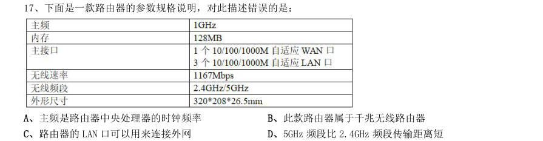

- **A.** 主频是路由器中央处理器的时钟频率
- **B.** 此款路由器属于千兆无线路由器
- **C.** 路由器的LAN 口可以用来连接外网
- **D.** 5GHz 频段比2.4GHz 频段传输距离短

**答案：C**

### 2021 国考·地市级　第 19 题　（政治常识（综合））

下列与口罩相关的说法正确的是:

- **A.** 纱布口罩可达到防雾霾的效果
- **B.** 活性炭口罩可吸附过滤空气中的甲醛
- **C.** 医用外科口罩是医用口罩中防护等级最高的一类
- **D.** 在成分不明的毒气污染环境中应佩戴过滤式防毒口罩

**答案：B**

### 2020 湖北·统一卷　第 3 题　（政治常识（综合））

为提升生态文明、建设美丽中国,党和政府做了一系列重要工作。下列有关生态文明建设的说法不正确的是:

- **A.** 自2020 年1 月起,黄河流域的自然保护区将全面禁止生产性捕捞
- **B.** 2019 年8 月第一届国家公园论坛在青海省举行,与会代表形成了8 条“西宁共识”
- **C.** 2019 年,第二轮中央生态环保督察启动,拟用三年时间完成例行督查,再用一年时间开展回头看
- **D.** 2019 年11 月,住建部发布了新修订《生活垃圾分类标志》标准,将生活垃圾类别调整为可回收物、有害垃

**答案：A**

### 2020 湖北·统一卷　第 4 题　（政治常识（综合））

为应对新冠肺炎疫情,我国出台了一系列政策举措,帮助企业和个体工商户减负纾困,促进复工复产。下列 哪一选项不属于我国在支持复工复产方面的优惠政策:

- **A.** 阶段性减免增值税小规模纳税人增值税
- **B.** 阶段性减免企业和个体工商户物业租金
- **C.** 阶段性减征职工基本医疗保险单位缴费
- **D.** 阶段性减免企业养老、失业、工伤保险单位的缴费

**答案：B**

### 2020 湖北·统一卷　第 5 题　（政治常识（综合））

下列有关公共卫生的说法正确的是:

- **A.** 突发公共卫生事件应急响应分为I级,II级,III级三个等级
- **B.** 按照我国现行标准,甲类传染病有鼠疫、霍乱、传染性非典型肺炎三种
- **C.** 省,自治区,直辖市人民政府卫生行政主管部门有权向社会发布本行政区域内突发事件的信息
- **D.** 医疗卫生机构发现可能发生传染病暴发、流行的,应当在2 小时内向所在地县级人民政府卫生行政主管部门

**答案：D**

### 2020 湖北·统一卷　第 9 题　（政治常识（综合））

下列政府举措中,不能够直接促进城镇居民人均可支配收入增长的是:

- **A.** 减税
- **B.** 发行政府债券
- **C.** 将学前教育纳入义务教育
- **D.** 提高退休职工养老金发放标准

**答案：B**

### 2020 湖北·统一卷　第 10 题　（政治常识（综合））

下列作家与其作品中所展现的地域对应错误的是:

- **A.** 鲁迅——《阿Q 正传》——绍兴
- **B.** 沈从文——《边城》——湘西
- **C.** 汪曾祺——《受戒》——高邮
- **D.** 莫言——《红高粱》——东北

**答案：D**

### 2020 湖北·统一卷　第 11 题　（马克思主义基本原理）

下列名言中出现最晚的一项是:

- **A.** 笛卡尔:我思故我在
- **B.** 亚里士多德:人是天生的政治动物
- **C.** 亚当·斯密:人天生,并且永远,是自私的动物
- **D.** 阿基米德:给我一个支点,我就能撬起整个地球

**答案：C**

### 2020 湖北·统一卷　第 16 题　（政治常识（综合））

下列哪一选项是蚊子用于获取“猎物”信息的主要器官:

- **A.** 复眼
- **B.** 蚊翅
- **C.** 蚊足
- **D.** 触角

**答案：D**

### 2020 湖北·统一卷　第 17 题　（政治常识（综合））

为治疗维生素缺乏导致的夜盲症、败血病、佝偻病和脚气病而需要补充相对应的食物依次是:

- **A.** 谷类、深海鱼、胡萝卜、柑橘
- **B.** 柑橘、深海鱼、谷类、胡萝卜
- **C.** 深海鱼、胡萝卜、谷类、柑橘
- **D.** 胡萝卜、柑橘、深海鱼、谷类

**答案：D**

### 2020 湖北·统一卷　第 19 题　（政治常识（综合））

下列食物经过人体口腔能够初步消化的是:

- **A.** 牛肉和鱼
- **B.** 鸡蛋和牛奶
- **C.** 青菜和螃蟹
- **D.** 米饭和馒头

**答案：D**

### 2020 广东·乡镇　第 15 题　（政治常识（综合））

中国特色社会主义制度是一个严密完整的科学制度体系,起四梁八柱作用的是根本制度、基本制度、重要 制度,其中具有统领地位的是:

- **A.** 党的领导制度
- **B.** 协商民主制度
- **C.** 国家监察制度
- **D.** 人民代表大会制度

**答案：暂缺**

### 2020 广东·乡镇　第 19 题　（政治常识（综合））

新冠肺炎疫情发生以来,中国始终同国际社会开展交流合作,并提出( )的新理念:倡导团结合作共同 抗疫。

- **A.** 构建人类命运共同体
- **B.** 建立疫苗协作开发机制
- **C.** 构建人类卫生健康共同体
- **D.** 建立全球治理体系

**答案：暂缺**

### 2020 广东·乡镇　第 20 题　（政治常识（综合））

2020 年4 月,经国务院批准,海南省三沙市设立南沙区,南沙区人民政府驻永暑礁。以下对永暑礁的描述 有误的是:

- **A.** 永暑礁位于海南省东南部
- **B.** 永暑礁位于西沙群岛
- **C.** 永暑礁的气候为热带季风气候
- **D.** 永暑礁拥有丰富的渔业和矿产资源

**答案：暂缺**

### 2020 广东·乡镇　第 25 题　（政治常识（综合））

岭南地区盛产甜美可口的荔枝,自古就有“日啖荔枝三百颗,不辞长作岭南人”的美誉。以下最有可能为 岭南地区适合荔枝生长主要原因的是:

- **A.** 日照时间长,光合作用充分
- **B.** 昼夜温差小,易于糖分聚集
- **C.** 土壤粘,强碱性,利于中和果酸
- **D.** 气温高,降水多,适宜果实生长

**答案：暂缺**

### 2020 广东·思维能力测验　第 1 题　（政治常识（综合））
> 材料：2020 年度广东省选调生和急需紧缺专业公务员招录笔试 思维能力测验 一、思维能力测验。在这项测验中,可能有一些试题很容易,但也有一些试题有一定的难度,建议不要 在一道试题上思考太长时间,遇到不会的试题,可先跳过去,待完成较容易的试题后,有时间再去思考,试 题答错不倒扣分,可根据猜测来解答那些没有把握的试题。…

建设一流大学、一流学科,离不开一流校舍、一流教师,更离不开一流学生。然而当前国内许多高校 “严进宽出”的培养观念导致许多大学生放松了自我管理,严重降低了高校毕业生质量。因此把牢毕业“出 口”是大学必然的选择。 下列选项中,与上述推理结构最为相似的是( )。

- **A.** 好的书籍能够增进人的知识、陶冶人的性情,由于诗歌既能增进人的知识,又能陶冶人的性情,因此诗歌是好的书籍
- **B.** 现代主义建筑强调建筑的功能性,反对毫无功用的纯美学装饰,然而缺乏美学装饰的建筑反而会令人感到单调,因此许多现代主义建筑并不受人喜爱
- **C.** 预防近视必须适度用眼,尤其要避免长时间近距离用眼,但当前许多学生的学业压力过大,难以避免长时间伏案用眼,因此许多学生都会近视
- **D.** 想拥有高超的钢琴技艺必须积累丰富的经验,而“三天打鱼两天晒网”式的练习是无法积累足够的经

**答案：D**

### 2020 广东·思维能力测验　第 5 题　（政治常识（综合））

许多城市都实行了垃圾分类,但不少市民在丢垃圾时仍然没有正确地分类投放。有专家建议对没有正 确垃圾分类的人罚款,这样人们为避免罚款就可能会正确地分类投放垃圾。 上述论证若成立,则必须补充的前提是( )。

- **A.** 与正确进行垃圾分类相比,人们更加不愿意被罚款
- **B.** 每一个没有正确进行垃圾分类的人都一定会被抓到并罚款
- **C.** 罚款金额的大小不会影响到垃圾分类政策的效果
- **D.** 对没正确垃圾分类的人罚款是改变其行为的唯一有效方法

**答案：A**

### 2020 广东·思维能力测验　第 8 题　（马克思主义基本原理）

集训队教练宣称,只要集训队全体队员都在承诺书上签名,那么,如果发生训练迟到的情况,则全部 队员都要接受惩罚。结果训练时仍然有人迟到,但是队长没有接受惩罚。 根据以上情况可以得知( )。

- **A.** 迟到的人是队长本人
- **B.** 集训队多数人没有迟到
- **C.** 集训队有人没在承诺书上签名
- **D.** 集训队没有人在承诺书上签名

**答案：C**

### 2020 广东·思维能力测验　第 9 题　（马克思主义基本原理）

某单位计划外出调研,在人员的安排上,需要综合考虑以下因素: (1)甲或乙至少要派一人。 (2)如果派了乙,还要派丙才合适。 (3)甲和丙至多派一人。 (4)若派了甲,还必须派丁一起去。 (5)乙和丁是多年的搭档,应该一起去。 则参与此次调研的至少有( )人。

- **A.** 1
- **B.** 2
- **C.** 3
- **D.** 4

**答案：C**

### 2020 广东·思维能力测验　第 12 题　（政治常识（综合））

某外贸公司中有许多懂英语的人不懂法语,但是所有懂法语的人都懂英语。 由此,不能推出该公司中( )。

- **A.** 有些懂英语的人也懂法语
- **B.** 有些懂法语的人不懂英语
- **C.** 没有一个懂法语的人不懂英语
- **D.** 有些不懂法语的人懂英语

**答案：B**

### 2020 广东·思维能力测验　第 13 题　（政治常识（综合））

对于减肥的人来说,最痛苦的事情是控制不住的饥饿感使他们总是想进食,导致热量摄入增加。而 燕麦含有丰富的膳食纤维,这能让人在较长的一段时间内感觉不到饿。因此,选择用燕麦代替米饭做主食是 减肥人士的上佳选择。 以下最能够质疑上述推论的是( )。

- **A.** 荞麦等粗粮的膳食纤维并不比燕麦少
- **B.** 燕麦的营养成分不如米饭全面
- **C.** 膳食纤维能够加速胃肠蠕动
- **D.** 相同重量的燕麦比大米热量更高

**答案：D**

### 2020 广东·思维能力测验　第 17 题　（马克思主义基本原理）

统计数据显示,G 市的餐饮企业数量从5 年前的20000 个,逐年下降至今年的8000 个。但是,该市 餐饮企业的经营资本在整个服务行业中所占的比例却大幅增加了。 以下对解释上述现象最没有帮助的是( )。

- **A.** 5 年来,G 市每年的餐饮业的经营资本总额逐年增加
- **B.** G 市餐饮企业今年的平均经营资本额比5 年前有显著增长
- **C.** 5 年来,由于竞争激烈,G 市部分餐饮企业扩大了经营规模
- **D.** 5 年来,G 市服务行业经营资本占全市产业经营总资本的比例逐年下降

**答案：D**

### 2020 广东·思维能力测验　第 20 题　（政治常识（综合））

现在研究生毕业的难度比十年前要高得多。因为现在大部分学校都要求研究生毕业前必须在期刊上 发表论文,而众所周知,现在各类期刊的退稿率比十年前提高了好几倍。 以下最能够质疑上述观点的是( )。

- **A.** 各类期刊对投稿论文的审核标准比十年前严格了很多
- **B.** 各类期刊的种类、数量比十年前均略有增长
- **C.** 现在的研究生倾向于重复投稿,这会导致被退稿
- **D.** 部分专业的研究生不需要在期刊上发表论文也能毕业

**答案：C**

### 2020 广东·思维能力测验　第 22 题　（政治常识（综合））

某中学地处山区,每年暑假时都会有高校学生前来开展一个月左右的支教活动。该中学有教师对此 提出质疑,认为尽管高校学生受教育程度高,但他们没有教师资格证,因此无法开展专业有效的教学。 要使上述论证成立,必须补充的前提是( )。

- **A.** 只有专业有效的教学才是学生们喜爱的教学
- **B.** 高校学生不具备考取教师资格证的能力
- **C.** 受教育程度高的人未必能开展专业有效的教学
- **D.** 只有拥有教师资格证的人才能够开展专业有效的教学

**答案：D**

### 2020 广东·思维能力测验　第 26 题　（政治常识（综合））

所有电竞专业的毕业生都支持举办电竞赛事,所有支持举办电竞赛事的人都喜欢打游戏。有的电竞 专业的毕业生在电视台体育频道工作,电视台体育频道有50 岁以上的工作人员。所有50 岁以上的人都不喜 欢打游戏。 由此不能推出的结论是( )。

- **A.** 没有一个50 岁以上的人支持举办电竞赛事
- **B.** 电视台体育频道中有工作人员喜欢打游戏
- **C.** 有的电竞专业的毕业生年龄在50 岁以上
- **D.** 所有电竞专业的毕业生都喜欢打游戏

**答案：C**

### 2020 广东·思维能力测验　第 27 题　（政治常识（综合））

天天公司将生产线由A 县搬至B 县,这对两个县来说都是好事,因为这一做法提高了两县企业的平 均生产效率。 若上述论断成立,则必须补充的前提是( )。 1天天公司的生产效率比A 县其他企业都低 2天天公司的生产效率低于A 县企业的平均生产效率 3B 县企业的平均生产效率低于A 县企业 4B 县企业的生产效率普遍低于A 县企业

- **A.** 14
- **B.** 13
- **C.** 23
- **D.** 24

**答案：C**

### 2020 广东·思维能力测验　第 30 题　（政治常识（综合））

某运动会有跳高、跳远、铅球和长跑四个项目,甲乙丙丁四人报名参加了其中一个项目,且四人参 加的项目各不相同,四人并不知道其他人参加的项目。 甲猜测:乙参加的是跳高。 乙猜测:丙没参加跳远。 丙猜测:丁没参加跳远。 丁猜测:甲没参加长跑。 结果表明,只有跳高和长跑项目的参加者猜对了。下列陈述正确的是( )。

- **A.** 甲参加的是跳远
- **B.** 乙参加的是长跑
- **C.** 丙参加的是铅球
- **D.** 丁参加的是跳高

**答案：C**

### 2020 广东·思维能力测验　第 32 题　（政治常识（综合））

没有东西是永恒的。机器用久了就会发生故障,天上的星星最终也会熄灭。人在一生中也难免会生 一两场大病,所以每个人都必须购买重大疾病保险。 下列各项最好地总结了上述论证缺陷的是( )。

- **A.** 暗含了身体的健康也不是永恒的
- **B.** 忽视了购买保险后也无法控制疾病的发生
- **C.** 忽视了不少机器在出现故障之前已经被淘汰
- **D.** 默认了只有购买重大疾病保险才能抵御大病风险

**答案：D**

### 2020 广东·思维能力测验　第 33 题　（政治常识（综合））

中国戏曲具有丰富的表现力。粤剧是我国著名的戏曲剧种,所以粤剧具有丰富的表现力。 下列选项中,与上述推理结构最为相似的是( )。

- **A.** 公共交通很便捷。地铁是公共交通,所以地铁很便捷
- **B.** 护士是白衣天使。小舟是白衣天使,所以小舟是护士
- **C.** 杜甫是诗人。杜甫是唐朝人,所以唐朝人擅写诗
- **D.** 鸟儿都会飞。鸵鸟不会飞,所以鸵鸟不是鸟

**答案：A**

### 2020 广东·思维能力测验　第 35 题　（政治常识（综合））

有研究显示,中国脑卒中(俗称中风)的患者数量正迅速上升,但对于中风防治效果好、费用低的 颈动脉内膜剥脱手术(CEA)却尚未得到普及,该研究进而建议要培养大量能够熟练施行CEA 手术的医生以应 对严峻形势。 上述论证最可能基于的潜在假设是( )。

- **A.** CEA 手术的普及能够使患者、医生双赢
- **B.** CEA 手术的难度极高
- **C.** CEA 手术普及的瓶颈在于熟练施行该手术的人才缺乏
- **D.** CEA 手术的尚未普及使脑卒中患者数量上升

**答案：C**

### 2020 广东·思维能力测验　第 37 题　（马克思主义基本原理）

近些年来,电视剧的资本投入越来越大了,数量和类型越来越丰富了,真正能够走入并留存于观众 内心的荧屏形象却越来越少了,并未能如以前一样对观众产生较为深刻的影响。这种现象背后的根本原因是 电视剧的质量不如以往。 上述论证所隐含的前提是( )。

- **A.** 电视剧的高资本投入不能带来高质量
- **B.** 观众对于电视剧的要求越来越高
- **C.** 经典电视剧难以超越
- **D.** 质量上乘的电视剧才能对观众产生深刻影响

**答案：D**

### 2020 广东·思维能力测验　第 40 题　（政治常识（综合））

随着移动终端的发展,个人偏好的数据变得更加容易收集了。有专家认为,这能够形成一种双赢局 面:媒体能够有效地找到自己的信息受众,而个人也能更便捷地获得符合自己偏好的信息。由于减少了无关 信息的干扰,这对于社会创新将是一个重大利好。 下列能够最有力地质疑上述结论的是( )。

- **A.** 创新更有赖于接收个人偏好以外的信息
- **B.** 个人会根据自己的偏好主动选择一些信息提供渠道
- **C.** 当前移动终端与互联网的发展尚未能充分收集个人偏好
- **D.** 媒体向个人输送符合其偏好信息的同时也发送了更多广告

**答案：A**

### 2020 广东·思维能力测验　第 46 题　（政治常识（综合））

某教育机构在选拔学生的时候提出:我们录取学生,不看他的学习成绩,而是看他的潜力。有的同 学各科成绩都很好,但是我们仍要怀疑他未来的发展空间。 以下和该教育机构选拔学生的逻辑最不一样的是( )。

- **A.** 投资公司在评价项目的时候,主要看行业的发展前景
- **B.** 小王在交朋友的时候,主要看对方的家庭条件好不好
- **C.** 某专业就业相对困难,小张很感兴趣但是并没有选择报考
- **D.** 老王判断某地房价将会持续上涨,在该地投资买了一栋房子

**答案：B**

### 2020 广东·思维能力测验　第 47 题　（政治常识（综合））

为了探究居住环境对流动人口融入城市的影响,某研究小组对居住在商品房小区和出租房社区的部 分流动人口进行了问卷调查,结果发现居住在商品房小区的流动人口表现出了更高的城市融入水平。据此该 研究小组认为,相比出租房社区,居住在商品房小区能够显著提升流动人口的城市融入水平。 下列最能指出上述论断缺陷的是( )。

- **A.** 忽视了流动人口在选择居住环境时可能存在同乡聚居的现象
- **B.** 忽视了调查的商品房小区和出租房社区之间相隔很远
- **C.** 忽视了对两组流动人口进行调查的可能并非同一批调查员
- **D.** 忽视了居住在这两类小区的流动人口本身的社会经济地位不同

**答案：D**

### 2020 广东·思维能力测验　第 50 题　（政治常识（综合））

我国的省会城市都通铁路,然而有的省会城市没有高铁站,因此通铁路的城市不一定有高铁站。 下列选项,与上述论证方式最相似的是( )。

- **A.** 所有的大跨度桥梁都是悬索桥,而有的悬索桥未必用铁索作为主要承重构件,因此有的大跨度桥梁的承重构件不是铁索
- **B.** 大多数公交车都采用了无人售票系统,然而无人售票公交车并不一定支持电子支付,因此有的公交车尚不支持电子支付
- **C.** 有的出租车并非采用燃油驱动,而出租车都是四轮驱动的,因此四轮驱动的车辆未必采用燃油驱动
- **D.** 现役民用客机都无法实现垂直起降,但有的民用客机能够实现洲际飞行,因此能够实现洲际飞行的飞

**答案：C**

### 2020 广东·思维能力测验　第 51 题　（马克思主义基本原理）

近日,一则关于某品牌婴幼儿爽身粉含有某种有害物质的新闻,在朋友圈流传开来。但据调查,该 新闻似乎对婴幼儿家长的影响很小,因为几乎没有婴幼儿家长表示将不再使用该品牌婴幼儿爽身粉。尽管如 此,在新闻出现两个月后的10 月份,该品牌婴幼儿爽身粉的销量却显著下降了。 下列各项能够最为合理地解释以上陈述的是( )。

- **A.** 针对新生儿家长的调查出自某母婴杂志,调查结果可能并不真实
- **B.** 在10 月份,为了显示维护产品质量的决心,一些大型超市主动下架了该品牌婴幼儿爽身粉
- **C.** 市场监管部门表示,该有害物质只低于国家标准,不会对婴幼儿健康产生任何影响
- **D.** 爽身粉主要功能为吸收汗液,滑爽皮肤,因此当气温降低时,其需求量将有所减少

**答案：B**

### 2020 广东·思维能力测验　第 54 题　（政治常识（综合））

电话手表越来越受家长和小朋友的青睐,它能让孩子随时随地与家长进行通话,并且带有GPS 定位 功能,能够让家长很方便地知道孩子的位置。但是,电话手表还是应该被禁用,这是因为一些电话手表带有 游戏功能,可能会对孩子的学习造成影响。 下列选项,与上述论证过程最为类似的是( )。

- **A.** 大多数电动汽车都存在续航问题,所以我不会买电动汽车
- **B.** 小张的经济收入并不稳定,这导致了他很容易出现入不敷出的情况
- **C.** 小赵工作很勤奋,但这并不意味着他能高效地完成工作
- **D.** 虽然同样具有节能功能,但另一个品牌空调的节能效果要比您选的这一款更好,所以我建议您购买另

**答案：A**

### 2020 广东·思维能力测验　第 59 题　（政治常识（综合））

某地为提高医疗服务水平,加大了对社区医院的建设力度。社区医院可以为居民提供免费疫苗接种、 输液及普通病情诊断等服务。但社区医院开始运营以来,前来看病的居民很少。有人推断这是因为社区医院 不能满足居民的基本医疗需求。 以下最不能有效反驳上述结论的是( )。

- **A.** 该社区内有一家三级甲等医院,居民习惯去大医院看病
- **B.** 该社区医院位置较偏僻,大部分居民不知道如何前往
- **C.** 由于经费等问题,该社区医院未能聘请到国内知名专家
- **D.** 由于宣传力度不足,许多居民不知道社区医院已经开始运营

**答案：C**

### 2020 广东·思维能力测验　第 68 题　（政治常识（综合））

下列各项中不可能是如左图所示立方体组成部分的是( )。

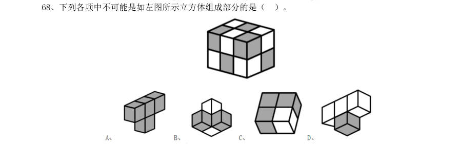

> （本题为图形题，选项为图片，见原卷）

**答案：D**

### 2020 广东·思维能力测验　第 71 题　（政治常识（综合））

某单位组织趣味运动会,运动会一共安排了8 个项目,一个项目结束才进行下一个项目。如果每个 项目每支队伍都要派出4 人参加,同时每个队员参赛的项目不超过3 个。则每支队伍至少需要( )名队 员。

- **A.** 11
- **B.** 12
- **C.** 13
- **D.** 14

**答案：A**

### 2020 广东·思维能力测验　第 72 题　（政治常识（综合））

某学校对500 名学生进行了一次调查,结果显示,会游泳的学生比不会游泳的学生多34 人,而在会 游泳的学生中,会自由泳的学生只占1/3。则在500 名学生中,不会自由泳的学生比会自由泳的学生多( )人。

- **A.** 322
- **B.** 237
- **C.** 231
- **D.** 79

**答案：A**

### 2020 广东·思维能力测验　第 73 题　（政治常识（综合））

如图所示,一个边长为16 厘米的大正方形,在距离角一定距离位置处与对角线平行折叠四次,得到 中部小正方形的边长为4 厘米。如果CB 与大正方形的边平行,则三角形ABC 的面积为( )。

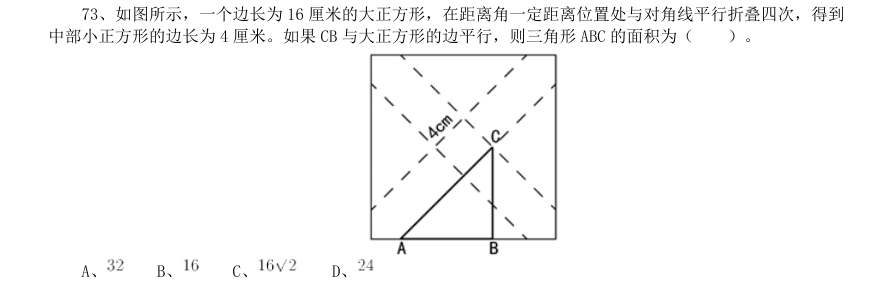

- **A.** 
- **B.** 
- **C.** 
- **D.** 

**答案：A**

### 2020 广东·思维能力测验　第 75 题　（政治常识（综合））

一个大的正方体的6 个面分别写有数字1~6,甲乙丙丁四人分别面对正方体的四个侧面,分别能看 到正方体的一个侧面和顶部。甲乙丙三人看到的正方体侧面和顶部的点数之和分别是4、9 和5,则正方体底 部的点数是( )。

- **A.** 4 或5
- **B.** 3 或4
- **C.** 2 或3
- **D.** 1 或2

**答案：A**

### 2020 广东·思维能力测验　第 76 题　（政治常识（综合））

甲、乙二人绕着圆形操场跑道散步,甲顺时针走,乙逆时针走。两人在跑道A 处同时出发,甲每分 钟走90 米,乙每分钟走60 米,当甲、乙两人在跑道B 处相遇时,乙加快了速度,甲在原地停留4 分钟后保 持原来的速度继续往前走,最后甲、乙二人仍在A 处相遇。已知该操场的周长为1800 米,那么相遇后,乙的 速度变为每分钟( )米。

- **A.** 70
- **B.** 80
- **C.** 90
- **D.** 100

**答案：C**

### 2020 广东·思维能力测验　第 78 题　（政治常识（综合））

服务大厅每天上午8 点半开始办理业务。某天8 点半,已经有15 位市民正在排队,并且每3 分钟都 会新增一位前来办理业务的市民。由于大厅只开放了3 个窗口,到10 点整时发现,仍有18 位市民正在排队。 如果每个窗口办理一项业务的时间相同,则大厅还需要至少再增开( )个窗口,才能在中午12 点前办理 完所有业务。

- **A.** 1
- **B.** 2
- **C.** 3
- **D.** 4

**答案：B**

### 2020 广东·思维能力测验　第 79 题　（政治常识（综合））

有一批边长为1 厘米的小正方体,其中一面涂红色的有400 个,相邻两面涂红色的有30 个,相邻三 面涂红色的有1 个,其余小正方体各面都没有涂颜色。用这一批小正方体组成一个大正方体,要求这个大正 方体有三个面是红色,且这三个面两两相邻,其余的三个面没有颜色。假如没有涂颜色的小正方体数量足够 多,那么这个正方体的边长最大是( )厘米。

- **A.** 10
- **B.** 11
- **C.** 12
- **D.** 13

**答案：B**

### 2020 广东·思维能力测验　第 80 题　（政治常识（综合））

某展览使用了序号为1~100 的100 盏灯,现在有两个开关,开关A 能切换所有序号为偶数的灯的开 关状态,开关B 能切换所有序号为3 的倍数的灯的开关状态。若在100 盏灯都打开的状态下,先后按下开关

- **A.** 和B,则还有( )盏灯处于打开状态。
- **B.** 34
- **C.** 49
- **D.** 50

**答案：C**

### 2020 广东·思维能力测验　第 83 题　（政治常识（综合））

, , , ,( )

- **A.** 
- **B.** 
- **C.** 
- **D.** 

**答案：C**

### 2020 广东·思维能力测验　第 86 题　（政治常识（综合））

0.02,3.13,8.24,15.35,24.46,35.57,48.68,( )

- **A.** 63.79
- **B.** 73.89
- **C.** 66.79
- **D.** 76.89

**答案：A**

### 2020 广东·思维能力测验　第 90 题　（政治常识（综合））

（本题题干为图形/公式，文字层无题干，图见原卷）

- **A.** 53
- **B.** 63
- **C.** 73
- **D.** 83

**答案：B**

### 2020 广东·思维能力测验　第 91 题　（毛中特与党史）

乡村:振兴( )

- **A.** 西部:开发
- **B.** 改革:创新
- **C.** 人才:强国
- **D.** 国际:合作

**答案：A**

### 2020 广东·思维能力测验　第 92 题　（政治常识（综合））

计划:总结( )

- **A.** 跑步:运动
- **B.** 预习:复习
- **C.** 授权:审批
- **D.** 分析:统计

**答案：B**

### 2020 广东·思维能力测验　第 93 题　（政治常识（综合））

江河:湖海( )

- **A.** 名山:大川
- **B.** 风吹:雨打
- **C.** 日月:星辰
- **D.** 湖光:山色

**答案：C**

### 2020 广东·思维能力测验　第 94 题　（政治常识（综合））

电费:( )相当于 重量:( )

- **A.** 用电量 质量
- **B.** 水费 热量
- **C.** 电器 物体
- **D.** 功率 密度

**答案：A**

### 2020 广东·思维能力测验　第 95 题　（政治常识（综合））

行距:( )相当于 品德:( )

- **A.** 段落 道德
- **B.** 字体 规范
- **C.** 排版 教育
- **D.** 缩小 高尚

**答案：C**

### 2020 广东·思维能力测验　第 96 题　（政治常识（综合））

税务局:收税( )

- **A.** 医院:健康
- **B.** 回收站:分类
- **C.** 企业:投资
- **D.** 学校:教育

**答案：D**

### 2020 广东·思维能力测验　第 97 题　（政治常识（综合））

鹤发童颜:敬老尊贤( )

- **A.** 垂髫稚子:童言无忌
- **B.** 桃李芬芳:后生可畏
- **C.** 豆蔻年华:高风亮节
- **D.** 窈窕淑女:君子好逑

**答案：A**

### 2020 广东·思维能力测验　第 98 题　（政治常识（综合））

环保:发电:太阳能( )

- **A.** 民主:选举:选票
- **B.** 高效:配置:市场
- **C.** 公正:审判:法官
- **D.** 精准:扶贫:资金

**答案：C**

### 2020 广东·思维能力测验　第 99 题　（政治常识（综合））

指纹:钥匙:密码( )

- **A.** 公交:地铁:客轮
- **B.** 月季:玫瑰:花朵
- **C.** 现金:信用卡:手机
- **D.** 宣纸:毛笔:狼毫

**答案：A**

### 2020 广东·思维能力测验　第 100 题　（政治常识（综合））

工人:齿轮:机械表( )

- **A.** 诗人:诗词:出版物
- **B.** 老师:教材:优等生
- **C.** 画家:画笔:画作
- **D.** 厨师:面粉:馒头

**答案：D**

### 2020 广东·综合行政能力测验　第 1 题　（新时代理论）
> 材料：2020 年度广东省选调生和急需紧缺专业公务员招录笔试 综 合行政能力测验…

党的十九大报告提出,在全面建成小康社会的基础上,分两步走在本世纪中叶建成( )的社会主 义现代化强国。

- **A.** 富强民主法治幸福美丽
- **B.** 富强平等法治幸福绿色
- **C.** 富强平等文明和谐美丽
- **D.** 富强民主文明和谐美丽

**答案：D**

### 2020 广东·综合行政能力测验　第 4 题　（马克思主义基本原理）

今年是五四运动100 周年。以下关于五四运动表述错误的是( )。

- **A.** 五四运动是中国共产党领导的第一次爱国青年运动
- **B.** 五四运动是中国旧民主主义革命走向新民主主义革命的转折点
- **C.** 五四精神以爱国、进步、民主、科学为主要内容
- **D.** 五四运动具有彻底反帝反封建的革命性

**答案：A**

### 2020 广东·综合行政能力测验　第 5 题　（马克思主义基本原理）

关于新时代我国社会主要矛盾的变化,下列说法有误的是( )。

- **A.** 我国社会主要矛盾已经转化为人民日益增长的美好生活需要和不平衡不充分的发展之间的矛盾
- **B.** 生产力水平低已经成为满足人民日益增长的美好生活需要的主要制约因素
- **C.** 我国社会主要矛盾的变化是关系全局的历史性变化,对党和国家工作提出了许多新要求
- **D.** 我国社会主要矛盾的变化,没有改变我们对我国社会主义所处历史阶段的判断

**答案：B**

### 2020 广东·综合行政能力测验　第 6 题　（马克思主义基本原理）

马克思主义是科学的理论,创造性地揭示了人类社会发展规律。以下关于马克思主义表述错误的是 ( )。

- **A.** 实践性是马克思主义理论区别于其他理论的显著特征
- **B.** 马克思主义第一次创立了人民实现自身解放的思想体系
- **C.** 马克思主义政党同其他政党的根本区别在于为民族利益而奋斗
- **D.** 中国共产党是用马克思主义武装起来的政党

**答案：C**

### 2020 广东·综合行政能力测验　第 8 题　（政治常识（综合））

构建国土空间开发保护制度,完善主体功能区配套政策,建立以( )为主体的自然保护地体系。

- **A.** 生态保护区
- **B.** 生态发展区
- **C.** 自然公园
- **D.** 国家公园

**答案：D**

### 2020 广东·综合行政能力测验　第 10 题　（毛中特与党史）

党的十九大报告提出,建设教育强国是中华民族伟大复兴的基础工程。办好继续教育,加快建设( )社会,大力提高国民素质。

- **A.** 学习型
- **B.** 创新型
- **C.** 发展型
- **D.** 改革型

**答案：A**

### 2020 广东·综合行政能力测验　第 15 题　（毛中特与党史）

党的十九大报告提出,加强党的基层组织建设,要以提升( )为重点,突出政治功能,把基层组 织建设成为宣传党的主张、贯彻党的决定、领导基层治理、团结动员群众、推动改革发展的坚强战斗堡垒。

- **A.** 组织力
- **B.** 影响力
- **C.** 协调力
- **D.** 战斗力

**答案：A**

### 2020 广东·综合行政能力测验　第 17 题　（政治常识（综合））

2019 年7 月,展现新石器时代我国长江下游稻作文明发展程度的( )被正式列入“世界遗产名 录”。

- **A.** 马坝人遗址
- **B.** 南越王宫署遗址
- **C.** 平遥古城遗址
- **D.** 良渚古城遗址

**答案：D**

### 2020 广东·综合行政能力测验　第 19 题　（政治常识（综合））

2019 年9 月29 日,中华人民共和国( )颁授仪式在北京人民大会堂隆重举行。

- **A.** 和平勋章和友谊勋章
- **B.** “十一”勋章和军队功勋
- **C.** 人民满意的公务员和集体
- **D.** 国家勋章和国家荣誉称号

**答案：D**

### 2020 广东·综合行政能力测验　第 22 题　（政治常识（综合））

与驾驶小汽车相比,驾驶员以同样的速度驾驶公交车时,会感觉公交车移动的速度更快。以下最能 解释这一现象的是( )。

- **A.** 公交车挡风玻璃比小汽车的挡风玻璃厚,造成司机视线差异
- **B.** 公交车车头更短,司机可以看到距离车头很近的地面
- **C.** 公交车体型比小汽车大得多,需要更大的动力和刹车距离
- **D.** 公交车挡风玻璃面积更大,司机的视线范围更广

**答案：B**

### 2020 广东·综合行政能力测验　第 24 题　（政治常识（综合））

大雾天气,公路两旁路灯的灯光会变得朦胧,其主要原因是( )。

- **A.** 雾气吸收了路灯的光线
- **B.** 灯光照射在雾气上发生了散射
- **C.** 雾气吸附在灯罩表面,阻挡了灯光
- **D.** 雾气阻挡了人的视线

**答案：B**

### 2020 广东·综合行政能力测验　第 25 题　（政治常识（综合））

植物一生吸水的重量常常达到其自重的数百倍,但植物所吸取的水分最终存储在植物体内的并不多, 大约98%的水分都蒸腾散失掉。以下不属于植物需要进行蒸腾作用的原因是( )。

- **A.** 帮助植物降温散热,避免被烈日烤焦
- **B.** 为植物吸收和运输水分提供了动力,使根部不断向土壤吸水
- **C.** 水在从根部向叶片运输的过程中,把各种养分带到了植物全身
- **D.** 叶片水分散失的同时会发生代谢,有利于植物维持内环境稳定

**答案：D**

### 2020 广东·综合行政能力测验　第 26 题　（政治常识（综合））

PUE 值是国际通用的数据中心电力使用效率指标,数据中心的冷却占机房总功耗的 ,降低机房制 冷的耗电量能有效降低PUE 值。为使大型云计算数据中心建设达到国际标准,以下计算数据中心建设选址不 是从利用自然环境降低PUE 这一方面考虑的是( )。

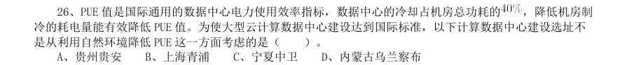

- **A.** 贵州贵安
- **B.** 上海青浦
- **C.** 宁夏中卫
- **D.** 内蒙古乌兰察布

**答案：B**

### 2020 广东·综合行政能力测验　第 27 题　（政治常识（综合））

2018 年,我国将每年农历“秋分”这一天设立为中国农民丰收节。如果按照“日出而作,日落而息” 的习惯,中国农民丰收节当天,下列地方的农民耕作时间(按北京时间)最早的是( )。

- **A.** 位于华北平原的北京市郊
- **B.** 位于珠江三角洲平原的广州市郊
- **C.** 绿茶产地,地处云贵高原的大理州
- **D.** “中国大豆之乡”,东北嫩江县

**答案：D**

### 2020 广东·综合行政能力测验　第 37 题　（政治常识（综合））

在我国,有人用“青如天,明如镜,薄如纸,声如磬”来形容优秀的( )作品。

- **A.** 漆器
- **B.** 瓷器
- **C.** 玉器
- **D.** 铜器

**答案：B**

### 2020 广东·综合行政能力测验　第 39 题　（政治常识（综合））

李清照是宋代著名女词人,一生中经历了北宋灭亡和南渡漂泊,在变乱前后其词风也发生了很大的 变化。下列词句中属于其南渡之前所创作的是( )。

- **A.** 空梦长安,认取长安道
- **B.** 故乡何处是?忘了除非醉
- **C.** 物是人非事事休,欲语泪先流
- **D.** 莫道不销魂,帘卷西风,人比黄花瘦

**答案：D**

### 2020 国考·地市级　第 1 题　（新时代理论）

下列有关“不忘初心、牢记使命”主题教育的说法正确的是:

- **A.** 总要求是坚守初心使命,积极担当作为
- **B.** 根本任务是建设高素质党员干部队伍
- **C.** 把学习教育、调查研究、检视问题、整改落实贯穿主题教育全过程
- **D.** 具体目标是找差距、抓落实

**答案：C**

### 2020 国考·地市级　第 3 题　（新时代理论）

党的十九大报告指出,发展必须是科学发展,必须坚定不移贯彻创新、协调、绿色、开放、共享的发展理念。 下列与之有关的说法,正确的有几项? 1创新发展注重的是解决发展动力问题 2协调发展注重的是解决社会公平正义问题 3绿色发展注重的是解决人与自然和谐共生问题 4开放发展注重的是解决发展内外联动问题 5共享发展注重的是解决发展不平衡问题

- **A.** 1
- **B.** 2
- **C.** 3
- **D.** 4

**答案：C**

### 2020 国考·地市级　第 4 题　（毛中特与党史）

时代楷模是具有很强先进性、代表性、时代性和典型性的先进人物。下列时代楷模与事迹特点对应正确的是:

- **A.** 张富清—95 岁老党员的本色人生
- **B.** 杜富国—践行社会主义核心价值观的优秀知识分子
- **C.** 黄文秀—用生命担当使命的新时代英雄战士
- **D.** 黄大年—乡村教育守望者

**答案：A**

### 2020 国考·地市级　第 6 题　（政治常识（综合））

坚持农村基本经营制度,是党的农村政策的基石,是乡村振兴的制度基础。关于农村基本经营制度,下列说 法错误的是:

- **A.** 实行家庭承包经营为基础、统分结合的双层经营体制
- **B.** 保持土地承包关系稳定并长久不变,第二轮土地承包到期后再延长三十年
- **C.** 完善农村承包地所有权、承包权、经营权“三权”分置制度
- **D.** 支持进城落户农民依法自愿有偿转让集体土地所有权

**答案：D**

### 2020 国考·地市级　第 8 题　（新时代理论）

关于党在新时代的强军目标,下列说法正确的是:

- **A.** 力争到本世纪中叶基本实现国防和军队现代化
- **B.** 建设一支听党指挥、能打胜仗、作风优良的人民军队
- **C.** 到2035 年把人民军队全面建成世界一流军队
- **D.** 确保到2020 年全面实现机械化

**答案：B**

### 2020 国考·地市级　第 11 题　（政治常识（综合））

甲乘坐公交车时因到站未停与司机发生争执,一怒之下抢夺正在行驶的公交车方向盘,致公交车失控撞到路 边电线杆,乘客及行人受伤、公交车严重受损。甲的行为构成:

- **A.** 以危险方法危害公共安全罪
- **B.** 交通肇事罪
- **C.** 寻衅滋事罪
- **D.** 危险驾驶罪

**答案：A**

### 2020 国考·地市级　第 15 题　（政治常识（综合））

下列言论中涉及到的人才选拔制度,按出现顺序先后排列正确的是: 1学通行修,经中博士 2宗室非有军功论,不得为属籍 3九品访人,唯问中正 4风吹金榜落凡世,三十三人名字香

- **A.** 2134
- **B.** 3241
- **C.** 2413
- **D.** 1324

**答案：A**

### 2020 国考·省级　第 4 题　（马克思主义基本原理）

坚决打好“三大攻坚战”,是党的十九大提出的重大政治任务,是2020 年决胜全面建成小康社会的迫切要求。 以下哪幅漫画不适合用于“三大攻坚战”的宣传?

> （本题为图形题，选项为图片，见原卷）

**答案：A**

### 2020 国考·省级　第 8 题　（新时代理论）

关于党在新时代的强军目标,下列说法正确的是:

- **A.** 力争到本世纪中叶基本实现国防和军队现代化
- **B.** 建设一支听党指挥、能打胜仗、作风优良的人民军队
- **C.** 到2035 年把人民军队全面建成世界一流军队
- **D.** 确保到2020 年全面实现机械化

**答案：B**

### 2020 国考·省级　第 12 题　（政治常识（综合））

关于陶瓷,下列说法错误的是:

- **A.** “入窑一色,出窑万彩”是钧瓷的特点
- **B.** 紫砂壶是用含铁量较高的黏土制成的
- **C.** 景德镇在宋代时期主要烧制青白瓷
- **D.** 唐三彩中最具代表性的造型是虎和骆驼

**答案：D**

### 2020 国考·省级　第 15 题　（政治常识（综合））

下列关于电池的说法错误的是:

- **A.** 干电池利用液态电解液产生电流
- **B.** 自行放电是蓄电池不可避免的渐生故障
- **C.** 锂电池不会产生铅、汞等有害重金属物质
- **D.** 太阳能电池产生的电是直流电

**答案：A**

### 2020 国考·省级　第 16 题　（政治常识（综合））

关于能量与做功,下列说法正确的是:

- **A.** 雨点从高空中匀速下落时只有重力做功
- **B.** 匀速圆周运动的物体动能始终发生变化
- **C.** 自由落体过程中物体的机械能保持不变
- **D.** 向上飞的石子重力做负功导致势能减小

**答案：C**

### 2020 国考·省级　第 17 题　（政治常识（综合））

白居易有诗云:“绿蚁新醅酒,红泥小火炉。晚来天欲雪,能饮一杯无?”下列与该诗相关的说法正确的是:

- **A.** “绿蚁”是因为酒中添加了可食用调色剂
- **B.** “醅酒”的过程利用了微生物的作用
- **C.** 炉火燃烧的过程是内能转化成化学能
- **D.** 从雪到水的转化过程会释放出热量

**答案：B**

### 2020 国考·省级　第 18 题　（政治常识（综合））

关于塑料大棚,下列说法正确的是:

- **A.** 塑料大棚的薄膜能够提高光照强度
- **B.** 搭建塑料大棚能有效防御地质灾害
- **C.** 冬季在塑料大棚内熏烟有助于防御霜冻
- **D.** 无土栽培技术必须在塑料大棚中进行

**答案：C**

### 2020 国考·省级　第 19 题　（政治常识（综合））

下列与疫苗有关的说法正确的是:

- **A.** 疫苗通过三角肌注射才能产生作用
- **B.** 免疫力弱的人不能接种疫苗
- **C.** 疫苗的接种者必须是健康个体
- **D.** 卡介疫苗是典型的活疫苗

**答案：D**
