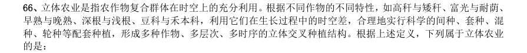
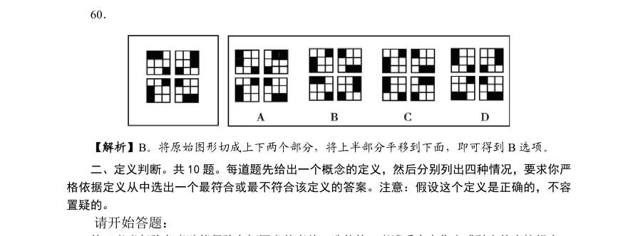
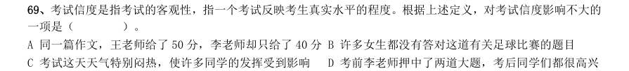
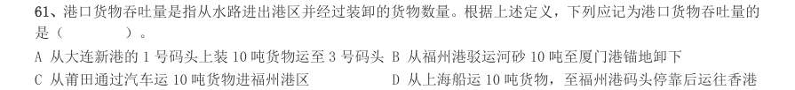
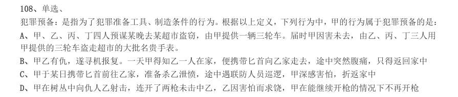

# 判断推理 · 定义判断 · 2000 年代真题

> 所属考点：[PD-DY](../PD-DY-定义判断.md)　｜　本片 97 题

> 本片子考点：单定义 89　定义判断（综合） 8

### 【2009 湖北省考·第 56 题】HB-2009-ty-X056　定义判断｜单定义

核心技术能力是企业通过特有的技术要素和技能或各种要素和技能的独特的组合来创造具有自身特性的技 术,以产生稀缺的、不可模仿的技术资源(包括技术和知识等)的企业能力。 根据上述定义。下列不属于企业核心技术能力的是:

- **A.** Google 公司掌握网络搜索的关键技术
- **B.** 微软公司掌握操作系统的开发技术
- **C.** 原IBM 公司掌握大型超级计算机的制造技术
- **D.** 联想公司掌握个人计算机的制造技术

**答案：D**

### 【2009 湖北省考·第 57 题】HB-2009-ty-X057　定义判断｜单定义

外部不经济性是指经济活动主体在生产和消费过程中,给他人带来的损失或额外费用,而他人并未因此得 到补偿。 下列属于外部不经济性的是:

- **A.** 某项新技术发明被他人使用,没有得到使用费
- **B.** 桃树花开时,行人都可以享受到花香,但并未向种桃树的人交钱
- **C.** 上游居民大量植树,自己收获了木材又改善了下游居民的水源质量,却未收取费用
- **D.** 农民使用农药过量造成污染,却并没有赔偿受害者

**答案：D**

### 【2009 湖北省考·第 59 题】HB-2009-ty-X059　定义判断｜单定义

耕作是指作物种植以前,或在作物生长期间,为了改善植物生长条件而对土壤进行的机械操作,耕作的基 本目的有三个:1、改良土壤结构;2、把作物残茬和有机肥料掩埋并掺和到土壤中去;3、清除杂草或其他不 需要的植株。 根据上述定义,以下属于耕作的是:

- **A.** 在果园里挖排水沟
- **B.** 喷洒除草剂以清除杂草
- **C.** 将雨后板结的表土破碎
- **D.** 冬季在农田里种植绿肥作物

**答案：C**

### 【2009 湖北省考·第 60 题】HB-2009-ty-X060　定义判断｜单定义

战略决策是指在企业内贯彻的一种决策活动。通常包括组织目标、方针的确定,组织机构的调整,企业产 品的更新换代、技术改造等,这些决策牵涉组织的方方面面,具有长期性和方向性。 下列属于战略决策的是:

- **A.** 我国的神舟七号载人航天计划
- **B.** 某公司决定开发新技术,在十年内推出神经网络电脑
- **C.** 某大公司经理决定招聘一位有多年工作经验并能熟练讲英语的主管
- **D.** 某公司用蓝皮书规定全国分公司经理行为

**答案：B**

### 【2009 湖北省考·第 61 题】HB-2009-ty-X061　定义判断｜单定义

生产销售伪劣产品罪是指生产者或销售者故意在产品中掺杂、掺假、以次充好、以假充真或者以不合格产 品冒充合格产品,销售金额5 万以上的行为。 下列属于生产销售伪劣产品罪的是:

- **A.** 赖某、宣某经商量用化工原料二氧化硒掺过硫酸氨后当作纯二氧化硒出售,以每公斤430 元的合同价格售出425 公斤
- **B.** 陈某以假金项链冒充纯金项链出售,每条金项链24 克,价值人民币4600 元,共售出三条
- **C.** 某建筑公司承建价值300 万元的住宅楼,为了降低成本,使用了不合格的建筑材料,导致住宅楼还没有验收就有了裂缝
- **D.** 孟某以二手车冒充新车,与肖某以30 万元的价格签订汽车销售合同,但孟某在车款到手后携款逃匿

**答案：A**

### 【2009 湖北省考·第 62 题】HB-2009-ty-X062　定义判断｜单定义

风险转移是指通过合同或非合同的方式将风险转嫁给另一个人或单位的一种风险处理式。风险转移是对风 险造成的损失的承担的转移。 根据上述定义,以下属于风险转移的是:

- **A.** 医院在给垂危病人施行手术之前,要求病人家属签字同意
- **B.** 某人看到近期股票大跌,于是将本要投资股市的钱存入银行
- **C.** 为避免泄密可能带来的损失,甲单位要求相关人员签订保密协议
- **D.** 某企业产品出现了质量问题,声称是因原料供应商所供原料不合格

**答案：A**

### 【2009 湖北省考·第 64 题】HB-2009-ty-X064　定义判断｜单定义

选择性注意是指在外界诸多刺激中,人们仅仅注意到某些刺激或刺激的某些方面,而忽略了其他刺激。 根据上述定义,下列属于选择性注意的一项是:

- **A.** 志愿者小张在奥运会期间,每天忙于奥运赛场的服务,无暇观看奥运比赛
- **B.** 奥运结束后,一些学生仍对奥运精彩纷呈的赛事感到意犹未尽,无法投入到新学期的学习生活中
- **C.** 意大利小伙子马克观看完北京奥运会开幕式后,对中国文化产生了浓厚兴趣,于是留在北京学习汉语
- **D.** 北京奥运会期间,原本闹离婚的夫妻俩。由于一起收看奥运会节目,交流增多,关系缓和,不再闹离婚了

**答案：D**

### 【2009 湖北省考·第 65 题】HB-2009-ty-X065　定义判断｜单定义

转继承是指继承人在继承开始后遗产分割前死亡的,其继承的遗产转由其法定继承人(包括配偶、子女、 父母、兄弟姐妹、祖父母和外祖父母)继承的制度。 下列属于转继承的是:

- **A.** 老王与其妻子生有两个儿子,二儿子早年去世,留有一女,未满十八岁。老王去世后,在未立有遗嘱的情况下,该女孩要求继承老王的部分遗产
- **B.** 老李有价值50 万元的房产一处。老李去世的当天,儿子小李在赶往医院办理后事的途中不幸遭遇车祸死亡,小李的儿子当即表示要继承老李的房产
- **C.** 孤寡老人老刘一直由邻居老张照顾,老刘在生前立下遗嘱,将其全部财产留给老张。老刘去世后不久,老张心脏病发去世,老张的妻子要求继承老张应继承的部分份额
- **D.** 老黄生前一直由其外甥小赵照顾,老黄立下遗嘱,将全部财产留给小赵。老黄去世后,老黄的子女向法院

**答案：B**

### 【2009 国考·第 71 题】GK-2009-ty-X071　定义判断｜单定义

广义而言,集体记忆即是一个具有自己特定文化内聚性和统一性的群体对自己过去的记忆。这种群体可以是 一个政治宗教集团、一个地区文化共同体,也可以是一个民族或是一个国家。这种记忆可以是分散的、零碎的、 口头的,也可以是集中的、官方的、文字的,可以是对最近一个事件的回忆,也可以是对远古祖先事迹的追溯。 根据上述定义,下列属于集体记忆的是:

- **A.** 我国广泛流传的大禹治水的传说
- **B.** 某市宣传地方旅游资源的记录片
- **C.** 某政府机构关于某项工作的文件汇编
- **D.** 我国某大学内介绍邻国历史的教材

**答案：A**

### 【2009 国考·第 72 题】GK-2009-ty-X072　定义判断｜单定义

隐性广告是指将产品或品牌及其代表性的视觉性符号,甚至服务性内容策略性的融入电影、电视剧或其他电 视节目及其他传播内容中(隐藏于载体并与载体融为一体),使观众在接受传播内容事物同时,不自觉地接受商 品或品牌信息,继而达到广告主所期望的传播目的。 根据上述定义,下列属于隐性广告的是:

- **A.** 电视台在转载世界杯足球比赛中场休息时播放的某知名饮品的广告
- **B.** 某知名运动品牌赞助奥运会某国家体育代表运动员的领奖服
- **C.** 某电子产品生产商赞助拍摄电影,电影放映前播放该产品广告
- **D.** 某电视台知名女主播穿着某品牌提供的服装参加亲戚的婚礼

**答案：B**

### 【2009 国考·第 73 题】GK-2009-ty-X073　定义判断｜单定义

缺陷补偿是指个体在充当社会角色时不可能事事成功,当自我角色目标失败时,常常可能会对相关的社会角 色的重要性做重新评价,从而进行自我定义以补偿自己的角色缺陷。 根据上述定义,下列属于补偿缺陷的是:

- **A.** 小王认为评上优秀员工是晋升的关键,因此当评选失利后决定在下一次评选中再接再厉
- **B.** 小张有份很不错的工作,他参加公务员考试是抱着试试看的态度,所以当他得知自己没有通过考试时并未觉得太遗憾
- **C.** 袁女士离婚后全身心投入工作,取得了很大的成绩,她认为事业成功比婚姻幸福更为重要
- **D.** 黄某大学毕业后求职不顺利,他觉得这是由于自己不是名牌大学毕业生,否则就业会容易的多

**答案：C**

### 【2009 国考·第 74 题】GK-2009-ty-X074　定义判断｜单定义

职业社会化是指个体按社会需求选择职业,掌握从事某种职业的知识和技能,以及从事某种职业后进行知识、 技能更新再训练的过程。 根据上述定义,下列属于职业社会化的是:

- **A.** 食堂管理员张某看到很多领域急需翻译人才,利用业余时间学习取得翻译资格证后到某公司任职
- **B.** 青年张某参军后被分配至汽车班,学得精湛的修车技艺,退役后自己开了一间修理部
- **C.** 某公司会计李某热爱厨艺,业余时间参加了一个培训班,学习营养知识,提高烹饪技艺
- **D.** 下岗女工陈某在抚育孩子期间,积累了丰富的知识和经验,后在朋友建议下开办了一所幼儿园

**答案：A**

### 【2009 国考·第 75 题】GK-2009-ty-X075　定义判断｜单定义

差异性市场策略是指企业在对整体市场细分的基础上,针对每个细分市场的需求特点,设计和生产不同的产 品,制定并实施不同的市场营销组合策略(各种营销手段的综合运用),试图以差异性的产品满足差异性的市场 需求。 根据上述定义,下列属于差异性市场策略的是:

- **A.** 某汽车生产企业面向工薪阶层,主要生产经济型轿车,这种轿车售价低,耗油少,深受工薪阶层欢迎
- **B.** 某超市推行会员制,根据会员积分的多少,赠予不同档次的礼品
- **C.** 某企业生产的电脑在市场上销路很好,为拓宽市场,又开始研发手机
- **D.** 某化妆品生产企业针对不同年龄阶段的消费生产、销售不同种类的润肤露

**答案：D**

### 【2009 国考·第 76 题】GK-2009-ty-X076　定义判断｜单定义

现在统计中常用的人均可支配收入由四部分构成,分别是工资性收入、转移性收入、经营性收入和财产性收 入。财产性收入一般是指家庭拥有的动产(如银行存款、有价证券等)、不动产(如房屋、车辆、土地、收藏品 等)所得的收入。它包括出让财产使用权获得的利息、租金、专利收入等;财产劳动所获得的红利收入、财产增 值收益等。 根据上述定义,下列属于财产性收入的是:

- **A.** 王某家传的青花瓷器在展览会上被专家估价为200 万元
- **B.** 李某买了一辆载重10 吨的货车跑运营,每年收入8 万元以上
- **C.** 赵某为公司作出重大贡献,公司给予10 万元的奖励
- **D.** 高某在闹市有一间房屋,某厂家在房顶安放了广告牌,并支付给他一定费用

**答案：D**

### 【2009 国考·第 77 题】GK-2009-ty-X077　定义判断｜单定义

有一些植物需经过低温后才能开花并成长结果。通过低温诱导促使植物开花结果的作用称为春化作用。 根据上述定义,下列未利用春化作用原理的是:

- **A.** 洋葱开花影响其品质,因此在春季种植前高温处理越冬贮藏的鳞茎,以降低其感受低温的能力,从而得到较大鳞茎
- **B.** 使用赤霉素,二年生天仙子、白菜、甜菜和胡萝卜等不经低温处理就可以开花
- **C.** 将萌发的冬小麦种子装在罐中,放在冬季的低温下40 至50 天后在春季播种,可获得和秋播同样的收成
- **D.** 在第一年将二年生药用植物当归的块根挖出,贮藏在高温下,以减少第二年的抽薹率而获得较好的块根

**答案：B**

### 【2009 国考·第 78 题】GK-2009-ty-X078　定义判断｜单定义

产品召回是指生产商将已经送到批发商、零售商或最终用户手上的产品收回。产品召回的典型原因是所售出 的产品被发现存在缺陷。产品召回制度是针对厂家原因造成的批量性问题而出现的,其中,对于质量缺陷的认定 和厂家责任的认定是最关键的核心。 根据上述定义,下列属于产品召回的是:

- **A.** 某商家作出承诺,产品有问题可以无条件退货
- **B.** 某超市发现卖出的罐头已过期变质,及时告知消费者前来退货或换货
- **C.** 因质检把关不严,某厂一批次品流入市场,厂家告知消费者前来退货
- **D.** 某玩具厂因某种玩具有害物质超标,向提起诉讼的部分消费者退货赔偿

**答案：C**

### 【2009 国考·第 79 题】GK-2009-ty-X079　定义判断｜单定义

环境影响评价是指拟定开发计划或建设项目时,事前对该计划或项目将给大气、水体、土壤、生物以及由它 们组成的环境系统带来什么影响,这些影响的结果又将对人类的健康和生活环境以及自然环境和经济、文化、历 史环境造成什么影响所进行的调查、预测与评价,以及据此制定出防止或减少环境污染和破坏的对策与措施。 根据上述定义,下列属于环境影响评价的行为是:

- **A.** 某市在建设污染水处理厂之前,请专家根据城市规模对该厂日处理污水能力进行调查、预测与评价
- **B.** 某市建高架桥后,附近几栋楼的居民反映该桥严重影响了采光,市政府组织相关部门进行评估以决定如何处理
- **C.** 某市在治理一条古老的河道前,请专家考证该河道的历史,以开发旅游资源
- **D.** 某市在建设机场前,预测飞机噪声并提出机场周围土地利用控制性建议

**答案：D**

### 【2009 国考·第 80 题】GK-2009-ty-X080　定义判断｜单定义

政府采购是指国家各级政府为从事日常的政务活动或为了满足公共服务的目的,利用国家财政性资金和政府 借款购买货物、工程和服务的行为。政府采购不仅是指具体的采购过程,而且是采购政策、采购程序、采购过程 及采购管理的总称,是一种对公共采购进行管理的制度。 根据上述定义,下列不属于政府采购的是:

- **A.** 某市政府规定,单笔超过一定金额的办公用品必须报有关部门集中采购
- **B.** 某市政府为方便市民出行,租用电信公司的短信平台给市民发送免费短信
- **C.** 某县政府为改善当地教育条件,拨专项资金给某小学翻修校舍,并规定必须严格按招标程序进行
- **D.** 某市政府通过公开竞标方式选择一家酒店作为指定接待酒店

**答案：C**

### 【2008 湖北省考·第 71 题】HB-2008-ty-X071　定义判断｜单定义
> 材料：C.如果某种产品超过了市场需求,就可能出现滞销现象。“草群”领带的供应量大大 超过了市场需求,因此,一定会出现滞销现象 D.凡是超越代理人权限所签的合同都是无效的。这份房地产建设合同是超越代理权限 签订的,所以它是无效的 从中选出一个最符合或最不符合该定义的答案。注意:假定这个定义是正确的,不容置疑的。…

外部不经济,是指一种经济行为对其本身和外部产生出来的负效益。 下列选项中,属于外部不经济现象的是:

- **A.** 学校周边钢厂的烟囱冒出黑色灰尘
- **B.** 国家出资提高公众健康水平
- **C.** 湘江岸边的造纸厂流出经处理合格的水
- **D.** 吃完东西后将包装用的塑料袋扔到分类的垃圾箱

**答案：A**

### 【2008 湖北省考·第 72 题】HB-2008-ty-X072　定义判断｜单定义

转移收入,是指来自非生产、交换过程的收入,如资助、赠与和遗产收入等各种形式的转移收入。 下列选项中,有关转移收入说法正确的是:

- **A.** 转移收入是给予者自愿的,与生产、交换的竞争无关
- **B.** 转移收入与工资、业主利润等一样,属于生产、交换过程的范畴
- **C.** 转移收入的存在是因为产权使用效率的提高
- **D.** 以上说法均不正确

**答案：暂缺**

### 【2008 湖北省考·第 75 题】HB-2008-ty-X075　定义判断｜定义判断（综合）

佣金,是指经纪人、代理商等中间人完成受委托事项后,由委托人向其支付的报酬。 下列选项中,属于佣金的是?

- **A.** 某啤酒经销商,获取出厂价和批发价之间的10 元差额
- **B.** 小王是某公司职员,公司每月付他2000 元工资
- **C.** 某超市供销某品牌香烟,烟厂付超市10%的报酬
- **D.** 经王某介绍,小李做成一笔大生意,为答谢王某,小李送上5 千元红包

**答案：暂缺**

### 【2008 湖北省考·第 76 题】HB-2008-ty-X076　定义判断｜单定义

国民财富,是指某个国家在特定时点上所拥有的各种有形生产资产、无形生产资产、天然资源(已探明或 已收入使用)以及对外的金融净资产的总和。 下列选项中,不应计入国民财富的是:

- **A.** 某制衣厂生产的价值5 万元的布匹
- **B.** 小王在学术研究上取得重大突破,并获得专利
- **C.** 中国对外金融净资产
- **D.** 深山里未被发现的金矿

**答案：暂缺**

### 【2008 湖北省考·第 77 题】HB-2008-ty-X077　定义判断｜单定义

企业,是指具有法人地位、创造价值、增加效用、追求利润最大化的独立商品生产单位。 下列选项中,属于企业的是:

- **A.** 主要给家人或客人做饭的家庭
- **B.** 从事家庭式小商品生产的家庭企业
- **C.** 部队里面的连队
- **D.** 从事自给自足生产劳动的农户

**答案：暂缺**

### 【2008 湖北省考·第 78 题】HB-2008-ty-X078　定义判断｜定义判断（综合）

公共物品,是指在消费上具有非竞争性、非排他性的商品,供整个社会共同享用的物品。 下列选项中,不属于公共物品的是:

- **A.** 警察提供的安全服务
- **B.** 研究和开发
- **C.** 环境保护
- **D.** 商场的名牌电视机

**答案：D**

### 【2008 湖北省考·第 79 题】HB-2008-ty-X079　定义判断｜单定义

保险的最大诚信原则,是指保险双方当事人在签订和履行保险合同的整个过程中,必须诚实守信,以最大 的诚意恪守信用,如实告知重要情况,不欺骗不隐瞒,并保证正确履行各自的权利和义务。 下列选项中,投保人没有履行最大诚信原则的是:

- **A.** 刘某,因肝癌病休治疗。2005 年7 月,刘某所在装饰公司为全公司职员投保团体人身保险,公司在提交被保险人名单时,在健康状况一栏中说明了刘某因肝癌病休的情况
- **B.** 张某,身体健康,在单位集体组织下投保简易人身保险,在投保单上“被保险人健康情况”一栏填“健康”两字
- **C.** 新学期,学校让新生每人交纳了保险费25 元,其中学生平安保险10 元,附加疾病险15 元。9 月8 日新生张某,腹部疼痛,经医院确诊为某先天性疾病。之后,张某住院治疗,张父向保险公

**答案：暂缺**

### 【2008 湖北省考·第 80 题】HB-2008-ty-X080　定义判断｜单定义
> 材料：D.李某患胃癌住院治疗,手术后出院,并正常参加工作。后来,李某经人介绍投保了简易人身险,填写投保 单填写投保单时没有申报身患癌症的事实…

思维:指人脑对客观间接的概括的反映。根据思维过程中的凭借物或者思维状态的不同可以将思维分为(1) 动作思维,是指在思维过程中以实际动作作为支持的思维。其特点是任务是直观的,以具体形式给予的,解 决方式是实际动作;(2)形象思维,是指用表象来进行分析、综合、抽象、概括的过程。特点是借助鲜明、 生动的客观形象;(3)抽象思维,是指借助概念、判断、推理等形式来反映客观事物的运动规律,对事物的 本质特征和内部联系加以认识的过程。 下列哪项符合动作思维的定义?

- **A.** 福尔摩斯通过在屋子找不到其他的出口,断定凶手一定是从屋顶的烟囱出去的,尽管烟囱很小
- **B.** 洪熙官的儿子很小的时候就被要求每天看着父亲练武功。渐渐地,他也能跟着父亲一起比划起来
- **C.** 刘教授喜欢在他的文章中通过列举大量的事例来说明问题
- **D.** 建筑系的学生在设计建筑方案时有时候需要先根据建筑图纸制作出一个模型来,这样似乎更有助于发

**答案：暂缺**

### 【2008 国考·第 66 题】GK-2008-ty-X066　定义判断｜单定义

立体农业是指农作物复合群体在时空上的充分利用。根据不同作物的不同特性,如高秆与矮秆、富光与耐荫、 早熟与晚熟、深根与浅根、豆科与禾本科,利用它们在生长过程中的时空差,合理地实行科学的间种、套种、混 种、轮种等配套种植,形成多种作物、多层次、多时序的立体交叉种植结构。根据上述定义,下列属于立体农业 的是:

- **A.** 甲在自己的玉米地里种植大豆
- **B.** 乙在自己承包的鱼塘不但养鱼,还种植了很多莲藕
- **C.** 丙在南方某地区承包了十亩稻田,特意引种了高产的水稻新品种
- **D.** 丁前年承包了一座山,他在山上种植了大量苹果树,并在山上养殖了大量蜜蜂

**答案：A**

### 【2008 国考·第 67 题】GK-2008-ty-X067　定义判断｜单定义

天然孳息是指按照物质的自然生长规律而产生的果实与动物的出产物,与原物分离前,是原物的一部分。天 然孳息,由所有权人取得;既有所有权人又有用益物权人的,由用益物权人取得。当事人另有约定的,按照约定。 根据上述定义,下列不属于天然孳息的是:

- **A.** 送给他人的猫崽
- **B.** 从羊身上剪下的羊毛
- **C.** 牛被宰杀后发现的牛黄
- **D.** 公园里的柿子树所结的果实

**答案：A**

### 【2008 国考·第 68 题】GK-2008-ty-X068　定义判断｜单定义

绿色壁垒是指一些国家和国际组织通过制定环境标准和法规,为保护生态环境、人类以及动植物生命安全与 健康而直接或间接采取的各种限制或者禁止贸易的措施,它是能对进出口贸易产生影响的一种非关税贸易壁垒。 根据上述定义,下列属于绿色壁垒行为的是:

- **A.** 某大型连锁超市只销售通过绿色食品检验的进口农产品
- **B.** 一家纺织品进出口公司销往欧洲的10 余吨棉纱因检测出含有德国禁用的偶氮染料而停止出口
- **C.** 某公司向国外出口大蒜,因途中货轮上的温控设施出问题,部分大蒜到港后变质,结果所有大蒜被退回
- **D.** 一家工厂生产的木质卧室家具在美国市场销售量非常可观,但由于美国提高了木质卧室家具的关税,其出口

**答案：B**

### 【2008 国考·第 69 题】GK-2008-ty-X069　定义判断｜单定义

失语症是指由于神经中枢病损导致抽象信号思维障碍,而丧失口语、文字的表达和领悟能力的临床症侯群。 根据上述定义,下列可能患失语症的是:

- **A.** “狼孩“回归社会后无法与人进行言语交流
- **B.** 幼时高烧听力受损致使发音有极大缺陷,影响交流
- **C.** 因受刺激精神失常,造成言语理解和表达上的困难
- **D.** 因车祸头部受创,虽能模仿他人言语但经常答非所问

**答案：D**

### 【2008 国考·第 70 题】GK-2008-ty-X070　定义判断｜单定义

职业枯竭是指人们在自己长期从事的工作重压之下,产生身心能量被工作耗尽的感觉。根据上述定义,下列 属于职业枯竭状态的是:

- **A.** 老周不能胜任自己现有的工作,每天都会忙得焦头烂额
- **B.** 刚参加工作的小李觉得这份工作太累,产生了跳槽的念头
- **C.** 刘经理每天工作繁忙,缺乏充足的休息,情绪也越来越糟糕
- **D.** 在从事过许多不同的职业之后,老王觉得所有工作都索然无味

**答案：C**

### 【2008 国考·第 71 题】GK-2008-ty-X071　定义判断｜单定义

价格垄断行为是指经营者通过相互串通或者滥用市场支配地位,操纵市场调节价,扰乱正常的生产经营秩序, 损害其他经营者或者消费者合法权益,或者危害社会公共利益的行为。 根据上述定义,下列不属于价格垄断行为的是:

- **A.** 几家大型电视机生产企业通过协议联手操纵价格
- **B.** 某商场为了吸引顾客将部分商品低于成本价销售
- **C.** 拥有专利权的工厂凭借市场支配地位,在经销商提货时强制限定转售价格
- **D.** 一家占市场份额70%的大企业以回扣、赠送等方式变相降价,致使商品市场价低于成本价

**答案：B**

### 【2008 国考·第 72 题】GK-2008-ty-X072　定义判断｜单定义

生态移民是指为了保护某个地区特殊的生态或让某个地区的生态得到修复而进行的移民,也指因自然环境恶 劣,不具备就地扶贫的条件而将当地人民整体迁出的移民。 根据上述定义,下列属于生态移民的是:

- **A.** 贵州省某山区因土地出现石质化现象,该地区村民被迁往他乡
- **B.** 几百年前,中原一带的居民为躲避战争,整体迁到南方,成为客家人
- **C.** 某村落位于山谷中,交通十分不便,为更快致富,村民集体研究决定移居山外
- **D.** 张三的父母家住三峡库区,由于修水库,其父母将家产变卖,来到上海与张三一起居住

**答案：A**

### 【2008 国考·第 73 题】GK-2008-ty-X073　定义判断｜单定义

危机公关是指由于企业管理不善、同行竞争甚至遭遇恶意破坏或者是外界特殊事件的影响,而给企业或者品 牌带来危机,企业针对危机所采取的一系列自救行动,包括消除影响、恢复形象等。 根据上述定义,下列属于危机公关的是( )。

- **A.** 由于台风影响,某企业的户外广告牌被风吹倒,企业派员工前去修复
- **B.** 某企业由于重要生产设备被盗,严重影响生产,高层领导召开紧急会议,研究对策
- **C.** 某企业在行业竞争中失去领先地位,利润大幅下滑,企业高层领导决定转向新的领域
- **D.** 某大型餐饮集团的一个连锁店由于卫生状况差被曝光后,该集团领导通过媒体向公众道歉,并借此机会发布

**答案：D**

### 【2008 国考·第 74 题】GK-2008-ty-X074　定义判断｜单定义

附加值是附加价值的简称,是在产品原有价值的基础上,通过生产过程中的有效劳动新创造的价值,即附加 在产品原有价值上的新价值。 根据上述定义,以下行为提高了产品附加价值的是:

- **A.** 某明星为娱乐活动优胜者的奖品签名
- **B.** 雨天商贩以高于市场价的价格在景区内销售雨具
- **C.** 某生产饮料的厂家将产品由过去的罐装变为塑料包装
- **D.** 个体商贩请人在白色T 恤上画上各种漂亮的图案后出售

**答案：D**

### 【2008 国考·第 75 题】GK-2008-ty-X075　定义判断｜单定义

流通加工是指物品在从生产地到使用的过程中,根据需要施加包装、分割、计量、分拣、刷标志、帖标准、 组装等简单作业的总称。 根据上述定义,下列属于流通加工的是:

- **A.** 某工厂采购布匹、钮扣等材料,加工成时装并在市场上销售
- **B.** 某运输公司在冷藏车皮中保存水果,使之在运到目的地时更新鲜
- **C.** 杂货店将购时的西红柿按质量分成每斤1 元和每斤2 元两个档次销售
- **D.** 某批发商在运输玻璃杯的过程中,为杯子加上防震外包装,以避免某碎裂

**答案：D**

### 【2007 国考·第 66 题】GK-2007-ty-X066　定义判断｜单定义

Email 营销是指在用户事先许可的前提下。通过电子邮件的方式向目标用户传递有价值信息的一种网络营销 手段。Email 营销有三个基本要素:基于用户许可、通过电子邮件传递信息、信息对用户是有价值的。三个要素 缺少一个,都不能称之为有效的Email 营销。 根据上述定义,下列属于有效的Email 的一项是:

- **A.** 小王2002 年成为某品牌产品的会员,该产品定期给他用电子邮件发送电子刊物,人会期满一年后,小王决定退会,但他在网上进行退会操作没有成功,该产品还继续发来信息
- **B.** 小李在某门户网站注册了免费邮箱,注册时注明愿意接收有关医疗保健和体育比赛方面的信息。使用邮箱后,该网站经常向他的邮箱发送包括医疗保健以及商品折扣方面的信息
- **C.** 小赵曾经给某厂商留下地址,希望对方免费邮寄相关资料,后来他收到一份电子邮件,没有发件人姓名、地址、身份,标题是“产品目录”。他恐怕该邮件有病毒,没有打开就将其删除了
- **D.** 小高收到一封邮件,标题为“免费赠卡,直接消费”。打开后,发现收件人一栏只有一个地址,但却不是自

**答案：B**

### 【2007 国考·第 67 题】GK-2007-ty-X067　定义判断｜单定义

可更新资源是指能够通过自然力以某一增长率保持或增加蕴藏量的自然资源,如太阳能、大气、水等,当代 人消费的数量不会便后代人消费的数量减少;又如森林、各种野生动植物等,不人为破坏基本上保持稳定。 根据上述定义,下列说法正确的是:

- **A.** 风吹绿了草原,草原是可更新资源
- **B.** 煤由太阳能转化而形成,因此是可更新资源
- **C.** 很多金属机械报废后可以回收,因此是可更新资源
- **D.** 地球上的淡水资浑已经非常稀少,属于不可更新资源

**答案：A**

### 【2007 国考·第 68 题】GK-2007-ty-X068　定义判断｜单定义

定性思维是指根据事物的性质和属性来认识事物,确定和判断事物的思维方法。 根据上述定义,下列属于定性思维的是:

- **A.** 2005 年某省信息产业完成增加值110 亿元,保持了较快的增长速度。
- **B.** 由于循环经济带来了生态环境的改善,每年冬季近2 万只白天鹅飞临某市
- **C.** 某镇做大做强织袜业,在许多大城市中一双袜子卖到100 元的高价,说明其质量优良、品牌过硬
- **D.** 某市“十五期间”生产总值、财政收入、城镇居民人均可支配收入年均递增25%以上,进出口贸易总额、海

**答案：D**

### 【2007 国考·第 69 题】GK-2007-ty-X069　定义判断｜单定义

社会从众倾向是指当群体规范被成员接受以后就会成为控制和影响群体成员的手段,使成员在知觉、判断、 信念和行为上表现与群体中多数人相一致的现象。 根据上述定义,下列情况中没有社会从众倾向的是:

- **A.** 小李因工作进度慢而被同事们责难,他只好利用业余时间加班赶上
- **B.** 学生小李认为张老师对自己的期望值太高了,但一想老师就是老师,他表面上还是接受了
- **C.** 春节放长假,小王准备假期旅游,但看到同事们都打算回家团聚也决定先回家团聚
- **D.** 刘先生在旅游时看到有几个游客自觉地收集垃圾保护环境,心里很赞赏,但自己却不好意思做

**答案：B**

### 【2007 国考·第 70 题】GK-2007-ty-X070　定义判断｜单定义

实绩原则就是以下属的实绩为依据,给予适当方式的激励。根据上述定义,下列情况遵循实绩原则的是:

- **A.** 因为小赵是实验室里学历最高、能力最强的人员,所以他得到了高额奖金
- **B.** 酒店员工小刘喜爱自己的工作,每天情绪饱满笑容可掬,受到经理的表扬
- **C.** 推销员李小姐工作认真负贵,兢兢业业,虽然镇售额一般,但客户访问量远高于其他同事,因而被提拔
- **D.** 某连锁洗衣店虽然收费较高,但因质量一流,服务周到取得了同行中的最好利润,受到总公司的奖励

**答案：D**

### 【2007 国考·第 71 题】GK-2007-ty-X071　定义判断｜单定义

危机管理策划是指为防止爆发危机或者危机发生后为减少、消除危机带来的风险与损失,通过策划手段使人 更有效地掌握事物和社会舆论的一些办法与措施的综合过程。根据上述定义,下列不属于危机管理策划的一项是:

- **A.** 听到海啸警报后,海边的游客飞快地向高处撤离
- **B.** 李平参加考试后,特意带了两支铅笔以备万一
- **C.** 面对突如其来的地震,小张被震倒在地,所幸躲过一劫
- **D.** 某企业因负债累累,无力清偿到期债务向法院提出破产申请

**答案：C**

### 【2007 国考·第 72 题】GK-2007-ty-X072　定义判断｜单定义

企业信息化是指企业利用现代技术,通过深化开发和广泛利用资源,不断提高生产、经营、管理、决策效率 和水平的过程。根据上述定义,下列不属于企业信息化的是:

- **A.** 学校建立计算机网络平台使校内信息资源得到充分利用
- **B.** 将全部企业业务乃至全部企业管理实现信息化的计算机集成制造系统
- **C.** 将离散型和流程型生产的质量、设施、控制、数据和通信等结合起来,实现广泛的管理信思集成
- **D.** 制定原材料零部件采购加工计划,以保证能在规定的时间、地点得到需要的物料数量,并引进计算机进行辅

**答案：A**

### 【2007 国考·第 73 题】GK-2007-ty-X073　定义判断｜单定义

印象管理是指一个人通过一定的方式影响别人形成的对自己的印象的过程,它是自我调节的一个重要方面, 也包括了与他人的社会互动,是自我认知观点的核心,人类的一种基本动机是,不论个体在组织内部还是组织外 部,都渴望被别人积极看待,避免被别人消极看待,试图使别人积极看待自己的努力叫获得性印象管理,而尽可 能弱化自己的不足或避免使别人消极的看待自己的防御性措施是保护性印象管理 下列属于保护性印象管理的是:

- **A.** 林处长平易近人,总是以身作则,最近单位为灾区募捐,他捐的钱物最多
- **B.** 小张新来单位,对老员工孟某的意见总虚心接受,并常常表示自己很佩服他
- **C.** 小李工作后朋友很少,但他对同事说,他在大学读书时,学习和体育非常好,朋友也很多
- **D.** 公司领导分配小王一项任务,小王很久没有完成,领导催促他时,他说,这段时间我很忙,我会尽力完成”

**答案：C**

### 【2007 国考·第 74 题】GK-2007-ty-X074　定义判断｜单定义

借口就是承认活动本身是错的,但是当事人否认他应当承担责任,辩解则是承认应当对活动承担责任,但是 当事人否认这项活动是错的,面对失败的事件时,人们使用借口以尽可能地减轻自己应当承担的责任;而人们使 用辩解的目的是试图重新界定有争议的行动,使之看起来不至于太差。 根据上述定义,下列属于辩解的是:

- **A.** 小李失去了一笔业务,给公司造成了一定损失,他说,这是由于他腿伤发作迟到了半个小时造成的
- **B.** 某部门工作出现失误,负责人说:“他们决定时根本就没有征求我的意见,我对此一无所知”
- **C.** 某国消费者对在包装中加入一氧化碳使肉类看起来红润新鲜的做法表示质疑,但该国食品管理局称这种做法“总体上”是安全的
- **D.** 某公司产品出现质量问题,声明说这是由于他们使用了其他公司生产的不合格部件造成的

**答案：C**

### 【2007 国考·第 75 题】GK-2007-ty-X075　定义判断｜单定义

行政征用是行政机关为了公共利益和公共目的,依法强制获得公民、法人财产的使用权或所有权,并给予其 合理补偿的一种行政法律制度。根据上述定义,下列不属于行政征用的是:

- **A.** 两年前镇建的一个经济开发园区占用了杨军家的承包地,杨军经多次努力,终于拿到了合理的补偿
- **B.** 某公安机关在破案时,由于情况紧急,使用了王某的摩托车,后来支付给王某一些费用
- **C.** 一项国家重点工程项目需占用某市农民的土地,当地政府给予被征用土地的农民各种补偿费用与安置费,并对多余的劳动力进行了安置
- **D.** 某地发生洪灾,为了抗洪,政府从几个建筑公司调集了沙子,给予他们一定的补偿

**答案：A**

### 【2006 国考·第 60 题】GK-2006-ty-X060　定义判断｜单定义

【解析】B。将原始图形切成上下两个部分,将上半部分平移到下面,即可得到B 选项。 格依据定义从中选出一个最符合或最不符合该定义的答案。注意:假设这个定义是正确的,不容 置疑的。 请开始答题:

> （本题为图形题，选项为图片，见原卷）

**答案：暂缺**

### 【2006 国考·第 61 题】GK-2006-ty-X061　定义判断｜单定义
> 材料：请开始答题:…

第三者责任险负责赔偿保险车辆因意外事故,致使第三者遭受人身伤亡或财产的直接损失。 所谓第三者是指被保险人及其财产和保险车辆上所有人员与财产以外的他人、他物。所谓“所 有人员”指车上的驾驶员和所有乘坐人员。但这些人下车后除驾驶员外,均可视为第三者。 根据以上定义,下列属于第三者责任险赔偿范围的是( )。

- **A.** 甲驾驶自己的私人车辆出行,途中车辆发生故障。甲下车修理,车辆突然向后滑行,甲被车辆轧断脚掌,本次事故中甲的医疗费用共计5000 元
- **B.** 甲驾驶卡车向某市运送货物,由于雪天路滑,在避让行人时,发生了翻车事故。经检查,本次事故中车辆损毁及货物损毁费用共计19000 元
- **C.** 甲为某长途汽车司机。在车辆的行驶过程中,车厢内突然起火。乘客乙被烧伤,财物被烧光。乙要求甲赔偿医疗费用及财物损毁费用共计10000 元
- **D.** 甲驾驶大巴车送一批游客去参观名胜古迹。到达旅游地点,甲倒车时将在车后绕行的乘客

**答案：D**

### 【2006 国考·第 62 题】GK-2006-ty-X062　定义判断｜单定义

专家系统是一个电脑系统,其具有某专业领域的特定知识,可以解决该领域的问题或给予建 议,是人工智能领域较成功的例子。 根据以上定义,以下属于专家系统的是( )。

- **A.** 网上银行系统。通过这个系统,用户可以在网上对自己的账户进行管理
- **B.** 办公自动化系统。以电子复读机为中心,把文字处理机、传真机、打印机等办公设备有机地结合起来,用作日常办公
- **C.** 深蓝系统。IBM 公司专门为国际象棋竞赛所开发的电脑系统
- **D.** 公交查询系统。通过这个系统,用户可以查询到各路公交汽车的停靠站点

**答案：C**

### 【2006 国考·第 63 题】GK-2006-ty-X063　定义判断｜单定义

信贷杠杆是指国家根据国民经济运行状况,通过调节利率和确定不同的贷款方向、贷款数量、 贷款成本,以控制和引导资金运用、调整国民经济运行的重要手段。 根据以上定义,下面运用信贷杠杆的是( )。

- **A.** 国家提高房贷利率
- **B.** 国家调整人民币汇率
- **C.** 公司发行股票以吸引社会资金
- **D.** 人们为了获得利息把钱存进银行

**答案：A**

### 【2006 国考·第 64 题】GK-2006-ty-X064　定义判断｜单定义

自然失业是由于经济中一些难于克服的原因所引起的失业,它是任何经济都难以避免的失业, 也是正常的失业。 根据以上定义,下列不属于自然失业的是( )。

- **A.** 张某在某工厂试工一个月后,嫌老板给的工资低,于是炒了老板的“鱿鱼”
- **B.** 某地发大水,冲毁了厂房和设备,厂长含泪遣散了跟随自己多年的工人
- **C.** 某企业根据市里的要求进行了改制,一些文化水平低、年满45 岁的女职工下了岗
- **D.** 李某因哥们义气帮朋友要债,失手将欠债人打伤。公司以李某违反劳动纪律为由将李某开

**答案：D**

### 【2006 国考·第 65 题】GK-2006-ty-X065　定义判断｜单定义

非法经营罪是指违反国家规定实施的国家限制或者禁止经营的、扰乱市场秩序、情节严重的 倒卖行为。 根据以上定义,下面构成非法经营罪的是( )。

- **A.** 浙江省某市某区王某注册了“鑫源经贸有限公司”,采用销售提成和发展下线提成等方式,组织、吸收全国各地9800 余名营销员,进行服饰、保健品、皮具、健身器材等商品的传销活动,传销额达千万余元
- **B.** 东北的杨某在网上注册成立了一家化妆品批发及零售公司,现在拥有网上注册会员一万多名,这些会员大都在网上订货,并通过银行转账方式交款提货
- **C.** 北京的陈某和李某,通过在商场及街头散发传单等宣传方式,为一家并不存在的美容院做广告宣传,骗取二百多名女性成为他们的会员,通过收取入会费获利一万八千元
- **D.** 学校图书馆的老师,私自将国外捐赠的珍贵图书拿出去卖,获利八千多元

**答案：A**

### 【2006 国考·第 66 题】GK-2006-ty-X066　定义判断｜单定义

创伤后应激障碍是一种极度的灾难的持续效果,即经历了创伤以后,出现的持续的、不必要 的、无法控制的障碍。 根据以上定义,下列不属于创伤后应激障碍的是( )。

- **A.** 从伊拉克战场回来的美国兵,大多患上了失眠、焦虑甚至严重的精神疾病
- **B.** 扬扬小时候在邻居张阿姨家被狗咬过一口,从此再也不想去张阿姨家了
- **C.** 小张曾经被困在电梯里五个多小时,当时感觉自己没救了,最后化险为夷,但从此小张常常做被困在电梯里的梦,而且以后再也不敢乘坐电梯了
- **D.** 目睹了儿子阿毛被野兽叼走的一幕,失魂落魄的祥林嫂见了人就说:“我真傻,真的,我

**答案：B**

### 【2006 国考·第 67 题】GK-2006-ty-X067　定义判断｜单定义

教唆犯是指故意唆使他人实施犯罪意图的犯罪分子。其突出特点是本人不亲自实施犯罪,而 故意唆使他人产生犯罪意图、决定实施犯罪的犯罪分子。 根据以上定义,下列属于教唆犯的是( )。

- **A.** 林某在一次闲聊中,对刘某说自己特想杀掉丁某。于是,刘某就出面雇用马某将丁某杀害
- **B.** 郑某生病,请卢某为其“镇鬼”。卢某胡言说是某坟地有问题。于是郑某在卢某的指点下将一个铁棒钉在坟上,后被坟主拔掉。后来郑某又生病,怀疑又是那个坟在作怪,便决定杀死坟主,为自己消灾。于是郑某将坟主骗到坟边,用菜刀将其杀死
- **C.** 在计算机课上,谈到学校的计算机安全系统,老师随意对学生说,这个设计非常完美,如果谁能进入这个安全系统,厂商会有奖金。结果一个15 岁的孩子真的进入了这个安全系统,并迫使它瘫痪
- **D.** 王某指使自己的儿子(14 岁)和邻居家孩子豆豆(15 岁)偷盗电线及其他输电设备,然

**答案：D**

### 【2006 国考·第 68 题】GK-2006-ty-X068　定义判断｜单定义
> 材料：多个村庄停电,并使输电线路处于危险状态…

物证是指能够证明案件真实情况的物质痕迹和物品。物证的特征是它的外形、质量、特性和 所在的位置等,反映了某些案件事实,人们可以此来证明案件的事实真相。 根据以上定义,下列属于物证的是( )。

- **A.** 高速公路上发生一起交通事故,交通警察勘测现场时拍摄的现场照片
- **B.** 在审理一起恶性的杀人案件中,因目击证人担心遭到报复,不愿出庭作证,而提供的记录证言的录音带
- **C.** 某地警方在打击盗窃机动车的行动中追缴回来的被盗车辆
- **D.** 根据警方在盗窃现场提取的指纹,鉴定人员所做的指纹鉴定报告

**答案：C**

### 【2006 国考·第 69 题】GK-2006-ty-X069　定义判断｜单定义

器官移植分为:1自体移植,指移植物取自受者自身;2同系移植,指移植物取自遗传基因 与受者完全相同或基本相似的供者;3同种移植,指移植物取自同种但遗传基因有差异的另 一个体;4异种移植,指移植物取自异种动物。 根据以上定义,同卵双生姐妹之间的肾移植属于( )。

- **A.** 自体移植
- **B.** 同系移植
- **C.** 同种移植
- **D.** 异种移植

**答案：B**

### 【2006 国考·第 70 题】GK-2006-ty-X070　定义判断｜单定义

行政授权是指法律、法规将行政职权及行政职责的一部分或全部授给非行政机关的社会组织 来行使的法律行为。 根据以上定义,下列属于行政授权的是( )。

- **A.** 《植物检疫条例》规定,县级以上地方各级农业部门所属的植物检疫机构负责行使植物检疫权
- **B.** 某县政府文件规定,县自来水公司行使节约用水、计划用水的行政执法权
- **C.** 宪法规定国务院行使省、自治区、直辖市范围内部分地区的戒严权
- **D.** 县环保局局长要求一副局长代行其外出期间的局长职务

**答案：A**

### 【2005 国考·第 61 题】GK-2005-ty-X061　定义判断｜定义判断（综合）
> 材料：请开始答题:…

工作扩大化是指在横向水平上增加工作任务的数目或变化性,使工作多样化。工作丰富化是指从纵 向上赋予员工更复杂、更系列化的工作,使员工有更大的控制权。 下列属于工作丰富化的是( )。

- **A.** 自助餐厅的伙计在面食、沙拉、蔬菜、饮品和甜点部轮换工作
- **B.** 邮政部门的员工从原来只专门分捡邮件增加到也负责分送到各邮政部门
- **C.** 在某传输数据系统公司,员工可以经常提出自己喜欢的工作并随后转入新的岗位
- **D.** 在一家研究所,一个部门主管告诉她的下属,只要在预算内并且合法,他们就可以做想做的任

**答案：B**

### 【2005 国考·第 68 题】GK-2005-ty-X068　定义判断｜定义判断（综合）

特设性修改是指为了使某个科学理论免遭被否证的危险,对该理论进行修改或者增加一些新的假定, 使该理论不具有可否证性或者可检验性。下列属于特设性修改的是( )。

- **A.** 托勒密体系的学者为了使“地心说”符合观察到的天体运行数据,不断增加本轮的数目。到16世纪,托勒密体系的本轮总数一直增加到80 个
- **B.** 亚里士多德的信徒为了坚持一切天体都是完美球体的学说,提出月球上存在的不可检测的物质充满了凹处,使得月球仍然保持完美球体形状
- **C.** 爱因斯坦为了研究特别大和特别快的物体,修改了牛顿的绝对时空体系,提出了相对时空体系,其中包括光速不变论和质量可变论
- **D.** 黎曼等通过修改欧氏几何的第五条公理,创造出了非欧几何学,把数学向前推进了一大步

**答案：B**

### 【2005 国考·第 69 题】GK-2005-ty-X069　定义判断｜定义判断（综合）

行政许可是指行政机关根据公民、法人或者其他组织的申请,经依法审查,准予其从事特定活动的 行为。下列属于行政许可的是( )。

- **A.** 烟草专卖局为方便市民、扩大市场,特邀请该市的数家有影响的商家增设香烟销售业务,并向他们颁发了烟草专卖许可证
- **B.** 某网吧因违规经营被吊销营业执照转营其他业务
- **C.** 某人为提高专业技能,特向单位申请参加研究生学习,单位领导同意了其申请,并同意在其毕业后为他报销部分学习费用
- **D.** 某人为从事运输,去学习驾驶技术。其考核合格并申请后,公安车辆管理部门为其核发了机动

**答案：D**

### 【2005 国考·第 70 题】GK-2005-ty-X070　定义判断｜定义判断（综合）

民法规定,一项允诺可以通过明示或默示方法作出。所谓明示是行为人直接将自主决定的意思表示 于外的允诺方法,包括口头明示和书面明示。下列不属于明示范畴的是( )。

- **A.** 用户以通话形式申请提供服务
- **B.** 用户到营业厅办理信用卡手续
- **C.** 开车到收费停车场停车
- **D.** 授权朋友办理服务申请

**答案：C**

### 【2004 国考（A卷）·第 62 题】GK-2004-a-X062　定义判断｜单定义

知情权是指公民有权知道他应该知道的事情,国家应该最大限度地确认和保障公民知悉、获取信息的权利, 尤其是政务信息的权利。根据上述定义,下列与知情权无关的是( )。

- **A.** 小丽是其父母从小自别人家抱养的孩子,长大后要求知道其生身父母
- **B.** 为满足公众获取信息的权利,某记者通过隐藏拍摄的方法跟踪拍摄明星生活
- **C.** 高女士投诉某产品没有注明产品使用说明和生产日期
- **D.** 英国公众坚持要求政府对凯利自杀事件作出一个交代

**答案：B**

### 【2004 国考（A卷）·第 63 题】GK-2004-a-X063　定义判断｜单定义

投机是指为了以后再销售(或暂时售出)商品而购买,以期从其价格变化中获利。根据上述定义,下列属于 投机范畴的是( )。

- **A.** 10 年前老张承包了村里无人要的15 亩果园,如今依靠果树发家致富
- **B.** 小刘最近买了一双皮鞋,因不喜欢样式又转卖给朋友
- **C.** 老杨以10.03 元的价格买入2000 股股票,以11.00 元的价格卖出
- **D.** 王老师买了住房自住,后房价上涨,王老师卖出房屋从中获利

**答案：C**

### 【2004 国考（A卷）·第 64 题】GK-2004-a-X064　定义判断｜单定义

行政回避是指行政机关的公务员在行使职权过程中,因与其处理的法律事务有利害关系,为保证实体处理结 果和程序进展的公平性,依法终止其职务的行使并由他人代理的一种程序法律制度。根据上述定义,下列哪种情 况违反了行政回避的规定?( )

- **A.** 丈夫是妻子的直接行政领导
- **B.** 老师提拔自己的学生
- **C.** 在外任职的警察回家乡办案
- **D.** 法官审判自己朋友的儿子

**答案：A**

### 【2004 国考（A卷）·第 65 题】GK-2004-a-X065　定义判断｜单定义

复句是指由两个或几个意义上相关、结构上互不包含的单句形式组成的句子。根据上述定义,下列属于复句 的一项是( )。

- **A.** 最后的结果证明,不能仅仅依靠聪明才智,还需付出努力才会成功
- **B.** 远山青翠,晚霞夕照,是这里最美的景色
- **C.** 小张原来是个工人,他搞技术开发,是受了师傅的指点的
- **D.** 树林里,三三两两的少先队员,正在分头采集蘑菇

**答案：C**

### 【2004 国考（A卷）·第 66 题】GK-2004-a-X066　定义判断｜单定义

财产处分行为是指直接发生财产权移转或消灭效果的行为,财产处分行为的结果是使权利移转,权利的内容 的缩小或改变,权利上设定负担以及权利消灭等。根据上述定义,下述行为中不属于财产处分行为的是 ( )。

- **A.** 为担保一笔债务,甲公司将自己所有的房产抵押,抵押行为使甲公司对该房产的所有权受到限制
- **B.** 乙抛弃自己的电视机。抛弃行为使乙对该电视机的所有权消灭
- **C.** 丙与丁订立合同,出卖丙的家传古画,并约定7 日后丙交付古画。合同行为使丙负担着7 日后移转古画所有权的义务
- **D.** 丁免除丙的金钱债务。免除行为使丙不必履行偿还金钱的义务

**答案：A**

### 【2004 国考（A卷）·第 67 题】GK-2004-a-X067　定义判断｜单定义

不当得利是指非法定原因而得到利益,致使他人受损失的事实。根据上述定义,下述不构成甲、乙不当得利 关系的是( )。

- **A.** 天下大雨,将甲鱼塘中的数条大鱼冲入乙的鱼塘
- **B.** 乙代为偿还甲欠丁的2 万元
- **C.** 7 月5 日甲乙订立购买大米的合同。7 月10 日甲按照合同向乙付贷款2 万元。7 月15 日乙拒绝给付大米。8 月1 日甲单方面解除合同
- **D.** 甲欠丁2 万元。甲将乙误认为丁,向乙偿还2 万元

**答案：B**

### 【2004 国考（A卷）·第 68 题】GK-2004-a-X068　定义判断｜单定义

个人所得税的纳税人是指在中国境内有住所,或者无住所而在境内居住满一年,从中国境内和境外取得所得 的个人;在中国境内无住所又不居住或者无住所而在境内居住不满一年,从中国境内取得所得的个人。根据上述 定义,下列不属于中国个人所得税的纳税人的是( )。

- **A.** 亨利是美国人。应聘在”北京华尔街英语学校”任教6 个月
- **B.** 汤姆是英国人。应聘在”北京华尔街英语学校”任教2 年
- **C.** 高红是美籍华人,在回国探亲两个月内,她在美国工作的公司仍然向她支付工资
- **D.** 李扬是北京大学的教授,她在新加坡出版了一本书,得到一笔稿费

**答案：C**

### 【2004 国考（A卷）·第 69 题】GK-2004-a-X069　定义判断｜单定义

考试信度是指考试的客观性,指一个考试反映考生真实水平的程度。根据上述定义,对考试信度影响不大的 一项是( )。 A 同一篇作文,王老师给了50 分,李老师却只给了40 分B 许多女生都没有答对这道有关足球比赛的题目 C 考试这天天气特别闷热,使许多同学的发挥受到影响 D 考前李老师押中了两道大题,考后同学们都很高兴

> （本题为图形题，选项为图片，见原卷）

**答案：B**

### 【2004 国考（A卷）·第 70 题】GK-2004-a-X070　定义判断｜单定义

行政强制执行是指公民、法人或其他组织不履行法律规定的义务或行政机关依法作出的行政处理决定中规定 的义务,有关国家机关依法强制其履行义务或达到与履行义务状态相同的行为。根据上述定义,下列不属于行政 强制执行行为的是( )。

- **A.** 某税务机关对长期拖欠税费的商户店铺进行封闭,强制其缴纳税金
- **B.** 某市人民法院拍卖一个个体户的私有财产,保证与之相关的法律文书的执行
- **C.** 国家认监委正式对外公布了新的强制性产品认证制度,并强制执行
- **D.** 某法院没收了市公安局的警车一部。要求其按照法律文件对胜诉方进行赔偿

**答案：C**

### 【2004 国考（A卷）·第 71 题】GK-2004-a-X071　定义判断｜单定义

绝对反义词:也称互补反义词,这类反义词在意义上互相排斥,肯定甲必否定乙,肯定乙必否定甲。同时, 否定甲就必肯定乙,否定乙就肯定甲。根据上述定义,下列属于绝对反义词的一组是( )。

- **A.** 完整——残缺
- **B.** 高兴——生气
- **C.** 寒冷——温暖
- **D.** 卑微——高尚

**答案：A**

### 【2004 国考（B卷）·第 60 题】GK-2004-b-X060　定义判断｜单定义

消费者监督权是指消费者享有对商品和服务以及保护消费者权益的工作进行监督的权利。根据上述定义,下 列行为属于行使消费者监督权范围的是( )。

- **A.** 小赵到商店中专门购买假冒伪劣商品以获取赔偿
- **B.** 一家烤鸡店为战胜对手,向消费者称对手的货源不合格
- **C.** 小张发现某商场的电梯存在安全隐患,立即报告给有关部门
- **D.** 老王在一家商店买回了变质的食品,马上回去要求退换

**答案：C**

### 【2004 国考（B卷）·第 61 题】GK-2004-b-X061　定义判断｜单定义

港口货物吞吐量是指从水路进出港区并经过装卸的货物数量。根据上述定义,下列应记为港口货物吞吐量的 是( )。 A 从大连新港的1 号码头上装10 吨货物运至3 号码头B 从福州港驳运河砂10 吨至厦门港锚地卸下 C 从莆田通过汽车运10 吨货物进福州港区 D 从上海船运10 吨货物,至福州港码头停靠后运往香港

> （本题为图形题，选项为图片，见原卷）

**答案：B**

### 【2004 国考（B卷）·第 62 题】GK-2004-b-X062　定义判断｜单定义

允诺是一种民事法律行为。民事法律行为可以附条件或期限。条件是不确定的偶然性事实,期限是确定的必 然性事实。根据上述定义,下列允诺中不属于附期限允诺的是( )。

- **A.** 乙允诺甲:待甲60 大寿送甲电视一台
- **B.** 乙允诺甲:临终时将房产送给甲
- **C.** 乙允诺甲:三年后送甲古画一张
- **D.** 乙允诺甲:2004 年送甲轿车一辆

**答案：B**

### 【2004 国考（B卷）·第 63 题】GK-2004-b-X063　定义判断｜单定义

典范借鉴是指从他人(或对方)那里发现、学习并应用最佳做法的过程,以达到帮助改善自身业绩的目的。 根据上述定义,下列属于典范借鉴的是( )。

- **A.** 甲村参考乙村因卖梨枣收入颇丰的做法,同样开始种植梨枣
- **B.** 考生甲某在同桌乙某的帮助下,成绩大幅提高
- **C.** 甲厂吸取生产同产品的乙厂的经验,降低成本,提高效益
- **D.** 甲某看到乙某倒卖盗版光碟赚钱不少,也加入了此行列

**答案：C**

### 【2004 国考（B卷）·第 64 题】GK-2004-b-X064　定义判断｜单定义

考试公平是指所有参加考试的考生在考试过程中都受到完全同等的对待。根据上述定义,下列违反考试公平 的做法的是( )。

- **A.** 某市停止了实行多年的通过考试择优录取的初中招生办法,在初中招生中改用就近入学方式。对于户口所在地几乎等距离地介于几所初中之间的孩子,采用了电脑自动派位方式安排就读学校
- **B.** 有一道试题是关于北京地下铁道建设的讨论。对于北京的考生,这道题没有什么理解困难。但是,这道关于“地下铁道”的题目对于一些来自偏远农村的考生,就感到很困惑
- **C.** 为了参加这个考试,李红已经脱产复习了半年,家里重金为她请了有经验的辅导教师。王丽只能利用业余时间准备考试,每天下班后,还要为残疾的父亲和年幼的弟弟做饭洗衣,常常晚上10 点以后,才能开始看书复习
- **D.** 竞争上岗考试中包含了一些有关西方文学的试题。其实,这些西方文学知识对胜任这个岗位的工作没有多大关

**答案：B**

### 【2004 国考（B卷）·第 65 题】GK-2004-b-X065　定义判断｜单定义

意外事件是指因当事人故意或过失以外的偶然因素而发生的事故。根据上述定义,下列属于意外事件的是 ( )。

- **A.** 医院未给聂某进行过敏皮试就为其注射了青霉素,结果造成其死亡
- **B.** 两个学生在课间打闹玩耍时,一学生用铅笔把另一学生的眼睛戳伤
- **C.** 某仓库保管员酒后昏睡,结果仓库失窃,造成经济损失达数十万元
- **D.** 黄某私自驾驶一报废车辆进行长途运输,途中发生车祸,车毁人亡

**答案：B**

### 【2004 国考（B卷）·第 66 题】GK-2004-b-X066　定义判断｜单定义

紧急避险是指为了使国家、公共利益,本人或者他人的人身财产和其他权利避免正在发生的危险,不得已而 采取的损害另一方较小的合法权益,以保护较大的合法权益的行为。根据上述定义,下列不属于紧急避险的是 ( )。

- **A.** 某客轮忽遇台风,船长凭多年经验决定抛弃大量贵重货物以减轻重量,保护旅客生命安全
- **B.** 小郭正骑车行走,一机动车突然斜冲过来,小郭赶忙躲闪,结果将一香烟摊的货架撞坏
- **C.** 小刘在回家途中遇到劫匪,情急之下,拣起一砖头砸向匪徒
- **D.** 某小区一住户家窗户、阳台都在冒黑烟,物业公司在确定无人的情况下,破门而入

**答案：C**

### 【2004 国考（B卷）·第 67 题】GK-2004-b-X067　定义判断｜单定义

根据语言学习的顺序,把最先学习并使用的语言叫第一语言,把第一语言之后学习和使用的语言叫做第二语 言。根据上述定义,下列不属于第二语言学习的是( )。

- **A.** 出生在中国的日本孩子同时学习汉语和日语
- **B.** 中国学生学习了英语之后又开始学习法语
- **C.** 中国学生出国后同时学习英语和法语
- **D.** 外国留学生来华学习汉语

**答案：A**

### 【2004 国考（B卷）·第 68 题】GK-2004-b-X068　定义判断｜单定义

相对反义词:也称极性反义词。这类反义词在意义上互相对立,肯定甲必否定乙,肯定乙必否定甲;但是, 否定甲不一定就是肯定乙,否定乙也不一定就是肯定甲。根据上述定义,下列属于相对反义词的一组是 ( )。

- **A.** 生——死
- **B.** 曲——直
- **C.** 多——少
- **D.** 有——无

**答案：C**

### 【2004 国考（B卷）·第 69 题】GK-2004-b-X069　定义判断｜单定义

城市管理是指城市政府对城市的公益事业、公共设施和公共事业的管理。根据上述定义,以下选项中不属于 城市管理的是( )。

- **A.** 规划城市建设
- **B.** 加强对城市交通的管理
- **C.** 引导城市市场经济运作
- **D.** 优化、美化城市环境

**答案：C**

### 【2003 国考（A卷）·第 42 题】GK-2003-a-X042　定义判断｜单定义

反诉:是指在已经提起的诉讼中,被告针对与原诉有联系的行为,提起独立诉讼请求的行为。根据以上 定义,下列行为属于反诉的是( )。

- **A.** 老师起诉学生借钱不还,学生起诉老师剽窃
- **B.** 原告起诉离婚,被告请求法院确认婚姻关系本来就是无效
- **C.** 原告起诉,要求被告按买卖合同交货,被告起诉供货商未能按时交货
- **D.** 原告起诉被告居住的房屋所有权是他的,被告请求法院让原告偿还欠款

**答案：B**

### 【2003 国考（A卷）·第 43 题】GK-2003-a-X043　定义判断｜单定义

诉讼标的:是指当事人争议的要求人民法院通过审判予以解决的某一民事法律关系或权利。根据以上 定义,下列属于诉讼标的的是( )。

- **A.** 原、被告之间发生纠纷的1 000 元的借款
- **B.** 原、被告之间发生的名誉受到诽谤的伤害
- **C.** 原、被告之间发生的起诉与被起诉的关系
- **D.** 原、被告之间发生的抢劫与被抢劫的施、受害关系

**答案：B**

### 【2003 国考（A卷）·第 44 题】GK-2003-a-X044　定义判断｜单定义

赠与合同:是合同一方当事人将自己的财产无偿给予另一方当事人的合同。给予财产的一方当事人为赠与 人,受领财产的一方为受赠人。 根据以上定义,下列行为可能形成赠与合同的是( )。

- **A.** 甲出国留学期间将自己的住所免费提供朋友乙使用
- **B.** 甲将自己经营的养鸡场送给答应给自己养老的女婿
- **C.** 甲邀请乙来经营自己的公司并给对方80%的股份
- **D.** 某电脑商在校庆之际送给母校15 台新款电脑

**答案：D**

### 【2003 国考（A卷）·第 46 题】GK-2003-a-X046　定义判断｜单定义

职务侵占罪:是指公司、企业或者其他单位的人员,利用职务上的便利,将本单位财物非法占为己有,数 额较大的行为。下列行为属于职务侵占罪的是( )。

- **A.** 王某是出租车司机,将乘客遗失在他车上价值5 000 元的物品占为己有
- **B.** 刘某是某建筑公司一工地的材料工人,负责工地模板等物品的调拨,几次私自将公司的建筑模板卖给一个过路的车主,共卖了2 万元
- **C.** 刘某是单位的保管员,一天他趁其他同事不注意的时候,将一个200 元的录音机拿回家给儿子用
- **D.** 赵某是一大钢铁公司的会计师,为了增加公司的利润私自做假账,使公司偷税高达200 万余元

**答案：B**

### 【2003 国考（A卷）·第 47 题】GK-2003-a-X047　定义判断｜单定义

受贿:是指国家工作人员利用职务上的便利,索取他人财物,或者非法收受他人财物,为他人谋取利益的 行为。下列行为属于受贿的是( )。

- **A.** 某建筑公司以女色拉拢市长对工程招、投标实施影响
- **B.** 某市工商行政管理局李局长,因个人恩怨,故意刁难申请开办公司的张某。张某便出钱请与李局长熟识的刘某为其疏通。刘某收下张某的5 000 元钱,但未做任何疏通工作
- **C.** 杨某为某县副县长,主管外贸。杨某生性贪婪,认为下面的人都应该向自己纳贡。但他又怕脏了自己的手,遂指示其妻子向本县辖区内的各外贸企业打电话,让他们表表孝心,各公司老总为了本公司的前途,

**答案：C**

### 【2003 国考（A卷）·第 50 题】GK-2003-a-X050　定义判断｜单定义

倾销:是指企业在国外出售商品的价格低于国内市场的价格或低于生产成本。 根据这一定义,下列行为不属于倾销的是( )。

- **A.** 某国以低于产品正常价值的价格向他国销售新闻纸
- **B.** 某企业在国内有较高的垄断地位和较大的市场份额,但质量不如国外同类产品,为了抢占国际市场,该企业以低于成本价的价格在他国销售
- **C.** 某国软件公司为了获得他国政府采购的定单,与他国同类软件竞争,以低于该产品在本国的销售价格投标
- **D.** 某地为著名的蔬菜生产基地,由于采用先进的科学技术和规模化经营,其生产的蔬菜的价格远远低于国

**答案：D**

### 【2003 国考（B卷）·第 46 题】GK-2003-b-X046　定义判断｜单定义

重婚:是指有配偶的男女未办离婚手续又与他人登记结婚,或者没有登记结婚而与他人同 居而构成事实上的婚姻关系的,以及未婚男女明知他人有配偶而与之结婚的行为。根据以上定义, 下列行为属于重婚的是( )。

- **A.** 甲乙离婚后又自愿恢复夫妻关系而同居
- **B.** 甲在离婚期间与未婚的乙领取了结婚证书
- **C.** 甲在离婚后与未婚的乙登记结婚并生有一子D.甲在不知乙已婚的情况下与其结婚

**答案：B**

### 【2003 国考（B卷）·第 48 题】GK-2003-b-X048　定义判断｜定义判断（综合）

刑事责任能力:刑事犯罪人在实施犯罪时辨认自己行为的性质和社会意义,控制自己行为 的能力。刑事责任是指犯罪主体实行刑事法律禁止的行为所必须承担的法律后果。下列情况具有刑 事责任能力的是( )。

- **A.** 一个13 岁男孩将同学打成骨折
- **B.** 张某酒后强奸了饭店的服务员
- **C.** 李某在精神病发作时纵火烧了汽车
- **D.** 酒后驾车撞坏了别人的汽车

**答案：B**

### 【2003 国考（B卷）·第 49 题】GK-2003-b-X049　定义判断｜定义判断（综合）

犯罪未遂:是指行为人已经着手实施犯罪,但由于其意志以外的原因或障碍,而使犯罪未 得逞。下列行为不属于犯罪未遂的是( )。

- **A.** 杨某预谋实施抢劫。一次,他怀揣水果刀,跟踪从银行取款出来的女子,因周围行人较多,便一直尾随该女子到其住处,但始终没机会下手
- **B.** 福尔摩斯得知有人要暗害他,于是在房间内放置了和自己一样大小的蜡像。后来凶手朝房内开枪,击中蜡像的头部,而真正的福尔摩斯则安然无恙
- **C.** 甲乙二人系邻居,因为口角乙对甲怀恨在心。在一天深夜,乙悄悄从家里溜出来,准备给甲家的仓库放一把火,火势刚刚开始变大的时候,天上下起了暴雨,将火种浇灭
- **D.** 秦某因为失恋,痛恨所有的女人并开始疯狂报复。一天夜晚,正当他准备从背后袭击一名女

**答案：D**

### 【2002 国考（A卷）·第 106 题】GK-2002-a-X106　定义判断｜单定义

单选、 行政处罚:是指行政相对人违反行政管理,依法应当给予处罚的行政行为。根据以上定义,下列行为属于行政处 罚的是:

- **A.** 某县土地管理局对下属某一土地管理所所长给予警告的处分
- **B.** 某市人民政府对甲、乙两村委会就争议的土地所有权作出的裁决
- **C.** 某市税务局对涉嫌违法的某公司帐户的查封
- **D.** 某县建委对县人民政府涉嫌违法的建筑作出限期拆除的决定

**答案：D**

### 【2002 国考（A卷）·第 107 题】GK-2002-a-X107　定义判断｜单定义

单选、 行政许可:是指行政主体根据行政相对人的申请,依法赋予其从事某种事项或活动的资格或者权利的行政行为。 根据以上定义,下列行为属于行政许可的是:

- **A.** 登记
- **B.** 产品质量认证
- **C.** 颁发营业执照
- **D.** 授予荣誉称号

**答案：C**

### 【2002 国考（A卷）·第 108 题】GK-2002-a-X108　定义判断｜单定义

单选、 犯罪预备:是指为了犯罪准备工具、制造条件的行为。根据以上定义,下列行为中,甲的行为属于犯罪预备的是:

> （本题为图形题，选项为图片，见原卷）

**答案：B**

### 【2002 国考（A卷）·第 110 题】GK-2002-a-X110　定义判断｜单定义

单选、 共同犯罪:是指二人以上共同故意犯罪。根据以上定义,下列行为属于共同犯罪的是:

- **A.** 甲欲杀乙,故意将装好子弹的枪支给丙,并骗丙说是空枪,叫丙向乙瞄准恐吓乙,结果乙中弹身亡。甲与丙构成共同犯罪
- **B.** 赵某之妻提出离婚,赵坚决反对,并与其好友高某商量对策。高某说,想办法把她脸弄伤,让她不能再嫁人。

**答案：暂缺**

### 【2002 国考（A卷）·第 111 题】GK-2002-a-X111　定义判断｜单定义
> 材料：性痢疾,高失约未去,赵独自一人毁了其妻的容貌。赵某与高某构成共同犯罪 C、甲将其依法持有的猎枪寄存乙处,某日甲至乙处。对乙讲明,要用该猎枪杀丙,请乙交还猎枪,甲遂持枪杀 丙。甲乙构成共同犯罪 D、张某、李某经共谋后于深夜蒙面携带管制刀具进入一狭窄街巷抢劫。张叫李把住街口,防止他人进来,自己 深入街巷,持刀抢劫了一妇女现金3000 元。张欲独吞此款,对李讲该妇女身上一分钱都没有,李信以为真。张、 李的行为属于共同犯罪…

单选、 行政复议参加人:是指行政争议的当事人和与行政争议的具体行政行为有利害关系而参加行政复议的人。根据以 上定义,下列不是行政复议参加人的是:

- **A.** 行政复议的被申请人
- **B.** 行政复议的第三人
- **C.** 行政复议的鉴定人
- **D.** 行政复议第三人委托的律师

**答案：C**

### 【2002 国考（A卷）·第 112 题】GK-2002-a-X112　定义判断｜单定义

单选、 不公平竞争:是一个企业采用不正当或者不公平的手段,提高其产品的市场份额,给生产同类产品的竞争对手造 成了不公平的市场环境,严重损害其竞争对手的利益。根据定义,下列行为不是不公平竞争的是:

- **A.** 微软在其操作系统中捆绑IE 测览器,用户购买操作系统的同时也购买了IE 测览器,导致大量用户不再另外购买其竞争对手Netscape 的测览器
- **B.** 20 世纪80 年代,IBM 公司投入大量资金研制超大型计算机的关键技术,成功之后申请专利,造成20 世纪90年代在超大型计算机领域IBM 一手遮天的局面
- **C.** A 公司和B 公司都生产减肥药品,为了扩大市场占有份额,提高销售利润,A 公司在电视台和一些报纸上大作宣传,指出B 公司药品的种种缺点和副作用,导致消费者拒买B 公司的产品
- **D.** A 公司为了和B 公司争夺市场份额,制作电影广告,显示一架机徽为A 的战机向即将倾覆的(标专为B)军舰

**答案：B**

### 【2002 国考（B卷）·第 116 题】GK-2002-b-X116　定义判断｜单定义

单选、 行政处罚:是指行政相对人违反行政管理法规,依法应当给予处罚的行政行为。根据以上定义,下列行为属于行 政处罚的是( )。

- **A.** 某县土地管理局对下属某一土地管理所所长给予警告的处分
- **B.** 某市人民政府对甲、乙两村委会就争议的土地所有权作出的裁决
- **C.** 某市税务局对涉嫌违法的某公司账户的查封
- **D.** 某县建委对县人民政府涉嫌违法的建筑作出限期拆除的决定

**答案：暂缺**
