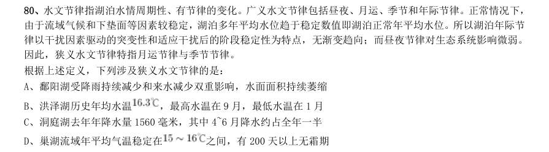
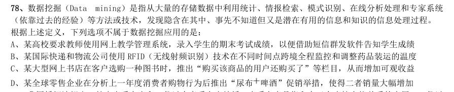
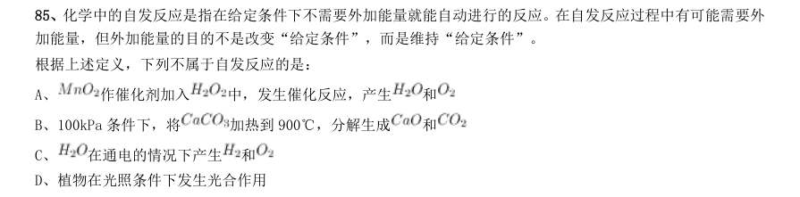

# 判断推理 · 定义判断 · 2010 年代真题

> 所属考点：[PD-DY](../PD-DY-定义判断.md)　｜　本片 185 题

> 本片子考点：单定义 178　定义判断（综合） 4　多定义 3

### 2019 湖北·统一卷　第 77 题　（单定义）

虚拟现实技术是指一种可以创建和体验虚拟世界的仿真系统,它利用计算机生成可交互的三维环境,向使用 者提供视觉、听觉、触觉等感官的模拟,从而让人有身临其境之感,这是一种360 度视角的沉浸式体验。 根据上述定义,下列选项属于虚拟现实技术运用的是:

- **A.** 张三通过电脑与远在巴黎的父亲视频聊天,亲眼见到了埃菲尔铁塔
- **B.** 李四用手机微信与妻子视频聊天,亲耳听到了儿子背诵古诗的声音
- **C.** 刘五戴上特制头盔网购书桌,能够全方位地体验书桌摆进书房的效果
- **D.** 王二用平板电脑看同学在西藏旅游的视频,感觉自己也到了布达拉宫

**答案：C**

### 2019 湖北·统一卷　第 78 题　（单定义）

组织认同是指组织成员在行为或观念等诸方面与其所加入的组织具有一致性,觉得自己在组织中既有理性的 契约和责任感,也有非理性的归属和依赖感,以及在这种心理基础上表现出的对组织活动尽心尽力的行为结果。 根据上述定义,下列选项不属于组织认同的是:

- **A.** “我们要以共产党员的标准严格要求自己”
- **B.** “公司面临困难的时候,我们要不离不弃”
- **C.** “我要每时每刻自觉维护公司的良好形象”
- **D.** “今日我以母校为傲,明日母校以我为荣”

**答案：A**

### 2019 湖北·统一卷　第 80 题　（单定义）

水文节律指湖泊水情周期性、有节律的变化。广义水文节律包括昼夜、月运、季节和年际节律。正常情况下, 由于流域气候和下垫面等因素较稳定,湖泊多年平均水位趋于稳定数值即湖泊正常年平均水位。所以湖泊年际节 律以干扰因素驱动的突变性和适应干扰后的阶段稳定性为特点,无渐变趋向;而昼夜节律对生态系统影响微弱。 因此,狭义水文节律特指月运节律与季节节律。 根据上述定义,下列涉及狭义水文节律的是:

- **A.** 鄱阳湖受降雨持续减少和来水减少双重影响,水面面积持续萎缩
- **B.** 洪泽湖历史年均水温,最高水温在9 月,最低水温在1 月
- **C.** 洞庭湖去年年降水量1560 毫米,其中4~6 月降水约占全年一半
- **D.** 巢湖流域年平均气温稳定在

**答案：B**

### 2019 湖北·统一卷　第 81 题　（单定义）

时间感知扭曲是指对时间不正确的知觉。在生活中,受各种因素影响,人们对时间的感知往往会不符合实际, 有时候觉得时间过长,有时候觉得时间太短。许多原因都可以造成时间感知扭曲,现实中一场糟糕的表演会让人 如坐针毡、觉得终场遥遥无期,与此相反的是,人们对于美好愉快的时光总嫌太短。 根据上述定义,下列选项不符合时间感知扭曲的是:

- **A.** 一日不见,如三月兮
- **B.** 欢愉嫌夜短,寂寞恨更长
- **C.** 孤馆度日如年,风露渐变
- **D.** 入春才七日,离家已二年

**答案：D**

### 2019 湖北·统一卷　第 82 题　（单定义）

消费滞后是指个人消费滞后于国家经济发展和个人家庭收人所应达到的平均消费水平。消费超前是指当下的 收入水平不足以购买现在所需的产品或服务,以贷款、分期付款、预支等形式进行消费。 根据上述定义,下列属于消费超前的是:

- **A.** 职员小王以信用卡支付的形式在网上订购了火车票
- **B.** 大学生小李通过某借贷平台购买了某知名品牌电脑
- **C.** 退休工人老张名下有商品房和汽车,但坚持只用老式的直板手机
- **D.** 青年教师小刘有十万元定期存款未到期,向同事借了八万元买车

**答案：B**

### 2019 湖北·统一卷　第 83 题　（单定义）

类脑计算技术总体分为三个层次:结构层次模仿脑、器件层次逼近脑、智能层次超越脑。其中,结构层次模 仿脑是指将大脑作为一个物质和生理对象进行解析,获得基本单元(各类神经元和神经突触等)的功能及其连接关 系(网络结构);器件层次逼近脑是指研制能够模拟神经元和神经突触功能的器件,从而在有限的物理空间和功 耗条件下构造出人脑规模的神经网络系统;智能层次超越脑是指通过对类脑计算机进行信息刺激、训练和学习, 使其产生与人脑类似的智能。 根据上述定义,下列属于智能层次超越脑的是:

- **A.** 调整神经网络的突触连接关系及连接频率和强度
- **B.** 绘制精确的人类大脑动态图谱以解析探测大脑
- **C.** 开发功能、密度与人类大脑皮层相当的电子装备
- **D.** 捕捉细微的单个神经元放电的非线性动力学过程

**答案：A**

### 2019 湖北·选调　第 99 题　（单定义）

研究表明,城市化率越高,消费需求就越多元化,消费时间就越长;发达城市人群60%以上的消费发生在夜 间。据此,经济学界提出了“夜间经济”概念,即一种基于时段划分的商业形态,指从每日下午6 点到次日凌晨 6 点所发生的三产服务业方面的商业活动,包括购物、餐饮、旅游、娱乐等。 根据上述定义,以下属于夜间经济打造项目的是:

- **A.** H 市计划打造9 条特色商业示范街区,并在街区内培育100 家连锁品牌商业企业
- **B.** N 市今年的施政议题之一是让城市夜晚亮起来,人气聚起来,市民夜生活火起来
- **C.** M 拟于今年年底前建成4 个能满足市民和国内外游客多元消费需求的地标型夜市
- **D.** S 市围绕三处名胜古迹建设三条商业步行街,方便所有人昼夜购物、进餐、娱乐

**答案：C**

### 2019 湖北·选调　第 100 题　（单定义）

近几年,大学生“慢就业”渐渐成为一种现象。慢就业是指一些大学生毕业后既不打算马上就业也不打算 继续深造,而是暂时选择游学、支教、备考、社区服务、在家陪父母或者创业考察等,慢慢考虑人生道路的现象。 根据上述定义,以下各位应届大学毕业生中哪位选择的不是慢就业?

- **A.** 张毅已开始北上广深游,打算边考察边学习边思考未来发展方向
- **B.** 李明正积极备考选调生、公务员和事业单位,直到考上一个为止
- **C.** 王莉在社区做义工,拟做到暑假结束,再去办理研究生入学手续
- **D.** 赵芳一直找不到理想工作,决定先在家陪陪父母,等待合适机会

**答案：C**

### 2019 湖北·选调　第 101 题　（单定义）

“C 位”是2018 年度十大网络用语之一。其中“C”有多种解释,最普遍的一种认为是英文单词center 的 缩写,是中央、中心的意思。“C 位”一般指舞台中央或艺人在宣传海报的中间位置,现被引申为各种场合中最 重要、最核心和最受关注的位置。 根据上述定义,以下哪项表述没有涉及C 位?

- **A.** 专家合影时,德高望重的M 院士坐在中间位置
- **B.** 上海中心大厦高632 米位于上海市东部功能区
- **C.** 腾讯、阿里巴巴、百度是中国互联网核心企业
- **D.** B 院士是我国量子通信研究领域的首席科学家

**答案：B**

### 2019 湖北·选调　第 102 题　（单定义）

随意后注意是注意的一种,是指一种自觉的、有预定目的的、不需要意志努力的注意。 根据上述定义,下列属于随意后注意的是:

- **A.** 小明为买到某歌手的演唱会门票,熬夜关注网上售票信息
- **B.** 小红因故上课迟到了,在进门的时候,全班的人都看着她
- **C.** 小华不知不觉中被“夕阳西下,小桥流水”的美景所吸引
- **D.** 小亮在掌握了文言文知识后,主动开始欣赏古典文学名著

**答案：D**

### 2019 湖北·选调　第 103 题　（单定义）

所谓手段善,也可以称之为“结果善”,它表现为手段自身为恶,而结果通常为善,并且结果的善与自身 的恶相减,净余额为善。 依据上述定义,以下不属于手段善的是:

- **A.** 大风预警
- **B.** 外科手术
- **C.** 冬季冬泳
- **D.** 断尾求生

**答案：A**

### 2019 广东·乡镇　第 58 题　（定义判断（综合））

“后驱”是指发动机的动力通过传动轴传递给后轮,从而推动车辆前进的一种驱动形式。当后驱车在水平公路 上匀速前进时,下列说法正确的是( )。

- **A.** 前轮和后轮受到的摩擦力均向前
- **B.** 前轮和后轮受到的摩擦力均向后
- **C.** 前轮受到的摩擦力向前,后轮受到的摩擦力向后
- **D.** 前轮受到的摩擦力向后,后轮受到的摩擦力向前

**答案：暂缺**

### 2019 国考·地市级　第 82 题　（单定义）

严格指示词是指一个语言表达式所具有的如下性质:它所指示的对象不会随着该表达式被使用的具体情境而 发生改变。这些情境通常包括表达式的使用主体、表达式被使用的时间、地点、世界状态等等。 根据上述定义,下列属于严格指示词的是:

- **A.** 现任联合国秘书长
- **B.** 世界上身高最高的人
- **C.** 最小的素数
- **D.** 经常坐在教室第一排正中间的同学

**答案：C**

### 2019 国考·地市级　第 83 题　（单定义）

同病异治是指中医对相同疾病采取不同的治法,达到治病求本的治疗效果;异病同治是指不同的疾病在发展 过程中出现性质相同的症状,因而可以采用同样的中医治疗方法。 根据上述定义,下列属于异病同治的是:

- **A.** 久痢脱肛和胃下垂,均为中气下陷之证,可用升提中气之法治疗
- **B.** 外感风热,内有蕴热的表里俱实之证,宜解表和攻里之药同时并用
- **C.** 麻疹初期疹未出透,治疗宜宣肺透疹;中期肺热明显,治疗宜清热解毒
- **D.** 风热感冒宜用辛凉解表法治疗,风寒感冒宜用辛温解表法治疗

**答案：A**

### 2019 国考·地市级　第 85 题　（单定义）

公平世界谬误是指人们倾向于认为我们生活的世界是公平的,一个人获得成就,是因为他肯定做对了什么, 所以这份成就是他应得的;一个人遭遇不幸,他自己也有责任,甚至是咎由自取。 根据上述定义,下列没有反映公平世界谬误的是:

- **A.** 一分耕耘,一分收获
- **B.** 谋事在人,成事在天
- **C.** 可怜之人必有可恨之处
- **D.** 天网恢恢,疏而不漏

**答案：B**

### 2019 国考·地市级　第 86 题　（单定义）

按照先后顺序排列的两个数字或者字母称为序对,如2a、e3、dm 等等,序对中的第一个数字或者字母称为 前项,第二个称为后项。函项指的是由若干序对构成的一个有限序列,其中每个序对的前项都是字母,后项都是 数字,并且对于任一序对,如果前项相同,则后项必定相同。 根据上述定义,下列哪项属于函项?

- **A.** p3、c4、d6、p6、m8
- **B.** b3、5a、8n、p1、66
- **C.** f4、h4、gm、y2、x2
- **D.** a3、b5、d6、p1、e3

**答案：D**

### 2019 国考·地市级　第 87 题　（单定义）

诉前财产保全是指利害关系人因情况紧急,若不立即申请财产保全将会使其合法权益受到难以弥补的损害, 起诉前向人民法院申请,由人民法院采取的一种财产保全措施。 根据上述定义,下列不属于诉前财产保全的是:

- **A.** 工厂甲向信用社乙贷款500 万元,甲无法按期归还。乙随即起诉,审理期间得知甲已将设备转卖,遂请求法院查封甲正在出售的大楼
- **B.** 甲与乙签订购销合同,甲给乙200 万元预付款后,发现乙有欺诈行为,无力履行合同,遂请求人民法院冻结200 万元预付款
- **C.** 银行甲与公司乙签订协议,甲向乙提供5000 万元贷款,分3 期还清,第一笔到期时乙无力归还,甲向法院申请查封乙的财产
- **D.** 甲欠乙10 万元,乙多次找甲还钱未果,得知甲有一辆轿车,乙向法院申请将甲的轿车予以查封,再将甲告上

**答案：A**

### 2019 国考·地市级　第 88 题　（单定义）

员工帮助计划是由企业为员工设置的一套长期的、系统的福利项目,通过专业人员对员工及其直系亲属提供 专业指导和咨询,旨在帮助解决员工及其家庭成员的各种心理和行为问题,提高员工在企业中的工作绩效。 根据上述定义,下列属于员工帮助计划的是:

- **A.** 项目经理小祁的父亲最近去世了,小祁很悲痛,工作效率受到很大影响,总经理特批了一笔慰问款
- **B.** 司机小方驾车外出工作期间交通肇事致人死亡,公司聘请律师为小方做从轻处罚的辩护,最终小方获刑三年
- **C.** 会计师老王的儿子没有考上大学,老王夫妇很烦恼,互相指责。在公司心理专员的指导下,老王改善了与妻子的沟通方式,情绪逐渐好转
- **D.** 职员小欣情绪低落,有自杀的念头,经医院诊断为重度抑郁症,需住院治疗。公司启动援助机制,为小欣支

**答案：C**

### 2019 国考·地市级　第 90 题　（单定义）

变文和连文是古汉语中常用的修辞方法。变文是指为了避重而在相临近的句子中采用同义词来表达相同的意 义。连文是指本来要表达甲,而连带说到乙,使两个相关联的词连在一起,但突出表达其中一个词的意义。 根据上述定义,下列使用了连文这一修辞方法的是:

- **A.** 《史记·淮阴侯列传》:“置之死地而后生,置之亡地而后存。”
- **B.** 《易经·系辞上传》:“鼓之以雷霆,润之以风雨。”
- **C.** 诸葛亮《出师表》:“受任于败军之际,奉命于危难之间。”
- **D.** 贾谊《过秦论》:“南取汉中,西举巴蜀,东割膏腴之地,北收要害之郡。”

**答案：B**

### 2018 湖北·统一卷　第 76 题　（单定义）

情感广告是诉诸于消费者的情绪或情感反应,传达商品带给他们的附加值或情绪满足的一种广告策略。这 种情绪在消费者心目中的价值可能远远超出商品本身,从而使消费者形成积极的品牌态度。 根据上述定义,下列广告语不属于情感广告的是:

- **A.** 某品牌饮料广告语:“××可乐,中国人自己的可乐!”
- **B.** 某品牌啤酒进入东南亚市场的广告语:“好不好,家乡水。”
- **C.** 某品牌纸尿裤广告语:“宝宝天天好心情,妈妈一定更美丽。”
- **D.** 某品牌润肤露广告语:“为了肌肤柔美润舒,请使用××润肤露。”

**答案：D**

### 2018 湖北·统一卷　第 77 题　（单定义）

精准医疗是指以个体化医疗为基础,通过基因组、蛋白质组等技术,对大样本人群与特定疾病类型进行生 物标记物的分析与鉴定、验证与应用,从而精确寻找到疾病的原因和治疗的靶点,最终实现对疾病和特定患者 进行个性化精确治疗。 根据上述定义,下列选项不属于精准医疗的是:

- **A.** 甲某罹患癌症,医生对其基因进行全面检测并确定治疗方案
- **B.** 乙某近期反常头晕,医生询问症状后就给其开了非处方药物
- **C.** 丙某在就医时称自己对某种药物过敏,医生根据其过敏情况设计用药方案
- **D.** 丁某患失眠症到中医院就诊,医生据“同病异治,异病同治”的理念施治

**答案：B**

### 2018 湖北·统一卷　第 78 题　（单定义）

理性预期指的是,针对某个经济现象进行预期的时候,如果人们是理性的,那么他们就会最大限度地充分 利用所得到的信息来作出行动而不会犯系统性的错误。 根据以上定义,下列属于理性预期的是:

- **A.** 省立医院分院一投入使用,小陈就在附近开了一家水果店
- **B.** 老秦获悉某政策即将施行,凭着长期炒股的经验进行股票操作
- **C.** 传言说城南要建某重点中学分校,老刘立即在附近买了一套房子
- **D.** 小张得知其高考成绩在全省排第二十位,果断决定第一志愿报清华大学

**答案：A**

### 2018 湖北·统一卷　第 79 题　（单定义）

在决断之前,每个事物的价值在决策者心中大致相近,则难于决断其优劣;但在作出选择之后,决策者对 这些事物的态度评价就发生了改变。这种现象叫作决断后效应。 根据上述定义,下列现象属于决断后效应的是:

- **A.** 某职员对自己的去留一筹莫展,一番考量之后他认为留下来要面对许多复杂关系,不如重新开创新天地
- **B.** 某女士对各有优劣的两个品牌手机难以抉择,最后她从经济角度考虑选择其中一款,可到货后发现这款有色差
- **C.** 某老师对选A 还是B 去参加比赛犹豫不决,班长建议选B。事后,老师认为选B 完全正确,因为B 最终夺得冠军
- **D.** 某学生填报志愿时对报甲大学还是乙大学犹豫不决,最后他听从老师建议选择了甲大学,从此觉得甲大学

**答案：D**

### 2018 湖北·统一卷　第 80 题　（单定义）

绿色设计是指在整个产品周期内,着重考虑产品的环境属性,如可拆卸性、可回收性、可维护性、可重复 利用性等,并将其作为设计目标,在满足环境保护条件的同时,保证产品的质量达到最优状态。 根据上述定义,下列选项符合绿色设计理念的是:

- **A.** 迪拜太阳村巧摆太阳能收集器以实现日照时间最大化
- **B.** 荷兰某化学品公司将健康环保作为公司重要的价值观
- **C.** 巴西流行利用绿色植物代替砖、石、钢筋水泥来砌墙
- **D.** 某学校将教室背景设计为浅绿色来保护孩子们的眼睛

**答案：C**

### 2018 湖北·统一卷　第 81 题　（单定义）

广义相对论是爱因斯坦以几何语言建立而成的引力理论,他将引力改描写成因时空中的物质与能量而弯曲 的时空,以取代传统对于引力是一种力的看法,而这种时空曲率与处于时空中的物质与辐射的能量动量直接相 关。 根据上述定义,下列选项中的现象不涉及广义相对论的是:

- **A.** 科学家在观察日全食时发现,光线经过太阳附近时会产生偏角弯曲
- **B.** 科学家发现,在强引力场中时钟要走得慢一些,因而从巨大质量的星体表面发射到地球的光线,会向光谱的红端移动
- **C.** 科学家发现,当一个星体足够致密时,其引力使时空中的区域极端扭曲以至光线都无法逸出,由此发现了黑洞的存在
- **D.** 麦哲伦航行时发现,驶向远方的船帆逐渐下沉,最后消失在视线中,而海平面似呈弯曲状,远处的海水似

**答案：D**

### 2018 湖北·统一卷　第 82 题　（单定义）

在企业活动中,库存有多种类型。装运库存是指在价值链末端工厂的库房里,那些已经准备好可以随时出 货的产品。在途库存又称中转库存,指尚未到达目的地,正处于运输状态或等待运输状态而储备在运输工具中 的库存。 根据上述定义,下列选项属于在途库存的是:

- **A.** 小张给自己网购了一件毛衣,下单两天后查知该毛衣已到某中转站
- **B.** 某高速服务区内一辆大货车满载着A 超市从B 地采购的各类毛巾
- **C.** 某皮鞋厂的卡车里,堆满了该厂用于制造新款皮鞋的牛皮
- **D.** 某公司在城南的自有库房中存放着给城北门店销售的玩具

**答案：B**

### 2018 湖北·统一卷　第 83 题　（单定义）

水体游泳是人们前往水体及周边区域以寻求愉悦为主要目的的一种具有社会、休闲和消费属性的短期经历, 目前已逐渐成为人们休闲时尚与区域旅游开发的重要载体。水体旅游资源是指水域(水体)及相关联的岸地、 岛屿、林草、建筑等能对人产生吸引力的自然景观和人文景观。 根据上述定义,下列选项不属于水体旅游资源的是:

- **A.** 武夷山“九曲溪”两旁随处可见历代文人墨客的题词
- **B.** 秦淮河岸的街道上,有一座建于明代的“江南贡院”
- **C.** 某森林公园建有一个放养着上千条锦鲤的“放生池”
- **D.** 某大厦矗立于长江岸边,成为游客拍照留念的背景

**答案：C**

### 2018 湖北·统一卷　第 84 题　（单定义）

刺激泛化是指条件作用的形成使有机体习得了对某一刺激做出特定反应的行为,因此也就可能对类似的刺 激做出同样的行为反应。刺激分化是通过选择性强化和消退使有机体学会对条件刺激和与条件刺激相类似的刺 激做出不同的行为反应。 根据上述定义,下列说法不正确的是:

- **A.** “一朝被蛇咬,十年怕井绳”属于刺激泛化
- **B.** “横看成岭侧成峰,远近高低各不同”属于刺激分化
- **C.** 为突出品牌,厂家对包装进行独特设计,力图使顾客产生刺激分化
- **D.** 某品牌牙膏创成名牌后,生产商将其生产的化妆品也以同品牌命名,利用的是顾客的刺激泛化

**答案：B**

### 2018 湖北·统一卷　第 85 题　（单定义）

地震震级是通过仪器给出地震大小的一种量度,是划分震源放出能量大小的等级,地震所释放的能量越大, 地震震级也越大,每一次地震只有一个震级。地震烈度表示地震对地表及工程建筑物影响的强弱程度,是在没 有仪器记录的情况下,凭地震时人们的感觉或地震发生后器物反应的程度、工程建筑物的破坏程度、地表的变 化状况而定的一种宏观尺度。 根据上述定义,下列说法正确的是:

- **A.** 地震震级越大,地震烈度相应越强
- **B.** 一次地震只有一个震级,一个烈度
- **C.** 距震源越近,震级越大,烈度越强
- **D.** 地表破坏越严重说明地震烈度越强

**答案：D**

### 2018 国考·副省级　第 86 题　（单定义）

伦理信用是指人们交往中由一定的预先约定、契约、承诺、誓言等引发的一种伦理关系,其蕴涵的合理秩序 则凝结为遵守诺言、履行约定的道德准则,人们基于对信用伦理关系合理秩序的理解和规则的践行便形成了相应 的道德品行。 根据上述定义,下列涉及伦理信用的是:

- **A.** 陈某看到一群人在围殴邻居的孩子,他一边报警,一边跑上前去大声喝止
- **B.** 赵某答应了丈夫的临终请求,在丈夫去世后,对丈夫前妻留下的两个孩子视如己出,将他们抚养成人
- **C.** 王某父亲曾借给张某10 万元,王父去世后,王某要求张某还钱
- **D.** 李某家乡发生洪涝灾害,不少农民颗粒无收,父亲要求他发动其公司员工和微信圈朋友捐钱捐物

**答案：B**

### 2018 国考·副省级　第 87 题　（单定义）

系统脱敏法是一种心理治疗法,当患者面前出现引起焦虑和恐惧的刺激物时,引导患者放松,使患者逐渐消 除焦虑与恐惧,不再对该刺激物产生病理性反应。它包括快速脱敏法和接触脱敏法等。前者是治疗者陪伴病人置 身于令病人感到恐惧的情景,直到病人不再紧张为止。后者是通过示范,让病人逐渐与所惧怕的对象接触,最终 达到克服恐惧的目的。 根据上述定义,如果要治疗一名特别害怕蛇的孩子,下列治疗方法中属于接触脱敏法的是:

- **A.** 让孩子旁观别人触摸、拿起和放下蛇的过程后,再慢慢让孩子逐渐接近和触摸蛇
- **B.** 带孩子去室内蛇类养殖场,看各种不同种类的蛇,看多了自然就不再害怕了
- **C.** 给孩子讲有关蛇的有趣的童话故事,引发孩子开心的情绪,逐渐减少对蛇的恐惧
- **D.** 录下孩子看见蛇后恐惧害怕的表情和动作,然后一遍又一遍地把这些视频放给孩子看

**答案：A**

### 2018 国考·副省级　第 88 题　（单定义）

独立证明法和归谬法是间接论证的两种方法,其中独立证明法是通过证明与被反驳命题相矛盾的命题为真, 从而确定被反驳命题为假的方法。归谬法就是由所要反驳的命题为真,引出荒谬的结论,从而证明所要反驳的命 题为假。 根据上述定义,下列论证中使用了独立证明法的是:

- **A.** 甲:人类是由猿猴进化而来的。乙:不可能!有哪一个人见过,哪一只猴子变成了人?
- **B.** 甲:天不生仲尼,万古如长夜。乙:难道仲尼以前的人都生活在黑暗之中?
- **C.** 甲:人性本恶。乙:如果真的人性本恶,那么道德规范又从何而来呢?
- **D.** 甲:温饱是谈道德的先决条件。乙:温饱绝不是谈道德的先决条件。古往今来,没有解决衣食之困的社会也

**答案：D**

### 2018 国考·副省级　第 89 题　（单定义）

定向调控指政府针对不同调控领域,制定清晰明确的调控政策,使调控更具针对性。相机调控指政府根据市 场情况和各项调节措施的特点,灵活决定当前应采取哪一种或几种政策措施,重在“预调、微调”。定向调控是 “做什么”,相机调控是“怎么做”。 根据上述定义,下列属于相机调控的是:

- **A.** 甲国政府于年初提出了经济增长率和就业水平的“下限”、物价涨幅的“上限”等工作目标
- **B.** 乙国政府提出“双引擎”策略:一是对小微企业、“三农”等市场主体“减负”;二是支持公共产品、公共服务建设,拉动投资。由各地制定具体措施
- **C.** 丙国政府根据一二三四线城市房地产市场的不同特点,制定了有针对性的契税、房贷政策
- **D.** 丁国政府实行产品和服务的生产及销售完全由自由市场的自由价格机制所引导、产权明晰的经济政策

**答案：C**

### 2018 国考·副省级　第 90 题　（单定义）

法律的当然解释是指法律虽然没有明确规定某一事项,但依规范目的,该事项应当被解释为适用这一法律规 定。其解释方法有举重以明轻和举轻以明重。前者是指对于某一应当被允许的行为,举一个情节比其严重而被允 许的规定,以说明其应当被允许。后者是指对于某一应当被禁止的行为,举一个情节比其轻微而被禁止的规定, 以说明其应当被禁止。 根据上述定义,下列判断正确的是:

- **A.** 法律规定禁止在公园采摘树叶,依据举轻以明重,在公园攀折树枝的行为应当被禁止
- **B.** 唐律规定主人打死夜无故入人家者无罪,依据举轻以明重,主人打伤夜无故入人家者无罪
- **C.** 法律规定禁止携带小型动物,依据举重以明轻,携带大型动物的行为应当被禁止
- **D.** 法律规定16 周岁以下的未成年人不承担刑事责任,依据举重以明轻,15 周岁的未成年人不承担刑事责任

**答案：A**

### 2018 国考·副省级　第 91 题　（单定义）

人耳对一个声音的感受性会因另一个声音的存在而发生改变。一个声音能被人耳听到的最低值会因另一声音 的出现而提高,这种现象就是听觉掩蔽。 根据上述定义,下列符合听觉掩蔽的是:

- **A.** 吵闹的课间,老师得大声说话,同学们才能听到
- **B.** 长时间戴耳机听音乐,会觉得听到的音量逐渐变小
- **C.** 人类无法听到蝙蝠等动物发出来的超声波
- **D.** 安静的房间内,我们能够听到闹钟“滴答”的声音

**答案：A**

### 2018 国考·副省级　第 92 题　（单定义）

异质型人力资本是指某个特定历史阶段中具有边际收益递增生产力形态的人力资本,表现为拥有者所具有的 独特能力,这些能力主要包括:综合协调能力、判断决策能力、学习创新能力和承担风险能力等。 根据上述定义,下列不涉及异质型人力资本的是:

- **A.** 某厂长期亏损,李某担任厂长后施行了大刀阔斧的改革,很快使工厂扭亏为盈
- **B.** 技术员陈某潜心钻研技术,他将人们认为不太可能整合的两种技术巧妙结合在一起,大大降低了生产成本
- **C.** 某包装厂效益平平,设计师王某应聘到该厂后,由于他的设计新颖、风格清新,一下子使该厂的包装产品畅销起来
- **D.** 某厂聘请某院士担任技术顾问,一大批风险投资公司慕名而来,一些高学历人才也陆续加盟

**答案：D**

### 2018 国考·副省级　第 93 题　（单定义）

符号现象是指表意上没有相关性的甲乙两事物,当我们用甲事物代表乙事物时,甲事物就可以视为乙事物的 符号。 根据上述定义,下列不属于符号现象的是:

- **A.** 消防车的警笛声
- **B.** 医疗机构使用的十字标记
- **C.** 法院大门上雕刻的天平图案
- **D.** 体育比赛裁判员的哨声

**答案：C**

### 2018 国考·副省级　第 94 题　（单定义）

数客互动管理是指通过先进的电子通讯和网络手段,达到企业与目标客户群之间高效、直接、自主、往复的 沟通,从而满足客户的个性化需要。 根据上述定义,下列属于数客互动管理的是:

- **A.** 某市政府在官网设立市长信箱,广泛收集各方面的意见,及时答复群众质询,努力改进政府工作
- **B.** 某玩具公司建立网络交流平台,家长只要将需要的玩具类型、价格、功能等提交给平台,公司就可以及时生产出来
- **C.** 某家具生产企业通过收集网络海量数据,进行市场需求分析,及时调整家具风格
- **D.** 某热水器厂家根据客户提供的信息,定期与客户联系,为客户提供免费检修服务

**答案：B**

### 2017 湖北·统一卷　第 76 题　（单定义）

共享经济指借助网络第三方平台,基于闲置资源使用权的暂时性转移,实现生产要素的社会化,提高存量资产的 使用效率以创造更多价值,促进社会经济的可持续发展。 根据上述定义,下列经济活动不属于共享经济的是:

- **A.** 王某从某网络平台订车去飞机场,方便快捷
- **B.** 李某从某网络平台贷款炒股,获得了预期收益
- **C.** 马某旅行前从某网络平台预定民宿,抵达后入住
- **D.** 张某从某网络平台购买外卖美食,在家享受美味

**答案：D**

### 2017 湖北·统一卷　第 77 题　（单定义）

自我效能感是个体对自己能否成功操作某一行为达到某种预期效果的主观预期和推断。当面临困难任务时,低自 我效能感的人比高自我效能感的人更集中于问题存在的障碍、失败影响以及个人缺陷上。 根据上述定义,下列选项属于低自我效能感表现的是:

- **A.** 破釜沉舟
- **B.** 画饼充饥
- **C.** 心急如焚
- **D.** 睹物兴悲

**答案：C**

### 2017 湖北·统一卷　第 78 题　（单定义）

数据挖掘(Data mining)是指从大量的存储数据中利用统计、情报检索、模式识别、在线分析处理和专家系统 (依靠过去的经验)等方法或技术,发现隐含在其中、事先不知道但又是潜在有用的信息和知识的信息处理过程。 根据上述定义,下列选项不属于数据挖掘应用的是:

- **A.** 某高校要求教师使用网上教学管理系统,录入学生的期末考试成绩,以便借助短信群发软件告知学生成绩
- **B.** 某国际快递和物流公司使用RFID(无线射频识别)技术在不同时间点跨境全程监控和调整药品装运的温度
- **C.** 某大型网上书店在客户选购一种图书时,推出“购买该商品的用户还购买了”等栏目,从而增加可观收益
- **D.** 某全球零售企业在分析上一年度消费者购物行为后推出“尿布

**答案：A**

### 2017 湖北·统一卷　第 79 题　（单定义）

我国婚姻法规定,禁止直系血亲和三代以内旁系血亲结婚。直系血亲是指和自己有直接血缘关系的亲属,三代以 内旁系血亲是指与己身出自同一父母或同一祖父母、外祖父母,除直系血亲外的所有血亲。 根据上述定义,下列选项中的甲和乙可以结婚的是:

- **A.** 张某是甲(女)的姨父,乙系张某的儿子
- **B.** 李某是乙(女)的姑父,甲系李某的儿子
- **C.** 甲是林某与前夫的儿子,乙是林某与后夫的女儿
- **D.** 王某是张某的舅舅,甲系王某的儿子,乙系张某的女儿

**答案：D**

### 2017 湖北·统一卷　第 80 题　（单定义）

随着科学技术的发展,人机交流已经成为现实,这其中的关键是脑机接口技术。所谓脑机接口,就是连接大脑与 计算机之间的信息系统,可让大脑直接和计算机沟通。脑机接口可以从大脑传递信息到计算机,又可以从计算机传递 信息进入大脑。 根据上述定义,下列应用不属于脑机接口技术的是:

- **A.** 某游戏玩家的大脑植入一部装置,通过该装置用意念控制机械手,端起杯子喝茶
- **B.** 某游戏玩家佩戴一套义肢设备,经过多次练习,凭着坚强意志力,实现独立行走
- **C.** 某游戏玩家佩戴一种脸部饰品,饰品根据佩戴者的情绪变化作出相应的指示动作
- **D.** 某游戏玩家戴上一套高科技耳机,集中注意力,通过精神控制小球飞越各种障碍

**答案：B**

### 2017 湖北·统一卷　第 81 题　（单定义）

逻辑思维是人的理性认识阶段,是人类反映事物本质和规律的认识过程。逻辑思维既涉及逻辑思维形式和逻辑方 法规则,也涉及逻辑思维的基本规律。逻辑思维形式和逻辑方法规则是指把自然语言抽象概括为形式语言,形成初始 符号或规则,用来研究概念、判断和推理,只在局部范围内起作用;逻辑思维基本规律是人类进行正确逻辑思维的根 本准则和基本依据,普遍适用于人们的思维。 根据上述定义,下列选项违反逻辑思维形式和逻辑思维方法规则的是:

- **A.** 把不同概念相互混淆或改换同一概念的含义
- **B.** 把两个互相矛盾或反对的思想都认为是真的
- **C.** 对某个概念进行划分时存在越级划分的错误
- **D.** 把没有经过证明的假设作为论证的充分前提

**答案：C**

### 2017 湖北·统一卷　第 82 题　（单定义）

人类增强就是利用生物医学技术、智能技术、神经科学技术、信息技术和纳米技术等高新技术手段使健康人类的 机体功能或能力超出其正常范围,从而使人类的体貌、寿命、人格、认知和行为等能力发生根本性变化并具有全新能 力的一种技术手段,其目的是显著提高人类生活的质量。 根据上述定义,下列选项不属于人类增强的是:

- **A.** 演员赵某用药剂延缓衰老
- **B.** 医生建议老张去做心脏搭桥手术
- **C.** 医生将传感器植入老陈大脑提高其记忆力
- **D.** 小王为了增加自己的身高服用类增高药物

**答案：B**

### 2017 湖北·统一卷　第 83 题　（单定义）

木椅子效应是指将成绩相等的两组学生分别安排坐在舒适的沙发椅和很不舒服的木椅子上学习,不久之后,坐木 椅子的学生学习成绩要比坐沙发椅的学生成绩高出许多。原因是坐木椅子的学生因为不舒服而不断调整坐姿,表面看 来好像不安而好动,实质却因此给脑部供应了更多的血液和营养;而坐沙发椅的学生,由于舒适而一动不动,致使血 液循环相对减慢,脑部得到的血液和营养相对减少,学习效果因此就差了一些。 根据上述定义,下列选项最能体现木椅子效应的是:

- **A.** 某学生从小到大饱受责罚,学习成绩一直不理想
- **B.** 小刚每天步行上学和回家,风雨无阻却学得很好
- **C.** 某家长为鼓励孩子暑天学习,每天为其提供冷饮
- **D.** 搬入新书房一个月后,小明的成绩名次一路攀升

**答案：B**

### 2017 湖北·统一卷　第 84 题　（单定义）

心理人类学是介于文化人类学与心理学之间的交叉学科,主要研究并了解文化对所属社会成员产生影响的心理机 制,发现在个体水平上的心理变量与在总体水平上的文化、社会、经济、生态和生物变量之间的关系。 根据上述定义,下列选项属于心理人类学研究范畴的是:

- **A.** “五四”前后诗歌风格的比较
- **B.** 当代流行话语下的社会主流价值
- **C.** 草原文明与蒙古民族性格的养成
- **D.** 从《背影》看作者对父亲态度的变化

**答案：C**

### 2017 湖北·统一卷　第 85 题　（单定义）

心理会计是指人们在心里无意识地把财富划归不同的账户进行管理,并对结果(尤其是经济结果)加以编码、分 类和估价的过程,且不同的心理账户有不同的记账方式和心理运算规则。小到个体、家庭,大到企业集团,都有一套 或隐或显的心理账户系统,其心理记账方式与经济学和数学的运算方式都不相同,因此经常以非预期的方式影响着决 策,使个体的决策违背最简单的理性经济法则。 根据上述定义,下列选项最能体现心理会计现象的是:

- **A.** 整日忧心忡忡的小李将自己全部存款的四分之三用于购买人寿保险
- **B.** 小陈已经攒够购买相机的钱,但他一定要等领到年底奖金再买相机
- **C.** 小王在两家不同银行都有储蓄卡,但他总是去离家更近的银行取款
- **D.** 小刘因公司奖励出游某地感觉不错,后来自费重游此地却感觉不佳

**答案：D**

### 2017 国考·副省级　第 86 题　（单定义）

语句的示意功能是指通过语句表达某种通知、告诫、命令或请求,目的在于要求别人按照语句表达的思想, 做出或不做出某种行为。 根据上述定义,下列没有反映语句的示意功能的是:

- **A.** 全体学生请到操场集合
- **B.** 请您务必不要践踏草坪
- **C.** 禁止生产假冒伪劣产品
- **D.** 销售部现在应该在开会

**答案：D**

### 2017 国考·副省级　第 87 题　（单定义）

水利工程是用于控制和调配自然界的地表水和地下水,达到除害兴利目的而修建的工程。 根据上述定义,下列不涉及水利工程的是:

- **A.** 城市污水处理厂利用微生物分解吸收水中的有机物
- **B.** 水电站利用水力发电技术,将水能转化为电能
- **C.** 农业上建设合理开发利用地下水的灌溉设施,以满足作物生长需要
- **D.** 在水利枢纽中设河岸泄洪道以防止因洪水超过水库容量而漫顶造成溃坝

**答案：A**

### 2017 国考·副省级　第 88 题　（单定义）

火力投射密度是指军事行动中军事部门在单位时间内的最大弹药发射量。它是现代军事学中衡量作战部队战 斗力的重要指标之一。 根据上述定义,以下属于通过增大火力投射密度来加强部队战斗力的是:

- **A.** 某步兵师在普通士兵中选拔特等射手编入狙击班,进而能够更有效地杀伤敌人的有生力量
- **B.** 某国将其部队列装的半自动步枪全部更换为全自动步枪,增加了子弹的发射频率
- **C.** 某炮兵部队将原计划两小时的炮火掩护时间延长为三小时,更有效地杀伤了掩体中的敌人
- **D.** 某军事科研单位研制出更先进的炮火定位系统,能够将火力打击的误差由半径200 米缩小到50 米

**答案：B**

### 2017 国考·副省级　第 89 题　（单定义）

货币性资产是指持有的现金及将以固定或可确定金额的货币收取的资产,包括现金、应收账款和应收票据以 及准备持有至到期的债券等。非货币性资产则是指货币性资产以外的资产,这些资产在将来为企业带来的经济利 益(即货币金额)是不固定的或不可确定的。 根据上述定义,下列属于货币性资产的是:

- **A.** 某服装厂的库存货物
- **B.** 某汽车公司用于出租的车辆
- **C.** 某通讯企业旗下手机品牌的商标权
- **D.** 某化工集团按照国家规定获得的技术补贴

**答案：D**

### 2017 国考·副省级　第 90 题　（单定义）

埋伏营销是指企业利用媒体和公众对重大事件的关注,通过举办与重大事件相关的活动,使自己与重大事件 产生关联,从而引起消费者的联想和媒体的注意。这类营销通常是隐蔽的、突发的,不以赞助者的身份出现,却 对自己的品牌悄无声息地进行了宣传。 根据上述定义,下列不属于埋伏营销的是:

- **A.** 某矿泉水公司邀请著名运动员为其代言,并将广告投放在电视媒体的黄金时段和一些大型酒店的视频媒体中
- **B.** 地震发生后,某户外用品公司向灾区捐赠价值100 万元的帐篷,并举行了捐赠仪式
- **C.** 某市举办中小学生知识竞赛,一出版集团在现场向参与者免费发放其出版的图书
- **D.** 世界一级方程式锦标赛比赛期间,观众席中时不时会有人挥舞着印有某轮胎企业商标的彩色旗帜

**答案：A**

### 2017 国考·副省级　第 91 题　（单定义）

自由落体运动是指物体只在重力作用下从静止开始下落的运动。这种运动只有在真空条件下才能发生,在有 空气时,如果空气的阻力作用比较小,可以忽略不计,则物体的下落可以近似看作自由落体运动。 根据上述定义,下列可以近似看作自由落体运动的是:

- **A.** 熟透了的苹果从树上被风吹落
- **B.** 飞行中的飞机被导弹击中坠落
- **C.** 抛过来的皮球没被接住,掉在地上
- **D.** 冬日中午,冰棱融化后从屋檐掉下

**答案：D**

### 2017 国考·副省级　第 92 题　（单定义）

著名科学家、科学史学家普赖斯提出:如果K 代表参与某一专业领域的人数,那么这个数字的平方根大致等 于为这个领域做出一半贡献的排名在前的那部分人的人数。 根据上述定义,下列符合普赖斯观点的是:

- **A.** 某国出版协会统计了本国的期刊,发现与经济有关的期刊大约有150 种,所有与经济有关的科研论文中,有一半发表在其中的13 种期刊上
- **B.** 某县有20 万农业人口,统计发现,过去一年全县的粮食总产量中,大约一半粮食产量是由450 位左右的种粮大户贡献的
- **C.** 某组织统计过去一年全世界公开举办的音乐会的演奏曲目,发现所有演奏曲目是由大约250 位作曲家完成的,其中大约一半的曲目来自于16 位作曲家
- **D.** 某销售奢侈品的网店过去一年的访问量为10 万人次,但去年全部的销售额中,大约一半的销售额是由其中大

**答案：C**

### 2017 国考·副省级　第 93 题　（单定义）

隐匿定位策略是指当一类产品不被消费者看好时,公司能够在不打破产品种类界限的情况下,合法地利用某 些策略消除消费者对这类产品的偏见,使消费者转而接受它们,实现更好的销量。 根据上述定义,下列没有运用隐匿定位策略的是:

- **A.** 某公司生产的游戏机销量不佳,公司决定将产品升级并提出创建家庭娱乐平台的概念,该游戏机因此变得畅销
- **B.** 某公司开发了家庭机器人,但消费者并不感兴趣。该公司调整思路,推出一种可爱的、不做家务的机器狗,一上市就大受欢迎
- **C.** 某公司推出一种小型电脑,由于定价高而鲜有问津。该公司在产品宣传中强调其可作为移动数字化设备等,与低端产品区分开,从而打开销路
- **D.** 某公司推出新款SUV 车型,但少有人问津,于是公司又推出一款价格昂贵的跑车,消费者觉得SUV 性价比更

**答案：A**

### 2017 国考·副省级　第 94 题　（单定义）

参照依赖是指个体基于某个参照点对得失价值进行判断,参照点之上,个体感受是收益,反之感受为损失。 损失和收益的感知取决于参照点的选择。 根据上述定义,下列不属于参照依赖的是:

- **A.** 张女士因为生育和哺乳不得不暂停工作半年,失去了很多客户,心里很苦恼,但看到自己健康活泼的儿子,又变得高兴起来
- **B.** 小张原本对收入很满意,他听说跟自己同时进公司、现在同是项目经理的小李收入比自己高10%后,对收入没有那么满意了
- **C.** 研究者设计了一项实验:告知被试他们邻居的月水电支出比他们低,结果发现被试下个月的家庭能耗显著降低了
- **D.** 姐姐期中考试得了99 分,期末考试得了95 分,妈妈批评了她;弟弟期中考试得了75 分,期末考试得了85

**答案：C**

### 2017 国考·副省级　第 95 题　（单定义）

传递关系指的是对任意的元素

- **A.** 自然数中的大于关系
- **B.** 生活中的同学关系
- **C.** 家庭中的父子关系
- **D.** 食物链的天敌关系

**答案：A**

### 2017 国考·地市级　第 90 题　（单定义）

传递关系指的是对任意的元素

- **A.** 自然数中的大于关系
- **B.** 生活中的同学关系
- **C.** 家庭中的父子关系
- **D.** 食物链的天敌关系

**答案：A**

### 2016 湖北·统一卷　第 76 题　（单定义）

博喻又称连比,就是用几个喻体从不同角度反复设喻去说明一个本体。博喻运用得当,能给人留下深刻的印 象。运用博喻能加强语意,增添气势。博喻能将事物的特征或事物的内涵从不同侧面、不同角度表现出来,这是 其他类型的比喻所无法达到的。 根据上述定义,下列属于博喻的是:

- **A.** 这个整天同钢铁打交道的技术员,他的心倒不像钢铁那样
- **B.** 试问闲愁都几许?一川烟草,满城飞絮,梅子黄时雨
- **C.** 上海人叫小瘪三的那批角色,也很像我们的党八股,干瘪得很,样子十分难看
- **D.** 桃花潭水深千尺,不及汪伦送我情

**答案：B**

### 2016 湖北·统一卷　第 77 题　（单定义）

红叶子理论认为,一个人职业的成功不在于红叶子数目的多少,而在于他是否具备一片特别硕大的红叶子, 这片特别硕大的红叶子不是与生俱来的,需要根据个人优势不断努力才能获得。 根据上述定义,下列哪项能用红叶子理论解释?

- **A.** 小李的销售能力和财务水平一般,但对市场特别敏感,他努力发展这方面优势,最后成了一名企业家
- **B.** 小刘虽然偶尔迟到,但对工作尽职尽责、富有团队精神
- **C.** 小张本科学习数学专业,但是他觉得数学专业比较枯燥,所以他选择攻读经济学硕士
- **D.** 小文是英语系学生,但口语不太好,她辅修了国际法方面的课程,最后成了一名出色的律师

**答案：A**

### 2016 湖北·统一卷　第 78 题　（单定义）

择一的因果关系是指两个或者两个以上的行为人都实施了可能对他人造成损害的危险行为,并且已经造成了 损害结果,但是无法确定其中谁是加害人。 根据上述定义,下列存在择一的因果关系的是:

- **A.** 甲在乙的饮水中下毒,乙喝下后在毒发前又因琐事与丙发生争吵,丙一怒之下用刀刺死了乙
- **B.** 甲、乙共同绑架了丙,甲负责向丙的家人索要赎金,乙为避免被丙认出,将丙残忍杀害
- **C.** 甲、乙两人在搬卸货物过程中因操作不当,造成货物损坏
- **D.** 甲、乙、丙三人带着相同的猎枪和子弹外出狩猎,甲、乙看到一只猎物出现在丙附近,二人同时开枪,结果

**答案：D**

### 2016 湖北·统一卷　第 79 题　（单定义）

不规则需求是指某些物品或者服务的市场需求在不同季节,或一周不同日子,甚至一天不同时间上下波动很 大的一种需求状况。 根据上述定义,下列哪项属于不规则需求?

- **A.** 早晚高峰期出租车供不应求
- **B.** 某品牌牙刷分为软、硬、中三种以面向不同消费者
- **C.** 某电商店庆打折,活动当天点击量剧增
- **D.** 某博物馆引进一批梵高画作巡展,游客蜂拥而至

**答案：A**

### 2016 湖北·统一卷　第 80 题　（单定义）

企业从银行或海外取得外汇借款后并不是直接使用外汇资金,而是将外汇结汇给银行,取得人民币资金加以 使用,这种现象称之为贷款替代。 根据上述定义,下列哪项属于贷款替代?

- **A.** 人民币升值后,一些企业纷纷减少人民币负债,增加外汇负债,然后再用人民币进行投资
- **B.** 国内经济过热,商业银行对人民币贷款的发放从紧。某贸易公司出于财务考虑转向外资银行贷款,获得外币资金
- **C.** 王明觉得人民币利率高于美元,因此他申请美元贷款,然后将外汇结汇给银行,从而获得人民币资金
- **D.** 小宇出国旅游前去银行兑换了一些外币,到国外后他使用信用卡结算,回国后用人民币还款

**答案：暂缺**

### 2016 湖北·统一卷　第 81 题　（单定义）

生物学研究发现,成群的蚂蚁中,大部分蚂蚁很勤劳,寻找、搬运食物争先恐后,少数蚂蚁却东张西望不干 活。当食物来源断绝或蚁窝被破坏时,那些勤快的蚂蚁一筹莫展。“懒蚂蚁”则“挺身而出”,带领众伙伴向它 早已侦察到的新的食物源转移。这就是所谓的懒蚂蚁效应。 根据上述定义,下列属于懒蚂蚁效应的是:

- **A.** 通信工程师待遇优厚,工作时间自由,擅长攻克技术难题
- **B.** 某汽车公司鼓励员工创新,允许员工在上班时间钻研技术
- **C.** 某经理用人不拘一格,看重的是坚韧和正直,而非学历背景
- **D.** 在金融危机中,某外贸公司凭借多元化经营手段渡过了难关

**答案：B**

### 2016 湖北·统一卷　第 83 题　（单定义）

精益生产是通过系统结构、人员组织、运行方式和市场供求等方面的变革,最大限度地消除浪费和降低库存 以及缩短生产周期,力求实现低成本准时生产的技术,其最终目的是通过流程整体优化、均衡物流、高效利用资 源、消灭一切库存和浪费,达到用最少的投入向顾客提供最完美价值的目的。 根据上述定义,下列属于精益生产的是:

- **A.** 为了抢占市场,甲公司不断提高空间利用率
- **B.** 乙公司投入了大量资金以缩短其产品生产周期
- **C.** 丙公司的强大供货体系保证它能随时满足客户
- **D.** 丁公司充分发挥自身优势建立了超快的物流系统

**答案：D**

### 2016 湖北·统一卷　第 84 题　（单定义）

诱发运动是指由于一个物体的运动使其相邻的一个静止物体产生运动的错觉现象。 根据上述定义,下列属于诱发运动的是:

- **A.** 在黑板前点燃一支蜡烛,并注视着烛光会看到烛光在运动
- **B.** 多张图片按一定空间间隔与时间距离相继呈现形成电影
- **C.** 注视瀑布的某一处,再看周围的树木,会觉得树木在向上飞升
- **D.** 当我们注视夜空时,会看到月亮在动,而云是静止的

**答案：D**

### 2016 湖北·统一卷　第 85 题　（单定义）

化学中的自发反应是指在给定条件下不需要外加能量就能自动进行的反应。在自发反应过程中有可能需要外 加能量,但外加能量的目的不是改变“给定条件”,而是维持“给定条件”。 根据上述定义,下列不属于自发反应的是:

- **A.** 作催化剂加入中,发生催化反应,产生和
- **B.** 100kPa 条件下,将加热到900°C,分解生成和
- **C.** 在通电的情况下产生和
- **D.** 植物在光照条件下发生光合作用

**答案：C**

### 2016 国考·副省级　第 86 题　（单定义）

土壤是岩石在风化作用下破碎,物理化学性质改变后形成结构疏松的风化壳,风化壳在气候与生物的作用下, 经历很长时间形成的地表物质。与土壤自然形成过程无关的外来物质被称为土壤侵入体。 根据上述定义,下列属于土壤侵入体的是:

- **A.** 戈壁滩中大量的沙砾
- **B.** 河床上存在的大量鹅卵石
- **C.** 考古发掘中挖出的砖瓦
- **D.** 岩缝中生长的野草

**答案：C**

### 2016 国考·副省级　第 87 题　（单定义）

党政机关公文是党政机关实施领导、履行职能、处理公务的具有特定效力和规范体式的文书。其中命令(令) 适用于公布行政法规和规章、宣布施行重大强制性措施、批准授予和晋升衔级、嘉奖有关单位和人员。意见适用 于对重要问题提出见解和处理办法。批复适用于答复下级机关请示事项。函适用于不相隶属机关之间商洽工作、 询问和答复问题、请求批准和答复审批事项。 根据上述定义,下列选项中应添加批复的是:

- **A.** 《国务院办公厅关于进一步加强资本市场中小投资者合法权益保护工作的——》
- **B.** 《国务院办公厅关于黑龙江双鸭山经济开发区升级为国家级经济技术开发区的——》
- **C.** 《国务院关于在我国统―实行法定计量单位的——》
- **D.** 《国务院关于同意设立陕西西咸新区的——》

**答案：D**

### 2016 国考·副省级　第 88 题　（单定义）

合成字是合体字中一个比较特殊的门类,它原本是汉语中―个常用的词语、词组,但由于这些词语、词组在 方言中使用的频率很高,就把这些词语在讲究字形美观的前提下原封不动地组合成了一个独有的汉字。 根据上述定义,下列汉字根据其意思不属于合成字的是:

- **A.** 氼,读作nì,古同“溺”,沉没,沉溺
- **B.** 嘦,读作jiào,方言,“只要”的意思
- **C.** 覅,读作fiào,表示否定,相当于“不要”
- **D.** 尠,读作xiǎn,意思是稀有的、罕见的

**答案：A**

### 2016 国考·副省级　第 89 题　（单定义）

真理是指客观事物及其规律在人的意识中的正确反映。真理可以分为理性真理和事实真理两种。理性真理指 的是具有普遍性和必然性的真理,其反面是不可能的;事实真理指的是具有偶然性的真理,其反面是可能的。 根据上述定义,下列属于理性真理的是:

- **A.** 月晕而风,础润而雨
- **B.** 如果a 大于b 且b 大于c,那么a 大于c
- **C.** 恩惠要一点点地施舍才具有最大效益
- **D.** 一个人如果违反了法律,就―定会受到法律的制裁

**答案：B**

### 2016 国考·副省级　第 90 题　（单定义）

直观教学是指利用教具作为感官传递物,向学生展示相关内容,以达到提高学习效率或效果的一种教学方式。 直观教学包括实物直观、模象直观和言语直观。实物直观通过直接感知实际事物而进行;模象直观通过对实物的 模拟性形象来直接感知;言语直观是在形象化的语言作用下,通过学生对语言的物质形式(语音、字形)的感知 及对语义的理解而进行的一种直观形式。 根据上述定义,下列不属于上述三种直观教学的是:

- **A.** 请学生在课后阅读整篇小说内容并撰写读后感
- **B.** 暑期带着学生去工厂和农村进行实地参观访问
- **C.** 请学生分角色朗读戏剧作品,或通过上台表演来体会人物性格
- **D.** 在艺术鉴赏课上,使用幻灯片给学生展示西方油画的经典之作

**答案：A**

### 2016 国考·副省级　第 91 题　（单定义）

负启动效应是指人们由于之前受到某一刺激的影响而使之后对同一类型刺激的知觉加工过程变得困难的心理 现象。其中知觉加工过程是指外界事物作用于人的感官后,头脑中产生的对事物的认识和理解的过程。 根据上述定义,下列属于负启动效应的是:

- **A.** 先给被试人员呈现一组汉字,里面有“海”这个字,随后让他们写出部首是“氵”的字时,这些人写出“海”的几率并未增大
- **B.** 先在黑板上给一组被试人员呈现词语“桌子”,后播放语音“椅子”,一段时间后,请被试人员分别说出看到和听到的词语,发现很多人答错了
- **C.** 请被试人员回答屏幕中显示的词语的颜色,先向其呈现词语“绿色”(字体为红色),再呈现词语“蓝色”(字体为绿色),发现被试人员辨识颜色变得困难
- **D.** 给被试人员呈现一张未完成的画,随着画越来越完整,被试人员逐渐辨认出画的内容,过一段时间后再给他

**答案：C**

### 2016 国考·副省级　第 92 题　（单定义）

数字鸿沟指的是由于信息化和互联网的影响,人们的信息获取、信息处理和信息传播都是通过数字化技术来 实现的,由此造成了不同个体、群体或者国家在思想意识、经济、文化和政治等方面的差距越来越大。 根据上述定义,下列不涉及数字鸿沟的是:

- **A.** 放假回家的小宋和同学用手机聊天,满口网络新词,一旁的奶奶―句也听不懂
- **B.** 小赵整天痴迷于网络游戏,父母多次苦口婆心地劝说,均没有效果,为此小赵和父母发生了多次争执
- **C.** 东部某镇种植的水果尚未成熟就已经通过网络平台被订购一空,而西部某乡质优价廉的水果由于无人知晓只能烂在树上
- **D.** 一些西方国家利用其技术积累,在大数据处理方面取得了绝对的优势,他们进一步实行技术封锁,使得某些

**答案：B**

### 2016 国考·副省级　第 93 题　（单定义）

叶龄指数指的是禾谷类作物主茎已出叶数与最终总叶数的比值,是衡量作物生长进程的重要指标之一。 根据上述定义,下列关于叶龄指数的说法一定正确的是:

- **A.** 稻谷的叶龄指数与其生长进程成正比
- **B.** 荞麦的叶龄指数越大则其产量也越高
- **C.** 小麦的叶龄指数最大值为100%
- **D.** 玉米的平均叶龄指数大于高粱

**答案：C**

### 2016 国考·副省级　第 95 题　（单定义）

产品责任是指产品有缺陷,存在可能危及人身、财产安全的危险,造成产品的消费者、使用者或者其他第三 者人身或其他直接财产损失后,缺陷产品的生产者、销售者应当承担的特殊的侵权法律责任。 根据上述定义,下列受害人可因产品责任要求侵权损害赔偿的是:

- **A.** 甲购买了一辆新车,一次与朋友王某驾车外出时,汽车因电路质量问题发生自燃,致使王某被烧伤
- **B.** 乙购买了一件大衣,大衣上没有洗涤标志和成分说明,营业员也未告知应如何洗涤。大衣水洗后严重缩水
- **C.** 丙购买了一部新手机,一次因质量问题自动关机,无法开启,致使丙漏接了客户的电话,损失了一笔大额订单
- **D.** 丁的电视机使用了20 年,图像不清晰时拍几下就好了,一次丁在拍打电视机时,电视机发生爆炸,将丁炸伤,

**答案：A**

### 2015 湖北·统一卷　第 77 题　（单定义）

碳信用又称碳权,指在经过联合国或联合国认可的减排组织认证的条件下,国家或企业以增加能源使用效率、 减少污染或减少开发等方式减少碳排放,因此得到可以进入碳交易市场的碳排放计量单位,一个碳信用相当于一 吨二氧化碳排放量。 某燃煤发电厂去年碳排放额超标,根据上述定义,该电厂对应做法不包括:

- **A.** 将该厂从城市郊区迁到海边
- **B.** 减少该厂全年的发电总产量
- **C.** 改进设备提高热源转化效率
- **D.** 购买碳信用来实现排放达标

**答案：A**

### 2015 湖北·统一卷　第 78 题　（单定义）

行政不作为是行政机关对于公民、法人和其他组织的符合条件的申请依法应该实施某种行为或履行某种法定 职责却无正当理由拒绝履行或拖延履行的行政违法行为。 根据上述定义,下列选项中行政机关行为不属于行政不作为的是:

- **A.** 王某要求所在地交通局告知有关汽车养路费标准,三个月未答复
- **B.** 陈某在某市建设局工作多年,符合职称评定申请,申请职称评定被拒绝
- **C.** 林某投诉某医药公司贩卖假药,该市药监局以不属于主管范围而拒绝
- **D.** 何某因制止违章建筑施工被打伤,公安机关以对违章建筑无权处理不理睬

**答案：B**

### 2015 湖北·统一卷　第 81 题　（单定义）

近因原则是保险人对于承保范围的保险事故作为直接的、最接近的原因引起的损失承担保险责任,而对于承 保范围以外的原因造成的损失不负赔偿责任。按照该原则,承担责任并不取决于时间上或空间上的接近,而是取 决于导致保险标损失的风险事故是否在承保范围内,如果存在多个原因导致损失,其中最直接、最有效、起决定 作用的原因,以及不可避免会产生事故作用的原因就是近因。 根据上述定义,下列原因不属于近因的是:

- **A.** 张某夜间打猎不慎摔伤,在等待救援时受凉感冒引发肺炎导致死亡,其死亡原因是摔伤
- **B.** 王某的保险车辆遇暴雨浸泡汽缸进水,他强行启动车辆时发动机受损,受损原因是暴雨
- **C.** 暴雨致电线杆倒塌,电线短路引发火花引燃仓库,库存商品燃烧殆尽,损失原因是暴风雨
- **D.** 船舶进水,所载皮革进水腐烂,糜烂恶臭致邻舱的烟草变质,烟草受损原因是船舶进水

**答案：A**

### 2015 湖北·统一卷　第 82 题　（单定义）

环境标志也称绿色标志、生态标志,是指由政府部门或公共团体依据一定的环境标准向有关厂家颁布证书, 证明其产品的生产、使用及处置过程全部符合环保要求,对环境无害或危害极少,同时有利于资源的再生和回收 利用的一种特定标志。中国的环境标志唯一认证机构是中国环境产品认证委员会及其秘书处。 根据上述定义,下列选项不符合环境标志要求的是:

- **A.** 甲公司产品不在中国环境标志产品认证范围内,但其仍有权向认证机构填报环境标志产品种类建议表
- **B.** 乙公司的污染物排放不符合国家排放标准,但只要其生产的节能荧光灯符合认证条件,其产品仍可获得环境标志认证
- **C.** 丙公司生产的运动鞋2012 年获得了环境标志认证,根据环境标志的时效性,该标志3 年后仍需要重新申请环境标志认证
- **D.** 丁公司有权在其获得环境标志认证的产品及其包装上使用认证的环境标志图形,也可在认证产品广告宣传中

**答案：B**

### 2015 湖北·统一卷　第 83 题　（单定义）

贫困的要素不仅包括物质和收入水平指标,还包括能力指标,即人类基本能力和权利的剥夺。权利贫困就是 缺乏政治、经济、文化和社会基本人权的一种贫困状态。权利贫困是贫困的核心,物质贫困是贫困的具体表现, 权利贫困是造成物质贫困的根本原因。 根据上述定义,下列选项不属于权利贫困的是:

- **A.** 张某大学毕业在京成为“蚁族”一员,收入低下,蜗居城乡结合部多年
- **B.** 王某好心救人却被讹诈,因无证据证明无辜,被判承担全部医疗费用
- **C.** 李某在深圳私企打工多年,因工伤丧失劳动能力,却得不到任何赔偿
- **D.** 辛某房屋被强拆,致使一家人居无定所,其申诉上访过程中多次被拘留

**答案：A**

### 2015 湖北·统一卷　第 84 题　（单定义）

交易成本,是指在协商、谈判和履行协议等交易性活动中,为达成合作所需要支付的各种资源的总和。只要 存在交易活动就存在交易成本,它已经成为人类社会中不可分割的组成部分。 下列选项不属于交易成本的是:

- **A.** 某公司为了搜索交易信息消耗了两天时间
- **B.** 某工厂为了开拓生产花费五十万元购买专利
- **C.** 老王在购房中为契约向中介支付了五千元
- **D.** 某企业因违反合同而支付五百万元的违约金

**答案：B**

### 2015 湖北·统一卷　第 85 题　（单定义）

社会方言是由社会群体的不同性质而形成的语言变体,是在某一社会群体、社会阶层或次文化群中被使用的 语言,它是由不同的职业、社会地位、政治信仰、受教育程度因素或这些因素构成的社区交际习惯所形成的语言 差异。主要差别是语言风格和表达方式,以及一些特殊词汇的使用。 根据上述定义,下列选项不属于社会方言的是:

- **A.** 贵族语言
- **B.** 学生腔
- **C.** 法律术语
- **D.** 客家话

**答案：暂缺**

### 2015 湖北·统一卷　第 86 题　（单定义）

符号是人们共同约定来指称一定对象的标志物,它可以包括以任何形式通过感觉来显示意义的全部现象,在 这些现象中某种可以感觉的东西就是对象及其意义的体现者。 根据上述定义,下列选项属于符号的是:

- **A.** 中医诊断时所观察的舌苔
- **B.** 野外行路时人所使用的指南针
- **C.** 十字路口指示用的红绿灯
- **D.** 搜救犬救人时所闻的人体气味

**答案：C**

### 2015 国考·副省级　第 86 题　（单定义）

垂直绿化指的是利用攀援植物向空中生长进行纵向绿化的一种方式,以期达到在有限面积内最大限度地利用 空气和阳光来提高绿化的效率。 根据上述定义,下列涉及垂直绿化的是:

- **A.** 爬山虎爬满了墙头和屋顶
- **B.** 松树林从山脚一直延伸到山顶
- **C.** 利用巴根草匍匐攀援的特性,人们在沙漠中逐渐开拓出一片绿洲
- **D.** 在丘陵地区,人们常使用飞机从空中播种的方式对山地进行绿化

**答案：A**

### 2015 国考·副省级　第 87 题　（多定义）

赋、比、兴指的是诗歌的三种表现手法。赋:铺陈直叙,把思想感情及其有关的事物平铺直叙地表达出来; 比:类比,以彼物比此物,使此物更加生动具体、鲜明浅近;兴:先言他物,然后借以联想,引出诗人所要表达 的事物、思想、感情。 根据上述定义,下列诗句中使用了“比”的是:

- **A.** 死生契阔,与子成说。执子之手,与子偕老
- **B.** 七月流火,九月授衣。春日载阳,有鸣仓庚
- **C.** 我心匪石,不可转也。我心匪席,不可卷也
- **D.** 手如柔荑,肤如凝脂。领如蝤蛴,齿如瓠犀

**答案：D**

### 2015 国考·副省级　第 88 题　（单定义）

经济学中,系统内部个别效率较高的组织的出现,会对其他效率较低的组织的存在和发展构成破坏或抑制, 人们把这种作用称为“顶尖效应”。由于个人之间、地区之间、国家之间的发展不平衡,因此“顶尖效应”是普 遍存在的。 根据上述定义,下列有助于避免“顶尖效应”的是:

- **A.** 发达国家甲与经济落后国家乙之间的贸易交易费用下降,导致乙国的资金外流
- **B.** 某地制定新政,加大对中小企业的扶持力度,同时对垄断行业进行调控,限制规模
- **C.** 某粮食生产企业一直不景气,在采用先进栽培技术后,企业生产规模扩大,销售份额开始提升
- **D.** 某地规定,对于优秀留学归国人员可参照其学历或专业水平直接授予相应等级的专业技术职称,不受任何年

**答案：B**

### 2015 国考·副省级　第 89 题　（多定义）

正惩罚是指当个体发出某种行为后,引发外部对其行为的某种反应,导致令该个体不愉快的后果,使个体今 后发出此行为的可能性降低。负惩罚是指当个体发出某种行为后,撤销令个体愉快的后果,使个体今后发出此行 为的可能性降低。 根据上述定义,下列属于正惩罚的是:

- **A.** 禁烟标识贴出后,在办公室吸烟的人明显减少
- **B.** 母亲要求小明不写作业不得出去玩
- **C.** 某人因酒驾被处罚后,再没有酒驾
- **D.** 冰棍解暑,所以夏天冰棍很畅销

**答案：C**

### 2015 国考·副省级　第 90 题　（单定义）

疑罪是指司法机关对被告人是否犯罪或罪行轻重难以确证的情况。疑罪从无原则是现代刑法“有利被告”思 想的体现,是无罪推定原则的具体内容之一,即在既不能证明被告人有罪又不能证明被告人无罪的情况下,推定 被告人无罪。 根据上述定义,下列采用了疑罪从无原则的是:

- **A.** 赵六因盗窃他人网络密码被起诉,但由于赵六被证明从来不使用网络,法院判其无罪
- **B.** 史某和汤某打架,两人都受了伤,因无法确定谁先动手,法庭建议庭外和解
- **C.** 钱某因涉嫌投毒被起诉,后因证据不足,法院判决钱某无罪
- **D.** 张三起诉李四侵权,但因拿不出任何证据,结果败诉

**答案：C**

### 2015 国考·副省级　第 93 题　（单定义）

垂直搜索引擎是针对某一个行业的专业搜索引擎,是对网页资源中的某类专门的信息进行一次整合,定向分 字段抽取出需要的数据进行处理后再以某种形式返回给用户。 根据上述定义,下列应用与垂直搜索引擎关系最为密切的是:

- **A.** 在某个购物网站上在线购买鞋子
- **B.** 登陆央视网站查询某个城市天气
- **C.** 用百度音乐搜索自己爱听的歌曲
- **D.** 在图书馆网站上查询该馆的藏书

**答案：C**

### 2015 国考·副省级　第 94 题　（多定义）

概念的内涵是指概念所反映的事物具有的本质属性(或特有属性),它是从质的方面反映概念的,概念的外 延是指具有概念所反映的本质属性(或特有属性)的那些事物,它是从量的方面反映概念的。内涵和外延的反变 关系是指具有属种关系的概念之间所具有的一种相互联系、相互制约的关系,一个概念的外延越大,它的内涵越 少;一个概念外延越小,它的内涵越多。反之,一个概念的内涵越多,它的外延越小;一个概念内涵越少,它的 外延越大。 根据上述定义,下列哪组概念体现了概念内涵与外延的反变关系?

- **A.** 司法机关,最高审判机关,最高人民法院
- **B.** 水杯,热水杯,大号热水杯
- **C.** 中国,新疆,乌鲁木齐
- **D.** 中国人,文学家,鲁迅

**答案：B**

### 2015 国考·副省级　第 95 题　（单定义）

时间知觉是对客观现象延续性和顺序性的感知,时间知觉的信息,既来自于外部,也来自内部。外部信息包 括计时工具,也包括宇宙环境的周期性变化,内部信息是机体内部的一些有节奏的生理过程和心理活动。 根据上述定义,下列没有包含时间知觉信息的是:

- **A.** 东边日出西边雨,道是无晴却有晴
- **B.** 三更灯火五更鸡,正是男儿读书时
- **C.** 人有悲欢离合,月有阴晴圆缺
- **D.** 月出惊山鸟,时鸣春润中

**答案：A**

### 2014 湖北·统一卷　第 78 题　（单定义）

诱导运动是一种视错觉,即观察者知觉到某个物体在运动,而实际上该物体没有发生空间移动,只是由于其 他物体的运动使得被观察物体看起来好像在运动。 根据上述定义,下列属于诱导运动的是:

- **A.** 在没有月光的夜晚仰望天空,觉得星星好像在动
- **B.** 电影院里播放的精彩电影
- **C.** 月亮在云彩后面穿行
- **D.** 注视飞速开过的火车之后,会觉得附近的树木向相反方向运动

**答案：C**

### 2014 湖北·统一卷　第 79 题　（单定义）

经营性资产是在生产和流通中能够为社会提供商品或劳务的资产。经营性资产的使用单位是具有法人地位的 企业,其运营要以追求经济效益为原则。从会计角度看,主要指企业因盈利目的而持有,且实际也具有盈利能力 的资产。 根据上述定义,下列不属于“经营性资产”的是:

- **A.** 某电视机厂中积压的黑白电视机
- **B.** 建设中尚未投入使用的水力发电站
- **C.** 某外贸公司用于交纳税金的银行存款
- **D.** 某重点中学新购入的实验室设备和器材

**答案：D**

### 2014 湖北·统一卷　第 80 题　（单定义）

选择性接触是指受众在接触大众传播活动之际,并不是不加区别地对待任何媒介和内容,而是更倾向于与自 己的既有立场、观点、态度一致或接近的加以接触,或有意无意地回避与自己既有倾向相左的媒介或内容。 根据上述定义,下列属于“选择性接触”的是:

- **A.** 旅行社推出的夕阳红系列游的团体活动受到很多退休老人的欢迎。
- **B.** 减肥产品最畅销的人群是那些正在减肥的人,而不是那些打算减肥的人。
- **C.** 初中政治老师王某每天回家的第一件事就是收看新闻联播。
- **D.** 赵总监推崇人性化管理,经常参加人本主义取向的心理学培训课程。

**答案：D**

### 2014 湖北·统一卷　第 81 题　（单定义）

喻代是一种建立于比喻基础之上的以喻体代本体的一种修辞方式。即先比喻,后用喻体代本体。喻代是比喻 后的名称代换,喻体作为别名而存在,其比喻的色彩、意味减弱,含蓄表达成为关键。根据上述定义,下列各项 中没有使用喻代这一修辞方式的是:

- **A.** 我吃了一吓,却见一个五十岁上下的女人站在我的面前,两手搭在髀间,张着两脚,正像一个画图仪器里细脚伶仃的圆规......然而圆规很不平,显示鄙夷的神色。
- **B.** 多么熟悉的声音,多么动人的曲子,去年春节文娱晚会上因这支歌而被同学们昵称为“李谷二”,她的声音,我一下子就能听出来。
- **C.** 他走了,像只风筝,在山坡上摇啊摇,弯弯曲曲的白线越放越长,到底放到头了,那儿是山顶,是和天连着的地方,“风筝”停了,他知道这条白线还拴着一颗心呢。
- **D.** 那外国人想雇我的驴去游山东,我要五块钱,他嫌贵。你嫌贵,我还嫌你胖呢。胖的像大白熊,别压坏了我

**答案：B**

### 2014 湖北·统一卷　第 82 题　（单定义）

著作人身权,又称著作精神权,指著作权人对其作品所享有的各种与人身相联系或者密不可分而又无直接财 产内容的权利,是作者通过创作表现个人风格的作品而依法享有获得名誉、声望和维护作品完整性的权利。著作 财产权,又称著作经济权,是著作人身权的对称,是指著作权人自己使用或者授权他人以一定方式使用作品而获 得物质利益的权利。 根据上述定义,下列说法中正确的是:

- **A.** 某知名网络小说作家要求出版社使用其真实姓名出版其作品,则该作家行使的是著作人身权
- **B.** 画家王某将自己的画作以高价卖给了姜某,则姜某获得了该画作的著作财产权
- **C.** 某知名舞蹈家创作的舞蹈深受群众喜爱,不少人纷纷模仿并进行商业演出,该舞蹈家要求停止这一侵权行为,则她行使的是著作人身权
- **D.** 某剧作家创作的电视剧因深受观众喜爱而被翻拍,该剧作家要求电视剧制作方不得修改故事的结局,则他行

**答案：A**

### 2014 湖北·统一卷　第 83 题　（单定义）

生产、销售有毒、有害食品罪是指在生产、销售的食品中掺入有毒、有害的非食品原料,或者销售明知掺有 有毒、有害的非食品原料的食品的行为。 根据上述定义,下列构成生产、销售有毒、有害食品罪的是:

- **A.** 某肉食品加工厂用病死猪肉作原料生产火腿,造成大批消费者食物中毒
- **B.** 刘某在地下工厂用工业高纯度酒精加自来水制造大量假酒,并将其销售给商店,获得8 万多元
- **C.** 某饮料生产厂家在生产的可乐中添加了食品添加剂——咖啡因,但并未在包装上予以注明,使大量消费者饮用了含有咖啡因的可乐
- **D.** 某食品厂在所生产的一批彩虹糖中添加食用色素超标,长期食用会给人体健康造成危害

**答案：B**

### 2014 湖北·统一卷　第 84 题　（单定义）

姑息治疗是指对那些治愈性治疗无望或不能接受治愈性治疗的病人采取完全的主动的医疗和护理,控制疼痛 及有关症状,并对心理、社会和精神问题予以重视,其目的是为病人和家属赢得最好的生活质量。姑息治疗同样 适用于早期肿瘤病人,将姑息治疗与抗肿瘤治疗相结合。 根据上述定义,下列不属于姑息治疗的是:

- **A.** 某患者因病情恶化且年老体衰,无法翻身,身体生了褥疮,口腔也有霉菌感染,护士为其洗澡擦身,并做了口腔清洁
- **B.** 某患者因为癌症晚期,且自身状况差无法进行抗癌治疗,医生认为患者已没有治疗价值,劝患者回家休养
- **C.** 某年轻患者刚结婚便被诊断为乳腺癌,情绪非常激动,拒绝接受治疗,医生为其进行了心理辅导
- **D.** 某患者手术后严重疼痛,无法入睡,医生给了他止疼药,并给予一定的镇静剂,让患者能好好休息

**答案：D**

### 2014 湖北·统一卷　第 85 题　（单定义）

心理记账是人们在心理上对结果进行分类、编码、估价和预算的过程。消费者在决策时可能根据不同的任务 进行相应的心理记账。 根据上述定义,下列不属于典型心理记账的是:

- **A.** 损失10 元钱给人心理带来的痛苦要比获得10 元奖金带来的高兴更强烈
- **B.** 王某出差常选星级酒店,因为它比旅馆更可能提供免费网络和自助早餐
- **C.** 相比丢了10 元钱的人,丢了电影票的人更不可能会掏钱买票去看电影
- **D.** 工会发放福利时,不再发实物而改发购物卡以使职工有更多的自由选择

**答案：D**

### 2014 国考·统一卷　第 86 题　（单定义）

选择性曲解是指人们面对客观事物,经常会不自觉地把外界输入的信息与头脑中早已存在的模式相结合,从 而出现根据自己固有的价值体系和既定的情感好恶来解释所接受信息的倾向。 根据上述定义,下列属于选择性曲解的是:

- **A.** 爱屋及乌
- **B.** 指鹿为马
- **C.** 按图索骥
- **D.** 度日如年

**答案：A**

### 2014 国考·统一卷　第 87 题　（单定义）

扩大论题和缩小论题在辩论赛中很常见,在相互的辩驳中,辩手们常常故意扩大对方的论题,将对方的论题 推到荒谬的地步,以利于本方的反驳和进攻;同时为了利于本方立论与防守。辩手们又常常故意缩小本方的论题。 根据上述定义,下列采用了扩大论题的是:

- **A.** 将论题“中学生异性交往弊大于利”解释成“中学生异性过分密切交往必定弊大于利”
- **B.** 将论题“人性本恶”解释成“人具有与生俱来的本能和欲望,因此人性是恶的”
- **C.** 将论题“德国人很严谨”解释成“所有德国人都很严谨”
- **D.** 将论题“人性本善”解释成“没有人不是善的”

**答案：D**

### 2014 国考·统一卷　第 88 题　（单定义）

内隐学习是指一种无需意志努力的潜意识的学习。这种学习的特点在于人们潜意识地获得某种知识,而且无 需意志努力就可以将这些知识提取出来,并应用于特定任务的操作中。 根据上述定义,下列不属于内隐学习的是:

- **A.** 小张在高考前做了大量数学习题,因此在数学考试中获得高分
- **B.** 小李经常看别人下象棋,时间一长,他也掌握了下象棋的方法
- **C.** 儿童无需系统地学习语词和语法规则,不知不觉地就会说母语
- **D.** 生长在京剧世家的孩子耳濡目染,很小就会唱京剧

**答案：A**

### 2014 国考·统一卷　第 89 题　（单定义）

注意分为内源性注意和外源性注意。内源性注意是指个体根据自己的目标或意图来分配注意、支配行为,是 主动注意;外源性注意是指由个体外部信息引起的个体注意,是被动注意。 根据上述定义,下列属于内源性注意的是:

- **A.** “轰”的一声响,大家不由地都回头看了一眼
- **B.** 六一儿童节,公园里奇幻的魔术表演受到许多小朋友和家长的喜爱
- **C.** 超市琳琅满目的商品,包装各异、颜色鲜亮,吸引了许多顾客的眼球
- **D.** 根据客户的要求,广告设计师特别关注了大量以温馨家园为题材的售楼广告素材

**答案：D**

### 2014 国考·统一卷　第 90 题　（单定义）

顺从型互动是指行动者之间发生性质相同或方向一致的行动过程,常有三种形式:有意无意向他人发出信号 或暗示,并引起他人反应;不经过考量,直接按照他人的方式去行动;行动者在他人压力下接受他人行动方式, 并且照做。 根据上述定义,下列不属于顺从型互动的是:

- **A.** 很多投资者寻找项目时什么热就投资什么,股票热时炒股票,翡翠热时炒翡翠
- **B.** 大家对小刘的业务能力有目共睹,连素来挑剔的老主任也赞成选小刘为业务主管
- **C.** 护士阿姨一边说“不哭啊,一点都不疼”,一边在毛毛的手臂上注射,毛毛果然没哭
- **D.** 小文对新来的家教老师不满意,但无奈于父母的苦心和已缴的学费,还是开始了家教课程

**答案：B**

### 2014 国考·统一卷　第 91 题　（单定义）

组织控制是指组织用各种规章制度和奖惩手段来约束组织成员行为,以保证组织的决策和指令能够有效地贯 彻执行,维护组织的各项秩序。 根据上述定义,下列最能体现组织控制的是:

- **A.** 某高校不断加强对外交流,派遣访问学者的名额逐年增加
- **B.** 某公司每年举办新人入职会,以便让新加入团队的成员尽快熟悉环境
- **C.** 某生产厂商为了提高员工生产积极性,薪酬计算由原来的计时绩效改为计件绩效
- **D.** 某外企实行上班打卡制,如果员工去见客户可以不用打卡,但须在前一天向上级报告

**答案：D**

### 2014 国考·统一卷　第 92 题　（单定义）

矩阵对策是指处于利益竞争的两个关系主体,各自可选的策略有限,且在一局对策中双方得失和为零的现象, 即要不成功、要不失败。对策中,一方真正成功的措施应该是,针对对方所采取的行动相应地制定有利于自己的 应对策略,各方选择的策略必定是自己对对方策略预测的最佳反应。 根据上述定义,下列属于矩阵对策的是:

- **A.** 齐王和田忌按原条件重新赛马,并约定每局比赛须用同等级的马参赛
- **B.** 劳资双方进行薪资谈判,经过反复的讨价还价,最终双方都作出让步
- **C.** 在进入奥运女子排球决赛后,某国家队重新安排队员阵容和出场顺序
- **D.** 丈夫要去踢球,妻子要去看电影,儿子要去游乐园,最后三人去郊游

**答案：C**

### 2014 国考·统一卷　第 93 题　（单定义）

签名效应是指当人们在纸上写上自己名字时,大脑中的自我意识会加强,此时看到喜欢的东西,更容易把物 品和自己联系起来,产生“这个东西真适合我”等想法,从而激发购买欲望。 根据上述定义,下列现象可用签名效应解释的是:

- **A.** 快递公司坚持“先签字后验货”的做法
- **B.** 采取实名捐款的办法能够募捐到更多善款
- **C.** 手术前,患者被要求在《知情同意书》上签字
- **D.** 中介公司要求租客在看房前签订《看房协议书》

**答案：D**

### 2014 国考·统一卷　第 94 题　（单定义）

红旗原则是指如果侵犯著作权的事实是显而易见的,网络服务商就不能装作看不见,或以不知道侵权的理由 来推脱责任。 根据上述定义,下列适用红旗原则的情形是:

- **A.** 未经用户许可,某客户端软件就能够自动扫描、获取用户个人数据
- **B.** 甲利用网络服务商提供的免费存储空间,非法经营盗版影视作品
- **C.** 乙上传正在首播的某热门电视剧,并被网站编辑推荐到下载首页
- **D.** 丙通过第三方在有下载功能的互联网电视上获取未经授权的节目

**答案：B**

### 2014 国考·统一卷　第 95 题　（单定义）

角色混同指的是将自己所具有的不同角色相混淆,而发生的导致背离角色期待和角色规范的行为。 根据上述定义,下列哪项属于角色混同:

- **A.** 到北京来打工的某外省青年有时不自觉地说起家乡话,常常弄得同事莫名其妙
- **B.** 庄周梦见自己变成蝴蝶,醒过来之后惊惶不定,庄周不知自己梦中变成了蝴蝶,还是蝴蝶梦中变成了自己
- **C.** 小王是个游戏迷,他常常将工作中的同事假想成游戏中的玩家,也常常将游戏中的玩家想象成自己的某个同事
- **D.** 老李是某局局长,对于儿子提出的要求,他常常不自觉地说:“这事得和其他同志研究研究。”为此,他多

**答案：D**

### 2013 湖北·统一卷　第 100 题　（单定义）

自白任意性规则是指只有基于犯罪嫌疑人自由意志而作出的、承认有罪的真实陈述,才具有证据能力。 根据上述定义,下列符合自白任意性规则做法的是:

- **A.** 为避免犯罪嫌疑人有可能作出虚假陈述,应中止询问
- **B.** 犯罪嫌疑人的有罪陈述与收集到的证据材料一致
- **C.** 犯罪嫌疑人主张自己无罪,可以不承担举证责任
- **D.** 以从轻处罚为条件,换取犯罪嫌疑人的有罪答疑

**答案：B**

### 2013 湖北·统一卷　第 101 题　（单定义）

印记学习是指发生在动物生活的早期阶段、由直接印象形成的学习行为,印记学习行为虽发生在早期,但 对晚期行为也具有一定的影响。 根据上述定义,下列不属于印记学习行为的是:

- **A.** 绵羊走近并试图留在喂养过它的主人身边
- **B.** 由人喂养大的斑马雀会向主人的手指求偶
- **C.** 绵羊用舌舔小羊的方式来标记自己的后代
- **D.** 刚出生的绿头鸭跟随着一个移动的物体走

**答案：C**

### 2013 湖北·统一卷　第 102 题　（单定义）

蒸发冷却是指液体在蒸发气体的过程中会吸热,从而降低周围的温度起到冷却效果。蒸发冷却效应是指在 目的或志趣相同的人们组成的社会团体中,团体的价值跟液体的整体温度类似,当价值较高的成员离开社团后, 社团自身的平均价值会降低。 根据上述定义,下列属于蒸发冷却效应的是:

- **A.** 某高校的街舞社团的团长毕业离开学校后,该社团便没有在街舞比赛中取得较好的名次
- **B.** 某知名流行音乐演唱组合中的一个歌手因意外去世,大批歌迷认为这个歌手的离开导致该组合整体演唱水平大打折扣
- **C.** 某教育机构的一些老师离开该机构创办的教育公司,使该机构在市场竞争中的形势变得更加严峻
- **D.** 某社交网站的影评小组建立之初人数较少,影评质量较高,后来有大量人加入这个小组上传影评,使这里整

**答案：A**

### 2013 湖北·统一卷　第 103 题　（单定义）

威客模式是指一些人通过互联网把自己的智慧、知识、能力、经验转换成实际收益,他们在互联网上通过 解决科学、技术、工作、生活、学习中的问题从而让知识、智慧、经验、技能产生经济价值。 根据上述定义,下列属于威客模式的是:

- **A.** 某IT 技术人员用业余时间开了一个小公司,主要在网络上远程帮助他人修理电脑
- **B.** 某大学毕业生在一个B2C 网站上开了一家服装店,运用自己的人脉资源使网店很快就开始盈利
- **C.** 某摄影师个人网站上的摄影作品吸引了大批网友浏览、转发,后来该摄影师依靠该网站上发布摄影器材广告带来了大量收入
- **D.** 某高校学生建立的免费回答中小学生学习问题的公益网站受到了学生和家长的好评,当地一家教育机构出资

**答案：A**

### 2013 湖北·统一卷　第 104 题　（单定义）

临终关怀是指为临终患者提供医疗、护理、心理、社会等多方位的关怀照顾,使每位患者的生命受到尊重, 症状得到控制,生命质量得到提高。 根据上述定义,下列不属于临终关怀的是:

- **A.** 老赵肝癌晚期,医生尽最大努力进行治疗,不惜一切代价延长其生命
- **B.** 老王肾衰竭晚期希望回到故乡,他在接受疼痛处理后被同意出院
- **C.** 老李白血病晚期,医生对他进行保守治疗,配合适当的绘画与音乐治疗
- **D.** 老刘胃癌晚期,某大学组织志愿者陪他聊天

**答案：A**

### 2013 湖北·统一卷　第 105 题　（单定义）

农产品补贴通常是指一国政府对本国的农产品市场商或者经营者提供资金或财政上的支持,包括现金补贴、 价格补贴或其他政策优惠待遇,使其农产品在国际、国内市场上与未受补贴的同类产品相比获得竞争优势。 根据上述定义,下列属于农产品补贴的是:

- **A.** 为了稳定农产品价格,某市政府对农贸市场经营者的摊位租金实行减免政策外,还规定若摊位租金低于限定额数,可以向经营者发放10%—40%不等的补贴
- **B.** 某国政府为农民和水稻研究所牵线搭桥,使该国农民种植了新品种水稻。该品种水稻的质量和产量大幅度提升,使得该国水稻出口价格与国际市场上的水稻相差无几
- **C.** 甲国市场上,政府以高于市场价格收购农民种植的玉米,再低价出售,以鼓励农民种植玉米。该国某企业利用玉米作为主要饲料培育肉鸡,再大量出口到乙国
- **D.** 甲地主要是草原,由于过度放牧导致草场退化。该国政府根据该地区情况,发放牧民8—10 年的补贴,请他

**答案：C**

### 2013 湖北·统一卷　第 106 题　（单定义）

调查显示,59.4%的公众感觉当前社会“逆淘汰”现象普遍,其中18.8%的人觉得“非常多”。所谓“逆淘 汰”,即指坏的淘汰好的,劣质的淘汰优胜的,平庸的淘汰杰出的等现象。 根据上述定义,下列属于逆淘汰现象的是:

- **A.** 某公司拥有领先的卫星通话技术,语音质量高,覆盖范围广,但该技术的维持费用高昂。后来该公司入不敷出,宣告破产
- **B.** 市场上某些价格高昂的止咳药疗效实际不如价格低廉的常用药,而事实上常用药所占市场份额较小
- **C.** 许多公司都有对工作发牢骚的人,结果,凡是公司中有对工作发牢骚的人,那家公司一定比没有这种人的公司要成功得多
- **D.** 名牌大学毕业的甲和普通大学毕业的乙同时进入某国际知名公司,但甲始终未获提升,乙却逐渐得到了公司

**答案：B**

### 2013 湖北·统一卷　第 107 题　（单定义）

逆向服务是在产品(服务)销售以后,企业向顾客提供实现产品(服务)使用价值的服务。 根据上述定义,下列不属于逆向服务的是:

- **A.** 某电信运营商推出“存话费送手机”的优惠活动
- **B.** 某空调生产商为客户提供终身免费上门维修服务
- **C.** 某网店推出售后商品7 天内可免费退换货服务
- **D.** 某汽车4S 店为客户提供二手车估价转让服务

**答案：A**

### 2013 湖北·统一卷　第 108 题　（单定义）

政策性亏损是指为保证国民经济的协调发展和人民生活的安定,企业在实现政府规定的社会公益服务目标, 生产经营某种商品的过程中,由于国家限价等原因而产生的亏损。发生这类亏损,由财政部门审核后给予合理补 偿。 根据上述定义,下列属于政策性亏损的是:

- **A.** 2012 年某粮食直补每亩增至120 元,补贴资金将通过“省财政涉农补贴一本通”发放到种粮农民手中,以弥补农民增加的种粮成本
- **B.** 国家出台提高小麦最低收购保护价政策,某粮油企业为开拓市场大量抢购小麦,又将大量面粉低于市场价销售,因此造成了亏损
- **C.** 政府为实现农业现代化目标,加大了对农业生产改造的资金收入,某农机企业在这种形式下扩大生产规划导致了亏损,得到了退税补偿
- **D.** 某县的粮食购销企业在经营政府规定的平价粮食过程中,因国家粮食保护价高但粮油成品销售价格低导致了

**答案：D**

### 2013 湖北·统一卷　第 109 题　（单定义）

自我建构指个体通过行为表现表明自己符合在他人心目中的已经建立起来的社会身份和社会形象。 根据上述定义,下列属于自我建构的是:

- **A.** 16 岁的女孩欢欢经常模仿话剧演员的表演并像他们一样早起练功,她希望自己以后也成为话剧演员
- **B.** 某公司创立之初就定下服务社会的企业使命,后来在偏远山区建立多所希望小学,树立了公司热心于社会公益事业的良好形象
- **C.** 一些企业家经常穿着昂贵的西装,坐豪华轿车,有些人认为这是“炫富”,但他们认为如果不是这样,就不会得到同行的认可
- **D.** 不同航空公司要求本公司的空中乘务员穿着不同的制服,他们认为员工形象会影响到公司在旅客心中的形象

**答案：C**

### 2013 湖北·统一卷　第 110 题　（单定义）

某些产品的精心设计使产品方便高效,能给客户带来舒适感,使用时不用阅读复杂的说明或是求助他人。 而有些产品恰恰相反,它们的设计没有考虑用户的使用习惯和需要,因而使人们在使用过程中会遇到困难或者迷 惑不解的情况,这类产品被人们称为诺曼产品。 根据上述定义,下列属于诺曼产品的是:

- **A.** 某品牌木制大衣柜的底部滑轮质量较差,用户很难将门拉开
- **B.** 某款网络游戏很难通关,很多玩家在网上求助怎样破解其中的关卡
- **C.** 汽车收音机按钮和其他设备开关的形状、大小都一样,用户很难分辨哪个是收音机按钮
- **D.** 某科技公司的精密实验设备附有300 页的说明书,一般人觉得里面术语太多,很难读懂

**答案：C**

### 2013 国考·统一卷　第 86 题　（单定义）

职业认同是指个人对所从事的职业主观建构的、与职业特征联系在一起的认知和感受,常常包括职业角色的 意义感和价值感、职业是否有乐趣和吸引力等。职业认同分为过程性职业认同和状态性职业认同。其中过程性职 业认同是指个体从自己经历中逐渐发展出的认同自己职业角色的过程;状态性职业认同是指个体当前对自己所从 事职业的认同程度。 根据上述定义,下列属于过程性职业认同的是:

- **A.** 身为一名警察,老张几十年如一日,始终将维护公共安全的原则牢记于心
- **B.** 李老师凭借自己灵活的授课方式赢得最佳教师奖,为此她深感自豪
- **C.** 听完老党员的模范事迹,小赵顿时感觉到作为一名党员干部身上肩负的重任
- **D.** 陈医生行医多年,“救死扶伤”四个字已从字面意思转变为人生追求

**答案：D**

### 2013 国考·统一卷　第 87 题　（单定义）

获致身份是指一个人经历某种公开的、具有竞争性的奋争或因具备某种特殊的本领而获得的社会地位。 根据上述定义,下列选项符合获致身份说法的是:

- **A.** 生子当如孙仲谋
- **B.** 王侯将相宁有种乎
- **C.** 忠臣必出孝子之门
- **D.** 上品无寒门,下品无士族

**答案：B**

### 2013 国考·统一卷　第 88 题　（单定义）

制度的反功能指的是该制度实现了系统的某些功能之后而产生的副作用,诸如破坏该系统的内部协调、稳定 关系,造成系统内部冲突,对系统良性运行产生破坏作用等现象。 根据上述定义,下列涉及制度的反功能的是:

- **A.** 某校实行绩效考核,实行一段时间后引发了教师争抢上课、乱发文章等一系列问题
- **B.** 某售楼处规定销售额可以提成,结果某销售员一个月卖房近50 套
- **C.** 一对夫妻新婚后实行家庭消费AA 制,一段时间后觉得不方便就取消了
- **D.** 某部门实行人性化管理,结果上班迟到现象反而比实行考勤制度时减少了

**答案：A**

### 2013 国考·统一卷　第 89 题　（单定义）

优势富集效应是一种起点发展理论,是指起点上的微小优势经过关键过程的级数放大,产生更大级别的优势 积累。 根据上述定义,下列不属于优势富集效应的是:

- **A.** 某名牌大学建校时间很早,文化传统悠久,并拥有政策、资金等多方面支持,全国许多优秀的学生填写高考志愿时都选择了该校
- **B.** 上海的金茂大厦楼体高度略微超过“东方明珠”电视塔,被誉为“中华第一高楼”,因此吸引了众多游客和广告商,各类会议也常在此举办,呈现后来居上的态势
- **C.** 某教育培训机构为了拓展业务,也像别的培训机构那样,通过发送宣传单来进行宣传,后来随着规模的不断扩大,服务质量也更上一层楼,成为业内的典范
- **D.** 某服装品牌设立之初,最先提出要做“夹克之王”的理念,并通过电视媒体进行推广,后来这个概念逐渐被

**答案：C**

### 2013 国考·统一卷　第 90 题　（单定义）

“翻异别勘”是宋代为防止冤假错案而规定的复审制度,是指犯人如果在录问或行刑时提出申诉,案件必须 重新审理。宋代的“翻异别勘”分为原审机关的“移司别勘”和“差官别勘”两种形式。“移司别勘”是指由原 审机关将案子交给另一个同级的司法机关复审。“差官别勘”是指原审机关将案子申报到上级机关,由上级机关 负责差派与原审机关不相干的另外一个机关的官员重新审理。这种情况下,往往或者是差派上级机关的官员前往 原审机关主审,或者将案子移往上级机关复审。 根据上述定义,下列不属于“翻异别勘”的是:

- **A.** 犯人对州县审理的案件提出申诉,可以将案件移交至州县的上级——路的长官进行重审。
- **B.** 宋代中央司法机关刑部分左、右两厅,对其中一厅审理的案件,若犯人提出申诉,则由另一厅重审。
- **C.** 犯人对州县审理的案件提出申诉,州县的上级——路的长官可以亲至州县对案件进行重审。
- **D.** 宋代地方司法机关从上至下分为路、州、县三级,对由县上诉至州的案件作出判决后,若犯人提出申诉,则

**答案：D**

### 2013 国考·统一卷　第 91 题　（单定义）

求助者有两种求助动机:执行性求助和工具性求助。前者是自己不作任何尝试或努力,只想知道答案或让他 人代自己完成任务;后者是借助其他人的力量以达到自己解决问题或实现目标的目的。 根据上述定义,下列属于工具性求助的是:

- **A.** 妈妈为五岁的小明报了很多兴趣班,小明在兴趣班中结识了许多新朋友
- **B.** 家教老师耐心讲解了这道题的思路和原理后,小斌还是请老师直接给出答案
- **C.** 综合了多家咨询机构提供的意见,小峰拟定了符合自身条件的出国学习规划
- **D.** 小文每次阅读英语文章遇到生词时都会查阅电子词典,掌握生词的读音和意思

**答案：C**

### 2013 国考·统一卷　第 92 题　（单定义）

生态演替是指在同一地段上生物群落有规律的更替过程,分为原生演替和次生演替两类。在过去从未有过植 被,或者原来有过植被但被彻底破坏,原有植被下的土壤已不复存在的裸地上开始的演替称为原生演替;在原有 植被虽已被破坏,但仍保持着土壤和植物繁殖体的地方开始的演替称为次生演替。发生次生演替的生物群落趋向 于恢复到破坏前的形态。 根据上述定义,下列可能导致次生演替的情形是:

- **A.** 人类将利用转基因技术培育的植物种子撒向森林
- **B.** 某岛屿火山爆发之后,火山岩浆覆盖整座岛屿
- **C.** 当森林被反复砍伐后,演化成为了稀疏的草原
- **D.** 水坝建成后下游湖泊干涸,沿湖植被大多枯死

**答案：D**

### 2013 国考·统一卷　第 93 题　（单定义）

电子反对抗是指防止敌方或己方的电子对抗措施影响己方的设备和人员作战效能所进行的各种活动,以防护 己方的战斗力不遭受其损害,主要措施包含电子反侦察、电子反干扰、抗反辐射摧毁、抗定向能致盲和抗计算机 病毒传染。 根据上述定义,下列选项不涉及电子反对抗的是:

- **A.** 军事演习前,演习指挥中心提前对使用的电脑进行病毒查杀
- **B.** 发射车向敌方发射反辐射导弹,关闭己方电子设备以免误击
- **C.** 军舰在冲突海域降低雷达发射信号功率,并设置反辐射诱饵
- **D.** 为对抗敌方电子干扰,指挥部决定重要指令用固定电话下达

**答案：D**

### 2013 国考·统一卷　第 94 题　（单定义）

文化自觉是指生活在一定文化中的人,对自己的文化有“自知之明”,即明白它的来历、形成过程、特色和 发展趋向,从而增强自身文化转型的能力,并获得在新的时代条件下进行文化选择的能力和地位。此外,文化自 觉还表现为应具有世界眼光,能够理解别的民族的文化,增强与不同文化之间接触、对话、相处的能力。 根据上述定义,下列选项属于文化自觉的是:

- **A.** 经谈判,中方同意增加美国电影进入中国市场的配额
- **B.** 为保护贵州梭嘎苗族文化习俗建立了梭嘎生态博物馆
- **C.** 赵武灵王的“胡服骑射”与北魏拓跋氏的“禁断胡语”
- **D.** 湖北省襄樊市与河南省南阳市都自称是“诸葛亮故里”

**答案：C**

### 2013 国考·统一卷　第 95 题　（单定义）

偶然音乐是指音乐家在创作中将偶然性因素引入创造过程或演奏过程的一种音乐形式。具体方法包括:谱写 作品时采用随意手法,允许演奏者进行没有任何提示的即兴演奏,甚至以改造乐器或加入场外声响来演奏曲目。 根据上述定义,下列选项不属于偶然音乐的是:

- **A.** 指挥家在演出前随机决定使用乐器的数量、演出时长以及参演人数
- **B.** 在钢琴琴弦中塞进橡皮和铁钉等物以模拟打击乐的声响来演奏音乐
- **C.** 用掷骰子、丢硬币来确定作品的音高、力度与配器等并创作成曲谱
- **D.** 演奏者保持沉默,此时台上台下偶然出现的掌声、笑声构成了乐曲

**答案：A**

### 2012 湖北·统一卷　第 71 题　（单定义）

社会自组织就是指自发成立,自主发展、自行动作,具有一定规模的,以民间组织形式存在,逐步从无序 走向有序的社会组织。 根据上述定义,下列选项不属于社会自组织的是:

- **A.** 某市软件企业定期组织企业家联谊,进行业务交流
- **B.** 一群学生通过QQ 群认识,每周末一起参加敬老活动
- **C.** 每周六晚上,某市政公园广场上都有年轻人在跳街舞
- **D.** 一群年轻人建立动物收容所,收养各种被遗弃的宠物

**答案：C**

### 2012 湖北·统一卷　第 73 题　（单定义）

代币管理制就是用某种东西或标记来替代实物或权利,当期望行为出现时即给予一定数量的“标记”加以 强化,期望行为坚持一段时间后再将“标记”按事前编制的激励系统转换成物质奖励。 根据上述定义,下列选项不属于代币管理制的是:

- **A.** 幼儿园老师经常用小星星贴纸来鼓励表现好的孩子
- **B.** 某企业按员工每月接受表扬的次数,确定当月奖金
- **C.** 游戏规定优胜者可获得奖券,积累奖券可换取奖品
- **D.** 顾客在商场购物获得积分,年底用积分兑换打折卡

**答案：A**

### 2012 湖北·统一卷　第 74 题　（单定义）

虚拟人力资源管理是指以合作关系为基础,充分利用现代信息网络技术,帮助企业获取、发展和筹划智力 和劳力资本的一种人力资源管理办法,它可以满足企业管理虚拟化发展的要求,将大量的人力资源管理活动外 部化或由员工实现自主管理,企业从而可以将主要精力放在核心人力资源管理方面,提高人力资源管理效率。 根据上述定义,下列选项不属于虚拟人力资源管理的是:

- **A.** 某企业通过猎头公司物色到一位产品研发专家
- **B.** 某集团将其全部广告交由同一家广告公司设计
- **C.** 小李和同事都被公司派到某职业学校培训半年
- **D.** 某公司委托劳动派遣公司负责分发员工的薪酬

**答案：B**

### 2012 湖北·统一卷　第 75 题　（单定义）

相符行为是指个人的行为与他人的行为和意志相符合、一致或相似的现象。相符行为通常包括三种情况: 第一,人们出于适应社会生活环境的需要而遵守共同的社会规范,产生相似行为,以便使社会生活能正常进行; 第二,相似的文化背景和社会化过程促使人们产生相似的行为,第三,人际交往中双方心理的相互影响,也导 致相符行为。 根据上述定义,下列选项不属于相符行为的是:

- **A.** 某高校毕业生大多愿意到大型国有企业工作
- **B.** 双胞胎失散多年,但见面时仍可以一眼认出
- **C.** 两辆汽车在闹市区刮擦,路上行人驻足围观
- **D.** 某设计院建筑师设计的作品都有相似的风格

**答案：B**

### 2012 湖北·统一卷　第 76 题　（单定义）

水平一体化物流是指同一行业的多个企业,通过共同利用物流渠道,获得规模经济效益、提高物流效率。 水平一体化物流须具备物流需求和物流供应的信息平台,要有大量企业参与并存在较多的商品量。 根据上述定义,下列选项属于水平一体化物流的是:

- **A.** 某家具厂要求原材料供应商和产品销售商使用同一家物流公司
- **B.** 某市屠宰企业将猪、牛肉混放入冷藏车并送往一百多家零售店
- **C.** 电子城百家商店签订协议,指定其中一家承担电子城送货业务
- **D.** 某百货公司设立物流中心,统筹安排全公司各类货物发送工作

**答案：C**

### 2012 湖北·统一卷　第 77 题　（单定义）

网络暴力是行为主体的网络行为对当事人造成实质性伤害的网络失范现象。 根据上述定义,下列选项属于网络暴力的是:

- **A.** 某非法传销团伙借助网络发展下线
- **B.** 某足球俱乐部球迷建立网站,要求主教练下课
- **C.** 某艺人喜欢在微博上爆料,提高自己微博的访问量
- **D.** 某选秀选手隐私在网上被曝光后,宣布放弃晋级机会

**答案：D**

### 2012 湖北·统一卷　第 78 题　（单定义）

行政代履行是指行政机关依法作出要求当事人履行排除妨碍、恢复原状等义务的行政决定,当事人逾期不 履行,经催告仍不履行,其后果已经或者将危害交通安全、造成环境污染或者破坏自然资源的,行政机关可以 代履行,或者委托没有利害关系的第三人代履行。 根据上述定义,下列选项符合行政代履行规定的是:

- **A.** 某企业违规倾倒废渣造成水污染,因其不具备治理能力,当地环保局指定另一企业代为治理
- **B.** 安监局要求矿山企业配发防尘口罩,经催告,对拒不执行的企业,由安监局代为购买、配发
- **C.** 某工厂因噪声污染被环保局处以罚款,经催告,厂方拒不缴纳罚款,环保局遂申请法院强制执行
- **D.** 某店设置的广告牌影响行车安全,城管部门催告该店限期拆除,逾期未果,城管部门遂代为拆除

**答案：D**

### 2012 湖北·统一卷　第 79 题　（单定义）

公民的基本权利可分为积极权利和消极权利。积极权利是指通过国家积极介入保障公民在社会经济生活领 域的权利,是要求国家积极作为的权利。消极权利即自由权,是要求排除国家妨害、国家相应不作为的权利。 根据上述定义,下列选项属于积极权利范畴的是:

- **A.** 董事长不得借助权力剥夺股东的股权
- **B.** 国家为满足低收入者需要建设保障房
- **C.** 盲、聋、哑人员应依法列入选民名单
- **D.** 每一位公民都有不受非法逮捕的权利

**答案：B**

### 2012 湖北·统一卷　第 80 题　（单定义）

企业社会响应是指企业受社会伦理道德标准的引导满足社会某种普遍需要。 根据上述定义,下列选项不属于企业社会响应的是:

- **A.** 某工厂发生污染事故,周边企业出资垫付事故赔偿金
- **B.** 工程队在工地周围铺设防尘网,减少粉尘造成的污染
- **C.** 某企业捐赠3 亿股企业股票给慈善组织设立专项基金
- **D.** 某公司按照《残疾人保障法》的规定安排残疾人就业

**答案：D**

### 2012 广东·统一卷　第 56 题　（定义判断（综合））

非物质文化遗产是指各种以非物质形态存在的与群众生活密切相关、世代相承的传统文化表现形式。 下列不属于非物质文化遗产的是:

- **A.** 传统节庆礼仪
- **B.** 传统民俗活动
- **C.** 传统表演艺术
- **D.** 传统手工艺品

**答案：暂缺**

### 2012 国考·统一卷　第 91 题　（单定义）

群体极化指的是群体成员中存在的某一种倾向性,通过群体相互影响而使结果得到加强并趋于极端化,从而 偏离某种合理性的现象。群体极化通常存在两种情形,一种是使结果变得更为冒险甚至激进,称为冒险偏移;一 种是使结果变得更加保守,称为谨慎偏移。 根据上述定义,下列哪项中的现象不涉及群体极化:

- **A.** 一部略带瑕疵的电影在某网络论坛被批驳得一无是处
- **B.** 经过表决,答辩委员会一致否决了某同学的博士论文答辩
- **C.** 对某人的不良行为,大家均保持沉默,这使得他气焰更加嚣张
- **D.** 足球比赛中甲队因犯规被判点球,甲队球迷表示极大不满,并纷纷向场内投掷杂物

**答案：B**

### 2012 国考·统一卷　第 92 题　（单定义）

包容性增长即为倡导机会平等的增长,最基本的含义是公平合理地分享经济增长。它涉及平等与公平的问题, 寻求的是社会和经济的协调发展及可持续发展,与单纯追求经济增长相对立。 根据上述定义,下列哪项不涉及包容性增长:

- **A.** 增进社会不同阶层的相互理解,对各种社会矛盾增加容忍度
- **B.** 还田于海,退耕于林,延长禁捕期,对山林进行保护性封育
- **C.** 反对投资和贸易的地方保护主义,提倡投资和贸易自由化
- **D.** 在发展经济的同时充分重视社会保障体系的建立

**答案：A**

### 2012 国考·统一卷　第 94 题　（单定义）

动物福利指的是尊重动物的权利、保护生态环境,促进人与动物协调发展。动物福利主要包括:生理福利, 即无饥渴之忧虑;环境福利,即让动物有适当的居所;卫生福利,即尽量减少动物的伤病;行为福利,即保证动 物表达天性的自由;心理福利,即减少动物恐惧和焦虑的心情。 根据上述定义,下列哪项不涉及动物福利:

- **A.** 为了科研目的对动物进行活体实验时注射麻药
- **B.** 采取多种奖励方式,激发猴子表演高难度动作
- **C.** 在山区修建高速公路时预留多处动物过桥涵洞
- **D.** 养鸡场让母鸡在山林中自由觅食,提高产蛋率

**答案：B**

### 2012 国考·统一卷　第 95 题　（单定义）

客体行政文化是指作为行政管理对象的个人、群体和组织对行政主体(主要是指行政机关)的行为做出合理 的评价,其评价标准会因各自利益的不同而呈现多样性。 根据上述定义,下列属于客体行政文化的是:

- **A.** 某地环保部门加大对污染严重企业的监管力度,其严肃执法的态度受到当地群众的一致好评
- **B.** 小王是某政府部门工作人员,工作认真负责,他的主管领导和同志都认为小王是一名合格的工作者
- **C.** 个体经营者张某未按规定缴税,税务部门向其下达限期缴纳税款的通知书,张某不但置乏不理,还责怪税务部门不该向其征税
- **D.** 某市工商部门为支持当地中小企业的发展,根据有关法律法规对这些企业实施优惠政策,这一举措得到了广

**答案：D**

### 2012 国考·统一卷　第 96 题　（单定义）

差别化信贷是指对不同地区、不同行业、不同群体、不同用途的信贷额度和还贷方式采取差别对待的政策。 这是国家对经济进行宏观调控的重要手段,通过差别化信贷遏制两极分化趋势、促进社会公平、促进经济结构调 整和全面可持续发展。 根据上述定义,下列选项中属于差别化信贷的是:

- **A.** 2008 年年初,央行放宽商业银行信贷规模,全国性商业银行在原有信贷规模基础上调增5%,地方性商业银行在原有信贷规模基础上调增10%,共新增约2000 亿元贷款
- **B.** 某商业银行规定:贷款不满一年提前还款,收取不低于实际还款额三个月的利息;贷款满一年后提前还款,则收取不低于实际还款额一个月的利息
- **C.** 新购房政策规定:购买首套住房,且套型建筑面积在90 平米以下的家庭,可以享受首付款20%的政策;如果首套住房套型面积大于90 平米,贷款首付款比例不得低于30%
- **D.** 2009 年,某国际银行对中小企业的贷款总额较去年增长14%,同时又推出“幸福时贷”无担保个人贷款,18-55

**答案：C**

### 2012 国考·统一卷　第 97 题　（单定义）

相对剥夺感是指人们在与那些既和自己地位相近,又不完全等同于自己的人或群体做比较时,由价值期待和 价值能力不一致的认知所产生的一种心理状态。 根据上述定义,下列属于相对剥夺感的是:

- **A.** 参加学生会竞选的人数比往年多了一倍,小燕感到竞选的压力更大了
- **B.** 王某从海外名校学成归来,总觉得在单位里无法施展自己的才华和能力
- **C.** 小张经常出色地完成各项工作,项目组其他人认为小张就是喜欢表现自己
- **D.** 小杨原本认为自己的工作还不错,但是参加同学聚会后,他觉得跟同学相比显得没有前途

**答案：D**

### 2012 国考·统一卷　第 98 题　（单定义）

研究中把实际观测或调查的一部分个体称为样本,研究对象的全部称为总体。抽样误差是指抽样方法本身 所引起的误差,即样本指标值与被推断的总体指标值之差。 根据上述定义,下列不涉及抽样误差的是:

- **A.** 调查员因为粗心、疏忽等原因将样本数据登记错误
- **B.** 通过随机拨打电话了解大众对某品牌洗发水的忠诚度
- **C.** 要了解某班学生数学水平,将他们的数学期中考试成绩进行统计分析
- **D.** 要调查全国城市居民婚姻满意度,选取北京200 名已婚者作为调查对象

**答案：A**

### 2012 国考·统一卷　第 99 题　（单定义）

军事上的电子欺骗指的是利用电子设备对己方的相关信息进行伪装或者虚假模拟,欺骗敌方的电子侦察,使 敌方对己方部署、作战能力和作战企图等产生错误判断,从而达到迷惑和扰乱敌方的目的。 根据上述定义,下列涉及电子欺骗的是:

- **A.** 军事演习时蓝军故意丢失伪造的电子作战地图,佯装泄露己方情报
- **B.** 某国将无人机藏匿于敌国领空,冒充敌国领导人编制、发布虚假命令
- **C.** 二战中盟军虚设了一个司令部,用通讯设备源源不断地发送各种“指挥命令”
- **D.** 驻扎在太平洋小岛的某部为其计算机系统设置了数量庞大的仿真数据库

**答案：C**

### 2012 国考·统一卷　第 100 题　（单定义）

统计性歧视,是指将一个群体的典型特征推断为群体中的个体具有的特征,并将此特征作为对个体的评价 标准。 根据上述定义,下列属于统计性歧视的是:

- **A.** 小莉觉得周围许多金牛座的人都不太诚实,她就认为金牛座的人都不诚实可靠
- **B.** 公司认为某高校毕业生工作稳定性不够,该校的优秀毕业生小刘因此未被公司录取
- **C.** 某专家根据北京市过去十年的降雨量推断今年的降雨量将与往年的平均值基本持平
- **D.** 一名外国游客在旅游区随手乱扔垃圾,周围人们认为来自这个国家的人素质普遍较低

**答案：B**

### 2011 湖北·统一卷　第 61 题　（单定义）

低碳经济是在可持续发展理论指导下,通过技术创新、制度创新产业转型、新能源开发等多种手段,尽可 能地减少煤炭、石油高碳能源消耗,减少温室气体排放,达到社会经济发展与生态环境保护双赢的一种经济发 展形态。 根据上述定义,下列不符合低碳经济理念的是:

- **A.** 某粮油食品公司大力推广绿色食品
- **B.** 某小区住房都安装了太阳能电池板
- **C.** 某空调公司引进了低能耗空调生产线
- **D.** 在荒山、滩头、草甸兴建风力发电站

**答案：A**

### 2011 湖北·统一卷　第 62 题　（单定义）

如果概念B 所表达的对象均在概念A 所表达的范围之内,概念A 所表达的对象有些在概念B 所表达的范围 之内,有些不在概念B 所表述的范围之内,则称概念A 与概念B 之间存在真包含关系。 根据上述定义,下列哪项中划横线的两个概念是真包含关系:

- **A.** 榕树在很多城市被作为行道树
- **B.** 启明星就是金星
- **C.** 植物有时候也会表现出类似动物的行为
- **D.** 科学包括多种学科,例如气象学、遗传学等

**答案：D**

### 2011 湖北·统一卷　第 63 题　（单定义）

沉没成本是指已经付出且不可收回的成本。沉没成本是由过去的决策或环境决定的,它所造成的成本是不 能由现在或将来的任何决策而改变的。 根据上述定义,下列不涉及沉没成本的是:

- **A.** 小李花100 美元买了一台二手台式电脑,回国时由于无法携带,只好忍痛将电脑丢弃
- **B.** 某煤矿的煤炭已经开采完,矿井里的一些采掘设备由于无法取出,只好被废弃
- **C.** 小陈如果在承包的山林中放养野鸡,比放养野兔的年收益更多,但管理更多,于是他选择了放养野兔
- **D.** 小张准备约小丽一起去看电影,因为小丽临时加班,又不能退票,小张只好将两张电影票充当了留言条

**答案：C**

### 2011 湖北·统一卷　第 64 题　（单定义）

学习障碍是指从发育的早期阶段起,儿童获得学习技能的正常方式方法受损。这种损害不是单纯缺乏学习 机会的结果,不是智力的发展迟缓的结果,也不是后天的脑外伤或疾病的结果,这种障碍来源于认知处理过程 的异常,表现在阅读、拼写、计算等方面有特殊的障碍。 根据上述定义,下列属于学习障碍的是:

- **A.** 九岁的小强刚从国外回来,不能识别简体字,在阅读学习材料时面临不少困难
- **B.** 小华原来学习优秀,随父母移居国外后由于听课困难,学习成绩大幅下降
- **C.** 小明的成绩不好,三年级时接受了专业的智力的测验,结果发现他的智力只相当于六岁只相当于六岁儿童的水平
- **D.** 小红聪明可爱,但上学之后读书时常出现跳行跳字的现象,虽然老师多次引正但她仍然难以改正

**答案：D**

### 2011 湖北·统一卷　第 65 题　（单定义）

行政赔偿是指行政机关及其工作从员违法行使职权,侵犯了公民,法人或其他组织的合法权益并造成损害, 由国家承担赔偿责任的制度。 根据上述定义,下列各项要求中属于行政赔偿范围的是:

- **A.** 某区政府工作人员王某驾驶区政府车辆外出办事途中顺路回家探亲,因超速行驶撞伤村民张某,张某要求该区政府进行损害赔偿
- **B.** 交通警察孙某与出租车司机李某素有嫌隙,孙某诬陷李某违反交通规则,并吊销其驾照,李某要求交通管理部门赔偿其损失
- **C.** 某市工商局发现某公司涉嫌销售假冒伪劣产品而将其产品扣押,该公司以其财产给遭受损失为由要求赔偿
- **D.** 公安局销毁了一片非法种植的罂粟,种植者老刘认为他种植罂粟的目的是为母亲治病,公安机关不应销毁,

**答案：B**

### 2011 湖北·统一卷　第 66 题　（单定义）

绿色公关是指企业以生态与经济可持续发展观念影响公关,选择具有“绿色”特征的媒体开展传播活动, 以“绿色”为特色塑造企业形象,赢得公众的信任与支持,给企业带来更多便利和竞争优势的一系列公关活动。 根据上述定义,下列属于绿色公关的是:

- **A.** 某软件公司推出一款绿色软件,无需安装即可使用,移除后也不会有任何残留记录留在电脑里,受到了很多用户的欢迎
- **B.** 某快餐企业推出了“种植一棵树”的宣传活动,并倡导减少包装以节约资源,创造了良好的经营环境和社会氛围
- **C.** 某小区居委会按照当地政府的要求进行垃圾分类宣传,在小区举办垃圾分类知识竞赛,现场发放不同颜色的垃圾袋供居民使用,受到大家的欢迎
- **D.** 人民网举办了以“发展低碳经济引领绿色潮流”为主题的“2010 首届低碳中国年度创新论坛”,揭晓了2010

**答案：B**

### 2011 湖北·统一卷　第 67 题　（单定义）

敌意性归因偏差是指在情景不明的情况下,会将对方的动机或意图视为有敌意的倾向。 根据上述定义,下列属于敌意性归因偏差的是:

- **A.** 小刘在社团主席竞选中败得很惨,当小王劝他再参加学生会将要进行的主席选举时,他觉得小王是故意来挖苦他的
- **B.** 领导看到小张在晋升前的民主评议中得票很低,就断定他人品不好,打消了提升他的念头
- **C.** 王老师班上的学生陈强一向表现平平,却在最近的学科竞赛上获得了全校最好成绩,王老师觉得陈强在竞赛中存在作弊行为
- **D.** 某公司赵总一直不同意李总提出的年底奖金分配方案,李总多次与之沟通收效甚微,李总认为赵总过于维

**答案：A**

### 2011 湖北·统一卷　第 68 题　（单定义）

食品污染物指不是有意加入食品中,而是在生产,制造,加工,调制,处理,填充,包装,运输和贮藏等 过程中带入食品中,或是由于环境污染带入食品中的任何物质。 根据上述定义,下列属于食品污染物的是:

- **A.** “三鹿奶粉”事件中“问题奶粉”含有三聚氰胺成分
- **B.** 对肉质进行嫩化改良而使用的木瓜蛋白酶成分
- **C.** 油炸食品在加工过程中由于加入增多剂而产生的铝成分
- **D.** 食品腌制中,使用的添加剂中含有的对人体有害的亚硝酸盐

**答案：D**

### 2011 湖北·统一卷　第 69 题　（单定义）

范围经济是由厂商的经营范围而非规模带来的经济,是指同时生产两种产品的费用低于分别生产每种产品 的费用的经济现象 根据上述定义,下列属于范围经济的是:

- **A.** 某啤酒制造厂收购了一个经营亏损的小型啤酒厂,生产线扩大后原料采购成本降低,两个厂区啤酒的生产效益均有提高
- **B.** 某家具生产厂家实行桌子与衣柜全并生产后,相同的生产过程使成本有效降低
- **C.** 因为市场需求扩大,布鞋和鞋垫的手工作坊式生产逐渐被机器生产取代,生产成本大幅下降
- **D.** 某奶制品厂实行奶酪与酸奶一起生产生,二者的生产工艺相互借鉴,产品改良,销量大增

**答案：B**

### 2011 湖北·统一卷　第 70 题　（单定义）

自我设限是指个体针对可能到来的失败威胁,事先调协障碍,为失败创造一个合理的借口,从而保护自我 价值,维护自我形象。 根据上述定义,下列属于自我设限的是:

- **A.** 小周和小田一起竞选班长,小田跟朋友说,小周学习好,人缘也好,还在学生社团担任干部,老师都比较喜欢他,自己估计没戏了,最后果然小周当选了班长。
- **B.** 小王即将参加某公司的面试,但总觉得自己无法通过,面试前一天,他因为突然生病被送进了医院,错过了这次面试
- **C.** 小李毕业后进入保险公司做销售代理,第一个月没有签订一单合同,他解释是因为受全球金融危机影响,市场行情很不好
- **D.** 小明的语文成绩在班上一直名列前茅,每次考试前他都跟同学说,自己状态不好肯定会考砸,但他最后的

**答案：A**

### 2011 国考·统一卷　第 91 题　（单定义）

“社会人”假设是组织行为学家提出的一种与管理有关的人性假设。“社会人”假设认为,人们在工作中得 到的物质利益对于调动其生产积极性是次要的,人们最重视在工作中与周围的人友好相处,良好的人际关系对于 调动人的工作积极性起决定作用。 根据上述定义,下列哪项是基于“社会人”假设的管理方式:

- **A.** 员工的奖金与绩效挂钩,并且实行秘薪制
- **B.** 鼓励、支持员工利用业余时间参加职业培训
- **C.** 对不同年龄层的员工实行不同的管理措施
- **D.** 上级和下级不同程度地参与企业决策的研究和讨论

**答案：D**

### 2011 国考·统一卷　第 92 题　（单定义）

顺从是指互动中的一方自愿或主动地调整自己的行为,按另一方的要求行事,即一方服从另一方。顺应的含 义比顺从更广泛,除了有顺从的含义外,还指互动的双方或各方都调整自己的行为,以实现互相适应。 根据上述定义,下列行为属于顺应的是:

- **A.** 王某经常将垃圾堆放在家门口,影响了居民楼内的环境卫生,邻居们向他提出意见后,王某家门口变得干净起来
- **B.** 小燕经常出色地完成各项工作,经理根据小燕的表现在员工大会上表扬了她,并给予奖励
- **C.** 某食品厂因存在不正当竞争行为,被工商部门处以20 万元罚款,该厂以罚款过重为由提起行政复议,上级工商部门作出罚款10 万元的决定
- **D.** 强盛公司与荣发公司有意进行合作,经过多轮激烈地磋商,双方都降低了自己的条件,从而实现了合作目标

**答案：D**

### 2011 国考·统一卷　第 93 题　（单定义）

体验营销是指企业采用让目标顾客观摩、聆听、尝试、试用等方式,使其亲身体验企业提供的产品或服务, 让顾客实际感知产品或服务的品质或性能,从而促使顾客认知,喜好并购买的一种营销方式。 根据上述定义,下列采用了体验营销方式的是:

- **A.** 某美容公司举办了一场以“亲子教育”为主题的消费者联谊会,把“为消费者着想”的经营理念传递给潜在的客户
- **B.** 某服装公司邀请批发商参加其产品推广介绍会,在会上安排了表演、小竞赛、新产品试用等活动
- **C.** 某公司为维护行业领军地位,多次举办全国性的行业讨论会,邀请其部分消费者参与研讨
- **D.** 某化妆品公司先打开国外市场,树立国际品牌形象,然后在国内以电视购物的方式传播销售,逐步占领国内

**答案：B**

### 2011 国考·统一卷　第 94 题　（单定义）

行政指令是指行政主体依靠行政组织的权威,运用行政手段,包括行政命令、指示、规定、条例及规章制度 等措施,按照行政组织的系统和层次进行行政管理活动的方法。 根据上述定义,下列描述不属于行政指令的是:

- **A.** 体育局局长签发嘉奖令,表彰在全运会上取得优异成绩的运动员和教练员
- **B.** 消费者协会同中国家用电器协会正式发布《太阳能热水器选购指南》
- **C.** 市教育局紧急电话通知,要求全市中小学、幼儿园加强校园安全管理
- **D.** 市消防大队对未经消防设计备案擅自施工的违法工程下发《责令改正通知书》

**答案：B**

### 2011 国考·统一卷　第 95 题　（单定义）

政策性收益是指由于某些政策、法规的变动而导致的个体收益,这种收益不会导致整个社会财富的增长,只 会导致整个社会财富的重新分配。 根据上述定义,下列涉及政策性收益的是:

- **A.** 由于市相关部门联合整治经营环境,小张经营的书店效益明显好转,每月营业额增加5000 元
- **B.** 歹徒意欲行凶,小王挺身而出制服了歹徒,因此获得市政府见义勇为奖5 万元
- **C.** 由于国家加大西部开发力度,某县获得了5000 万元专项水利建设基金
- **D.** 由于利率调整,小李的存款利息比此前每月增加100 元

**答案：D**

### 2011 国考·统一卷　第 96 题　（单定义）

反应性相倚是指在沟通过程中,沟通双方都以对方的行为作为自己行为的依据,做出相应的反应,而并不按 照原来的计划进行沟通。 根据上述定义,下列属于反应性相倚的是:

- **A.** 妈妈得知小明考试失利准备劝慰一番,但她发现小明的情绪并未受到影响,于是放弃了劝慰小明的打算
- **B.** 王厂长在大会上宣读了关于加强劳动纪律的发言稿,由于制定的措施不合理,职工在下面议论纷纷,但他还是完成了自己的发言
- **C.** 张老师认为他为学生准备的口试题目并不难,但是仍有一些学生回答不出,当学生要求张老师提示时,张老师断然拒绝
- **D.** 小李同意按照编辑意见修改稿件,但希望保留原文的写作风格,与编辑沟通后,编辑表示同意

**答案：D**

### 2011 国考·统一卷　第 97 题　（单定义）

附款行政行为是指除行政法规明确规定外,行政主体根据实际需要在主内容基础上附加从属性内容的行政行 为。这里的附款就是附加条件,是行政主体规定(而不是行政法规规定)的某种将来不确定事实或行为,该条件 是否符合将决定法律行为的效力。 根据上述定义,下列属于附款行政行为的是:

- **A.** 某省物价局在关于小儿广谱止泻口服液的价格批复中规定该药物每盒不得高于36 元,此价格从2009 年9 月30 日起执行
- **B.** 某税务所对王某(现在外地打工)偷税行为作出的处理决定是:处王某罚款1500 元,所处罚款及所欠税款待王某回乡后缴清
- **C.** 交通警察李某对超速驾驶的刘某作出罚款100 元的处罚决定,同时告知刘某应在规定的时间内到指定地点缴纳罚款,逾期需缴纳滞纳金
- **D.** 某市人民政府为发展地方经济,规划未来五年内在本市南部建立高新技术产业开发区,吸引一批高新技术企

**答案：B**

### 2011 国考·统一卷　第 98 题　（单定义）

反向诱导是指政府、媒体等主体所采取的措施或者宣传活动,在实际的社会生活中不但没有收到预期的效果, 反而导致了与预期相反的社会现象大量出现。 根据上述定义,下列属于反向诱导的是:

- **A.** 某影院为了让观众摘下帽子,在银幕上打出通告:“本院允许老年人戴帽观赏。”结果通告一出,许多观众纷纷摘下了帽子
- **B.** 某单位要求员工统一着装,结果招致单位很多女员工的强烈反对,最后只好不了了之
- **C.** 高温季节供水相对紧张,某市自来水公司贴出告示,告知市民近期不会停水,结果导致很多市民在家中大量囤水备用
- **D.** 某电视台播放预防心理疾病的讲座,很多市民对号入座,觉得自己得了心理疾病,纷纷打电话咨询

**答案：C**

### 2011 国考·统一卷　第 99 题　（单定义）

仿生设计学以自然界万事万物的“形”“色”“音”“功能”“结构”等为研究对象,有选择地在设计过程 中应用这些特征原理,同时结合仿生学的研究成果,为设计提供新的思想、新的原理、新的方法和新的途径。其 中,结构仿生设计学主要研究生物体和自然界物质存在的内部结构原理在设计中的应用问题,适用于产品设计和 建筑设计。 根据上述定义,下列属于结构仿生设计的是:

- **A.** 设计师根据鱼鳔的作用原理发明了潜艇
- **B.** 科学家发明了能够模仿鱼类声音的电子诱鱼器
- **C.** 受变色龙的启发,军方设计出适用于野外作战的迷彩服
- **D.** 我们的祖先有巢氏受鸟类在树上筑巢的启发,发明“巢居”以防御猛兽的攻击

**答案：D**

### 2011 国考·统一卷　第 100 题　（单定义）

非正式组织是指人们在共同工作或相互接触中,以感情、性格、爱好相投为基础形成的若干人群。这些群 体不受正式组织的行政部门和管理层次等的限制,也没有明确规定的正式结构,但在其内部形成一些特定的关系 结构,自然涌现出自己的“领导者”,形成一些不成文的行为准则和规范。 根据上述定义,下列提及的人群属于非正式组织的是:

- **A.** 老王过生日,邀请了十多位同事在自己家中聚会
- **B.** 小刘下班后和本单位的几名年轻人一起踢足球
- **C.** 小张是校学生会文艺部部长,经他介绍,几名同学参加了文艺演出
- **D.** 几位退休职工自发成立老人曲艺社,利用周末时间在社区演出

**答案：D**

### 2010 湖北·统一卷　第 71 题　（单定义）

口红效应是指每当经济不景气,人们的消费就会转向购买廉价商品,而口红虽非生活必需品,却兼具廉价和 粉饰的作用,能够给消费者带来心理慰藉。 下列符合口红效应的是:

- **A.** 近来公司效益不好,胡老板卖掉了自己的高级轿车,改骑自行车上班,既环保又锻炼身体
- **B.** 为了约会,小刘虽然工资不高,还是买了一身名牌西装来装扮
- **C.** 今年单位效益不好,小杨取消了假期带全家到国外旅行的计划,改为到近郊旅游,结果感觉还不错
- **D.** 为了明天的面试,小黄到理发店理了一个新发型,看上去朝气蓬勃,使他信心十足

**答案：C**

### 2010 湖北·统一卷　第 72 题　（单定义）

原始取得是指根据法律规定,最初取得财产的所有权或不依赖于原所有人的意志而取得财产的所有权。 下列不属于原始取得的是:

- **A.** 农民种植并收获的粮食
- **B.** 老王养的牛产下的牛犊
- **C.** 违法犯罪分子的财产收归国家所有
- **D.** 朋友赠送的礼物

**答案：D**

### 2010 湖北·统一卷　第 73 题　（单定义）

从权利:民事权利可分为主权利与从权利。从权利是指在互有关联的两个民事权利中,其效力受另一效力制 约的权利。从权利随主权利的存在而存在或消灭而消灭。 下列属于从权利的是:

- **A.** 抵押权
- **B.** 债权
- **C.** 著作权
- **D.** 上诉权

**答案：A**

### 2010 湖北·统一卷　第 75 题　（单定义）

投射效应是指以己度人,认为自己具有某种特性,他人也一定会有与自己相同的特性,从而把自己的感情、 意志、特性投射到他人身上,同时认为对方也应该有同样的感受和认知。简单来说,这是一种强加于人的一种认 知障碍。 下列属于投射效应的是:

- **A.** 某人非常喜欢打篮球,只要跟别人说话就围绕着篮球的话题没完没了,不管别人是否感兴趣
- **B.** 某人喜爱武术,因而看电影只喜欢看武打片
- **C.** 林丽与王飞两人性格相投,一见钟情,不顾家人反对结为夫妻
- **D.** 公司林老板看到新招聘来的大学生很像自己年轻时的样子,因而非常喜欢他,同时对他寄予很高的期望

**答案：A**

### 2010 广东·统一卷　第 46 题　（定义判断（综合））

“低碳生活“就是指尽量减少日常生活所消耗的能量,从而间接降低二氧化碳排放量的一种生活理 念,下列不属于低碳生活理念的一项是:

- **A.** 超市采用玻璃门冰柜,缩短顾客购物时打开冰柜门的时间
- **B.** 优先选用公共交通出行,减少驾车次数
- **C.** 尽量减少传真机、打印机和复印机等办公设备的使用量
- **D.** 公共场所禁止吸烟,餐馆、咖啡厅设立吸烟区

**答案：暂缺**

### 2010 国考·统一卷　第 66 题　（单定义）

差别比例税率是指一种税设两个或两个以上的税率,不同纳税人按不同比例计算应纳税额的税率;累进税率 是指随着征税对象的数额由低到高逐级累进,所使用的税率也随之逐级提高的税率。 根据上述定义,下列各项中所提到的税率,属于差别比例税率的是:

- **A.** 对于某企业来说,需缴纳25%的企业所得税,还需缴纳5%的营业税
- **B.** 我国个人所得税中对工资薪金所得适用的税率随工资薪金所得增多而逐渐增多,从5%到45%共分为九档
- **C.** 2009 年1 月20 日至12 月31 日,我国对1.6 升及以下排量的乘用车按5%征收车辆购置税,对1.6 升以上排量乘用车按10%征收车辆购置税
- **D.** 我国自2009 年1 月1 日起实施成品油税费改革,将成品油价内征收的汽油消费税单位税额每升提高0.8 元,

**答案：暂缺**

### 2010 国考·统一卷　第 68 题　（单定义）

角色模糊是指个人所体验到的工作角色定位的不确定性,包括工作职责的不确定、工作目标的不确定等,因 此常造成工作流程上的混乱和工作效率的低下。 根据上述定义,下列属于角色模糊的是:

- **A.** 张大夫身兼数职,是某医院骨科主任,同时又担任该医院的副院长、该地区医学会委员等,工作繁忙使他日益憔悴
- **B.** 苏丽刚升任客服部的副总监,有些事务她不知道是否该自己处理,如果处理了是否会超出目前的权限,也不知道去问谁,对于这些事务她通常就不处理
- **C.** 小陈刚当上小学老师,想跟学生做朋友,尽管她现在跟学生的关系很亲密,可她发现学生们不怕她,不听话,甚至作业也不交
- **D.** 小张刚参加工作,满怀热情,一心想在工作岗位上充分发挥自己的专业特长,但却不得不经常做些与其专业

**答案：暂缺**

### 2010 国考·统一卷　第 69 题　（单定义）

生态入侵是指人们有意识或者无意识地把某些生物带入适宜其栖息和繁衍的地区,使得该生物种群不断扩大, 分布区不断稳定地扩展,从而危害当地的生产和生活,改变当地生态环境的过程。 根据上述定义,下列属于生态入侵的是:

- **A.** 某实验室由于管理不当将试验用的致病性结核菌株散播了出去,造成结核病在周围居民中流行
- **B.** 美国科学家将从我国引进的野生大豆与当地品种杂交,培育出抗大豆萎黄病的优良品种,该品种现已彻底取代了美国传统大豆
- **C.** 某地发生大面积放射性核素泄露,使某种植物发生变异,其繁殖能力超强,逐渐取代了该地域内的其他植物
- **D.** 产于南美洲的凤眼莲花朵艳丽,曾经作为观赏植物被我国引进,致使云南滇池因为凤眼莲的疯狂蔓延而鱼虾

**答案：暂缺**

### 2010 国考·统一卷　第 70 题　（单定义）

宜家效应是指劳动会增加人们对劳动成果的感情,当人们自己动手制作东西时,他们都会觉得自己的创作特 别有价值。 根据上述定义,下列最能体现宜家效应的是:

- **A.** 让人们亲手做折纸,然后连同他人做的折纸放在一起竞价,结果大家都愿意为自己做的折纸出更高的价钱
- **B.** 某公司为方便人们制作蛋糕,推出方便蛋糕粉,使蛋糕的制作非常简单
- **C.** 某家具生产商生产的家具需要顾客买回家后,按照产品说明书来完成家具的拼装组合工作
- **D.** 学校鼓励学生自己动手制作各种教具,不仅锻炼了学生的动手能力,还节约了教学成本

**答案：暂缺**

### 2010 国考·统一卷　第 71 题　（单定义）

证实性偏见是指过于关注支持自己决策的信息。当我们在主观上认为某种观点正确的时候,往往倾向于寻找 那些能够支持这一观点的信息,而忽略掉那些可能推翻这一观点的信息。 根据上述定义,下列属于证实性偏见的是:

- **A.** 小张前天夜里梦见自己的钱包被偷,昨天钱包真的被偷了;昨晚他又梦见自己被车撞,结果今天一整天没敢出门
- **B.** 小张总觉得室友最近的表现很反常,好像出什么事了,第二天公安局的人找到小张询问情况,证实了他的猜测,室友被扯进了一起盗窃案
- **C.** 自从小王产生辞职的念头以后,总觉得经理处处刁难他,甚至看不起他,就连经理和他开个玩笑,都认为是对他的嘲笑
- **D.** 小林今年未考上重点大学,他明知是因为自己实力不够,但他总是对同学说:“要不是考试前患了感冒,我

**答案：暂缺**

### 2010 国考·统一卷　第 72 题　（单定义）

存疑时有利于被告原则是指在刑事诉讼中遇到事实无法查清或查清事实所需成本过高的情况,依照有利于被 告的原则判决。 根据上述定义,下列表现符合该原则的是:

- **A.** 因缺少直接证据证实被告人有罪,法院对被告人做出无罪判决
- **B.** 无法确定某犯罪行为是否超过追诉时效时,应当追诉
- **C.** 检察机关认为被告人犯罪情节显著轻微,决定免于起诉
- **D.** 法院在认定被告人犯有数罪或一罪之间存在疑问时,发回公安机关补充侦查

**答案：暂缺**

### 2010 国考·统一卷　第 73 题　（定义判断（综合））

同类群体影响力是指人们对他人(尤其是类似群体)的行为总会做出某种反应;类似程度越高,影响力就越 大。比如对某种良好行为规范大力宣传,往往会成为所谓的"磁心",吸引人们仿效。 下列做法中不会带来同类群体影响力的是:

- **A.** 某地节水办告知那些用水量高的用户,他们的用水量明显高出了周围的邻居
- **B.** 某森林公园设置告示牌,告知偷盗林木者将受到高于林木价钱10 倍的罚款
- **C.** 酒店在房间内放置标语,提醒客人大多数客人都不是每天要更换毛巾
- **D.** 老师在墙报上贴小红花,表扬那些完成作业好,守纪律的小学生

**答案：暂缺**

### 2010 国考·统一卷　第 74 题　（单定义）

蓄积器官是毒物在体内的蓄积部位,毒物在蓄积器官内的浓度高于其他器官,但对蓄积器官不一定显示毒作 用。这种毒作用也可以通过某种病理生理机制,由另一个器官表现出来,这种器官叫作效应器官。 根据上述定义,下列判断正确的是:

- **A.** 大气污染物中的铅经肺吸收后可转移并积存于人的骨骼中,损害骨骼造血系统,所以铅的蓄积器官是肺
- **B.** 大气污染物中的二氧化硫经人体的上呼吸道和气管吸入人体,并直接刺激上呼吸道和气管,所以上呼吸道和气管是蓄积器官
- **C.** 有机磷酸酯农药作用于神经系统,会造成神经突触处乙酰胆碱蓄积,使人产生流涎、瞳孔缩小等症状,所以神经系统是有机磷酸酯的效应器官
- **D.** 沉积于网状内皮系统的放射性核素对肝、脾损伤较重,引起中毒性肝炎,所以网状内皮系统是蓄积器官

**答案：暂缺**

### 2010 国考·统一卷　第 75 题　（单定义）

偶然防卫是指在客观上被害人正在或者即将对被告人或他人的人身进行不法侵害,但被告人主观上没有认识 到这一点,出于非法侵害的目的而对被害人使用了武力,客观上起到了人身防卫的效果。 根据上述定义,下列行为不属于偶然防卫的一项是:

- **A.** 甲与乙积怨很深,某日发生冲突后,甲回家拿了手枪打算去杀乙,两人在路上正好碰上,甲先开枪杀死了乙,但开枪时不知乙的右手已抓住口袋中的手枪正准备对其射击
- **B.** 甲正准备枪杀乙时,丙在后面对甲先开了一枪,将其打死,而丙在开枪时并不知道甲正准备杀乙,纯粹是出于报复泄恨的目的杀甲,结果保护了乙的生命
- **C.** 甲与乙醉酒后发生激烈冲突,两人相互厮打至马路上,正当甲要捡起路边砖头击打乙时,围观群众中有人喊“警察来啦”,甲受惊吓不慎跌落路边河沟溺水身亡,乙安全无事
- **D.** 甲身穿警服带着电警棍,冒充警察去“抓赌”,甲抓住乙搜身时,乙将甲打伤后逃离,甲未能得手

**答案：暂缺**
