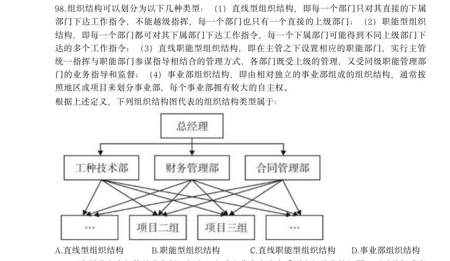
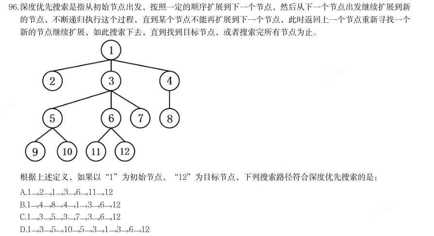
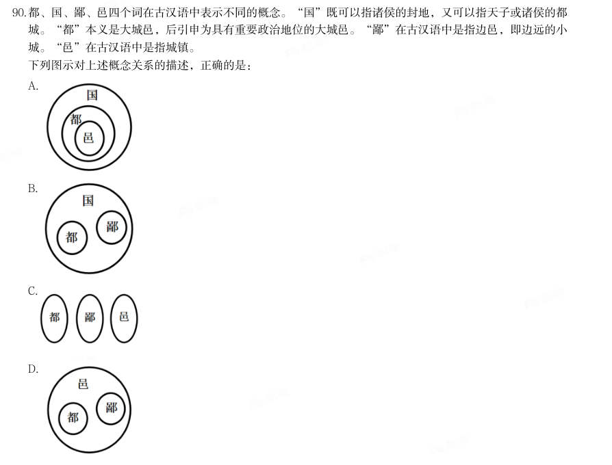
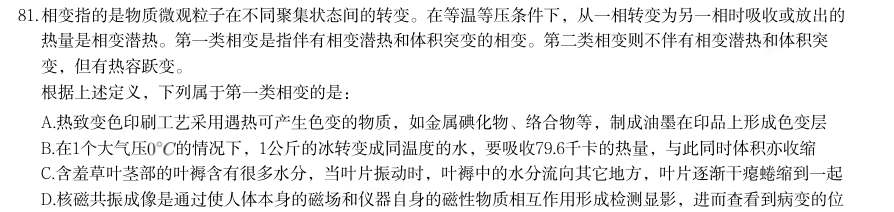
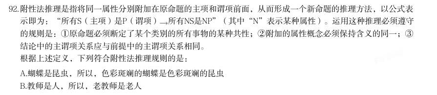
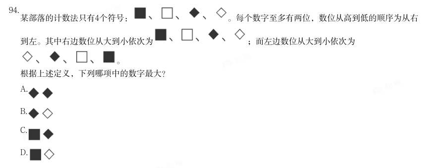
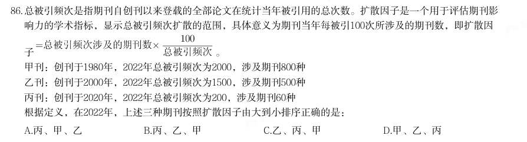
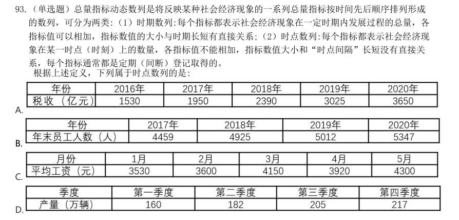
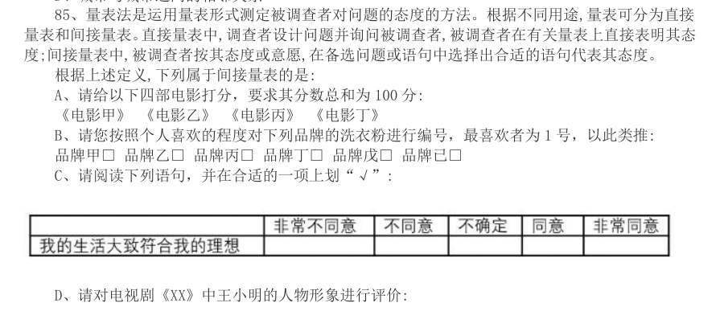

# 判断推理 · 定义判断 · 2020 年代真题

> 所属考点：[PD-DY](../PD-DY-定义判断.md)　｜　本片 151 题

> 本片子考点：单定义 137　多定义 12　定义判断（综合） 2

### 2026 国考·副省级　第 93 题　（单定义）

选矿是指用物理、化学或者物理与化学相结合的方法,将原矿中的有用矿物与伴生的无用固 定物质(脉石)或有害矿物分开的过程。选矿可显著提高矿石的质量,减少运输费用,降低冶炼 成本,进而实现综合利用。 根据上述定义,下列没有体现选矿过程的是:

- **A.** 利用矿物颗粒电性的差别,在高压电场中挑选出白钨矿、赤铁矿等,通过电机分离除尘
- **B.** 利用水枪和洗矿槽等设备,将锡矿石中的泥土等杂质洗去,同时也可以将部分轻矿物冲走,实现锡石初步富集
- **C.** 经验丰富的老师傅通过敲击、光照、观察皮壳等方法对开采的翡翠原石进行筛选,挑选优质原石
- **D.** 将铜矿矿石破碎到一定的粒度后,混以少量的食盐和煤粉隔氧加热,矿石中的铜便以金属状态

**答案：C**

### 2026 国考·副省级　第 94 题　（单定义）

根据动词对其后所接的宾语小句(作宾语的句子)真值的不同预设能力可以把现代汉语中的 相关动词分为叙实动词、非叙实动词和反叙实动词。叙实动词的肯定式和否定式都预设其宾语小 句为真;非叙实动词的肯定式和否定式都不预设其宾语小句为真,也不预设其宾语小句为假;反 叙实动词的肯定式和否定式都预设其宾语小句为假。 根据上述定义,下列画线的动词属于非叙实动词的是:

- **A.** 我听说他来过这里
- **B.** 我庆幸听了你的建议
- **C.** 我知道你帮助过我
- **D.** 我幻想成为一只小鸟

**答案：A**

### 2026 国考·副省级　第 95 题　（单定义）

动作预期是指运动员在比赛过程中,根据已有信息,对即将发生的动作结果进行预测的过程。 在这一过程中,运动员主要依赖两类信息:运动学信息和情境先验信息。运动学信息包括对手的 动作、器材的运动轨迹或队员之间的相对位置,情境先验信息则涉及比赛情境中事件发生的概 率。 根据上述定义,下列不涉及上述任何一种信息的是:

- **A.** 篮球队员甲在双方比分紧咬的情况下,基于对手今日比赛罚篮命中率不高,在对手投篮时选择直接犯规
- **B.** 网球运动员乙知道对手在比赛前有一系列习惯性动作,包括整理球衣、球裤、头发等,暗自提醒自己不要被其干扰
- **C.** 羽毛球双打运动员丙发现对方准备接发球的球员位置稍微靠前,可能来不及转身或后退接球,便发了个后场球
- **D.** 乒乓球运动员丁发现对方发过来的球位置较低、速度较慢,极有可能擦网变线,便没有后退,

**答案：B**

### 2026 国考·副省级　第 96 题　（单定义）

设备利用率是指每年度设备实际使用时间占计划用时的百分比。设备完好率是根据各类设备 完好标准,对企业设备进行逐台检查所确定的完好台数与设备总台数之比。设备总台数是指企业 在用的、备用的、停用的以及正在检修的全部生产设备,完好台数是指设备性能良好、运转正 常,且原料、燃料,油料等消耗正常的设备台数,设备负荷率是指设备需要台数与实际选用设 备的台数之比。设备闲置率是指闲置不用的设备台数与设备总台数的比值。 根据上述定义,下列说法错误的是:

- **A.** 若年度设备实际使用时间为9 个月、设备利用率为75%,则计划用时为12 个月
- **B.** 企业正在检修的、零部件出现磨损或腐蚀的设备应当纳入设备总台数的计算中
- **C.** 设备负荷率可用来考核设备选用的合理性程度,可用于量化分析设备运行状态
- **D.** 设备闲置率可以反映出设备资产投资的回报程度,其数值一般小于设备完好率

**答案：D**

### 2026 国考·副省级　第 97 题　（单定义）

分项累进淘汰法是指在对植株进行选种时,根据性状的相对重要性顺序排列,先按第一重要 性状进行选择,然后在入选株内按第二重要性状进行选择,依此顺次累进的一种选种方法。 根据上述定义,下列对南瓜的选种方法属于分项累进淘汰法的是:

- **A.** 按株选目标性状出现的先后顺序,先淘汰蔓生植株,然后淘汰第一雌花节位高的植株,再淘汰单瓜重量低的植株
- **B.** 首先在群体内选择无病植株,再在这些无病植株内选择丰产性好的植株,再根据产量性状顺次进行选择
- **C.** 在收获时按照果实的大小、果型等性状初选,在初选瓜内再按照综合性状入选标准进行复选
- **D.** 将需要鉴定的性状,如蔓长、单瓜重、果实籽粒数、籽粒长等,分别规定一个最低的入选标

**答案：B**

### 2026 国考·副省级　第 98 题　（单定义）

组织结构可以划分为以下几种类型:(1)直线型组织结构,即每一个部门只对其直接的下属 部门下达工作指令,不能越级指挥,每一个部门也只有一个直接的上级部门;(2)职能型组织 结构,即每一个部门都可对其下属部门下达工作指令,每一个下属部门可能得到不同上级部门下 达的多个工作指令;(3)直线职能型组织结构,即在主管之下设置相应的职能部门,实行主管 统一指挥与职能部门参谋指导相结合的管理方式,各部门既受上级的管理,又受同级职能管理部 门的业务指导和监督;(4)事业部组织结构,即由相对独立的事业部组成的组织结构,通常按 照地区或项目来划分事业部,每个事业部拥有较大的自主权。 根据上述定义,下列组织结构图代表的组织结构类型属于:

- **A.** 直线型组织结构
- **B.** 职能型组织结构
- **C.** 直线职能型组织结构
- **D.** 事业部组织结构

**答案：B**

### 2026 国考·副省级　第 99 题　（单定义）

《中国共产党纪律处分条例》规定,主动交代本人应当受到党纪处分的问题,可以从轻或者 减轻处分。这里所称的主动交代主要包括两种情况:一是涉嫌违纪的党员在组织谈话函询、初步 核实前向有关组织交代自己的问题。二是在谈话函询、初步核实和立案审查期间交代组织未掌握 的问题。 假定下列人员均受该条例约束,根据上述定义,下列属于主动交代的是:

- **A.** 甲在参加违纪违法典型案例警示教育大会后,主动找到单位领导反映同事的违纪问题
- **B.** 乙在组织对其进行廉政谈话时,组织举证一项他才承认一项,对未涉及的情况闭口不谈
- **C.** 丙在纪委对其个人财产有关事项进行函询时,将其利用职权为自己和他人谋利的情况如实交代
- **D.** 丁在纪委对其立案审查期间,面对确凿的证据,交代了之前没有交代的收受大额礼金的问题

**答案：C**

### 2026 国考·副省级　第 100 题　（单定义）

心理护理是指在护理过程中,护士发现了影响患者治疗及康复的心理问题后,运用心理学的 理论作指导,通过自身的语言、态度和行为等,或通过改善环境(包括人文环境及物理环境)去 影响或调整患者的心理状态和行为,进而帮助患者康复的护理方法。 根据上述定义,下列没有体现心理护理的是:

- **A.** 护士协助医生让青少年患者进行心理量表的测试,进而评估患者心理问题的类型
- **B.** 护士发观患儿害怕用药后,在更换切口敷料时动作轻柔、耐心细致,使患儿不再抵触换药
- **C.** 护士建议家属及时安抚患者的消极情绪并多加陪伴,以增强患者战胜疾病的信心
- **D.** 针对患者手术前的紧张情绪,护士教会患者放松的技巧,帮助患者正确对待手术

**答案：A**

### 2026 国考·地市级　第 90 题　（单定义）

商品动销率是指在售的商品品种数与库存商品总品种数的比率。商品库销比是指商品库存量与 销售额的比率。商品滞销率是指滞销的商品品种数占库存商品总品种数的比率。商品损耗率是指 在一定的保管条件下,某商品在储存保管期间,其自然损耗量与商品在库总量的比例。 根据上述定义,下列说法正确的是:

- **A.** 若商品动销率超过100%,说明商品在售品种数高于库存商品总品种数
- **B.** 商品损耗率高表明有库存积压风险,商品损耗率低表明销售态势良好
- **C.** 库存商品数一定时,商品滞销率越高,说明滞销的商品越多
- **D.** 当商品库存量越大,销售额越高时,商品库销比就会越大

**答案：A**

### 2026 国考·地市级　第 94 题　（单定义）

在制品控制是企业生产控制的基础工作,是企业对生产运作过程中各工序原材料、半成品等 按照位置、数量、质量及车间之间的物料转运等进行的控制。 根据上述定义,下列没有直接体现在制品控制的是:

- **A.** 服装厂梳理了运动裤制作流程并制定规范,确保衣料在不同流水线上流转有序
- **B.** 食品厂设立质检员,定时对各个工序的食材抽样进行微生物检测,剔除不良品
- **C.** 制药厂规定员工进入洁净区后,每两小时洗手一次,避免药品生产环境被污染
- **D.** 家具厂对板材进行定期盘点,并合理摆放,确保板材库存合理且满足生产需要

**答案：C**

### 2026 国考·地市级　第 95 题　（单定义）

预防性维修是指在机械设备没有发生故障或尚未造成损坏的前提下,通过对产品的系统性检 查,设备测试或更换以防止设备发生故障,使其保持在正常状态所进行的全部活动。 根据上述定义,下列属于预防性维修的是:

- **A.** 公路管理部门定期巡视道路两旁护栏并涂刷、除锈,发现护栏松动、断裂时进行修复
- **B.** 某车间在正式制造某种设备前,测量将要安装在该设备中的关键零部件是否符合检查标准
- **C.** 某数控车床突然发生摇动,无法研制物品,检查后发现电机出现故障,更换电机后车床可正常运行
- **D.** 雨季来临前,供电公司对辖区内变压器、配电器、电缆线路等电力设备设施隐患进行专项排查

**答案：D**

### 2026 国考·行政执法　第 88 题　（单定义）

假对是指借用同音或多义的字或词作形(音)此义彼的表达,构成形式上相对的一种修辞方 式。假对也是对偶的形式之一,多用于古汉语作品中。根据其构成方式,假对可以分为谐音假对 和衍义假对两类:谐音假对是利用语音的相同或相近构成的假对,衍义假对是利用字或词的一形 多义现象构成的假对。 根据上述定义,下列对偶句中的一对画线字属于衍义假对的是:

- **A.** 明月松间照,清泉石上流
- **B.** 厨人具鸡黍,稚子摘杨梅
- **C.** 本无丹灶术,那免白头翁
- **D.** 枸杞因吾有,鸡栖奈汝何

**答案：C**

### 2026 国考·行政执法　第 89 题　（单定义）

药学服务是指药师应用药学专业知识向公众(包括医护人员、患者及家属)提供直接的、负 责任的、与药物使用有关的服务,以提高药物治疗的安全性、有效性和经济性。 根据上述定义,下列没有体现药学服务的是:

- **A.** 药师与主治医生协商,调整了某患者的用药方案,并给予其相应的用药教育和指导
- **B.** 药师在社区药房开展咨询活动,为长期服药的慢病患者提供个性化的健康用药建议
- **C.** 药师给去药房拿药的患者一个条码,患者扫码后手机就会显示出药物的使用医嘱
- **D.** 药师在调剂工作中审核某患者处方的合法性,评估病情与用药匹配度及疗程合理性

**答案：C**

### 2026 国考·行政执法　第 91 题　（单定义）

联想的相似律是指两种在性质、特征上相似的事物或属性可形成联想;对比律是指具有相反 特点的事物或属性可形成联想;接近律是指在空间与时间上接近的事物或属性可形成联想。 根据上述定义,下列说法正确的是:

- **A.** 由树木想到森林、由蓝天想到飞机,都运用了对比律
- **B.** 由狐狸想到狡猾、由电灯想到房间,都运用了相似律
- **C.** 由钢铁想到坚强、由酷暑想到严寒,分别运用了接近律和对比律
- **D.** 由黑暗想到光明、由花圃想到蝴蝶,分别运用了对比律和接近律

**答案：D**

### 2026 国考·行政执法　第 94 题　（单定义）

在民法理论上,可以将条件划分为随意条件、混合条件与偶成条件。随意条件又分为纯粹随 意条件和非纯粹随意条件。纯粹随意条件的成就与否完全由一方当事人的意思决定;非纯粹随意 条件的成就与否除一方当事人的意思外,尚须另一方当事人发生某种事件;混合条件的成就与否 取决于一方当事人与第三人的意思;偶成条件的成就与否无关当事人的意思,但可能受制于第三 人的意思。 根据上述定义,下列属于混合条件的是:

- **A.** 小王与爸爸约定,如果小王考上的研究生院校让爸爸满意,爸爸就资助其旅游经费
- **B.** 某店铺与供应商约定,如果三伏的第一天下雨,则今年的雨伞就多进货30%
- **C.** 甲厂与乙厂约定,如果甲厂能与丙公司签订承揽合同,甲厂就在乙厂购置原料板材
- **D.** 小李与哥哥约定,如果小李能在开学前考取驾照,哥哥就把现在开的这台车赠送给小李

**答案：C**

### 2025 湖北·统一卷　第 76 题　（定义判断（综合））

近零碳建筑是指建筑物通过适应气候特征和场地条件,最大幅度地降低建筑对能源的需求,运行过程中全电 化,不使用燃气,建筑排放的碳量处于较低水平,近零碳建筑不仅利用各种方法减少自身产生的碳排放,还收 集并利用雨水、太阳能等可再生能源,最终达到零废水、零能耗、零废弃物的理想状态。 下列做法不符合近零碳建筑理念的是:

- **A.** 加大物联网、大数据、人工智能等技术在建筑上的应用
- **B.** 淘汰预制模块化建筑技术,采用传热系数高的幕墙建材
- **C.** 实现建筑内空调精细化运行,始终保持温湿度的独立控制
- **D.** 利用集成地源热泵、空气源热泵、光伏发电等可再生能源

**答案：C**

### 2025 湖北·统一卷　第 77 题　（单定义）

马氏体相变是一种晶体结构变化,由于外界物理作用,比如温度、外力或者磁场的变化,一些材料的晶体结构 会失去稳定性,原子发生短距离的移动,导致结构畸变。这种非原子扩散型的结构变化被称为马氏体相变,马 氏体相变的一个重要特性是形状记忆效应,即基于两种结构相互转变和变体滑移,材料外形发生明显变化并能 恢复原态。 根据上述定义,下列未体现马氏体相变的是:

- **A.** 将形状扭曲的别针放到热水里,别针立刻就能恢复原状
- **B.** 起扩张血管作用的心脏支架用在外周血管时,因为挤压而变形
- **C.** 通过电流加热控制合金网状结构变化,制造了能模仿蠕虫前进的机器人
- **D.** 采用镍钛弓丝的牙齿矫形器受口腔温度影响,可产生形状恢复力,为牙齿矫形提供所需

**答案：D**

### 2025 湖北·统一卷　第 80 题　（定义判断（综合））

物质循环是指在生态系统中,各种元素物质沿着特定途径从周围环境中被生物体吸收利用,再从生物体回到周 围环境的循环变化过程,即各种元素物质在生物体和非生物环境之间的往复循环运转过程。 下列诗句中所描写的内容最能体现物质循环的是:

- **A.** 时有落花至,远随流水香
- **B.** 莫作绕山云,循环无定期
- **C.** 黄河之水天上来,奔流到海不复回
- **D.** 落红不是无情物,化作春泥更护花

**答案：C**

### 2025 湖北·统一卷　第 81 题　（单定义）

印客也称in客,指的是把自己在网络平台上所写的、画的、摘录的任何文字和图片整理成册,自己制作或请人 制作成具有保存价值并体现个性的印刷品的人。 根据以上定义,下列属于印客的是:

- **A.** 小楠是某大学的特聘教师,撰写不少高水平学术文章,去年她将这些文章分类整理成册,目前正与出版社商量印刷排版事宜
- **B.** 小雪是某印刷服务社的美工,具备较高专业素养,业务内容是美化处理客户发来的图片和文字,成品在网络上得到海量好评
- **C.** 小影是某网站的专栏作家,在网络上发表多篇高阅读量和点赞量的文章,不少读者将她的文章打印出来,作为范本交流学习
- **D.** 小芳是某企业员工,经常在微博上用图片加文字的形式表达心灵感悟,她定期收集这些记录,请专业人士排

**答案：B**

### 2025 湖北·统一卷　第 82 题　（单定义）

版设计印刷成册 拓扑绝缘体是一种内部绝缘、界面允许电荷移动的材料,在拓扑绝缘体的内部,电子能带结构和常规的绝缘体 相似,但在其表面或边界上存在特殊的量子态,这些量子态位于块体能带结构的带隙之中,从而能够导电。 根据上述定义,以下哪项是拓扑绝缘体?

- **A.** 量子点接触是一种纳米尺度的电子器件,其整体的导电性质可以通过调整器件的尺寸和形状来调控
- **B.** 氮化镓中由半导体异质结中的特殊电子结构形成的二维电子气,虽然其并不是一种材料,但在一定条件下能够导电
- **C.** 纯石墨烯本身不导电,但是经过一些工艺加工后,会表现出在一定条件下可以允许表面电荷移动形成导电能力的一种量子效应
- **D.** 镧钡铜氧体系的超导陶瓷,是一类在临界温度时电阻为零的陶瓷材料,它还表现出完全抗磁性的行为,在传

**答案：C**

### 2025 湖北·统一卷　第 83 题　（单定义）

输过程中几乎没有能量消耗 计算亲属关系亲疏远近的单位是亲等,国际最为通用的是罗马法亲等计算法和寺院法亲等计算法,二者关于旁 系血亲的计算法有所不同:罗马法亲等计算法是从己身往上数至双方共同的直系血亲即同源人,每经一代为一 亲等,再往下数至要计算的人,也是每经一代为一亲等,所有数字相加就是双方之间的亲等数;寺院法亲等计 算法是从己身和所要计算的人分别往上数至血缘同源人,两边的亲等数相等时,就采用一边的亲等数,如果亲 等数不等,则采用多的一方的亲等数。 根据上述定义,下列符合罗马法亲等计算法的是:

- **A.** 自己与外甥的女儿之间的亲等是三亲等
- **B.** 表妹与堂妹之间的亲等,都是四亲等
- **C.** 姑侄之间的亲等是二亲等
- **D.** 自己与伯父之间是三亲等

**答案：A**

### 2025 湖北·统一卷　第 84 题　（单定义）

免疫电镜技术是将抗原抗体反应的特异性和电子显微镜的高分辨率相结合,在亚细胞和超微结构水平上对抗原 进行定位分析的一种高精确度的技术。 根据上述定义,下列不属于免疫电镜技术的是:

- **A.** 酶的催化作用对其底物的反应可形成不同的电子密度,运用电子显微镜来观察,可确定酶的存在,从而对抗原进行定位
- **B.** 胶体金与铁蛋白一样具有高电子密度,将沙门氏菌的抗血清与胶体金颗粒结合,可以明确病原物抗原在电镜水平的定位
- **C.** 铁蛋白通过交联剂与抗体等物质的共价结合,其分辨率高、散射能力强,借助电镜可以准确描述抗原抗体复合物的定位
- **D.** 微流体检测芯片中的免疫电极体系有镀金基层、导电聚合物层和抗体层,三者自下而上依次贴合,提高检测

**答案：D**

### 2025 湖北·统一卷　第 85 题　（单定义）

定位的水平 意思主义和表示主义是解释确定语言含义的两种方法。当语言发生歧义时。意思主义认为应当按照言语者内心 所欲表达的真实意思来确定语言含义,而无需在意别人如何理解;反之,表示主义主张语言一旦表达出来便与 言语者没有关系了,应当按照社会公众的通常理解来确定语言的含义。 根据上述定义,下列说法最能体现意思主义的是:

- **A.** 误载不害真意
- **B.** 人同此心,心同此理
- **C.** 一千个读者有一千个哈姆雷特
- **D.** 横看成岭侧成峰,远近高低各不同

**答案：B**

### 2025 国考·副省级　第 91 题　（单定义）

后视错觉是个体的一种认知偏差,是指在一件事情已经发生之后,即使个体之前没有对此做过预判,也认为自 己“早就知道会这样”。 根据上述定义,下列符合后视错觉的是:

- **A.** 小瑾是一个悲观的人,她申请升职失败后,灰心丧气地说:“我早就知道,我什么都不如别人,什么也做不好。”
- **B.** 朋友邀阿欣去爬山,阿欣说高温预警不宜爬山,朋友坚持去,才到半山腰就汗流浃背,阿欣说:“我早就说会很热啊。”
- **C.** 晓琳参加一个重要会议迟到了。她懊悔地说:“我早该想到周一早上会堵车,不该按周末的情况预估通勤时间。”
- **D.** 晓菲在股票大跌之后,懊恼地说:“我早就觉察到那些信号了,觉得走势不太好,怎么就没有早卖出啊。”

**答案：D**

### 2025 国考·副省级　第 92 题　（单定义）

回应型预算要求政府基于与人民的民主协商作出预算决策,相关责任部门应当及时反应并积极回复人民的质疑 和诉求。 根据上述定义,下列属于回应型预算的是:

- **A.** 甲国突发大规模严重旱情,财政部门从中央及各级政府应急预算中,通过多种财政政策安排,保障应急救援经费
- **B.** 乙省是地质灾害高发地区,年初该省编制《乙省地质灾害应急中心XX年度部门预算公开说明》并在官网上发布
- **C.** 丙市在年初将上一年度的地方预算执行情况在官网进行公布,诚邀广大市民和社会公众踊跃监督并提出意见
- **D.** 丁区实行预算听证制度,对与公共服务和社会民生相关的重大支出项目开展听证,并就意见和建议进行书面

**答案：D**

### 2025 国考·副省级　第 93 题　（单定义）

答复 选择或然率理论解释的是影响受众对大众传播内容选择的决定性因素。该理论的核心公式是:选择或然率=报 偿的保证/费力的程度。其中,报偿的保证指的是传播内容满足选择者需要的程度,即内容对于受众的吸引力和 实用性;费力的程度指的是获取传播内容和使用传播途径的难度。 根据上述定义,下列属于提高选择或然率的传播行为的是:

- **A.** 视频号平台借助数据分析和个性化算法,给用户推荐符合其偏好的视频
- **B.** 时下流行的某影视作品在播放之前被插入一段2分钟的广告
- **C.** 某商家优化了商品布局,将畅销商品放在出口处,顾客可直接扫码支付
- **D.** 电视内置视频播放软件,开机后须先注册登录,才可搜索相关内容观看

**答案：A**

### 2025 国考·副省级　第 95 题　（单定义）

形象史学是指把形与象作为主要材料,用以研究历史的一门学问。具体来说,是指把传世的包括出土(水)的 具有研究价值的石刻、陶塑、壁画、雕砖、铜玉、织绣、漆器、木器、绘画等历史实物、文本图像以及文化史 迹作为主要研究对象,并结合传统文献来综合考察历史的一种新的史学研究模式。 根据上述定义,下列属于形象史学研究范畴的是:

- **A.** 结合《晋书》等史书,通过对吉林集安长川1号墓礼佛图主佛形象及莲花纹的考察,研究三燕文化对高句丽佛教产生的影响
- **B.** 通过对现存的汉画像石(汉代人雕刻在墓室、祠堂四壁的装饰石刻壁画)的实地考察,分析汉画像石的雕刻风格和雕刻技法
- **C.** 根据史诗《伊利亚特》的记载,找到特洛伊城的遗址,并在其中发掘出王冠、银瓶、短剑等大量器物
- **D.** 通过对二十世纪二三十年代齐白石、傅抱石等人具有代表性的国画作品进行研究,分析当时国画中所蕴含的

**答案：A**

### 2025 国考·副省级　第 96 题　（单定义）

思想意境 深度优先搜索是指从初始节点出发,按照一定的顺序扩展到下一个节点,然后从下一个节点出发继续扩展到新 的节点,不断递归执行这个过程,直到某个节点不能再扩展到下一个节点,此时返回上一个节点重新寻找一个 新的节点继续扩展,如此搜索下去,直到找到目标节点,或者搜索完所有节点为止。 根据上述定义,如果以“1”为初始节点,“12”为目标节点,下列搜索路径符合深度优先搜索的是:

- **A.** 1
- **B.** 1
- **C.** 1
- **D.** 1

**答案：B**

### 2025 国考·副省级　第 97 题　（单定义）
> 材料：元科学也称元理论,是一种以科学为研究对象的学科,它研究科学的性质、特征、形成和发展规律。科学概念 是“科学内部”出现的概念,如“质量”“频率”等;而元科学概念是“谈论科学的”,表示科学的陈述或活…

动特征的概念。 根据上述定义,下列说法正确的是:

- **A.** “黑洞”是科学概念,“量子”是元科学概念
- **B.** “物质波”“科学”都是科学概念
- **C.** “理论”“确证”都是元科学概念
- **D.** “经验”是科学概念,“宇宙”是元科学概念

**答案：C**

### 2025 国考·副省级　第 98 题　（单定义）

同一认定是指侦查中具有专门知识的人或了解客体特征的人,通过比较先后出现的客体的特征而对客体是否同 一做出的判断。这里所说的客体是指与案件有关联的人或物。 根据上述定义,下列属于同一认定的是:

- **A.** 通过对手机中所存储的信息进行检查,确定其是否为报案人所丢失的手机
- **B.** 通过对犯罪现场提取的DNA信息与DNA信息库进行比对,查找犯罪嫌疑人
- **C.** 通过对走私案中所缴获的走私物品进行多次鉴定,认定其是否为国外某厂家所生产
- **D.** 通过对犯罪嫌疑人车上所收缴的各类物品进行检验,判断其是否属于违禁物品

**答案：C**

### 2025 国考·副省级　第 99 题　（单定义）

流域内降雨或融冰化雪都可以引起河水显著上涨。春季,气候转暖,流域内的季节性积雪融化、河流解冻或春 雨,引起河水上涨称春汛。因正值桃花盛开时节,故亦称桃汛。我国北方,把春季河冰解冻引起的涨水现象专 称为凌汛。夏季,流域内的暴雨或高山冰川和积雪融化,使河水急剧上涨,称夏汛。我国习惯上把发生在夏季 三伏前后的汛水称为伏汛。秋季由于暴雨,河水发生急剧上涨称秋汛。 根据上述定义,下列判断错误的是:

- **A.** 春汛包含凌汛
- **B.** 夏汛包含伏汛
- **C.** 伏汛在凌汛前
- **D.** 春汛就是桃汛

**答案：C**

### 2025 国考·副省级　第 100 题　（单定义）

具有包含与被包含关系的三个概念,如植物、乔木、水杉等,可至少形成三个正确的命题:所有的水杉都是乔 木,所有的乔木都是植物,所有的水杉都是植物,由“所有的乔木都是植物”“所有的水杉都是植物”而得 出“所有的水杉都是乔木”,这样的推理被称为排序推理。 根据上述定义,下列属于排序推理的是:

- **A.** 所有的平行四边形都是四边形,所有的菱形都是四边形,所以,所有的菱形都是平行四边形
- **B.** 所有的昆虫都是动物,所有的蝴蝶都是昆虫,所以,所有的蝴蝶都是动物
- **C.** 所有的文字都是符号,所有的文字都是图形,所以,所有的符号都是图形
- **D.** 这个花园的花都是迎春花,迎春花都在冬、春季开放,所以,这个花园的花都在冬、春季开放

**答案：A**

### 2025 国考·地市级　第 86 题　（单定义）

土地监测是利用遥感、遥测技术,对一个国家或地区土地利用状况的动态变化进行定期或不定期的监视和测 定,目的在于为国家和地区有关部门提供准确的土地利用变化情况,及时进行土地利用数据更新与对比分析, 以便编制土地利用变化图解等。 根据上述定义,下列属于土地监测的是:

- **A.** 通过量化多时相遥感图像空间域、时间域、光谱域的耦合特征,获得土地变化的类型、位置和数量
- **B.** 利用定期现场踏勘的方式标绘各土地使用单位及各类型土地的界线,对变化的地物界线作出修正
- **C.** 通过某地区土地权属变更资料的分析,梳理该地区土地所有权、使用权的变化,以及土地纠纷调解情况
- **D.** 利用植被具有红光强吸收特点,通过遥感设备监测植被的生长状态,并绘制植被的生长周期图

**答案：A**

### 2025 国考·地市级　第 87 题　（单定义）

主体间性是指人对他人意图的判断与推测。主体间性有不同的级别,一级主体间性即人对另一个人意图的判断 与推测,二级主体间性即人对另一人关于其他人意图的判断与推测的认知的认识。 根据上述定义,下列体现了二级主体间性的是:

- **A.** 小明饿了,去问妈妈饭做好没有,妈妈说爸爸正在做
- **B.** 老师知道学生们不喜欢做作业,周五就在班级群里通知本周末不留作业
- **C.** 小王知道老板爱挑毛病,每次提交的总结都得仔细检查好几遍
- **D.** 小花看见妈妈冲爸爸使了个眼色后,爸爸尴尬地放下酒杯,小花偷偷地笑了

**答案：D**

### 2025 国考·地市级　第 89 题　（单定义）

答复 温度习服是指机体长期在高温或低温环境中,逐渐产生的对环境温度的耐受现象,包括热习服和冷习服。热习 服是指机体长期生活或工作在炎热或高温环境后产生的适应性变化;冷习服是指机体长期暴露于寒冷环境后逐 渐出现的适应性变化。 根据上述定义,下列属于温度习服的是:

- **A.** 长期接受滑雪训练的人都会穿着防水防风、透气保暖的滑雪服进行运动
- **B.** 生活在北极的因纽特人常表现出较高的基础代谢率以维持体温
- **C.** 生活在缺氧、干燥、紫外线照射强烈的高原地区的人,脸部呈现出“高原红”特征
- **D.** 在寒冷天气进行体育锻炼的人,倾向于增加热身时间以适应气温

**答案：B**

### 2025 国考·地市级　第 91 题　（单定义）

思想意境 求证思维是指用自己掌握的知识和经验去验证某一结论的思维。转化思维是指在解决问题的过程中遇到障碍 时,把问题转换成另一种形式,使问题变得更简单、更清晰。集中思维是指从许多资料中找出合乎逻辑的联 系,从而导出一定的结论,或者对几种解决方案加以比较研究,进而导出一种解决办法。 根据上述定义,下列说法正确的是:

- **A.** 数学家根据自己所学,从多角度证明某一命题是否成立。这体现了求证思维
- **B.** 修建铁路时,工程师依据施工方案采用爆破的方法开山劈岭,完成线路铺设。这体现了集中思维
- **C.** 当发现改变滚珠形状无法减少轴承摩擦时,有人设计出使旋转轴呈悬浮状的空气轴承。这体现了集中思维
- **D.** 商家通过分析药店互联网化的不同方案,权衡利弊后最终选定线上线下相结合的模式。这体现了转化思维

**答案：A**

### 2025 国考·地市级　第 92 题　（单定义）

自动投案是指犯罪事实或者犯罪嫌疑人未被司法机关发觉,或者虽被发觉,但犯罪嫌疑人尚未受到讯问、未被 采取强制措施时,主动、直接向公安机关、人民检察院或者人民法院投案。 根据上述定义,下列不属于自动投案的是:

- **A.** 甲实施多起电信诈骗,获利十余万元,在公安机关进行的一次隐患排查入户走访中,发现甲形迹可疑,经盘问甲主动交代了自己的罪行
- **B.** 乙致人重伤后潜逃,在公安机关经侦查确认乙为该案的犯罪嫌疑人时,乙正因酒后驾驶被行政拘留,经公安机关讯问后,乙交代了自己的罪行
- **C.** 丙多次挪用公款,其父母发现异常后,多次规劝其投案自首无效,直至单位发现款项异常开始查账后,丙才到公安机关交代自己的罪行
- **D.** 丁因入室盗窃被判处有期徒刑,在服刑期间,丁主动向公安机关交代自己系公安机关久未破获的“7·26”走

**答案：B**

### 2025 国考·地市级　第 93 题　（单定义）
> 材料：私案的主谋之一 深度优先搜索是指从初始节点出发,按照一定的顺序扩展到下一个节点,然后从下一个节点出发继续扩展到新 的节点,不断递归执行这个过程,直到某个节点不能再扩展到下一个节点,此时返回上一个节点重新寻找一个 新的节点继续扩展,如此搜索下去,直到找到目标节点,或者搜索完所有节点为止。…

根据上述定义,如果以“1”为初始节点,“12”为目标节点,下列搜索路径符合深度优先搜索的是:

- **A.** 1
- **B.** 1
- **C.** 1
- **D.** 1

**答案：B**

### 2025 国考·地市级　第 94 题　（单定义）

企业薪酬策略主要包括两个方面:一是体现企业支付标准的策略,即薪酬水平策略,其本质是在市场既定的薪 酬水平上设定一个对公司有利的最优报酬水平;二是体现企业支付差异的策略,即薪酬结构策略,其通过企业 的工资等级和工资幅度、加薪条件、晋升降级、小时工资、加班休假、工作时间等方面的薪酬政策表现出来。 根据上述定义,下列说法正确的是:

- **A.** 甲企业根据市场调查结果,设定行政岗位的薪酬标准。这体现了薪酬结构策略
- **B.** 乙企业今年赢利颇丰,企业将全员工资普遍调高。这体现了薪酬水平策略
- **C.** 丙企业工资分为基本工资和绩效工资两部分,绩效工资与员工绩效挂钩。这体现了薪酬水平策略
- **D.** 丁企业采取不同方式调整高、中、低三个职位层次人员的薪酬。这体现了薪酬水平策略

**答案：B**

### 2025 国考·地市级　第 95 题　（单定义）

断取是修辞格的一种,引用词语时,只截取其中部分字眼的意义,而置其余于不顾,是一种“断章取义”的修 辞方式。 根据上述定义,下列没有采用断取修辞方式的是:

- **A.** 相较于他之前见过的大阵仗,眼前的情形在他眼中就是“小儿科”
- **B.** 小林一心扑在科研项目上,他至今还是一个“光杆司令”呢
- **C.** 山林发生火灾,消防员“上刀山下火海”,奋力保卫人民的生命和财产安全
- **D.** 实在走投无路,他最终还是找老师“开药方”,问询这一困局的破解之道

**答案：D**

### 2025 国考·行政执法　第 87 题　（单定义）

选择或然率理论解释的是影响受众对大众传播内容选择的决定性因素。该理论的核心公式是:选择或然率=报 偿的保证/费力的程度。其中,报偿的保证指的是传播内容满足选择者需要的程度,即内容对于受众的吸引力和 实用性;费力的程度指的是获取传播内容和使用传播途径的难度。 根据上述定义,下列属于提高选择或然率的传播行为的是:

- **A.** 视频号平台借助数据分析和个性化算法,给用户推荐符合其偏好的视频
- **B.** 时下流行的某影视作品在播放之前被插入一段2分钟的广告
- **C.** 某商家优化了商品布局,将畅销商品放在出口处,顾客可直接扫码支付
- **D.** 电视内置视频播放软件,开机后须先注册登录,才可搜索相关内容观看

**答案：A**

### 2025 国考·行政执法　第 90 题　（单定义）

都、国、鄙、邑四个词在古汉语中表示不同的概念。“国”既可以指诸侯的封地,又可以指天子或诸侯的都 城。“都”本义是大城邑,后引申为具有重要政治地位的大城邑。“鄙”在古汉语中是指边邑,即边远的小 城。“邑”在古汉语中是指城镇。 下列图示对上述概念关系的描述,正确的是:

- **A.** 
- **B.** 
- **C.** 
- **D.** 

**答案：D**

### 2025 国考·行政执法　第 91 题　（单定义）
> 材料：流域内降雨或融冰化雪都可以引起河水显著上涨。春季,气候转暖,流域内的季节性积雪融化、河流解冻或春 雨,引起河水上涨称春汛。因正值桃花盛开时节,故亦称桃汛。我国北方,把春季河冰解冻引起的涨水现象专 称为凌汛。夏季,流域内的暴雨或高山冰川和积雪融化,使河水急剧上涨,称夏汛。我国习惯上把发生在夏季 三伏前后的汛水称为伏汛。秋季由于暴雨,河水发生急剧上涨称秋汛。…

根据上述定义,下列判断错误的是:

- **A.** 春汛包含凌汛
- **B.** 夏汛包含伏汛
- **C.** 伏汛在凌汛前
- **D.** 春汛就是桃汛

**答案：C**

### 2025 国考·行政执法　第 93 题　（单定义）

细胞化学是研究细胞的化学成分及其在细胞活动中的变化和定位的学科。具体来说,细胞化学是在不破坏细胞 形态结构的状况下,用生化的和物理的技术对细胞的各种组分做定量分析,研究其动态变化,了解细胞代谢过 程中各种细胞组分的作用。 根据上述定义,下列属于细胞化学研究范围的是:

- **A.** 观察玉米根系细胞从周围环境中摄取营养的能力以及受环境影响产生的活动
- **B.** 根据哺乳动物细胞内核酸、蛋白质吸收不同紫外光的特点,分析其含量
- **C.** 抽取患者骨髓液,根据显微镜下骨髓细胞的不同形态,判断患者的疾病种类
- **D.** 研究小鼠免疫细胞受病原体侵入后,病原体释放毒素杀死免疫细胞的动态过程

**答案：B**

### 2024 湖北·统一卷　第 76 题　（单定义）

蒸发冷却是一种通过水的蒸发来冷却空气的过程,即水会吸收空气的热量而蒸发从而冷却空气。空气越干燥, 其容纳水分的能力越强,当用水喷淋空气时,则空气温度的降低幅度越大。如果采用温度更低的自来水或井 水,其空气的降温效果更佳。 根据上述定义,下列未体现蒸发冷却的是:

- **A.** 用喷水壶装满冰凉刺骨的井水,然后喷淋房屋周边
- **B.** 在逆风处设置风井,使空气沿风井流入楼内喷泉处
- **C.** 沿海国家在风口建造风车,利用空气流动驱动扇页
- **D.** 将冷水输送到屋顶,冷水从房檐四周流下形成水帘

**答案：C**

### 2024 湖北·统一卷　第 77 题　（单定义）

在统计学中,生态谬误是指用一种高层次的分析单位做调查,却用另一种低层次的分析单位做结论,即运用数 据时错误地将整组的汇总结果应用到组内的单位中。 根据以上定义,下列属于生态谬误的是:

- **A.** 一项调研发现甲地居民的收入普遍比乙地居民的收入更高,由此认为甲地教师的收入高于乙地教师的收入
- **B.** 服务业占比大的区域比服务业占比小的区域更容易吸引高层次人才,由此认为服务业占比大的区域高层次人才更多
- **C.** 某杂志开设了读者意见反馈邮箱,几天后收到28个不喜欢时装栏目的反馈邮件。某编辑认为有读者不喜欢,就一定有读者喜欢
- **D.** 某公司规定,上一年工资数额在公司前6%的要降低工资,小王上一年的工资低于公司的平均水平,可以推出

**答案：A**

### 2024 湖北·统一卷　第 78 题　（单定义）

小王今年的工资可能降低 湖陆风是指湖陆之间相互转换的热力环流现象。入夜以后,陆地降温速度比湖水快,近地面空气变冷变重,而 湖水降温慢,温度比陆地高,空气暖而轻,形成上升气流,陆上气流流向湖心形成陆风。太阳升起后,陆地吸 热和升温速度比湖水快,直至陆上空气升温形成上升气流,湖面空气流向陆地形成湖风。 根据上述定义,下列诗句最能体现湖陆风现象的是:

- **A.** 轮台九月风夜吼,一川碎石大如斗,随风满地石乱走
- **B.** 潮没具区薮,潦深云梦田。朝随北风去,暮逐南风旋
- **C.** 鸱枭养子庭树上,曲墙空屋多旋风
- **D.** 鹊飞山月曙,蝉噪野风秋

**答案：B**

### 2024 湖北·统一卷　第 79 题　（单定义）

磁滞现象指的是磁场把未带磁性的铁磁性物质(如铁、钴、镍及其合金等)磁化,使之带有磁性,但外加磁场 去除后,铁磁性物质的磁性也不会马上消除,仍保有磁性的现象。 根据上述定义,下列属于磁滞现象的是:

- **A.** 当水中溶解了某些铁磁性物质,水在强磁场下流过时,周围金属物体中会产生磁感应现象,金属中有电流流过
- **B.** 由导线将电池、小灯泡、电流表、开关连接成闭合电路,闭合开关时,灯泡亮暗、电流表指针的指向等都会有变化
- **C.** 电饭锅中的温控元件都有设置好的温度值,电饭锅运行达到一定温度后,感温磁钢会消磁,依靠弹簧的反作用力断开电源
- **D.** 把烧红的铁片放置在子午线的方向,使铁分子顺着地球磁场方向排列,达到磁化目的,之后挪动铁片,铁分

**答案：D**

### 2024 湖北·统一卷　第 80 题　（单定义）

子仍然按照磁场方向排列 政策合成谬误,是指从各部门来看,每项政策都是对的,组合起来实施时却是错的。政策分解谬误,是指不该 分解的系统性任务被分解了,有的分解到各部门、各地方,有的分解到各个时间段。 根据上述定义,下列属于政策分解谬误的是:

- **A.** 为了让居民买得起房,某省各部门实施了一系列举措调控房价,几年后该省的房地产商数量明显减少
- **B.** 为了推动乡村振兴,某乡镇决定帮扶辖区内村民养殖黑山羊,一年后黑山羊数量剧增,导致附近山林遭到破坏
- **C.** 为了加快新能源产业的发展,某省出台政策鼓励居民购买电动汽车,半年后发现,该省范围内充电桩数量严重不足
- **D.** 某地政府欲出台一部环境卫生管理条例,其中各部分内容被分配到相关部门草拟,但最终统筹草案后发现各

**答案：D**

### 2024 湖北·统一卷　第 81 题　（单定义）

部分之间难以衔接 相变指的是物质微观粒子在不同聚集状态间的转变。在等温等压条件下,从一相转变为另一相时吸收或放出的 热量是相变潜热。第一类相变是指伴有相变潜热和体积突变的相变。第二类相变则不伴有相变潜热和体积突 变,但有热容跃变。 根据上述定义,下列属于第一类相变的是:

- **A.** 热致变色印刷工艺采用遇热可产生色变的物质,如金属碘化物、络合物等,制成油墨在印品上形成色变层
- **B.** 在1个大气压的情况下,1公斤的冰转变成同温度的水,要吸收79.6千卡的热量,与此同时体积亦收缩
- **C.** 含羞草叶茎部的叶褥含有很多水分,当叶片振动时,叶褥中的水分流向其它地方,叶片逐渐干瘪蜷缩到一起
- **D.** 核磁共振成像是通过使人体本身的磁场和仪器自身的磁性物质相互作用形成检测显影,进而查看到病变的位

**答案：B**

### 2024 湖北·统一卷　第 82 题　（单定义）

置 “嗜睡”是一种睡眠失调现象,患者会持续感到极端疲倦,昏昏欲睡,往往会在毫无预警的情况下睡着,甚至 是在活动中途突然入睡。“醉睡”则指酒醒后并没有完全清醒的状态,“醉睡”往往伴随混乱、迷惑、甚至暴 力反应和失忆。 根据上述定义,下列选项未体现“嗜睡”或“醉睡”的是:

- **A.** 昨夜雨疏风骤,浓睡不消残酒
- **B.** 终日昏昏醉梦间,忽闻春尽强登山
- **C.** 老眠早觉常残夜,病力先衰不待年
- **D.** 临川税驾忽数月,嗜睡爱闲常闭门

**答案：C**

### 2024 湖北·统一卷　第 83 题　（单定义）

肿瘤侵犯,指的是肿块发展后引起相邻部位的反应和变化。肿瘤浸润,是指肿瘤细胞发展扩大透过原发部位的 浆膜层转移到相邻组织和器官。肿瘤转移,指肿瘤由原发器官通过血液、淋巴等方式到达另一个远处器官。 根据上述定义,下列属于肿瘤侵犯的是:

- **A.** 宋阿姨近期体检发现患有乳腺癌,医生告知癌细胞已到达胸壁组织
- **B.** 经检查,老赵的肺部有五个毛玻璃结节,医生提醒他要定期复查
- **C.** 老王的胰腺肿瘤经过三个月的无效治疗已经蔓延到肝脏
- **D.** 老张肺部的肿块碰触心脏薄膜,引起心包积液

**答案：D**

### 2024 湖北·统一卷　第 84 题　（单定义）

生物学重复是指对不同生物个体或者不同生物群体的样品采用相同的处理方式进行实验。技术重复则是指对同 一样品进行的多次相同实验。 根据上述定义,下列属于生物学重复的是:

- **A.** 采集小王的血样一次并采用三种不同方式分别进行一次检测
- **B.** 采用三种不同方式对分三次采集的小王血样各进行一次检测
- **C.** 采集小王、小李、小张三人的血样并用同样方式分别进行一次检测
- **D.** 采集小王、小李、小张三人的血样混合后用三种方式进行三次检测

**答案：C**

### 2024 湖北·统一卷　第 85 题　（单定义）

供应商绿色压力是指企业供应商的环保意识和环保行为对企业绿色创新的影响。它会促使企业显著改进产品生 产流程,以减少对自然资源的使用,并在产品生命周期内减少有害物质的释放。研究表明,供应商的绿色环保 意识越强,绿色环保行为越主动,就越有可能通过供应链来影响链上企业的绿色创新行为。 根据上述定义,下列属于供应商绿色压力的是:

- **A.** 随着绿色意识的增强,消费者更愿意选择资源节约和环境友好的产品
- **B.** 随着国家生态建设的推进,企业会更加谨慎地选择自己的下游客户
- **C.** 供应商可以为链上企业提供“绿色创新”方面的资源和知识
- **D.** 供应商的绿色环保行为倒逼企业进行绿色创新行为

**答案：D**

### 2024 国考·副省级　第 86 题　（单定义）

慢病也称为慢性非传染性疾病,是指长期的、不能自愈的、也几乎不能被治愈的疾病。慢病自我管理是指慢病 患者主动监测自己的病情,以积极态度及行动,改善健康和情绪,通过对疾病的认识,学习与疾病长期共存。 根据上述定义,下列属于慢病自我管理的是:

- **A.** 老张在患了流感后多方查阅相关信息,每天监测血氧、心率、血压等指标,不做剧烈运动,避免着凉
- **B.** 老王因慢性肾功能衰竭需定期在医院进行透析治疗,医院为其建立了慢病管理档案,追踪监测肾功能等各项指标
- **C.** 老赵的父母都因胃癌去世,老赵深知该疾病的严重后果,每年全面体检一次,定期进行胃肠镜检查,不熬夜不喝酒,规律作息
- **D.** 患II型糖尿病的老李,平日生活格外谨慎,含糖量高的食物一概不碰,每天按时服药,定期监测血糖水平

**答案：D**

### 2024 国考·副省级　第 87 题　（单定义）

多级养殖是指根据物种代谢产物或残余有机质的利用价值及其在食物链中所处的级次,依次放养相应生物,多 级次利用营养物质的一种养殖方式。 根据上述定义,下列属于多级养殖的是:

- **A.** 将养殖过江蓠的海水用于放养贝类,以利用其中繁殖的浮游生物;再将养殖过贝类的水用于放养对虾;再以对虾代谢分解的产物养殖藻类
- **B.** 将鱼、虾、贝类与藻类放在同一水槽混养,其代谢产物会为藻类提供必要的营养要素,藻类的光合作用又产生更多的溶解氧
- **C.** 在一台浮筏上,于冬春季养殖海带;至夏秋季养殖海湾扇贝或石花菜,从而更好利用海况条件,满足市场需要
- **D.** 同一池塘中,鲢、鳙生活在上层,主食浮游生物;草鱼、鳊生活在中下层,主食草类;鲤、鲫生活在底层,

**答案：A**

### 2024 国考·副省级　第 88 题　（单定义）

主食底栖动物和有机碎屑 动态描写法是指记叙文中对人物、景物作运动状态的描写,创造具体而栩栩如生的形象的一种描写方法。动态 描写法包括两类:一类是对运动着的景物的描写,一类是对静物所作的动态描写。动态描写法的目的在于赋予 客观事物以运动感、活力感、变化感,克服形象的单调性,丰富形象的多样性,达到更好地表现事物、感染读 者的艺术效果。 根据上述定义,下列没有体现动态描写法的是:

- **A.** 有的松树望穿秋水,不见你来,独自上到高处,斜着身子张望
- **B.** 夜阑人静,家养的大黄狗趴在院子里安静地睡了
- **C.** 七股大水,从水库的桥孔跃出,仿佛七幅闪光的黄锦,直铺下去
- **D.** 一轮杏黄色的满月,悄悄从山嘴处爬出来,把倒影投入湖水中

**答案：B**

### 2024 国考·副省级　第 89 题　（单定义）

电力系统的电力设备根据其在运行中所起的作用,分为电力一次设备和电力二次设备。电力一次设备指的是直 接参与生产、变换、传输、分配和消耗电能的设备;电力二次设备指的是为了保护并保证电力一次设备的正常 运行,对其运行状态进行测量、监视、控制和调节等的设备。 根据上述定义,下列说法正确的是:

- **A.** 电路中用于升降交流电压的变压器,属于电力二次设备
- **B.** 将回路中高电压降低的电压互感器,属于电力一次设备
- **C.** 由柴油驱动的发电机,属于电力二次设备
- **D.** 记录零序电流值并用于查找故障点的故障录波装置,属于电力一次设备

**答案：B**

### 2024 国考·副省级　第 90 题　（单定义）

复杂型消费行为是指消费者对价格昂贵,品牌差异大,功能复杂的商品,由于缺乏必要的商品知识,需要慎重 选择,仔细对比,只求降低风险的购买行为;多变型消费行为是指如果消费者购买的商品价格低,可供选择的 品牌很多时,他们并不花太多的时间选择品牌,而是经常变换品牌。 根据上述定义,下列说法正确的是:

- **A.** 老李给儿子换了十几个钢琴老师之后,发现还是第一个钢琴老师最好,于是一次性交了一年的学费。这属于复杂型消费行为
- **B.** 小明去超市买某品牌饼干,心想上次买了巧克力口味,这次买绿茶口味,下次再试一下夹心的。这属于多变型消费行为
- **C.** 老王打算买一辆越野车,网上查阅了各种型号参数,试驾了十几款品牌之后,才做出决定。这属于复杂型消费行为
- **D.** 小丽逛街的时候本来只想买一条裤子,后来发现需要搭配一件合适的上衣和配套的手提包,所以买了全套。

**答案：C**

### 2024 国考·副省级　第 91 题　（单定义）

这属于多变型消费行为 森林覆盖率是指森林面积占土地总面积的百分比。郁闭度是指森林中乔木树冠在阳光直射下地面总投影面积与 此林地总面积的比,其最大值为1,表示树冠层全部连接形成完全郁闭的状态。郁闭度与森林气温日变化呈负 相关,与相对湿度呈正相关。立木蓄积量是指森林中所有树木材积的总和,立木包括枯立木和活立木两类;森 林蓄积量是指森林中现存各种活立木的材积总量,以立方米为计算单位。 根据上述定义,下列说法正确的是:

- **A.** 森林覆盖率能够反映一个国家(或地区)森林资源分布的实际状况
- **B.** 若某森林郁闭度为0.3,其阳光直射下乔木树冠的地面总投影面积为3万公顷,则该林地总面积为10万公顷
- **C.** 一般来说,郁闭度大时森林白天气温降低,气温日变化增加,相对湿度增大
- **D.** 某区域森林蓄积量为14亿立方米,则该区域立木蓄积量一定少于14亿立方米

**答案：B**

### 2024 国考·副省级　第 92 题　（单定义）

附性法推理是指将同一属性分别附加在原命题的主项和谓项前面,从而形成一个新命题的推理方法,以公式表 示即为:“所有S(主项)是P(谓项) 所 有NS是NP”(其中“N”表示某种属性)。运用这种推理必须遵守 的规则是:1原命题必须断定了某个类别的所有事物的某种共性;2附加的属性概念必须保持含义的同一;3 结论中的主谓项关系应与前提中的主谓项关系相同。 根据上述定义,下列符合附性法推理规则的是:

- **A.** 蝴蝶是昆虫,所以,色彩斑斓的蝴蝶是色彩斑斓的昆虫
- **B.** 教师是人,所以,老教师是老人
- **C.** 有些诗人是画家,所以,有些女诗人是女画家
- **D.** 音乐家是人,所以,无天赋的音乐家是无天赋的人

**答案：A**

### 2024 国考·副省级　第 93 题　（单定义）

民俗是指一个民族或一个社会群体在长期的生产实践和社会生活中逐渐形成并世代相传、较为稳定的文化事 项,可以简单概括为民间流行的风尚、习俗,具有传承性、广泛性、稳定性。 根据上述定义,下列活动属于民俗的是:

- **A.** 清明节当天,黄帝陵举行隆重的公祭活动,按照既定祀典礼仪,缅怀始祖精神,传承中华文明
- **B.** 王老伯家有一个传承三代的习惯,每到重大节日,全家都要聚在一起,交流感情,品尝美食,共享天伦
- **C.** 农历九月九日为重阳节,自古以来,河洛地区的人们每逢这天都会结伴登高山、逛庙会、赏菊花
- **D.** 近年来,一些大都市的公园每周都会举办“相亲角”活动,中老年父母聚在一起替儿女相亲

**答案：C**

### 2024 国考·副省级　第 94 题　（单定义）

某部落的计数法只有4个符号: 。每个数字至多有两位,数位从高到低的顺序为从右 到左。其中右边数位从大到小依次为 ;而左边数位从大到小依次为 。 根据上述定义,下列哪项中的数字最大?

- **A.** 
- **B.** 
- **C.** 
- **D.** 

**答案：A**

### 2024 国考·副省级　第 95 题　（单定义）

伪装型反侦查行为是指犯罪行为人通过采取相应措施来隐蔽自身、迷惑侦查机关侦查活动的行为,其主要表现 为三类:1栽赃嫁祸,通过将赃物、违禁品暗置别人处等方式来误导侦查方向;2主动报案,通过实施“贼喊 捉贼”式的行为来蒙蔽侦查机关;3制造伪证,通过假人证、不知情的人或一些特定物品,制造出虚假的不在 场证明或者自己与案件无关的假象,以达到混淆视听、误导侦查视线的目的。 根据上述定义,下列没有体现上述几类伪装型反侦查行为的是:

- **A.** 甲将乙杀害后,故意在网络上散布丙与乙不和的谣言,转移警方注意力
- **B.** 甲在作案后,拿走可以证明受害人乙身份的物品,隐藏其身份
- **C.** 甲酒后与乙争吵并痛下杀手,事后甲主动报警,声称自己是目击证人
- **D.** 甲作案后接受警方讯问时,拿出案发当日的火车票谎称自己当时正在火车上

**答案：B**

### 2024 国考·地市级　第 82 题　（单定义）

主食底栖动物和有机碎屑 复杂型消费行为是指消费者对价格昂贵,品牌差异大,功能复杂的商品,由于缺乏必要的商品知识,需要慎重 选择,仔细对比,只求降低风险的购买行为;多变型消费行为是指如果消费者购买的商品价格低,可供选择的 品牌很多时,他们并不花太多的时间选择品牌,而是经常变换品牌。 根据上述定义,下列说法正确的是:

- **A.** 老李给儿子换了十几个钢琴老师之后,发现还是第一个钢琴老师最好,于是一次性交了一年的学费。这属于复杂型消费行为
- **B.** 小明去超市买某品牌饼干,心想上次买了巧克力口味,这次买绿茶口味,下次再试一下夹心的。这属于多变型消费行为
- **C.** 老王打算买一辆越野车,网上查阅了各种型号参数,试驾了十几款品牌之后,才做出决定。这属于复杂型消费行为
- **D.** 小丽逛街的时候本来只想买一条裤子,后来发现需要搭配一件合适的上衣和配套的手提包,所以买了全套。

**答案：C**

### 2024 国考·地市级　第 83 题　（单定义）

这属于多变型消费行为 慢病也称为慢性非传染性疾病,是指长期的、不能自愈的、也几乎不能被治愈的疾病。慢病自我管理是指慢病 患者主动监测自己的病情,以积极态度及行动,改善健康和情绪,通过对疾病的认识,学习与疾病长期共存。 根据上述定义,下列属于慢病自我管理的是:

- **A.** 老张在患了流感后多方查阅相关信息,每天监测血氧、心率、血压等指标,不做剧烈运动,避免着凉
- **B.** 老王因慢性肾功能衰竭需定期在医院进行透析治疗,医院为其建立了慢病管理档案,追踪监测肾功能等各项指标
- **C.** 老赵的父母都因胃癌去世,老赵深知该疾病的严重后果,每年全面体检一次,定期进行胃肠镜检查,不熬夜不喝酒,规律作息
- **D.** 患II型糖尿病的老李,平日生活格外谨慎,含糖量高的食物一概不碰,每天按时服药,定期监测血糖水平

**答案：D**

### 2024 国考·地市级　第 85 题　（单定义）
> 材料：电子测量是指利用电子技术为测量手段,进行电的或非电的各种测量,主要分两类:电参量的测量,是指对用 电设备中用电参数的测量;非电参量的测量,是指通过不同类型的传感器将物理的、化学的、机械的非电参量…

转换成电信号,然后利用电子技术测出其相应的电参量,最后将其折合成非电参量数据。 根据上述定义,下列电子测量与其他三项类型不同的是:

- **A.** 利用电子仪表测量某机房电路的电压、电流
- **B.** 用电子天平称出物体的重量
- **C.** 声波使话筒内的驻极体薄膜振动,产生随之变化的电压,这一电压被数据采集器接收,用于测量声音的振动频率
- **D.** 将电极放到体表采集患者心脏活动的电信号,经过放大传输到机器后形成心电图

**答案：A**

### 2024 国考·地市级　第 86 题　（单定义）

总被引频次是指期刊自创刊以来登载的全部论文在统计当年被引用的总次数。扩散因子是一个用于评估期刊影 响力的学术指标,显示总被引频次扩散的范围,具体意义为期刊当年每被引100次所涉及的期刊数,即扩散因 子 。 甲刊:创刊于1980年,2022年总被引频次为2000,涉及期刊800种 乙刊:创刊于2000年,2022年总被引频次为1500,涉及期刊500种 丙刊:创刊于2020年,2022年总被引频次为200,涉及期刊60种 根据定义,在2022年,上述三种期刊按照扩散因子由大到小排序正确的是:

- **A.** 丙、甲、乙
- **B.** 丙、乙、甲
- **C.** 乙、丙、甲
- **D.** 甲、乙、丙

**答案：D**

### 2024 国考·地市级　第 87 题　（单定义）

动态描写法是指记叙文中对人物、景物作运动状态的描写,创造具体而栩栩如生的形象的一种描写方法。动态 描写法包括两类:一类是对运动着的景物的描写,一类是对静物所作的动态描写。动态描写法的目的在于赋予 客观事物以运动感、活力感、变化感,克服形象的单调性,丰富形象的多样性,达到更好地表现事物、感染读 者的艺术效果。 根据上述定义,下列没有体现动态描写法的是:

- **A.** 有的松树望穿秋水,不见你来,独自上到高处,斜着身子张望
- **B.** 夜阑人静,家养的大黄狗趴在院子里安静地睡了
- **C.** 七股大水,从水库的桥孔跃出,仿佛七幅闪光的黄锦,直铺下去
- **D.** 一轮杏黄色的满月,悄悄从山嘴处爬出来,把倒影投入湖水中

**答案：B**

### 2024 国考·地市级　第 89 题　（单定义）

中医七方指的是大方、小方、缓方、急方、奇方、偶方、复方七种方剂的总称。其中缓方是指药性缓和,治疗 病势缓慢需长期服用的方剂;急方是指药性峻猛,治疗病势急重急于取效的方剂;奇方是指单数药物组成的方 剂;偶方是指双数药物组成的方剂。 根据上述定义,下列既属于缓方又属于偶方的是:

- **A.** 参附汤:人参15克、附子30克,有回阳、益气、固脱之功,常用于元气大亏、阳气暴脱之症
- **B.** 甘草汤:甘草6克,主治少阴咽痛,兼治舌肿,有清热解毒之功效
- **C.** 四君子汤:人参、甘草、茯苓、白术各等分,主治脾胃气虚证,症见面色萎黄、语声低微、气短乏力等
- **D.** 生脉散:人参9克、麦门冬9克、五味子6克,为补益剂,具有益气生津、敛阴止汗之功效

**答案：C**

### 2024 国考·地市级　第 90 题　（单定义）

在图书馆统计指标中,文献流通数是指实际被阅读者借阅、利用的文献数。文献流通率是指文献流通数与馆藏 中提供流通的文献数的比率。文献利用率是指文献流通数与馆藏文献总数的比率。文献拒借率是指读者未能借 到的文献数与读者合理要求借阅的文献数的比率,即索书条拒借数占索书条总数的百分比。文献保障率是指图 书馆提供读者借阅、利用的文献数与图书馆拥有的读者数的比率。 根据上述定义,下列说法正确的是:

- **A.** 对一个图书馆来说,文献流通率一定不低于文献利用率
- **B.** 对一个图书馆来说,文献流通率反映了图书馆馆藏文献的规模及读者的需求
- **C.** 当文献拒借率越高时,文献保障率就越低
- **D.** 文献流通数越多而馆藏中提供流通的文献数越少,文献利用率就越高

**答案：A**

### 2024 国考·行政执法　第 82 题　（单定义）

动物的战斗行为在进化中演变出一种既能决定胜负又能减少伤亡的相对固定的方式,这种方式被称为仪式化战 斗。 根据上述定义,下列不属于仪式化战斗的是:

- **A.** 偶蹄动物通常用角互相推顶以比试力量,但并不攻击对方的要害部位
- **B.** 蟾蜍被其他动物捕食时,其体表会分泌毒液使捕食者产生不适,从而将其吐出
- **C.** 蜜蚁发生争斗时,会鼓起并翘起腹部,使自己看起来更大一些,直至对方投降
- **D.** 响尾蛇争斗时,采用颈部侧贴并互相压制的方式,并不使用毒牙和毒液

**答案：B**

### 2024 国考·行政执法　第 83 题　（单定义）

品牌延伸是将著名或成名品牌使用到与原产品不同类型的产品上,是企业在推出新产品过程中经常采用的策 略。如果品牌延伸到一个与原产品相对立或易引起消费者反感的产品上,就会对消费者造成心理冲突。消费者 只会购买其一,或两者都不买,从而损害原有品牌的形象。 根据上述定义,下列情形属于品牌延伸导致消费者心理冲突的是:

- **A.** 某著名雪糕品牌“白雪”跟著名白酒品牌“九里香”合作推出一款雪糕新产品“雪里香”,很多家长以为这款雪糕含酒精,不敢买给孩子吃
- **B.** 某奢侈品手提包品牌突然走平民路线,推出百元手提包,还印上了该品牌商标,不少消费者放弃了该品牌
- **C.** 某世界知名服装品牌为打开甲国市场,特地将甲国标志性的动物印在新款服饰上,但被指伤害了该国民众的民族感情,遭到了严重抵制
- **D.** 某知名厨卫清洁品牌深受消费者喜爱,后该品牌又进军食品行业,推出功能饮料产品,消费者一时难以接受

**答案：D**

### 2024 国考·行政执法　第 87 题　（单定义）
> 材料：民俗是指一个民族或一个社会群体在长期的生产实践和社会生活中逐渐形成并世代相传、较为稳定的文化事 项,可以简单概括为民间流行的风尚、习俗,具有传承性、广泛性、稳定性。…

根据上述定义,下列活动属于民俗的是:

- **A.** 清明节当天,黄帝陵举行隆重的公祭活动,按照既定祀典礼仪,缅怀始祖精神,传承中华文明
- **B.** 王老伯家有一个传承三代的习惯,每到重大节日,全家都要聚在一起,交流感情,品尝美食,共享天伦
- **C.** 农历九月九日为重阳节,自古以来,河洛地区的人们每逢这天都会结伴登高山、逛庙会、赏菊花
- **D.** 近年来,一些大都市的公园每周都会举办“相亲角”活动,中老年父母聚在一起替儿女相亲

**答案：C**

### 2024 国考·行政执法　第 89 题　（单定义）

甲类对象如果全部属于乙类对象,就把表达甲类对象的概念称为种概念,表达乙类对象的概念称为属概念。属 种定义是一种明确概念的定义方法,其定义方法是首先找出与被定义概念相邻近的上位属概念,然后找出被定 义概念与该邻近属概念下其他种概念之间的差别,以此来定义该概念。 根据上述定义,下列属于属种定义的是:

- **A.** 葛布是用葛的纤维织成的布
- **B.** 吃香即受欢迎
- **C.** 摩天大厦指的是诸如上海金茂大厦、迪拜哈利法塔那样的高楼大厦
- **D.** 竹林七贤指的是魏晋时期的阮籍、嵇康、山涛、刘伶、阮咸、向秀和王戎等七位名士

**答案：A**

### 2023 湖北·统一卷　第 76 题　（单定义）

生态恢复岸线是指通过人工直接或间接实施保护修复工程或在常年潮汐、冲淤等自然力 作用下,将原来的人工岸线最大限度地恢复海岸自然形态、地貌单元,恢复和改善海岸生态 功能的岸线。生态恢复岸线具有独特的地理、形态和动态特征,是海陆分界的地理要素,具 有重要的生态功能和资源价值。 根据上述定义,下列属于生态恢复岸线的是:

- **A.** 将自然海岸形态改变成人工海岸形态的堤坝
- **B.** 某港口城市全力打造的生态美、人气旺的黄金旅游岸线
- **C.** 某海滨城市修复建设的具有自然岸滩形态特征和生态功能的海堤
- **D.** 保持自然生态属性特征,没有因人类活动而改变形态和属性的海岸线

**答案：C**

### 2023 湖北·统一卷　第 77 题　（单定义）

代表性启发,是指在使用启发法时,首先会考虑借鉴要判断的事件本身或同类事件以往 的经验,即以往出现的结果;可得性启发,是指在使用启发法进行判断时,人们往往会依赖 最先想到的经验和信息,并认定这些容易知觉到或回想起的事件更常出现,以此作为判断的 依据。 根据上述定义,下列属于可得性启发的是:

- **A.** 人们偏向于高估连续事件发生的概率,这往往会导致对某一计划的成功过分乐观
- **B.** 我们知道高质量产品一般价格不菲,因此,如果某个产品很贵,我们会认为它的质量很好
- **C.** 很多人会根据服装来判断他人社会地位的高低,看到身着高档服装的人,就认为他们更成功、社会地位更高
- **D.** 人们在判断交通工具的安全性时,都认为乘坐飞机更危险,因为首先想到的是关于飞机

**答案：D**

### 2023 湖北·统一卷　第 78 题　（单定义）

不真正连带责任,是指各债务人之间基于不同的发生原因,对同一债权人负有以同一给 付为标的的数个债务责任。如果一个债务人履行了全部债务,那么全体债务归于消灭。 根据上述定义,下列说法正确的是:

- **A.** 小张在医院治疗期间进行了输血,但由于血液质量不合格,导致小张病情加重,后小张起诉至法院。医院和血液提供机构属于不真正连带责任
- **B.** 小赵委托小孙作为自己的代理人采购钢材10 吨,小孙为获私利与销售方小李串通,故意抬高钢材销售价格。小孙与小李属于不真正连带责任
- **C.** 某有限公司股东小刘和小宋各持有50%的股份,后因经营不善欠债100 万元,债权人现向小刘主张全部债权。小刘和小宋属于不真正连带责任
- **D.** 小王在路上行走突遇对面来车,小王急忙躲闪,撞伤了同在行走的周大爷,周大爷因此

**答案：D**

### 2023 湖北·统一卷　第 79 题　（单定义）

生物修复就是利用生物的生命代谢活动减少被污染的环境中的有毒有害物的浓度或使 其无害化,从而使被污染了的环境能够部分地或完全地恢复到原初状态的过程。 根据上述定义,下列不属于生物修复的是:

- **A.** 在被重金属污染的土壤中种植能吸附重金属的蜈蚣草,通过收割蜈蚣草带走土壤里的部分重金属
- **B.** 用玉米等粮食作物做成的降解塑料袋替代传统塑料袋,解决丢弃传统塑料对环境造成的污染问题
- **C.** 利用硝化细菌、芽孢杆菌等微生物菌降解河道有机污染物,治理被污水和垃圾污染的城市河流
- **D.** 在人工水产养殖场中投放一些藻类,利用菌藻共生关系,对池塘里的污物进行处理和净

**答案：B**

### 2023 湖北·统一卷　第 80 题　（单定义）

大气中水汽直接在地面或地物表面及低空的凝结物,称为隐匿性降水。由空中降落到地 面上的水汽凝结物,称为直接性降水。 根据上述定义,下列属于隐匿性降水的是:

- **A.** 夜深烟火灭,霰雪落纷纷——白居易《秦中吟》
- **B.** 广寒宫中珠径雨,狂风倾下九天来——邓肃《雹》
- **C.** 神农架景区温度大幅下降至零下3 度,迎来了入秋后的雾凇奇观
- **D.** 雨淞边降边冻,粘附在裸露物的外表而不流失,形成越来越厚的冰层

**答案：C**

### 2023 湖北·统一卷　第 81 题　（单定义）

环境吸收能力是指自然环境对人类在生产生活过程中产生的废弃物具有自动容纳、吸收 和消化的能力。理论上,由于环境吸收能力的存在,地球自身的力量是可以将环境恢复到原 有或相近的活力水平,资源环境退化并不是不可逆的。 根据上述定义,下列属于环境吸收能力的是:

- **A.** 某地开展农村人居环境整治行动,加强固体废弃物和垃圾处置
- **B.** 某县通过环境治理,提升了当地环境资源所能容纳的人口和经济规模
- **C.** 某市为高载能产业寻求发展空间,测算出该城市大气允许承载污染物的最大数量
- **D.** PM2.5 能够被大自然转化为对生态系统造成危害较小的物质,甚至能进一步被分解达到

**答案：D**

### 2023 湖北·统一卷　第 82 题　（单定义）

被害人盲点症是指被害人出于某种迫切的需要和急切的欲望,以致注意力狭窄、判断力 减弱甚至轻度丧失理智,对自已所处的危险或面临的风险视而不见的一种状态。 根据上述定义,下列不属于被害人盲点症的是:

- **A.** 王某为强身健体高价购买大量伪劣保健品
- **B.** 林某在公交车上因争抢座位不慎滑倒受伤
- **C.** 为谋高额回报黄某兼职网络刷单导致经济受损
- **D.** 幻想通过理财一夜暴富的刘某给了骗子可乘之机

**答案：B**

### 2023 湖北·统一卷　第 83 题　（单定义）

法律规范包含多种类型。授权性规范,是规定法律主体可以为一定行为或不为一定行为 的法律规范。义务性规范,是规定法律主体必须为一定行为的法律规范。禁止性规范,是规 定禁止法律主体为一定行为的法律规范。 根据上述定义,下列属于禁止性规范的是:

- **A.** 自然人决定、变更姓名,或者法人、非法人组织决定、变更、转让名称的,应当依法向有关机关办理登记手续,但是法律另有规定的除外
- **B.** 对亲子关系有异议且有正当理由的,父或者母可以向人民法院提起诉讼,请求确认或者否认亲子关系
- **C.** 任何组织或者个人不得以丑化、污损或者利用信息技术手段伪造等方式侵害他人肖像权
- **D.** 因正当防卫造成损害的,不承担民事责任

**答案：C**

### 2023 湖北·统一卷　第 84 题　（单定义）

商业效用原则是商事实践中发展出来的一项交易惯例,市场主体提供的商品、服务以及 其他标的物应当能够发挥基本的功能作用,如果欠缺必要的使用条件或者辅助设施导致其交 易目的落空的,应当予以补足。最佳效用原则是指通过配置组合,使得资源能够最大程度地 发挥效能,提高利用效率。 根据上述定义,下列选项最能体现商业效用原则的是:

- **A.** 开发商销售商品房赠送车位
- **B.** 商家促销“买桌子送椅子”
- **C.** 出售的地下酒窖附带出入通道
- **D.** 购买家电享受“三包服务”

**答案：C**

### 2023 湖北·统一卷　第 85 题　（单定义）

借词就是音义都借自外语的词,它不仅引入了新的外来概念,而且还引入了外语的音义 结合关系。意译词指只引入新的外来概念,但用本族语的构词材料和构词规则构成新词来表 达它。仿译词是意译词的一类,它的特点是构词所用的本族语的构词材料和构词规则分别与 所源出的外语词具有一一对应的关系。 根据上述定义,下列属于仿译词的一组词是:

- **A.** 蜜月、足球
- **B.** 激光、天使
- **C.** 雷达、可口可乐
- **D.** 黑板、高尔夫球

**答案：A**

### 2023 国考·行政执法　第 81 题　（单定义）

微量鉴定是指运用物理学、化学和仪器分析等方法,通过对案件现场有关物质材料(材料特点多为体小量微、 不易注意)的成分及其结构进行定性、定量分析,对检材的种类、检材和嫌疑样本的同类性和同一性进行鉴 定。 根据以上定义,下列涉及交通事故的鉴定属于微量鉴定的是:

- **A.** 对车辆驾驶人采血,分析血液中的酒精含量,判断驾驶人是否存在酒后驾车嫌疑
- **B.** 现场提取、检验受害人毛发、衣物纤维,认定受害人是否与嫌疑人车辆存在接触
- **C.** 拆解车辆特定部位,查明车辆故障原因,用以鉴定其属于人为责任还是机械故障
- **D.** 通过人体损伤程度检验,确定伤害损伤部位与交通事故伤害后果的关联程度

**答案：B**

### 2023 国考·行政执法　第 82 题　（单定义）

架构创新是指组成产品的基本元件不变,但是整体结构布局改变,即将相同元件进行整体结构的重新调整,进 而产生新功能的创新。 根据上述定义,下列属于架构创新的是:

- **A.** 陶瓷底板电熨斗与传统不锈钢底板电熨斗相比,其底板的耐磨性更强,具有更高的光滑度,使用起来更顺畅
- **B.** 某款手机聊天软件增加了拜年红包功能,用户可以在给亲朋好友发送红包时,编辑拜年吉祥语、自定义红包图片,满足个性化需求
- **C.** 可拆卸手柄锅将原手柄设计成可从锅具上拆卸下来,并提供多个手柄可安装在锅具边缘的任意位置上,满足烹饪需要
- **D.** 某板材厂改良制作工艺,将原来的轧制工序分成两步进行,同时增加砂光工序,生产出满足市场需要的薄板

**答案：C**

### 2023 国考·行政执法　第 83 题　（单定义）

民宿是指利用当地民居等相关闲置资源,经营用客房不超过4层、建筑面积不超过800平方米,主人参与接待, 为游客提供体验当地自然、文化与生产生活方式的小型住宿设施。 根据上述定义,下列属于民宿的是:

- **A.** 王某在市中心有一套两居室的房子,过了马路就是知名的景区公园。王某将闲置房间租给那些节假日来旅游的家庭,并提供导游服务
- **B.** 某家庭农场开发亲子休闲旅游业务,建设了农业科普、亲子游玩场所,为孩子和家长营造一处寓教于乐的乡村乐园
- **C.** 李某通过某网上平台找到心仪城市的会员“交换”旅行,即双方各自为对方提供住宿,住在对方家中深入体验当地的风土人情
- **D.** 张某在古镇上有一所老宅。他和某平台签订合同,将老宅租给该平台运营。该平台将老宅装修,并提供完善

**答案：A**

### 2023 国考·行政执法　第 84 题　（单定义）

的酒店式服务机制 体验式采访是指直接投入到所要报道的新闻事件中去体验生活,以获得新闻报道所需要的素材,以及对新闻事 件的认识。 根据上述定义,下列不属于体验式采访的是:

- **A.** 某报社要求年轻记者沉入生活,了解基层,以改变写官话、说套话的文风
- **B.** 某作家为了解包身工的悲惨遭遇,深入到工厂中,写出报告文学《包身工》
- **C.** 某记者为了解传销组织的真面目,打入到传销组织内部,揭示传销组织的骗局
- **D.** 某电视台推出专栏《体验三百六十行》,派记者体验各职业一周并进行系列报道

**答案：A**

### 2023 国考·行政执法　第 85 题　（单定义）

伴性遗传是指控制性状的基因位于性染色体上,遗传总是与性别相关联,不同性别出现某一性状的概率不同的 遗传。限性遗传是指控制性状的基因位于性染色体上,性状只在一种性别上得以表现,而在另一性别上完全不 能表现的遗传。从性遗传是指控制性状的基因位于常染色体上,但由于受到性激素的作用,基因在不同性别中 表达不同的遗传。 根据上述定义,下列属于限性遗传的是:

- **A.** 抗维生素D佝偻病是伴X染色体显性遗传病,女性发病率高,常表现为世代遗传
- **B.** 人类外耳道多毛症为伴Y染色体遗传病,在家族男性亲属中代代遗传
- **C.** 遗传性斑秃为常染色体显性遗传病,男性会出现早秃,而女性则不会出现
- **D.** 红绿色盲症是伴X染色体隐性遗传病,男性发病率高,表现出交叉遗传和隔代遗传

**答案：B**

### 2023 国考·行政执法　第 86 题　（单定义）

预判设计是一种能够引导用户、缩短用户行为路径的有效设计手段。它可以根据用户的行为或用户所在的场 景,让功能“主动找到”用户,并让用户与之产生自然的交互,为用户提供更好的使用体验,本质就是为用户 多想一步,让用户使用起来尽量简单。 根据上述定义,下列不属于预判设计的是:

- **A.** 某购物软件,根据用户输入的搜索关键词,将商品按与关键词的相关性排列
- **B.** 某翻译软件,用户第一次点击播放,语音速度正常;再次点击,语音速度变慢
- **C.** 某外卖软件,当用户对店家给出差评,系统自动勾选“将评价设为匿名评价”
- **D.** 某购物软件,所选商品缺货时,出现“找相似”按钮,点击可看到同款、相似商品

**答案：A**

### 2023 国考·行政执法　第 87 题　（单定义）

负性偏向是指负性信息比其他信息得到优先的注意和加工,这是人类在先天遗传和后天经验基础上存在的一种 普遍性认知倾向,即给予负性事物更大的权重,并在注意、记忆、情绪、决策等方面遵循“坏比好重要”的心 理原则。 根据上述定义,下列没有体现负性偏向的是:

- **A.** “3·15”晚会报道侵犯消费者权益的违法行为,以期政府各级管理部门有效管理
- **B.** 被试对负面词汇的再认正确率比正面词汇高,能更精准识别某负面词汇是否在语料中
- **C.** 新闻传播过程中,模糊信息中的一些负面细节更容易被人们关注并作进一步负面解读
- **D.** 应聘者的优缺点与职位具有同等相关性,但招聘者往往更关注应聘者的缺点

**答案：A**

### 2023 国考·行政执法　第 88 题　（单定义）

单元素导语是指在撰写新闻导语(即消息的开头)时,突出表现一个新闻事实的导语。单元素导语按新闻五要 素可分为:1何人导语,突出报道显要或影响大的新闻人物;2何事导语,突出报道新闻事实本身;3何时导 语,突出报道读者关心的事情什么时候会发生或进行;4何地导语,突出报道一些重要或有特殊意义的地方发 生重大变化的消息;5为什么导语,突出报道一个事件的起因。 根据上述定义,下列导语与其分类对应正确的是:

- **A.** 亲爱的读者,你知道为什么夏天夜空里看到的星星比冬天夜空里看到的多?——4
- **B.** 1964年10月16日,我国第一颗原子弹爆炸成功——2
- **C.** 杨先生带着2岁的女儿到市医院看病,没想到看一个“咳嗽”就要花1000多元——1
- **D.** 谁是高考状元?这个一年一度的热门话题,今年却在XX省消失了——3

**答案：B**

### 2023 国考·行政执法　第 89 题　（单定义）

子弹时间即计算机辅助的摄影技术模拟变速特效,是一种使用在电影、电视节目或电脑游戏等领域的摄影技术 模拟变速特效,例如强化的慢镜头、时间静止等效果。 根据上述定义,下列描述符合子弹时间的是:

- **A.** 电视剧中,男主角因车祸去世,女主角目睹了这个过程,此后很多年,她的眼前无数次闪现出车祸发生的过程
- **B.** 江阿姨的丈夫去世之后,她每天的大部分时间都用来反复看他们以前拍摄的视频,时间在她身上似乎静止了
- **C.** 科幻小说中,小明因考试结束时还没有答完卷子,祈祷时间暂停,然后他发现时间真的静止了,只有他可以答卷
- **D.** 通过电视转播,观众们看到滑雪运动员的身体缓慢地在空中划出优美的曲线,翻转瞬间的每个动作都无比清

**答案：D**

### 2023 国考·行政执法　第 90 题　（单定义）

晰 联合式构词法是由两个意义相同、相反或相对的词根联合起来构成新词的方法,在词内两个词根是平等的,没 有主从、正副之分。 根据上述定义,下列使用了联合式构词法的是:

- **A.** “叮当”,因摹拟动作的声音而构成的词
- **B.** “椅子”,在单字“椅”后面附加“子”而构成的词
- **C.** “蹉跎”,由韵母相同的两个单字组合构成意义与单字无关的词
- **D.** “开关”,由“开”和“关”两个单字组合而构成的词

**答案：D**

### 2022 国考·副省级　第 86 题　（单定义）

(单选题)归因不变性原则是指人们会寻找某一特定结果与特定原因之间的不变联系,如果某种特定 原因在许多情境下总是与某种结果相伴。人们就会把特定结果归结于那一原因。归因折扣原则是指人们 不完全相信某一现象的形成确是由于某种原因所导致,即某一特定原因在产生特定结果中的作用,如果 存在其他似是而非的原因,应该“打折扣”。 根据上述定义,两类归因原则均没有体现的是:

- **A.** 电视广告中明星推销洗发水时,观众觉得她的一头秀发不完全是因为洗发水才有的
- **B.** 在代理了诸多离婚案件后,律师小林统计发现离婚诉讼中大多数争议与财产纠纷有关
- **C.** 创业失败总会使创业者背负债务,创业者小罗这几年债台高筑,朋友认为他一定是创业失败了
- **D.** 对一系列盗窃案的分析显示,现场都出现过同一个男人,人们容易假定该男人就是犯罪嫌疑人

**答案：B**

### 2022 国考·副省级　第 87 题　（多定义）

(单选题)按调查范围来看,可将调查分为全面调查和非全面调查。全面调查指的是一定范围内的情 况普查;非全面调查是指从总体中抽取一部分对象进行情况调查,又可分为:根据随机原则选择样本的抽 样调查和有意识选取若干样本进行的典型调查。 根据上述定义,下列说法正确的是:

- **A.** 对某市幼儿园所有儿童进行口腔卫生检查,这属于非全面调查
- **B.** 对省内1~3 年级的全体学生进行体育活动时间的调查,这属于非全面调查
- **C.** 规模较大的前30 所医学院校进行学生就业情况调查,这属于典型调查
- **D.** 对某市中考数学成绩最好的几所学校进行调查,总结相关经验,这属于抽样调查

**答案：C**

### 2022 国考·副省级　第 88 题　（单定义）

(单选题)对于特定论域中的任意两个对象a、b 而言,当对象a 与对象b 之间具有关系R 时,对象b 与对 象a 之间是否也具有关系R?基于此,对称性关系命题可分为正对称关系、反对称关系和半对称关系。(1) 正对称关系:若对象a 与b 之间具有关系R,则对象b 与a 之间也具有关系R;(2)反对称关系:若对象a 与b 之间具有关系R,则对象b 与a 之间一定不具有关系R;(3)半对称关系:若对象a 与b 之间具有关系R,则对 象b 与a 之间不一定具有关系R。根据上述定义,下列关系属于半对称关系的是:

- **A.** 学生之间的同学关系
- **B.** 两个分数之间的小于关系
- **C.** 人与人之间的帮助关系
- **D.** 城市与城市之间的相邻关系

**答案：C**

### 2022 国考·副省级　第 89 题　（单定义）

(单选题)司法物理鉴定是运用物理学原理和方法,即通过检验确定物质的颜色、硬度、结构、比 重、熔点、沸点、浓度、导电导热系数等物理属性,或显现肉眼看不见的痕迹特征,对与案件有关的痕 迹、物品进行鉴认、识别的一种技术手段。 根据上述定义,下列仅使用了司法物理鉴定手段的是:

- **A.** 选用试剂对被害人胃内容物进行分离、提纯,明确其中毒类型
- **B.** 通过技术手段复原受害人被删除的手机信息,排查案件嫌疑人
- **C.** 使用天平称量案件中伪造文件的重量,并采用试剂染色法检验纸浆的种类
- **D.** 利用不同波长光对受害者衣物进行照射,通过观察颜色、透射率来辨别色料种类

**答案：D**

### 2022 国考·副省级　第 90 题　（单定义）

(单选题)由于人类建设活动的破坏和干扰,生物群体原来连续成片的生活环境被割裂,形成分散的 岛状甚至碎片状的生境。生境廊道是指连接破碎化生境并适宜生物生活、移动或扩散的通道,便于实现 物种基因、能量、物质的流动。 根据上述定义,下列不属于生境廊道的是:

- **A.** 国家公园内,两棵参天古树跨过公路上方枝叶相连,金丝猴借助古树跨越公路,不同区域的金丝猴群可以保持接触
- **B.** 某地将过去严重污染的河道改造为河滨公园,架设了多座拱桥,美化了环境,方便了交通,还吸引了大量鸟类来此栖息
- **C.** 为了让野生象群在两个自然保护区之间迁移,管理者设计建成了迁移通道,避开村寨,并保证该区域范围内有丰富的水和食物资源
- **D.** 为避免青藏铁路隔断藏羚羊迁徙路线,动物学家设计了桥梁下方、隧道上方及路基缓坡3 种形式的野

**答案：B**

### 2022 国考·副省级　第 91 题　（单定义）

(单选题)领主属宾句是汉语中的一种句式,句子主干由主语、动词和宾语三个部分组成。这种句子 的主语和宾语之间具有比较稳定的“领有——隶属”关系:主语是“领有”的一方,宾语是“隶 属”的一方;句子的动词和主语没有直接的语义关系。根据上述定义,下列属于领主属宾句的 是:

- **A.** 他的脸上长了一点肉
- **B.** 从远处走来一个挑夫
- **C.** 去年他烂了一车苹果
- **D.** 他头顶上飞过一只鸟

**答案：C**

### 2022 国考·副省级　第 92 题　（单定义）

(单选题)基因污染指原生物种基因库非预期或不受控制的基因流动,即外源基因通过转基因作物、外 来入侵物种、家养动物等扩散到其他栽培作物或自然野生物种并成为后者基因的一部分。 根据上述定义,下列没有体现出基因污染的是:

- **A.** 某农场生产的大豆发现了转基因成分Bt 基因,这些成分是附近地区种植的基因工程Bt 大豆通过交叉授粉传播过来的
- **B.** 黑足猫是一种体型娇小但捕猎能力超强的野生猫,跑到野外的家猫和黑足猫交配后,生出血统不纯正的黑足猫,真正的黑足猫几近灭绝
- **C.** 转基因SL 玉米获批做动物饲料,SL 玉米只占某国玉米总产量的1%,但一年后该国22%的玉米样本被认定含有SL 玉米基因
- **D.** 某国开发出耐除草剂的转基因油菜,油菜出油率提高,但这种油菜种子能在土壤中休眠数年,因此成为

**答案：D**

### 2022 国考·副省级　第 93 题　（多定义）

(单选题)总量指标动态数列是将反映某种社会经济现象的一系列总量指标按时间先后顺序排列形成 的数列,可分为两类:(1)时期数列:每个指标都表示社会经济现象在一定时期内发展过程的总量,各 指标值可以相加,指标数值的大小与时期长短有直接关系;(2)时点数列:每个指标都表示社会经济现 象在某一时点(时刻)上的数量,各指标值不能相加,指标数值大小和“时点间隔”长短没有直接关 系,每个指标通常都是定期(间断)登记取得的。 根据上述定义,下列属于时点数列的是:

- **A.** 
- **B.** 
- **C.** 
- **D.** 

**答案：B**

### 2022 国考·副省级　第 94 题　（多定义）

(单选题)在卫生经济学评价中,直接成本是指与疾病有关的预防、诊断、治疗和康复等所支出的费 用,包括直接医疗成本和直接非医疗成本。直接医疗成本是指与医疗服务的提供直接相关的医疗成本, 包括一切必要的医学检验和检查的成本,以及卫生服务管理成本和所有后续治疗成本;直接非医疗成本 是指与医疗服务的提供直接相关的非医疗成本。 根据上述定义,下列没有体现上述成本的是:

- **A.** 患者李某前往医院看夜间急诊的出租车费
- **B.** 患者赵某因右臂受伤停工造成的工资损失
- **C.** 在口腔科拔取智齿前,患者于某支付的血常规化验费
- **D.** 在陪同女儿去外地做手术期间,何某住宾馆支付的住宿费

**答案：B**

### 2022 国考·副省级　第 95 题　（单定义）

(单选题)地球物理勘探是通过研究和观测各种地球物理场的变化来探测地层岩性、地质构造等地质 条件的过程。由于组成地壳的不同岩层介质往往在密度、弹性、导电性等方面存在差异,这些差异将引 起相应的地球物理场的局部变化,通过测量这些物理场的分布和变化特征,结合已知地质资料进行分析 研究,就可以达到推断地质性状的目的。 根据上述定义,下列不属于地球物理勘探的是:

- **A.** 根据岩石和矿石导电性、电磁感应特性等来记录地层界面的深度和形态
- **B.** 利用人工激发的地震波在弹性不同地层内的传播规律,了解水文地质的分布情况
- **C.** 采集岩石样品,分析岩石内的微量元素,通过发现与矿化有关的原生异常来寻找矿床
- **D.** 通过观测不同岩石引起的重力差异,判断地下地层的岩性及状态,确定沉积盆地范围

**答案：C**

### 2022 国考·地市级　第 81 题　（单定义）

刑事科学技术是公安、司法机关依照刑事诉讼法的规定,应用现代科学技术的成果,收集、 检验和鉴定与犯罪活动有关的物证,为侦查、起诉、审判工作提供线索和证据的专门技术。 根据上述定义,下列没有体现刑事科学技术的是:

- **A.** 通过核对公司台账、采购合同等文件资料,确定犯罪嫌疑人行贿的具体数额
- **B.** 交通肇事伤亡案件中,根据车辆损毁情况推断车辆的接触点、行驶方向及事故成因
- **C.** 应用声谱仪对手机录音与犯罪嫌疑人的语音进行声学特征分析,作出是否为同一人的判断
- **D.** 对警犬识别出来的可疑物进行成分鉴定,判断嫌疑人所携带的物品是否为违禁品

**答案：A**

### 2022 国考·地市级　第 82 题　（单定义）

归因不变性原则是指人们会寻找某一特定结果与特定原因之间的不变联系,如果某种特定原 因在许多情境下总是与某种结果相伴。人们就会把特定结果归结于那一原因。归因折扣原则是指人们 不完全相信某一现象的形成确是由于某种原因所导致,即某一特定原因在产生特定结果中的作用,如 果存在其他似是而非的原因,应该“打折扣”。 根据上述定义,两类归因原则均没有体现的是:

- **A.** 电视广告中明星推销洗发水时,观众觉得她的一头秀发不完全是因为洗发水才有的
- **B.** 在代理了诸多离婚案件后,律师小林统计发现离婚诉讼中大多数争议与财产纠纷有关
- **C.** 创业失败总会使创业者背负债务,创业者小罗这几年债台高筑,朋友认为他一定是创业失败了
- **D.** 对一系列盗窃案的分析显示,现场都出现过同一个男人,人们容易假定该男人就是犯罪嫌疑

**答案：B**

### 2022 国考·地市级　第 83 题　（单定义）

由于人类建设活动的破坏和干扰,生物群体原来连续成片的生活环境被割裂,形成分散的岛 状甚至碎片状的生境。生境廊道是指连接破碎化生境并适宜生物生活、移动或扩散的通道,便于实现 物种基因、能量、物质的流动。 根据上述定义,下列不属于生境廊道的是:

- **A.** 国家公园内,两棵参天古树跨过公路上方枝叶相连,金丝猴借助古树跨越公路,不同区域的金丝猴群可以保持接触
- **B.** 某地将过去严重污染的河道改造为河滨公园,架设了多座拱桥,美化了环境,方便了交通,还吸引了大量鸟类来此栖息
- **C.** 为了让野生象群在两个自然保护区之间迁移,管理者设计建成了迁移通道,避开村寨,并保证该区域范围内有丰富的水和食物资源
- **D.** 为避免青藏铁路隔断藏羚羊迁徙路线,动物学家设计了桥梁下方、隧道上方及路基缓坡3 种

**答案：B**

### 2022 国考·地市级　第 84 题　（单定义）

对于特定论域中的任意两个对象a、b 而言,当对象a 与对象b 之间具有关系R 时,对象b 与 对象a 之间是否也具有关系R?基于此,对称性关系命题可分为正对称关系、反对称关系和半对称关系。 (1)正对称关系:若对象a 与b 之间具有关系R,则对象b 与a 之间也具有关系R;(2)反对称关系: 若对象a 与b 之间具有关系R,则对象b 与a 之间一定不具有关系R;(3)半对称关系:若对象a 与b 之间具有关系R,则对象b 与a 之间不一定具有关系R。根据上述定义,下列关系属于半对称关系的是: 根据上述定义,下列关系属于半对称关系的是:

- **A.** 学生之间的同学关系
- **B.** 两个分数之间的小于关系
- **C.** 人与人之间的帮助关系
- **D.** 城市与城市之间的相邻关系

**答案：C**

### 2022 国考·地市级　第 85 题　（单定义）

量表法是运用量表形式测定被调查者对问题的态度的方法。根据不同用途,量表可分为直接 量表和间接量表。直接量表中,调查者设计问题并询问被调查者,被调查者在有关量表上直接表明其态 度;间接量表中,被调查者按其态度或意愿,在备选问题或语句中选择出合适的语句代表其态度。 根据上述定义,下列属于间接量表的是:

- **A.** 请给以下四部电影打分,要求其分数总和为100 分:《电影甲》《电影乙》《电影丙》《电影丁》
- **B.** 请您按照个人喜欢的程度对下列品牌的洗衣粉进行编号,最喜欢者为1 号,以此类推:品牌甲□品牌乙□品牌丙□品牌丁□品牌戊□品牌已□
- **C.** 请阅读下列语句,并在合适的一项上划“√”:
- **D.** 请对电视剧《XX》中王小明的人物形象进行评价:

**答案：C**

### 2022 国考·地市级　第 86 题　（单定义）

基因污染指原生物种基因库非预期或不受控制的基因流动,即外源基因通过转基因作物、外 来入侵物种、家养动物等扩散到其他栽培作物或自然野生物种并成为后者基因的一部分。 根据上述定义,下列没有体现出基因污染的是:

- **A.** 某农场生产的大豆发现了转基因成分B、t 基因,这些成分是附近地区种植的基因工程B、t大豆通过交叉授粉传播过来的
- **B.** 黑足猫是一种体型娇小但捕猎能力超强的野生猫,跑到野外的家猫和黑足猫交配后,生出血统不纯正的黑足猫,真正的黑足猫几近灭绝
- **C.** 转基因SL 玉米获批做动物饲料,SL 玉米只占某国玉米总产量的1%,但一年后该国22%的玉米样本被认定含有SL 玉米基因
- **D.** 某国开发出耐除草剂的转基因油菜,油菜出油率提高,但这种油菜种子能在土壤中休眠数年,

**答案：D**

### 2022 国考·地市级　第 87 题　（单定义）

回指是在语法描写中用来指一个语言单位(回指语)从先前某个已表达的单位或意义(先行 语)得出自身释义的过程或结果。回指可分为直接回指和间接回指。直接回指是指回指语与先行语存 在明显共指关系,回指语是对先行语的重复。间接回指是指回指语与先行语之间的关系不明显,必须通 过特定语境进行判断才能确立。 根据上述定义,下列加下划线部分所反映的先行语和回指语之间的关系属于直接回指的是:

- **A.** 门口停着好些三轮车,许多车夫在那里闲站着
- **B.** 这房子相当讲究,门是楠木做的
- **C.** 要向前来参会的人表示感谢,人家来参会就是对我们的支持
- **D.** 他午饭前来到餐馆点了一杯咖啡,服务员是一位意大利人

**答案：C**

### 2022 国考·地市级　第 88 题　（多定义）

在生物学、医学及其子科学的研究中,对从通常的生物学环境中分离出的生物体组织成分进 行体外研究的实验称为体外实验;在活体生物机体之中进行研究的实验称为体内实验。 根据上述定义,下列属于体外实验的是:

- **A.** 在光学显微镜下观察枯草杆菌是否具有鞭毛
- **B.** 研究不同比例氮肥对玉米植株生长的影响
- **C.** 在试管中观察药剂与某溶液的化学反应
- **D.** 在培养皿中对卵子授精后观察受精卵的发育情况

**答案：D**

### 2022 国考·地市级　第 89 题　（多定义）

按调查范围来看,可将调查分为全面调查和非全面调查。全面调查指的是一定范围内的情况 普查;非全面调查是指从总体中抽取一部分对象进行情况调查,又可分为:根据随机原则选择样本的抽 样调查和有意识选取若干样本进行的典型调查。 根据上述定义,下列说法正确的是:

- **A.** 对某市幼儿园所有儿童进行口腔卫生检查,这属于非全面调查
- **B.** 对省内1~3 年级的全体学生进行体育活动时间的调查,这属于非全面调查
- **C.** 规模较大的前30 所医学院校进行学生就业情况调查,这属于典型调查
- **D.** 对某市中考数学成绩最好的几所学校进行调查,总结相关经验,这属于抽样调查

**答案：C**

### 2022 国考·地市级　第 90 题　（单定义）

地球物理勘探是通过研究和观测各种地球物理场的变化来探测地层岩性、地质构造等地质条 件的过程。由于组成地壳的不同岩层介质往往在密度、弹性、导电性等方面存在差异,这些差异将引 起相应的地球物理场的局部变化,通过测量这些物理场的分布和变化特征,结合已知地质资料进行分 析研究,就可以达到推断地质性状的目的。 根据上述定义,下列不属于地球物理勘探的是:

- **A.** 根据岩石和矿石导电性、电磁感应特性等来记录地层界面的深度和形态
- **B.** 利用人工激发的地震波在弹性不同地层内的传播规律,了解水文地质的分布情况
- **C.** 采集岩石样品,分析岩石内的微量元素,通过发现与矿化有关的原生异常来寻找矿床
- **D.** 通过观测不同岩石引起的重力差异,判断地下地层的岩性及状态,确定沉积盆地范围

**答案：C**

### 2022 国考·行政执法　第 81 题　（单定义）

(单选题)同种数罪是指行为人实施数个行为,符合数个性质相同的基本犯罪构成,触犯数个罪名相同 的数罪。 根据上述定义,下列情形属于同种数罪的是:

- **A.** 甲为了自杀,在水中投入剧毒农药,其幼女误饮后身亡,甲见状也饮水身亡
- **B.** 乙为阻止警察抓捕其子,采用暴力手段妨害警察的执法行为,挥刀将警察砍成重伤
- **C.** 丙因缺钱,先是对某单位实施了盗窃,而后又使用暴力手段抢劫了素不相识的赵某
- **D.** 丁故意杀死了与其分手的女友张某,而后又杀死了在生意上与其竞争的李某

**答案：D**

### 2022 国考·行政执法　第 82 题　（单定义）

(单选题)刑事科学技术是公安、司法机关依照刑事诉讼法的规定,应用现代科学技术的成果,收 集、检验和鉴定与犯罪活动有关的物证,为侦查、起诉、审判工作提供线索和证据的专门技术。 根据上述定义,下列没有体现刑事科学技术的是:

- **A.** 通过核对公司台账、采购合同等文件资料,确定犯罪嫌疑人行贿的具体数额
- **B.** 交通肇事伤亡案件中,根据车辆损毁情况推断车辆的接触点、行驶方向及事故成因
- **C.** 应用声谱仪对手机录音与犯罪嫌疑人的语音进行声学特征分析,作出是否为同一人的判断
- **D.** 对警犬识别出来的可疑物进行成分鉴定,判断嫌疑人所携带的物品是否为违禁品

**答案：A**

### 2022 国考·行政执法　第 84 题　（多定义）

(单选题)在生物学、医学及其子科学的研究中,对从通常的生物学环境中分离出的生物体组织成分 进行体外研究的实验称为体外实验;在活体生物机体之中进行研究的实验称为体内实验。 根据上述定义,下列属于体外实验的是:

- **A.** 在光学显微镜下观察枯草杆菌是否具有鞭毛
- **B.** 研究不同比例氮肥对玉米植株生长的影响
- **C.** 在试管中观察药剂与某溶液的化学反应
- **D.** 在培养皿中对卵子授精后观察受精卵的发育情况

**答案：D**

### 2022 国考·行政执法　第 85 题　（单定义）

(单选题)回指是在语法描写中用来指一个语言单位(回指语)从先前某个已表达的单位或意义(先 行语)得出自身释义的过程或结果。回指可分为直接回指和间接回指。直接回指是指回指语与先行语存 在明显共指关系,回指语是对先行语的重复。间接回指是指回指语与先行语之间的关系不明显,必须通过 特定语境进行判断才能确立。 根据上述定义,下列加下划线部分所反映的先行语和回指语之间的关系属于直接回指的是:

- **A.** 门口停着好些三轮车,许多车夫在那里闲站着
- **B.** 这房子相当讲究,门是楠木做的
- **C.** 要向前来参会的人表示感谢,人家来参会就是对我们的支持
- **D.** 他午饭前来到餐馆点了一杯咖啡,服务员是一位意大利人

**答案：C**

### 2022 国考·行政执法　第 88 题　（多定义）

(单选题)除草剂必须具有良好的选择性,即在一定的用量与使用期内,能够防除杂草而又不伤害作 物。其中,形态选择性是利用作物与杂草的形态结构差异而获得的选择性。生化选择性是利用作物和杂 草在代谢过程中活化机制和解毒反应差异而产生的选择性。 根据上述定义,下列属于生化选择性的是:

- **A.** 将玉米种子事先用吸附性强的活性炭处理,通过这种保护物质避免或降低除草剂对种子的伤害
- **B.** 除草剂草甘膦用于作物播种、移栽或插秧之前,杀死已萌发的杂草,而这种除草剂在土壤中会很快失活或钝化,因此使用过后可安全地播种作物
- **C.** 小麦叶片窄、直立,表面有较厚的蜡质层和角质层,可使药液不易沾着,而杂草则因叶片宽、平、角质层薄,易接触除草剂而被杀伤
- **D.** 除草剂敌稗可被水稻含有的酰胺水解酶分解,而杂草不具备足量的酰胺水解酶,无法分解敌稗,易被

**答案：D**

### 2022 国考·行政执法　第 90 题　（单定义）

(单选题)老年系数是指65 岁及以上的人口数在总人口中所占的百分比;少年儿童系数是指14 岁及以 下人口数在总人口中的百分比;抚养比是指人口中非劳动年龄人数与劳动年龄人数之比(百分比),一 般以15~64 岁为劳动年龄,14 岁及以下和65 岁及以上称为非非劳动年龄或被抚养年龄;老少比是65 岁 及以上的人口与14 岁及以下人口数量之比(百分比)。 根据上述定义,下列说法正确的是:

- **A.** 一般情况下,抚养比大于老年系数与少年儿童系数之和
- **B.** 当社会总人口不变,劳动年龄人数增加时,少年儿童系数就会减少
- **C.** 老年系数和少年儿童系数的乘积等于老少比
- **D.** 老少比通常表示的是每100 名老年人对应多少少年儿童

**答案：A**

### 2021 国考·副省级　第 86 题　（单定义）

串对是指在诗句或对联中,出句与对句在意义上和语法结构上不是相对,而是上下相承,两句不能互相脱离, 更不能颠倒,在语言结构上有一定的前后顺序。 根据上述定义,下列属于串对的是:

- **A.** 到此已穷千里目,谁知才上一层楼
- **B.** 书山有路勤为径,学海无涯苦作舟
- **C.** 横眉冷对千夫指,俯首甘为孺子牛
- **D.** 江间波浪兼天涌,塞上风云接地阴

**答案：暂缺**

### 2021 国考·副省级　第 88 题　（单定义）

国际多式联运是指按照多式联运合同,以至少两种不同的运输方式,由多式联运经营人将货物从一国境内接 货地点运至另一国境内指定交货地点的一种运输方式。 根据上述定义,下列属于国际多式联运的是:

- **A.** 将货运汽车直接开上火车车皮进行铁路运输,到达目的地再把货车从车皮上开下来
- **B.** 某公司为员工采购进口商品,通过厢式货车运送到公司楼下,员工再开车将商品带回家
- **C.** 电商从海外采购生鲜商品,由物流公司通过航空冷链进口到国内,然后由冷链车运至全国各地
- **D.** 船运公司将从外海打捞的海鲜运输到沿海地区,再由买家分销到各个生鲜市场

**答案：暂缺**

### 2021 国考·地市级　第 81 题　（单定义）

析数是指在一定的语境中,利用数学上相加或相乘等关系,把一个数有目的地进行拆分的一种修辞手法。 根据上述定义,下列没有使用析数的是:

- **A.** 故国三千里,深宫二十年。一声何满子,双泪落君前
- **B.** 娥眉蔽珠栊,玉钩隔琐窗。三五二八时,千里与君同
- **C.** 读尽文章一百担,老来方得一青衫。媒人却问余年纪,四十年前三十三
- **D.** 江陵去扬州,三千三百里。已行一千三,所有二千在

**答案：A**

### 2021 国考·地市级　第 82 题　（单定义）

互益素是一种生物释放的、能引起他种接受生物产生对释放者和接受者都有益的反应的信息化学物质。 根据上述定义,下列涉及互益素的是:

- **A.** 苹果实蝇在植物果实上产卵后会留下一种标记信息素,以避免自己再次到这里产卵
- **B.** 楝科植物印楝的种子、树叶和树皮中含有的印楝素,对几乎所有害虫都有驱杀效果
- **C.** 亚洲玉米螟雌蛾释放的性信息素能够吸引雄蛾,使雄蛾能够准确找到雌蛾的方位
- **D.** 小麦在遭受麦长管蚜攻击后会释放出水杨酸甲酯,可吸引麦长管蚜的天敌异色瓢虫

**答案：D**

### 2021 国考·地市级　第 83 题　（单定义）

统计数据分为定性数据与定量数据。定性数据包括分类数据和顺序数据。分类数据是指只能归于某一类别的 非数字型数据,它是对事物进行分类的结果,用文字表述;顺序数据是指归于某一有序类别的非数字型数据。定 量数据是指表现为具体数字观测值的数据。 1按城市规模可将城市分为特大城市、大城市、中等城市和小城市; 2婚姻状况:1-未婚,2-已婚,3-离异,4-丧偶; 3A 地到B 地的距离为200 公里,到C 地为320 公里,到D 地为100 公里; 4某医院建筑面积37.5 万平方米,开放床位3182 个,临床医生687 个。 根据上述定义,关于以上4 组数据的说法正确的是:

- **A.** 24都是分类数据
- **B.** 234都是定量数据
- **C.** 12都是顺序数据
- **D.** 仅2是分类数据

**答案：D**

### 2021 国考·地市级　第 84 题　（单定义）

拮抗作用是一种常见的感觉变化现象,是指因一种呈味物质的存在,而使另一种呈味物质的呈味特性减弱的 现象。 根据上述定义,下列没有体现拮抗作用的是:

- **A.** 在橘子汁中添加少量柠檬酸会感觉甜味减弱,如再加砂糖,又会感到酸味减弱
- **B.** 糖精带有苦味,在糖精中添加少量的谷氨酸钠,苦味可明显缓和
- **C.** 同时服用氯化钠和奎宁后,再饮用清水会有微甜的感觉
- **D.** 在食用过酸涩的西非山榄后,再吃酸味食品,会尝不到酸味

**答案：C**

### 2021 国考·地市级　第 85 题　（单定义）

通过提供产品及服务使顾客产生愉悦等积极情感,从而使顾客觉得从产品及服务中获得了超过使用价值的新 价值,以此为手段进行情感营销的过程,称为情感价值链。 根据上述定义,下列没有凸显情感价值链的是:

- **A.** 小张从事美容工作多年,她总是专注而耐心地倾听客户说话,让客户在享受按摩的同时心情舒畅
- **B.** 智能音箱“小美”深受孩子们喜爱,因为它不仅能播放儿歌和故事,还能跟小朋友“对话、握手和点头”
- **C.** 电视上,一对年轻夫妻为“该谁扫地了”而犯愁,之后扫地机器人登场,并闪现广告语“有了它,更幸福”
- **D.** 洗碗机广告中,一位女士愁眉苦脸刷着油腻的碗盘,看着自己粗糙的双手,广告词是“你要做这样的女人吗?”

**答案：B**

### 2021 国考·地市级　第 86 题　（单定义）

一般来说,科学实验中主要涉及三种变量:自变量、因变量和控制变量。自变量是指在实验中由实验者操作 的变量。因变量是指随着自变量的变化而变化的变量。控制变量是指实验中除自变量以外的影响实验变化和结果 的潜在因素或条件。 根据上述定义,下列说法正确的是:

- **A.** 研究小麦供给量受当地采购价格的影响,小麦供给量是控制变量,采购价格是因变量
- **B.** 研究不同税率对稀土出口量的影响,稀土出口量是自变量,税率是因变量
- **C.** 研究气候条件对棉花产量的影响,气候条件是因变量,害虫影响是控制变量
- **D.** 研究制糖厂营业额受糖产量的影响,糖的单价是控制变量,糖产量是自变量

**答案：D**

### 2021 国考·地市级　第 87 题　（单定义）

对立互补命题指的是先后叙述的两个结构基本相同的句式中含有两对或者两对以上相互对立的概念,但是其 阐发的意思是一致的或者是相互补充的。 根据上述定义,下列不属于对立互补命题的是:

- **A.** 君子坦荡荡,小人长戚戚
- **B.** 先天下之忧而忧,后天下之乐而乐
- **C.** 仓廪实而知礼节,衣食足而知荣辱
- **D.** 穷在闹市无人问,富在深山有远亲

**答案：C**

### 2021 国考·地市级　第 88 题　（单定义）

预测干预是指人们受预测信息的影响而采取了某种行为,造成原本有多种可能性的结果真的朝着预测所指示 的方向发展。 根据上述定义,下列属于预测干预的是:

- **A.** 某次财经访谈栏目中一名专家预测H 股票将大涨,结果很多收看该节目的观众争相购买该股票,导致该股票涨停
- **B.** 某福利彩票代销点宣称他们卖出的彩票多次中奖,结果到该代销点购买彩票的人经常排起长队
- **C.** 某国首脑在新年致辞中对该国经济形势进行了展望,因而该国老百姓对未来经济好转充满了信心
- **D.** 甲国大选前,与其敌对的乙国媒体大肆渲染,认为M 党总统候选人将当选,结果甲国很多选民转而支持N 党

**答案：A**

### 2021 国考·地市级　第 90 题　（单定义）

人们常常系统地高估自己对事件的控制程度或影响力,而低估机会、运气等不可控制因素在事件发展过程及 其结果上所扮演的角色,这一现象被称为控制错觉。 根据上述定义,下列没有体现控制错觉的是:

- **A.** 人们想用骰子掷出“双6”时会在心中默念,用力揉捏骰子,相信这样做就会如愿
- **B.** 一些股民往往借助几个简单的因素预测大盘指数,结果常常是谬以千里
- **C.** 某企业经理认为今年当地举办的运动会对企业发展非常有利,预测今年营业额会有所上涨
- **D.** 景区某摆渡车驾驶员常年走山路,认为自己路况熟、技术好,所以在山路上开得非常快

**答案：B**

### 2020 湖北·统一卷　第 76 题　（单定义）

亲环境行为是指个体通过减少或消除自身活动对环境的负面影响以达到改善生态系统结构的行为。它的本质 是通过有效减轻环境问题实现环境改善,核心任务是构造环境稳态友好型的社会。 根据上述定义,下列选项属于亲环境行为的是:

- **A.** 植树造林
- **B.** 低碳出行
- **C.** 细水长流
- **D.** 围海造田

**答案：B**

### 2020 湖北·统一卷　第 77 题　（多定义）

社会收缩是指人类聚落中人口持续流失,由此引发相应地区经济社会环境和文化在空间上的衰退这一过程。 根据收缩行为是否是聚落行为主体主动采取的规划策略或管理措施,可以分为主动社会收缩和被动社会收缩。 根据上述定义,下列选项属于主动社会收缩的是:

- **A.** 某市因疏解核心区功能导致城区人口下降
- **B.** 2019 年我国春运人口迁移规模近30 亿人次
- **C.** 某产煤大县因资源枯竭导致就业吸纳能力下降
- **D.** 某制造业基地因产业升级导致房屋空置率居高不下

**答案：A**

### 2020 湖北·统一卷　第 78 题　（单定义）

侵蚀作用指风力、流水、冰川、波浪等外力在运动状态下改变地面岩石及其风化物的过程。侵蚀作用可分为 机械剥蚀作用和化学剥蚀作用。 根据上述定义,下列选项属于侵蚀作用的是:

- **A.** 裸露的人造雕像在长期的风吹日晒雨淋下,会出现机械剥蚀,甚至会出现崩塌碎裂
- **B.** 植物根部在岩缝中向岩石施加物理压力,并提供一个水及化学物的渗透渠道,造成岩石分解开裂
- **C.** 可溶性石灰岩在流水中部分溶解形成天然溶液而随水流失,造成岩体缩小甚至消失,形成岩溶地貌
- **D.** 在气温变化突出的地区,岩石中的水分冻融交替,冰冻时体积膨胀,像楔子插入岩体内,导致岩石崩碎

**答案：C**

### 2020 湖北·统一卷　第 79 题　（单定义）

印象管理是指人试图控制他人对自己形成的印象的过程。一个人留给他人的印象表明了他人对其的知觉、评 价,甚至会使他人形成对其的特定应对方式。因而,为了给他人留下好的印象,得到他人好的评价与对待,人会 用一种给他人造成特定印象的方式来自我表现。印象管理的运用,尤其要避免某些表演崩溃,包括无意动作、不 合时宜的闯入、闹剧等。 根据上述定义,下列选项体现印象管理运用的是:

- **A.** 沙子龙在夜静人稀时,关好门,舞出一套断魂枪,微微一笑说:“不传不传”
- **B.** 许衡看到人们摘食路边的梨解渴,不为所动,说:“梨虽无主,而吾心有主”
- **C.** 一向沉静温柔的小美在毕业之际,承受不住与同学离别的感伤,突然嚎啕大哭
- **D.** 岳飞的母亲为了激励岳飞奋勇抗金,用针在其背上刺了四个字:“精忠报国”

**答案：B**

### 2020 湖北·统一卷　第 80 题　（单定义）

疼痛共情的偏好性,是指个体对他人疼痛的感知、判断和情绪反应,总是由于个体与他人之间的亲疏远近关 系或情感认同程度不同而不同。 根据上述定义,下列没有体观疼痛共情的偏好性的是:

- **A.** 小明看到《西游记》里的白骨精被孙悟空打死,高兴得跳了起来
- **B.** 小张看到外来游客不幸溺水而死,从此再也不敢去那条河里游泳
- **C.** 小李在看歌剧《白毛女》时跳上戏台拉住喜儿,不让黄世仁抢走
- **D.** 小红听奶奶回忆自己在旧社会的苦日子时,禁不住潸然泪下

**答案：B**

### 2020 湖北·统一卷　第 81 题　（单定义）

算法歧视是以算法为手段实施的歧视,主要指在大数据背景下、依靠机器计算的自动决策系统在对数据主体 做出决策分析时,由于数据和算法本身不具有中立性或者隐含错误、被人为操控等原因,对数据主体进行差别对 待,造成歧视性后果。 根据上述定义,下列属于算法歧视的是:

- **A.** 某新生班主任根据学生的入学成绩高低来安排他们的学号
- **B.** 某水果商家总是对长期参与团购的客户给予更低价格折扣
- **C.** 某信用评估平台通过用户的网络使用行为来判定其信用值
- **D.** 某招聘网站给男性推送高薪职位的广告次数是女性的6 倍

**答案：D**

### 2020 湖北·统一卷　第 82 题　（多定义）

积极强化是指用某种有吸引力的结果对某一行为进行奖励和肯定,以期在类似条件下重复这一行为。消极强 化是指在行为出现时把不愉快的刺激撤销或减少,这样也可以增加行为频率。 根据上述定义,下列选项属于积极强化的是:

- **A.** 君子一日三省其身
- **B.** 杀鸡骇猴以儆效尤
- **C.** 重赏之下必有勇夫
- **D.** 从轻发落戴罪立功

**答案：C**

### 2020 湖北·统一卷　第 83 题　（多定义）

社会计算的内涵包括两个层面:一是社会的计算化,二是计算的社会化。社会的计算化是指通过人们在互联 网上留下的海量而且相互关联的数据足迹,对人们的社会活动进行追踪、检索、汇编、计量和运算。计算的社会 化则是指互联网创造了一种环境、一个平台,使人们能够广泛地参与计算过程,从而在数据的挖掘、分析和应用 等方面获得更高效率。 根据上述定义,下列现象符合计算的杜会化的是:

- **A.** 某购物平台根据用户购物经历,定期向用户推荐商品
- **B.** 某手机导航软件能为用户自动生成一个月来的行踪图
- **C.** 全班同学在暑假田野调查结束后合作制成精美的相册
- **D.** 小陈在众筹平台匿名捐款后,受助者上门送来感谢信

**答案：D**

### 2020 湖北·统一卷　第 84 题　（多定义）

外部性是指经济当事人的生产和消费行为对其它经济当事人的生产和消费行为施加的有益或者有害影响的效 应。正外部性是指某个经济行为个体的活动使他人或社会受益,而受益者无需花费代价。负外部性是指某个经济 行为个体的活动使他人或社会受损,而造成负外部性的人却没有为此承担成本。 根据上述定义,下列选项属于正外部性的是:

- **A.** 经过农田的蒸汽机车,喷出火花飞到农民种植的麦穗上
- **B.** 飞速行驶的火车尖锐的汽笛声吓跑在农田吃稻谷的小鸟
- **C.** 某工厂在村庄建起了扶贫车间,为村民就近就业提供便利
- **D.** 某工厂排出了大量废水和有害气体,给周围居民带来健康危害

**答案：C**

### 2020 湖北·统一卷　第 85 题　（多定义）

错觉是完全不符合刺激本身特征的失真的或扭曲事实的知觉经验,生活中,凭知觉经验所作的解释显然是失 真的,甚至是错误的。幻觉是在没有相应的外界客观事物直接作用下发生的不真实感知。幻觉具有与真实知觉类 似的特点,但它是虚幻的。正常人在某些特殊的状态下,如强烈的情绪体验并伴有生动的想象、回忆,或期待的 心情、紧张的情绪,或处于催眠状态,都可能会出现幻觉。在入眠或醒觉状态的过程中,也会发生幻觉。 根据上述定义,下列属于幻觉的是:

- **A.** 杯弓有蛇影,草木疑皆兵
- **B.** 相看两不厌,唯有敬亭山
- **C.** 寝兴目存形,遗音犹在耳
- **D.** 蝉噪林逾静,鸟鸣山更幽

**答案：C**

### 2020 国考·地市级　第 81 题　（单定义）

超前纠结指的是在平庸的人群中,有正确洞见的人当其观点不被接受、不被相信,对事情的发展无能为力时, 所表现出的无奈、压抑和痛苦的心情。 根据上述定义,下列最能体现超前纠结的是:

- **A.** 古来圣贤皆寂寞,惟有饮者留其名
- **B.** 举世皆浊我独清,世人皆醉我独醒
- **C.** 无可奈何花落去,似曾相识燕归来
- **D.** 醉卧沙场君莫笑,古来征战几人回

**答案：B**

### 2020 国考·地市级　第 82 题　（单定义）

算术平均数描述了一组数据的平均趋势,是所有数据之和除以数据个数所得之商。在统计学中使用时应注意: 出现极端数值、模糊不清的数据或者不同质的数据时,均不能计算算术平均数。 根据上述定义,下列适于计算算术平均数的是:

- **A.** 某社区统计该社区居民的平均年龄,其中包括10 岁以下儿童204 人,90 岁以上老人26 人
- **B.** 某公司统计35 岁以下青年职工的年平均收入,发现基本处于10~12 万元之间,其中有一人为公司高管,年收入百万元以上
- **C.** 某学校统计本校青少年平均身高,将该校学前部、小学部和中学部全部学生计算在内
- **D.** 某市统计该市各区县留守儿童的平均数量,其中外出务工人员数量较多的区县无法进行准确统计,只提供了

**答案：A**

### 2020 国考·地市级　第 83 题　（单定义）

动物辅助治疗是一种以动物为媒介,通过人与动物的接触,改善或维持残障人士的身体状况,或帮助他们加 强与外部世界的互动,进而促进康复、适应社会的过程。 根据上述定义,下列情形不属于动物辅助治疗的是:

- **A.** 性情温和的迷你猪适合陪伴自闭症患者,减轻他们面对人群时产生的焦虑
- **B.** 卷尾猴能够帮助体障者完成日常生活中的简单动作,如开关门、操控遥控器等
- **C.** 鼬獾会在主人精神病发作之际,发出叫声,警示主人,让主人可以及时服药
- **D.** 英国短毛猫性格温顺且不具有攻击性,喜静且贴近主人,适合陪伴独自生活的老年人

**答案：D**

### 2020 国考·地市级　第 84 题　（单定义）

合理使用是指在法律明文规定的情形下,非商业性使用他人已经发表的作品,可以不经著作权人许可,也不 必向其支付报酬。“法律明文规定的情形”主要包括:(1)为个人学习、研究或者欣赏,使用他人已经发表的 作品;(2)免费表演已经发表的作品;(3)对设置或者陈列在室外公共场所的艺术作品进行临摹、绘画、摄影、 录像;(4)将已经发表的以汉语言文字创作的作品翻译成少数民族语言文字作品出版发行。 根据上述规定,下列属于合理使用的是:

- **A.** 甲在班级聚会上演唱了戊未发表的一首歌曲
- **B.** 乙将一部英文作品翻译成蒙文作品出版发行
- **C.** 丙公司拍摄公共广场的雕塑作品后,将其制作成图片发行
- **D.** 丁为撰写论文,复印了庚发表在某期刊上的论文作参考

**答案：D**

### 2020 国考·地市级　第 86 题　（单定义）

编剧式观影者是指看影视剧不介意被剧透,甚至会提前查询剧情介绍、翻遍各种影评的人。这种观影者追求 掌控剧情发展的感觉,不喜欢出乎意料。 根据上述定义,下列属于编剧式观影者的是:

- **A.** 小王看了一部好的影片后,觉得应该和女朋友一起分享,于是邀请女朋友到电影院观影,还向她介绍了电影的主要内容
- **B.** 小杜对任何事情都讲求理性思维,对于电影,他只有在了解了权威评价、剧情内容、画面特征等情况后,才有观赏的冲动
- **C.** 小李酷爱悬疑类影片,他喜欢陶醉在烧脑的剧情中,心情随着剧情而起伏,他经常假想自己就是一名侦探,对他人总是投出审视的目光
- **D.** 张大爷的老伴退休后整天在家看电视剧,对很多电视剧的剧情都了如指掌,还经常将剧情讲述给张大爷

**答案：B**

### 2020 国考·地市级　第 87 题　（单定义）

愧疚补偿策略指的是不直接提出要求,而强调由于对方的责任导致自己处于困境,使对方产生愧疚心理,从 而使对方补偿自己的一种策略。 根据上述定义,下列反映了愧疚补偿策略的是:

- **A.** 甲向李某倾诉由于误信了他群发的信息,导致自己被骗得很惨,李某于是免息借钱给甲做生意以求得心安
- **B.** 乙上班迟到被领导批评,回家后责怪妻子没有及时叫醒他,并要求妻子以后负责夜里带孩子,妻子答应了他
- **C.** 丙开车邀请陈某一起郊游,途中丙不慎扭伤了脚,只得请假休养,陈某感到非常内疚,决定帮助丙接送孩子上下学
- **D.** 丁在庄某家做保洁时不慎摔伤,庄某听家政公司说丁家庭非常困难,主动替丁支付了5000 元的治疗费用

**答案：A**

### 2020 国考·地市级　第 88 题　（单定义）

客观-价值谬误是一种错误的推理,其前提是一个事实性的描述,而结论所表述的则是一个涉及价值意义的 描述,而且这种推理没有预设明显的价值判断前提。 根据上述定义,下列属于客观-价值谬误的是:

- **A.** 人与人之间应该进行更多地交流和沟通,更多地理解和包容,世界上的民族国家将越来越少
- **B.** 既然人人都要遵纪守法,那我们就应该对法律多一份尊重,对规则多一份敬畏
- **C.** 世界变得越来越城市化,因此人们就不应该继续诗意地栖居在农村
- **D.** 这个地区的绿化率在不断提高,其空气质量也将不断改善

**答案：C**

### 2020 国考·地市级　第 89 题　（单定义）

社交裂变是一种利益驱动的商业模式,通过人与人之间的社交促进产品的传播与销售,本质上是通过利益驱 动激励客户从而形成裂变。 根据上述定义,下列不属于社交裂变的是:

- **A.** 某微商客户挑选好某个商品后,分享在自己的社交圈,好友帮助砍价后,客户可以低价购买,同时也宣传了该商品
- **B.** 某微信用户在购买到自己喜欢的商品后,经常拍照发在朋友圈中,慢慢地大家都知道她喜欢购买高档奢侈品
- **C.** 某电商平台的客户成功购买商品后,分享其链接,所有点击的人都能获得商家提供的随机金额的优惠券
- **D.** 某咖啡店的老顾客参加“邀请好友免费喝咖啡”的活动后,可以获取一张套餐券

**答案：B**

### 2020 国考·地市级　第 90 题　（单定义）

培养基是指供给微生物、植物或动物(或组织)生长繁殖的,由不同营养物质组合配制而成的营养基质,一 般都含有碳水化合物、含氮物质、无机盐、维生素、水等物质。天然培养基是利用动物、植物或微生物包括其提 取物制成的培养基;合成培养基是根据天然培养基的成分,用化学物质模拟合成、人工设计而配制的培养基;半 组合培养基是以化学试剂配制为主,同时还加有少量天然成分的培养基。 根据上述定义,下列属于半组合培养基的是:

- **A.** 为研究鸡胚细胞的生长,在一定比例的盐水氨基酸溶液中加入少量玉米汁制成的培养基
- **B.** 为促进乳酸菌生长,使用小麦的麦芽汁制成的培养基
- **C.** 为加速诱发绿萝生长,将有机成分、矿物元素、琼脂等按3:1:2 的比例制成的培养基
- **D.** 为观察产气荚膜梭菌的生成,在1000 毫升新鲜牛奶中加入10 毫升硫酸亚铁制成的培养基

**答案：A**
